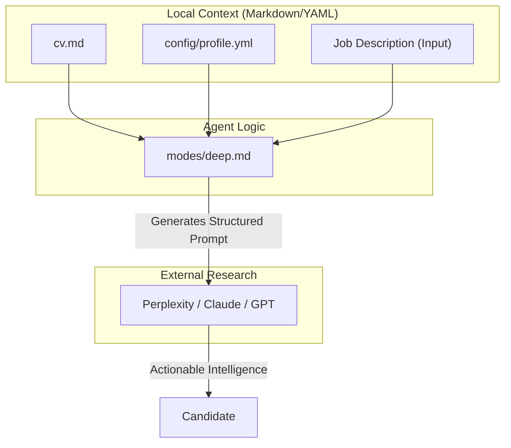
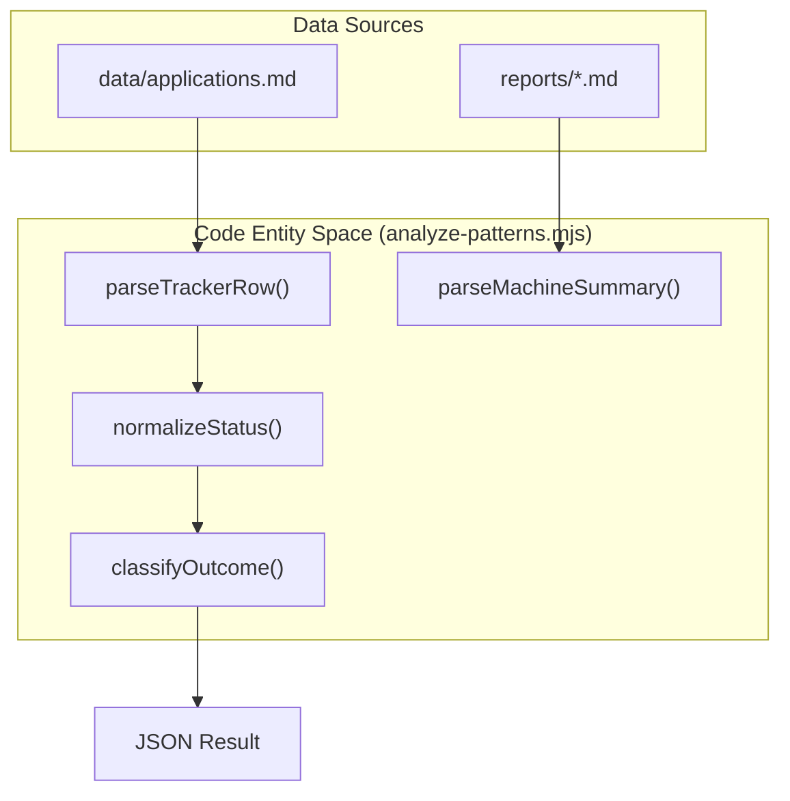
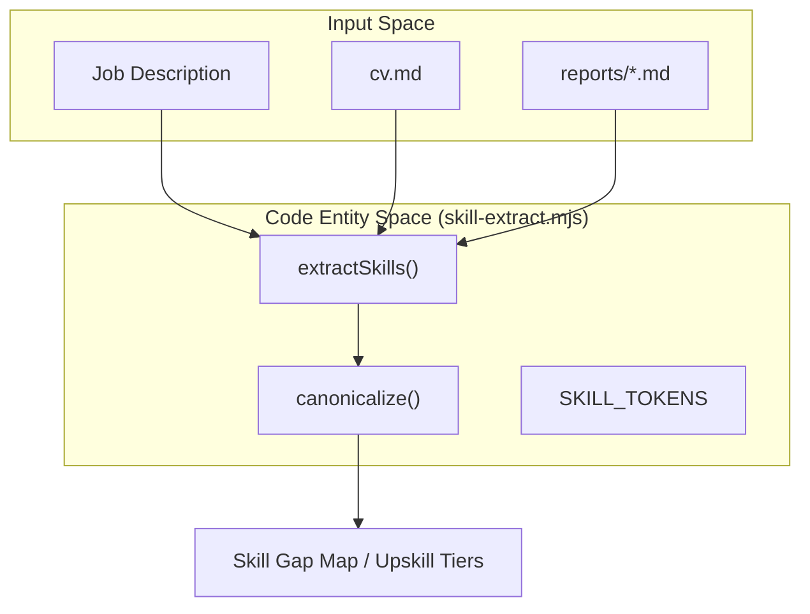

<!-- source: DeepWiki mcp.deepwiki.com · repo santifer/career-ops · page 2.4 Career Development Modes (deep, training, project, patterns, upskill, titles, add) · fetched 2026-10-27 -->

# Career Development Modes (deep, training, project, patterns, upskill, titles, add)

Relevant source files

The following files were used as context for generating this wiki page:

- [analyze-patterns.mjs](analyze-patterns.mjs)
- [batch/batch-prompt.md](batch/batch-prompt.md)
- [jd-skill-gap.mjs](jd-skill-gap.mjs)
- [match-star.mjs](match-star.mjs)
- [modes/auto-pipeline.md](modes/auto-pipeline.md)
- [modes/followup.md](modes/followup.md)
- [modes/oferta.md](modes/oferta.md)
- [modes/patterns.md](modes/patterns.md)
- [modes/tracker.md](modes/tracker.md)
- [modes/training.md](modes/training.md)
- [skill-extract.mjs](skill-extract.mjs)
- [tests/jd-skill-gap-json-output.test.mjs](tests/jd-skill-gap-json-output.test.mjs)
- [tests/skill-extract.test.mjs](tests/skill-extract.test.mjs)
- [tests/upskill-known-skills.test.mjs](tests/upskill-known-skills.test.mjs)
- [tests/upskill-targeted-input.test.mjs](tests/upskill-targeted-input.test.mjs)
- [upskill.mjs](upskill.mjs)

This section details the auxiliary career development modes within the `modes/` directory. While core evaluation modes focus on job offers, these modes assist the candidate in preparing for interviews, evaluating professional development opportunities, scoring side projects, performing skill-gap analysis, and conducting high-level meta-analysis of their job search performance using specialized scripts.

## Overview of Development Modes

The development modes provide a structured framework for long-term career growth and short-term interview success. They leverage the candidate's profile and CV to provide personalized advice and data-driven insights. These modes are invoked via the `/career-ops {mode}` command structure.

| Mode | File | Purpose |
|:---|:---|:---|
| `deep` | [modes/deep.md:1-1]() | Generates a deep research prompt for company intelligence. |
| `training` | [modes/training.md:1-1]() | Evaluates the ROI of courses, certifications, and training. |
| `project` | [modes/project.md:1-1]() | Scores side project ideas based on hiring signal and feasibility. |
| `patterns` | [modes/patterns.md:1-1]() | Analyzes rejection patterns and conversion funnels via `analyze-patterns.mjs`. |
| `upskill` | [upskill.mjs:3-9]() | Aggregates skill gaps from all reports to create a weighted gap map. |
| `titles` | [SKILL.md:33-33]() | Suggests adjacent job titles based on the candidate's archetypes. |
| `add` | [SKILL.md:34-34]() | Assistant for adding projects, papers, or roles to `cv.md`. |

**Sources:** [modes/deep.md:1-1](), [modes/training.md:1-1](), [modes/project.md:1-1](), [modes/patterns.md:1-1](), [upskill.mjs:3-9](), [.claude/skills/career-ops/SKILL.md:13-39]()

---

## Deep Research Mode (`deep.md`)

The `deep` mode generates a structured, multi-dimensional prompt designed for use with high-reasoning LLMs (Perplexity, Claude, or ChatGPT) to perform company intelligence gathering before an interview [modes/deep.md:3-5](). It is explicitly bounded to prevent open-ended research during standard evaluations, recommending this mode as a separate follow-up [modes/oferta.md:40-41]().

### Research Dimensions
The generated prompt covers six critical axes to ensure the candidate is better informed than the average applicant:

1.  **AI Strategy**: Analysis of the company's AI stack, engineering blog, and published research [modes/deep.md:10-14]().
2.  **Recent Moves**: Tracking funding, leadership changes, and product launches from the last 6 months [modes/deep.md:16-20]().
3.  **Engineering Culture**: Technical specifics like deployment cadence, repository structure (mono vs. multi), and remote-work policies [modes/deep.md:22-27]().
4.  **Likely Challenges**: Identifying potential pain points in reliability, cost, or latency mentioned in reviews [modes/deep.md:29-33]().
5.  **Competitors and Differentiation**: Understanding the company's differentiation and market positioning [modes/deep.md:35-38]().
6.  **Candidate Angle**: Personalized mapping of the candidate's `cv.md` and `profile.yml` to the company's specific needs [modes/deep.md:40-44]().

**Deep Research Prompt Synthesis**

**Sources:** [modes/deep.md:1-48](), [modes/oferta.md:40-41](), [.claude/skills/career-ops/SKILL.md:82-94]()

---

## Training Evaluation Mode (`training.md`)

The `training` mode assesses professional development opportunities. It prevents "tutorial hell" by forcing an evaluation of opportunity cost and recruiter signal [modes/training.md:3-12]().

### Evaluation Dimensions
Every training request is scored across six dimensions:
*   **North Star Alignment**: Does this move the candidate closer to their target goal? [modes/training.md:7-7]()
*   **Recruiter Signal**: What is the perceived value to a Hiring Manager? [modes/training.md:8-8]()
*   **Time and Effort**: Assessment of hours required per week [modes/training.md:9-9]().
*   **Opportunity Cost**: What else could be done during that time? [modes/training.md:10-10]()
*   **Risks**: Outdated content or weak brand [modes/training.md:11-11]().
*   **Portfolio Deliverable**: Does the course result in a demonstrable artifact? [modes/training.md:12-12]()

**Sources:** [modes/training.md:1-27]()

---

## Pattern Analysis Mode (`patterns.md`)

The `patterns` mode uses the `analyze-patterns.mjs` script to identify systemic issues in the candidate's application strategy [modes/patterns.md:1-5](). It requires at least 5 tracked applications with outcomes beyond "Evaluated" to run [modes/patterns.md:17-20]().

### Technical Implementation
The analysis logic is encapsulated in `analyze-patterns.mjs`, which parses the application tracker and associated report files [analyze-patterns.mjs:3-7]().

1.  **Data Ingestion**: `parseTrackerRow()` (imported from `tracker-parse.mjs`) reads `data/applications.md` [analyze-patterns.mjs:20-20]().
2.  **Report Parsing**: `parseMachineSummary()` extracts the `## Machine Summary` block from individual Markdown files in the `reports/` directory [analyze-patterns.mjs:161-170]().
3.  **Outcome Classification**: Statuses are normalized and classified into `positive`, `negative`, `self_filtered`, or `pending` via `classifyOutcome()` [analyze-patterns.mjs:101-109]().
4.  **Channel Yield**: Performs `vendorAnalysis` (ATS detection) and `viaChannelAnalysis` (recruiter/agency yield) [analyze-patterns.mjs:57-93]().

**Rejection Pattern Analysis Pipeline**

**Sources:** [modes/patterns.md:1-155](), [analyze-patterns.mjs:1-110]()

---

## Upskill & Skill Gap Analysis

The system provides two complementary methods for identifying skill gaps: a zero-LLM regex approach for individual JDs and an aggregate analyzer for the entire tracker.

### Aggregate Upskill Mode (`upskill.mjs`)
`upskill.mjs` extracts skill tokens from every linked evaluation report's gaps (Hard Stops and Soft Gaps) [upskill.mjs:5-6](). It weights gaps by the inverse of the report score: a 2.1/5 report contributes more weight to a gap than a 4.5/5 report [upskill.mjs:10-11]().

*   **Suppression Logic**: It removes any skills already present in `cv.md` or `config/profile.yml` [upskill.mjs:7-8]().
*   **Canonicalization**: Uses a shared `skill-extract.mjs` to ensure "k8s" and "Kubernetes" are treated as the same entity [skill-extract.mjs:3-9]().
*   **YAML Hygiene**: `yamlValueText()` strips comments from YAML config files before extraction to prevent commented-out skills (e.g., `# not using Kubernetes`) from being registered as "known" [upskill.mjs:143-151]().

### Individual JD Skill Gap (`jd-skill-gap.mjs`)
For a single JD, this script performs a zero-LLM classification of requirements into three buckets [jd-skill-gap.mjs:4-8]():
1.  **Existing**: Named skill in `cv.md`'s Skills section.
2.  **SupportedByResume**: Appears in prose elsewhere in `cv.md`.
3.  **Gap**: Required by JD but no trace in `cv.md`.

**Skill Extraction and Mapping**

**Sources:** [upskill.mjs:1-110](), [jd-skill-gap.mjs:1-30](), [skill-extract.mjs:1-40](), [tests/skill-extract.test.mjs:1-50]()

---

## Interview Story Matching (`match-star.mjs`)

The `add` mode helps users populate `interview-prep/story-bank.md`, which is then utilized by `match-star.mjs`. This script performs a zero-LLM, zero-browser match of behavioral questions against the candidate's STAR stories [match-star.mjs:4-8]().

*   **Parsing**: `parseStories()` converts the Markdown story bank into structured objects [match-star.mjs:47-50]().
*   **Scoring**: Stories are scored based on tag matches (highest weight), title/theme matches, and body content overlap [match-star.mjs:125-159]().
*   **Formatting**: Returns matches formatted to ATS-ready prose (250–500 words) [match-star.mjs:169-180]().

**Sources:** [match-star.mjs:1-195](), [.claude/skills/career-ops/SKILL.md:34-34]()

---

