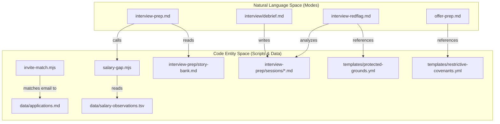
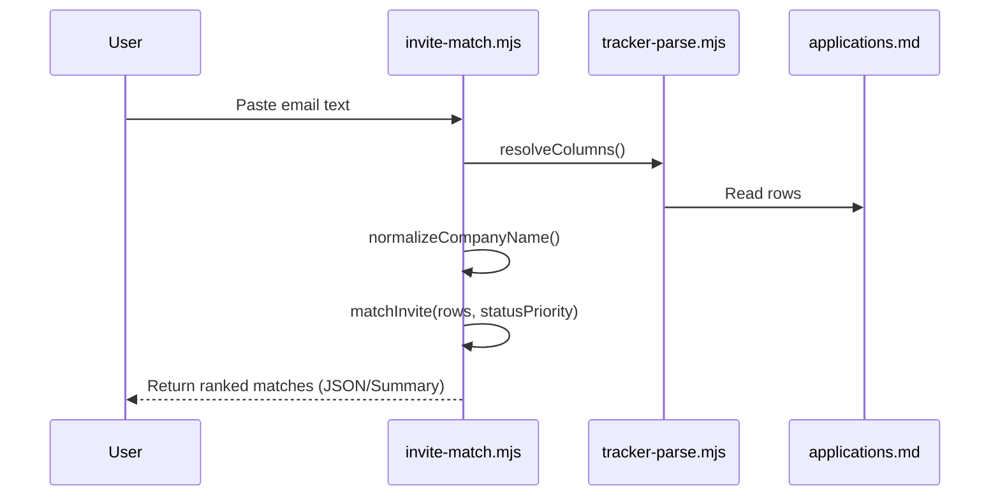

<!-- source: DeepWiki mcp.deepwiki.com · repo santifer/career-ops · page 2.5 Interview & Offer Modes (interview-prep, interview-redflag, offer-prep) · fetched 2026-10-27 -->

# 2.5 Interview & Offer Modes (interview-prep, interview-redflag, offer-prep)

Relevant source files

The following files were used as context for generating this wiki page:

- [invite-match.mjs](invite-match.mjs)
- [invite-match.test.mjs](invite-match.test.mjs)
- [modes/README.md](modes/README.md)
- [modes/_profile.template.md](modes/_profile.template.md)
- [modes/add.md](modes/add.md)
- [modes/fr/README.md](modes/fr/README.md)
- [modes/interview-prep.md](modes/interview-prep.md)
- [modes/interview-redflag.md](modes/interview-redflag.md)
- [modes/interview/debrief.md](modes/interview/debrief.md)
- [modes/interview/plan.md](modes/interview/plan.md)
- [modes/offer-prep.md](modes/offer-prep.md)
- [modes/outcome.md](modes/outcome.md)
- [modes/pdf/hm-audit.md](modes/pdf/hm-audit.md)
- [modes/upskill.md](modes/upskill.md)
- [salary-gap.mjs](salary-gap.mjs)
- [templates/protected-grounds.yml](templates/protected-grounds.yml)
- [templates/restrictive-covenants.yml](templates/restrictive-covenants.yml)
- [validate-untrusted-content-coverage.mjs](validate-untrusted-content-coverage.mjs)

This section covers the specialized AI agent modes and supporting scripts used during the final stages of the hiring funnel: preparing for specific interview rounds, identifying organizational red flags from session transcripts, and analyzing employment contracts.

## System Topology: Interview & Offer Stage

The following diagram illustrates the relationship between the AI modes (Markdown instructions) and the data entities they consume or produce.

### Entity Relationship Diagram

**Sources:** [modes/interview-prep.md:9-15](), [modes/interview-redflag.md:15-18](), [modes/offer-prep.md:33-35](), [salary-gap.mjs:8-11](), [invite-match.mjs:5-10]()

---

## Interview Preparation (interview-prep)

The `interview-prep` mode is triggered when an application moves to the `Interview` status or when a user explicitly requests preparation for a specific company and role [modes/interview-prep.md:3]().

### Intelligence Gathering
The mode performs structured research across several vectors:
1.  **Compensation Research:** Queries `levels.fyi` and `Glassdoor` to extract base, equity, and bonus ranges [modes/interview-prep.md:78-80]().
2.  **Process Mapping:** Identifies common screening questions and recruiter behavior from community reviews [modes/interview-prep.md:79]().
3.  **Hiring Manager (HM) Audit:** Reuses the `## HM Audit` section from previous evaluation reports to understand the reviewer persona [modes/interview-prep.md:15]().
4.  **Story Mapping:** Cross-references the `story-bank.md` to map the candidate's STAR+R stories to the specific role requirements [modes/interview-prep.md:9]().

### Prior Stated Compensation
A critical feature of this mode is the integration with `salary-gap.mjs`. It runs `node salary-gap.mjs --stated-for <tracker#>` to retrieve any compensation figures the candidate has already committed to in earlier rounds [modes/interview-prep.md:14](). This prevents accidental contradictions in later-stage negotiations.

**Sources:** [modes/interview-prep.md:1-85](), [salary-gap.mjs:18-23]()

---

## Interview Red-Flag Detector (interview-redflag)

This mode analyzes the **interviewer's side** of session transcripts to surface structural risks before a candidate accepts an offer [modes/interview-redflag.md:3-5]().

### Signal Taxonomy
The agent looks for four primary behavioral signals in transcripts stored in `interview-prep/sessions/`:

| Signal | Indicator |
| :--- | :--- |
| **Scope Ambiguity** | Questions with no measurable criteria or circular role definitions [modes/interview-redflag.md:68](). |
| **Defensive Closure** | Interviewer cuts off technically superior answers or ends sessions abruptly [modes/interview-redflag.md:69](). |
| **Evaluator Competency Gap** | Interviewer cannot engage with domain-correct answers or pivots due to unfamiliarity [modes/interview-redflag.md:70](). |
| **Process Signals** | Contradictory criteria across different interviewers in the same loop [modes/interview-redflag.md:71](). |

### Legal & Protected Grounds
The mode utilizes `templates/protected-grounds.yml` to detect questions that may be legally problematic based on the candidate's jurisdiction (e.g., race, religion, age, or pregnancy status) [modes/interview-redflag.md:18](). This is a local data lookup; the agent identifies matches against example patterns like *"Where are you really from?"* or *"What is your Social Insurance Number?"* [templates/protected-grounds.yml:79-88]().

**Sources:** [modes/interview-redflag.md:58-74](), [templates/protected-grounds.yml:71-123]()

---

## Offer Preparation (offer-prep)

The `offer-prep` mode acts as a "Contract Reading Companion." It is designed to prepare a candidate for a decision or a meeting with a lawyer, but it is explicitly forbidden from providing legal advice or severity ratings [modes/offer-prep.md:11-16]().

### Execution Logic
1.  **Intake Gate:** Quotes back section headings to ensure the OCR/text extraction was successful [modes/offer-prep.md:81-85]().
2.  **Promises Intake:** Asks the candidate for verbal or email promises to compare against the written contract [modes/offer-prep.md:93-97]().
3.  **Restrictive Covenants:** References `templates/restrictive-covenants.yml` to provide statutory context for non-compete and non-solicitation clauses without stating enforceability [modes/offer-prep.md:33-43]().
4.  **Hard Guards:** The mode is prohibited from online research during this phase to protect PII (Personally Identifiable Information) and contract confidentiality [modes/offer-prep.md:28-30]().

**Sources:** [modes/offer-prep.md:23-55](), [modes/offer-prep.md:74-107]()

---

## Supporting Scripts

### invite-match.mjs
This script solves the problem of generic recruiter emails (e.g., "Schedule Your Phone Screen") that lack job titles or req IDs.

*   **Implementation:** It fuzzy-matches company names from pasted text against `data/applications.md` [invite-match.mjs:12-14]().
*   **Disambiguation:** If multiple applications exist for one company, it ranks them using `STATUS_PRIORITY`. `Interview` status outranks `Applied`, which outranks `Rejected` [invite-match.mjs:121-130]().
*   **Platform Detection:** It extracts meeting platforms (Zoom, Teams, Meet) or phone numbers from the invite text [invite-match.test.mjs:98-108]().

### salary-gap.mjs
A compensation analyzer that folds multiple data sources into a single view of "Desired vs. Advertised vs. Actual" pay.

*   **Data Flow:**
    1.  Reads `advertised_comp` from evaluation reports [salary-gap.mjs:9]().
    2.  Reads `target_range` from `profile.yml` [salary-gap.mjs:11]().
    3.  Appends user-reported observations from `data/salary-observations.tsv` [salary-gap.mjs:10]().
*   **Trust Tiers:** It uses a hierarchy to resolve conflicts (e.g., for `actual` pay, a `contract` source outranks a `recruiter-verbal` source) [salary-gap.mjs:45-49]().

### Logic Flow: Invite to Tracker

**Sources:** [invite-match.mjs:40](), [invite-match.mjs:121-130](), [invite-match.mjs:143-146]()

---

