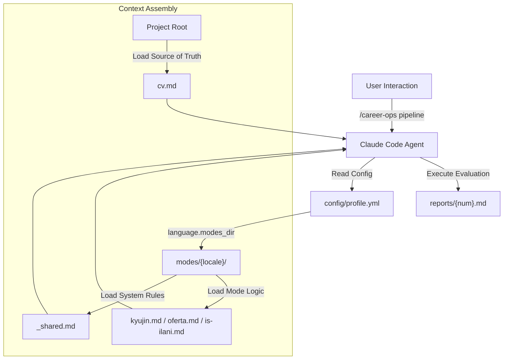
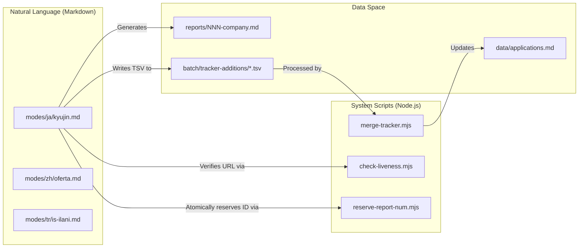

<!-- source: DeepWiki mcp.deepwiki.com · repo santifer/career-ops · page 2.6 Internationalization (i18n Modes) · fetched 2026-10-27 -->

# Internationalization (i18n Modes)

Relevant source files

The following files were used as context for generating this wiki page:

- [modes/ar/fursah.md](modes/ar/fursah.md)
- [modes/ja/README.md](modes/ja/README.md)
- [modes/ja/_shared.md](modes/ja/_shared.md)
- [modes/ja/kyujin.md](modes/ja/kyujin.md)
- [modes/ja/oubo.md](modes/ja/oubo.md)
- [modes/ja/pipeline.md](modes/ja/pipeline.md)
- [modes/tr/is-ilani.md](modes/tr/is-ilani.md)
- [modes/zh-TW/README.md](modes/zh-TW/README.md)
- [modes/zh-TW/_shared.md](modes/zh-TW/_shared.md)
- [modes/zh-TW/apply.md](modes/zh-TW/apply.md)
- [modes/zh-TW/oferta.md](modes/zh-TW/oferta.md)
- [modes/zh/README.md](modes/zh/README.md)
- [modes/zh/_shared.md](modes/zh/_shared.md)
- [modes/zh/apply.md](modes/zh/apply.md)
- [modes/zh/oferta.md](modes/zh/oferta.md)

The `career-ops` system provides localized agent behaviors through the `modes/` subdirectories. These internationalization (i18n) modes adapt the core evaluation and application logic to specific regional job markets, legal frameworks, and linguistic conventions. Instead of a simple translation, each locale modifies the **Evaluation (A-G)** and **Application** workflows to account for regional compensation structures (e.g., Polish ZUS/B2B, Turkish SGK, Japanese Seishain vs. Gyomu Itaku), employment types, and cultural interviewing norms.

## Implementation Architecture

The i18n system functions as a set of specialized "skills" that the AI agent loads based on user configuration. While core scripts like `merge-tracker.mjs` remain language-agnostic, the prompts that drive the AI's decision-making are swapped for localized versions.

### Localized Mode Mapping

| Locale | Directory | Key Mode File (Evaluation) | Key Mode File (Application) | Market Focus |
| :--- | :--- | :--- | :--- | :--- |
| **Japanese** | `modes/ja/` | `kyujin.md` | `oubo.md` | Japan (Wantedly, Green, BizReach) |
| **Chinese** | `modes/zh/` | `oferta.md` | `apply.md` | China (BOSS直聘, Lagou) |
| **Turkish** | `modes/tr/` | `is-ilani.md` | `basvuru.md` | Turkey (Kariyer.net, Secretcv) |
| **Arabic** | `modes/ar/` | `fursah.md` | `apply.md` | MENA Market (LinkedIn, Local Portals) |
| **Polish** | `modes/pl/` | `oferta.md` | `aplikuj.md` | Poland (Pracuj.pl, No Fluff Jobs) |
| **Portuguese** | `modes/pt/` | `oferta.md` | `aplicar.md` | Brazil (Gupy, Greenhouse BR) |
| **French** | `modes/fr/` | `offre.md` | `postuler.md` | France / Francophone markets |
| **German** | `modes/de/` | `angebot.md` | `bewerben.md` | DACH (Xing, LinkedIn DE) |

Sources: [modes/ja/README.md:48-57](), [modes/zh/README.md:42-47](), [modes/tr/is-ilani.md:1-3](), [modes/ar/fursah.md:1-3]()

### System Data Flow: Locale Activation

The system resolves the active mode directory through a hierarchy of configuration. Users can set a permanent locale in `config/profile.yml` or trigger it per session via natural language instructions to the agent.

**Title: Mode Selection and Context Injection**

Sources: [modes/ja/README.md:32-42](), [modes/zh/README.md:18-36](), [modes/tr/is-ilani.md:100-104]()

---

## Market-Specific Adaptations

### 1. Japanese Market (modes/ja/)
The Japanese modes focus on the rigid distinction between permanent employment and contracting, as well as specific allowance structures.

*   **Employment Types**: Differentiates between **Seishain (正社員)** and **Gyomu Itaku (業務委託)**, calculating equivalent compensation by accounting for social insurance and bonuses [modes/ja/_shared.md:101-102]().
*   **Allowance Evaluation**: Analyzes **Minashi Zangyo** (fixed overtime), **36 Kyotei** (overtime limits), **Tsukin Teate** (commuting), and **Jutaku Teate** (housing) [modes/ja/_shared.md:105-110]().
*   **Evaluation Structure**: Extends to 7 blocks (A-G), including a **Liveness Gate** that uses Playwright to verify URLs before consuming tokens [modes/ja/kyujin.md:5-16]().

### 2. Chinese Market (modes/zh/)
The Chinese modes prioritize "Legitimacy" (Block G) to filter out "Ghost Jobs" and handle specific social welfare structures.

*   **Legitimacy (Block G)**: Analyzes activity signals on platforms like BOSS直聘 (e.g., "Active Today") and detects "Ghost Jobs" based on 90-day history in `scan-history.tsv` [modes/zh/oferta.md:155-169]().
*   **Social Welfare**: Evaluates **Five Insurances and One Fund** (五险一金), 13th-month pay, and probation salary rules (minimum 80% of contract) [modes/zh/_shared.md:111-115]().
*   **Risk Summary**: Aggregates culture signals, employment classification, and interview red flags into a machine-readable `risk_summary` table [modes/zh/oferta.md:177-195]().

### 3. Turkish Market (modes/tr/)
The Turkish modes adapt to the local compensation and inflation-adjusted landscape.

*   **Compensation**: Evaluates Net vs. Gross (Net/Brüt) and checks for **TÜFE** (CPI) based annual raise guarantees [modes/tr/is-ilani.md:56-60]().
*   **Portal Integration**: Optimized for `Kariyer.net`, `Secretcv.com`, and `LinkedIn TR` [modes/tr/is-ilani.md:50-52]().

### 4. Arabic Market (modes/ar/)
The Arabic modes focus on deep "Archetype Detection" and STAR+R storytelling adapted for the MENA region.

*   **Archetype Detection**: Classifies roles into FDE, SA, PM, LLMOps, Agentic, or Transformation roles to prioritize specific proof points [modes/ar/fursah.md:7-12]().
*   **STAR+R Methodology**: Adds a **Reflection** component to STAR stories to signal seniority, distinguishing between junior (process-oriented) and senior (lesson-oriented) candidates [modes/ar/fursah.md:84-90]().

---

## Technical Configuration & Rules

### The _shared.md Contract
Every locale directory contains a `_shared.md` file. This is a system-level file that the agent **must** read before any evaluation. It defines:
1.  **Archetype Signals**: Localized keywords for role detection (e.g., "HITL" for Agentic roles) [modes/ja/_shared.md:86-91](), [modes/zh/_shared.md:92-99]().
2.  **Scoring Interpretation**: Market-specific salary quartiles (Comp) and culture signals [modes/ja/_shared.md:37-50]().
3.  **Source of Truth Boundary**: Enforces strict reading of `cv.md` and `article-digest.md` while forbidding the fabrication of metrics [modes/ja/_shared.md:11-28]().

### Localized Evaluation Block Structure (A-G)
Regardless of language, the modes maintain the canonical structure to ensure compatibility with the dashboard and `merge-tracker.mjs`.

| Block | Japanese (`kyujin.md`) | Chinese (`oferta.md`) | Purpose |
| :--- | :--- | :--- | :--- |
| **A** | Role Summary | 岗位概览 | Role Summary & Metadata |
| **B** | Match with CV | 简历匹配分析 | Skill alignment & gap analysis |
| **C** | Level and Strategy | 级别判断与求职策略 | Seniority positioning |
| **D** | Comp and Demand | 薪酬竞争力与市场需求 | Market rate benchmarking |
| **E** | Customization Plan | 针对性定制方案 | CV/LinkedIn update plan |
| **F** | Interview Plan | 面试备考计划 | STAR+R story mapping |
| **G** | Posting Legitimacy | 职位真实性评估 | Legitimacy & Ghost job check |

Sources: [modes/ja/kyujin.md:25-111](), [modes/zh/oferta.md:13-176]()

### Entity Mapping: Mode Files to Logic

**Title: Natural Language Space to Code Entity Mapping**

Sources: [modes/ja/kyujin.md:104-106](), [modes/ja/pipeline.md:9-13](), [modes/tr/is-ilani.md:157-169]()

## Usage Guidelines for Technical Contributors

1.  **Linguistic Consistency**: Modes use "Natural Technical Language." Commands and tool names (e.g., `Playwright`, `WebSearch`, `WebFetch`, `Read`, `Write`) must **never** be translated [modes/ja/README.md:61-68]().
2.  **TSV Data Integrity**: Even in localized modes, the `merge-tracker.mjs` script expects status values in English (e.g., `Evaluated`, `Applied`, `Interview`, `Offer`, `Rejected`) to maintain dashboard compatibility [modes/ja/README.md:67-67](), [modes/tr/is-ilani.md:164-164]().
3.  **Atomic Numbering**: Localized pipeline and evaluation modes must use `reserve-report-num.mjs` to allocate `REPORT_NUM` to prevent race conditions during parallel processing [modes/ja/pipeline.md:23-23](), [modes/tr/is-ilani.md:104-104]().
4.  **Liveness Sweeps**: Localized `pipeline.md` implementations must run `check-liveness.mjs` in bulk to drop expired postings before starting token-heavy evaluations [modes/ja/pipeline.md:7-17]().

Sources: [modes/ja/README.md:1-114](), [modes/zh/README.md:1-65](), [modes/tr/is-ilani.md:1-190](), [modes/ar/fursah.md:1-140]()

---

