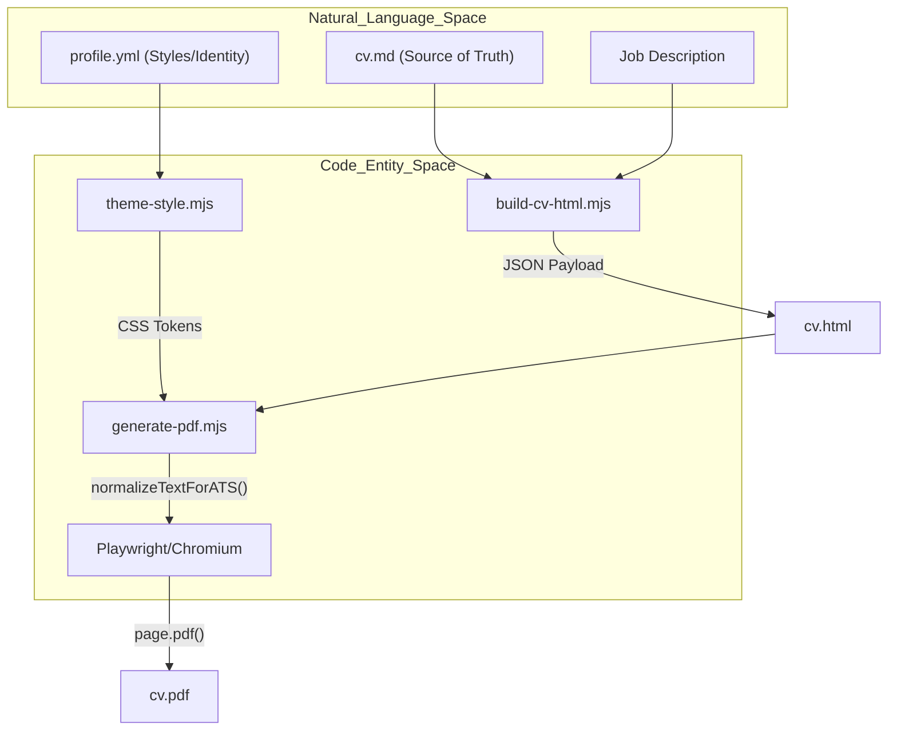
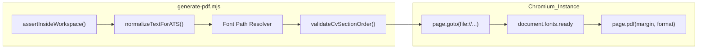

<!-- source: DeepWiki mcp.deepwiki.com · repo santifer/career-ops · page 3.2 generate-pdf.mjs Script · fetched 2026-10-27 -->

# generate-pdf.mjs Script

<details>
<summary>Relevant source files</summary>

The following files were used as context for generating this wiki page:

- [.npmignore](.npmignore)
- [build-cv-html.mjs](build-cv-html.mjs)
- [build-cv-latex.mjs](build-cv-latex.mjs)
- [config/profile.example.yml](config/profile.example.yml)
- [generate-pdf.mjs](generate-pdf.mjs)
- [modes/_shared.md](modes/_shared.md)
- [modes/pdf.md](modes/pdf.md)
- [templates/cv-template.html](templates/cv-template.html)
- [tests/cv-dollar-pattern.test.mjs](tests/cv-dollar-pattern.test.mjs)
- [tests/cv-numeric-scalars.test.mjs](tests/cv-numeric-scalars.test.mjs)
- [tests/cv-partial-empty-fallbacks.test.mjs](tests/cv-partial-empty-fallbacks.test.mjs)
- [tests/cv-section-order.test.mjs](tests/cv-section-order.test.mjs)
- [tests/generate-pdf-batch.test.mjs](tests/generate-pdf-batch.test.mjs)
- [tests/generate-pdf-font-cache.test.mjs](tests/generate-pdf-font-cache.test.mjs)
- [tests/generate-pdf-page-budget.test.mjs](tests/generate-pdf-page-budget.test.mjs)
- [tests/helpers.mjs](tests/helpers.mjs)
- [tests/hermetic-git-env.test.mjs](tests/hermetic-git-env.test.mjs)
- [tests/theme-style-dollar-pattern.test.mjs](tests/theme-style-dollar-pattern.test.mjs)
- [tests/theme-style.test.mjs](tests/theme-style.test.mjs)
- [tests/user-layer-gitignored.test.mjs](tests/user-layer-gitignored.test.mjs)
- [theme-style.mjs](theme-style.mjs)

</details>


The `generate-pdf.mjs` script is the core rendering engine of the Career-Ops pipeline. It transforms tailored HTML CVs and resumes into ATS-optimized PDF documents using Playwright and headless Chromium. The script handles complex layout requirements, dynamic theming, Unicode normalization for legacy Applicant Tracking Systems (ATS), and strict workspace security boundaries.

## Overview and CLI Usage

The script is invoked by the `pdf` agent mode [modes/pdf.md:43-43]() or as part of the `batch-runner.sh` orchestrator. It supports both single-file rendering and a high-performance batch manifest mode.

**Command Syntax:**
```bash
node generate-pdf.mjs <input.html> <output.pdf> [--format=letter|a4] [--report=NNN] [--max-pages=N] [--strict-pages]
node generate-pdf.mjs --batch=<manifest.json> [--format=letter|a4]
```

### Key CLI Flags
*   **`--batch`**: Renders multiple documents through a single shared Chromium instance to reduce overhead [generate-pdf.mjs:10-14]().
*   **`--report`**: Links the PDF to a specific tracker entry in `data/pdf-index.tsv` [generate-pdf.mjs:16-19]().
*   **`--max-pages`**: Sets the preferred page limit (default: 2). Overflow triggers a warning or rejection [generate-pdf.mjs:27-30]().
*   **`--template`**: Selects a specific HTML variant (e.g., `resume`, `compact`, `modern`) [generate-pdf.mjs:43-43]().

**Sources:** [generate-pdf.mjs:1-34]()

## Core Systems

### ATS Unicode Normalization
The `normalizeTextForATS` function is a security and compatibility layer that sanitizes HTML content before rendering [generate-pdf.mjs:106-116](). It targets "mojibake" issues caused by legacy ATS parsers failing on modern Unicode characters.

*   **Masking**: The script uses a `MASK` token system to protect `<style>` and `<script>` blocks, ensuring normalization only affects visible body text [generate-pdf.mjs:120-142]().
*   **Sanitization**: It replaces em-dashes (`\u2014`) with hyphens, converts "smart" quotes to straight quotes, and strips zero-width characters [generate-pdf.mjs:148-153]().
*   **Currency Expansion**: Unambiguous symbols like `€` and `£` are converted to `EUR` and `GBP` to prevent font-subsetting display errors [generate-pdf.mjs:167-168]().

### Dynamic Theming System
The script integrates with `theme-style.mjs` to inject user-defined styles from `config/profile.yml` into the HTML template [generate-pdf.mjs:42-42]().

*   **Token Resolution**: `readStyleTokens` extracts `accent_color`, `font_family`, `font_size`, and `margin` from the YAML profile [theme-style.mjs:18-35]().
*   **Injection**: `injectThemeStyle` prepends a `<style id="career-ops-dynamic-theme">` block to the document head, overriding the template's CSS variables [theme-style.mjs:83-102]().

### Workspace Security & Path Resolution
To prevent SSRF or unauthorized file access, the script implements `assertInsideWorkspace` [generate-pdf.mjs:72-101]().
*   **Canonicalization**: It uses `realpathSync` to resolve symlinks before comparing paths against the `__workspaceRoot` [generate-pdf.mjs:54-54]().
*   **Font Inlining**: Because Chromium headless cannot resolve relative paths without a server, the script transforms font URLs into absolute `file://` paths [generate-pdf.mjs:218-227]().

**Sources:** [generate-pdf.mjs:106-168](), [theme-style.mjs:1-102](), [tracker-utils.mjs:1-50]()

## Implementation Data Flow

The following diagrams bridge the gap between the user's Markdown content and the final rendered PDF entity.

### CV Generation Pipeline

**Sources:** [build-cv-html.mjs:3-12](), [generate-pdf.mjs:36-42](), [modes/pdf.md:14-43]()

### Script Internal Logic

**Sources:** [generate-pdf.mjs:72-270]()

## Advanced Rendering Features

### Section Order Guard
The script prevents AI-generated CVs from accidentally scrambling the professional layout. It compares the header sequence in the rendered HTML against the `cv.md` source [generate-pdf.mjs:153-174](). If the order differs (e.g., Education moved above Experience), the script throws an error unless the `--allow-reorder` flag is present [generate-pdf.mjs:21-25]().

### ATS Typography & Ligature Suppression
The `templates/cv-template.html` includes specific CSS to ensure machine readability:
*   **Ligature Disabling**: `font-variant-ligatures: none` prevents Chromium from merging character pairs like "fi" into a single glyph (U+FB01), which often breaks ATS keyword matching [templates/cv-template.html:35-43]().
*   **System Font Stack**: While visual templates use "Space Grotesk", the base CV template uses a static system sans-serif stack to avoid glyph advance issues in PDF text extractors [templates/cv-template.html:22-29]().

### Page Count Estimation
After rendering, the script performs a binary scan of the resulting PDF to count `/Type /Page` objects [generate-pdf.mjs:269-270](). This provides immediate feedback to the user or the batch runner if a CV has exceeded the target length (typically 1-2 pages) [generate-pdf.mjs:27-30]().

## Technical Reference Table

| Feature | Code Entity / Implementation |
| :--- | :--- |
| **PDF Engine** | `playwright` (Chromium) [generate-pdf.mjs:36-36]() |
| **HTML Builder** | `build-cv-html.mjs` (JSON-to-HTML) [build-cv-html.mjs:1-12]() |
| **Dynamic Style** | `theme-style.mjs` (`injectThemeStyle`) [theme-style.mjs:83-83]() |
| **Unicode Fix** | `normalizeTextForATS` (Regex-based) [generate-pdf.mjs:116-116]() |
| **Workspace Guard** | `assertInsideWorkspace` [generate-pdf.mjs:72-72]() |
| **ATS Formatting** | `font-variant-ligatures: none` [templates/cv-template.html:42-42]() |
| **Paper Sizing** | Letter (8.5in) vs A4 (210mm) [build-cv-html.mjs:40-40]() |

**Sources:** [generate-pdf.mjs:1-280](), [build-cv-html.mjs:1-160](), [templates/cv-template.html:1-100]()

---

