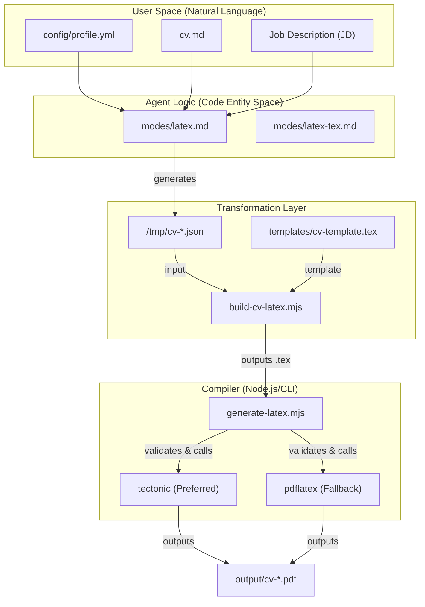
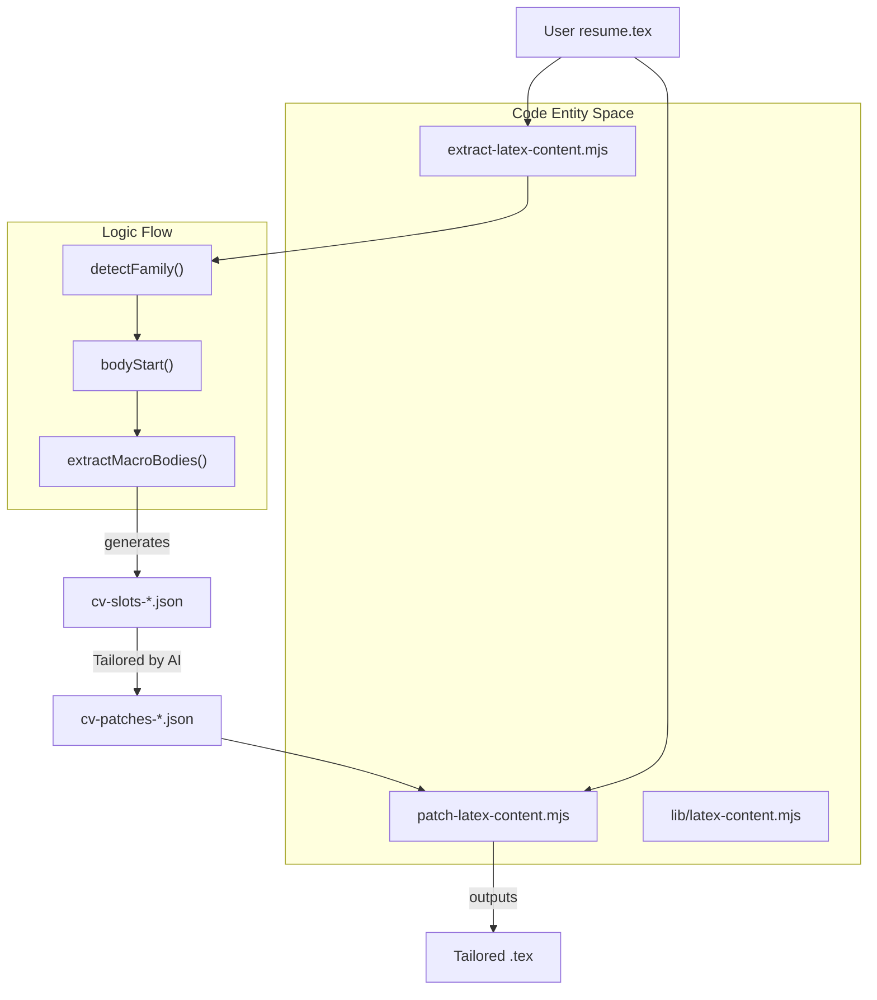

<!-- source: DeepWiki mcp.deepwiki.com · repo santifer/career-ops · page 3.3 LaTeX/Overleaf Export · fetched 2026-10-27 -->

# LaTeX/Overleaf Export

Relevant source files

The following files were used as context for generating this wiki page:

- [cv-sections-core.mjs](cv-sections-core.mjs)
- [examples/latex-tex/README.md](examples/latex-tex/README.md)
- [examples/latex-tex/resume-subheading-withouttitle.tex](examples/latex-tex/resume-subheading-withouttitle.tex)
- [examples/latex-tex/resume-subheading.tex](examples/latex-tex/resume-subheading.tex)
- [examples/latex-tex/tabularx-itemize.tex](examples/latex-tex/tabularx-itemize.tex)
- [extract-latex-content.mjs](extract-latex-content.mjs)
- [generate-latex.mjs](generate-latex.mjs)
- [lib/latex-content.mjs](lib/latex-content.mjs)
- [lib/latex-escape.mjs](lib/latex-escape.mjs)
- [modes/latex-tex.md](modes/latex-tex.md)
- [modes/latex.md](modes/latex.md)
- [templates/README.md](templates/README.md)
- [templates/cv-template.tex](templates/cv-template.tex)
- [templates/resume-template.html](templates/resume-template.html)
- [tests/cv-latex-numeric-scalars.test.mjs](tests/cv-latex-numeric-scalars.test.mjs)
- [tests/cv-named-templates.test.mjs](tests/cv-named-templates.test.mjs)
- [tests/cv-optional-sections.test.mjs](tests/cv-optional-sections.test.mjs)
- [tests/latex-escape.test.mjs](tests/latex-escape.test.mjs)

The LaTeX/Overleaf export path provides a high-fidelity, professional alternative to the standard HTML-to-PDF workflow. It is designed for candidates who require a traditional academic or high-end engineering CV format that is 100% compatible with Overleaf and optimized for ATS (Applicant Tracking Systems) through native Unicode mapping.

### Pipeline Overview

The LaTeX export process is orchestrated via `modes/latex.md` [modes/latex.md:1-22](). It follows a structured sequence that targets `.tex` source generation and specialized LaTeX compilation.

1.  **Context Gathering**: Reads `cv.md` (Source of Truth) and `config/profile.yml` (Identity) [modes/latex.md:7-8]().
2.  **JD Analysis**: Extracts 15-20 keywords and detects the role archetype [modes/latex.md:10-12]().
3.  **Tailored Generation**: Rewrites the Professional Summary and reorders experience bullets/projects based on JD relevance [modes/latex.md:13-16]().
4.  **Payload Construction**: The agent builds a structured JSON payload following a specific schema [modes/latex.md:30-80]().
5.  **Templating**: Executes `build-cv-latex.mjs` to merge the JSON payload into `templates/cv-template.tex`, performing automatic LaTeX escaping [modes/latex.md:18]().
6.  **Validation & Compilation**: Executes `generate-latex.mjs` to verify the structure and compile the PDF using `tectonic` or `pdflatex` [modes/latex.md:19]().

### Data Flow: From Markdown to LaTeX

The following diagram illustrates how the system routes data through the LaTeX workflow.

**LaTeX Export System Topology**

**Sources:** [modes/latex.md:5-20](), [generate-latex.mjs:134-150]()

### The Transformation Engine (`build-cv-latex.mjs`)

Unlike the HTML path which uses direct string replacement, the LaTeX path uses `build-cv-latex.mjs` to handle the complexities of LaTeX syntax and escaping.

#### Automatic Escaping
The `escapeLatex` function in `lib/latex-escape.mjs` sanitizes user-supplied text to prevent compilation breaks [lib/latex-escape.mjs:12-48](). It also handles numeric scalars (e.g., years as integers) to ensure they are not dropped during rendering [tests/cv-latex-numeric-scalars.test.mjs:1-13]().

| Character | LaTeX Escape | Code Reference |
| :--- | :--- | :--- |
| `\` | `\textbackslash{}` | [lib/latex-escape.mjs:26]() |
| `{` or `}` | `\{` or `\}` | [lib/latex-escape.mjs:27]() |
| `_` | `\_` | [lib/latex-escape.mjs:30]() |
| `&` | `\&` | [lib/latex-escape.mjs:31]() |
| `±` | `$\pm$` | [lib/latex-escape.mjs:42]() |
| `→` | `$\rightarrow$` | [lib/latex-escape.mjs:43]() |

**Sources:** [lib/latex-escape.mjs:24-47](), [tests/cv-latex-numeric-scalars.test.mjs:21-32]()

### Template Placeholder System

The `templates/cv-template.tex` file uses double-brace placeholders [templates/cv-template.tex:83-127]().

| Placeholder | Description | Script Mapping |
| :--- | :--- | :--- |
| `{{NAME}}` | Full Candidate Name | `payload.name` |
| `{{CONTACT_LINE}}` | Phone and Location | `payload.contact_line` |
| `{{EMAIL_URL}}` | Sanitized mailto link | `sanitizeUrl(payload.email.url)` |
| `{{EXPERIENCE}}` | Work history blocks | `buildExperience(payload.experience)` |
| `{{PROJECTS}}` | Project blocks | `buildProjects(payload.projects)` |
| `{{SKILLS}}` | Skill category list | `buildSkills(payload.skills)` |

**Optional Sections**: Sections like `AWARDS` or `PROJECTS` are stripped entirely if the payload array is empty, preventing bare headers [cv-sections-core.mjs:4-16](). This uses the `%%%% END %%%%` sentinel to bound the strip [cv-sections-core.mjs:32-50]().

**Sources:** [templates/cv-template.tex:81-133](), [cv-sections-core.mjs:89-107](), [tests/cv-optional-sections.test.mjs:71-81]()

### Compilation & Validation: `generate-latex.mjs`

The `generate-latex.mjs` script acts as a validator and compiler wrapper.

**Validation Logic**:
The `validateLatexContent` function checks for:
*   **Section Count**: Ensures at least 4 `\section{}` blocks exist (Education, Experience, Projects, Skills) [generate-latex.mjs:22, 57-60]().
*   **CJK Detection**: Rejects characters from Japanese, Chinese, or Korean ranges as the `pdfLaTeX` setup lacks CJK font support [generate-latex.mjs:30, 62-64]().
*   **ATS Compatibility**: Verifies `\pdfgentounicode=1` is present [generate-latex.mjs:84-86]().
*   **Unresolved Placeholders**: Scans for any remaining `{{UPPER_CASE}}` strings [generate-latex.mjs:72-75]().

**Engine Selection**:
The script detects available engines on the system `PATH` [generate-latex.mjs:134-147]():
1.  **Tectonic**: Preferred. The script automatically patches the `.tex` file to remove `pdflatex`-specific primitives like `glyphtounicode` that cause Tectonic to crash [generate-latex.mjs:152-158]().
2.  **pdflatex**: Standard fallback. Runs two passes to resolve references [generate-latex.mjs:167-176]().

**Sources:** [generate-latex.mjs:37-96](), [generate-latex.mjs:105-224]()

### In-Place Tailoring (`latex-tex` mode)

For users with existing hand-tuned `.tex` files, `modes/latex-tex.md` allows tailoring prose without changing the template [modes/latex-tex.md:1-9]().

**Supported Families**:
*   `resumeSubheading`: Detects `\resumeSubheading` + `\resumeItem` [lib/latex-content.mjs:47-49]().
*   `tabularx-itemize`: Detects `tabularx` and `itemize` environments [lib/latex-content.mjs:50-54]().

**Extraction and Patching Logic**

**Sources:** [lib/latex-content.mjs:45-56](), [lib/latex-content.mjs:66-69](), [lib/latex-content.mjs:108-146](), [modes/latex-tex.md:35-59]()

### Overleaf Compatibility
The template is designed to be "zero-config" for Overleaf. It utilizes standard CTAN packages such as `titlesec`, `hyperref`, and `fontawesome` [templates/cv-template.tex:9-21](). The generated `.tex` file can be uploaded directly to an Overleaf project and compiled using the default `pdfLaTeX` engine [modes/latex.md:23-28]().

**Sources:** [modes/latex.md:23-28](), [templates/cv-template.tex:1-24]()

---

