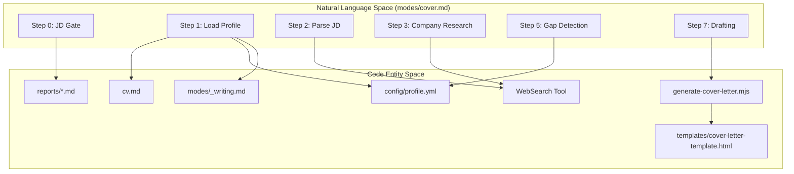
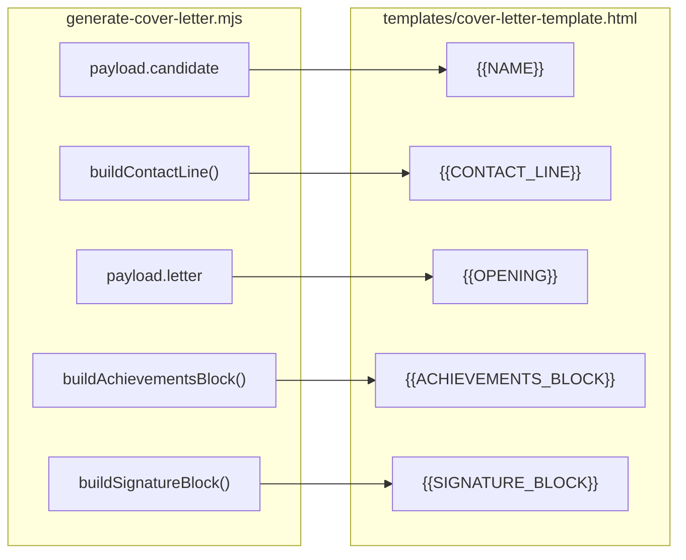

<!-- source: DeepWiki mcp.deepwiki.com · repo santifer/career-ops · page 3.4 Cover Letter Generator · fetched 2026-10-27 -->

# Cover Letter Generator

Relevant source files

The following files were used as context for generating this wiki page:

- [generate-cover-letter.mjs](generate-cover-letter.mjs)
- [modes/_brief.template.md](modes/_brief.template.md)
- [modes/cover.md](modes/cover.md)
- [modes/email.md](modes/email.md)
- [modes/expand.md](modes/expand.md)
- [modes/triage.md](modes/triage.md)
- [templates/cover-letter-template.html](templates/cover-letter-template.html)
- [test/cover-resolver.test.mjs](test/cover-resolver.test.mjs)
- [tests/cover-letter-output-path.test.mjs](tests/cover-letter-output-path.test.mjs)
- [tests/cover-letter-signature.test.mjs](tests/cover-letter-signature.test.mjs)
- [tests/cover-unresolved-placeholders.test.mjs](tests/cover-unresolved-placeholders.test.mjs)

The Cover Letter Generator is a specialized pipeline within `career-ops` designed to produce highly tailored, ATS-optimized, and human-centric cover letters. It bridges the gap between the candidate's core identity (defined in `cv.md` and `profile.yml`) and the specific requirements of a Job Description (JD), while strictly adhering to conversational writing standards that eliminate "AI-slop."

## Generation Pipeline & Modes

The system operates through `modes/cover.md`, which defines the logic for two primary entry points:

1.  **Slug Mode**: Initiated via `/career-ops cover {slug}`. It loads an existing evaluation report from the `reports/` directory, extracting the `## Cover Letter Draft` section as a baseline and fetching the original JD URL for context [modes/cover.md:5-17]().
2.  **Paste Mode**: Initiated via `/career-ops cover` or by pasting a JD directly. This mode starts the generation process from scratch [modes/cover.md:6-6]().

### The JD Gate
A mandatory preflight check, the **JD Gate**, ensures that a valid job description (containing a role title, company name, and responsibilities) is present before any drafting occurs. The system is programmed to refuse the generation of generic or placeholder letters [modes/cover.md:10-22]().

### Data Flow Diagram: Generation Logic
This diagram illustrates the association between the natural language requirements in `modes/cover.md` and the underlying code entities and data sources.

**Cover Letter Data Assembly**

Sources: [modes/cover.md:10-166](), [generate-cover-letter.mjs:1-15]()

## Writing Standards and Guardrails

The generator is governed by shared writing guidance that ensures the output avoids "Dead AI vocabulary" and mechanical structures.

| Rule Source | Role in Cover Letter | Source |
| :--- | :--- | :--- |
| `modes/_writing.md` | Primary guardrail for Voice DNA, style calibration, and ATS rules. | [modes/cover.md:41-41]() |
| `modes/_profile.md` | Candidate-specific overrides for voice, exit narratives, and framing. | [modes/cover.md:43-43]() |
| `voice-dna.md` | Tier 2 conversational writing rules (if present). | [modes/email.md:72-72]() |

### Core Writing Constraints
*   **ATS Optimization**: Headless Chromium ligatures (fi/fl/ffi) are disabled via CSS `font-variant-ligatures: none` to ensure PDF text extractors correctly read keywords [templates/cover-letter-template.html:25-32]().
*   **Gap Management**: The system explicitly prompts the user to address domain mismatches, notice periods, and language requirements rather than auto-fabricating solutions [modes/cover.md:128-154]().
*   **Keyword Mirroring**: The system extracts "ATS-critical" and "Human trust signals" from the JD and mirrors them in the profile intro and achievements [modes/cover.md:87-125]().

Sources: [modes/cover.md:41-44](), [templates/cover-letter-template.html:25-32]()

## Technical Implementation: generate-cover-letter.mjs

The `generate-cover-letter.mjs` script handles the transformation of the AI-generated JSON payload into a finalized PDF. It uses a placeholder replacement system to inject data into `templates/cover-letter-template.html` [generate-cover-letter.mjs:9-15]().

### Key Functions
- `buildHtml(payload, templatePath)`: Reads the HTML template and performs a single-pass substitution. It throws an error if any `{{TOKEN}}` placeholders remain unresolved after processing [generate-cover-letter.mjs:207-266](), [tests/cover-unresolved-placeholders.test.mjs:38-45]().
- `safeOutputPath(raw)`: A security guard that ensures output files are written within the `output/` directory, rejecting path traversal attempts [generate-cover-letter.mjs:38-65](), [tests/cover-letter-output-path.test.mjs:76-83]().
- `buildSignatureBlock(signature, candidateName)`: Handles optional sign-off blocks, supporting both simple strings and objects with custom valedictions and names [generate-cover-letter.mjs:170-184](), [tests/cover-letter-signature.test.mjs:65-75]().
- `resolveCoverTemplatePath(payload, options)`: Resolves which template to use, checking `profile.yml` defaults first before falling back to the base template [test/cover-resolver.test.mjs:23-45]().

### Template Placeholder System
The template uses double-curly-brace tokens (e.g., `{{NAME}}`). The substitution is performed in a way that allows user text to contain token-like sequences without being re-interpreted as placeholders [tests/cover-unresolved-placeholders.test.mjs:47-55]().

**Entity Mapping: Script to Template**

Sources: [generate-cover-letter.mjs:98-184](), [templates/cover-letter-template.html:138-156]()

## Canva Integration

For candidates desiring a design-heavy approach, the system integrates with the **Canva MCP**. This workflow allows the AI to duplicate an existing Canva design and map the cover letter text directly into the design's text elements while enforcing character budget limits to prevent overflow.

## Storage and Output

Generated cover letters are stored in the `output/` directory. The `safeOutputPath` function ensures that application-bundle layouts (e.g., `output/{slug}/cover-letter/v1/`) are preserved while preventing writes outside the root `output/` folder [generate-cover-letter.mjs:38-71](), [tests/cover-letter-output-path.test.mjs:41-54]().

When generated as part of the application flow, the draft is also stored within the corresponding evaluation report in `reports/` under the `## Cover Letter Draft` section [modes/cover.md:17-17]().

Sources: [generate-cover-letter.mjs:38-71](), [modes/cover.md:5-17]()

---

