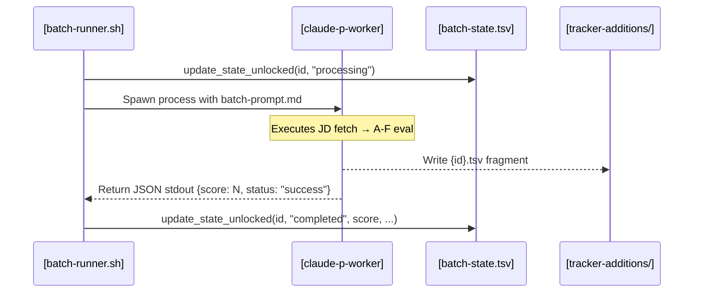

<!-- source: DeepWiki mcp.deepwiki.com · repo santifer/career-ops · page 4.1 batch-runner.sh Orchestrator · fetched 2026-10-27 -->

# batch-runner.sh Orchestrator

<details>
<summary>Relevant source files</summary>

The following files were used as context for generating this wiki page:

- [batch/README.md](batch/README.md)
- [batch/batch-runner.sh](batch/batch-runner.sh)
- [examples/README.md](examples/README.md)
- [examples/cv-example.md](examples/cv-example.md)
- [examples/resume-example.md](examples/resume-example.md)
- [followup-seed.mjs](followup-seed.mjs)
- [modes/batch.md](modes/batch.md)
- [pipeline-lock.mjs](pipeline-lock.mjs)
- [portal-health-lock.mjs](portal-health-lock.mjs)
- [reconcile-pipeline.mjs](reconcile-pipeline.mjs)
- [test/pipeline-lock.test.mjs](test/pipeline-lock.test.mjs)
- [tests/lock-rm-contention.test.mjs](tests/lock-rm-contention.test.mjs)
- [tests/ollama-profile-context.test.mjs](tests/ollama-profile-context.test.mjs)
- [tests/pipeline-lock-mkdir-eperm.test.mjs](tests/pipeline-lock-mkdir-eperm.test.mjs)
- [tests/rename-contention.test.mjs](tests/rename-contention.test.mjs)
- [tests/with-followups-lock.test.mjs](tests/with-followups-lock.test.mjs)
- [tracker-utils.mjs](tracker-utils.mjs)

</details>


The `batch-runner.sh` script is the central orchestrator for high-volume, automated job evaluations. It manages a fleet of `claude -p` workers, providing a robust execution layer that handles parallelization, state persistence, rate-limit management, and automatic recovery from failures. It transforms a list of job URLs into a structured set of evaluations, PDF reports, and tracker entries without manual intervention.

### Core Architecture and Data Flow

The orchestrator operates as a state machine, reading from an input queue and maintaining a persistent state file to ensure idempotency and resumability. It uses a dual-lock mechanism: a global process lock and a fine-grained state lock for thread-safe updates during parallel execution.

#### System Components Interaction
The following diagram illustrates how `batch-runner.sh` coordinates between input files, the Claude CLI, and the final data destinations.

**Orchestrator Logic Flow**
```mermaid
graph TD
    subgraph "Input_Space"
        [batch-input.tsv]
        [batch-prompt.md]
    end

    subgraph "Execution_Engine_batch-runner.sh"
        [acquire_lock]
        [init_state]
        [next_report_num_unlocked]
        [process_offer]
        [update_state_unlocked]
        [handle_rate_limit]
    end

    subgraph "Worker_Space_Claude_CLI"
        [claude-p-worker]
    end

    subgraph "Output_Space"
        [batch/logs/]
        [batch/tracker-additions/]
        [reports/md]
        [output/pdf]
        [batch-state.tsv]
    end

    [batch-input.tsv] --> [process_offer]
    [batch-prompt.md] --> [claude-p-worker]
    [acquire_lock] -- "Prevents collisions" --> [process_offer]
    [process_offer] --> [next_report_num_unlocked]
    [next_report_num_unlocked] -- "Calculates sequence" --> [process_offer]
    [process_offer] --> [claude-p-worker]
    [claude-p-worker] -- "JSON Output" --> [update_state_unlocked]
    [update_state_unlocked] --> [batch-state.tsv]
    [claude-p-worker] --> [batch/logs/]
    [claude-p-worker] --> [batch/tracker-additions/]
    [claude-p-worker] --> [reports/md]
    [claude-p-worker] --> [output/pdf]
    [claude-p-worker] -- "Exit 129/rate-limit" --> [handle_rate_limit]
    [handle_rate_limit] -- "Pause/Retry" --> [process_offer]
```
**Sources:** [batch/batch-runner.sh:13-28](), [batch/batch-runner.sh:144-158](), [batch/batch-runner.sh:293-310](), [batch/batch-runner.sh:401-510](), [batch/batch-runner.sh:543-660]()

---

### CLI Flags and Configuration

The orchestrator supports several flags to control the execution environment and recovery behavior:

| Flag | Default | Description |
| :--- | :--- | :--- |
| `--parallel N` | `1` | Number of concurrent `claude` worker processes. [batch/batch-runner.sh:33]() |
| `--dry-run` | `false` | Lists pending offers without initiating Claude workers. [batch/batch-runner.sh:34]() |
| `--retry-failed` | `false` | Filters the queue to only process IDs marked as `failed` in `batch-state.tsv`. [batch/batch-runner.sh:35]() |
| `--resume-paused` | `false` | Resumes offers marked as `paused_rate_limit`. [batch/batch-runner.sh:36]() |
| `--start-from N` | `0` | Skips all IDs numerically lower than `N`. [batch/batch-runner.sh:37]() |
| `--limit N` | `0` | Max number of offers to process in this run. [batch/batch-runner.sh:48]() |
| `--max-retries N` | `2` | Max attempts allowed per ID before permanent failure. [batch/batch-runner.sh:38]() |
| `--min-score N` | `0` | Skip PDF/tracker for offers scoring below `N`. [batch/batch-runner.sh:39]() |
| `--rate-limit-sleep N`| `300` | Seconds to wait before retrying a rate-limited worker. [batch/batch-runner.sh:44]() |
| `--model NAME` | `""` | Passes a specific model name to `claude -p --model`. [batch/batch-runner.sh:41]() |

**Sources:** [batch/batch-runner.sh:32-48](), [batch/batch-runner.sh:103-126]()

---

### State Management and Resumability

The system uses two primary TSV (Tab-Separated Values) files to manage the lifecycle of a batch.

#### 1. batch-input.tsv
The source of truth for the work queue.
*   **Format:** `id	url	source	notes` [batch/batch-runner.sh:82]()
*   The `id` is a unique numeric identifier used to track progress.

#### 2. batch-state.tsv
The persistence layer managed by `update_state_unlocked()`.
*   **Columns:** `id`, `url`, `status`, `started_at`, `completed_at`, `report_num`, `score`, `error`, `retries`. [batch/batch-runner.sh:200]()
*   **Statuses:** `pending`, `processing`, `completed`, `failed`, `skipped`, `rate_limited`, `paused_rate_limit`. [batch/batch-runner.sh:275-285]()

#### Lock Mechanisms
To prevent race conditions, `batch-runner.sh` implements two tiers of locking:
1.  **Process Lock (`acquire_lock`)**: Uses `batch/batch-runner.pid` to prevent multiple orchestrator instances. [batch/batch-runner.sh:144-158]()
2.  **State Lock (`acquire_state_lock`)**: Uses a directory-based lock (`.batch-state.lock/`) to synchronize access to `batch-state.tsv` across parallel workers. [batch/batch-runner.sh:211-253]()
3.  **Cross-Process Lock**: The system also utilizes `pipeline-lock.mjs` for advisory locks on shared files like `data/pipeline.md` to prevent data loss during concurrent writes. [pipeline-lock.mjs:1-12]()

**Sources:** [batch/batch-runner.sh:16-27](), [batch/batch-runner.sh:144-165](), [batch/batch-runner.sh:198-253](), [pipeline-lock.mjs:1-31]()

---

### Worker Execution and Rate Limiting

The orchestrator uses `process_offer()` to prepare the environment and `run_worker()` to manage the lifecycle of each Claude process.

#### Sequence Generation
Before launching a worker, the script calculates the `next_report_num_unlocked()`. It scans both the `reports/` directory and the `batch-state.tsv` file to find the highest existing number and increments it (e.g., `042`). [batch/batch-runner.sh:293-310]()

#### Rate Limit Handling
If a worker exits with code `129` (indicating a Claude session or rate limit), the orchestrator:
1.  Marks the offer as `paused_rate_limit` in `batch-state.tsv`. [batch/batch-runner.sh:471]()
2.  Creates a `batch-runner.paused` sentinel file. [batch/batch-runner.sh:474]()
3.  Stops scheduling new workers until the user explicitly runs with `--resume-paused`. [batch/batch-runner.sh:618-622]()

**Sources:** [batch/batch-runner.sh:454-483](), [batch/batch-runner.sh:543-660]()

#### Data Flow: Worker to Orchestrator
The following diagram shows how the orchestrator captures the worker's output to update the global state.

**Worker-Orchestrator Handshake**

**Sources:** [batch/batch-runner.sh:346-398](), [batch/batch-runner.sh:543-660]()

---

### Post-Processing and Integration

Once the batch finishes, the orchestrator performs automatic merging and reconciliation:

1.  **Tracker Integration**: Calls `merge-tracker.mjs` to ingest TSV fragments from `batch/tracker-additions/` into `data/applications.md`. [batch/batch-runner.sh:781-785]()
2.  **Pipeline Reconciliation**: Runs `reconcile-pipeline.mjs` to move processed URLs from the `Pendientes` section of `data/pipeline.md` to `Procesadas`. [batch/batch-runner.sh:788-792]()
3.  **Integrity Check**: Runs `verify-pipeline.mjs` to ensure the application database remains consistent. [batch/batch-runner.sh:795-799]()
4.  **Automatic Resumption**: Because `get_status()` checks `batch-state.tsv` before processing, the script can be safely restarted to pick up where it left off. [batch/batch-runner.sh:275-285](), [batch/batch-runner.sh:611-640]()

**Sources:** [batch/batch-runner.sh:777-805](), [batch/README.md:73-78]()

---

