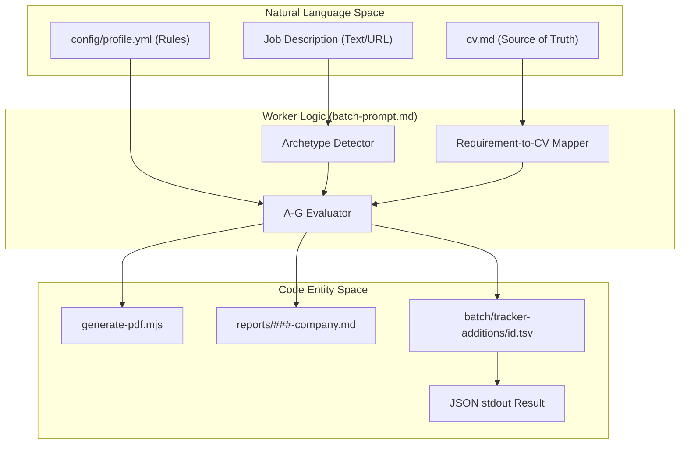
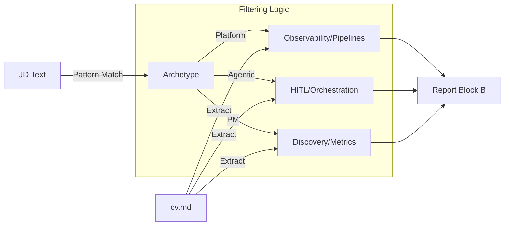

<!-- source: DeepWiki mcp.deepwiki.com · repo santifer/career-ops · page 4.2 batch-prompt.md Worker Template · fetched 2026-10-27 -->

# batch-prompt.md Worker Template

<details>
<summary>Relevant source files</summary>

The following files were used as context for generating this wiki page:

- [batch-evaluate-gemini.mjs](batch-evaluate-gemini.mjs)
- [batch/README.md](batch/README.md)
- [batch/batch-runner.sh](batch/batch-runner.sh)
- [browser-extract.mjs](browser-extract.mjs)
- [examples/README.md](examples/README.md)
- [examples/cv-example.md](examples/cv-example.md)
- [examples/resume-example.md](examples/resume-example.md)
- [modes/batch.md](modes/batch.md)
- [reconcile-pipeline.mjs](reconcile-pipeline.mjs)
- [tests/application-artifacts.test.mjs](tests/application-artifacts.test.mjs)
- [tests/batch-evaluate.test.mjs](tests/batch-evaluate.test.mjs)
- [tests/batch-runner-jd-prefetch.test.mjs](tests/batch-runner-jd-prefetch.test.mjs)
- [tests/batch-runner-score-delimiter.test.mjs](tests/batch-runner-score-delimiter.test.mjs)
- [tests/browser-extract-flags.test.mjs](tests/browser-extract-flags.test.mjs)
- [tests/browser-extract.test.mjs](tests/browser-extract.test.mjs)

</details>


The `batch-prompt.md` file is a self-contained, high-density instruction set used by the `claude -p` worker instances during batch processing. It defines the logic for transforming a raw Job Description (JD) into a comprehensive evaluation report, a tailored CV, and a structured data entry for the application tracker.

## Purpose and Scope

In the `career-ops` architecture, the orchestrator (`batch-runner.sh`) spawns multiple worker processes. Each worker is initialized with `batch-prompt.md` as its system prompt [batch/batch-runner.sh:18](). This template is designed to be "zero-dependency" from the perspective of Claude's internal state—it contains all the rules, archetypes, and pipeline steps necessary to complete an evaluation without requiring external tool calls to other Markdown skills.

Sources: [batch/batch-runner.sh:1-20](), [batch/README.md:57-61]()

## Placeholder Substitution

Before a worker begins execution, the orchestrator performs string substitution on specific placeholders within the template to provide context for the specific job being processed. The `batch-runner.sh` script manages these replacements during the parallel worker dispatch.

| Placeholder | Description | Source in Orchestrator |
|-------------|-------------|------------------------|
| `{{URL}}` | The original job posting URL | `batch-input.tsv` [batch/batch-runner.sh:82]() |
| `{{JD_FILE}}` | Path to the local text file containing the scraped JD | `mktemp batch-jd-XXXX` [tests/batch-runner-jd-prefetch.test.mjs:50-54]() |
| `{{REPORT_NUM}}` | 3-digit zero-padded sequence number (e.g., `042`) | `reserve-report-num.mjs` [batch-evaluate-gemini.mjs:95-98]() |
| `{{DATE}}` | Current date in `YYYY-MM-DD` format | `date +%Y-%m-%d` |
| `{{ID}}` | Unique identifier for the batch row | `batch-input.tsv` [batch/batch-runner.sh:82]() |

Sources: [batch/batch-runner.sh:16-18](), [batch/README.md:57-61](), [tests/batch-runner-jd-prefetch.test.mjs:1-19]()

## The 6-Step Evaluation Pipeline

The worker follows a rigid sequential pipeline to ensure consistency across hundreds of evaluations.

### 1. JD Ingestion
The worker reads the content of `{{JD_FILE}}`. A pre-fetch logic in `batch-runner.sh` using `curl` ensures the JD is available locally to avoid unreliable web fetching for JS-rendered boards [tests/batch-runner-jd-prefetch.test.mjs:4-10](). If the local file is insufficient (e.g., < 80 words), the worker falls back to live extraction [tests/batch-runner-jd-prefetch.test.mjs:12-16]().

### 2. Archetype Detection
The system classifies the role into canonical archetypes (e.g., AI Platform, Agentic Workflows, Solutions Architect). This classification dictates which "proof points" from the candidate's history are prioritized.

### 3. A-G Evaluation Blocks
The worker generates a detailed Markdown report consisting of:
*   **Block A (Role Summary):** Metadata and TL;DR.
*   **Block B (CV Match):** Direct mapping of JD requirements to `cv.md` lines.
*   **Block C (Level Strategy):** Seniority analysis.
*   **Block D (Comp Research):** Market rates and company reputation.
*   **Block E (Personalization):** Specific changes for the CV and LinkedIn.
*   **Block F (Interview Prep):** STAR stories mapped to the JD.
*   **Block G (Posting Legitimacy):** Analysis of posting signals.

### 4. Report & PDF Generation
The worker saves the Markdown report to `reports/`. If the score exceeds the `MIN_SCORE` threshold, it invokes `generate-pdf.mjs` to create the tailored CV [batch/batch-runner.sh:39-40]().

### 5. Tracker TSV Generation
The worker generates a single line of Tab-Separated Values (TSV) for the `merge-tracker.mjs` utility, saved to `batch/tracker-additions/` [batch/README.md:59-61]().

### 6. JSON Output
The final step is printing a structured JSON object to `stdout`. The orchestrator uses a specific delimiter (avoiding IFS whitespace) to parse this JSON and update `batch-state.tsv` [tests/batch-runner-score-delimiter.test.mjs:6-19]().

Sources: [batch/README.md:54-61](), [tests/batch-runner-jd-prefetch.test.mjs:1-19](), [tests/batch-runner-score-delimiter.test.mjs:39-63]()

## Data Flow and Entity Mapping

The following diagram illustrates how the `batch-prompt.md` instructions bridge the gap between natural language job descriptions and the structured code entities in the system.

### Worker Execution Logic

Sources: [batch/batch-runner.sh:16-25](), [batch/README.md:54-61](), [batch-evaluate-gemini.mjs:31-40]()

## Tracker TSV Format

The worker produces a TSV line following a strict schema for ingestion by `merge-tracker.mjs`. The order of columns in this temporary TSV differs from the final `applications.md` and is normalized during the merge [batch/README.md:64-67]().

| Col | Field | Description |
|-----|-------|-------------|
| 1 | `#` | `{{REPORT_NUM}}` |
| 2 | `Date` | `{{DATE}}` |
| 3 | `Company` | Company Name |
| 4 | `Role` | Job Title |
| 5 | `Score` | Global Score (1-5) |
| 6 | `Status` | Default: `⏳ Evaluada` |
| 7 | `PDF` | Relative path or ✅/❌ indicator |
| 8 | `Report` | Relative path to Markdown report |
| 9 | `Notes` | Archetype + Score breakdown + TL;DR |

Sources: [batch/README.md:63-71](), [batch-evaluate-gemini.mjs:73-83](), [tests/batch-evaluate.test.mjs:72-83]()

## JSON Result Schema

At the end of the process, the worker outputs a JSON block. The `batch-runner.sh` orchestrator captures this using a `node -e` parser to update the `batch-state.tsv` file [tests/batch-runner-score-delimiter.test.mjs:68-85]().

```json
{
  "status": "completed",
  "error": null,
  "score": 4.5
}
```

The orchestrator reads these values to populate the `batch-state.tsv` columns: `status`, `error`, `score`, and `report_num` [batch/batch-runner.sh:200]().

Sources: [tests/batch-runner-score-delimiter.test.mjs:78-85](), [batch/batch-runner.sh:198-202](), [reconcile-pipeline.mjs:91-102]()

## Archetype Logic Flow

The worker uses the detected Archetype to filter which information from `cv.md` is relevant. This ensures that an evaluation emphasizes different achievements based on the role's focus.

### Archetype Mapping Process

Sources: [batch-evaluate-gemini.mjs:124-166](), [tests/batch-evaluate.test.mjs:40-48]()

---

