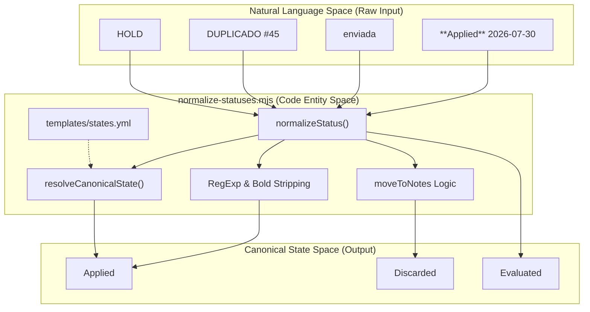
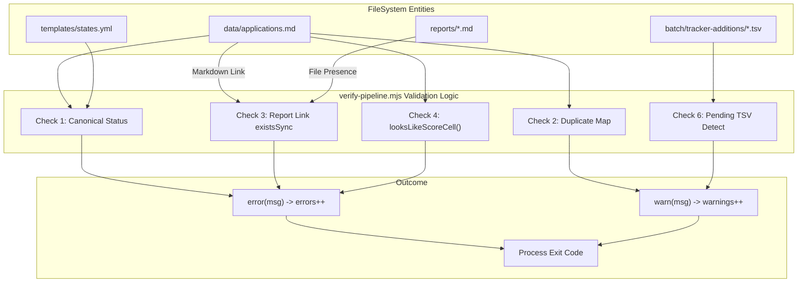

<!-- source: DeepWiki mcp.deepwiki.com · repo santifer/career-ops · page 5.3 normalize-statuses.mjs & verify-pipeline.mjs · fetched 2026-10-27 -->

# normalize-statuses.mjs & verify-pipeline.mjs

Relevant source files

The following files were used as context for generating this wiki page:

- [dedup-tracker.mjs](dedup-tracker.mjs)
- [lib/local-today.mjs](lib/local-today.mjs)
- [merge-tracker.mjs](merge-tracker.mjs)
- [normalize-statuses.mjs](normalize-statuses.mjs)
- [set-status-tests.mjs](set-status-tests.mjs)
- [set-status.mjs](set-status.mjs)
- [stats.mjs](stats.mjs)
- [templates/states.yml](templates/states.yml)
- [tests/merge-tracker.test.mjs](tests/merge-tracker.test.mjs)
- [tests/scan-run-failure.test.mjs](tests/scan-run-failure.test.mjs)
- [tests/source-no-nul-bytes.test.mjs](tests/source-no-nul-bytes.test.mjs)
- [tests/states-alias-coverage.test.mjs](tests/states-alias-coverage.test.mjs)
- [tests/stats.test.mjs](tests/stats.test.mjs)
- [tracker-parse.mjs](tracker-parse.mjs)
- [verify-pipeline.mjs](verify-pipeline.mjs)
- [web/src/app/api/status/route.ts](web/src/app/api/status/route.ts)
- [web/src/lib/core/run-registry.ts](web/src/lib/core/run-registry.ts)
- [web/src/lib/core/tracker-lock.ts](web/src/lib/core/tracker-lock.ts)
- [web/src/lib/status-cli.mjs](web/src/lib/status-cli.mjs)
- [web/tests/lib/status-cli.test.mjs](web/tests/lib/status-cli.test.mjs)
- [web/tests/lib/tracker-lock.test.mjs](web/tests/lib/tracker-lock.test.mjs)

This section covers the two primary data-integrity scripts used to maintain the `applications.md` flat-file database. These scripts ensure that application states remain consistent with the canonical state machine and that the pipeline remains free of structural errors, broken references, or stale data artifacts.

## normalize-statuses.mjs

`normalize-statuses.mjs` is a transformation script designed to clean and standardize the `STATUS` column in `applications.md`. It resolves inconsistencies introduced by manual editing or legacy batch outputs by mapping varied inputs to a strict set of canonical states defined in `templates/states.yml` [normalize-statuses.mjs:5-9]().

### Core Logic and Transformations

The script iterates through every row of the Markdown table, extracts the status field using header-aware column mapping [normalize-statuses.mjs:146-150](), and applies normalization rules via the `normalizeStatus` function [normalize-statuses.mjs:42-104]().

| Transformation Type | Logic | Implementation |
|:---|:---|:---|
| **Bold Stripping** | Removes `**` markers from status and score cells. | [normalize-statuses.mjs:44](), [normalize-statuses.mjs:180-182]() |
| **Alias Mapping** | Resolves localized or legacy terms (e.g., "sent", "evaluada", "mülakat") to canonical labels using `templates/states.yml`. | [normalize-statuses.mjs:93-100]() |
| **Date Stripping** | Removes trailing years/dates from status strings (e.g., "Rechazado 2024-01-01"). | [normalize-statuses.mjs:64-67]() |
| **Note Migration** | If a status indicates a duplicate (e.g., "DUPLICADO" or "repost"), it changes the status to "Discarded" and prepends the original text to the `notes` column. | [normalize-statuses.mjs:48-50](), [normalize-statuses.mjs:79-80](), [normalize-statuses.mjs:172-177]() |
| **Sentinel Reset** | Maps specific workflow markers like "HOLD", "GEO BLOCKER", or "Verificar" to canonical "Evaluated" or "SKIP". | [normalize-statuses.mjs:70-76]() |

### Safety and Transactions

To prevent data corruption during concurrent access, the script utilizes the shared tracker lock mechanism:
1.  **Tracker Transaction**: It acquires a filesystem lock via `openTrackerTransaction` before reading the file [normalize-statuses.mjs:125-129]().
2.  **Atomic Write**: Changes are applied in-memory and written back only if not in `--dry-run` mode [normalize-statuses.mjs:24](), [normalize-statuses.mjs:123-133]().
3.  **Dry Run**: The `--dry-run` flag allows previewing transformations in the console without modifying `applications.md` [normalize-statuses.mjs:24]().

### Status Normalization Flow

This diagram illustrates how raw status strings from the Markdown table are processed into canonical entities using the `states.yml` definitions.

**Status Normalization Pipeline**

**Sources:** [normalize-statuses.mjs:42-104](), [normalize-statuses.mjs:158-190](), [templates/states.yml:16-74]()

---

## verify-pipeline.mjs

`verify-pipeline.mjs` acts as a health check for the entire application tracking system. It performs a comprehensive suite of validations and exits with a non-zero code if critical integrity errors are found [verify-pipeline.mjs:20-21](), [verify-pipeline.mjs:220]().

### Validation Suite

The script executes 13 distinct checks to ensure data consistency [verify-pipeline.mjs:5-18]():

1.  **Canonical Statuses**: Validates every status against `states.yml` and flags markdown bolding or embedded dates [verify-pipeline.mjs:123-147]().
2.  **Duplicate Detection**: Identifies potential double-entries by comparing normalized Company + Role keys [verify-pipeline.mjs:149-166]().
3.  **Report Link Integrity**: Verifies that Markdown links in the `report` column point to existing `.md` files in the `reports/` directory [verify-pipeline.mjs:168-185]().
4.  **Score Format**: Ensures scores match the `X.XX/5` pattern or valid sentinels like `N/A`, `DUP`, or `—` [verify-pipeline.mjs:187-195]().
5.  **Schema Consistency**: Uses `tracker-parse.mjs` to map columns dynamically, supporting custom layouts (e.g., inserted `Location` or `Via` columns) [verify-pipeline.mjs:96-119]().
6.  **Pending TSVs**: Detects unmerged files in `batch/tracker-additions/` [verify-pipeline.mjs:197-200]().
7.  **Sentinel GC**: Identifies stale report-number reservation sentinels that should be garbage-collected [verify-pipeline.mjs:13]().
8.  **ID Reuse**: Checks for reused application numbers (#) across multiple rows [verify-pipeline.mjs:17]().
9.  **Interview Sync**: Validates status consistency between `applications.md` and `active-interviews.md` [verify-pipeline.mjs:18]().

### Error vs. Warning Classification

The script distinguishes between structural failures and stylistic warnings:
*   **Errors (❌)**: Structural issues like non-canonical statuses, broken links, or reused IDs. These cause a non-zero exit code [verify-pipeline.mjs:72](), [verify-pipeline.mjs:220]().
*   **Warnings (⚠️)**: Potential duplicates or pending TSVs. These alert the user but do not necessarily block CI/CD pipelines [verify-pipeline.mjs:73]().

### System Integrity Validation Flow

This diagram maps the validation checks to the specific file entities and code functions they monitor.

**Pipeline Integrity Mapping**

**Sources:** [verify-pipeline.mjs:23-74](), [verify-pipeline.mjs:123-200](), [tracker-parse.mjs:60-64]()

### Technical Reference: Column Mapping

Both scripts rely on `tracker-parse.mjs` to handle non-standard table layouts. Instead of hardcoding indices, they use `resolveColumns` to build a mapping from header labels to indices [tracker-parse.mjs:152-168]().

| Property | Canonical Header | Internal Key |
|:---|:---|:---|
| Unique ID | `#` | `num` |
| Application Date | `Date` | `date` |
| Hiring Company | `Company` | `company` |
| Position Title | `Role` | `role` |
| Match Score | `Score` | `score` |
| Pipeline State | `Status` | `status` |

**Sources:** [tracker-parse.mjs:18-20](), [tracker-parse.mjs:35-46](), [verify-pipeline.mjs:104-118]()

---

