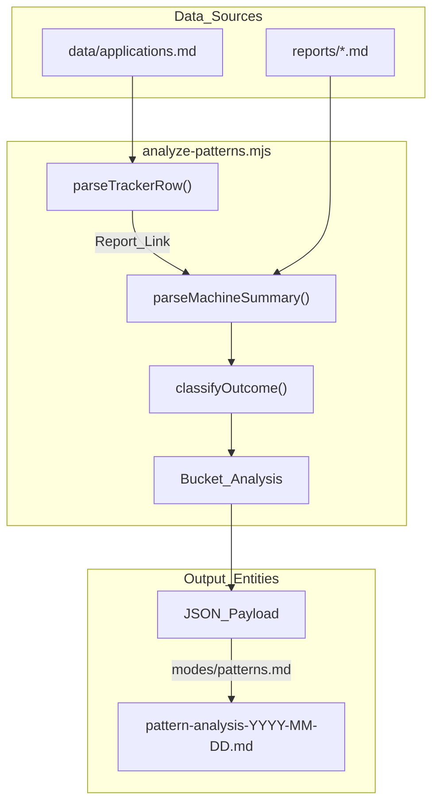
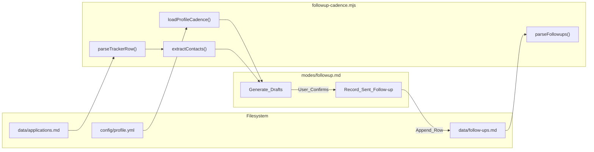

<!-- source: DeepWiki mcp.deepwiki.com · repo santifer/career-ops · page 5.4 Pattern Analysis & Follow-up Cadence Scripts · fetched 2026-10-27 -->

# Pattern Analysis & Follow-up Cadence Scripts

Relevant source files

The following files were used as context for generating this wiki page:

- [analyze-patterns.mjs](analyze-patterns.mjs)
- [assessment-log.mjs](assessment-log.mjs)
- [batch/batch-prompt.md](batch/batch-prompt.md)
- [check-table-freshness.mjs](check-table-freshness.mjs)
- [company-history.mjs](company-history.mjs)
- [company-history.test.mjs](company-history.test.mjs)
- [followup-cadence.mjs](followup-cadence.mjs)
- [followup-cadence.test.mjs](followup-cadence.test.mjs)
- [followup-seed-tests.mjs](followup-seed-tests.mjs)
- [funnel-velocity.mjs](funnel-velocity.mjs)
- [modes/auto-pipeline.md](modes/auto-pipeline.md)
- [modes/followup.md](modes/followup.md)
- [modes/oferta.md](modes/oferta.md)
- [modes/patterns.md](modes/patterns.md)
- [modes/tracker.md](modes/tracker.md)
- [modes/training.md](modes/training.md)
- [tests/fixtures/profile-custom-cadence.yml](tests/fixtures/profile-custom-cadence.yml)
- [tests/fixtures/profile-default-cadence.yml](tests/fixtures/profile-default-cadence.yml)
- [tests/funnel-velocity-flags.test.mjs](tests/funnel-velocity-flags.test.mjs)
- [tests/local-today-gates.test.mjs](tests/local-today-gates.test.mjs)
- [tests/run-failure-diagnostics.test.mjs](tests/run-failure-diagnostics.test.mjs)
- [tracker-writer-lock-tests.mjs](tracker-writer-lock-tests.mjs)

The **Pattern Analysis** and **Follow-up Cadence** systems provide the analytical and relationship-management layer of `career-ops`. While other modes focus on individual job evaluations, these scripts analyze the aggregate data in `data/applications.md`, `data/status-log.tsv`, and `reports/` to identify why applications are failing and ensure active leads do not go cold.

## 1. Pattern Analysis (`analyze-patterns.mjs`)

The `analyze-patterns.mjs` script is a diagnostic tool that parses the history of all applications to identify correlations between job attributes (archetypes, remote policy, tech stack) and success rates. It is invoked via the `patterns` mode [modes/patterns.md:29-33]().

### Implementation & Data Flow
The script performs a multi-stage ingestion process:
1.  **Tracker Parsing**: Reads `data/applications.md` (or the fallback `applications.md`) to identify all entries and their current statuses [analyze-patterns.mjs:20-25](), [analyze-patterns.mjs:153-170]().
2.  **Report Deep-Dive**: For every application, it locates the corresponding Markdown report in `reports/` and extracts structured data from the `## Machine Summary` block [analyze-patterns.mjs:26](), [analyze-patterns.mjs:161-205]().
3.  **Classification**: It normalizes raw statuses into outcome buckets: `positive` (Interview/Offer/Responded/Applied/Hired), `negative` (Rejected/Discarded), `self_filtered` (SKIP), and `pending` (Evaluated) [analyze-patterns.mjs:101-109]().
4.  **Bucket Analysis**: It groups data by dimensions such as `archetype`, `seniority`, `remote`, and `vendor` (ATS channel) to calculate conversion rates [analyze-patterns.mjs:206-250]().

### Key Functions
- `parseMachineSummary(content)`: Extracts a YAML/JSON block from reports containing structured metadata like `archetype`, `score`, and `hard_stops` [analyze-patterns.mjs:161-205]().
- `classifyOutcome(status)`: Maps various status aliases (e.g., "rechazada", "sent") to canonical outcomes for statistical grouping [analyze-patterns.mjs:101-109]().
- `normalizeScalar(value)` and `normalizeList(value)`: Ensure data consistency when parsing YAML fields from different LLM generations [analyze-patterns.mjs:148-160]().
- `discardableBase(enriched)`: Calculates the denominator for skip/discard reasons by filtering for negative or self-filtered outcomes [analyze-patterns.mjs:122-124]().

### Pattern Analysis Logic
The following diagram illustrates how the script bridges the flat-file database to analytical insights.

**System Logic: Pattern Detection Pipeline**

Sources: [analyze-patterns.mjs:20-26](), [analyze-patterns.mjs:101-110](), [analyze-patterns.mjs:161-205](), [modes/patterns.md:35-54]()

---

## 2. Follow-up Cadence (`followup-cadence.mjs`)

The `followup-cadence.mjs` script manages the post-application lifecycle. It calculates when the next touchpoint should occur based on the current status and previous history. It integrates with `modes/followup.md` to generate communication drafts.

### Urgency Tiers & Rules
The system enforces a strict cadence configuration defined in the `DEFAULT_CADENCE` object, which can be overridden by `config/profile.yml` [followup-cadence.mjs:38-45](), [followup-cadence.mjs:61-76]():
- **Applied**: First follow-up at 7 days (default); subsequent every 7 days; max 2 attempts [followup-cadence.mjs:39-41]().
- **Responded**: Follow-up after 1 day for initial response, then every 3 days [followup-cadence.mjs:42-43]().
- **Interview**: Thank-you note within 1 day [followup-cadence.mjs:44]().

### Data Interaction
The script correlates three primary files:
1.  **`data/applications.md`**: The source of truth for the current state of the application [followup-cadence.mjs:23-25]().
2.  **`data/follow-ups.md`**: A secondary ledger that records the history of sent messages to avoid double-pinging [followup-cadence.mjs:26]().
3.  **`templates/states.yml`**: Used to load canonical states and aliases for status normalization [followup-cadence.mjs:104-121]().

### Key Functions
- `loadProfileCadence(profilePath)`: Loads user-specific timing preferences from `config/profile.yml` [followup-cadence.mjs:61-76]().
- `extractContacts(notes)`: Scans the notes column of the tracker using Regex to find email addresses and names (e.g., "Emailed [Name] at...") for draft personalization [followup-cadence.mjs:206-224]().
- `parseAppliedDate(notes)`: Extracts the actual submission date from notes (e.g., "Applied 2026-06-20") to ensure cadence is calculated from the submission, not the evaluation date [followup-cadence.mjs:145-174]().
- `resolveCadenceConfig()`: Merges default cadence with profile overrides and CLI flags [followup-cadence.mjs:78-83]().

**Entity Mapping: Follow-up Generation**

Sources: [followup-cadence.mjs:23-26](), [followup-cadence.mjs:61-76](), [followup-cadence.mjs:206-224](), [modes/followup.md:7-13]()

---

## 3. Funnel Velocity & Company History

Beyond simple cadence, `career-ops` provides deep metrics on how fast applications move and how specific companies behave.

### Funnel Velocity (`funnel-velocity.mjs`)
This script calculates median and p75 days per stage hop (e.g., Applied → Responded) by parsing `data/status-log.tsv` [funnel-velocity.mjs:1-12]().
- **Transition Ledger**: Reads an append-only log written by `set-status.mjs` [funnel-velocity.mjs:13-19]().
- **Statistical Honesty**: Excludes 0-day hops and reports right-censoring for rows still waiting to avoid survivorship bias [funnel-velocity.mjs:20-26]().
- **Key Function**: `parseStatusLog(content, states)` converts the TSV into a timeline of observations per tracker ID [funnel-velocity.mjs:101-128]().

### Company History (`company-history.mjs`)
Aggregates evidence per company across the tracker, follow-ups, and scan history [company-history.mjs:3-12]().
- **Responsiveness Axis**: Detects if a company has ever responded or gone silent past the silence window [company-history.mjs:10-12]().
- **Posting Churn Axis**: Uses `detect-reposts.mjs` to identify if a company repeatedly reposts the same role [company-history.mjs:13-20]().
- **Key Function**: `normalizeCompany(name)` ensures "Acme" and "Acme Corp" are treated as the same entity [company-history.mjs:57]().

---

## 4. Jurisdiction & Freshness (`check-table-freshness.mjs`)

The `check-table-freshness.mjs` script acts as a watchdog for jurisdiction-compliance tables (like minimum wage or legal changes) in `templates/*.yml` [check-table-freshness.mjs:2-9]().
- **Staleness Detection**: Flags rows as `expired` if `today >= next_effective` and the row wasn't re-verified, or `review-due` if the `as_of` date is older than the configured threshold (default 12 months) [check-table-freshness.mjs:18-26]().
- **Key Function**: `extractRows(doc)` identifies jurisdiction tables by looking for rows that carry an `as_of` field [check-table-freshness.mjs:127-145]().

Sources: [funnel-velocity.mjs:1-26](), [company-history.mjs:3-25](), [check-table-freshness.mjs:2-26]()

---

