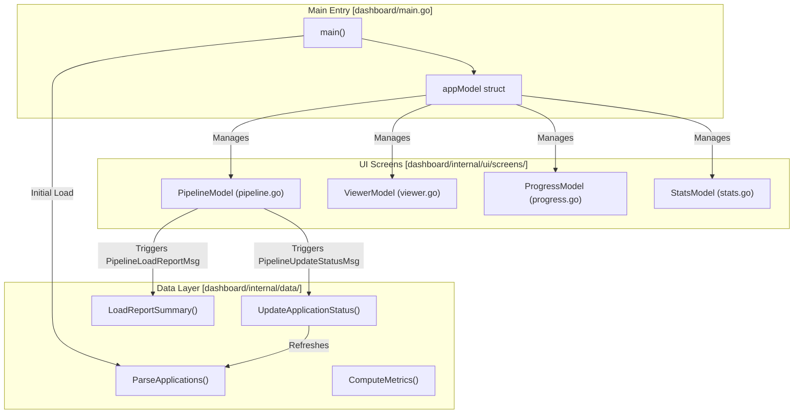

<!-- source: DeepWiki mcp.deepwiki.com · repo santifer/career-ops · page 6 Dashboard TUI (Go) · fetched 2026-10-27 -->

# Dashboard TUI (Go)

Relevant source files

The following files were used as context for generating this wiki page:

- [LICENSE](LICENSE)
- [batch/tracker-additions/.gitkeep](batch/tracker-additions/.gitkeep)
- [dashboard/go.mod](dashboard/go.mod)
- [dashboard/go.sum](dashboard/go.sum)
- [dashboard/internal/data/career.go](dashboard/internal/data/career.go)
- [dashboard/internal/data/career_test.go](dashboard/internal/data/career_test.go)
- [dashboard/internal/data/derive.go](dashboard/internal/data/derive.go)
- [dashboard/internal/data/derive_test.go](dashboard/internal/data/derive_test.go)
- [dashboard/internal/data/progress_metrics_test.go](dashboard/internal/data/progress_metrics_test.go)
- [dashboard/internal/data/stats.go](dashboard/internal/data/stats.go)
- [dashboard/internal/data/stats_test.go](dashboard/internal/data/stats_test.go)
- [dashboard/internal/i18n/catalog.go](dashboard/internal/i18n/catalog.go)
- [dashboard/internal/i18n/i18n_test.go](dashboard/internal/i18n/i18n_test.go)
- [dashboard/internal/model/career.go](dashboard/internal/model/career.go)
- [dashboard/internal/theme/catppuccin_latte.go](dashboard/internal/theme/catppuccin_latte.go)
- [dashboard/internal/theme/theme.go](dashboard/internal/theme/theme.go)
- [dashboard/internal/ui/screens/pipeline.go](dashboard/internal/ui/screens/pipeline.go)
- [dashboard/internal/ui/screens/pipeline_pdf_test.go](dashboard/internal/ui/screens/pipeline_pdf_test.go)
- [dashboard/internal/ui/screens/pipeline_test.go](dashboard/internal/ui/screens/pipeline_test.go)
- [dashboard/internal/ui/screens/pipeline_width_test.go](dashboard/internal/ui/screens/pipeline_width_test.go)
- [dashboard/internal/ui/screens/progress.go](dashboard/internal/ui/screens/progress.go)
- [dashboard/internal/ui/screens/sort_test.go](dashboard/internal/ui/screens/sort_test.go)
- [dashboard/internal/ui/screens/stats.go](dashboard/internal/ui/screens/stats.go)
- [dashboard/internal/ui/screens/stats_test.go](dashboard/internal/ui/screens/stats_test.go)
- [dashboard/internal/ui/screens/timeago_test.go](dashboard/internal/ui/screens/timeago_test.go)
- [dashboard/internal/ui/screens/viewer.go](dashboard/internal/ui/screens/viewer.go)
- [dashboard/internal/ui/screens/viewer_test.go](dashboard/internal/ui/screens/viewer_test.go)
- [dashboard/main.go](dashboard/main.go)

The **Dashboard TUI** is a terminal-based graphical interface for the `career-ops` ecosystem, built using the Go programming language. It provides a centralized view of the job application pipeline, allowing users to browse, filter, and read evaluation reports without leaving the terminal.

The application is built on the **Charmbracelet Bubble Tea** framework, following the Model-View-Update (MVU) architecture, and utilizes **Lip Gloss** for sophisticated terminal styling. It requires Go 1.25+ to build and run [dashboard/go.mod:1-10]().

## Architecture & Data Flow

The dashboard functions as a read-write interface over the `applications.md` flat-file database. It parses the Markdown table into structured Go models and synchronizes changes back to the filesystem when statuses are updated.

### System Topology
The following diagram illustrates how the `appModel` coordinates between the data layer and the UI screens.

**Dashboard Component Interaction**

Sources: [dashboard/main.go:29-40](), [dashboard/main.go:42-56](), [dashboard/main.go:114-126](), [dashboard/internal/data/career.go:54-191]()

### Model-View-Update (MVU) Implementation
The `appModel` in `dashboard/main.go` acts as the root orchestrator:
*   **Model**: Holds the `PipelineModel`, `ViewerModel`, `ProgressModel`, `StatsModel`, and the current `viewState` (e.g., `viewPipeline`, `viewReport`, `viewProgress`, or `viewStats`) [dashboard/main.go:20-40]().
*   **Update**: Handles high-level messages like `PipelineOpenReportMsg` to switch screens, `PipelineUpdateStatusMsg` to modify data, or `PipelineOpenURLMsg` to trigger OS-level browser commands [dashboard/main.go:84-245]().
*   **View**: Conditionally renders the active screen based on the state [dashboard/main.go:247-260]().

## Visual Theme & Internationalization

The dashboard uses the **Catppuccin Mocha** color palette to provide a high-contrast, modern aesthetic. The theme is centralized in the `theme` package [dashboard/internal/theme/theme.go:9-27]().

| Color Entity | Code Reference | Usage in TUI |
| :--- | :--- | :--- |
| `Base` | `theme.Base` | Main background [dashboard/internal/theme/theme.go:12]() |
| `Blue` | `theme.Blue` | Headers and primary actions [dashboard/internal/theme/theme.go:19]() |
| `Mauve` | `theme.Mauve` | Secondary headers (H2) [dashboard/internal/theme/theme.go:20]() |
| `Green` | `theme.Green` | High scores and "Applied" status [dashboard/internal/theme/theme.go:21]() |
| `Red` | `theme.Red` | Low scores and "Rejected" status [dashboard/internal/theme/theme.go:25]() |

The UI is fully localized via a static, zero-dependency translation architecture in the `i18n` package [dashboard/internal/i18n/catalog.go:12-173](). Users can toggle between languages (e.g., English, Spanish, Turkish) using the `T` key [dashboard/main.go:87-93]().

Sources: [dashboard/internal/theme/theme.go:9-44](), [dashboard/internal/i18n/catalog.go:1-173](), [dashboard/main.go:87-93]()

## Core Screens

The dashboard is divided into four primary functional areas:

### 1. Pipeline Screen
The entry point of the application. It displays the `applications.md` data in a sortable, filterable list.
*   **Functionality**: Includes tab-based filtering by status (ALL, EVALUATED, APPLIED, INTERVIEW, TOP, etc.) and multiple sorting modes (Score, Date, Company, Status, Location, Pay, Last Contact) [dashboard/internal/ui/screens/pipeline.go:118-158]().
*   **Lazy Loading**: It emits `PipelineLoadReportMsg` to asynchronously fetch report summaries (Archetype, TL;DR, Remote, Comp) from the filesystem to keep the UI responsive [dashboard/internal/ui/screens/pipeline.go:60-64]().
*   **Search**: Supports real-time substring filtering on company, role, and notes fields using the `/` key [dashboard/internal/ui/screens/pipeline_test.go:117-155]().
*   **Column Picker**: Allows toggling optional columns (Applied Date, Location, Pay, Report/PDF presence, Last Contact, Posted) via the `C` key [dashboard/internal/ui/screens/pipeline.go:163-195]().
*   **For details, see [Pipeline Screen & Viewer](#6.1)**.

Sources: [dashboard/internal/ui/screens/pipeline.go:118-195](), [dashboard/main.go:114-118]()

### 2. Report Viewer
A dedicated screen for reading the detailed evaluation reports generated by the AI agents.
*   **Markdown Rendering**: The `ViewerModel` implements a custom Markdown styler that highlights headers, code blocks, and tables [dashboard/internal/ui/screens/viewer.go:48-72]().
*   **Navigation**: Supports Vim-style keybindings (`j`/`k`, `G`, `g`) and page navigation (`ctrl+d`/`ctrl+u`) [dashboard/internal/ui/screens/viewer.go:135-189]().
*   **Status Updates**: Allows changing the application status directly from the viewer using the `c` key [dashboard/internal/ui/screens/viewer.go:139-145]().
*   **For details, see [Pipeline Screen & Viewer](#6.1)**.

Sources: [dashboard/internal/ui/screens/viewer.go:129-203](), [dashboard/main.go:141-150]()

### 3. Progress Analytics
A high-level analytics screen providing visual feedback on pipeline velocity and conversion rates.
*   **Metrics**: Displays `ProgressMetrics` including funnel stages, score distribution, and weekly activity [dashboard/internal/model/career.go:43-63]().
*   **State Transition**: Triggered via `PipelineOpenProgressMsg` [dashboard/main.go:194-201]().

Sources: [dashboard/main.go:194-201](), [dashboard/internal/model/career.go:43-63]()

### 4. Strategic Stats
A strategic insights screen providing cross-cutting breakdowns of the pipeline.
*   **Functionality**: Shows distributions of archetypes, work modes, locations, and detailed pay statistics [dashboard/internal/model/career.go:88-97]().
*   **Pay Stats**: Aggregates top-dollar amounts (`PayMax`) across applications for average, median, and maximum pay analysis [dashboard/internal/model/career.go:117-124]().

Sources: [dashboard/main.go:207-215](), [dashboard/internal/model/career.go:88-124]()

## Data Integration

The dashboard is tightly integrated with the `career-ops` data structure:
*   **Parsing**: It reads the pipe-delimited Markdown table from `applications.md` via `data.ParseApplications`, supporting both legacy and header-aware layouts [dashboard/internal/data/career.go:54-135]().
*   **Enrichment**: It uses a 5-tier strategy to resolve job URLs, including report headers, batch ID lookups, and scan history [dashboard/internal/data/career.go:137-191]().
*   **Writing**: It updates application statuses via `data.UpdateApplicationStatus`, utilizing a shared file lock to ensure compatibility with Node.js scripts [dashboard/internal/data/career_test.go:36-96]().
*   **For details, see [Dashboard Data Layer](#6.2)**.

Sources: [dashboard/internal/data/career.go:54-191](), [dashboard/internal/data/career_test.go:13-34]()

---

