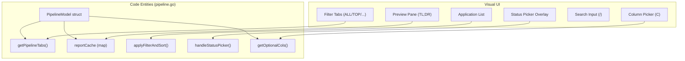
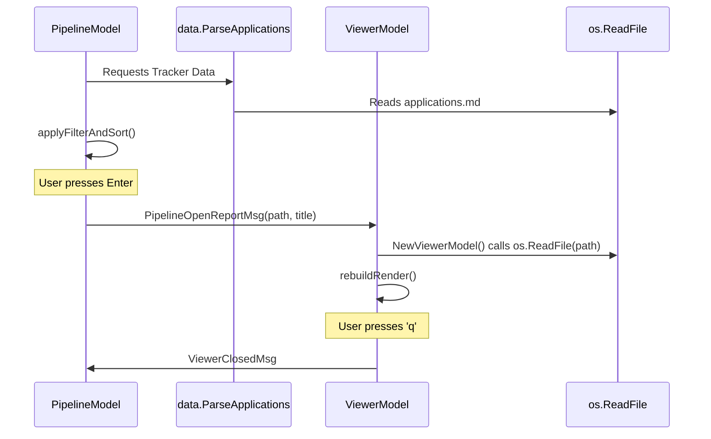

<!-- source: DeepWiki mcp.deepwiki.com · repo santifer/career-ops · page 6.1 Pipeline Screen & Viewer · fetched 2026-10-27 -->

# Pipeline Screen & Viewer

Relevant source files

The following files were used as context for generating this wiki page:

- [dashboard/internal/data/career.go](dashboard/internal/data/career.go)
- [dashboard/internal/data/career_test.go](dashboard/internal/data/career_test.go)
- [dashboard/internal/data/progress_metrics_test.go](dashboard/internal/data/progress_metrics_test.go)
- [dashboard/internal/ui/screens/pipeline.go](dashboard/internal/ui/screens/pipeline.go)
- [dashboard/internal/ui/screens/pipeline_pdf_test.go](dashboard/internal/ui/screens/pipeline_pdf_test.go)
- [dashboard/internal/ui/screens/pipeline_test.go](dashboard/internal/ui/screens/pipeline_test.go)
- [dashboard/internal/ui/screens/progress.go](dashboard/internal/ui/screens/progress.go)
- [dashboard/internal/ui/screens/viewer.go](dashboard/internal/ui/screens/viewer.go)
- [dashboard/internal/ui/screens/viewer_test.go](dashboard/internal/ui/screens/viewer_test.go)
- [dashboard/main.go](dashboard/main.go)

The Dashboard TUI is built using the **Bubble Tea** Model-View-Update (MVU) architecture. It provides a high-performance interface for navigating the job application pipeline, allowing users to filter, sort, and preview evaluation reports without leaving the terminal. The system is split into two primary models: `PipelineModel` for the list view and `ViewerModel` for document inspection.

## Pipeline Screen (PipelineModel)

The `PipelineModel` serves as the primary entry point for managing applications. It transforms the flat-file data from `applications.md` into an interactive, categorized, and searchable dashboard [dashboard/internal/ui/screens/pipeline.go:44-51]().

### Filtering and Sorting Logic
The core of the pipeline's interactivity is the `applyFilterAndSort` method [dashboard/internal/ui/screens/pipeline.go:577](). It processes the raw application list based on the currently selected tab, search query, and sort mode.

*   **Tabs (Filter Modes):** Defined in `getPipelineTabs` [dashboard/internal/ui/screens/pipeline.go:146-158]().
    *   `ALL`: No filtering.
    *   `EVALUATED`: Shows applications with status "Evaluated".
    *   `APPLIED`: Shows applications with status "Applied".
    *   `INTERVIEW`: Shows applications in "Interview" states.
    *   `TOP`: Filters for applications with a score of 4.0 or higher [dashboard/internal/ui/screens/pipeline.go:138]().
    *   `SKIP`, `REJECTED`, `DISCARDED`: Status-specific views [dashboard/internal/ui/screens/pipeline.go:135-137]().
*   **Search Sub-state:** Users can press `/` to enter a search query that filters by company, role, or notes [dashboard/internal/ui/screens/pipeline.go:593-599](). This filter composes with the active tab [dashboard/internal/ui/screens/pipeline_test.go:157-172]().
*   **Sort Modes:** Users cycle through `sortScore`, `sortDate`, `sortCompany`, `sortStatus`, `sortLocation`, `sortPay`, and `sortLast` [dashboard/internal/ui/screens/pipeline.go:118-126]().
*   **View Modes:** Supports a `flat` list or a `grouped` view where applications are categorized by their status priority [dashboard/internal/ui/screens/pipeline.go:275-285]().

### Data Enrichment and Note Parsing
The dashboard surfaces structured data from the free-text `Notes` column using `deriveNoteFields` [dashboard/internal/data/career.go:132]().
*   **Location:** Detects "City, ST" (US) or international cities.
*   **Pay:** Extracts ranges and converts them to numeric values for sorting.
*   **Last Contact:** Identifies the most recent ISO date mentioned in notes, falling back to the application date.

### Lazy-Loaded Report Cache
To maintain UI responsiveness, the dashboard uses a lazy-loading mechanism for evaluation reports.
1.  As the user moves the cursor, a `PipelineLoadReportMsg` is emitted [dashboard/internal/ui/screens/pipeline.go:61-64]().
2.  The main loop catches this and calls `data.LoadReportSummary` to parse specific blocks (Archetype, TL;DR, Remote, Comp) from the Markdown file [dashboard/main.go:114-117]().
3.  The data is stored in `reportCache map[string]reportSummary` [dashboard/internal/ui/screens/pipeline.go:261-266]() to prevent redundant disk I/O.

### Column Picker Overlay
The `PipelineModel` includes a column picker toggled with the `C` key [dashboard/internal/ui/screens/pipeline.go:423](). Users can toggle visibility for optional columns defined in `getOptionalCols` [dashboard/internal/ui/screens/pipeline.go:185-195]():
*   `ColDate`, `ColLocation`, `ColPay`, `ColHasReport`, `ColHasPDF`, `ColLastContact`, `ColPosted`.

### UI Component Mapping
The following diagram maps the visual components of the Pipeline Screen to their underlying code structures.

**Pipeline Screen Entity Mapping**

Sources: [dashboard/internal/ui/screens/pipeline.go:146-195](), [dashboard/internal/ui/screens/pipeline.go:261-266](), [dashboard/internal/ui/screens/pipeline.go:577-620](), [dashboard/internal/data/career.go:132]()

---

## Viewer Screen (ViewerModel)

The `ViewerModel` is a specialized Markdown renderer designed for reading evaluation reports. It is triggered via a `PipelineOpenReportMsg` [dashboard/internal/ui/screens/pipeline.go:24-29]().

### Markdown Rendering
`viewer.go` implements custom rendering logic using **Lipgloss** [dashboard/internal/ui/screens/viewer.go:10-11]().
*   **Table Block Detection:** The viewer detects Markdown tables and renders them using the Lipgloss table component [dashboard/internal/ui/screens/viewer.go:346-359]().
*   **Fenced Code:** Code blocks are detected and rendered with distinct styling [dashboard/internal/ui/screens/viewer.go:361-372]().
*   **Status Picker:** The viewer allows updating application status (`c` key) without closing the report [dashboard/internal/ui/screens/viewer.go:139-145]().
*   **Cover Letter:** Scans for a generated cover letter PDF path to allow opening it with the `L` key [dashboard/internal/ui/screens/viewer.go:76-98]().

### Navigation and Keybindings
The viewer supports standard pager navigation [dashboard/internal/ui/screens/viewer.go:135-194]():
*   `j`/`down`, `k`/`up`: Line-by-line scrolling.
*   `ctrl+d`, `pgdown`: Half-page jumps.
*   `g`/`home`, `G`/`end`: Jump to start/end of document.

### Data Flow: Pipeline to Viewer
The transition between the list and the viewer is managed by the top-level application via message passing.

**Data Flow Diagram**

Sources: [dashboard/internal/ui/screens/pipeline.go:24-29](), [dashboard/internal/ui/screens/viewer.go:49-72](), [dashboard/main.go:141-150]()

---

## Key Functions Reference

### Pipeline Logic
| Function | Description |
| :--- | :--- |
| `applyFilterAndSort` | Filters `apps` into `filtered` based on `activeTab` and `searchQuery`. [dashboard/internal/ui/screens/pipeline.go:577]() |
| `WithReloadedData` | Rebuilds the model with fresh data while preserving cursor and search state. [dashboard/internal/ui/screens/pipeline.go:292]() |
| `EnrichReport` | Caches report summary data (Archetype, TL;DR) for the preview pane. [dashboard/internal/ui/screens/pipeline.go:261]() |
| `deriveNoteFields` | Extracts Location, Pay, and Dates from unstructured notes. [dashboard/internal/data/career.go:132]() |

### Viewer Logic
| Function | Description |
| :--- | :--- |
| `rebuildRender` | Recomputes `renderedLines` from raw lines based on current terminal width. [dashboard/internal/ui/screens/viewer.go:101]() |
| `renderAll` | Main loop that identifies blocks (tables, code, paragraphs) for styling. [dashboard/internal/ui/screens/viewer.go:338]() |
| `handleStatusPicker` | Manages the keyboard state machine for the status update overlay. [dashboard/internal/ui/screens/viewer.go:440]() |
| `renderHeader` | Draws the top bar with the report title and scroll percentage. [dashboard/internal/ui/screens/viewer.go:227]() |

Sources: [dashboard/internal/ui/screens/pipeline.go:1-700](), [dashboard/internal/ui/screens/viewer.go:1-500](), [dashboard/internal/data/career.go:1-200](), [dashboard/main.go:1-250]()

---

