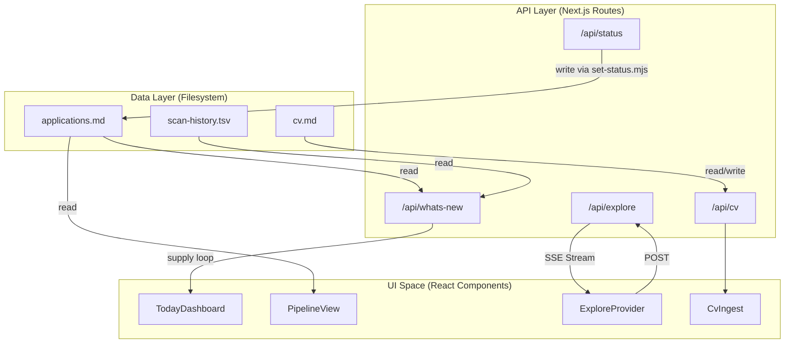
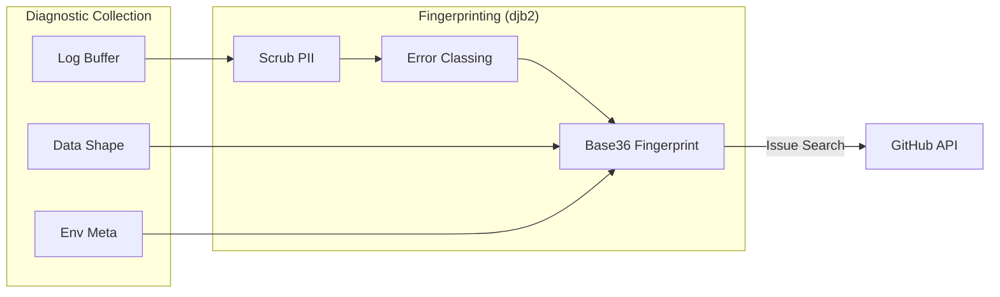

<!-- source: DeepWiki mcp.deepwiki.com · repo santifer/career-ops · page 7.2 Web UI Components & Pages · fetched 2026-10-27 -->

# Web UI Components & Pages

Relevant source files

The following files were used as context for generating this wiki page:

- [web/src/app/analytics/page.tsx](web/src/app/analytics/page.tsx)
- [web/src/app/api/explore/route.ts](web/src/app/api/explore/route.ts)
- [web/src/app/api/logo/route.ts](web/src/app/api/logo/route.ts)
- [web/src/app/api/report/shape/route.ts](web/src/app/api/report/shape/route.ts)
- [web/src/app/api/version/route.ts](web/src/app/api/version/route.ts)
- [web/src/app/api/whats-new/route.ts](web/src/app/api/whats-new/route.ts)
- [web/src/app/globals.css](web/src/app/globals.css)
- [web/src/app/portals/page.tsx](web/src/app/portals/page.tsx)
- [web/src/components/beta/beta-banner.tsx](web/src/components/beta/beta-banner.tsx)
- [web/src/components/company-logo.tsx](web/src/components/company-logo.tsx)
- [web/src/components/cost/cost-badge.tsx](web/src/components/cost/cost-badge.tsx)
- [web/src/components/cv-editor.tsx](web/src/components/cv-editor.tsx)
- [web/src/components/cv/cv-ingest.tsx](web/src/components/cv/cv-ingest.tsx)
- [web/src/components/delete-from-tracker.tsx](web/src/components/delete-from-tracker.tsx)
- [web/src/components/explore/discovery-card.tsx](web/src/components/explore/discovery-card.tsx)
- [web/src/components/explore/explore-mode-toggle.tsx](web/src/components/explore/explore-mode-toggle.tsx)
- [web/src/components/explore/explore-provider.tsx](web/src/components/explore/explore-provider.tsx)
- [web/src/components/explore/explorer-view.tsx](web/src/components/explore/explorer-view.tsx)
- [web/src/components/generate-pdf-button.tsx](web/src/components/generate-pdf-button.tsx)
- [web/src/components/home/decision-card.tsx](web/src/components/home/decision-card.tsx)
- [web/src/components/home/first-run-home.tsx](web/src/components/home/first-run-home.tsx)
- [web/src/components/home/follow-up-card.tsx](web/src/components/home/follow-up-card.tsx)
- [web/src/components/home/today-dashboard.tsx](web/src/components/home/today-dashboard.tsx)
- [web/src/components/mobile-nav.tsx](web/src/components/mobile-nav.tsx)
- [web/src/components/pipeline-view.tsx](web/src/components/pipeline-view.tsx)
- [web/src/components/portals-view.tsx](web/src/components/portals-view.tsx)
- [web/src/components/quick-evaluate.tsx](web/src/components/quick-evaluate.tsx)
- [web/src/components/report-view.tsx](web/src/components/report-view.tsx)
- [web/src/lib/core/logo-cache-key.mjs](web/src/lib/core/logo-cache-key.mjs)
- [web/src/lib/core/scan.ts](web/src/lib/core/scan.ts)
- [web/src/lib/explore-error.mjs](web/src/lib/explore-error.mjs)
- [web/src/lib/funnel-tiles.mjs](web/src/lib/funnel-tiles.mjs)
- [web/src/lib/report-sections.mjs](web/src/lib/report-sections.mjs)
- [web/src/lib/report/FORMAT.md](web/src/lib/report/FORMAT.md)
- [web/src/lib/report/logbuf.ts](web/src/lib/report/logbuf.ts)
- [web/src/lib/report/report.ts](web/src/lib/report/report.ts)
- [web/src/lib/whats-new.mjs](web/src/lib/whats-new.mjs)
- [web/tests/lib/decision-card-cta.test.mjs](web/tests/lib/decision-card-cta.test.mjs)
- [web/tests/lib/explore-error.test.mjs](web/tests/lib/explore-error.test.mjs)
- [web/tests/lib/first-run-copy.test.mjs](web/tests/lib/first-run-copy.test.mjs)
- [web/tests/lib/funnel-tiles.test.mjs](web/tests/lib/funnel-tiles.test.mjs)
- [web/tests/lib/logo-cache-key.test.mjs](web/tests/lib/logo-cache-key.test.mjs)
- [web/tests/lib/report-sections.test.mjs](web/tests/lib/report-sections.test.mjs)
- [web/tests/lib/whats-new.test.mjs](web/tests/lib/whats-new.test.mjs)

The `career-ops` Web UI is a React-based application built with Next.js that provides a local-first interface for managing the job search pipeline. It serves as a visual layer over the system's Markdown and TSV data files, delegating heavy processing (like AI evaluation and PDF generation) to the core CLI scripts while providing real-time discovery and tracking capabilities.

## Architecture & Data Flow

The Web UI follows a "View-over-Files" philosophy. It reads from the canonical `applications.md` and `scan-history.tsv` files and writes updates via dedicated API routes that execute the underlying Node.js maintenance scripts.

### Code Entity Mapping: Data to UI

The following diagram maps the relationship between data sources, API handlers, and the primary UI entry points.

**Sources:** [web/src/app/api/whats-new/route.ts:11-20](), [web/src/components/pipeline-view.tsx:44-53](), [web/src/components/home/today-dashboard.tsx:16-20]()

---

## Core View Components

### PipelineView
The `PipelineView` is the central tracker interface. It implements a sortable and filterable table that uses the URL as the single source of truth to prevent state desync between the UI and AI assistant actions [web/src/components/pipeline-view.tsx:44-53]().

- **Filtering Logic**: Supports tabs for canonical states (e.g., `INTERVIEW`, `OFFER`) and a minimum score filter [web/src/components/pipeline-view.tsx:93-102]().
- **Sorting**: Supports sorting by `company`, `role`, `score`, `status`, and `date` [web/src/components/pipeline-view.tsx:30-31]().
- **Inbox Integration**: Displays a triage queue of pending jobs from `pipeline.md` alongside tracked applications [web/src/components/pipeline-view.tsx:82-91]().

**Sources:** [web/src/components/pipeline-view.tsx:15-31](), [web/src/components/pipeline-view.tsx:93-117]()

### TodayDashboard
The `TodayDashboard` manages the "retention loop" for the candidate. It features a dual-loop action queue [web/src/components/home/today-dashboard.tsx:16-20]():
1. **Supply Loop**: Surfacing fresh matches from `scan-history.tsv` via `/api/whats-new` [web/src/app/api/whats-new/route.ts:11-15]().
2. **Demand Loop**: Tracking due follow-ups via `/api/followups` [web/src/components/home/today-dashboard.tsx:38-43]().

It utilizes `DecisionCard` components to allow one-tap "Apply" or "Skip" actions for evaluated roles [web/src/components/home/decision-card.tsx:13-20]().

**Sources:** [web/src/components/home/today-dashboard.tsx:21-78](), [web/src/components/home/decision-card.tsx:36-82]()

### ExploreProvider & ExplorerView
The Discovery subsystem provides two modes: a zero-token ATS network scan and an AI-assisted web discovery mode [web/src/components/explore/explore-provider.tsx:74-82]().

- **ExploreProvider**: Manages the state of active scans, including `Phase` tracking (casting, scanning, revealing) and AI cost tracking (searches, candidates, fetches) [web/src/components/explore/explore-provider.tsx:22-34]().
- **ExplorerView**: Renders the search interface and result list. It supports shareable searches via URL parameters [web/src/components/explore/explorer-view.tsx:63-71]().
- **Result Enrichment**: Matches discovered offers against existing tracker entries to prevent duplicate evaluations [web/src/components/explore/explorer-view.tsx:92-106]().

**Sources:** [web/src/components/explore/explore-provider.tsx:116-170](), [web/src/components/explore/explorer-view.tsx:114-155]()

---

## Specialized Components

### ReportView
Renders the A-F evaluation reports with progressive disclosure.
- **Verdict First**: The "F) Verdict" block is promoted to a lead callout [web/src/components/report-view.tsx:141-145]().
- **Technical Tier**: Machine artifacts like YAML summaries and submission logs are collapsed into a "Technical" tier to reduce noise for the user [web/src/components/report-view.tsx:30-34]().
- **Integration**: Contains `GeneratePdfButton` and `ApplyButton` which trigger the `generate-pdf.mjs` and Playwright-based application flows respectively [web/src/components/report-view.tsx:100-101]().

**Sources:** [web/src/components/report-view.tsx:16-28](), [web/src/components/report-view.tsx:145-155]()

### CvIngest
Handles the onboarding flow by parsing existing CVs to seed discovery filters.
- **Hybrid Parsing**: `.md` and `.txt` files are parsed instantly in the browser. PDF and DOCX files are sent to the local AI CLI for structured extraction [web/src/components/cv/cv-ingest.tsx:111-143]().
- **Wow Moment**: Upon saving, it redirects the user to the Explorer with auto-generated filters and triggers an immediate scan [web/src/components/cv/cv-ingest.tsx:169-176]().

**Sources:** [web/src/components/cv/cv-ingest.tsx:44-90](), [web/src/components/cv/cv-ingest.tsx:146-176]()

### Analytics Page
Provides funnel visualization using `funnel-tiles.mjs`.
- **Cumulative Achievement**: Unlike simple status counts, the "Interviews" and "Offers" tiles are cumulative achievement counters that don't reset if a candidate moves past those stages [web/src/app/analytics/page.tsx:44-49]().
- **Distribution**: Visualizes score distribution and top companies in the pipeline [web/src/app/analytics/page.tsx:31-43]().

**Sources:** [web/src/app/analytics/page.tsx:19-50](), [web/src/app/analytics/page.tsx:72-95]()

---

## UI Utilities & Feedback

### Cost & Usage
- **CostBadge**: A standardized indicator for token usage. It distinguishes between "Free" (Leaf/Sparkles icon) and "Spend" (Coins icon) to inform the user of token costs without causing alarm [web/src/components/cost/cost-badge.tsx:4-10]().
- **BetaBanner**: A diagnostic tool that allows users to report bugs. It collects a PII-scrubbed diagnostic snapshot including logs and "data shape" (counts of reports/PDFs) without sending actual job URLs or CV content [web/src/lib/report/report.ts:44-46]().

### Visual Assets
- **CompanyLogo**: Implements a caching strategy for company icons to ensure consistent UI even when offline or behind firewalls.
- **StatusSelect**: A dropdown component that delegates status changes to the `/api/status` route, which in turn calls `set-status.mjs` [web/src/components/report-view.tsx:99]().

### Diagnostics & Fingerprinting
The system uses a deterministic fingerprinting mechanism to group similar web UI errors.

**Sources:** [web/src/lib/report/report.ts:96-124](), [web/src/components/beta/beta-banner.tsx:53-60]()

---
**Sources:**
- `web/src/components/pipeline-view.tsx`
- `web/src/components/home/today-dashboard.tsx`
- `web/src/components/home/decision-card.tsx`
- `web/src/components/explore/explore-provider.tsx`
- `web/src/components/explore/explorer-view.tsx`
- `web/src/app/api/whats-new/route.ts`
- `web/src/components/cv/cv-ingest.tsx`
- `web/src/app/analytics/page.tsx`
- `web/src/components/report-view.tsx`
- `web/src/components/beta/beta-banner.tsx`
- `web/src/lib/report/report.ts`
- `web/src/components/cost/cost-badge.tsx`

---

