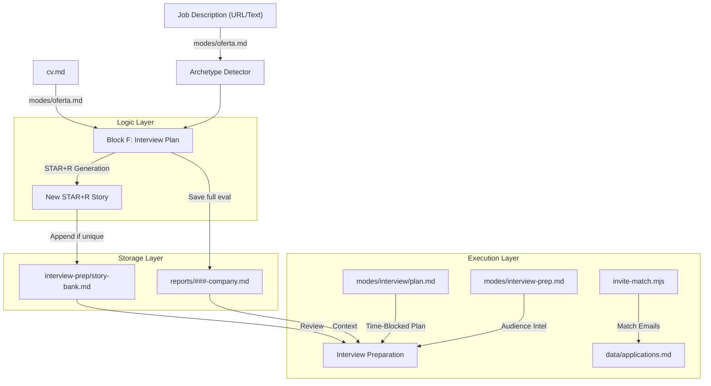
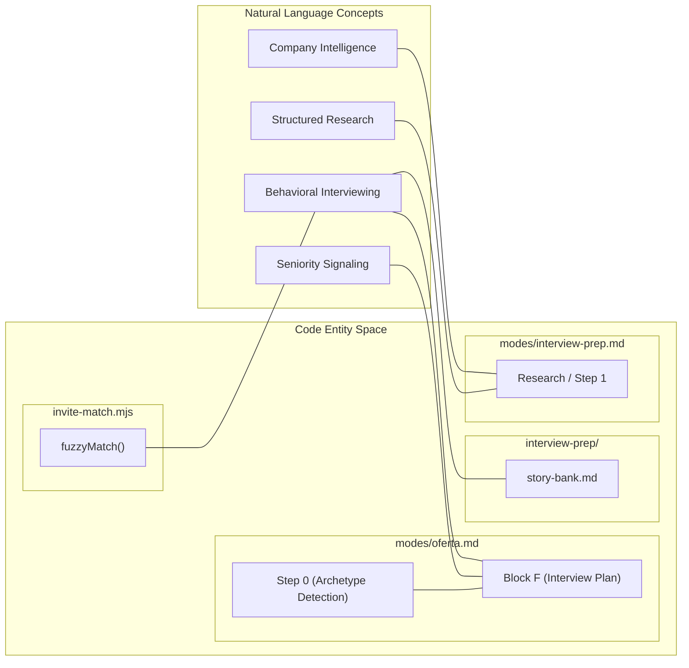

<!-- source: DeepWiki mcp.deepwiki.com · repo santifer/career-ops · page 8 Interview Preparation & Story Bank · fetched 2026-10-27 -->

# Interview Preparation & Story Bank

Relevant source files

The following files were used as context for generating this wiki page:

- [analyze-patterns.mjs](analyze-patterns.mjs)
- [batch/batch-prompt.md](batch/batch-prompt.md)
- [invite-match.mjs](invite-match.mjs)
- [invite-match.test.mjs](invite-match.test.mjs)
- [modes/README.md](modes/README.md)
- [modes/_profile.template.md](modes/_profile.template.md)
- [modes/add.md](modes/add.md)
- [modes/auto-pipeline.md](modes/auto-pipeline.md)
- [modes/followup.md](modes/followup.md)
- [modes/fr/README.md](modes/fr/README.md)
- [modes/interview-prep.md](modes/interview-prep.md)
- [modes/interview/debrief.md](modes/interview/debrief.md)
- [modes/interview/plan.md](modes/interview/plan.md)
- [modes/oferta.md](modes/oferta.md)
- [modes/offer-prep.md](modes/offer-prep.md)
- [modes/outcome.md](modes/outcome.md)
- [modes/patterns.md](modes/patterns.md)
- [modes/pdf/hm-audit.md](modes/pdf/hm-audit.md)
- [modes/tracker.md](modes/tracker.md)
- [modes/training.md](modes/training.md)
- [modes/upskill.md](modes/upskill.md)
- [salary-gap.mjs](salary-gap.mjs)
- [templates/restrictive-covenants.yml](templates/restrictive-covenants.yml)
- [validate-untrusted-content-coverage.mjs](validate-untrusted-content-coverage.mjs)

The **interview-prep/** subsystem transitions a candidate from "qualified applicant" to "hired professional" by building a persistent repository of behavioral stories and deep company intelligence. Unlike static CVs, the Story Bank grows with every job evaluation, ensuring that interview performance improves cumulatively across multiple applications.

## Persistent Story Repository: `story-bank.md`

The core of this subsystem is `interview-prep/story-bank.md`, a Markdown-based "experience database" [interview-prep/story-bank.md:1-3](). It uses the **STAR+R** framework (Situation, Task, Action, Result + **Reflection**) to document professional achievements.

### Data Flow: Generation to Persistence

Stories are harvested during the job evaluation process and stored for long-term reuse.

1.  **Trigger:** A user runs `/career-ops oferta` or the `auto-pipeline` [modes/oferta.md:1-3](), [modes/auto-pipeline.md:40-42]().
2.  **Extraction:** In **Block F (Interview Plan)**, the AI maps JD requirements to the candidate's `cv.md` and `article-digest.md` [modes/oferta.md:393-398]().
3.  **Formatting:** The AI generates 6-10 STAR+R stories tailored to the specific role archetype (e.g., FDE, LLMOps, PM) [modes/oferta.md:404-410]().
4.  **Persistence:** The system checks if these stories exist in `interview-prep/story-bank.md`. If not, it appends new ones to the file [modes/oferta.md:402-402]().

### Story Bank Structure

The bank organizes stories by "Theme" to allow quick retrieval during interview prep [interview-prep/story-bank.md:17-26]().

| Field | Description | Source |
| :--- | :--- | :--- |
| **Theme** | Behavioral category (e.g., Conflict, Leadership, Technical Debt). | [interview-prep/story-bank.md:18-18]() |
| **Source** | Reference to the specific `reports/` file where the story originated. | [interview-prep/story-bank.md:19-19]() |
| **STAR+R** | Core narrative components including the Reflection. | [interview-prep/story-bank.md:20-24]() |
| **Best for** | List of specific interview questions this story can answer. | [interview-prep/story-bank.md:25-25]() |

**Sources:** [interview-prep/story-bank.md:1-27](), [modes/oferta.md:393-410]()

---

## Interview Prep Logic (Block F)

When evaluating a specific job offer via `modes/oferta.md`, the system generates a tailored **Interview Plan** in Block F. This plan is heavily influenced by the **Archetype Detection** performed in Step 0 [modes/oferta.md:42-48]().

### Archetype-Driven Framing
The system frames stories differently based on the detected role type to align with hiring intent [modes/oferta.md:404-410]():

| Archetype | Story Framing Focus |
| :--- | :--- |
| **FDE (Forward Deployed)** | Client-facing delivery and rapid prototyping [modes/oferta.md:405-405](). |
| **SA (Solutions Architect)** | Enterprise integrations and end-to-end design [modes/oferta.md:406-406](). |
| **LLMOps** | Reliability, pipelines, and observability [modes/oferta.md:408-408](). |
| **Agentic** | Tooling, orchestration, and multi-agent systems [modes/oferta.md:409-409](). |
| **Transformation** | Change management and organizational adoption [modes/oferta.md:410-410](). |
| **Technical PM** | PRDs, discovery, and business translation [modes/oferta.md:407-407](). |

**Sources:** [modes/oferta.md:42-48](), [modes/oferta.md:404-410]()

---

## Company-Specific Intelligence (`interview-prep.md`)

The `modes/interview-prep.md` mode provides targeted intelligence when an application reaches the `Interview` status [modes/interview-prep.md:1-3]().

### Research Execution
The mode executes targeted `WebSearch` queries to extract structured data across three distinct audiences [modes/interview-prep.md:68-72]():
*   **Recruiter / HR screen:** Comp ranges (Levels.fyi/Glassdoor), process timeline, and benefits [modes/interview-prep.md:74-82]().
*   **Hiring manager / leadership:** Engineering blogs, product roadmaps, and recent company movements [modes/interview-prep.md:86-90]().
*   **Peer / technical panel:** Coding questions, technical bars (Blind), and stack-specific challenges [modes/interview-prep.md:94-98]().

### Audience Mapping & Panel Intel
A key feature is the `panel-mixed` audience mapping. If multiple interviewers are named, the system builds a **Panel Intel** table to weight decision-makers against the reporting line [modes/interview-prep.md:162-177]().

| Audience | Typical Round | Primary Evaluation |
| :--- | :--- | :--- |
| `recruiter-screen` | First call (15–30 min) | Box-checking: fit, comp, logistics [modes/interview-prep.md:168-168]() |
| `hiring-manager` | Manager call (30–45 min) | Communication, leadership, and fundamentals [modes/interview-prep.md:169-169]() |
| `peer-tech` | Technical deep-dive | Depth, applied scenarios, and judgment [modes/interview-prep.md:170-170]() |
| `panel-mixed` | Onsite / Loop | Cross-functional decision-making [modes/interview-prep.md:171-171]() |

**Sources:** [modes/interview-prep.md:1-177](), [modes/interview/plan.md:33-65]()

---

## Interview Utilities

### Invite Matching (`invite-match.mjs`)
`invite-match.mjs` fuzzy-matches company names from calendar invites or rejection emails against `data/applications.md` [invite-match.mjs:2-10](). It ranks candidates based on `STATUS_PRIORITY`, where `interview` and `responded` statuses outrank `rejected` or `discarded` rows for the same company [invite-match.mjs:121-130]().

### Pattern & Cadence Analysis
*   **`patterns.md`**: Uses `analyze-patterns.mjs` to detect why applications are failing (e.g., geo-blocks, stack gaps) [modes/patterns.md:1-7](), [analyze-patterns.mjs:3-7]().
*   **`followup.md`**: Uses `followup-cadence.mjs` to track elapsed time since application and generate conversational drafts [modes/followup.md:1-7]().
*   **`rejection-latency.mjs`**: Flags applications where post-interview silence exceeds a 30-day "courtesy threshold" [modes/followup.md:44-52]().

**Sources:** [invite-match.mjs:2-130](), [modes/patterns.md:1-53](), [modes/followup.md:1-103]()

---

## Technical Data Flow: Story Lifecycle

The following diagram illustrates how a story moves from a job description into the persistent Story Bank and finally into an interview preparation session.

### System Architecture: Story Propagation

**Sources:** [modes/oferta.md:393-410](), [interview-prep/story-bank.md:1-12](), [modes/interview-prep.md:1-20](), [invite-match.mjs:2-15]()

### Entity Mapping: Natural Language to Code
This diagram bridges conceptual interview preparation tasks to the specific code entities implementing them.

**Sources:** [modes/oferta.md:42-48](), [modes/oferta.md:393-402](), [interview-prep/story-bank.md:1-5](), [modes/interview-prep.md:68-72](), [invite-match.mjs:12-20]()

---

