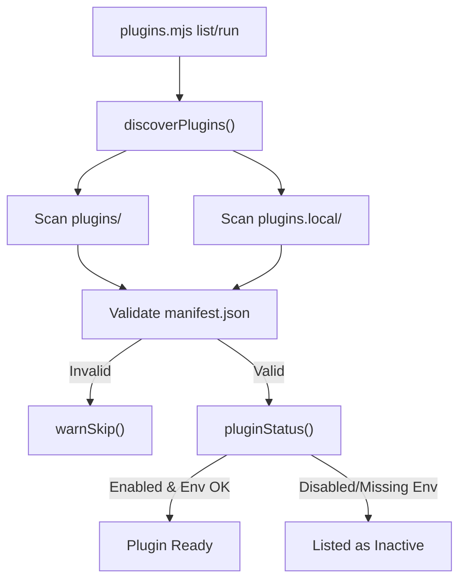

<!-- source: DeepWiki mcp.deepwiki.com · repo santifer/career-ops · page 9 Plugin System · fetched 2026-10-27 -->

# Plugin System

Relevant source files

The following files were used as context for generating this wiki page:

- [.github/PULL_REQUEST_TEMPLATE/plugin-registry.md](.github/PULL_REQUEST_TEMPLATE/plugin-registry.md)
- [.github/workflows/plugin-registry-validate.yml](.github/workflows/plugin-registry-validate.yml)
- [docs/PLUGINS.md](docs/PLUGINS.md)
- [docs/PLUGIN_REVIEW.md](docs/PLUGIN_REVIEW.md)
- [plugins.mjs](plugins.mjs)
- [plugins/_engine.mjs](plugins/_engine.mjs)
- [plugins/_registry.mjs](plugins/_registry.mjs)
- [plugins/apify/index.mjs](plugins/apify/index.mjs)
- [plugins/gmail/index.mjs](plugins/gmail/index.mjs)
- [plugins/notion/index.mjs](plugins/notion/index.mjs)
- [tests/plugin-symlink-discovery.test.mjs](tests/plugin-symlink-discovery.test.mjs)
- [validate-plugin-registry.mjs](validate-plugin-registry.mjs)

The career-ops plugin system provides an opt-in architecture for integrations that require API keys, external service communication, or private logic. By separating these from the "zero-key" core, the system maintains a local-first, privacy-focused foundation while allowing users to extend functionality as needed [docs/PLUGINS.md:1-7]().

### Architecture Overview

The system distinguishes between two types of plugins:
*   **Bundled Plugins:** Located in `plugins/`, these are reviewed in-tree, shipped with the core, and serve as reference implementations [docs/PLUGINS.md:29]().
*   **Local/Community Plugins:** Located in `plugins.local/`, these are private or community-contributed integrations [docs/PLUGINS.md:31]().

The `plugins/_engine.mjs` acts as the discovery and execution layer, ensuring that plugins are only loaded if they are explicitly enabled in `config/plugins.yml` and all required environment variables are present in `.env` [plugins/_engine.mjs:16-17]().

### Plugin Lifecycle & Discovery

Plugin discovery follows a strict set of rules to ensure system stability and security. The engine scans `plugins/` and `plugins.local/` for directories containing a valid `manifest.json` [plugins/_engine.mjs:27-32]().

#### Discovery Logic

*Sources: [plugins/_engine.mjs:109-125](), [plugins.mjs:95-119]()*

### The Plugin Contract (manifest.json)

Every plugin must provide a `manifest.json` that defines its identity and requirements. The engine validates this file before importing any code [plugins/_engine.mjs:151-160]().

| Field | Description | Requirement |
| :--- | :--- | :--- |
| `id` | Unique identifier (must match directory name) | Required [plugins/_engine.mjs:155-156]() |
| `apiVersion` | Currently `1` | Required [plugins/_engine.mjs:157]() |
| `hooks` | Array of hook types (see below) | Non-empty [plugins/_engine.mjs:161]() |
| `requiredEnv` | Environment variables needed (e.g., `NOTION_TOKEN`) | Optional [plugins/_engine.mjs:141]() |
| `allowedHosts` | List of domains the plugin can `fetch` | Required for keyed plugins [plugins/_registry.mjs:115]() |
| `humanInTheLoop` | Must be `true` (no auto-submit allowed) | Required [plugins/_engine.mjs:159]() |

### Hook Types

Plugins interact with the core via five defined hook types [plugins/_engine.mjs:35]():

1.  **`provider`**: Custom job board scrapers (e.g., Apify). These are invoked during `node scan.mjs` [plugins.mjs:12-17]().
2.  **`ingest`**: Pulls data from external sources like Gmail or Calendar into `data/pipeline.md` [plugins/gmail/index.mjs:7-13]().
3.  **`search`**: Queries external databases (e.g., Notion) for existing leads [plugins/notion/index.mjs:95-101]().
4.  **`notify`**: (Reserved) For outbound notifications regarding pipeline updates.
5.  **`export`**: Pushes a read-only snapshot of the tracker to external tools [plugins/notion/index.mjs:60-64]().

### Trust and Security Model

The system uses a **Trust Badge** system to inform users about the provenance of the code they are running [docs/PLUGINS.md:25-32]():
*   `📦 bundled`: In-tree, reviewed by maintainers.
*   `✓ approved`: Community plugin reviewed at a specific commit SHA in the registry.
*   `❓ community-unverified`: Locally installed, not in the registry.
*   `⚠️ off-registry`: Installed version differs from the approved registry SHA.

**Tamper Detection:** The engine uses a `plugins.lock` file to store file hashes. If a plugin's code changes without a version bump, the engine blocks execution until the user re-pins the trust [docs/PLUGINS.md:34-35]().

### Bundled Reference Plugins

Career-ops ships with three reference plugins to demonstrate the system's capabilities:
*   **Gmail (`plugins/gmail/`)**: Ingests job leads from specific email labels [plugins/gmail/index.mjs:7-13]().
*   **Notion (`plugins/notion/`)**: Mirrors the tracker to a Notion DB and searches for leads [plugins/notion/index.mjs:7-15]().
*   **Apify (`plugins/apify/`)**: A keyed provider that runs Apify actors for complex web scraping [plugins/apify/index.mjs:7-15]().

For detailed implementation details on these plugins and the underlying engine, see [Plugin Engine & Bundled Plugins](#9.1).

### Community Registry

The `plugins-registry/` directory contains JSON files for approved community plugins. The registration process requires a GitHub PR and a static security audit [docs/PLUGINS.md:55-61]().

For details on the registry format and how to publish your own plugin, see [Plugin Registry & Community Plugins](#9.2).

***

**Sources:**
*   [plugins/_engine.mjs:1-55]() (Engine invariants and constants)
*   [plugins.mjs:1-31]() (CLI host and hook management)
*   [docs/PLUGINS.md:1-54]() (User-facing plugin documentation)
*   [plugins/_registry.mjs:71-97]() (Trust classification logic)
*   [docs/PLUGIN_REVIEW.md:1-45]() (Maintainer review guidelines)

---

