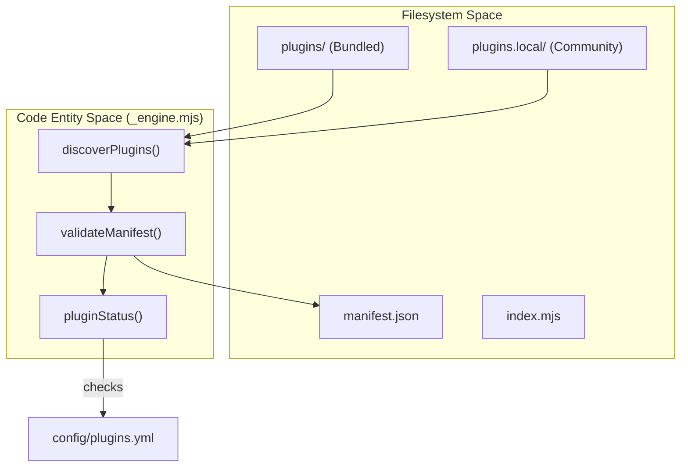
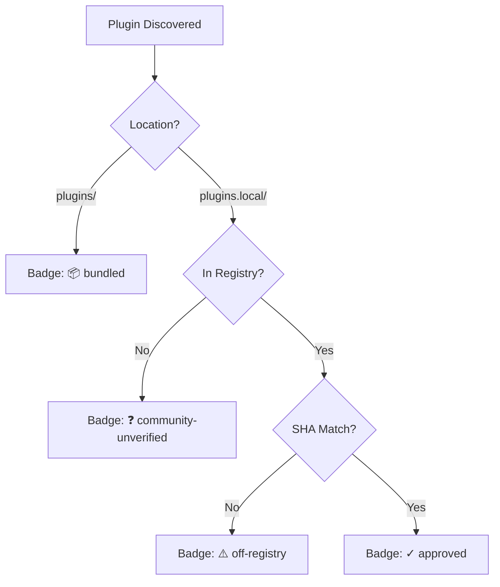

<!-- source: DeepWiki mcp.deepwiki.com · repo santifer/career-ops · page 9.1 Plugin Engine & Bundled Plugins · fetched 2026-10-27 -->

# Plugin Engine & Bundled Plugins

Relevant source files

The following files were used as context for generating this wiki page:

- [.github/PULL_REQUEST_TEMPLATE/plugin-registry.md](.github/PULL_REQUEST_TEMPLATE/plugin-registry.md)
- [.github/workflows/plugin-registry-validate.yml](.github/workflows/plugin-registry-validate.yml)
- [docs/PLUGINS.md](docs/PLUGINS.md)
- [docs/PLUGIN_REVIEW.md](docs/PLUGIN_REVIEW.md)
- [plugins.mjs](plugins.mjs)
- [plugins/_engine.mjs](plugins/_engine.mjs)
- [plugins/_registry.mjs](plugins/_registry.mjs)
- [plugins/apify/index.mjs](plugins/apify/index.mjs)
- [plugins/gmail/index.mjs](plugins/gmail/index.mjs)
- [plugins/notion/index.mjs](plugins/notion/index.mjs)
- [tests/plugin-symlink-discovery.test.mjs](tests/plugin-symlink-discovery.test.mjs)
- [validate-plugin-registry.mjs](validate-plugin-registry.mjs)

The career-ops plugin engine provides an opt-in, extensible layer for integrations that require API keys or external service communication (e.g., Gmail, Notion, Apify). It generalizes the provider pattern used in the core scanner into a multi-hook system while maintaining a strict "local-first" philosophy and a side-effect-free import model [plugins/_engine.mjs:5-25]().

### Plugin Discovery & Manifest Validation

The engine discovers plugins by scanning two specific directories: `plugins/` (bundled reference seeds) and `plugins.local/` (user-installed or private plugins) [plugins/_engine.mjs:98-100](). Discovery is designed to be resilient; for instance, dangling symlinks in `plugins.local/` are skipped without crashing the engine [tests/plugin-symlink-discovery.test.mjs:91-113]().

#### Manifest Requirements
Every plugin must contain a `manifest.json` that satisfies the following contract:
*   **`id`**: Must match the directory name and follow `^[a-z0-9][a-z0-9-]*$` [plugins/_engine.mjs:155-156]().
*   **`apiVersion`**: Currently must be `1` [plugins/_engine.mjs:157]().
*   **`hooks`**: A non-empty array containing valid hook types: `provider`, `ingest`, `search`, `notify`, or `export` [plugins/_engine.mjs:35, 161]().
*   **`humanInTheLoop`**: Must be `true`. The engine explicitly forbids fully automated submission plugins [plugins/_engine.mjs:159]().
*   **`requiredEnv`**: A list of environment variables. The engine blocks reserved core keys (e.g., `ANTHROPIC_API_KEY`, `PATH`) to prevent credential smuggling [plugins/_engine.mjs:44-51]().

**Plugin Entity Relationship**

Sources: [plugins/_engine.mjs:1-160](), [plugins.mjs:95-119]().

---

### The `ctx` Object & Security
Plugins interact with the system through a restricted `ctx` (context) object. This is a convenience layer, not a hard VM sandbox, as standard ESM imports cannot be fully isolated without a build step [plugins/_engine.mjs:18-21]().

| Property | Description | Enforcement |
| :--- | :--- | :--- |
| `ctx.fetch` | Guarded HTTP client | Enforces `allowedHosts` and prevents SSRF [docs/PLUGINS.md:47-49]() |
| `ctx.env` | Scoped environment variables | Only provides keys declared in the manifest [plugins/_engine.mjs:17]() |
| `ctx.settings` | Plugin-specific config | Read from `config/plugins.yml` [plugins/_engine.mjs:49]() |
| `ctx.dryRun` | Boolean flag | Indicates if the user requested a non-destructive run [plugins.mjs:122]() |

Sources: [plugins/_engine.mjs:18-21](), [docs/PLUGINS.md:47-49]().

---

### Tamper Detection & Trust Pinning
The system uses a "Trust Badge" hierarchy to communicate the origin and integrity of plugin code [docs/PLUGINS.md:25-36]().

1.  **Tamper Detection**: On first run, the engine generates an integrity hash of the plugin's file tree and stores it in `plugins.lock` [tests/plugin-symlink-discovery.test.mjs:153-161](). If the files change without a version bump, the plugin is blocked until the user runs `node plugins.mjs trust <id>` [docs/PLUGINS.md:34-35]().
2.  **Registry Pinning**: Approved community plugins are pinned to a specific Git SHA in the registry. If the local SHA differs, it is flagged as `⚠️ off-registry` [plugins/_registry.mjs:85-86]().
3.  **Successor Precedence**: A community plugin can supersede a bundled one by setting `"supersedesBundled": true` in the registry. If installed, the engine grants the community version precedence over the bundled reference seed [docs/PLUGINS.md:83-96]().

**Trust Flow**

Sources: [plugins/_registry.mjs:81-97](), [docs/PLUGINS.md:25-36]().

---

### The `plugins.mjs` CLI
The `plugins.mjs` script is the primary interface for managing and executing non-provider hooks [plugins.mjs:4-17]().

*   **`list`**: Shows all discovered plugins, their hooks, and current status (enabled/disabled/missing keys) [plugins.mjs:95-119]().
*   **`available`**: Lists bundled and approved community plugins from the remote registry [docs/PLUGINS.md:15]().
*   **`add <name>`**: Installs a plugin from the registry into `plugins.local/` [docs/PLUGINS.md:16]().
*   **`enable <id> [--confirm]`**: Modifies `config/plugins.yml` to activate a plugin [docs/PLUGINS.md:17]().
*   **`run <id> [hook] [args]`**: Executes a specific hook. For `ingest` and `search` hooks, the CLI handles writing the returned `Job[]` objects to `data/pipeline.md` to ensure data integrity [plugins.mjs:121-150]().
*   **`new <id>`**: Scaffolds a new plugin structure in `plugins.local/` [docs/PLUGINS.md:39-41]().

Sources: [plugins.mjs:1-150](), [docs/PLUGINS.md:11-41]().

---

### Bundled Plugins (Reference Seeds)

Bundled plugins serve as minimal, stable examples. They are reviewed in-tree and updated with the core system [docs/PLUGINS.md:78-82]().

#### Gmail (`plugins/gmail/`)
*   **Hook**: `ingest`
*   **Function**: Connects to the Gmail API via OAuth2 to pull job leads from a specific label (default: "Job Leads") [plugins/gmail/index.mjs:7-20]().
*   **Logic**: It checks emails from the last `N` days, validates authenticity via DMARC/headers, extracts URLs from the body, and parses the subject line for Role/Company hints [plugins/gmail/index.mjs:80-143]().

#### Notion (`plugins/notion/`)
*   **Hooks**: `export`, `search`
*   **Function**: Mirrors the local `applications.md` tracker to a Notion database [plugins/notion/index.mjs:7-15]().
*   **Logic**: `export` performs an upsert into a Notion DB (matching on Company + Role). `search` allows querying a Notion database for job leads to ingest back into the pipeline [plugins/notion/index.mjs:65-112]().

#### Apify (`plugins/apify/`)
*   **Hook**: `provider`
*   **Function**: A keyed provider that runs Apify Actors (e.g., Indeed or LinkedIn scrapers) [plugins/apify/index.mjs:7-15]().
*   **Logic**: Maps arbitrary JSON dataset items from Apify into the canonical `Job` shape using a `field_map` defined in `portals.yml`. It includes `htmlToText` utilities for cleaning job descriptions before they are cached locally in `jds/` [plugins/apify/index.mjs:89-170]().

Sources: [plugins/gmail/index.mjs:1-145](), [plugins/notion/index.mjs:1-113](), [plugins/apify/index.mjs:1-188]().

---

