# Page: Career-Ops Overview

# Career-Ops Overview

<details>
<summary>Relevant source files</summary>

The following files were used as context for generating this wiki page:

- [.agents/skills/career-ops/SKILL.md](.agents/skills/career-ops/SKILL.md)
- [.github/CODEOWNERS](.github/CODEOWNERS)
- [.github/PULL_REQUEST_TEMPLATE/sign-manifesto.md](.github/PULL_REQUEST_TEMPLATE/sign-manifesto.md)
- [.gitignore](.gitignore)
- [AGENTS.md](AGENTS.md)
- [ARCHITECTURE.md](ARCHITECTURE.md)
- [CLAUDE.md](CLAUDE.md)
- [DATA_CONTRACT.md](DATA_CONTRACT.md)
- [MAINTAINERS.md](MAINTAINERS.md)
- [MANIFESTO.md](MANIFESTO.md)
- [README.ar.md](README.ar.md)
- [README.cn.md](README.cn.md)
- [README.es.md](README.es.md)
- [README.fr.md](README.fr.md)
- [README.ja.md](README.ja.md)
- [README.ko-KR.md](README.ko-KR.md)
- [README.md](README.md)
- [README.pl.md](README.pl.md)
- [README.pt-BR.md](README.pt-BR.md)
- [README.ru.md](README.ru.md)
- [README.ua.md](README.ua.md)
- [README.zh-TW.md](README.zh-TW.md)
- [SIGNATURES.md](SIGNATURES.md)
- [dashboard/README.md](dashboard/README.md)
- [docs/ARCHITECTURE.md](docs/ARCHITECTURE.md)
- [docs/CUSTOMIZATION.md](docs/CUSTOMIZATION.md)
- [docs/REVIEWING.md](docs/REVIEWING.md)
- [docs/SCRIPTS.md](docs/SCRIPTS.md)
- [providers/README.md](providers/README.md)
- [test-all.mjs](test-all.mjs)
- [update-system.mjs](update-system.mjs)

</details>


Career-Ops is an AI-powered job search command center built on top of **Claude Code** and other AI coding CLIs. It transforms the manual, often overwhelming process of job hunting into a structured, automated pipeline. The system is designed for high-quality, targeted applications rather than "spray-and-pray" volume, using a sophisticated A-G scoring logic to ensure a genuine match between the candidate and the role.

The project was originally developed to manage a high-scale search involving 740+ evaluations and 100+ tailored CVs [README.md:41-41](), [AGENTS.md:3-5]().

## Core Philosophy: Quality via Automation

The system operates on three primary pillars:
1.  **Deep Evaluation**: Every job description (JD) is analyzed across weighted dimensions to produce a score from 1.0 to 5.0, plus a qualitative legitimacy assessment (Block G) and a negotiation prep block (Block H) [README.md:87-87](), [.agents/skills/career-ops/SKILL.md:45-46]().
2.  **Tailored Artifacts**: Instead of a generic resume, the system generates ATS-optimized PDFs or LaTeX documents customized specifically for the target JD using a keyword-injection engine [README.md:88-88](), [AGENTS.md:57-60]().
3.  **Data Integrity**: A flat-file "database" (`data/applications.md`) serves as the single source of truth, maintained by a suite of Node.js scripts to ensure consistency, deduplication, and status normalization [DATA_CONTRACT.md:31-31](), [AGENTS.md:13-14]().

Sources: [README.md:83-94](), [AGENTS.md:3-11](), [DATA_CONTRACT.md:1-53]()

## System Topology

The following diagram illustrates how a user interaction (pasting a URL) flows through the subsystems to produce structured data and documents.

### High-Level Data Flow (Natural Language to Code Space)
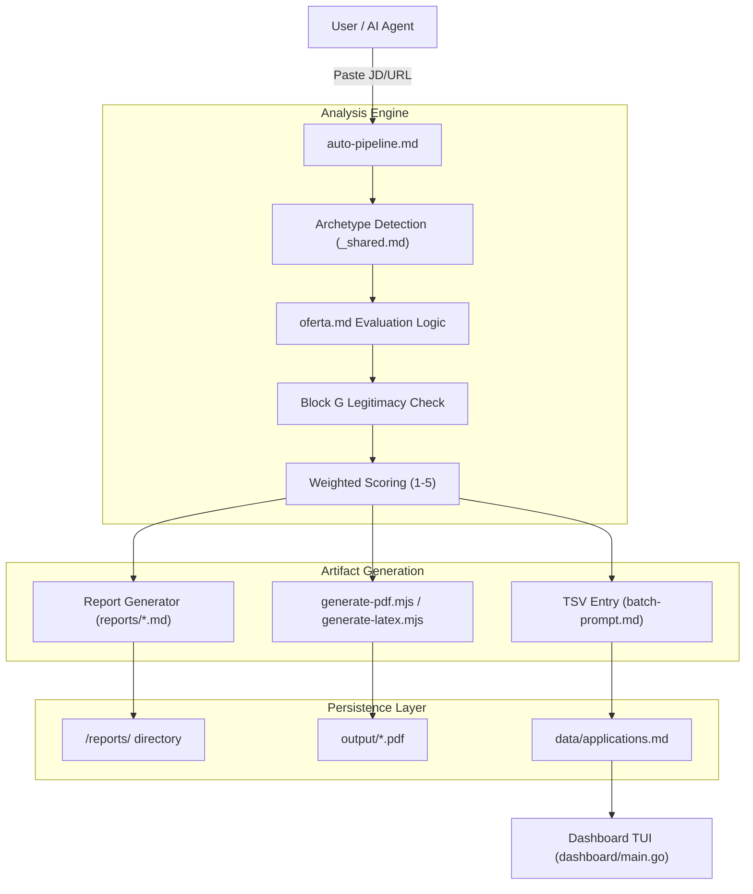
Sources: [README.md:85-92](), [AGENTS.md:72-104](), [DATA_CONTRACT.md:31-53]()

## Subsystem Interaction (Code Entity Space)

This diagram maps the logical functions to the specific files and scripts that execute them within the codebase.

### Code Entity Map
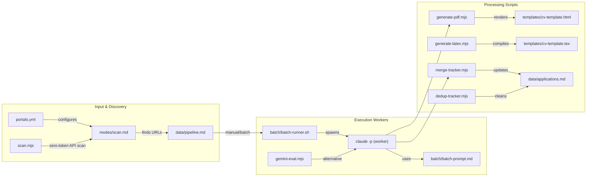
Sources: [AGENTS.md:49-70](), [DATA_CONTRACT.md:5-74](), [README.md:97-114](), [docs/SCRIPTS.md:9-54]()

## Major Subsystems

### 1. AI Agent Modes (`/modes`)
The intelligence of the system is contained in Markdown "skill" files. These files define how the AI behaves when specific commands are invoked.
*   **Evaluation**: `oferta.md` handles single analysis, including the 6-block A-F structure plus Block G [DATA_CONTRACT.md:51-51]().
*   **Discovery**: `scan.md` and `scan.mjs` find new roles based on `portals.yml` [AGENTS.md:69-69]().
*   **Action**: `apply.md` (form filling assistant) and `contacto.md` (LinkedIn outreach) handle external steps [DATA_CONTRACT.md:49-49]().
*   **Context**: `_shared.md` contains core rules, while `_profile.md` holds user-specific customizations (archetypes, narrative) to prevent overwrite during updates [AGENTS.md:16-16](), [DATA_CONTRACT.md:16-16]().

### 2. Batch Processing (`/batch`)
For high-volume processing, the system uses an orchestrator/worker architecture. `batch-runner.sh` manages multiple worker instances, each running the `batch-prompt.md` logic to evaluate dozens of offers in parallel and generate reports/PDFs automatically [README.md:90-90]().

### 3. Generation Engine
The system supports two output paths for CVs:
*   **HTML/PDF**: `generate-pdf.mjs` uses Playwright to render `templates/cv-template.html` [docs/SCRIPTS.md:16-16]().
*   **LaTeX**: `generate-latex.mjs` validates and compiles `templates/cv-template.tex` [docs/SCRIPTS.md:19-19]().
The choice is typically routed through the agent based on user preference or configuration [AGENTS.md:57-60]().

### 4. Data Management & TUI
The `data/` directory stores the pipeline state. Because this is a flat-file system, integrity scripts like `merge-tracker.mjs` and `dedup-tracker.mjs` are used to maintain the `applications.md` database [docs/SCRIPTS.md:14-15](). The **Dashboard TUI**, written in Go, provides a terminal interface for filtering and sorting this data [docs/SCRIPTS.md:53-53]().

### 5. Interview Intelligence (`/interview-prep`)
This subsystem accumulates STAR+Reflection stories in `story-bank.md` across multiple evaluations [DATA_CONTRACT.md:21-21](). The `deep.md` mode and `interview-prep` subcommands generate company-specific intelligence reports [AGENTS.md:48-50](), [DATA_CONTRACT.md:22-22]().

### 6. Multi-Agent & Updates
Career-Ops supports multiple agents (Claude, Gemini, Qwen, etc.) via a universal routing layer [AGENTS.md:141-146](). The `update-system.mjs` script ensures that core logic can be updated without touching user data by strictly enforcing the `DATA_CONTRACT.md` boundaries [update-system.mjs:6-7]().

## Child Pages

For detailed technical documentation on specific components, see the following pages:

*   **[Getting Started & Setup](#1.1)**: Installation (Node, Go, Playwright) and the initial onboarding flow (CV and Profile setup).
*   **[Configuration Reference](#1.2)**: Detailed breakdown of `profile.yml`, `portals.yml`, and the `DATA_CONTRACT.md` boundary.
*   **[Examples & Sample Files](#1.3)**: Walkthrough of sample CVs, evaluations, and proof point formats.

Sources: [README.md:95-130](), [AGENTS.md:72-134](), [DATA_CONTRACT.md:1-81](), [update-system.mjs:1-20]()

---

# Page: Getting Started & Setup

# Getting Started & Setup

<details>
<summary>Relevant source files</summary>

The following files were used as context for generating this wiki page:

- [.agents/skills/career-ops/SKILL.md](.agents/skills/career-ops/SKILL.md)
- [.gitignore](.gitignore)
- [AGENTS.md](AGENTS.md)
- [CLAUDE.md](CLAUDE.md)
- [DATA_CONTRACT.md](DATA_CONTRACT.md)
- [OPENCODE.md](OPENCODE.md)
- [README.ar.md](README.ar.md)
- [README.cn.md](README.cn.md)
- [README.es.md](README.es.md)
- [README.fr.md](README.fr.md)
- [README.ja.md](README.ja.md)
- [README.ko-KR.md](README.ko-KR.md)
- [README.md](README.md)
- [README.pl.md](README.pl.md)
- [README.pt-BR.md](README.pt-BR.md)
- [README.ru.md](README.ru.md)
- [README.ua.md](README.ua.md)
- [README.zh-TW.md](README.zh-TW.md)
- [cv-sync-check.mjs](cv-sync-check.mjs)
- [docs/FAQ.md](docs/FAQ.md)
- [docs/RUNNING_ON_A_BUDGET.md](docs/RUNNING_ON_A_BUDGET.md)
- [docs/SCRIPTS.md](docs/SCRIPTS.md)
- [docs/SUPPORTED_CLIS.md](docs/SUPPORTED_CLIS.md)
- [doctor.mjs](doctor.mjs)
- [jsonc-parse.mjs](jsonc-parse.mjs)
- [lib/gemini-node-floor.mjs](lib/gemini-node-floor.mjs)
- [modes/_writing.md](modes/_writing.md)
- [openai-tailor.mjs](openai-tailor.mjs)
- [opencode.example.json](opencode.example.json)
- [scaffolder/bin/skill-entrypoints.mjs](scaffolder/bin/skill-entrypoints.mjs)
- [test-all.mjs](test-all.mjs)
- [tests/doctor-cli-resolution.test.mjs](tests/doctor-cli-resolution.test.mjs)
- [tests/gemini-node-floor.test.mjs](tests/gemini-node-floor.test.mjs)
- [tests/jsonc-parse.test.mjs](tests/jsonc-parse.test.mjs)
- [tests/playwright-mcp-detection.test.mjs](tests/playwright-mcp-detection.test.mjs)
- [update-system.mjs](update-system.mjs)

</details>


This page provides a technical guide for initializing the `career-ops` pipeline. It covers dependency management, configuration of personal identity files, and the validation suite used to ensure the AI agent has a consistent "source of truth" for evaluations.

## System Prerequisites

Before installation, ensure the following environments are available:

*   **AI Coding CLI**: The core execution engine. `career-ops` is built as a suite of specialized prompts and scripts that extend agents like Claude Code, OpenCode, Antigravity CLI, or Gemini CLI [AGENTS.md:65-73](), [.agents/skills/career-ops/SKILL.md:17-25]().
*   **Node.js (v18+)**: Required for running utility scripts and the PDF generation engine. Node >= 22.5.0 is highly recommended to enable native `node:sqlite` support for the tracker index [doctor.mjs:66-91]().
*   **Playwright**: Used for PDF generation, liveness checks, and browser-based job extraction [doctor.mjs:150-170](), [docs/SCRIPTS.md:28-28]().
*   **Go (v1.22+)**: Required for building the Terminal User Interface (TUI) dashboard [README.md:76-78](), [test-all.mjs:1230-1230]().

Sources: [doctor.mjs:66-91](), [README.md:65-81](), [AGENTS.md:1-2]()

## Installation Workflow

The setup follows a structured process to transition from a clean clone to a functional AI job-search agent.

### 1. Recommended Initialization
The fastest way to set up is using the one-command installer which clones the repo and installs dependencies.

```bash
npx @santifer/career-ops init
```
Sources: [README.cn.md:101-105](), [README.es.md:104-106]()

### 2. Manual Clone and Dependency Resolution
Alternatively, you can clone the repository manually and install the required packages.

```bash
git clone https://github.com/santifer/career-ops.git
cd career-ops && npm install
npx playwright install chromium
```
Sources: [README.cn.md:123-129](), [doctor.mjs:139-160]()

### 3. Automated Onboarding & Health Check
`career-ops` includes a "doctor" script to validate the environment. It checks Node versions, dependency presence, Playwright installation, and billing sources to ensure you aren't accidentally using expensive API credits when a subscription is available [doctor.mjs:97-137]().

```bash
npm run doctor
# or for machine-readable output
node doctor.mjs --json
```
Sources: [doctor.mjs:1-60](), [docs/SCRIPTS.md:58-66]()

## Configuration & Identity

The system distinguishes between a **System Layer** (auto-updatable logic) and a **User Layer** (personal data) [DATA_CONTRACT.md:1-4]().

### Required User Files
| File | Purpose | Logic |
| :--- | :--- | :--- |
| `cv.md` | Primary source of truth for facts. | Ground truth for all generated content [AGENTS.md:22-24](). |
| `config/profile.yml` | Identity, target roles, and comp. | Authoritative for prose language and targets [AGENTS.md:91-100](). |
| `modes/_profile.md` | Narrative and negotiation scripts. | User-authored strategy layer [DATA_CONTRACT.md:16-16](). |
| `portals.yml` | Target companies for scanning. | Customized company list for `scan.mjs` [DATA_CONTRACT.md:26-26](). |

Sources: [DATA_CONTRACT.md:5-52](), [AGENTS.md:9-32](), [doctor.mjs:200-210]()

## Data Flow & Entity Mapping

The following diagram illustrates how configuration files and scripts interact to prepare the system for its first evaluation.

### Setup Data Flow: From Config to Execution
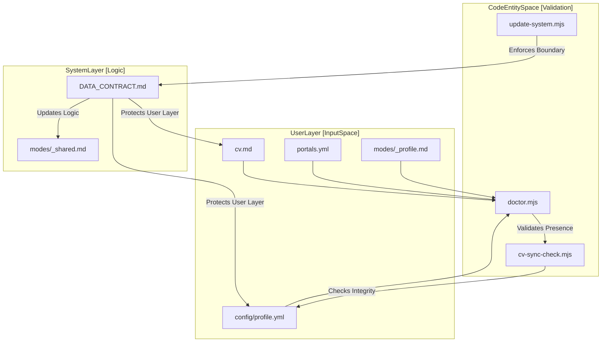
Sources: [doctor.mjs:140-210](), [DATA_CONTRACT.md:1-81](), [update-system.mjs:6-19]()

## System Maintenance & Updates

`career-ops` includes a self-updating mechanism to keep the system logic current without risking user data loss.

### The Update Workflow (`update-system.mjs`)
The system layer is defined by a strict list of paths in `update-system.mjs` that are safe to overwrite [update-system.mjs:63-211]().

1.  **Check**: `node update-system.mjs check` compares local version against `RAW_VERSION_URL` [update-system.mjs:10-10](), [update-system.mjs:41-41]().
2.  **Apply**: `node update-system.mjs apply` fetches updates and applies them to the **System Layer** [update-system.mjs:11-15]().
3.  **Rollback**: `node update-system.mjs rollback` restores the previous system state if an update fails [update-system.mjs:16-16]().

### Health Check Commands
| Command | Purpose |
| :--- | :--- |
| `npm run verify` | Health check for pipeline data integrity and status codes [docs/SCRIPTS.md:70-79](). |
| `npm run sync-check` | Validates CV/profile consistency [docs/SCRIPTS.md:20-20](). |
| `npm run normalize` | Maps non-canonical statuses to `templates/states.yml` [docs/SCRIPTS.md:82-94](). |
| `npm run dedup` | Removes duplicate entries from `applications.md` [docs/SCRIPTS.md:97-109](). |

Sources: [docs/SCRIPTS.md:1-54](), [update-system.mjs:1-20](), [DATA_CONTRACT.md:1-19]()

## Slash Commands Overview

Once setup is verified, the system is controlled via `/career-ops` commands routed through a unified skill dispatcher.

### Command Mapping to Code Entities
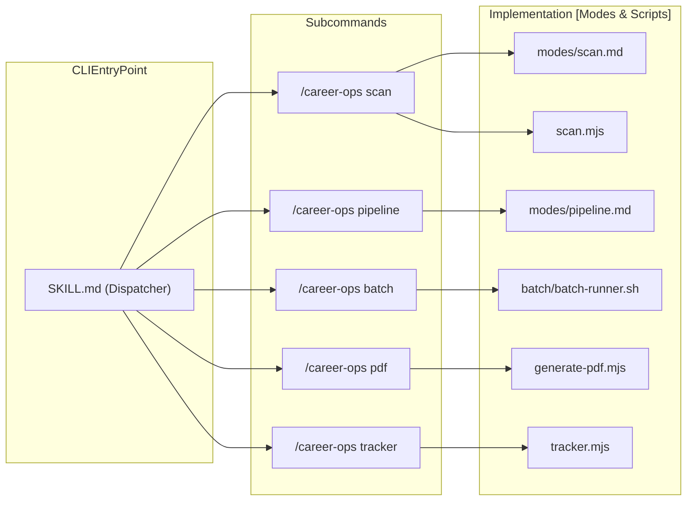
Sources: [.agents/skills/career-ops/SKILL.md:37-81](), [docs/SCRIPTS.md:1-54](), [AGENTS.md:1-16]()

### Core Command Reference
*   **Auto-Pipeline**: Paste a URL or JD text directly to trigger evaluation + PDF + tracker entry [.agents/skills/career-ops/SKILL.md:83-85]().
*   **`scan`**: Triggers the zero-token portal scanner using `portals.yml` [docs/SCRIPTS.md:29-29]().
*   **`pipeline`**: Processes pending URLs from `data/pipeline.md` [.agents/skills/career-ops/SKILL.md:67-67]().
*   **`pdf` / `latex`**: Generates ATS-optimized output from `cv.md` [.agents/skills/career-ops/SKILL.md:56-58]().
*   **`tracker`**: Interfaces with the SQLite derived index for status overviews [.agents/skills/career-ops/SKILL.md:64-64]().

Sources: [.agents/skills/career-ops/SKILL.md:104-150](), [docs/SCRIPTS.md:1-54](), [README.md:85-96]()

---

# Page: Configuration Reference

# Configuration Reference

<details>
<summary>Relevant source files</summary>

The following files were used as context for generating this wiki page:

- [.agents/skills/career-ops/SKILL.md](.agents/skills/career-ops/SKILL.md)
- [.gitignore](.gitignore)
- [AGENTS.md](AGENTS.md)
- [CLAUDE.md](CLAUDE.md)
- [DATA_CONTRACT.md](DATA_CONTRACT.md)
- [cv-sync-check.mjs](cv-sync-check.mjs)
- [dedup-tracker.mjs](dedup-tracker.mjs)
- [docs/FAQ.md](docs/FAQ.md)
- [docs/RUNNING_ON_A_BUDGET.md](docs/RUNNING_ON_A_BUDGET.md)
- [docs/SCRIPTS.md](docs/SCRIPTS.md)
- [docs/SUPPORTED_CLIS.md](docs/SUPPORTED_CLIS.md)
- [merge-tracker.mjs](merge-tracker.mjs)
- [modes/_writing.md](modes/_writing.md)
- [modes/apply.md](modes/apply.md)
- [modes/contacto.md](modes/contacto.md)
- [modes/pipeline.md](modes/pipeline.md)
- [modes/scan.md](modes/scan.md)
- [normalize-statuses.mjs](normalize-statuses.mjs)
- [openai-tailor.mjs](openai-tailor.mjs)
- [scaffolder/bin/skill-entrypoints.mjs](scaffolder/bin/skill-entrypoints.mjs)
- [scan-ats-full.mjs](scan-ats-full.mjs)
- [scan.mjs](scan.mjs)
- [stats.mjs](stats.mjs)
- [templates/portals.example.yml](templates/portals.example.yml)
- [templates/states.yml](templates/states.yml)
- [test-all.mjs](test-all.mjs)
- [tests/merge-tracker.test.mjs](tests/merge-tracker.test.mjs)
- [tests/scan-ats-full-title-filter-full.test.mjs](tests/scan-ats-full-title-filter-full.test.mjs)
- [tests/scan-run-failure.test.mjs](tests/scan-run-failure.test.mjs)
- [tests/source-no-nul-bytes.test.mjs](tests/source-no-nul-bytes.test.mjs)
- [tests/states-alias-coverage.test.mjs](tests/states-alias-coverage.test.mjs)
- [tests/stats.test.mjs](tests/stats.test.mjs)
- [tests/validate-portals-title-filter-full.test.mjs](tests/validate-portals-title-filter-full.test.mjs)
- [update-system.mjs](update-system.mjs)
- [validate-portals.mjs](validate-portals.mjs)
- [verify-pipeline.mjs](verify-pipeline.mjs)

</details>


This page provides a detailed technical reference for the configuration layer of Career-Ops. The system uses a "Configuration-as-Data" approach where YAML and Markdown files define the candidate's identity, search parameters for discovery agents, and the state machine for the application pipeline.

## System Configuration Flow

The configuration files act as the primary context providers for the AI agents (`modes/`) and the data validation rules for the processing scripts. The architecture enforces a strict boundary between the **System Layer** (logic and templates) and the **User Layer** (personal data and customizations) to ensure safe updates.

### Configuration Ingestion Map
The following diagram illustrates how configuration files are ingested by different system components and how they relate to code entities.

**Configuration Ingestion Map**
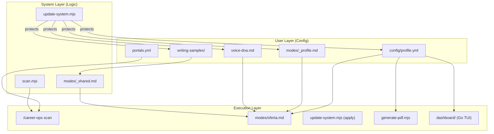
Sources: [DATA_CONTRACT.md:5-24](), [AGENTS.md:11-23](), [scan.mjs:73-74]()

---

## 1. Candidate Profile (`config/profile.yml`)

The `config/profile.yml` file is the "Single Source of Truth" for the candidate's professional identity. It is utilized by the `oferta`, `auto-pipeline`, `pdf`, and `dashboard` components.

### Key Schema Entities

| Section | Code Impact | Description |
|:---|:---|:---|
| `candidate` | `modes/pdf.md` | Personal contact details (Name, LinkedIn, Portfolio) injected into templates. |
| `target_roles` | `modes/oferta.md` | Defines "North Star" roles and archetypes used to calculate match scores. |
| `narrative` | `modes/pdf.md` | Provides the `headline`, `exit_story`, and `superpowers` for CV personalization. |
| `compensation` | `modes/oferta.md` | Sets `target_range` and `minimum` for Block D (Comp Research). |
| `cv.output_format` | `modes/auto-pipeline.md` | Routes the generation pipeline to either `modes/pdf.md` (HTML) or `modes/latex.md`. |
| `location.country` | `scan.mjs` | Used by `country_eligibility_filter` to cross-reference JD body text [templates/portals.example.yml:112-117](). |

### Implementation Detail: The User Layer
As defined in `DATA_CONTRACT.md`, `config/profile.yml` is a core part of the **User Layer** [DATA_CONTRACT.md:12](). The system logic is designed to read from this file but never overwrite it during system updates [update-system.mjs:7]().

Sources: [DATA_CONTRACT.md:5-15](), [AGENTS.md:11-23](), [scan.mjs:74]()

---

## 2. Portal Scanner Configuration (`portals.yml`)

The `portals.yml` file (copied from `templates/portals.example.yml`) configures the discovery engine. It supports a 4-level discovery strategy: Local parsers, Playwright direct navigation, HTTP JSON APIs, and WebSearch [templates/portals.example.yml:4-9]().

### Discovery Strategy (Levels)
1.  **Level 0: Local Parser**: Executes a specific script (Node, Python, etc.) to extract jobs from SSR/static pages without LLM tokens [modes/scan.md:35-40]().
2.  **Level 1: Playwright**: Direct navigation and snapshots for SPAs (Ashby, Lever, Workday) [modes/scan.md:112-118]().
3.  **Level 2: HTTP JSON**: Uses `providers/` to fetch from ATS APIs (Greenhouse, Ashby, Lever) [templates/portals.example.yml:7]().
4.  **Level 3: WebSearch**: Broad discovery using `site:` filters [templates/portals.example.yml:8]().

### Filtering Logic
The scanner applies filters in a specific sequence: Title → Location → Salary → Content → Deduplication.

*   **Title Filter**: Uses `positive` and `negative` keywords. Compiled matchers are cached in a `WeakMap` to optimize high-volume scans [scan.mjs:110-123]().
*   **Location Filter**: Case-insensitive substring matching. `always_allow` takes precedence over `block` [templates/portals.example.yml:56-62]().
*   **Country Eligibility**: Reads JD body text to detect "US-based only" restrictions [templates/portals.example.yml:105-125]().
*   **Salary Filter**: Annualized compensation filtering based on structured data [templates/portals.example.yml:143-150]().

**Scanner Data Flow**
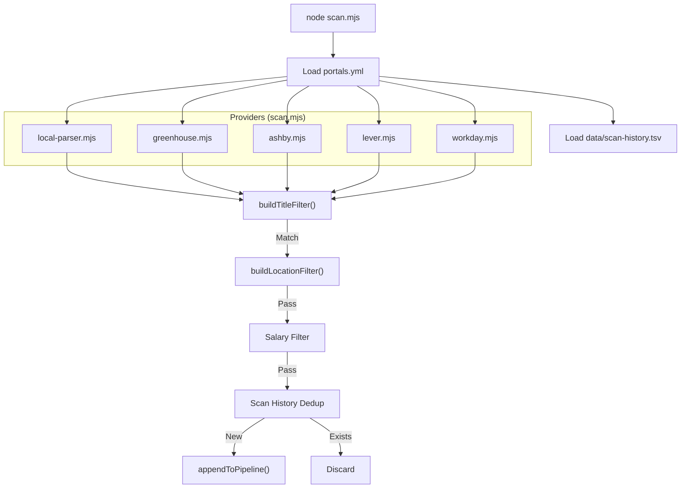
Sources: [templates/portals.example.yml:1-153](), [scan.mjs:4-38](), [modes/scan.md:5-21](), [scan-ats-full.mjs:44-51]()

---

## 3. Application States (`templates/states.yml`)

The `templates/states.yml` file defines the canonical state machine for the application tracker. This ensures consistency across the Markdown tracker, the SQLite index, and the Go dashboard.

### State Management
*   **Normalization**: `merge-tracker.mjs` and `normalize-statuses.mjs` map aliases (e.g., "Enviada" → "Applied") to canonical states [merge-tracker.mjs:143-150]().
*   **Validation**: All status changes are validated against `templates/states.yml` via `set-status.mjs` [docs/SCRIPTS.md:184-185]().
*   **Deduplication**: `dedup-tracker.mjs` uses a `STATUS_RANK` hierarchy to decide which entry to keep when duplicates are found [docs/SCRIPTS.md:99]().

Sources: [templates/states.yml:1-20](), [merge-tracker.mjs:140-150](), [docs/SCRIPTS.md:70-78]()

---

## 4. Data Contract and Update Safety (`DATA_CONTRACT.md`)

The `DATA_CONTRACT.md` file defines the technical boundary for the system. This separation allows users to pull the latest improvements to the AI logic and scripts without risking their personal data.

### Layer Separation

| Layer | Directories/Files | Update Policy |
|:---|:---|:---|
| **User** | `cv.md`, `config/`, `data/`, `reports/`, `output/`, `interview-prep/`, `portals.yml` | **NEVER** modified by updates [DATA_CONTRACT.md:5-53](). |
| **System** | `modes/`, `dashboard/`, `templates/`, `batch/`, `*.mjs`, `providers/` | **SAFE** to overwrite with upstream [DATA_CONTRACT.md:55-75](). |

### Implementation in `update-system.mjs`
The update script uses a hardcoded `SYSTEM_PATHS` list to identify which files are eligible for updates [update-system.mjs:64-211](). It enforces the data contract by only checking out and applying changes to these paths [update-system.mjs:6-8]().

**Update Logic Flow**
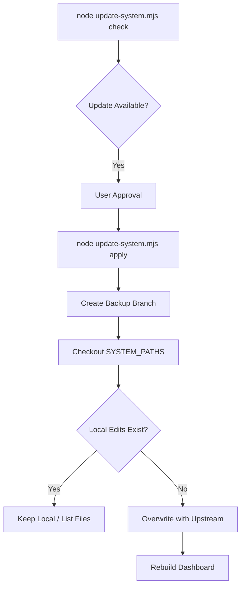
Sources: [DATA_CONTRACT.md:1-81](), [update-system.mjs:1-190](), [AGENTS.md:9-16]()

---

# Page: Examples & Sample Files

# Examples & Sample Files

<details>
<summary>Relevant source files</summary>

The following files were used as context for generating this wiki page:

- [README.ar.md](README.ar.md)
- [README.cn.md](README.cn.md)
- [README.es.md](README.es.md)
- [README.fr.md](README.fr.md)
- [README.ja.md](README.ja.md)
- [README.ko-KR.md](README.ko-KR.md)
- [README.md](README.md)
- [README.pl.md](README.pl.md)
- [README.pt-BR.md](README.pt-BR.md)
- [README.ru.md](README.ru.md)
- [README.ua.md](README.ua.md)
- [README.zh-TW.md](README.zh-TW.md)
- [batch/README.md](batch/README.md)
- [batch/batch-runner.sh](batch/batch-runner.sh)
- [examples/README.md](examples/README.md)
- [examples/cv-example.md](examples/cv-example.md)
- [examples/resume-example.md](examples/resume-example.md)
- [modes/batch.md](modes/batch.md)
- [reconcile-pipeline.mjs](reconcile-pipeline.mjs)

</details>


This page provides a technical walkthrough of the reference files located in the `examples/` directory. These files serve as the structural blueprints for the Career-Ops system, defining the expected schema for candidate data, project evidence, and the final evaluation output generated by the AI agents.

## 1. Overview of the Examples Directory

The `examples/` directory contains files that demonstrate the data flow from raw candidate information to a structured evaluation report. It includes single-track, dual-track, and US-specific resume variants.

| File | Role | Format | Usage |
|:---|:---|:---|:---|
| `cv-example.md` | Source of Truth | Markdown | Input for `oferta` and `apply` modes [examples/cv-example.md:1-49](). |
| `resume-example.md` | US/Industry Variant | Markdown | Concise (1-2 page) structural guide for US tech markets [examples/resume-example.md:1-58](). |
| `article-digest-example.md` | Evidence Bank | Markdown | Contextual "Proof Points" for deep evaluations [examples/article-digest-example.md:1-40](). |
| `sample-report.md` | Output Schema | Markdown | The canonical A-F evaluation structure [examples/sample-report.md:1-75](). |
| `dual-track-engineer-instructor/` | Advanced Config | Directory | Reference for candidates with two primary archetypes [examples/dual-track-engineer-instructor/README.md:1-22](). |

### Data Flow Architecture
The following diagram illustrates how these example files relate to the core system entities and processing modes.

**Diagram: Example File Integration**
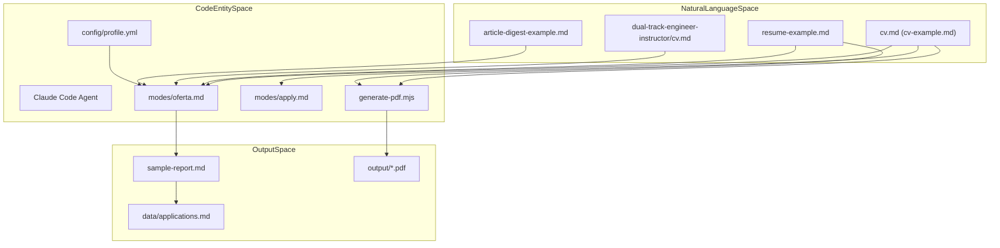
Sources: [examples/README.md:1-23](), [examples/cv-example.md:1-49](), [examples/resume-example.md:1-58](), [examples/sample-report.md:1-75]()

---

## 2. CV & Resume Structures

The system supports two primary Markdown-based document types as the primary context for matching skills against Job Descriptions (JDs).

### CV vs. Resume Distinction
*   **`cv-example.md`**: Designed for a longer, comprehensive career history (2+ pages), suitable for international or academic contexts [examples/cv-example.md:1-50]().
*   **`resume-example.md`**: A concise, 1-page variant targeted at US/industry job applications, focusing on recent impact metrics [examples/resume-example.md:3-9]().

### Key Components
*   **Header Metadata:** Contains contact information and social links used by the `apply` mode to fill web forms [examples/cv-example.md:1-8]().
*   **Professional Summary:** A high-level narrative that the `oferta` mode uses to determine the "Candidate's natural level" [examples/cv-example.md:9-11](), [examples/sample-report.md:41-42]().
*   **Work Experience:** Bulleted lists of achievements. The system parses these to find specific "Source" citations for the CV Match block [examples/cv-example.md:13-32](), [examples/sample-report.md:25-30]().
*   **Dual-Track Variant:** For candidates with hybrid roles (e.g., Engineer + Instructor), the `cv.md` in `examples/dual-track-engineer-instructor/` demonstrates a "Layered" approach, naming both tracks in the summary and mixing bullets within roles [examples/dual-track-engineer-instructor/cv.md:1-11]().

Sources: [examples/cv-example.md:1-50](), [examples/resume-example.md:1-58](), [examples/dual-track-engineer-instructor/cv.md:1-11]()

---

## 3. Article Digest & Proof Points (`article-digest-example.md`)

The `article-digest-example.md` serves as a "Story Bank" or "Evidence Bank." While `cv.md` is optimized for brevity, the digest provides the "Proof Points" required for Block F (Interview Plan) of the evaluation.

### Implementation Detail: The "Hero Metrics" Pattern
Each project in the digest follows a specific pattern:
1.  **Hero Metrics:** Quantifiable impact (e.g., "99.7% precision", "$2M/year saved") [examples/article-digest-example.md:9]().
2.  **Architecture:** Technical stack and data flow (e.g., "Kafka Streams → XGBoost") [examples/article-digest-example.md:11]().
3.  **Key Decisions:** Trade-off analysis (e.g., "streaming over batch") [examples/article-digest-example.md:13-16]().
4.  **Proof Points:** External validation (GitHub stars, conference talks) [examples/article-digest-example.md:18-22]().

The `oferta` mode pulls from this file to generate STAR (Situation, Task, Action, Result) stories in the final report [examples/sample-report.md:64-68]().

Sources: [examples/article-digest-example.md:1-40](), [examples/sample-report.md:64-68]()

---

## 4. The A-F Evaluation Report (`sample-report.md`)

The `sample-report.md` is a representative output of the `oferta` or `auto-pipeline` modes. It demonstrates the 6-block evaluation structure used to score a job opportunity.

### Block-by-Block Technical Breakdown

| Block | Title | Code Entity / Purpose |
|:---|:---|:---|
| **A** | **Role Summary** | Extracts Archetype, Seniority, and "TL;DR" from JD [examples/sample-report.md:11-21](). |
| **B** | **CV Match** | A mapping table between JD requirements and `cv.md` line items [examples/sample-report.md:23-31](). |
| **C** | **Level & Strategy** | Compares "Detected level" vs "Natural level" to create a "Sell Plan" [examples/sample-report.md:39-45](). |
| **D** | **Comp & Demand** | Market research data points (e.g., Levels.fyi ranges) [examples/sample-report.md:46-52](). |
| **E** | **Personalization** | Proposed edits to the CV to maximize ATS and recruiter match [examples/sample-report.md:54-61](). |
| **F** | **Interview Plan** | STAR stories mapped to JD requirements [examples/sample-report.md:62-70](). |

### System Name Mapping
The following diagram maps the logical sections of the report to the data sources and processing logic.

**Diagram: Report Data Mapping**
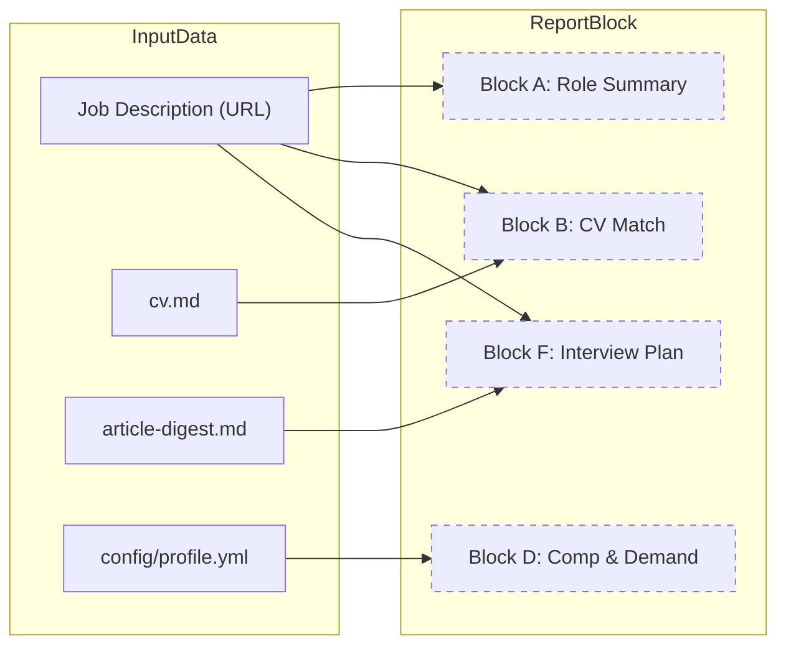

Sources: [examples/sample-report.md:1-75](), [examples/cv-example.md:1-49](), [examples/article-digest-example.md:1-40]()

---

## 5. Dual-Track Configuration (`profile.yml`)

The `examples/dual-track-engineer-instructor/profile.yml` demonstrates how to configure the system for candidates pursuing multiple career paths simultaneously.

*   **Archetypes:** Defines multiple `fit: primary` entries. The evaluator (`oferta` mode) picks the one closest to the JD [examples/dual-track-engineer-instructor/profile.yml:22-39]().
*   **Alternate Ranges:** Provides distinct compensation targets for different tracks (e.g., "teaching" vs "engineering") via the `alternate_ranges` block [examples/dual-track-engineer-instructor/profile.yml:98-108]().
*   **Narrative:** A combined headline and exit story that bridges the two tracks into a single value proposition [examples/dual-track-engineer-instructor/profile.yml:56-60]().

### Handling Objections
The dual-track example includes a `README.md` that serves as a playbook for handling interview objections triggered by a hybrid CV, such as concerns over being overqualified or "why not just pick one?" [examples/dual-track-engineer-instructor/README.md:66-87]().

Sources: [examples/dual-track-engineer-instructor/profile.yml:1-115](), [examples/dual-track-engineer-instructor/README.md:1-106]()

---

# Page: AI Agent Modes

# AI Agent Modes

<details>
<summary>Relevant source files</summary>

The following files were used as context for generating this wiki page:

- [analyze-patterns.mjs](analyze-patterns.mjs)
- [batch/batch-prompt.md](batch/batch-prompt.md)
- [config/profile.example.yml](config/profile.example.yml)
- [generate-pdf.mjs](generate-pdf.mjs)
- [modes/_shared.md](modes/_shared.md)
- [modes/apply.md](modes/apply.md)
- [modes/auto-pipeline.md](modes/auto-pipeline.md)
- [modes/contacto.md](modes/contacto.md)
- [modes/followup.md](modes/followup.md)
- [modes/oferta.md](modes/oferta.md)
- [modes/patterns.md](modes/patterns.md)
- [modes/pdf.md](modes/pdf.md)
- [modes/pipeline.md](modes/pipeline.md)
- [modes/scan.md](modes/scan.md)
- [modes/tracker.md](modes/tracker.md)
- [modes/training.md](modes/training.md)
- [scan-ats-full.mjs](scan-ats-full.mjs)
- [scan.mjs](scan.mjs)
- [templates/cv-template.html](templates/cv-template.html)
- [templates/portals.example.yml](templates/portals.example.yml)
- [tests/scan-ats-full-title-filter-full.test.mjs](tests/scan-ats-full-title-filter-full.test.mjs)
- [tests/theme-style-dollar-pattern.test.mjs](tests/theme-style-dollar-pattern.test.mjs)
- [tests/theme-style.test.mjs](tests/theme-style.test.mjs)
- [tests/validate-portals-title-filter-full.test.mjs](tests/validate-portals-title-filter-full.test.mjs)
- [theme-style.mjs](theme-style.mjs)
- [validate-portals.mjs](validate-portals.mjs)

</details>


The `career-ops` system is driven by a collection of "Skill Modes" defined as Markdown files in the `modes/` directory. These files serve as the "brain" for the AI agent, providing specific instructions, evaluation rubrics, and behavioral guidelines for every sub-command in the `/career-ops` suite [modes/_shared.md:1-20]().

By separating logic into these Markdown skills, the system allows for deep customization of the agent's behavior—from how it scores a job match to how it drafts LinkedIn outreach—without changing the underlying execution engine.

### The Skill Architecture

When a user invokes a command (e.g., `/career-ops scan`), the agent router identifies the requested mode and loads the corresponding context. The architecture follows a "Shared + Specific" pattern to maintain consistency while allowing for task-specific flexibility.

1.  **Shared Context (`_shared.md`)**: Injected into most modes to provide the "Source of Truth" regarding system rules, scoring logic, and tool config [modes/_shared.md:1-10]().
2.  **User Profile (`_profile.md`)**: A user-layer file that overrides defaults in `_shared.md` with personal archetypes, narrative, and negotiation scripts [modes/_shared.md:18-24]().
3.  **Voice DNA (`voice-dna.md`)**: An optional writing guardrail that enforces anti-AI-slop rules and a conversational human voice across all candidate-facing text [modes/_shared.md:24-25]().
4.  **Mode-Specific Logic**: The individual `.md` file for the command (e.g., `oferta.md`, `pdf.md`) which contains the specific prompt engineering for that task.

**Sources:** [modes/_shared.md:1-35](), [config/profile.example.yml:1-160]()

---

### The Shared Context Layer (`_shared.md`)

The `modes/_shared.md` file is the foundational layer for the agent's reasoning. It ensures that whether the agent is evaluating a job or drafting a message, it maintains a consistent "North Star."

*   **Archetype Detection**: Classifies offers into types (e.g., Platform, Agentic, ML) to adapt framing and proof points [modes/_shared.md:75-88]().
*   **Scoring System**: Establishes a 1-5 global score based on CV Match, North Star alignment, Compensation, and Cultural signals [modes/_shared.md:61-78]().
*   **Source of Truth**: Enforces strict rules to read `cv.md`, `config/profile.yml`, and `article-digest.md` at evaluation time [modes/_shared.md:11-26]().
*   **Spend Tier (Model Routing)**: Maps user-selected tiers (`economy`, `standard`, `premium`) to specific AI models [modes/_shared.md:37-60]().

**Sources:** [modes/_shared.md:1-145]()

---

### Mode Groups

The various modes are categorized by their role in the job search lifecycle. Detailed technical documentation for each group is available in the child pages linked below.

#### [Evaluation Modes (oferta, ofertas, auto-pipeline)](#2.1)
These modes handle the ingestion and analysis of Job Descriptions. They use a standardized A-G evaluation structure, including archetype detection and scoring [modes/oferta.md:1-49](). `auto-pipeline.md` defines the sequence for full automatic processing from URL to PDF generation.
*   **Key Entities**: `modes/oferta.md`, `modes/auto-pipeline.md`, `reports/`.
*   For details, see [Evaluation Modes (oferta, ofertas, auto-pipeline)](#2.1).

#### [Discovery & Pipeline Modes (scan, pipeline, scan-ats-full, local-parser)](#2.2)
Focused on finding new opportunities. The `scan` mode uses a 4-level discovery strategy (Local Parser, Playwright, API, WebSearch) [modes/scan.md:33-108](). `scan-ats-full.mjs` provides reverse-ATS discovery across public directories [scan-ats-full.mjs:1-35]().
*   **Key Entities**: `scan.mjs`, `portals.yml`, `data/pipeline.md`, `scan-ats-full.mjs`.
*   For details, see [Discovery & Pipeline Modes (scan, pipeline, scan-ats-full, local-parser)](#2.2).

#### [Application & Outreach Modes (apply, contacto, tracker, followup, reply-watch, outcome)](#2.3)
Assists with the active phase of the search. Includes `apply.md` for live form-filling using Playwright [modes/apply.md:1-12]() and `pdf.md` for generating ATS-optimized resumes via `generate-pdf.mjs` [modes/pdf.md:1-46]().
*   **Key Entities**: `modes/apply.md`, `modes/contacto.md`, `modes/pdf.md`, `generate-pdf.mjs`, `data/applications.md`.
*   For details, see [Application & Outreach Modes (apply, contacto, tracker, followup, reply-watch, outcome)](#2.3).

#### [Career Development Modes (deep, training, project, patterns, upskill, titles, add)](#2.4)
Supporting modes for long-term growth. `patterns.md` uses `analyze-patterns.mjs` to identify rejection trends [analyze-patterns.mjs:1-14](), while `followup.md` tracks cadence and generates email drafts [modes/followup.md:1-16]().
*   **Key Entities**: `analyze-patterns.mjs`, `followup-cadence.mjs`, `modes/upskill.md`.
*   For details, see [Career Development Modes (deep, training, project, patterns, upskill, titles, add)](#2.4).

#### [Interview & Offer Modes (interview-prep, interview-redflag, offer-prep)](#2.5)
Preparation tools for the final stages. Includes red-flag detection for legally problematic questions and contract reading companions.
*   **Key Entities**: `interview-prep/story-bank.md`, `protected-grounds.yml`, `invite-match.mjs`.
*   For details, see [Interview & Offer Modes (interview-prep, interview-redflag, offer-prep)](#2.5).

#### [Internationalization (i18n Modes)](#2.6)
Localized subdirectories (e.g., `modes/de/`, `modes/fr/`) that adapt evaluation and application logic for specific regional markets and legal frameworks.
*   For details, see [Internationalization (i18n Modes)](#2.6).

---

### Agent Mode Flow

The following diagrams illustrate how the system bridges Natural Language requests to the specific Code Entities (Markdown skills) and tools that govern the agent's behavior.

**System Mode Routing & Context Bridge**
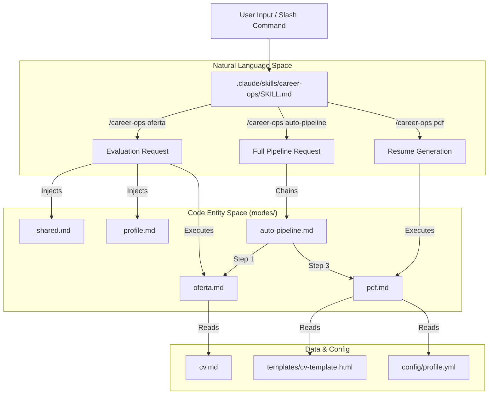
**Sources:** [modes/_shared.md:11-35](), [modes/auto-pipeline.md:1-45](), [modes/pdf.md:1-46]()

**Agent Interaction & Tool Usage**
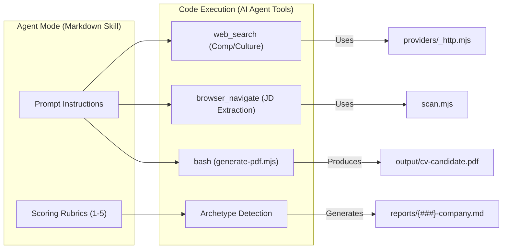
**Sources:** [modes/_shared.md:61-78](), [modes/pdf.md:42-46](), [scan.mjs:1-38]()

**Sources:** [modes/_shared.md:1-145](), [modes/pdf.md:1-46](), [modes/auto-pipeline.md:1-88](), [modes/apply.md:1-28](), [scan.mjs:1-108]()

---

# Page: Evaluation Modes (oferta, ofertas, auto-pipeline)

# Evaluation Modes (oferta, ofertas, auto-pipeline)

<details>
<summary>Relevant source files</summary>

The following files were used as context for generating this wiki page:

- [analyze-patterns.mjs](analyze-patterns.mjs)
- [batch/batch-prompt.md](batch/batch-prompt.md)
- [classify-tier.mjs](classify-tier.mjs)
- [config/cv-facts.example.json](config/cv-facts.example.json)
- [config/profile.example.yml](config/profile.example.yml)
- [generate-pdf.mjs](generate-pdf.mjs)
- [modes/_shared.md](modes/_shared.md)
- [modes/auto-pipeline.md](modes/auto-pipeline.md)
- [modes/followup.md](modes/followup.md)
- [modes/oferta.md](modes/oferta.md)
- [modes/patterns.md](modes/patterns.md)
- [modes/pdf.md](modes/pdf.md)
- [modes/tracker.md](modes/tracker.md)
- [modes/training.md](modes/training.md)
- [templates/cv-template.html](templates/cv-template.html)
- [tests/classify-tier-position.test.mjs](tests/classify-tier-position.test.mjs)
- [tests/cover-fact-gate.test.mjs](tests/cover-fact-gate.test.mjs)
- [tests/nonmetric-fact-gate.test.mjs](tests/nonmetric-fact-gate.test.mjs)
- [tests/theme-style-dollar-pattern.test.mjs](tests/theme-style-dollar-pattern.test.mjs)
- [tests/theme-style.test.mjs](tests/theme-style.test.mjs)
- [theme-style.mjs](theme-style.mjs)
- [verify-cv-facts.mjs](verify-cv-facts.mjs)

</details>


This page provides a technical deep dive into the core evaluation engine of `career-ops`. These modes transform raw job descriptions (JDs) into structured, actionable intelligence by mapping them against the candidate's profile, calculating strategic alignment, and preparing interview collateral.

## The Evaluation Workflow

The evaluation process is designed to be deterministic and comprehensive, moving from initial ingestion to long-term tracking. The system supports single-offer deep dives (`oferta`), comparative analysis (`ofertas`), and a fully automated end-to-end execution (`auto-pipeline`).

### Data Flow Overview

The following diagram illustrates how a Job Description is processed through the system entities, moving from raw input to structured reports and long-term storage.

**Diagram: JD Ingestion to Report Generation**
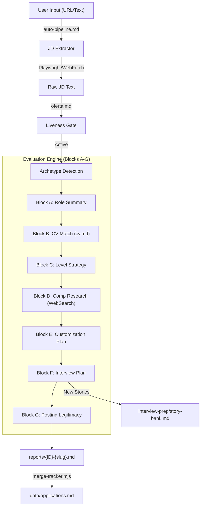
**Sources:** [modes/oferta.md:1-101](), [modes/auto-pipeline.md:1-100](), [modes/_shared.md:11-34]()

---

## 1. Core Evaluation: `modo: oferta`

The `oferta` mode is the atomic unit of evaluation. It follows a strict 7-block structure (A-G) to ensure no strategic dimension is overlooked.

### Liveness Gate
When a URL is provided, the system first verifies the posting is active using Playwright (`browser_navigate` + `browser_snapshot`). If the posting is closed (404, "position filled", or hard redirect), the evaluation stops immediately. If `scan.extractor: cli` is set in `config/profile.yml`, it runs `node browser-extract.mjs <url>` for a token-efficient distilled text extraction.
**Sources:** [modes/oferta.md:7-18](), [modes/auto-pipeline.md:22-32]()

### Blacklist Gate
Before Block A, the system checks `data/blacklist.md`. If the company matches, the agent stops and asks for an explicit override from the candidate before proceeding.
**Sources:** [modes/oferta.md:20-27](), [modes/auto-pipeline.md:34-39]()

### Step 0: Archetype Detection
The agent classifies the role into one of the 6 canonical archetypes defined in `_shared.md`.
*   **AI Platform / LLMOps:** Focus on reliability and pipelines [modes/oferta.md:44-44]().
*   **Agentic Workflows:** Focus on HITL and orchestration [modes/oferta.md:45-45]().
*   **Technical AI PM:** Focus on PRDs and discovery [modes/oferta.md:43-43]().
*   **AI Solutions Architect:** Focus on enterprise integration [modes/oferta.md:42-42]().
*   **AI Forward Deployed:** Focus on prototyping and delivery [modes/oferta.md:41-41]().
*   **AI Transformation Lead:** Focus on change management [modes/oferta.md:46-46]().

**Sources:** [modes/oferta.md:42-49](), [modes/_shared.md:107-115]()

### The 7-Block Structure

| Block | Name | Technical Implementation |
| :--- | :--- | :--- |
| **A** | **Role Summary** | Metadata table (Archetype, Domain, Seniority, Remote). Includes **Geo-mismatch** and **Work-authorization** checks [modes/oferta.md:49-89](). |
| **B** | **CV Match** | Maps requirements to `cv.md` and `article-digest.md`. Highlights gaps and mitigation [modes/oferta.md:91-112](). |
| **C** | **Level Strategy** | Strategy for selling seniority and handling downleveling [modes/oferta.md:114-119](). |
| **D** | **Comp Research** | Single-pass `WebSearch` for salary bands and funding signals (capped at 5 queries) [modes/oferta.md:29-39](), [modes/oferta.md:121-128](). |
| **E** | **Personalization** | Plan for tailoring the CV and outreach [modes/oferta.md:130-137](). |
| **F** | **Interview Prep** | STAR+R story generation. Appends new stories to `interview-prep/story-bank.md` [modes/oferta.md:139-161](). |
| **G** | **Legitimacy** | Evaluates if the posting is a "Ghost Job" based on freshness and description quality [modes/oferta.md:163-205](). |

**Sources:** [modes/oferta.md:49-205]()

---

## 2. Automation: `modo: auto-pipeline`

The `auto-pipeline` mode chains the evaluation with utility scripts to provide a zero-touch experience.

### JD Extraction Strategy
1.  **Playwright:** `browser_navigate` + `browser_snapshot` (preferred for SPAs like Lever/Ashby) [modes/auto-pipeline.md:13-14]().
2.  **WebFetch:** Fallback for static pages [modes/auto-pipeline.md:15-15]().
3.  **WebSearch:** Last resort for indexing secondary portals [modes/auto-pipeline.md:16-16]().

### Post-Evaluation Automation
If the calculated score is **>= 4.5**, the pipeline triggers **Step 4: Draft Application Answers**.
*   **Tone:** "I'm choosing you"—confident, selective, and direct [modes/auto-pipeline.md:76-85]().
*   **Fact Gate:** CV tailoring is validated by `node verify-cv-facts.mjs` to prevent hallucinated metrics [modes/pdf.md:44-47](), [verify-cv-facts.mjs:4-13]().

**Sources:** [modes/auto-pipeline.md:5-95](), [modes/pdf.md:44-47]()

---

## 3. Batch Processing: `batch-runner.sh`

For high-volume evaluation, `batch/batch-runner.sh` orchestrates multiple `claude` workers using `batch/batch-prompt.md`.

*   **Parallelization:** Uses `--parallel` to run multiple evaluations simultaneously [batch/batch-runner.sh:8-8]().
*   **State Management:** Tracks progress in `batch-state.tsv` and adds new entries to `batch/tracker-additions/` [batch/batch-runner.sh:10-10]().
*   **PDF Generation:** Triggers `generate-pdf.mjs` using the `--batch` flag to render all documents in one Chromium instance [generate-pdf.mjs:8-14]().

**Sources:** [batch/batch-runner.sh:1-20](), [batch/batch-prompt.md:1-15](), [generate-pdf.mjs:8-14]()

---

## 4. Technical Persistence & State

### Logic Flow: Entity Association
This diagram shows how the system names in the Markdown modes map to the file structure and data entities.

**Diagram: System Entity Mapping**
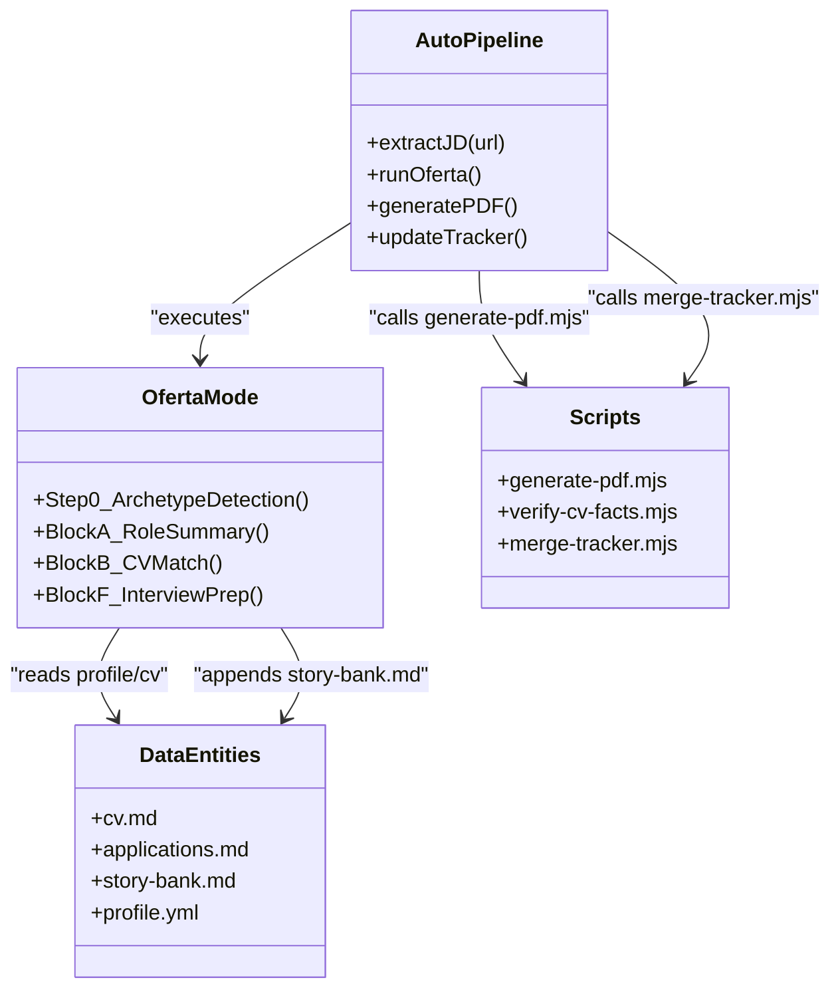
**Sources:** [modes/auto-pipeline.md:3-99](), [modes/oferta.md:1-161](), [generate-pdf.mjs:1-43]()

### Implementation Details
*   **Scoring System:** Global score (1-5) integrates Match, North Star, Comp, Culture, and Red Flags [modes/_shared.md:61-72]().
*   **Fact Verification:** `verify-cv-facts.mjs` uses `COUNT_CLAIM_RE` and `METRIC_NOUNS` to ensure generated numbers match `cv.md` or `article-digest.md` [verify-cv-facts.mjs:28-86]().
*   **Tracker Persistence:** The pipeline records results in `data/applications.md` with columns for Report and PDF marked as ✅ [modes/auto-pipeline.md:96-99]().

**Sources:** [modes/_shared.md:61-72](), [verify-cv-facts.mjs:28-86](), [modes/auto-pipeline.md:96-99]()

---

# Page: Discovery & Pipeline Modes (scan, pipeline, scan-ats-full, local-parser)

# Discovery & Pipeline Modes (scan, pipeline, scan-ats-full, local-parser)

<details>
<summary>Relevant source files</summary>

The following files were used as context for generating this wiki page:

- [check-liveness.mjs](check-liveness.mjs)
- [company-funded.mjs](company-funded.mjs)
- [discover-ats.mjs](discover-ats.mjs)
- [discover-ats.test.mjs](discover-ats.test.mjs)
- [liveness-api.mjs](liveness-api.mjs)
- [liveness-browser.mjs](liveness-browser.mjs)
- [liveness-core.mjs](liveness-core.mjs)
- [modes/apply.md](modes/apply.md)
- [modes/contacto.md](modes/contacto.md)
- [modes/discover.md](modes/discover.md)
- [modes/pipeline.md](modes/pipeline.md)
- [modes/scan.md](modes/scan.md)
- [scan-ats-full.mjs](scan-ats-full.mjs)
- [scan-hn.mjs](scan-hn.mjs)
- [scan.mjs](scan.mjs)
- [seeds/vc-portfolios.mjs](seeds/vc-portfolios.mjs)
- [templates/portals.example.yml](templates/portals.example.yml)
- [tests/ci-gemini-check.test.mjs](tests/ci-gemini-check.test.mjs)
- [tests/company-funded.test.mjs](tests/company-funded.test.mjs)
- [tests/hn-scanner.test.mjs](tests/hn-scanner.test.mjs)
- [tests/liveness-core.test.mjs](tests/liveness-core.test.mjs)
- [tests/scan-ats-full-title-filter-full.test.mjs](tests/scan-ats-full-title-filter-full.test.mjs)
- [tests/user-agent.test.mjs](tests/user-agent.test.mjs)
- [tests/validate-portals-title-filter-full.test.mjs](tests/validate-portals-title-filter-full.test.mjs)
- [tests/vc-portfolios-yc-pagination.test.mjs](tests/vc-portfolios-yc-pagination.test.mjs)
- [user-agent.mjs](user-agent.mjs)
- [validate-portals.mjs](validate-portals.mjs)

</details>


This page covers the discovery and ingestion engine of `career-ops`. It details how the system identifies new job opportunities via the portal scanner, the specialized reverse ATS discovery, the local-parser extension point, and how it processes queued URLs through the pipeline inbox.

## 1. Portal Scanner (scan mode)

The `scan` mode is responsible for discovering new job postings across various platforms and adding them to the evaluation queue. It implements a multi-tiered discovery strategy to balance speed, reliability, and breadth. While the logic is defined in `modes/scan.md` [modes/scan.md:1-3](), the high-performance implementation for API-based discovery is handled by `scan.mjs` [scan.mjs:4-21]().

### 1.1 Discovery Strategy (4 Levels)

The scanner operates on four levels of depth, executing them additively and deduplicating the results.

| Level | Method | Primary Tool | Description |
| :--- | :--- | :--- | :--- |
| **Level 0** | **Local Parser** | `providers/local-parser.mjs` | Executes per-company scripts for SSR/static pages. Zero-token and most efficient [modes/scan.md:35-37](). |
| **Level 1** | **Direct Playwright** | Playwright | Navigates to `careers_url` for tracked companies. Most reliable for SPAs but token-heavy for agents [modes/scan.md:112-118](). |
| **Level 2** | **ATS APIs / Feeds** | `scan.mjs` / Providers | Queries structured APIs (Greenhouse, Ashby, Lever, etc.). Fast and zero-token [modes/scan.md:5-5](). |
| **Level 3** | **WebSearch** | WebSearch | Uses `site:` filters across job boards to discover roles in companies not yet tracked [modes/scan.md:154-154](). |

### 1.2 Scan Workflow and Data Flow

The scanner follows a strict sequence to ensure data integrity and avoid redundant evaluations.

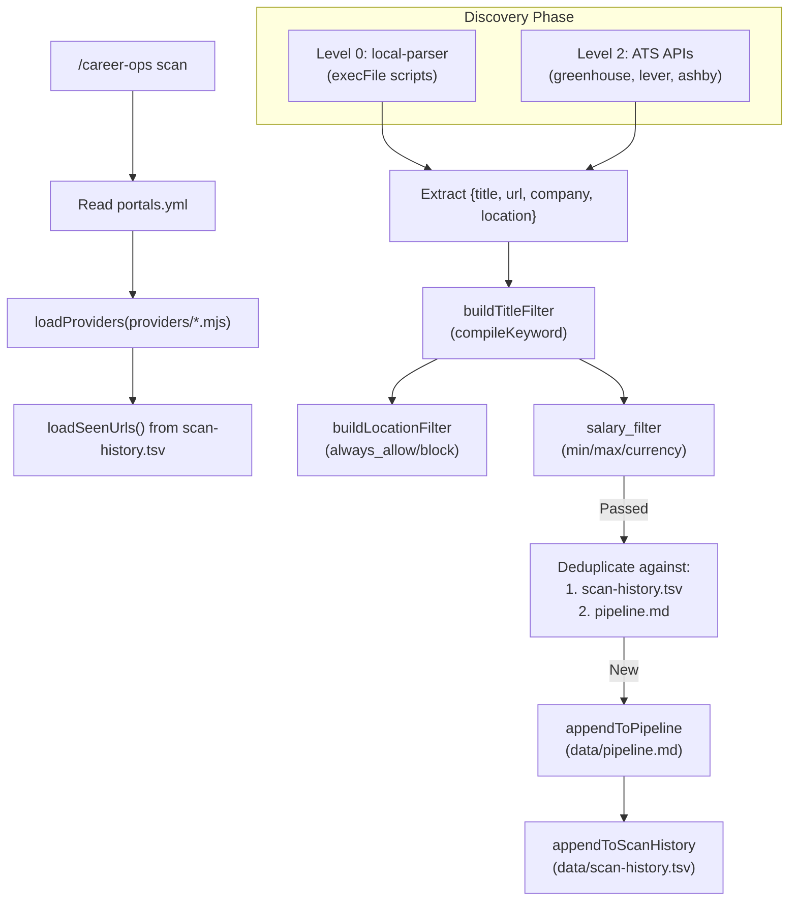

**Sources:** [scan.mjs:71-85](), [scan.mjs:100-108](), [scan.mjs:220-251](), [scan.mjs:308-320](), [scan.mjs:424-436]()

### 1.3 Local Parser Extension Point

The `local-parser` provider allows users to add custom scrapers for companies that don't use standard ATS APIs. It is configured in `portals.yml` under the `parser:` key [modes/scan.md:41-50]().

*   **Security**: Scripts must reside within the project root. Only whitelisted interpreters (node, python3, etc.) are allowed.
*   **Interface**: The script must output JSON to `stdout` containing an array of job objects [modes/scan.md:54-82]().
*   **Rule**: If a local parser succeeds, the system skips more expensive Playwright or API checks for that company [modes/scan.md:88-102]().

**Sources:** [scan.mjs:13-15](), [modes/scan.md:35-50]()

---

## 2. Reverse ATS Discovery (scan-ats-full)

`scan-ats-full.mjs` implements a "zero-token" broad discovery mode. Instead of scanning specific companies, it walks public directories of thousands of companies hosted on Greenhouse, Lever, Ashby, and Workday [scan-ats-full.mjs:6-10]().

*   **Dataset**: Uses the `job-board-aggregator` dataset, cached in `data/cache/` for 24 hours [scan-ats-full.mjs:17-18](), [scan-ats-full.mjs:60-61]().
*   **Filtering**: Applies the same `title_filter` and `location_filter` from `portals.yml` [scan-ats-full.mjs:8-9](), [scan-ats-full.mjs:51-51]().
*   **Checkpointing**: For multi-hour sweeps, progress is checkpointed every 500 companies to allow `--resume` [scan-ats-full.mjs:90-95]().
*   **Freshness**: Only surfaces postings from the last N days (default: 3) to avoid flooding the pipeline with stale roles [scan-ats-full.mjs:21-22](), [scan-ats-full.mjs:25-26]().

**Sources:** [scan-ats-full.mjs:6-35](), [scan-ats-full.mjs:96-118](), [scan-ats-full.mjs:123-129]()

---

## 3. Pipeline Inbox (pipeline mode)

The `pipeline` mode acts as a "Second Brain" inbox, processing URLs stored in `data/pipeline.md` [modes/pipeline.md:1-3]().

### 3.1 Liveness Sweep

Before processing, the pipeline runs a bulk liveness sweep using `check-liveness.mjs`. This zero-token step prevents wasting AI credits on expired postings [modes/pipeline.md:5-17]().

*   **API Rung**: The system first attempts to verify liveness via ATS-hosted JSON endpoints (Greenhouse, Lever, Ashby, Workday) [liveness-api.mjs:3-9](). This is SSRF-safe by construction, using fixed hosts and strict path segment validation [liveness-api.mjs:25-28]().
*   **Browser Rung**: If the API is inconclusive, it falls back to `liveness-browser.mjs` using Playwright [liveness-api.mjs:7-9]().
*   **Logic**: Uses `liveness-core.mjs` to classify pages based on HTTP status (404/410), text patterns ("job no longer available"), and presence of apply controls [liveness-core.mjs:17-49](), [liveness-core.mjs:78-94]().
*   **Anti-Bot**: Detects Cloudflare/hCaptcha walls and marks them as `uncertain` instead of `expired` to avoid false negatives [liveness-core.mjs:62-72](), [liveness-core.mjs:128-131]().

**Sources:** [modes/pipeline.md:7-17](), [liveness-api.mjs:1-28](), [liveness-core.mjs:17-150]()

### 3.2 Processing Workflow

The system maps natural language commands and file states to specific code entities during the pipeline loop.

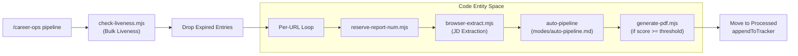

**Sources:** [modes/pipeline.md:31-43](), [liveness-api.mjs:62-120](), [liveness-browser.mjs:128-147]()

### 3.3 Configuration: PDF Gate

The pipeline reads `config/profile.yml` for `auto_pdf_score_threshold`. If an evaluation score falls below this threshold (default `3.0`), the PDF generation step is skipped to save time and resources [modes/pipeline.md:40-42]().

**Sources:** [modes/pipeline.md:40-42](), [templates/portals.example.yml:152-153]()

---

# Page: Application & Outreach Modes (apply, contacto, tracker, followup, reply-watch, outcome)

# Application & Outreach Modes (apply, contacto, tracker, followup, reply-watch, outcome)

<details>
<summary>Relevant source files</summary>

The following files were used as context for generating this wiki page:

- [analyze-patterns.mjs](analyze-patterns.mjs)
- [archive-posting.mjs](archive-posting.mjs)
- [assessment-log.mjs](assessment-log.mjs)
- [batch-tailor.mjs](batch-tailor.mjs)
- [batch/batch-prompt.md](batch/batch-prompt.md)
- [check-table-freshness.mjs](check-table-freshness.mjs)
- [company-history.mjs](company-history.mjs)
- [company-history.test.mjs](company-history.test.mjs)
- [followup-cadence.mjs](followup-cadence.mjs)
- [funnel-velocity.mjs](funnel-velocity.mjs)
- [jd-capture.mjs](jd-capture.mjs)
- [lib/cli-flags.mjs](lib/cli-flags.mjs)
- [modes/apply.md](modes/apply.md)
- [modes/auto-pipeline.md](modes/auto-pipeline.md)
- [modes/contacto.md](modes/contacto.md)
- [modes/followup.md](modes/followup.md)
- [modes/oferta.md](modes/oferta.md)
- [modes/patterns.md](modes/patterns.md)
- [modes/pipeline.md](modes/pipeline.md)
- [modes/scan.md](modes/scan.md)
- [modes/tracker.md](modes/tracker.md)
- [modes/training.md](modes/training.md)
- [outcome.mjs](outcome.mjs)
- [reply-matcher.mjs](reply-matcher.mjs)
- [reply-matcher.test.mjs](reply-matcher.test.mjs)
- [reply-watch.mjs](reply-watch.mjs)
- [scan-ats-full.mjs](scan-ats-full.mjs)
- [scan.mjs](scan.mjs)
- [templates/portals.example.yml](templates/portals.example.yml)
- [tests/batch-tailor-flags.test.mjs](tests/batch-tailor-flags.test.mjs)
- [tests/cli-flags.test.mjs](tests/cli-flags.test.mjs)
- [tests/funnel-velocity-flags.test.mjs](tests/funnel-velocity-flags.test.mjs)
- [tests/jd-capture.test.mjs](tests/jd-capture.test.mjs)
- [tests/local-today-gates.test.mjs](tests/local-today-gates.test.mjs)
- [tests/outcome.test.mjs](tests/outcome.test.mjs)
- [tests/reply-matcher-company-boundary.test.mjs](tests/reply-matcher-company-boundary.test.mjs)
- [tests/scan-ats-full-title-filter-full.test.mjs](tests/scan-ats-full-title-filter-full.test.mjs)
- [tests/scan-help-flag.test.mjs](tests/scan-help-flag.test.mjs)
- [tests/validate-portals-title-filter-full.test.mjs](tests/validate-portals-title-filter-full.test.mjs)
- [validate-portals.mjs](validate-portals.mjs)

</details>


This section covers the operational modes of Career-Ops that bridge the gap between job evaluation and active job seeking. These modes facilitate filling out complex application forms with Playwright, generating high-impact LinkedIn outreach messages, managing the application lifecycle, maintaining a timed follow-up cadence, and reconciling outcomes.

## 1. Application Assistant (`apply.md`)

The `apply` mode is an interactive assistant designed to help candidates fill out job application forms in real-time. It leverages the context generated during the evaluation phase (Blocks A-F) and any previous drafts in "Section H" to provide personalized answers for form fields.

### Workflow and Implementation
The assistant follows a structured pipeline to ensure consistency between the evaluated job description and the actual form being filled.

1.  **Detection**: Claude uses Playwright to read the active Chrome tab (URL, title, and content) or processes a screenshot/text provided by the user [modes/apply.md:15-16](), [modes/apply.md:45-50]().
2.  **Context Matching**: The system extracts the company name and role title to search for existing reports in the `reports/` directory [modes/apply.md:17-18]().
3.  **Preflight Gate**: Before drafting, it verifies liveness (e.g., checking for "expired" or "closed" signals) and compares the visible company/role against the matched report to prevent context drift [modes/apply.md:30-58]().
4.  **Blacklist Check**: If `data/blacklist.md` exists, the system checks the company against it and requires an explicit user override to proceed [modes/apply.md:34]().
5.  **Knock-out Pre-scan**: Identifies fields for degree, experience, work authorization, and salary floors to warn the candidate if their profile might trigger an automatic rejection [modes/apply.md:60-75]().
6.  **Response Generation**: Answers are synthesized using proof points from Block B and STAR stories from Block F. It applies `voice-dna.md` (if present) to ensure a conversational, non-AI tone [modes/apply.md:3-5](), [modes/apply.md:91-101]().

### Data Flow: Apply Mode
The following diagram illustrates how `apply.md` interacts with the filesystem and the browser.

**Diagram: Apply Mode Context Integration**
```mermaid
graph TD
    subgraph "Browser Space"
        [BrowserTab] -- "browser_snapshot" --> [ClaudeAgent]
    end

    subgraph "Code Entity Space"
        [ClaudeAgent] -- "read" --> [reports_md]
        [ClaudeAgent] -- "read" --> [profile_yml]
        [ClaudeAgent] -- "read" --> [cv_md]
        [ClaudeAgent] -- "read" --> [voice_dna_md]
        [ClaudeAgent] -- "read" --> [blacklist_md]
        
        [reports_md] -- "Extract Block B/F/H" --> [ResponseGen]
        [profile_yml] -- "Salary/Auth" --> [ResponseGen]
        [cv_md] -- "Experience" --> [ResponseGen]
        [voice_dna_md] -- "Tier 1/2 Rules" --> [ResponseGen]
        
        [ResponseGen] -- "Drafted Answers" --> [UserCopyPaste]
    end

    subgraph "Post-Apply"
        [UserCopyPaste] -- "Confirmation" --> [set_status_mjs]
        [set_status_mjs] -- "Update" --> [applications_md]
    end
```
Sources: [modes/apply.md:14-28](), [modes/apply.md:30-46](), [modes/apply.md:60-75](), [modes/_shared.md:139-145]()

---

## 2. LinkedIn Outreach (`contacto.md`)

The `contacto` mode (LinkedIn Power Move) generates ultra-concise, 300-character connection requests. It avoids "corporate-speak" in favor of a "hook-proof-proposal" framework tailored to the contact's persona.

### Persona-Based Frameworks
The mode adapts its emphasis based on the target persona identified via `WebSearch` [modes/contacto.md:5-15]():
*   **Recruiter**: Focuses on direct fit criteria (location, availability) to answer screening questions early [modes/contacto.md:21-24]().
*   **Hiring Manager**: Hooks with a specific team challenge (from JD/news) and offers a quantifiable achievement as proof [modes/contacto.md:26-29]().
*   **Peer**: Focuses on genuine interest in their work (blog/OSS) to build a natural connection rather than a job pitch [modes/contacto.md:31-35]().
*   **Interviewer**: A light-tone pre-interview message showing preparation [modes/contacto.md:37-41]().

Sources: [modes/contacto.md:1-56]()

---

## 3. Application Tracker & Status Management (`tracker.md`, `set-status.mjs`)

The tracker provides a CLI and dashboard view of `data/applications.md`. Status updates are strictly governed by `set-status.mjs` to maintain the integrity of the status-log.

### Application State Machine
The tracker enforces a canonical set of states (defined in `templates/states.yml`).

| State | Description |
| :--- | :--- |
| `Evaluated` | Initial state after evaluation. |
| `Applied` | Form submitted to the company. |
| `Responded` | Inbound contact received (Reconciliation point). |
| `Interview` | Active interview process. |
| `Offer` | Final offer received. |
| `Rejected` | Candidate rejected by the company. |
| `Discarded` | Process stopped by candidate or role closed. |

Sources: [followup-cadence.mjs:123-131](), [modes/tracker.md:10-14](), [templates/states.yml:1-50]()

---

## 4. Follow-up Cadence (`followup.md`, `followup-cadence.mjs`)

The `followup` mode identifies overdue interactions and generates tailored drafts.

### Cadence Logic and Urgency
The `followup-cadence.mjs` script calculates urgency based on the application status and time elapsed since the last action [followup-cadence.mjs:38-45]():
*   **Applied**: First follow-up after 7 days, subsequent every 7 days (max 2) [followup-cadence.mjs:39-41]().
*   **Responded**: Urgent reply within 1 day [followup-cadence.mjs:42]().
*   **Interview**: Thank-you note within 1 day, then every 3 days [followup-cadence.mjs:43-44]().

**Diagram: Follow-up Cadence Engine**
```mermaid
graph TD
    subgraph "Natural Language Space"
        [UserCmd] -- "/career-ops followup" --> [FollowupMode]
    end

    subgraph "Logic Layer"
        [FollowupMode] -- "Executes" --> [followup_cadence_mjs]
        [followup_cadence_mjs] -- "Parses" --> [applications_md]
        [followup_cadence_mjs] -- "Parses" --> [followups_md]
        [followup_cadence_mjs] -- "Computes" --> [UrgencyJSON]
    end

    subgraph "Draft Generation"
        [UrgencyJSON] -- "Overdue Items" --> [DraftGen]
        [DraftGen] -- "Context" --> [reports_md]
        [DraftGen] -- "Identity" --> [profile_yml]
        [DraftGen] -- "Style" --> [voice_dna_md]
        [DraftGen] -- "Result" --> [TailoredDrafts]
    end
```
Sources: [modes/followup.md:1-176](), [followup-cadence.mjs:1-202]()

---

## 5. Reply-Watch & Reconciliation (`reply-watch.md`, `reply-matcher.mjs`)

The `reply-watch` mode automates the classification of incoming employer emails and reconciles them with the tracker.

### Implementation
1.  **Ingestion**: The `gmail` plugin or manual paste provides the email body [reply-watch.mjs:10-20]().
2.  **Classification**: The agent classifies the reply as `rejection`, `interview_invite`, `followup_request`, or `other` [reply-watch.mjs:45-60]().
3.  **Matching**: `reply-matcher.mjs` uses fuzzy matching on company names and role keywords to link the email to a specific row in `data/applications.md` [reply-matcher.mjs:80-120]().
4.  **Action**: If a match is found, it triggers `set-status.mjs` to update the tracker to `Responded` or `Interview` and logs the event in `data/status-log.tsv` [reply-watch.mjs:150-180]().

Sources: [reply-watch.mjs:1-200](), [reply-matcher.mjs:1-150]()

---

## 6. Outcome & Archiving (`outcome.md`, `outcome.mjs`)

The `outcome` mode handles the final stages of an application, ensuring data is archived and patterns are analyzed.

### Workflow
1.  **Status Update**: Records the final outcome (`Hired`, `Rejected`, `Offer Declined`) [outcome.mjs:30-45]().
2.  **Artifact Archiving**: `archive-posting.mjs` captures a final snapshot of the job description and application answers for long-term storage [archive-posting.mjs:10-35]().
3.  **Pattern Analysis**: Triggers `analyze-patterns.mjs` to update the funnel metrics and identify rejection reasons (e.g., tech stack gaps, seniority mismatch) [analyze-patterns.mjs:5-20]().
4.  **Story Bank Update**: If successful, STAR stories used during the process are moved from the report to `data/story-bank.md` for future reuse [modes/outcome.md:72]().

Sources: [outcome.mjs:1-100](), [analyze-patterns.mjs:1-160](), [archive-posting.mjs:1-50]()

---

# Page: Career Development Modes (deep, training, project, patterns, upskill, titles, add)

# Career Development Modes (deep, training, project, patterns, upskill, titles, add)

<details>
<summary>Relevant source files</summary>

The following files were used as context for generating this wiki page:

- [analyze-patterns.mjs](analyze-patterns.mjs)
- [batch/batch-prompt.md](batch/batch-prompt.md)
- [jd-skill-gap.mjs](jd-skill-gap.mjs)
- [match-star.mjs](match-star.mjs)
- [modes/auto-pipeline.md](modes/auto-pipeline.md)
- [modes/followup.md](modes/followup.md)
- [modes/oferta.md](modes/oferta.md)
- [modes/patterns.md](modes/patterns.md)
- [modes/tracker.md](modes/tracker.md)
- [modes/training.md](modes/training.md)
- [skill-extract.mjs](skill-extract.mjs)
- [tests/jd-skill-gap-json-output.test.mjs](tests/jd-skill-gap-json-output.test.mjs)
- [tests/skill-extract.test.mjs](tests/skill-extract.test.mjs)
- [tests/upskill-known-skills.test.mjs](tests/upskill-known-skills.test.mjs)
- [tests/upskill-targeted-input.test.mjs](tests/upskill-targeted-input.test.mjs)
- [upskill.mjs](upskill.mjs)

</details>


This section details the auxiliary career development modes within the `modes/` directory. While core evaluation modes focus on job offers, these modes assist the candidate in preparing for interviews, evaluating professional development opportunities, scoring side projects, performing skill-gap analysis, and conducting high-level meta-analysis of their job search performance using specialized scripts.

## Overview of Development Modes

The development modes provide a structured framework for long-term career growth and short-term interview success. They leverage the candidate's profile and CV to provide personalized advice and data-driven insights. These modes are invoked via the `/career-ops {mode}` command structure.

| Mode | File | Purpose |
|:---|:---|:---|
| `deep` | [modes/deep.md:1-1]() | Generates a deep research prompt for company intelligence. |
| `training` | [modes/training.md:1-1]() | Evaluates the ROI of courses, certifications, and training. |
| `project` | [modes/project.md:1-1]() | Scores side project ideas based on hiring signal and feasibility. |
| `patterns` | [modes/patterns.md:1-1]() | Analyzes rejection patterns and conversion funnels via `analyze-patterns.mjs`. |
| `upskill` | [upskill.mjs:3-9]() | Aggregates skill gaps from all reports to create a weighted gap map. |
| `titles` | [SKILL.md:33-33]() | Suggests adjacent job titles based on the candidate's archetypes. |
| `add` | [SKILL.md:34-34]() | Assistant for adding projects, papers, or roles to `cv.md`. |

**Sources:** [modes/deep.md:1-1](), [modes/training.md:1-1](), [modes/project.md:1-1](), [modes/patterns.md:1-1](), [upskill.mjs:3-9](), [.claude/skills/career-ops/SKILL.md:13-39]()

---

## Deep Research Mode (`deep.md`)

The `deep` mode generates a structured, multi-dimensional prompt designed for use with high-reasoning LLMs (Perplexity, Claude, or ChatGPT) to perform company intelligence gathering before an interview [modes/deep.md:3-5](). It is explicitly bounded to prevent open-ended research during standard evaluations, recommending this mode as a separate follow-up [modes/oferta.md:40-41]().

### Research Dimensions
The generated prompt covers six critical axes to ensure the candidate is better informed than the average applicant:

1.  **AI Strategy**: Analysis of the company's AI stack, engineering blog, and published research [modes/deep.md:10-14]().
2.  **Recent Moves**: Tracking funding, leadership changes, and product launches from the last 6 months [modes/deep.md:16-20]().
3.  **Engineering Culture**: Technical specifics like deployment cadence, repository structure (mono vs. multi), and remote-work policies [modes/deep.md:22-27]().
4.  **Likely Challenges**: Identifying potential pain points in reliability, cost, or latency mentioned in reviews [modes/deep.md:29-33]().
5.  **Competitors and Differentiation**: Understanding the company's differentiation and market positioning [modes/deep.md:35-38]().
6.  **Candidate Angle**: Personalized mapping of the candidate's `cv.md` and `profile.yml` to the company's specific needs [modes/deep.md:40-44]().

**Deep Research Prompt Synthesis**
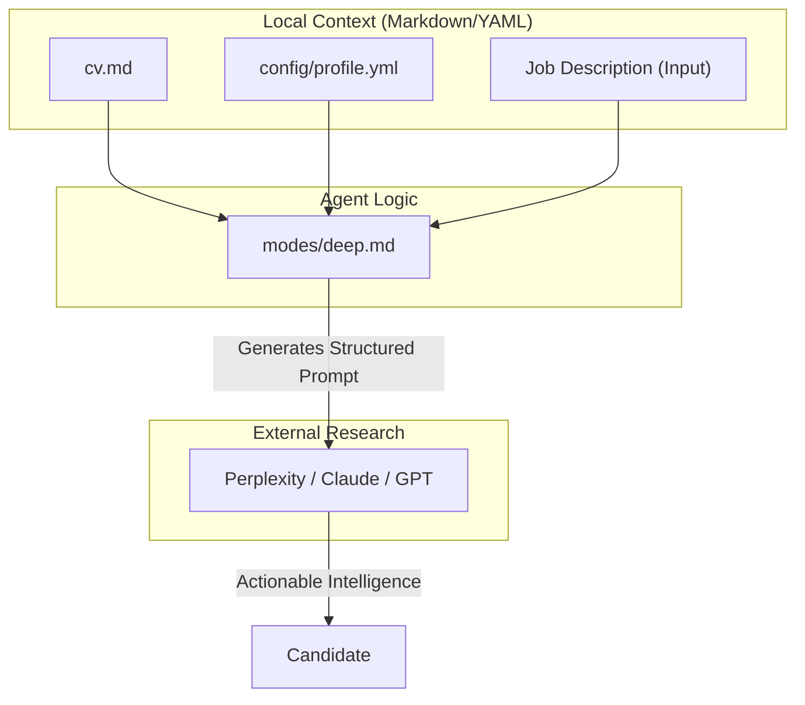
**Sources:** [modes/deep.md:1-48](), [modes/oferta.md:40-41](), [.claude/skills/career-ops/SKILL.md:82-94]()

---

## Training Evaluation Mode (`training.md`)

The `training` mode assesses professional development opportunities. It prevents "tutorial hell" by forcing an evaluation of opportunity cost and recruiter signal [modes/training.md:3-12]().

### Evaluation Dimensions
Every training request is scored across six dimensions:
*   **North Star Alignment**: Does this move the candidate closer to their target goal? [modes/training.md:7-7]()
*   **Recruiter Signal**: What is the perceived value to a Hiring Manager? [modes/training.md:8-8]()
*   **Time and Effort**: Assessment of hours required per week [modes/training.md:9-9]().
*   **Opportunity Cost**: What else could be done during that time? [modes/training.md:10-10]()
*   **Risks**: Outdated content or weak brand [modes/training.md:11-11]().
*   **Portfolio Deliverable**: Does the course result in a demonstrable artifact? [modes/training.md:12-12]()

**Sources:** [modes/training.md:1-27]()

---

## Pattern Analysis Mode (`patterns.md`)

The `patterns` mode uses the `analyze-patterns.mjs` script to identify systemic issues in the candidate's application strategy [modes/patterns.md:1-5](). It requires at least 5 tracked applications with outcomes beyond "Evaluated" to run [modes/patterns.md:17-20]().

### Technical Implementation
The analysis logic is encapsulated in `analyze-patterns.mjs`, which parses the application tracker and associated report files [analyze-patterns.mjs:3-7]().

1.  **Data Ingestion**: `parseTrackerRow()` (imported from `tracker-parse.mjs`) reads `data/applications.md` [analyze-patterns.mjs:20-20]().
2.  **Report Parsing**: `parseMachineSummary()` extracts the `## Machine Summary` block from individual Markdown files in the `reports/` directory [analyze-patterns.mjs:161-170]().
3.  **Outcome Classification**: Statuses are normalized and classified into `positive`, `negative`, `self_filtered`, or `pending` via `classifyOutcome()` [analyze-patterns.mjs:101-109]().
4.  **Channel Yield**: Performs `vendorAnalysis` (ATS detection) and `viaChannelAnalysis` (recruiter/agency yield) [analyze-patterns.mjs:57-93]().

**Rejection Pattern Analysis Pipeline**
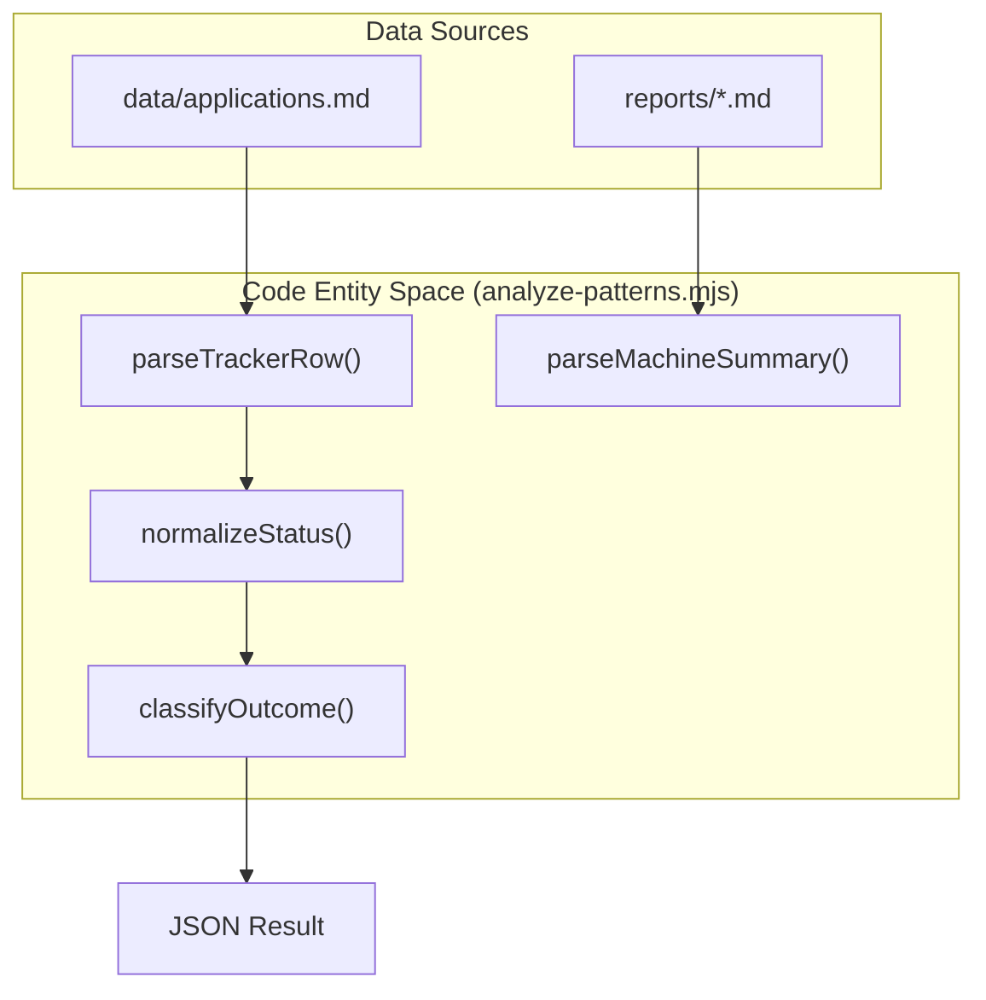

**Sources:** [modes/patterns.md:1-155](), [analyze-patterns.mjs:1-110]()

---

## Upskill & Skill Gap Analysis

The system provides two complementary methods for identifying skill gaps: a zero-LLM regex approach for individual JDs and an aggregate analyzer for the entire tracker.

### Aggregate Upskill Mode (`upskill.mjs`)
`upskill.mjs` extracts skill tokens from every linked evaluation report's gaps (Hard Stops and Soft Gaps) [upskill.mjs:5-6](). It weights gaps by the inverse of the report score: a 2.1/5 report contributes more weight to a gap than a 4.5/5 report [upskill.mjs:10-11]().

*   **Suppression Logic**: It removes any skills already present in `cv.md` or `config/profile.yml` [upskill.mjs:7-8]().
*   **Canonicalization**: Uses a shared `skill-extract.mjs` to ensure "k8s" and "Kubernetes" are treated as the same entity [skill-extract.mjs:3-9]().
*   **YAML Hygiene**: `yamlValueText()` strips comments from YAML config files before extraction to prevent commented-out skills (e.g., `# not using Kubernetes`) from being registered as "known" [upskill.mjs:143-151]().

### Individual JD Skill Gap (`jd-skill-gap.mjs`)
For a single JD, this script performs a zero-LLM classification of requirements into three buckets [jd-skill-gap.mjs:4-8]():
1.  **Existing**: Named skill in `cv.md`'s Skills section.
2.  **SupportedByResume**: Appears in prose elsewhere in `cv.md`.
3.  **Gap**: Required by JD but no trace in `cv.md`.

**Skill Extraction and Mapping**
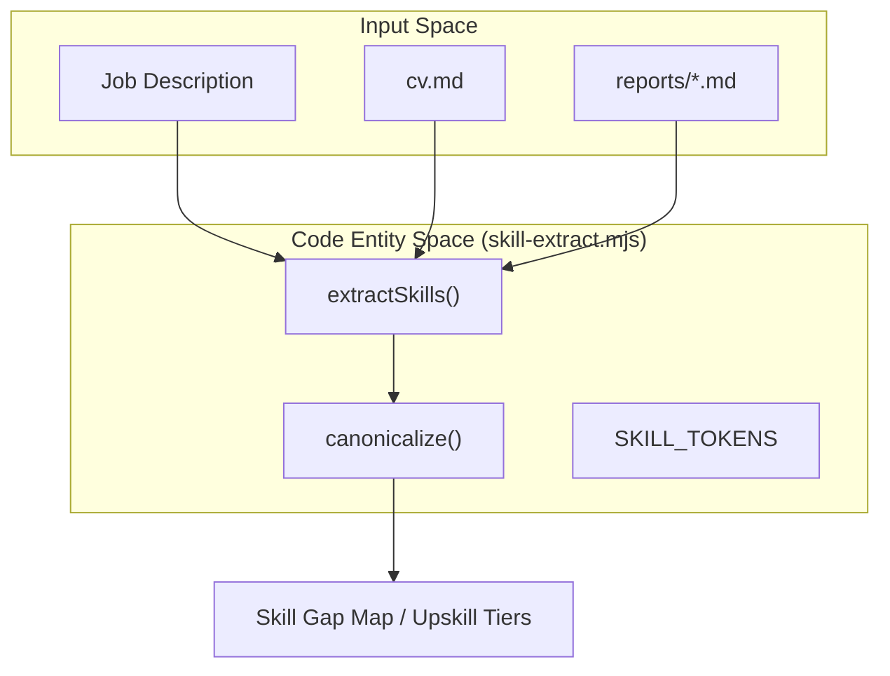

**Sources:** [upskill.mjs:1-110](), [jd-skill-gap.mjs:1-30](), [skill-extract.mjs:1-40](), [tests/skill-extract.test.mjs:1-50]()

---

## Interview Story Matching (`match-star.mjs`)

The `add` mode helps users populate `interview-prep/story-bank.md`, which is then utilized by `match-star.mjs`. This script performs a zero-LLM, zero-browser match of behavioral questions against the candidate's STAR stories [match-star.mjs:4-8]().

*   **Parsing**: `parseStories()` converts the Markdown story bank into structured objects [match-star.mjs:47-50]().
*   **Scoring**: Stories are scored based on tag matches (highest weight), title/theme matches, and body content overlap [match-star.mjs:125-159]().
*   **Formatting**: Returns matches formatted to ATS-ready prose (250–500 words) [match-star.mjs:169-180]().

**Sources:** [match-star.mjs:1-195](), [.claude/skills/career-ops/SKILL.md:34-34]()

---

# Page: Interview & Offer Modes (interview-prep, interview-redflag, offer-prep)

# 2.5 Interview & Offer Modes (interview-prep, interview-redflag, offer-prep)

<details>
<summary>Relevant source files</summary>

The following files were used as context for generating this wiki page:

- [invite-match.mjs](invite-match.mjs)
- [invite-match.test.mjs](invite-match.test.mjs)
- [modes/README.md](modes/README.md)
- [modes/_profile.template.md](modes/_profile.template.md)
- [modes/add.md](modes/add.md)
- [modes/fr/README.md](modes/fr/README.md)
- [modes/interview-prep.md](modes/interview-prep.md)
- [modes/interview-redflag.md](modes/interview-redflag.md)
- [modes/interview/debrief.md](modes/interview/debrief.md)
- [modes/interview/plan.md](modes/interview/plan.md)
- [modes/offer-prep.md](modes/offer-prep.md)
- [modes/outcome.md](modes/outcome.md)
- [modes/pdf/hm-audit.md](modes/pdf/hm-audit.md)
- [modes/upskill.md](modes/upskill.md)
- [salary-gap.mjs](salary-gap.mjs)
- [templates/protected-grounds.yml](templates/protected-grounds.yml)
- [templates/restrictive-covenants.yml](templates/restrictive-covenants.yml)
- [validate-untrusted-content-coverage.mjs](validate-untrusted-content-coverage.mjs)

</details>


This section covers the specialized AI agent modes and supporting scripts used during the final stages of the hiring funnel: preparing for specific interview rounds, identifying organizational red flags from session transcripts, and analyzing employment contracts.

## System Topology: Interview & Offer Stage

The following diagram illustrates the relationship between the AI modes (Markdown instructions) and the data entities they consume or produce.

### Entity Relationship Diagram
```mermaid
graph TD
    subgraph "Natural Language Space (Modes)"
        IP["interview-prep.md"]
        IR["interview-redflag.md"]
        OP["offer-prep.md"]
        DP["interview/debrief.md"]
    end

    subgraph "Code Entity Space (Scripts & Data)"
        SG["salary-gap.mjs"]
        IM["invite-match.mjs"]
        SB["interview-prep/story-bank.md"]
        SS["interview-prep/sessions/*.md"]
        PG["templates/protected-grounds.yml"]
        RC["templates/restrictive-covenants.yml"]
        APP["data/applications.md"]
        SO["data/salary-observations.tsv"]
    end

    IP -->|calls| SG
    IP -->|reads| SB
    DP -->|writes| SS
    IR -->|analyzes| SS
    IR -->|references| PG
    OP -->|references| RC
    IM -->|matches email to| APP
    SG -->|reads| SO
```
**Sources:** [modes/interview-prep.md:9-15](), [modes/interview-redflag.md:15-18](), [modes/offer-prep.md:33-35](), [salary-gap.mjs:8-11](), [invite-match.mjs:5-10]()

---

## Interview Preparation (interview-prep)

The `interview-prep` mode is triggered when an application moves to the `Interview` status or when a user explicitly requests preparation for a specific company and role [modes/interview-prep.md:3]().

### Intelligence Gathering
The mode performs structured research across several vectors:
1.  **Compensation Research:** Queries `levels.fyi` and `Glassdoor` to extract base, equity, and bonus ranges [modes/interview-prep.md:78-80]().
2.  **Process Mapping:** Identifies common screening questions and recruiter behavior from community reviews [modes/interview-prep.md:79]().
3.  **Hiring Manager (HM) Audit:** Reuses the `## HM Audit` section from previous evaluation reports to understand the reviewer persona [modes/interview-prep.md:15]().
4.  **Story Mapping:** Cross-references the `story-bank.md` to map the candidate's STAR+R stories to the specific role requirements [modes/interview-prep.md:9]().

### Prior Stated Compensation
A critical feature of this mode is the integration with `salary-gap.mjs`. It runs `node salary-gap.mjs --stated-for <tracker#>` to retrieve any compensation figures the candidate has already committed to in earlier rounds [modes/interview-prep.md:14](). This prevents accidental contradictions in later-stage negotiations.

**Sources:** [modes/interview-prep.md:1-85](), [salary-gap.mjs:18-23]()

---

## Interview Red-Flag Detector (interview-redflag)

This mode analyzes the **interviewer's side** of session transcripts to surface structural risks before a candidate accepts an offer [modes/interview-redflag.md:3-5]().

### Signal Taxonomy
The agent looks for four primary behavioral signals in transcripts stored in `interview-prep/sessions/`:

| Signal | Indicator |
| :--- | :--- |
| **Scope Ambiguity** | Questions with no measurable criteria or circular role definitions [modes/interview-redflag.md:68](). |
| **Defensive Closure** | Interviewer cuts off technically superior answers or ends sessions abruptly [modes/interview-redflag.md:69](). |
| **Evaluator Competency Gap** | Interviewer cannot engage with domain-correct answers or pivots due to unfamiliarity [modes/interview-redflag.md:70](). |
| **Process Signals** | Contradictory criteria across different interviewers in the same loop [modes/interview-redflag.md:71](). |

### Legal & Protected Grounds
The mode utilizes `templates/protected-grounds.yml` to detect questions that may be legally problematic based on the candidate's jurisdiction (e.g., race, religion, age, or pregnancy status) [modes/interview-redflag.md:18](). This is a local data lookup; the agent identifies matches against example patterns like *"Where are you really from?"* or *"What is your Social Insurance Number?"* [templates/protected-grounds.yml:79-88]().

**Sources:** [modes/interview-redflag.md:58-74](), [templates/protected-grounds.yml:71-123]()

---

## Offer Preparation (offer-prep)

The `offer-prep` mode acts as a "Contract Reading Companion." It is designed to prepare a candidate for a decision or a meeting with a lawyer, but it is explicitly forbidden from providing legal advice or severity ratings [modes/offer-prep.md:11-16]().

### Execution Logic
1.  **Intake Gate:** Quotes back section headings to ensure the OCR/text extraction was successful [modes/offer-prep.md:81-85]().
2.  **Promises Intake:** Asks the candidate for verbal or email promises to compare against the written contract [modes/offer-prep.md:93-97]().
3.  **Restrictive Covenants:** References `templates/restrictive-covenants.yml` to provide statutory context for non-compete and non-solicitation clauses without stating enforceability [modes/offer-prep.md:33-43]().
4.  **Hard Guards:** The mode is prohibited from online research during this phase to protect PII (Personally Identifiable Information) and contract confidentiality [modes/offer-prep.md:28-30]().

**Sources:** [modes/offer-prep.md:23-55](), [modes/offer-prep.md:74-107]()

---

## Supporting Scripts

### invite-match.mjs
This script solves the problem of generic recruiter emails (e.g., "Schedule Your Phone Screen") that lack job titles or req IDs.

*   **Implementation:** It fuzzy-matches company names from pasted text against `data/applications.md` [invite-match.mjs:12-14]().
*   **Disambiguation:** If multiple applications exist for one company, it ranks them using `STATUS_PRIORITY`. `Interview` status outranks `Applied`, which outranks `Rejected` [invite-match.mjs:121-130]().
*   **Platform Detection:** It extracts meeting platforms (Zoom, Teams, Meet) or phone numbers from the invite text [invite-match.test.mjs:98-108]().

### salary-gap.mjs
A compensation analyzer that folds multiple data sources into a single view of "Desired vs. Advertised vs. Actual" pay.

*   **Data Flow:**
    1.  Reads `advertised_comp` from evaluation reports [salary-gap.mjs:9]().
    2.  Reads `target_range` from `profile.yml` [salary-gap.mjs:11]().
    3.  Appends user-reported observations from `data/salary-observations.tsv` [salary-gap.mjs:10]().
*   **Trust Tiers:** It uses a hierarchy to resolve conflicts (e.g., for `actual` pay, a `contract` source outranks a `recruiter-verbal` source) [salary-gap.mjs:45-49]().

### Logic Flow: Invite to Tracker
```mermaid
sequenceDiagram
    participant U as User
    participant IM as invite-match.mjs
    participant TP as tracker-parse.mjs
    participant APP as applications.md

    U->>IM: Paste email text
    IM->>TP: resolveColumns()
    TP->>APP: Read rows
    IM->>IM: normalizeCompanyName()
    IM->>IM: matchInvite(rows, statusPriority)
    IM-->>U: Return ranked matches (JSON/Summary)
```
**Sources:** [invite-match.mjs:40](), [invite-match.mjs:121-130](), [invite-match.mjs:143-146]()

---

# Page: Internationalization (i18n Modes)

# Internationalization (i18n Modes)

<details>
<summary>Relevant source files</summary>

The following files were used as context for generating this wiki page:

- [modes/ar/fursah.md](modes/ar/fursah.md)
- [modes/ja/README.md](modes/ja/README.md)
- [modes/ja/_shared.md](modes/ja/_shared.md)
- [modes/ja/kyujin.md](modes/ja/kyujin.md)
- [modes/ja/oubo.md](modes/ja/oubo.md)
- [modes/ja/pipeline.md](modes/ja/pipeline.md)
- [modes/tr/is-ilani.md](modes/tr/is-ilani.md)
- [modes/zh-TW/README.md](modes/zh-TW/README.md)
- [modes/zh-TW/_shared.md](modes/zh-TW/_shared.md)
- [modes/zh-TW/apply.md](modes/zh-TW/apply.md)
- [modes/zh-TW/oferta.md](modes/zh-TW/oferta.md)
- [modes/zh/README.md](modes/zh/README.md)
- [modes/zh/_shared.md](modes/zh/_shared.md)
- [modes/zh/apply.md](modes/zh/apply.md)
- [modes/zh/oferta.md](modes/zh/oferta.md)

</details>


The `career-ops` system provides localized agent behaviors through the `modes/` subdirectories. These internationalization (i18n) modes adapt the core evaluation and application logic to specific regional job markets, legal frameworks, and linguistic conventions. Instead of a simple translation, each locale modifies the **Evaluation (A-G)** and **Application** workflows to account for regional compensation structures (e.g., Polish ZUS/B2B, Turkish SGK, Japanese Seishain vs. Gyomu Itaku), employment types, and cultural interviewing norms.

## Implementation Architecture

The i18n system functions as a set of specialized "skills" that the AI agent loads based on user configuration. While core scripts like `merge-tracker.mjs` remain language-agnostic, the prompts that drive the AI's decision-making are swapped for localized versions.

### Localized Mode Mapping

| Locale | Directory | Key Mode File (Evaluation) | Key Mode File (Application) | Market Focus |
| :--- | :--- | :--- | :--- | :--- |
| **Japanese** | `modes/ja/` | `kyujin.md` | `oubo.md` | Japan (Wantedly, Green, BizReach) |
| **Chinese** | `modes/zh/` | `oferta.md` | `apply.md` | China (BOSS直聘, Lagou) |
| **Turkish** | `modes/tr/` | `is-ilani.md` | `basvuru.md` | Turkey (Kariyer.net, Secretcv) |
| **Arabic** | `modes/ar/` | `fursah.md` | `apply.md` | MENA Market (LinkedIn, Local Portals) |
| **Polish** | `modes/pl/` | `oferta.md` | `aplikuj.md` | Poland (Pracuj.pl, No Fluff Jobs) |
| **Portuguese** | `modes/pt/` | `oferta.md` | `aplicar.md` | Brazil (Gupy, Greenhouse BR) |
| **French** | `modes/fr/` | `offre.md` | `postuler.md` | France / Francophone markets |
| **German** | `modes/de/` | `angebot.md` | `bewerben.md` | DACH (Xing, LinkedIn DE) |

Sources: [modes/ja/README.md:48-57](), [modes/zh/README.md:42-47](), [modes/tr/is-ilani.md:1-3](), [modes/ar/fursah.md:1-3]()

### System Data Flow: Locale Activation

The system resolves the active mode directory through a hierarchy of configuration. Users can set a permanent locale in `config/profile.yml` or trigger it per session via natural language instructions to the agent.

**Title: Mode Selection and Context Injection**
```mermaid
graph TD
    User["User Interaction"] -- "/career-ops pipeline" --> Agent["Claude Code Agent"]
    Agent -- "Read Config" --> Profile["config/profile.yml"]
    Profile -- "language.modes_dir" --> ModeDir["modes/{locale}/"]
    
    subgraph "Context Assembly"
        ModeDir -- "Load System Rules" --> Shared["_shared.md"]
        ModeDir -- "Load Mode Logic" --> ModeFile["kyujin.md / oferta.md / is-ilani.md"]
        Root["Project Root"] -- "Load Source of Truth" --> CV["cv.md"]
    end
    
    Shared --> Agent
    ModeFile --> Agent
    CV --> Agent
    Agent -- "Execute Evaluation" --> Report["reports/{num}.md"]
```
Sources: [modes/ja/README.md:32-42](), [modes/zh/README.md:18-36](), [modes/tr/is-ilani.md:100-104]()

---

## Market-Specific Adaptations

### 1. Japanese Market (modes/ja/)
The Japanese modes focus on the rigid distinction between permanent employment and contracting, as well as specific allowance structures.

*   **Employment Types**: Differentiates between **Seishain (正社員)** and **Gyomu Itaku (業務委託)**, calculating equivalent compensation by accounting for social insurance and bonuses [modes/ja/_shared.md:101-102]().
*   **Allowance Evaluation**: Analyzes **Minashi Zangyo** (fixed overtime), **36 Kyotei** (overtime limits), **Tsukin Teate** (commuting), and **Jutaku Teate** (housing) [modes/ja/_shared.md:105-110]().
*   **Evaluation Structure**: Extends to 7 blocks (A-G), including a **Liveness Gate** that uses Playwright to verify URLs before consuming tokens [modes/ja/kyujin.md:5-16]().

### 2. Chinese Market (modes/zh/)
The Chinese modes prioritize "Legitimacy" (Block G) to filter out "Ghost Jobs" and handle specific social welfare structures.

*   **Legitimacy (Block G)**: Analyzes activity signals on platforms like BOSS直聘 (e.g., "Active Today") and detects "Ghost Jobs" based on 90-day history in `scan-history.tsv` [modes/zh/oferta.md:155-169]().
*   **Social Welfare**: Evaluates **Five Insurances and One Fund** (五险一金), 13th-month pay, and probation salary rules (minimum 80% of contract) [modes/zh/_shared.md:111-115]().
*   **Risk Summary**: Aggregates culture signals, employment classification, and interview red flags into a machine-readable `risk_summary` table [modes/zh/oferta.md:177-195]().

### 3. Turkish Market (modes/tr/)
The Turkish modes adapt to the local compensation and inflation-adjusted landscape.

*   **Compensation**: Evaluates Net vs. Gross (Net/Brüt) and checks for **TÜFE** (CPI) based annual raise guarantees [modes/tr/is-ilani.md:56-60]().
*   **Portal Integration**: Optimized for `Kariyer.net`, `Secretcv.com`, and `LinkedIn TR` [modes/tr/is-ilani.md:50-52]().

### 4. Arabic Market (modes/ar/)
The Arabic modes focus on deep "Archetype Detection" and STAR+R storytelling adapted for the MENA region.

*   **Archetype Detection**: Classifies roles into FDE, SA, PM, LLMOps, Agentic, or Transformation roles to prioritize specific proof points [modes/ar/fursah.md:7-12]().
*   **STAR+R Methodology**: Adds a **Reflection** component to STAR stories to signal seniority, distinguishing between junior (process-oriented) and senior (lesson-oriented) candidates [modes/ar/fursah.md:84-90]().

---

## Technical Configuration & Rules

### The _shared.md Contract
Every locale directory contains a `_shared.md` file. This is a system-level file that the agent **must** read before any evaluation. It defines:
1.  **Archetype Signals**: Localized keywords for role detection (e.g., "HITL" for Agentic roles) [modes/ja/_shared.md:86-91](), [modes/zh/_shared.md:92-99]().
2.  **Scoring Interpretation**: Market-specific salary quartiles (Comp) and culture signals [modes/ja/_shared.md:37-50]().
3.  **Source of Truth Boundary**: Enforces strict reading of `cv.md` and `article-digest.md` while forbidding the fabrication of metrics [modes/ja/_shared.md:11-28]().

### Localized Evaluation Block Structure (A-G)
Regardless of language, the modes maintain the canonical structure to ensure compatibility with the dashboard and `merge-tracker.mjs`.

| Block | Japanese (`kyujin.md`) | Chinese (`oferta.md`) | Purpose |
| :--- | :--- | :--- | :--- |
| **A** | Role Summary | 岗位概览 | Role Summary & Metadata |
| **B** | Match with CV | 简历匹配分析 | Skill alignment & gap analysis |
| **C** | Level and Strategy | 级别判断与求职策略 | Seniority positioning |
| **D** | Comp and Demand | 薪酬竞争力与市场需求 | Market rate benchmarking |
| **E** | Customization Plan | 针对性定制方案 | CV/LinkedIn update plan |
| **F** | Interview Plan | 面试备考计划 | STAR+R story mapping |
| **G** | Posting Legitimacy | 职位真实性评估 | Legitimacy & Ghost job check |

Sources: [modes/ja/kyujin.md:25-111](), [modes/zh/oferta.md:13-176]()

### Entity Mapping: Mode Files to Logic

**Title: Natural Language Space to Code Entity Mapping**
```mermaid
graph LR
    subgraph "Natural Language (Markdown)"
        JA_K["modes/ja/kyujin.md"]
        ZH_O["modes/zh/oferta.md"]
        TR_I["modes/tr/is-ilani.md"]
    end

    subgraph "System Scripts (Node.js)"
        M_T["merge-tracker.mjs"]
        C_L["check-liveness.mjs"]
        R_N["reserve-report-num.mjs"]
    end

    subgraph "Data Space"
        R_MD["reports/NNN-company.md"]
        A_MD["data/applications.md"]
        T_ADD["batch/tracker-additions/*.tsv"]
    end

    JA_K -- "Verifies URL via" --> C_L
    JA_K -- "Atomically reserves ID via" --> R_N
    JA_K -- "Generates" --> R_MD
    JA_K -- "Writes TSV to" --> T_ADD
    T_ADD -- "Processed by" --> M_T
    M_T -- "Updates" --> A_MD
```
Sources: [modes/ja/kyujin.md:104-106](), [modes/ja/pipeline.md:9-13](), [modes/tr/is-ilani.md:157-169]()

## Usage Guidelines for Technical Contributors

1.  **Linguistic Consistency**: Modes use "Natural Technical Language." Commands and tool names (e.g., `Playwright`, `WebSearch`, `WebFetch`, `Read`, `Write`) must **never** be translated [modes/ja/README.md:61-68]().
2.  **TSV Data Integrity**: Even in localized modes, the `merge-tracker.mjs` script expects status values in English (e.g., `Evaluated`, `Applied`, `Interview`, `Offer`, `Rejected`) to maintain dashboard compatibility [modes/ja/README.md:67-67](), [modes/tr/is-ilani.md:164-164]().
3.  **Atomic Numbering**: Localized pipeline and evaluation modes must use `reserve-report-num.mjs` to allocate `REPORT_NUM` to prevent race conditions during parallel processing [modes/ja/pipeline.md:23-23](), [modes/tr/is-ilani.md:104-104]().
4.  **Liveness Sweeps**: Localized `pipeline.md` implementations must run `check-liveness.mjs` in bulk to drop expired postings before starting token-heavy evaluations [modes/ja/pipeline.md:7-17]().

Sources: [modes/ja/README.md:1-114](), [modes/zh/README.md:1-65](), [modes/tr/is-ilani.md:1-190](), [modes/ar/fursah.md:1-140]()

---

# Page: PDF & LaTeX Generation Engine

# PDF & LaTeX Generation Engine

<details>
<summary>Relevant source files</summary>

The following files were used as context for generating this wiki page:

- [build-cv-html.mjs](build-cv-html.mjs)
- [build-cv-latex.mjs](build-cv-latex.mjs)
- [config/profile.example.yml](config/profile.example.yml)
- [cv-sections-core.mjs](cv-sections-core.mjs)
- [generate-latex.mjs](generate-latex.mjs)
- [generate-pdf.mjs](generate-pdf.mjs)
- [modes/_shared.md](modes/_shared.md)
- [modes/latex.md](modes/latex.md)
- [modes/pdf.md](modes/pdf.md)
- [templates/README.md](templates/README.md)
- [templates/cv-template.html](templates/cv-template.html)
- [templates/cv-template.tex](templates/cv-template.tex)
- [templates/resume-template.html](templates/resume-template.html)
- [tests/cv-dollar-pattern.test.mjs](tests/cv-dollar-pattern.test.mjs)
- [tests/cv-named-templates.test.mjs](tests/cv-named-templates.test.mjs)
- [tests/cv-numeric-scalars.test.mjs](tests/cv-numeric-scalars.test.mjs)
- [tests/cv-optional-sections.test.mjs](tests/cv-optional-sections.test.mjs)
- [tests/cv-partial-empty-fallbacks.test.mjs](tests/cv-partial-empty-fallbacks.test.mjs)
- [tests/theme-style-dollar-pattern.test.mjs](tests/theme-style-dollar-pattern.test.mjs)
- [tests/theme-style.test.mjs](tests/theme-style.test.mjs)
- [theme-style.mjs](theme-style.mjs)

</details>


The **PDF & LaTeX Generation Engine** is a specialized subsystem designed to transform a Markdown-based CV source of truth into an ATS-optimized, professionally designed document. It supports two primary output paths: a high-fidelity HTML-to-PDF pipeline using headless browser rendering, and a structured LaTeX-to-PDF pipeline for academic or Overleaf-compatible exports. It also handles the generation of tailored cover letters and provides optional visual design variants.

### System Overview

The engine follows a linear pipeline that begins with the raw `cv.md` and ends with a rendered PDF file. The choice of pipeline is governed by the `cv.output_format` setting in `config/profile.yml` [config/profile.example.yml:126]().

#### Generation Pipeline
1.  **Context Ingestion**: Loads the base `cv.md`, `config/profile.yml`, and the target Job Description (JD) [modes/pdf.md:14-15](), [modes/latex.md:7-9]().
2.  **Skill Gap Analysis**: Executes `jd-skill-gap.mjs` to classify requirements into `existing`, `supportedByResume`, and `gap` buckets before drafting [modes/pdf.md:17-20]().
3.  **Regional Formatting**: Detects company location to set paper size (`letter` for US/Canada, `a4` elsewhere) [modes/pdf.md:29-31]().
4.  **Template Synthesis**: Populates either `templates/cv-template.html` (via `build-cv-html.mjs`) or `templates/cv-template.tex` (via `build-cv-latex.mjs`) with structured JSON content [build-cv-html.mjs:5-12](), [build-cv-latex.mjs:118-126]().
5.  **ATS Normalization**: For HTML, `generate-pdf.mjs` cleans Unicode characters like smart quotes and em-dashes to prevent keyword corruption [generate-pdf.mjs:107-116]().
6.  **Rendering**: Executes Playwright for HTML [generate-pdf.mjs:33-36]() or Tectonic/pdfLaTeX for LaTeX [modes/latex.md:19-23]() to produce the final document.

#### Data Flow: From Source to Output
The following diagram illustrates how natural language CV data is processed by code entities into the final PDF.

**CV Transformation Flow**
```mermaid
graph TD
    subgraph "Natural Language Space"
        CV_MD["cv.md (Source of Truth)"]
        JD["Job Description (URL/Text)"]
        PROFILE["config/profile.yml"]
    end

    subgraph "Code Entity Space"
        MODO_PDF["modes/pdf.md (HTML Path)"]
        MODO_LATEX["modes/latex.md (LaTeX Path)"]
        BUILD_HTML["build-cv-html.mjs"]
        BUILD_LATEX["build-cv-latex.mjs"]
        GEN_PDF["generate-pdf.mjs (Playwright)"]
    end

    subgraph "Output Space"
        FINAL_PDF["output/cv-candidate-company.pdf"]
        TEX_EXPORT["output/cv-candidate-company.tex"]
    end

    CV_MD --> MODO_PDF
    JD --> MODO_PDF
    PROFILE --> MODO_PDF

    MODO_PDF --> BUILD_HTML
    MODO_LATEX --> BUILD_LATEX
    
    BUILD_HTML --> GEN_PDF
    BUILD_LATEX --> TEX_EXPORT
    GEN_PDF --> FINAL_PDF
```
Sources: [modes/pdf.md:14-43](), [modes/latex.md:5-20](), [build-cv-html.mjs:3-16](), [build-cv-latex.mjs:1-12]()

---

### Core Components

The engine is divided into four main functional areas.

#### CV & Resume HTML Templates & Fonts
The system uses a single-column, ATS-optimized layout defined in `templates/cv-template.html` [templates/cv-template.html:22-29](). It utilizes a CSS design system that suppresses ligatures (`font-variant-ligatures: none`) to ensure clean machine-readable parsing [templates/cv-template.html:31-44](). The template relies on a placeholder system (e.g., `{{NAME}}`, `{{EXPERIENCE}}`) and supports optional section stripping for empty arrays [cv-sections-core.mjs:4-16]().

For details, see [CV & Resume HTML Templates & Fonts](#3.1).

#### generate-pdf.mjs Script
This Node.js utility renders HTML into PDF using `playwright` [generate-pdf.mjs:36](). It includes `normalizeTextForATS`, which converts problematic Unicode (like `\u2014` em-dashes) into ASCII-safe equivalents [generate-pdf.mjs:148-154](). It also enforces a workspace boundary check to prevent path traversal [generate-pdf.mjs:72-101]().

For details, see [generate-pdf.mjs Script](#3.2).

#### LaTeX/Overleaf Export
The alternative pipeline uses `templates/cv-template.tex` to generate a professional LaTeX document [modes/latex.md:3](). The `build-cv-latex.mjs` script takes a JSON payload and handles LaTeX escaping for special characters like `&`, `%`, and `$` [build-cv-latex.mjs:119-133]().

For details, see [LaTeX/Overleaf Export](#3.3).

#### Cover Letter Generator
The cover letter pipeline (defined in `modes/cover.md`) generates tailored letters that adhere to `voice-dna.md` writing rules. It uses a dedicated `generate-cover-letter.mjs` script and the `templates/cover-letter-template.html` placeholder system.

For details, see [Cover Letter Generator](#3.4).

---

### Implementation Details

The engine bridges the gap between AI-generated text and a fixed document format through the following mapping:

**Component Mapping: Logic to Files**
```mermaid
graph LR
    subgraph "Logic Entities"
        direction TB
        KW_INJECT["Keyword Injection"]
        ATS_NORM["ATS Normalization"]
        STRIP_LOGIC["Section Stripping"]
        THEME_LOGIC["Dynamic Theming"]
    end

    subgraph "Implementation"
        direction TB
        M_PDF["modes/pdf.md"]
        G_PDF["generate-pdf.mjs"]
        S_CORE["cv-sections-core.mjs"]
        T_STYLE["theme-style.mjs"]
    end

    KW_INJECT --- M_PDF
    ATS_NORM --- G_PDF
    STRIP_LOGIC --- S_CORE
    THEME_LOGIC --- T_STYLE
```
Sources: [modes/pdf.md:38-40](), [generate-pdf.mjs:116-143](), [cv-sections-core.mjs:1-16](), [theme-style.mjs:42]()

#### Technical Specifications
| Feature | HTML Implementation | LaTeX Implementation |
| :--- | :--- | :--- |
| **Rendering Engine** | Playwright (Chromium) [generate-pdf.mjs:36]() | Tectonic / pdfLaTeX [modes/latex.md:23]() |
| **Typography** | Liberation Sans / System Stack [templates/cv-template.html:13]() | Computer Modern (Standard LaTeX) [modes/latex.md:28]() |
| **ATS Strategy** | Ligature suppression, Unicode normalization [generate-pdf.mjs:145-155]() | `\pdfgentounicode=1` [modes/latex.md:141]() |
| **Paper Formats** | A4 / Letter (Dynamic CSS) [build-cv-html.mjs:40]() | letterpaper [modes/latex.md:142]() |
| **Section Guard** | `cv-sections-core.mjs` (HTML) [cv-sections-core.mjs:110-117]() | `cv-sections-core.mjs` (Tex) [cv-sections-core.mjs:118-123]() |

Sources: [generate-pdf.mjs:145-155](), [templates/cv-template.html:11-44](), [build-cv-html.mjs:33-40](), [cv-sections-core.mjs:109-123](), [modes/latex.md:23-28]()

---

# Page: CV & Resume HTML Templates & Fonts

# CV & Resume HTML Templates & Fonts

<details>
<summary>Relevant source files</summary>

The following files were used as context for generating this wiki page:

- [config/profile.example.yml](config/profile.example.yml)
- [cv-sections-core.mjs](cv-sections-core.mjs)
- [generate-latex.mjs](generate-latex.mjs)
- [generate-pdf.mjs](generate-pdf.mjs)
- [modes/_shared.md](modes/_shared.md)
- [modes/latex.md](modes/latex.md)
- [modes/pdf.md](modes/pdf.md)
- [templates/README.md](templates/README.md)
- [templates/cv-template.compact.html](templates/cv-template.compact.html)
- [templates/cv-template.executive.html](templates/cv-template.executive.html)
- [templates/cv-template.html](templates/cv-template.html)
- [templates/cv-template.jake.html](templates/cv-template.jake.html)
- [templates/cv-template.leadership.html](templates/cv-template.leadership.html)
- [templates/cv-template.modern.html](templates/cv-template.modern.html)
- [templates/cv-template.tex](templates/cv-template.tex)
- [templates/cv-template.zh-minimal.html](templates/cv-template.zh-minimal.html)
- [templates/resume-template.html](templates/resume-template.html)
- [tests/cv-named-templates.test.mjs](tests/cv-named-templates.test.mjs)
- [tests/cv-optional-sections.test.mjs](tests/cv-optional-sections.test.mjs)
- [tests/template-page-breaks.test.mjs](tests/template-page-breaks.test.mjs)
- [tests/theme-style-dollar-pattern.test.mjs](tests/theme-style-dollar-pattern.test.mjs)
- [tests/theme-style.test.mjs](tests/theme-style.test.mjs)
- [theme-style.mjs](theme-style.mjs)

</details>


The CV and Resume generation engine utilizes highly structured HTML templates designed for **ATS (Applicant Tracking System) compatibility** and rapid recruiter scanning. These templates act as the visual layer for data stored in `cv.md`, transforming Markdown content into professionally styled, single-column PDFs via the `generate-pdf.mjs` pipeline.

## CV vs. Resume Distinction

The system provides two primary templates to accommodate different market expectations:

*   **CV (`cv-template.html`)**: Designed for comprehensive career histories. It includes a dedicated "Certifications" section and is intended for multi-page documents common in academic or international contexts. [templates/cv-template.html:90](), [templates/resume-template.html:12]()
*   **Resume (`resume-template.html`)**: A variant optimized for the 1-2 page US/industry format. It omits the Certifications section to focus on recent, high-impact experience and impact metrics. [templates/resume-template.html:7-11]()

**Sources:** [templates/README.md:9-12](), [templates/resume-template.html:1-15]()

## Template Architecture

Both templates use a placeholder system that the `pdf` mode and `generate-pdf.mjs` script populate during execution.

### Placeholder System

| Placeholder | Description | Implementation Context |
|:---|:---|:---|
| `{{LANG}}` | Sets HTML `lang` attribute. Drives CJK fallback for `ja` or RTL for `ar`. | [templates/cv-template.html:2](), [modes/pdf.md:28]() |
| `{{PAGE_WIDTH}}` | CSS width (`8.5in` for letter, `210mm` for A4) based on company location. | [templates/cv-template.html:66](), [modes/pdf.md:29-31]() |
| `{{NAME}}` | Candidate name from `config/profile.yml`. | [templates/cv-template.html:6](), [modes/pdf.md:41]() |
| `{{SUMMARY_TEXT}}` | Professional Summary tailored with JD keywords and exit narrative. | [templates/cv-template.html:151](), [modes/pdf.md:35]() |
| `{{COMPETENCIES}}` | Flex-grid of keyword phrases as `<span class="competency-tag">`. | [templates/cv-template.html:168](), [modes/pdf.md:38]() |
| `{{EXPERIENCE}}` | Work history HTML with bullets reordered by JD relevance. | [templates/cv-template.html:186](), [modes/pdf.md:37]() |

**Sources:** [modes/pdf.md:28-43](), [templates/cv-template.html:1-162]()

### ATS Optimization & Ligature Suppression

A critical feature for machine readability is the suppression of ligatures. Headless Chromium often substitutes letter pairs (like "fi", "fl") with single Unicode glyphs (U+FB01), which causes ATS keyword searches for "verification" to fail if the parser sees "verification".

*   **Ligature Disable**: Both templates set `font-variant-ligatures: none` and `font-feature-settings: "liga" 0` on all elements. [templates/cv-template.html:42-43](), [templates/resume-template.html:69-70]()
*   **Unicode Normalization**: The `generate-pdf.mjs` script further cleanses the HTML by converting em-dashes (`—`) to hyphens (`-`) and smart quotes to ASCII equivalents to prevent "mojibake" in legacy ATS parsers. [generate-pdf.mjs:107-115]()

**Sources:** [templates/cv-template.html:35-44](), [generate-pdf.mjs:107-155]()

## Dynamic Theming & Customization

The system supports visual overrides via `config/profile.yml` without modifying the underlying templates.

*   **Design Tokens**: Users can define `accent_color`, `font_family`, `font_size`, and `margin` in their profile. [config/profile.example.yml:119-123]()
*   **Injection Mechanism**: `theme-style.mjs` parses these tokens and `generate-pdf.mjs` injects them as a `:root` CSS block into the HTML before rendering. [generate-pdf.mjs:42](), [tests/theme-style.test.mjs:13-15]()
*   **Optional Sections**: Sections like `Projects` or `Awards` are stripped entirely from the output if the data payload is empty, preventing bare headers. This is handled by `cv-sections-core.mjs` using marker sentinels like `<!-- PROJECTS -->`. [cv-sections-core.mjs:4-16](), [templates/README.md:31]()
*   **The END Sentinel**: Templates must include an `<!-- END -->` (HTML) or `%%%% END %%%%` (LaTeX) marker after the final section (usually Skills) to prevent the stripping logic from truncating the document tail. [cv-sections-core.mjs:32-56](), [templates/README.md:33-35]()

**Sources:** [theme-style.mjs:1-50](), [cv-sections-core.mjs:1-107](), [config/profile.example.yml:115-158]()

## Layout & Design Strategy

The layout is optimized for the **"6-second recruiter scan"**, placing high-impact keyword-dense information at the top.

*   **Single Column Layout**: Strictly avoids sidebars or parallel columns to ensure linear text extraction by ATS. [templates/README.md:27]()
*   **CSS Design Tokens**:
    *   **Fonts**: Base templates use `Liberation Sans` stack for extraction safety. [templates/cv-template.html:13]()
    *   **Color Scheme**: Cyan primary (`hsl(187, 74%, 32%)`) for section titles and Purple (`hsl(270, 70%, 45%)`) for company/project titles. [templates/cv-template.html:12](), [templates/cv-template.html:202]()
*   **Section Ordering**: Configurable via `cv.sections` in `profile.yml`. Default: 1. Summary, 2. Competencies, 3. Experience, 4. Projects, 5. Education, 6. Certifications, 7. Awards, 8. Skills. [config/profile.example.yml:139-152]()

### Data Flow: Markdown to Styled HTML

The following diagram illustrates how the system bridges the gap between raw Markdown data and the final rendered HTML structure.

**CV Transformation Map**
```mermaid
graph TD
    subgraph "NaturalLanguageSpace (cv.md & profile.yml)"
        MD_Name["profile.yml: candidate.full_name"]
        MD_Summary["> Summary Block"]
        MD_Exp["## Work Experience"]
        MD_Keywords["JD Keywords (Extracted)"]
    end

    subgraph "CodeEntitySpace (templates/cv-template.html)"
        H1_Tag["header h1"]
        Summary_Div["class='summary-text'"]
        Job_Section["class='job'"]
        
        MD_Name -->|Injected into {{NAME}}| H1_Tag
        MD_Summary -->|Tailored with Keywords| Summary_Div
        MD_Exp -->|Reordered Bullets| Job_Section
        MD_Keywords -->|Injected into| Summary_Div
    end

    subgraph "CSSDesignTokens (theme-style.mjs)"
        Accent["--accent-color"]
        FFamily["--font-family"]
        FSize["--font-size"]
    end

    H1_Tag -.-> FFamily
    Summary_Div -.-> FSize
    Job_Section -.-> Accent
```
**Sources:** [modes/pdf.md:14-43](), [templates/cv-template.html:72-148](), [theme-style.mjs:40-60]()

---

## Template Variants

The system includes several named variants for specific professional styles, selectable via the `--template` flag or `cv.template` config. [config/profile.example.yml:131-137]()

| Variant | Purpose | File |
|:---|:---|:---|
| `compact` | High information density for senior roles. | `templates/cv-template.compact.html` |
| `modern` | Clean, contemporary aesthetic with DM Sans. | `templates/cv-template.modern.html` |
| `jake` | Inspired by the popular Overleaf "Jake's Resume". | `templates/cv-template.jake.html` |
| `executive` | Formal layout for leadership positions. | `templates/cv-template.executive.html` |
| `zh-minimal` | Restrained technical CV for the Chinese market. | `templates/cv-template.zh-minimal.html` |

**Sources:** [templates/README.md:10](), [config/profile.example.yml:131-137]()

### Style Entity Relationship

**Style Entity Relationship**
```mermaid
classDiagram
    class Body {
        font-family: var(--font-family)
        font-size: var(--font-size)
        line-height: 1.5
    }
    class Header {
        font-size: 28px
        font-weight: 700
        line-height: 1.1
    }
    class SectionTitle {
        text-transform: uppercase
        color: var(--accent-color)
        border-bottom: 1.5px solid #e2e2e2
    }
    class JobCompany {
        font-size: 12.5px
        color: hsl(270, 70%, 45%)
        font-weight: 600
    }
    
    Body <|-- Header
    Body <|-- SectionTitle
    SectionTitle *-- JobCompany
```
**Sources:** [templates/cv-template.html:11-216](), [theme-style.mjs:42-55]()

---

# Page: generate-pdf.mjs Script

# generate-pdf.mjs Script

<details>
<summary>Relevant source files</summary>

The following files were used as context for generating this wiki page:

- [.npmignore](.npmignore)
- [build-cv-html.mjs](build-cv-html.mjs)
- [build-cv-latex.mjs](build-cv-latex.mjs)
- [config/profile.example.yml](config/profile.example.yml)
- [generate-pdf.mjs](generate-pdf.mjs)
- [modes/_shared.md](modes/_shared.md)
- [modes/pdf.md](modes/pdf.md)
- [templates/cv-template.html](templates/cv-template.html)
- [tests/cv-dollar-pattern.test.mjs](tests/cv-dollar-pattern.test.mjs)
- [tests/cv-numeric-scalars.test.mjs](tests/cv-numeric-scalars.test.mjs)
- [tests/cv-partial-empty-fallbacks.test.mjs](tests/cv-partial-empty-fallbacks.test.mjs)
- [tests/cv-section-order.test.mjs](tests/cv-section-order.test.mjs)
- [tests/generate-pdf-batch.test.mjs](tests/generate-pdf-batch.test.mjs)
- [tests/generate-pdf-font-cache.test.mjs](tests/generate-pdf-font-cache.test.mjs)
- [tests/generate-pdf-page-budget.test.mjs](tests/generate-pdf-page-budget.test.mjs)
- [tests/helpers.mjs](tests/helpers.mjs)
- [tests/hermetic-git-env.test.mjs](tests/hermetic-git-env.test.mjs)
- [tests/theme-style-dollar-pattern.test.mjs](tests/theme-style-dollar-pattern.test.mjs)
- [tests/theme-style.test.mjs](tests/theme-style.test.mjs)
- [tests/user-layer-gitignored.test.mjs](tests/user-layer-gitignored.test.mjs)
- [theme-style.mjs](theme-style.mjs)

</details>


The `generate-pdf.mjs` script is the core rendering engine of the Career-Ops pipeline. It transforms tailored HTML CVs and resumes into ATS-optimized PDF documents using Playwright and headless Chromium. The script handles complex layout requirements, dynamic theming, Unicode normalization for legacy Applicant Tracking Systems (ATS), and strict workspace security boundaries.

## Overview and CLI Usage

The script is invoked by the `pdf` agent mode [modes/pdf.md:43-43]() or as part of the `batch-runner.sh` orchestrator. It supports both single-file rendering and a high-performance batch manifest mode.

**Command Syntax:**
```bash
node generate-pdf.mjs <input.html> <output.pdf> [--format=letter|a4] [--report=NNN] [--max-pages=N] [--strict-pages]
node generate-pdf.mjs --batch=<manifest.json> [--format=letter|a4]
```

### Key CLI Flags
*   **`--batch`**: Renders multiple documents through a single shared Chromium instance to reduce overhead [generate-pdf.mjs:10-14]().
*   **`--report`**: Links the PDF to a specific tracker entry in `data/pdf-index.tsv` [generate-pdf.mjs:16-19]().
*   **`--max-pages`**: Sets the preferred page limit (default: 2). Overflow triggers a warning or rejection [generate-pdf.mjs:27-30]().
*   **`--template`**: Selects a specific HTML variant (e.g., `resume`, `compact`, `modern`) [generate-pdf.mjs:43-43]().

**Sources:** [generate-pdf.mjs:1-34]()

## Core Systems

### ATS Unicode Normalization
The `normalizeTextForATS` function is a security and compatibility layer that sanitizes HTML content before rendering [generate-pdf.mjs:106-116](). It targets "mojibake" issues caused by legacy ATS parsers failing on modern Unicode characters.

*   **Masking**: The script uses a `MASK` token system to protect `<style>` and `<script>` blocks, ensuring normalization only affects visible body text [generate-pdf.mjs:120-142]().
*   **Sanitization**: It replaces em-dashes (`\u2014`) with hyphens, converts "smart" quotes to straight quotes, and strips zero-width characters [generate-pdf.mjs:148-153]().
*   **Currency Expansion**: Unambiguous symbols like `€` and `£` are converted to `EUR` and `GBP` to prevent font-subsetting display errors [generate-pdf.mjs:167-168]().

### Dynamic Theming System
The script integrates with `theme-style.mjs` to inject user-defined styles from `config/profile.yml` into the HTML template [generate-pdf.mjs:42-42]().

*   **Token Resolution**: `readStyleTokens` extracts `accent_color`, `font_family`, `font_size`, and `margin` from the YAML profile [theme-style.mjs:18-35]().
*   **Injection**: `injectThemeStyle` prepends a `<style id="career-ops-dynamic-theme">` block to the document head, overriding the template's CSS variables [theme-style.mjs:83-102]().

### Workspace Security & Path Resolution
To prevent SSRF or unauthorized file access, the script implements `assertInsideWorkspace` [generate-pdf.mjs:72-101]().
*   **Canonicalization**: It uses `realpathSync` to resolve symlinks before comparing paths against the `__workspaceRoot` [generate-pdf.mjs:54-54]().
*   **Font Inlining**: Because Chromium headless cannot resolve relative paths without a server, the script transforms font URLs into absolute `file://` paths [generate-pdf.mjs:218-227]().

**Sources:** [generate-pdf.mjs:106-168](), [theme-style.mjs:1-102](), [tracker-utils.mjs:1-50]()

## Implementation Data Flow

The following diagrams bridge the gap between the user's Markdown content and the final rendered PDF entity.

### CV Generation Pipeline
```mermaid
graph TD
    subgraph "Natural_Language_Space"
        MD["cv.md (Source of Truth)"]
        JD["Job Description"]
        PROF["profile.yml (Styles/Identity)"]
    end

    subgraph "Code_Entity_Space"
        BUILD["build-cv-html.mjs"]
        THEME["theme-style.mjs"]
        GEN["generate-pdf.mjs"]
        CHROME["Playwright/Chromium"]
    end

    MD --> BUILD
    JD --> BUILD
    PROF --> THEME
    BUILD -- "JSON Payload" --> HTML["cv.html"]
    THEME -- "CSS Tokens" --> GEN
    HTML --> GEN
    GEN -- "normalizeTextForATS()" --> CHROME
    CHROME -- "page.pdf()" --> PDF["cv.pdf"]
```
**Sources:** [build-cv-html.mjs:3-12](), [generate-pdf.mjs:36-42](), [modes/pdf.md:14-43]()

### Script Internal Logic
```mermaid
graph LR
    subgraph "generate-pdf.mjs"
        direction TB
        INIT["assertInsideWorkspace()"]
        NORM["normalizeTextForATS()"]
        FIX["Font Path Resolver"]
        VAL["validateCvSectionOrder()"]
    end

    subgraph "Chromium_Instance"
        direction TB
        NAV["page.goto(file://...)"]
        WAIT["document.fonts.ready"]
        PRINT["page.pdf(margin, format)"]
    end

    INIT --> NORM
    NORM --> FIX
    FIX --> VAL
    VAL --> NAV
    NAV --> WAIT
    WAIT --> PRINT
```
**Sources:** [generate-pdf.mjs:72-270]()

## Advanced Rendering Features

### Section Order Guard
The script prevents AI-generated CVs from accidentally scrambling the professional layout. It compares the header sequence in the rendered HTML against the `cv.md` source [generate-pdf.mjs:153-174](). If the order differs (e.g., Education moved above Experience), the script throws an error unless the `--allow-reorder` flag is present [generate-pdf.mjs:21-25]().

### ATS Typography & Ligature Suppression
The `templates/cv-template.html` includes specific CSS to ensure machine readability:
*   **Ligature Disabling**: `font-variant-ligatures: none` prevents Chromium from merging character pairs like "fi" into a single glyph (U+FB01), which often breaks ATS keyword matching [templates/cv-template.html:35-43]().
*   **System Font Stack**: While visual templates use "Space Grotesk", the base CV template uses a static system sans-serif stack to avoid glyph advance issues in PDF text extractors [templates/cv-template.html:22-29]().

### Page Count Estimation
After rendering, the script performs a binary scan of the resulting PDF to count `/Type /Page` objects [generate-pdf.mjs:269-270](). This provides immediate feedback to the user or the batch runner if a CV has exceeded the target length (typically 1-2 pages) [generate-pdf.mjs:27-30]().

## Technical Reference Table

| Feature | Code Entity / Implementation |
| :--- | :--- |
| **PDF Engine** | `playwright` (Chromium) [generate-pdf.mjs:36-36]() |
| **HTML Builder** | `build-cv-html.mjs` (JSON-to-HTML) [build-cv-html.mjs:1-12]() |
| **Dynamic Style** | `theme-style.mjs` (`injectThemeStyle`) [theme-style.mjs:83-83]() |
| **Unicode Fix** | `normalizeTextForATS` (Regex-based) [generate-pdf.mjs:116-116]() |
| **Workspace Guard** | `assertInsideWorkspace` [generate-pdf.mjs:72-72]() |
| **ATS Formatting** | `font-variant-ligatures: none` [templates/cv-template.html:42-42]() |
| **Paper Sizing** | Letter (8.5in) vs A4 (210mm) [build-cv-html.mjs:40-40]() |

**Sources:** [generate-pdf.mjs:1-280](), [build-cv-html.mjs:1-160](), [templates/cv-template.html:1-100]()

---

# Page: LaTeX/Overleaf Export

# LaTeX/Overleaf Export

<details>
<summary>Relevant source files</summary>

The following files were used as context for generating this wiki page:

- [cv-sections-core.mjs](cv-sections-core.mjs)
- [examples/latex-tex/README.md](examples/latex-tex/README.md)
- [examples/latex-tex/resume-subheading-withouttitle.tex](examples/latex-tex/resume-subheading-withouttitle.tex)
- [examples/latex-tex/resume-subheading.tex](examples/latex-tex/resume-subheading.tex)
- [examples/latex-tex/tabularx-itemize.tex](examples/latex-tex/tabularx-itemize.tex)
- [extract-latex-content.mjs](extract-latex-content.mjs)
- [generate-latex.mjs](generate-latex.mjs)
- [lib/latex-content.mjs](lib/latex-content.mjs)
- [lib/latex-escape.mjs](lib/latex-escape.mjs)
- [modes/latex-tex.md](modes/latex-tex.md)
- [modes/latex.md](modes/latex.md)
- [templates/README.md](templates/README.md)
- [templates/cv-template.tex](templates/cv-template.tex)
- [templates/resume-template.html](templates/resume-template.html)
- [tests/cv-latex-numeric-scalars.test.mjs](tests/cv-latex-numeric-scalars.test.mjs)
- [tests/cv-named-templates.test.mjs](tests/cv-named-templates.test.mjs)
- [tests/cv-optional-sections.test.mjs](tests/cv-optional-sections.test.mjs)
- [tests/latex-escape.test.mjs](tests/latex-escape.test.mjs)

</details>


The LaTeX/Overleaf export path provides a high-fidelity, professional alternative to the standard HTML-to-PDF workflow. It is designed for candidates who require a traditional academic or high-end engineering CV format that is 100% compatible with Overleaf and optimized for ATS (Applicant Tracking Systems) through native Unicode mapping.

### Pipeline Overview

The LaTeX export process is orchestrated via `modes/latex.md` [modes/latex.md:1-22](). It follows a structured sequence that targets `.tex` source generation and specialized LaTeX compilation.

1.  **Context Gathering**: Reads `cv.md` (Source of Truth) and `config/profile.yml` (Identity) [modes/latex.md:7-8]().
2.  **JD Analysis**: Extracts 15-20 keywords and detects the role archetype [modes/latex.md:10-12]().
3.  **Tailored Generation**: Rewrites the Professional Summary and reorders experience bullets/projects based on JD relevance [modes/latex.md:13-16]().
4.  **Payload Construction**: The agent builds a structured JSON payload following a specific schema [modes/latex.md:30-80]().
5.  **Templating**: Executes `build-cv-latex.mjs` to merge the JSON payload into `templates/cv-template.tex`, performing automatic LaTeX escaping [modes/latex.md:18]().
6.  **Validation & Compilation**: Executes `generate-latex.mjs` to verify the structure and compile the PDF using `tectonic` or `pdflatex` [modes/latex.md:19]().

### Data Flow: From Markdown to LaTeX

The following diagram illustrates how the system routes data through the LaTeX workflow.

**LaTeX Export System Topology**
```mermaid
graph TD
    subgraph "User Space (Natural Language)"
        PROFILE["config/profile.yml"]
        CV_MD["cv.md"]
        JD_INPUT["Job Description (JD)"]
    end

    subgraph "Agent Logic (Code Entity Space)"
        LATEX_MODE["modes/latex.md"]
        LATEX_TEX_MODE["modes/latex-tex.md"]
    end

    subgraph "Transformation Layer"
        JSON_DATA["/tmp/cv-*.json"]
        BUILDER["build-cv-latex.mjs"]
        TEX_TEMP["templates/cv-template.tex"]
    end

    subgraph "Compiler (Node.js/CLI)"
        GEN_LATEX["generate-latex.mjs"]
        TECTONIC["tectonic (Preferred)"]
        PDFLATEX["pdflatex (Fallback)"]
    end

    PROFILE --> LATEX_MODE
    CV_MD --> LATEX_MODE
    JD_INPUT --> LATEX_MODE
    LATEX_MODE -- "generates" --> JSON_DATA
    JSON_DATA -- "input" --> BUILDER
    TEX_TEMP -- "template" --> BUILDER
    BUILDER -- "outputs .tex" --> GEN_LATEX
    GEN_LATEX -- "validates & calls" --> TECTONIC
    GEN_LATEX -- "validates & calls" --> PDFLATEX
    TECTONIC -- "outputs" --> RESULT_PDF["output/cv-*.pdf"]
    PDFLATEX -- "outputs" --> RESULT_PDF
```
**Sources:** [modes/latex.md:5-20](), [generate-latex.mjs:134-150]()

### The Transformation Engine (`build-cv-latex.mjs`)

Unlike the HTML path which uses direct string replacement, the LaTeX path uses `build-cv-latex.mjs` to handle the complexities of LaTeX syntax and escaping.

#### Automatic Escaping
The `escapeLatex` function in `lib/latex-escape.mjs` sanitizes user-supplied text to prevent compilation breaks [lib/latex-escape.mjs:12-48](). It also handles numeric scalars (e.g., years as integers) to ensure they are not dropped during rendering [tests/cv-latex-numeric-scalars.test.mjs:1-13]().

| Character | LaTeX Escape | Code Reference |
| :--- | :--- | :--- |
| `\` | `\textbackslash{}` | [lib/latex-escape.mjs:26]() |
| `{` or `}` | `\{` or `\}` | [lib/latex-escape.mjs:27]() |
| `_` | `\_` | [lib/latex-escape.mjs:30]() |
| `&` | `\&` | [lib/latex-escape.mjs:31]() |
| `±` | `$\pm$` | [lib/latex-escape.mjs:42]() |
| `→` | `$\rightarrow$` | [lib/latex-escape.mjs:43]() |

**Sources:** [lib/latex-escape.mjs:24-47](), [tests/cv-latex-numeric-scalars.test.mjs:21-32]()

### Template Placeholder System

The `templates/cv-template.tex` file uses double-brace placeholders [templates/cv-template.tex:83-127]().

| Placeholder | Description | Script Mapping |
| :--- | :--- | :--- |
| `{{NAME}}` | Full Candidate Name | `payload.name` |
| `{{CONTACT_LINE}}` | Phone and Location | `payload.contact_line` |
| `{{EMAIL_URL}}` | Sanitized mailto link | `sanitizeUrl(payload.email.url)` |
| `{{EXPERIENCE}}` | Work history blocks | `buildExperience(payload.experience)` |
| `{{PROJECTS}}` | Project blocks | `buildProjects(payload.projects)` |
| `{{SKILLS}}` | Skill category list | `buildSkills(payload.skills)` |

**Optional Sections**: Sections like `AWARDS` or `PROJECTS` are stripped entirely if the payload array is empty, preventing bare headers [cv-sections-core.mjs:4-16](). This uses the `%%%% END %%%%` sentinel to bound the strip [cv-sections-core.mjs:32-50]().

**Sources:** [templates/cv-template.tex:81-133](), [cv-sections-core.mjs:89-107](), [tests/cv-optional-sections.test.mjs:71-81]()

### Compilation & Validation: `generate-latex.mjs`

The `generate-latex.mjs` script acts as a validator and compiler wrapper.

**Validation Logic**:
The `validateLatexContent` function checks for:
*   **Section Count**: Ensures at least 4 `\section{}` blocks exist (Education, Experience, Projects, Skills) [generate-latex.mjs:22, 57-60]().
*   **CJK Detection**: Rejects characters from Japanese, Chinese, or Korean ranges as the `pdfLaTeX` setup lacks CJK font support [generate-latex.mjs:30, 62-64]().
*   **ATS Compatibility**: Verifies `\pdfgentounicode=1` is present [generate-latex.mjs:84-86]().
*   **Unresolved Placeholders**: Scans for any remaining `{{UPPER_CASE}}` strings [generate-latex.mjs:72-75]().

**Engine Selection**:
The script detects available engines on the system `PATH` [generate-latex.mjs:134-147]():
1.  **Tectonic**: Preferred. The script automatically patches the `.tex` file to remove `pdflatex`-specific primitives like `glyphtounicode` that cause Tectonic to crash [generate-latex.mjs:152-158]().
2.  **pdflatex**: Standard fallback. Runs two passes to resolve references [generate-latex.mjs:167-176]().

**Sources:** [generate-latex.mjs:37-96](), [generate-latex.mjs:105-224]()

### In-Place Tailoring (`latex-tex` mode)

For users with existing hand-tuned `.tex` files, `modes/latex-tex.md` allows tailoring prose without changing the template [modes/latex-tex.md:1-9]().

**Supported Families**:
*   `resumeSubheading`: Detects `\resumeSubheading` + `\resumeItem` [lib/latex-content.mjs:47-49]().
*   `tabularx-itemize`: Detects `tabularx` and `itemize` environments [lib/latex-content.mjs:50-54]().

**Extraction and Patching Logic**
```mermaid
graph TD
    subgraph "Code Entity Space"
        EXTRACT["extract-latex-content.mjs"]
        PATCH["patch-latex-content.mjs"]
        LIB_CONTENT["lib/latex-content.mjs"]
    end

    subgraph "Logic Flow"
        DETECT["detectFamily()"]
        BODY["bodyStart()"]
        SLOTS["extractMacroBodies()"]
    end

    USER_TEX["User resume.tex"] --> EXTRACT
    EXTRACT --> DETECT
    DETECT --> BODY
    BODY --> SLOTS
    SLOTS -- "generates" --> JSON_SLOTS["cv-slots-*.json"]
    
    JSON_SLOTS -- "Tailored by AI" --> JSON_PATCH["cv-patches-*.json"]
    JSON_PATCH --> PATCH
    USER_TEX --> PATCH
    PATCH -- "outputs" --> TAILORED_TEX["Tailored .tex"]
```
**Sources:** [lib/latex-content.mjs:45-56](), [lib/latex-content.mjs:66-69](), [lib/latex-content.mjs:108-146](), [modes/latex-tex.md:35-59]()

### Overleaf Compatibility
The template is designed to be "zero-config" for Overleaf. It utilizes standard CTAN packages such as `titlesec`, `hyperref`, and `fontawesome` [templates/cv-template.tex:9-21](). The generated `.tex` file can be uploaded directly to an Overleaf project and compiled using the default `pdfLaTeX` engine [modes/latex.md:23-28]().

**Sources:** [modes/latex.md:23-28](), [templates/cv-template.tex:1-24]()

---

# Page: Cover Letter Generator

# Cover Letter Generator

<details>
<summary>Relevant source files</summary>

The following files were used as context for generating this wiki page:

- [generate-cover-letter.mjs](generate-cover-letter.mjs)
- [modes/_brief.template.md](modes/_brief.template.md)
- [modes/cover.md](modes/cover.md)
- [modes/email.md](modes/email.md)
- [modes/expand.md](modes/expand.md)
- [modes/triage.md](modes/triage.md)
- [templates/cover-letter-template.html](templates/cover-letter-template.html)
- [test/cover-resolver.test.mjs](test/cover-resolver.test.mjs)
- [tests/cover-letter-output-path.test.mjs](tests/cover-letter-output-path.test.mjs)
- [tests/cover-letter-signature.test.mjs](tests/cover-letter-signature.test.mjs)
- [tests/cover-unresolved-placeholders.test.mjs](tests/cover-unresolved-placeholders.test.mjs)

</details>


The Cover Letter Generator is a specialized pipeline within `career-ops` designed to produce highly tailored, ATS-optimized, and human-centric cover letters. It bridges the gap between the candidate's core identity (defined in `cv.md` and `profile.yml`) and the specific requirements of a Job Description (JD), while strictly adhering to conversational writing standards that eliminate "AI-slop."

## Generation Pipeline & Modes

The system operates through `modes/cover.md`, which defines the logic for two primary entry points:

1.  **Slug Mode**: Initiated via `/career-ops cover {slug}`. It loads an existing evaluation report from the `reports/` directory, extracting the `## Cover Letter Draft` section as a baseline and fetching the original JD URL for context [modes/cover.md:5-17]().
2.  **Paste Mode**: Initiated via `/career-ops cover` or by pasting a JD directly. This mode starts the generation process from scratch [modes/cover.md:6-6]().

### The JD Gate
A mandatory preflight check, the **JD Gate**, ensures that a valid job description (containing a role title, company name, and responsibilities) is present before any drafting occurs. The system is programmed to refuse the generation of generic or placeholder letters [modes/cover.md:10-22]().

### Data Flow Diagram: Generation Logic
This diagram illustrates the association between the natural language requirements in `modes/cover.md` and the underlying code entities and data sources.

**Cover Letter Data Assembly**
```mermaid
graph TD
    subgraph "Natural Language Space (modes/cover.md)"
        JD_Gate["Step 0: JD Gate"]
        Load_Profile["Step 1: Load Profile"]
        Parse_JD["Step 2: Parse JD"]
        Research["Step 3: Company Research"]
        Gaps["Step 5: Gap Detection"]
        Drafting["Step 7: Drafting"]
    end

    subgraph "Code Entity Space"
        CV_MD["cv.md"]
        PROFILE_YML["config/profile.yml"]
        REPORTS_DIR["reports/*.md"]
        WEB_SEARCH["WebSearch Tool"]
        GEN_SCRIPT["generate-cover-letter.mjs"]
        TEMPLATE["templates/cover-letter-template.html"]
        WRITING_MD["modes/_writing.md"]
    end

    JD_Gate --> REPORTS_DIR
    Load_Profile --> CV_MD
    Load_Profile --> PROFILE_YML
    Load_Profile --> WRITING_MD
    Parse_JD --> WEB_SEARCH
    Research --> WEB_SEARCH
    Gaps --> PROFILE_YML
    Drafting --> GEN_SCRIPT
    GEN_SCRIPT --> TEMPLATE
```
Sources: [modes/cover.md:10-166](), [generate-cover-letter.mjs:1-15]()

## Writing Standards and Guardrails

The generator is governed by shared writing guidance that ensures the output avoids "Dead AI vocabulary" and mechanical structures.

| Rule Source | Role in Cover Letter | Source |
| :--- | :--- | :--- |
| `modes/_writing.md` | Primary guardrail for Voice DNA, style calibration, and ATS rules. | [modes/cover.md:41-41]() |
| `modes/_profile.md` | Candidate-specific overrides for voice, exit narratives, and framing. | [modes/cover.md:43-43]() |
| `voice-dna.md` | Tier 2 conversational writing rules (if present). | [modes/email.md:72-72]() |

### Core Writing Constraints
*   **ATS Optimization**: Headless Chromium ligatures (fi/fl/ffi) are disabled via CSS `font-variant-ligatures: none` to ensure PDF text extractors correctly read keywords [templates/cover-letter-template.html:25-32]().
*   **Gap Management**: The system explicitly prompts the user to address domain mismatches, notice periods, and language requirements rather than auto-fabricating solutions [modes/cover.md:128-154]().
*   **Keyword Mirroring**: The system extracts "ATS-critical" and "Human trust signals" from the JD and mirrors them in the profile intro and achievements [modes/cover.md:87-125]().

Sources: [modes/cover.md:41-44](), [templates/cover-letter-template.html:25-32]()

## Technical Implementation: generate-cover-letter.mjs

The `generate-cover-letter.mjs` script handles the transformation of the AI-generated JSON payload into a finalized PDF. It uses a placeholder replacement system to inject data into `templates/cover-letter-template.html` [generate-cover-letter.mjs:9-15]().

### Key Functions
- `buildHtml(payload, templatePath)`: Reads the HTML template and performs a single-pass substitution. It throws an error if any `{{TOKEN}}` placeholders remain unresolved after processing [generate-cover-letter.mjs:207-266](), [tests/cover-unresolved-placeholders.test.mjs:38-45]().
- `safeOutputPath(raw)`: A security guard that ensures output files are written within the `output/` directory, rejecting path traversal attempts [generate-cover-letter.mjs:38-65](), [tests/cover-letter-output-path.test.mjs:76-83]().
- `buildSignatureBlock(signature, candidateName)`: Handles optional sign-off blocks, supporting both simple strings and objects with custom valedictions and names [generate-cover-letter.mjs:170-184](), [tests/cover-letter-signature.test.mjs:65-75]().
- `resolveCoverTemplatePath(payload, options)`: Resolves which template to use, checking `profile.yml` defaults first before falling back to the base template [test/cover-resolver.test.mjs:23-45]().

### Template Placeholder System
The template uses double-curly-brace tokens (e.g., `{{NAME}}`). The substitution is performed in a way that allows user text to contain token-like sequences without being re-interpreted as placeholders [tests/cover-unresolved-placeholders.test.mjs:47-55]().

**Entity Mapping: Script to Template**
```mermaid
graph LR
    subgraph "generate-cover-letter.mjs"
        P_CAND["payload.candidate"]
        P_LETT["payload.letter"]
        F_BC["buildContactLine()"]
        F_BA["buildAchievementsBlock()"]
        F_BS["buildSignatureBlock()"]
    end

    subgraph "templates/cover-letter-template.html"
        T_NAME["{{NAME}}"]
        T_CONT["{{CONTACT_LINE}}"]
        T_OPEN["{{OPENING}}"]
        T_ACHI["{{ACHIEVEMENTS_BLOCK}}"]
        T_SIGN["{{SIGNATURE_BLOCK}}"]
    end

    P_CAND --> T_NAME
    F_BC --> T_CONT
    P_LETT --> T_OPEN
    F_BA --> T_ACHI
    F_BS --> T_SIGN
```
Sources: [generate-cover-letter.mjs:98-184](), [templates/cover-letter-template.html:138-156]()

## Canva Integration

For candidates desiring a design-heavy approach, the system integrates with the **Canva MCP**. This workflow allows the AI to duplicate an existing Canva design and map the cover letter text directly into the design's text elements while enforcing character budget limits to prevent overflow.

## Storage and Output

Generated cover letters are stored in the `output/` directory. The `safeOutputPath` function ensures that application-bundle layouts (e.g., `output/{slug}/cover-letter/v1/`) are preserved while preventing writes outside the root `output/` folder [generate-cover-letter.mjs:38-71](), [tests/cover-letter-output-path.test.mjs:41-54]().

When generated as part of the application flow, the draft is also stored within the corresponding evaluation report in `reports/` under the `## Cover Letter Draft` section [modes/cover.md:17-17]().

Sources: [generate-cover-letter.mjs:38-71](), [modes/cover.md:5-17]()

---

# Page: Batch Processing System

# Batch Processing System

<details>
<summary>Relevant source files</summary>

The following files were used as context for generating this wiki page:

- [analyze-patterns.mjs](analyze-patterns.mjs)
- [batch-evaluate-gemini.mjs](batch-evaluate-gemini.mjs)
- [batch/README.md](batch/README.md)
- [batch/batch-prompt.md](batch/batch-prompt.md)
- [batch/batch-runner.sh](batch/batch-runner.sh)
- [browser-extract.mjs](browser-extract.mjs)
- [examples/README.md](examples/README.md)
- [examples/cv-example.md](examples/cv-example.md)
- [examples/resume-example.md](examples/resume-example.md)
- [modes/auto-pipeline.md](modes/auto-pipeline.md)
- [modes/batch.md](modes/batch.md)
- [modes/followup.md](modes/followup.md)
- [modes/oferta.md](modes/oferta.md)
- [modes/patterns.md](modes/patterns.md)
- [modes/tracker.md](modes/tracker.md)
- [modes/training.md](modes/training.md)
- [reconcile-pipeline.mjs](reconcile-pipeline.mjs)
- [tests/application-artifacts.test.mjs](tests/application-artifacts.test.mjs)
- [tests/batch-evaluate.test.mjs](tests/batch-evaluate.test.mjs)
- [tests/batch-runner-jd-prefetch.test.mjs](tests/batch-runner-jd-prefetch.test.mjs)
- [tests/batch-runner-score-delimiter.test.mjs](tests/batch-runner-score-delimiter.test.mjs)
- [tests/browser-extract-flags.test.mjs](tests/browser-extract-flags.test.mjs)
- [tests/browser-extract.test.mjs](tests/browser-extract.test.mjs)

</details>


The **Batch Processing System** is a high-volume evaluation subsystem designed to process job offers in parallel. It automates the transition from a raw URL or Job Description (JD) to a complete professional evaluation, including a generated PDF CV and a structured entry in the application tracker.

This system is designed for "burst" processing where a candidate identifies dozens of potential roles and needs a rapid, high-quality assessment of each without manual intervention for every step.

## System Architecture

The batch system follows an **Orchestrator/Worker** pattern. The orchestrator manages the state, concurrency, and error recovery, while independent workers (powered by Claude) perform the actual analysis and file generation.

### High-Level Flow
1.  **Input**: A list of URLs or JDs is provided via `batch/batch-input.tsv` [batch/batch-runner.sh:16]().
2.  **Orchestration**: The system determines which offers are pending by checking `batch/batch-state.tsv` [batch/batch-runner.sh:17]().
3.  **Execution**: Workers are spawned (sequentially or in parallel) to process each offer using `claude -p` with the `batch-prompt.md` template [batch/batch-runner.sh:8-11]().
4.  **Output**: Each worker generates a Markdown report in `reports/`, a customized PDF via `generate-pdf.mjs`, and a tracker TSV line in `batch/tracker-additions/` [batch/batch-prompt.md:7-12]().
5.  **Reconciliation**: Results are merged into the main `data/applications.md` tracker and the `data/pipeline.md` inbox is updated to reflect processed items via `reconcile-pipeline.mjs` [batch/README.md:27]().

### Code Entity Map: Architecture
The following diagram maps the logical components of the batch system to their physical file entities and data structures.

**Batch System Entity Mapping**
```mermaid
graph TD
    subgraph "Orchestration_Layer_[batch-runner.sh]"
        Runner["batch/batch-runner.sh"]
        State["batch/batch-state.tsv"]
        Input["batch/batch-input.tsv"]
        Lock["batch/batch-runner.pid"]
        StateLock["batch/.batch-state.lock"]
    end

    subgraph "Worker_Layer_(claude_-p)"
        Prompt["batch/batch-prompt.md"]
        Worker["Claude_Worker_Instance"]
        JD_File["{{JD_FILE}}_(temp_file)"]
    end

    subgraph "Output_Space"
        Reports["reports/*.md"]
        PDFs["output/*.pdf"]
        Additions["batch/tracker-additions/*.tsv"]
        AppTracker["data/applications.md"]
        PipelineMD["data/pipeline.md"]
        DiscardLog["batch/logs/discard.log"]
    end

    Input --> Runner
    Runner <--> State
    Runner -- "manages" --> Lock
    Runner -- "concurrency" --> StateLock
    Runner -- "spawns" --> Worker
    Prompt -- "System_Prompt" --> Worker
    JD_File -- "JD_Context" --> Worker
    Worker -- "writes" --> Reports
    Worker -- "calls_generate-pdf.mjs" --> PDFs
    Worker -- "writes" --> Additions
    Additions -- "merge-tracker.mjs" --> AppTracker
    State -- "reconcile-pipeline.mjs" --> PipelineMD
    Runner -- "pre-screen_logs" --> DiscardLog
```
Sources: [batch/batch-runner.sh:13-27](), [batch/batch-prompt.md:1-12](), [modes/batch.md:32-44](), [reconcile-pipeline.mjs:3-15]()

---

## Operational Modes

The batch system can be triggered in two distinct ways depending on the source of the job offers.

### 1. Conductor --chrome Mode
In this mode, the system uses a headed browser to navigate portals in real-time, extracting JDs directly from the DOM [modes/batch.md:8-20]().
*   **Extraction**: Navigates to portal search results and populates `batch-input.tsv` [modes/batch.md:46-50]().
*   **Orchestration**: For each pending URL, it extracts the JD text to a temporary file and executes a headless worker [modes/batch.md:51-60]().
*   **Post-Process**: Automatically merges additions into the main tracker and reconciles the pipeline inbox upon completion [modes/batch.md:65]().

### 2. Standalone Orchestrator (`batch-runner.sh`)
This is a headless Bash-based orchestrator used for bulk processing of URLs or JDs already collected in `batch-input.tsv` [batch/batch-runner.sh:4-6]().
*   **Parallelism**: Can run $N$ workers simultaneously using the `--parallel` flag [batch/batch-runner.sh:63]().
*   **Resumability**: Uses `batch-state.tsv` to skip completed IDs and can retry failed ones via `--retry-failed` [batch/batch-runner.sh:65]().
*   **Rate-Limiting**: Automatically handles Claude session limits, pausing via `paused_rate_limit` state and resuming with `--resume-paused` [batch/batch-runner.sh:109]().

Sources: [modes/batch.md:46-67](), [batch/batch-runner.sh:55-100]()

---

## Core Components

### [batch-runner.sh Orchestrator](#4.1)
The primary Bash script responsible for the lifecycle of a batch job. It handles prerequisite validation (checking for `claude` CLI), state management with a robust directory-based lock `STATE_LOCK_DIR` to handle parallel state updates [batch/batch-runner.sh:27-29](), and final merging via `merge-tracker.mjs` [batch/README.md:60-65](). It also implements a pre-fetch logic using `curl` with a word-count sufficiency check to ensure workers don't process empty or JS-shell pages [tests/batch-runner-jd-prefetch.test.mjs:12-16]().

For details, see [batch-runner.sh Orchestrator](#4.1).

### [batch-prompt.md Worker Template](#4.2)
A self-contained system prompt that transforms a standard Claude instance into a specialized career-ops worker [batch/batch-prompt.md:1-9](). It contains the logic for the 6-step evaluation pipeline (Archetype → A-F eval → Report → PDF → Tracker → JSON stdout) [batch/batch-prompt.md:84-150](). It respects `config/profile.yml` for `language.output` and `spend_tier` configurations [batch/batch-prompt.md:26-32]().

For details, see [batch-prompt.md Worker Template](#4.2).

---

## Data Flow & State Management

The system relies on Tab-Separated Values (TSV) files to maintain a robust, human-readable state that survives process crashes.

| File | Purpose | Key Columns |
| :--- | :--- | :--- |
| `batch-input.tsv` | Queue of work | `id`, `url`, `source`, `notes` [batch/batch-runner.sh:82]() |
| `batch-state.tsv` | Execution history | `status`, `started_at`, `score`, `error`, `retries` [batch/batch-runner.sh:200]() |
| `tracker-additions/` | Individual results | Individual TSV lines for `merge-tracker.mjs` [batch/batch-runner.sh:22]() |
| `logs/discard.log` | Pre-screen audit | `timestamp`, `job_id`, `url`, `reason` [modes/batch.md:32]() |

### Code Entity Map: Data Lifecycle
This diagram illustrates how data transitions from raw input to the final application tracker and pipeline inbox.

**Batch Data Lifecycle**
```mermaid
sequenceDiagram
    participant I as batch-input.tsv
    participant R as batch-runner.sh
    participant W as batch-prompt.md_(Worker)
    participant P as generate-pdf.mjs
    participant T as applications.md
    participant PL as pipeline.md

    I->>R: Read pending IDs
    R->>R: Pre-screen Gate (standard/premium)
    alt Obvious Mismatch
        R->>R: Log to discard.log
    else Valid Match
        R->>W: Spawn with {{URL}}, {{ID}}, {{REPORT_NUM}}
        W->>W: Execute A-G Evaluation
        W->>P: Call for ATS-optimized PDF
        W-->>R: Return JSON result (score, status, error)
        R->>R: Update batch-state.tsv
        R->>T: merge-tracker.mjs (from tracker-additions/)
        R->>PL: reconcile-pipeline.mjs (move to Processed)
    end
```
Sources: [batch/batch-runner.sh:198-202](), [batch/batch-prompt.md:73-82](), [batch/batch-prompt.md:84-150](), [modes/batch.md:24-33](), [reconcile-pipeline.mjs:12-19]()

---

# Page: batch-runner.sh Orchestrator

# batch-runner.sh Orchestrator

<details>
<summary>Relevant source files</summary>

The following files were used as context for generating this wiki page:

- [batch/README.md](batch/README.md)
- [batch/batch-runner.sh](batch/batch-runner.sh)
- [examples/README.md](examples/README.md)
- [examples/cv-example.md](examples/cv-example.md)
- [examples/resume-example.md](examples/resume-example.md)
- [followup-seed.mjs](followup-seed.mjs)
- [modes/batch.md](modes/batch.md)
- [pipeline-lock.mjs](pipeline-lock.mjs)
- [portal-health-lock.mjs](portal-health-lock.mjs)
- [reconcile-pipeline.mjs](reconcile-pipeline.mjs)
- [test/pipeline-lock.test.mjs](test/pipeline-lock.test.mjs)
- [tests/lock-rm-contention.test.mjs](tests/lock-rm-contention.test.mjs)
- [tests/ollama-profile-context.test.mjs](tests/ollama-profile-context.test.mjs)
- [tests/pipeline-lock-mkdir-eperm.test.mjs](tests/pipeline-lock-mkdir-eperm.test.mjs)
- [tests/rename-contention.test.mjs](tests/rename-contention.test.mjs)
- [tests/with-followups-lock.test.mjs](tests/with-followups-lock.test.mjs)
- [tracker-utils.mjs](tracker-utils.mjs)

</details>


The `batch-runner.sh` script is the central orchestrator for high-volume, automated job evaluations. It manages a fleet of `claude -p` workers, providing a robust execution layer that handles parallelization, state persistence, rate-limit management, and automatic recovery from failures. It transforms a list of job URLs into a structured set of evaluations, PDF reports, and tracker entries without manual intervention.

### Core Architecture and Data Flow

The orchestrator operates as a state machine, reading from an input queue and maintaining a persistent state file to ensure idempotency and resumability. It uses a dual-lock mechanism: a global process lock and a fine-grained state lock for thread-safe updates during parallel execution.

#### System Components Interaction
The following diagram illustrates how `batch-runner.sh` coordinates between input files, the Claude CLI, and the final data destinations.

**Orchestrator Logic Flow**
```mermaid
graph TD
    subgraph "Input_Space"
        [batch-input.tsv]
        [batch-prompt.md]
    end

    subgraph "Execution_Engine_batch-runner.sh"
        [acquire_lock]
        [init_state]
        [next_report_num_unlocked]
        [process_offer]
        [update_state_unlocked]
        [handle_rate_limit]
    end

    subgraph "Worker_Space_Claude_CLI"
        [claude-p-worker]
    end

    subgraph "Output_Space"
        [batch/logs/]
        [batch/tracker-additions/]
        [reports/md]
        [output/pdf]
        [batch-state.tsv]
    end

    [batch-input.tsv] --> [process_offer]
    [batch-prompt.md] --> [claude-p-worker]
    [acquire_lock] -- "Prevents collisions" --> [process_offer]
    [process_offer] --> [next_report_num_unlocked]
    [next_report_num_unlocked] -- "Calculates sequence" --> [process_offer]
    [process_offer] --> [claude-p-worker]
    [claude-p-worker] -- "JSON Output" --> [update_state_unlocked]
    [update_state_unlocked] --> [batch-state.tsv]
    [claude-p-worker] --> [batch/logs/]
    [claude-p-worker] --> [batch/tracker-additions/]
    [claude-p-worker] --> [reports/md]
    [claude-p-worker] --> [output/pdf]
    [claude-p-worker] -- "Exit 129/rate-limit" --> [handle_rate_limit]
    [handle_rate_limit] -- "Pause/Retry" --> [process_offer]
```
**Sources:** [batch/batch-runner.sh:13-28](), [batch/batch-runner.sh:144-158](), [batch/batch-runner.sh:293-310](), [batch/batch-runner.sh:401-510](), [batch/batch-runner.sh:543-660]()

---

### CLI Flags and Configuration

The orchestrator supports several flags to control the execution environment and recovery behavior:

| Flag | Default | Description |
| :--- | :--- | :--- |
| `--parallel N` | `1` | Number of concurrent `claude` worker processes. [batch/batch-runner.sh:33]() |
| `--dry-run` | `false` | Lists pending offers without initiating Claude workers. [batch/batch-runner.sh:34]() |
| `--retry-failed` | `false` | Filters the queue to only process IDs marked as `failed` in `batch-state.tsv`. [batch/batch-runner.sh:35]() |
| `--resume-paused` | `false` | Resumes offers marked as `paused_rate_limit`. [batch/batch-runner.sh:36]() |
| `--start-from N` | `0` | Skips all IDs numerically lower than `N`. [batch/batch-runner.sh:37]() |
| `--limit N` | `0` | Max number of offers to process in this run. [batch/batch-runner.sh:48]() |
| `--max-retries N` | `2` | Max attempts allowed per ID before permanent failure. [batch/batch-runner.sh:38]() |
| `--min-score N` | `0` | Skip PDF/tracker for offers scoring below `N`. [batch/batch-runner.sh:39]() |
| `--rate-limit-sleep N`| `300` | Seconds to wait before retrying a rate-limited worker. [batch/batch-runner.sh:44]() |
| `--model NAME` | `""` | Passes a specific model name to `claude -p --model`. [batch/batch-runner.sh:41]() |

**Sources:** [batch/batch-runner.sh:32-48](), [batch/batch-runner.sh:103-126]()

---

### State Management and Resumability

The system uses two primary TSV (Tab-Separated Values) files to manage the lifecycle of a batch.

#### 1. batch-input.tsv
The source of truth for the work queue.
*   **Format:** `id	url	source	notes` [batch/batch-runner.sh:82]()
*   The `id` is a unique numeric identifier used to track progress.

#### 2. batch-state.tsv
The persistence layer managed by `update_state_unlocked()`.
*   **Columns:** `id`, `url`, `status`, `started_at`, `completed_at`, `report_num`, `score`, `error`, `retries`. [batch/batch-runner.sh:200]()
*   **Statuses:** `pending`, `processing`, `completed`, `failed`, `skipped`, `rate_limited`, `paused_rate_limit`. [batch/batch-runner.sh:275-285]()

#### Lock Mechanisms
To prevent race conditions, `batch-runner.sh` implements two tiers of locking:
1.  **Process Lock (`acquire_lock`)**: Uses `batch/batch-runner.pid` to prevent multiple orchestrator instances. [batch/batch-runner.sh:144-158]()
2.  **State Lock (`acquire_state_lock`)**: Uses a directory-based lock (`.batch-state.lock/`) to synchronize access to `batch-state.tsv` across parallel workers. [batch/batch-runner.sh:211-253]()
3.  **Cross-Process Lock**: The system also utilizes `pipeline-lock.mjs` for advisory locks on shared files like `data/pipeline.md` to prevent data loss during concurrent writes. [pipeline-lock.mjs:1-12]()

**Sources:** [batch/batch-runner.sh:16-27](), [batch/batch-runner.sh:144-165](), [batch/batch-runner.sh:198-253](), [pipeline-lock.mjs:1-31]()

---

### Worker Execution and Rate Limiting

The orchestrator uses `process_offer()` to prepare the environment and `run_worker()` to manage the lifecycle of each Claude process.

#### Sequence Generation
Before launching a worker, the script calculates the `next_report_num_unlocked()`. It scans both the `reports/` directory and the `batch-state.tsv` file to find the highest existing number and increments it (e.g., `042`). [batch/batch-runner.sh:293-310]()

#### Rate Limit Handling
If a worker exits with code `129` (indicating a Claude session or rate limit), the orchestrator:
1.  Marks the offer as `paused_rate_limit` in `batch-state.tsv`. [batch/batch-runner.sh:471]()
2.  Creates a `batch-runner.paused` sentinel file. [batch/batch-runner.sh:474]()
3.  Stops scheduling new workers until the user explicitly runs with `--resume-paused`. [batch/batch-runner.sh:618-622]()

**Sources:** [batch/batch-runner.sh:454-483](), [batch/batch-runner.sh:543-660]()

#### Data Flow: Worker to Orchestrator
The following diagram shows how the orchestrator captures the worker's output to update the global state.

**Worker-Orchestrator Handshake**
```mermaid
sequenceDiagram
    participant B as [batch-runner.sh]
    participant C as [claude-p-worker]
    participant S as [batch-state.tsv]
    participant T as [tracker-additions/]

    B->>S: update_state_unlocked(id, "processing")
    B->>C: Spawn process with batch-prompt.md
    Note over C: Executes JD fetch → A-F eval
    C-->>T: Write {id}.tsv fragment
    C-->>B: Return JSON stdout {score: N, status: "success"}
    B->>S: update_state_unlocked(id, "completed", score, ...)
```
**Sources:** [batch/batch-runner.sh:346-398](), [batch/batch-runner.sh:543-660]()

---

### Post-Processing and Integration

Once the batch finishes, the orchestrator performs automatic merging and reconciliation:

1.  **Tracker Integration**: Calls `merge-tracker.mjs` to ingest TSV fragments from `batch/tracker-additions/` into `data/applications.md`. [batch/batch-runner.sh:781-785]()
2.  **Pipeline Reconciliation**: Runs `reconcile-pipeline.mjs` to move processed URLs from the `Pendientes` section of `data/pipeline.md` to `Procesadas`. [batch/batch-runner.sh:788-792]()
3.  **Integrity Check**: Runs `verify-pipeline.mjs` to ensure the application database remains consistent. [batch/batch-runner.sh:795-799]()
4.  **Automatic Resumption**: Because `get_status()` checks `batch-state.tsv` before processing, the script can be safely restarted to pick up where it left off. [batch/batch-runner.sh:275-285](), [batch/batch-runner.sh:611-640]()

**Sources:** [batch/batch-runner.sh:777-805](), [batch/README.md:73-78]()

---

# Page: batch-prompt.md Worker Template

# batch-prompt.md Worker Template

<details>
<summary>Relevant source files</summary>

The following files were used as context for generating this wiki page:

- [batch-evaluate-gemini.mjs](batch-evaluate-gemini.mjs)
- [batch/README.md](batch/README.md)
- [batch/batch-runner.sh](batch/batch-runner.sh)
- [browser-extract.mjs](browser-extract.mjs)
- [examples/README.md](examples/README.md)
- [examples/cv-example.md](examples/cv-example.md)
- [examples/resume-example.md](examples/resume-example.md)
- [modes/batch.md](modes/batch.md)
- [reconcile-pipeline.mjs](reconcile-pipeline.mjs)
- [tests/application-artifacts.test.mjs](tests/application-artifacts.test.mjs)
- [tests/batch-evaluate.test.mjs](tests/batch-evaluate.test.mjs)
- [tests/batch-runner-jd-prefetch.test.mjs](tests/batch-runner-jd-prefetch.test.mjs)
- [tests/batch-runner-score-delimiter.test.mjs](tests/batch-runner-score-delimiter.test.mjs)
- [tests/browser-extract-flags.test.mjs](tests/browser-extract-flags.test.mjs)
- [tests/browser-extract.test.mjs](tests/browser-extract.test.mjs)

</details>


The `batch-prompt.md` file is a self-contained, high-density instruction set used by the `claude -p` worker instances during batch processing. It defines the logic for transforming a raw Job Description (JD) into a comprehensive evaluation report, a tailored CV, and a structured data entry for the application tracker.

## Purpose and Scope

In the `career-ops` architecture, the orchestrator (`batch-runner.sh`) spawns multiple worker processes. Each worker is initialized with `batch-prompt.md` as its system prompt [batch/batch-runner.sh:18](). This template is designed to be "zero-dependency" from the perspective of Claude's internal state—it contains all the rules, archetypes, and pipeline steps necessary to complete an evaluation without requiring external tool calls to other Markdown skills.

Sources: [batch/batch-runner.sh:1-20](), [batch/README.md:57-61]()

## Placeholder Substitution

Before a worker begins execution, the orchestrator performs string substitution on specific placeholders within the template to provide context for the specific job being processed. The `batch-runner.sh` script manages these replacements during the parallel worker dispatch.

| Placeholder | Description | Source in Orchestrator |
|-------------|-------------|------------------------|
| `{{URL}}` | The original job posting URL | `batch-input.tsv` [batch/batch-runner.sh:82]() |
| `{{JD_FILE}}` | Path to the local text file containing the scraped JD | `mktemp batch-jd-XXXX` [tests/batch-runner-jd-prefetch.test.mjs:50-54]() |
| `{{REPORT_NUM}}` | 3-digit zero-padded sequence number (e.g., `042`) | `reserve-report-num.mjs` [batch-evaluate-gemini.mjs:95-98]() |
| `{{DATE}}` | Current date in `YYYY-MM-DD` format | `date +%Y-%m-%d` |
| `{{ID}}` | Unique identifier for the batch row | `batch-input.tsv` [batch/batch-runner.sh:82]() |

Sources: [batch/batch-runner.sh:16-18](), [batch/README.md:57-61](), [tests/batch-runner-jd-prefetch.test.mjs:1-19]()

## The 6-Step Evaluation Pipeline

The worker follows a rigid sequential pipeline to ensure consistency across hundreds of evaluations.

### 1. JD Ingestion
The worker reads the content of `{{JD_FILE}}`. A pre-fetch logic in `batch-runner.sh` using `curl` ensures the JD is available locally to avoid unreliable web fetching for JS-rendered boards [tests/batch-runner-jd-prefetch.test.mjs:4-10](). If the local file is insufficient (e.g., < 80 words), the worker falls back to live extraction [tests/batch-runner-jd-prefetch.test.mjs:12-16]().

### 2. Archetype Detection
The system classifies the role into canonical archetypes (e.g., AI Platform, Agentic Workflows, Solutions Architect). This classification dictates which "proof points" from the candidate's history are prioritized.

### 3. A-G Evaluation Blocks
The worker generates a detailed Markdown report consisting of:
*   **Block A (Role Summary):** Metadata and TL;DR.
*   **Block B (CV Match):** Direct mapping of JD requirements to `cv.md` lines.
*   **Block C (Level Strategy):** Seniority analysis.
*   **Block D (Comp Research):** Market rates and company reputation.
*   **Block E (Personalization):** Specific changes for the CV and LinkedIn.
*   **Block F (Interview Prep):** STAR stories mapped to the JD.
*   **Block G (Posting Legitimacy):** Analysis of posting signals.

### 4. Report & PDF Generation
The worker saves the Markdown report to `reports/`. If the score exceeds the `MIN_SCORE` threshold, it invokes `generate-pdf.mjs` to create the tailored CV [batch/batch-runner.sh:39-40]().

### 5. Tracker TSV Generation
The worker generates a single line of Tab-Separated Values (TSV) for the `merge-tracker.mjs` utility, saved to `batch/tracker-additions/` [batch/README.md:59-61]().

### 6. JSON Output
The final step is printing a structured JSON object to `stdout`. The orchestrator uses a specific delimiter (avoiding IFS whitespace) to parse this JSON and update `batch-state.tsv` [tests/batch-runner-score-delimiter.test.mjs:6-19]().

Sources: [batch/README.md:54-61](), [tests/batch-runner-jd-prefetch.test.mjs:1-19](), [tests/batch-runner-score-delimiter.test.mjs:39-63]()

## Data Flow and Entity Mapping

The following diagram illustrates how the `batch-prompt.md` instructions bridge the gap between natural language job descriptions and the structured code entities in the system.

### Worker Execution Logic
```mermaid
graph TD
    subgraph "Natural Language Space"
        JD["Job Description (Text/URL)"]
        CV_MD["cv.md (Source of Truth)"]
        PROFILE["config/profile.yml (Rules)"]
    end

    subgraph "Worker Logic (batch-prompt.md)"
        direction TB
        DETECTOR["Archetype Detector"]
        EVAL["A-G Evaluator"]
        MAPPER["Requirement-to-CV Mapper"]
    end

    subgraph "Code Entity Space"
        GEN_PDF["generate-pdf.mjs"]
        REPORT_MD["reports/###-company.md"]
        TSV_LINE["batch/tracker-additions/id.tsv"]
        JSON_OUT["JSON stdout Result"]
    end

    JD --> DETECTOR
    CV_MD --> MAPPER
    PROFILE --> EVAL
    DETECTOR --> EVAL
    MAPPER --> EVAL
    EVAL --> REPORT_MD
    EVAL --> GEN_PDF
    EVAL --> TSV_LINE
    TSV_LINE --> JSON_OUT
```
Sources: [batch/batch-runner.sh:16-25](), [batch/README.md:54-61](), [batch-evaluate-gemini.mjs:31-40]()

## Tracker TSV Format

The worker produces a TSV line following a strict schema for ingestion by `merge-tracker.mjs`. The order of columns in this temporary TSV differs from the final `applications.md` and is normalized during the merge [batch/README.md:64-67]().

| Col | Field | Description |
|-----|-------|-------------|
| 1 | `#` | `{{REPORT_NUM}}` |
| 2 | `Date` | `{{DATE}}` |
| 3 | `Company` | Company Name |
| 4 | `Role` | Job Title |
| 5 | `Score` | Global Score (1-5) |
| 6 | `Status` | Default: `⏳ Evaluada` |
| 7 | `PDF` | Relative path or ✅/❌ indicator |
| 8 | `Report` | Relative path to Markdown report |
| 9 | `Notes` | Archetype + Score breakdown + TL;DR |

Sources: [batch/README.md:63-71](), [batch-evaluate-gemini.mjs:73-83](), [tests/batch-evaluate.test.mjs:72-83]()

## JSON Result Schema

At the end of the process, the worker outputs a JSON block. The `batch-runner.sh` orchestrator captures this using a `node -e` parser to update the `batch-state.tsv` file [tests/batch-runner-score-delimiter.test.mjs:68-85]().

```json
{
  "status": "completed",
  "error": null,
  "score": 4.5
}
```

The orchestrator reads these values to populate the `batch-state.tsv` columns: `status`, `error`, `score`, and `report_num` [batch/batch-runner.sh:200]().

Sources: [tests/batch-runner-score-delimiter.test.mjs:78-85](), [batch/batch-runner.sh:198-202](), [reconcile-pipeline.mjs:91-102]()

## Archetype Logic Flow

The worker uses the detected Archetype to filter which information from `cv.md` is relevant. This ensures that an evaluation emphasizes different achievements based on the role's focus.

### Archetype Mapping Process
```mermaid
graph LR
    JD_TEXT["JD Text"] -- "Pattern Match" --> ARCH["Archetype"]
    
    subgraph "Filtering Logic"
        ARCH -- "Platform" --> FEAT1["Observability/Pipelines"]
        ARCH -- "Agentic" --> FEAT2["HITL/Orchestration"]
        ARCH -- "PM" --> FEAT3["Discovery/Metrics"]
    end
    
    CV_MD["cv.md"] -- "Extract" --> FEAT1
    CV_MD -- "Extract" --> FEAT2
    CV_MD -- "Extract" --> FEAT3
    
    FEAT1 --> REPORT["Report Block B"]
    FEAT2 --> REPORT
    FEAT3 --> REPORT
```
Sources: [batch-evaluate-gemini.mjs:124-166](), [tests/batch-evaluate.test.mjs:40-48]()

---

# Page: Application Tracker & Data Layer

# Application Tracker & Data Layer

<details>
<summary>Relevant source files</summary>

The following files were used as context for generating this wiki page:

- [dedup-tracker.mjs](dedup-tracker.mjs)
- [lib/local-today.mjs](lib/local-today.mjs)
- [merge-tracker.mjs](merge-tracker.mjs)
- [normalize-statuses.mjs](normalize-statuses.mjs)
- [set-status-tests.mjs](set-status-tests.mjs)
- [set-status.mjs](set-status.mjs)
- [stats.mjs](stats.mjs)
- [templates/states.yml](templates/states.yml)
- [tests/fixtures/three-city-board.mjs](tests/fixtures/three-city-board.mjs)
- [tests/merge-tracker-url-dedup.test.mjs](tests/merge-tracker-url-dedup.test.mjs)
- [tests/merge-tracker.test.mjs](tests/merge-tracker.test.mjs)
- [tests/scan-company-role-dedup.test.mjs](tests/scan-company-role-dedup.test.mjs)
- [tests/scan-run-failure.test.mjs](tests/scan-run-failure.test.mjs)
- [tests/scan-url-dedup.test.mjs](tests/scan-url-dedup.test.mjs)
- [tests/source-no-nul-bytes.test.mjs](tests/source-no-nul-bytes.test.mjs)
- [tests/states-alias-coverage.test.mjs](tests/states-alias-coverage.test.mjs)
- [tests/stats.test.mjs](tests/stats.test.mjs)
- [tests/tracker-busy-timeout.test.mjs](tests/tracker-busy-timeout.test.mjs)
- [tracker-aliases.json](tracker-aliases.json)
- [tracker-columns-tests.mjs](tracker-columns-tests.mjs)
- [tracker-parse.mjs](tracker-parse.mjs)
- [tracker.mjs](tracker.mjs)
- [url-key.mjs](url-key.mjs)
- [verify-pipeline.mjs](verify-pipeline.mjs)
- [web/src/app/api/status/route.ts](web/src/app/api/status/route.ts)
- [web/src/lib/core/run-registry.ts](web/src/lib/core/run-registry.ts)
- [web/src/lib/core/tracker-lock.ts](web/src/lib/core/tracker-lock.ts)
- [web/src/lib/status-cli.mjs](web/src/lib/status-cli.mjs)
- [web/src/lib/tracker-table.mjs](web/src/lib/tracker-table.mjs)
- [web/tests/lib/status-cli.test.mjs](web/tests/lib/status-cli.test.mjs)
- [web/tests/lib/tracker-lock.test.mjs](web/tests/lib/tracker-lock.test.mjs)

</details>


The `data/` directory serves as the persistent storage layer for the entire career-ops ecosystem. Unlike traditional systems that rely on heavy databases, career-ops uses a **flat-file database** approach, primarily centered around `data/applications.md`. This Markdown-based architecture ensures that the data is human-readable, version-controllable via Git, and easily editable by both AI agents and manual user intervention.

## The Markdown Database Schema

The core of the data layer is `applications.md`. It uses a pipe-delimited Markdown table to track every job offer through its lifecycle [merge-tracker.mjs:29-34](). While the system defaults to a 9-column schema, it dynamically detects columns by header name to support user-customized layouts (e.g., adding a "Location" column) [verify-pipeline.mjs:77-92]().

### Canonical Table Structure
The standard table structure used by the dashboard and maintenance scripts includes the following fields [tracker.mjs:54-55]():

| Column | Name | Description |
| :--- | :--- | :--- |
| 1 | `#` | Sequential ID (Number) [tracker.mjs:95]() |
| 2 | `Date` | Date of the latest status change (YYYY-MM-DD) [tracker.mjs:97]() |
| 3 | `Company` | The name of the hiring organization [tracker.mjs:98]() |
| 4 | `Role` | The specific job title [tracker.mjs:99]() |
| 5 | `Score` | AI-generated match score (e.g., `4.2/5`) [tracker.mjs:100]() |
| 6 | `Status` | Canonical state (see State Machine below) [tracker.mjs:101]() |
| 7 | `PDF` | Indicator if a tailored CV exists (Unicode ✅) [tracker.mjs:102]() |
| 8 | `Report` | Markdown link to the evaluation file in `reports/` [tracker.mjs:103]() |
| 9 | `Notes` | Optional free-text for context [tracker.mjs:104]() |

**Sources:** [merge-tracker.mjs:5-8](), [verify-pipeline.mjs:77-115](), [tracker.mjs:54-55](), [tracker.mjs:94-105]()

## Canonical Status State Machine

To maintain data integrity and enable dashboard filtering, the `Status` column adheres to a predefined set of canonical states. These are defined in `templates/states.yml` and enforced across the Node.js toolchain [tracker.mjs:123-141]().

### State Hierarchy & Aliases
The system maps various natural language inputs (aliases) to a single canonical label. Scripts like `dedup-tracker.mjs` use a `STATUS_RANK` to determine which status is "more advanced" in the pipeline to prevent data loss during deduplication [dedup-tracker.mjs:45-76]().

| ID | Label | Common Aliases | Rank |
| :--- | :--- | :--- | :--- |
| `evaluated` | Evaluated | evaluada, condicional, hold | 2 |
| `applied` | Applied | aplicado, enviada, sent | 3 |
| `responded` | Responded | respondido | 4 |
| `interview` | Interview | entrevista | 5 |
| `offer` | Offer | oferta | 6 |
| `hired` | Hired | contratado, accepted | 7 |
| `rejected` | Rejected | rechazado, rechazada | 1 |
| `discarded` | Discarded | cerrada, cancelada, duplicado | 0 |
| `skip` | SKIP | no aplicar, monitor, geo blocker | 0 |

**Sources:** [dedup-tracker.mjs:45-76](), [normalize-statuses.mjs:29-87](), [verify-pipeline.mjs:52-67](), [tracker.mjs:123-141]()

## Data Flow & Maintenance Architecture

The data layer is managed by a suite of Node.js scripts that ensure the flat-file remains consistent even when multiple batch processes or manual edits occur.

### System Data Flow
The following diagram illustrates how job data moves from external URLs into the canonical `applications.md` file and the derived SQLite index.

**Data Ingestion & Normalization Flow**
```mermaid
graph TD
    subgraph "Natural Language Space"
        A["External Job URL"] -- "batch-runner.sh" --> B["TSV files in batch/tracker-additions/"]
        C["Manual Edits"] -- "Direct Text Edit" --> D["data/applications.md"]
    end

    subgraph "Code Entity Space"
        B -- "merge-tracker.mjs" --> D
        D -- "dedup-tracker.mjs" --> D
        D -- "normalize-statuses.mjs" --> D
        D -- "verify-pipeline.mjs" --> E["Integrity Report"]
        D -- "tracker.mjs sync" --> F["data/applications.db (SQLite)"]
    end

    subgraph "Access Layer"
        F -- "tracker.mjs query" --> G["AI Agents / CLI"]
        D -- "ParseApplications()" --> H["Go Dashboard TUI"]
    end

    style D stroke-width:4px
    style F stroke-width:2px
```
**Sources:** [merge-tracker.mjs:1-15](), [tracker.mjs:4-17](), [verify-pipeline.mjs:1-15](), [dedup-tracker.mjs:1-10]()

### State Transition Integrity
State changes are gated by `set-status.mjs`, which serves as the canonical write path for status updates [set-status.mjs:4-9](). It records every change in `status-log.tsv` for velocity analysis [set-status.mjs:61-69]().

**Write Path & Concurrency Control**
```mermaid
graph LR
    subgraph "Write Clients"
        CLI["set-status.mjs"]
        WebAPI["/api/status/route.ts"]
        Batch["merge-tracker.mjs"]
    end

    subgraph "Concurrency Control"
        Lock["acquireTrackerLock()"]
        Atomic["writeFileAtomic()"]
    end

    CLI --> Lock
    WebAPI --> CLI
    Batch --> Lock
    Lock --> Atomic
    Atomic --> Target["data/applications.md"]
    Atomic --> Log["data/status-log.tsv"]

    style Target stroke-width:4px
```
**Sources:** [set-status.mjs:4-9](), [set-status.mjs:61-69](), [tracker-utils.mjs:25]()

## SQLite Derived Index (`tracker.mjs`)

As the Markdown tracker grows to hundreds of rows, structural degradation can occur (e.g., pipe-character corruption). `tracker.mjs` implements a **SQLite derived index** (RFC #918) to provide schema-validated, model-independent results for AI agents [tracker.mjs:4-17]().

*   **Losslessness:** The index is built from `applications.md` and can be regenerated at any time. Writes continue to target the Markdown file [tracker.mjs:6-10]().
*   **Auto-Resync:** The index automatically resyncs if the Markdown file's `mtime` is newer than the database [tracker.mjs:33-34]().
*   **Corruption Detection:** The sync process repairs common issues like "Mojibake" placeholder corruption [tracker.mjs:158-161]().

**Sources:** [tracker.mjs:4-35](), [tracker.mjs:158-161]()

## Maintenance Scripts Overview

### [merge-tracker.mjs](#5.1)
The primary entry point for batch data. It monitors `batch/tracker-additions/` for TSV files and merges them into the Markdown table [merge-tracker.mjs:38-41](). It uses a filesystem locking mechanism (`acquireTrackerLock`) to prevent race conditions [merge-tracker.mjs:122-137]().
*   **Details:** See [merge-tracker.mjs](#5.1).

### [dedup-tracker.mjs](#5.2)
Handles fuzzy deduplication by grouping entries by normalized company and role title clusters [dedup-tracker.mjs:5-8](). It uses `STATUS_RANK` to ensure that advanced application states (like "Interview") are never overwritten by new "Evaluated" rows [dedup-tracker.mjs:47-76]().
*   **Details:** See [dedup-tracker.mjs](#5.2).

### [normalize-statuses.mjs & verify-pipeline.mjs](#5.3)
These scripts handle data hygiene and safety.
*   **normalize-statuses.mjs**: Strips Markdown bolding and moves legacy status metadata (like "DUPLICADO") into the Notes column [normalize-statuses.mjs:3-9]().
*   **verify-pipeline.mjs**: A diagnostic tool checking for broken report links, non-canonical statuses, and pending TSVs [verify-pipeline.mjs:3-19]().
*   **Details:** See [normalize-statuses.mjs & verify-pipeline.mjs](#5.3).

### [Pattern Analysis & Follow-up Cadence Scripts](#5.4)
Advanced analytics operating on the tracker data.
*   **analyze-patterns.mjs**: Performs funnel analysis to detect tech stack gaps and archetype-based rejection patterns.
*   **followup-cadence.mjs**: Calculates follow-up urgency based on the last contact date and current status [stats.mjs:134-138]().
*   **Details:** See [Pattern Analysis & Follow-up Cadence Scripts](#5.4).

### [tracker.mjs SQLite Index](#5.5)
The technical implementation of the SQLite index, providing a robust query interface for agents and tools [tracker.mjs:24-32]().
*   **Details:** See [tracker.mjs SQLite Index](#5.5).

### [set-status.mjs & Tracker Write Path](#5.6)
Covers the canonical gatekeeper for status updates and the status-log.tsv ledger [set-status.mjs:1-90]().
*   **Details:** See [set-status.mjs & Tracker Write Path](#5.6).

**Sources:** [merge-tracker.mjs:1-15](), [dedup-tracker.mjs:1-10](), [normalize-statuses.mjs:1-12](), [verify-pipeline.mjs:1-21](), [tracker.mjs:1-35](), [set-status.mjs:1-90]()

---

# Page: merge-tracker.mjs

# merge-tracker.mjs

<details>
<summary>Relevant source files</summary>

The following files were used as context for generating this wiki page:

- [dedup-tracker.mjs](dedup-tracker.mjs)
- [merge-tracker.mjs](merge-tracker.mjs)
- [normalize-statuses.mjs](normalize-statuses.mjs)
- [role-matcher.mjs](role-matcher.mjs)
- [stats.mjs](stats.mjs)
- [templates/states.yml](templates/states.yml)
- [tests/merge-tracker.test.mjs](tests/merge-tracker.test.mjs)
- [tests/scan-run-failure.test.mjs](tests/scan-run-failure.test.mjs)
- [tests/source-no-nul-bytes.test.mjs](tests/source-no-nul-bytes.test.mjs)
- [tests/states-alias-coverage.test.mjs](tests/states-alias-coverage.test.mjs)
- [tests/stats.test.mjs](tests/stats.test.mjs)
- [verify-pipeline.mjs](verify-pipeline.mjs)

</details>


`merge-tracker.mjs` is the primary synchronization utility responsible for ingesting new job application data from the batch processing subsystem into the central `applications.md` database [merge-tracker.mjs:1-15](). It handles complex TSV parsing, fuzzy deduplication of company and role names, filesystem locking for concurrency safety, and score-based update logic to ensure the tracker remains the single source of truth for all career operations.

### Core Logic and Data Flow

The script operates by reading "addition" files from `batch/tracker-additions/`, comparing them against the existing entries in `applications.md`, and either appending new rows or updating existing ones based on a hierarchy of matching rules.

#### High-Level Data Flow
The following diagram illustrates how data moves from the batch worker output into the final Markdown table, including the locking mechanism and the authority check against `batch-state.tsv`.

**Data Ingestion Pipeline**
```mermaid
graph TD
    subgraph "Input Space"
        TSV["batch/tracker-additions/*.tsv"]
        STATE["batch/batch-state.tsv"]
    end

    subgraph "Concurrency Control"
        LOCK["acquireTrackerLock()"]
        OWNER["owner.json (PID check)"]
    end

    subgraph "merge-tracker.mjs"
        FAILED_SET["loadFailedReportNumbers()"]
        PARSE["parseTsvContent()"]
        VALID["validateStatus()"]
        DEDUP["Deduplication Logic"]
        UPDATE["Score-based Update"]
    end

    subgraph "Storage Space"
        APPS["data/applications.md"]
        MERGED["batch/tracker-additions/merged/"]
    end

    TSV --> PARSE
    STATE --> FAILED_SET
    FAILED_SET -- "Filter fabricated TSVs" --> DEDUP
    PARSE --> LOCK
    LOCK -- "Check PID" --> OWNER
    OWNER -- "If Stale/Free" --> DEDUP
    APPS -- "Read existing" --> DEDUP
    VALID --> DEDUP
    DEDUP --> UPDATE
    UPDATE -- "Atomic Write" --> APPS
    UPDATE -- "Archive" --> MERGED
```
Sources: [merge-tracker.mjs:38-45](), [merge-tracker.mjs:56-72](), [merge-tracker.mjs:122-137](), [merge-tracker.mjs:295-310]()

### Implementation Details

#### 1. Flexible TSV/Markdown Parsing
The script is resilient to variations in batch worker output and manual edits. It supports three primary formats [merge-tracker.mjs:5-9]():
*   **9-column TSV**: Includes an explicit `notes` field.
*   **8-column TSV**: Standard output without notes.
*   **Pipe-delimited**: Raw Markdown table rows (`| col | col | ... |`).

A key feature is the **Header-Aware Column Mapping** [merge-tracker.mjs:296-310](). Instead of relying on fixed positions, the script detects column indices by searching for a header row. This allows users to add custom columns (e.g., "Location" or "Via") without breaking the merge logic [verify-pipeline.mjs:85-96]().

#### 2. Status Validation & Normalization
To maintain data integrity, incoming statuses are validated against canonical states [merge-tracker.mjs:12]().
*   **Canonical States**: The script checks against standard labels like `Evaluated`, `Applied`, `Interview`, and `Hired` [merge-tracker.mjs:140-140]().
*   **Normalization**: It strips Markdown bolding (`**`) and trailing dates from status fields using `normalizeStatus()` [normalize-statuses.mjs:42-104]().
*   **Spanish/International Aliases**: It maps localized terms (e.g., "entrevista" → "Interview", "başvuruldu" → "Applied") to canonical IDs defined in `templates/states.yml` [templates/states.yml:16-74]().

#### 3. Fuzzy Deduplication and Score Updates
`merge-tracker.mjs` prevents duplicate entries using a multi-tiered approach:
*   **Company Normalization**: `normalizeCompany()` strips punctuation and branding (e.g., "Google (L3)" → "google") [tracker-utils.mjs:25-25]().
*   **Fuzzy Role Matching**: Shared logic in `role-matcher.mjs` tokenizes titles, removes common `ROLE_STOPWORDS` (senior, remote, etc.), and requires a Jaccard overlap [role-matcher.mjs:129-150]().
*   **Score-based Update**: If a duplicate is found with a higher fit score, the script updates the existing row in-place and re-points the report link [merge-tracker.mjs:10-11]().
*   **Fabricated Row Protection**: The script loads `FAILED_REPORT_NUMBERS` from `batch-state.tsv`. If a report number maps to a "failed" batch worker row, it is rejected even if the TSV is well-formed [merge-tracker.mjs:56-72]().

#### 4. Concurrency and Atomic Writes
To prevent data loss during simultaneous merges (common in parallel batch runs), the script implements a filesystem lock [merge-tracker.mjs:81-81]().
*   **acquireTrackerLock()**: Acquires a lock for the specific tracker file path with configurable timeouts and retries [merge-tracker.mjs:124-129]().
*   **Atomic Writes**: Updates are performed using `writeFileAtomic()`, which writes to a temporary file and renames it, ensuring the tracker is never corrupted by a partial write [merge-tracker.mjs:25-25]().

### System Entity Mapping

This diagram maps the logical operations of the script to the specific functions and variables defined in the source code.

**Logic to Code Entity Mapping**
```mermaid
classDiagram
    class MergeTracker {
        +String APPS_FILE
        +Set FAILED_REPORT_NUMBERS
        +acquireTrackerLock()
        +loadFailedReportNumbers(path)
        +normalizeStatus(status)
    }

    class RoleMatcher {
        +Set ROLE_STOPWORDS
        +Set BASELINE_TOKENS
        +roleTokens(role)
        +roleFuzzyMatch(a, b)
    }

    class TrackerUtils {
        +normalizeCompany(name)
        +writeFileAtomic(path, data)
        +acquireTrackerLock(dir, opts)
    }

    MergeTracker --> RoleMatcher : uses roleFuzzyMatch
    MergeTracker --> TrackerUtils : uses acquireTrackerLock
    MergeTracker --> TrackerUtils : uses writeFileAtomic
```
Sources: [merge-tracker.mjs:22-25](), [merge-tracker.mjs:56-72](), [role-matcher.mjs:29-50](), [role-matcher.mjs:129-150]()

### CLI Usage and Flags

| Flag | Description |
| :--- | :--- |
| `--dry-run` | Processes additions and logs intended changes without writing to disk [merge-tracker.mjs:73](). |
| `--verify` | Invokes `verify-pipeline.mjs` health checks after the merge completes [merge-tracker.mjs:74](). |
| `--migrate` | Triggers path migration logic for report links [merge-tracker.mjs:75](). |
| `--backfill-urls` | Attempts to populate missing posting URLs in the tracker [merge-tracker.mjs:77](). |

### Execution Flow
1.  **Lock Acquisition**: Calls `acquireTrackerLock()` to prevent concurrent writes [merge-tracker.mjs:124-137]().
2.  **Failed Report Loading**: Reads `batch-state.tsv` to identify fabricated reports that should not be merged [merge-tracker.mjs:72]().
3.  **Read and Parse**: Reads `applications.md` and detects the column layout using `resolveColumns` [merge-tracker.mjs:296-310]().
4.  **Merge Loop**: Iterates through files in `batch/tracker-additions/`, applying `roleFuzzyMatch` and checking FIT scores [merge-tracker.mjs:10-11]().
5.  **Insertion**: New entries are inserted immediately after the Markdown header separator (`SEPARATOR_ROW_RE`) to keep recent entries at the top [merge-tracker.mjs:24-24]().
6.  **Cleanup**: Moves processed TSVs to the `merged/` subdirectory and releases the lock [merge-tracker.mjs:41-41](), [merge-tracker.mjs:130-130]().

Sources: [merge-tracker.mjs:1-80](), [merge-tracker.mjs:122-140](), [merge-tracker.mjs:295-315]()

---

# Page: dedup-tracker.mjs

# dedup-tracker.mjs

<details>
<summary>Relevant source files</summary>

The following files were used as context for generating this wiki page:

- [dedup-tracker.mjs](dedup-tracker.mjs)
- [merge-tracker.mjs](merge-tracker.mjs)
- [normalize-statuses.mjs](normalize-statuses.mjs)
- [stats.mjs](stats.mjs)
- [templates/states.yml](templates/states.yml)
- [tests/merge-tracker.test.mjs](tests/merge-tracker.test.mjs)
- [tests/scan-run-failure.test.mjs](tests/scan-run-failure.test.mjs)
- [tests/source-no-nul-bytes.test.mjs](tests/source-no-nul-bytes.test.mjs)
- [tests/states-alias-coverage.test.mjs](tests/states-alias-coverage.test.mjs)
- [tests/stats.test.mjs](tests/stats.test.mjs)
- [verify-pipeline.mjs](verify-pipeline.mjs)

</details>


`dedup-tracker.mjs` is a maintenance utility designed to ensure the integrity and cleanliness of the `applications.md` flat-file database [dedup-tracker.mjs:2-10](). It identifies redundant job entries by comparing normalized company names and performing exact or fuzzy role matching. The script prioritizes data retention by selecting the highest-scoring evaluation as the "keeper" while promoting its status if a discarded duplicate reached a more advanced stage in the recruitment pipeline [dedup-tracker.mjs:5-8]().

## Core Logic & Hierarchy

The script operates on a predefined hierarchy of application statuses. This allows it to safely merge entries without losing progress (e.g., if one entry is marked "Evaluated" with a high score but a duplicate is already at the "Interview" stage, the final entry will keep the high score but advance to "Interview") [dedup-tracker.mjs:6-8]().

### STATUS_RANK Hierarchy
The `STATUS_RANK` object defines the "advancement" of an application. Higher values represent a more advanced stage in the pipeline [dedup-tracker.mjs:47-76](). It includes English canonicals from `states.yml`, Spanish aliases, and specific logic where `Hired` (Rank 7) outranks all other states to ensure accepted job records are never lost to reposts [dedup-tracker.mjs:57-76]().

| Status (Canonical/Alias) | Rank | Description |
| :--- | :--- | :--- |
| `skip` / `discarded` / `no_aplicar` | 0 | Entry point or explicit rejection of interest [dedup-tracker.mjs:49-50](). |
| `rejected` / `rechazado` | 1 | Terminal state (Company rejected candidate) [dedup-tracker.mjs:51](). |
| `evaluated` / `evaluada` | 2 | Initial AI evaluation complete [dedup-tracker.mjs:52](). |
| `applied` / `aplicado` | 3 | Application submitted [dedup-tracker.mjs:53](). |
| `responded` / `respondido` | 4 | Initial contact from recruiter [dedup-tracker.mjs:54](). |
| `interview` / `entrevista` | 5 | Interview process active [dedup-tracker.mjs:55](). |
| `offer` / `oferta` | 6 | Job offer received [dedup-tracker.mjs:56](). |
| `hired` / `accepted` | 7 | Job landed; highest priority [dedup-tracker.mjs:59-61](). |

**Sources:** [dedup-tracker.mjs:47-76](), [templates/states.yml:16-74]()

## Data Flow: Deduplication Pipeline

The script follows a multi-stage process to identify, merge, and prune entries.

### 1. Normalization & Grouping
The script first normalizes company names via `normalizeCompany` to ensure consistent grouping regardless of whitespace or casing [dedup-tracker.mjs:17-18](), [dedup-tracker.mjs:234](). It then groups all entries by these normalized company keys [dedup-tracker.mjs:234-239]().

### 2. Two-Tier Clustering
Within each company group, the script performs a secondary clustering check:
*   **Exact Identity:** If two rows share the same bracketed report number (e.g., `[123]`) or the same tracker number and exact role title, they are treated as exact duplicates [dedup-tracker.mjs:154-159]().
*   **Fuzzy Role Match:** If exact identity isn't found, it uses `roleFuzzyMatch` (via `roleMatch`) to check for similar titles [dedup-tracker.mjs:19-22](), [dedup-tracker.mjs:246]().
*   **Advanced Status Protection:** If an entry is already at the "Applied" stage or later (`isAdvancedStatus`), fuzzy matching is insufficient to trigger deduplication. The script treats these as distinct openings to avoid losing user history unless the identity is exact [dedup-tracker.mjs:120-122](), [dedup-tracker.mjs:200-213]().

### 3. Keeper Selection & Status Promotion
For every cluster of duplicates:
1.  **Selection:** The entry with the highest numeric score is selected as the `keeper` [dedup-tracker.mjs:265-266]().
2.  **Status Promotion:** The script iterates through discarded entries. If any discarded entry has a `statusRank` higher than the `keeper`, the `keeper`'s status is updated to that higher value [dedup-tracker.mjs:268-277]().
3.  **Note Merging:** Unique notes from discarded entries are appended to the `keeper`'s notes field [dedup-tracker.mjs:280-287]().
4.  **In-place Modification:** The `keeper` line in the `lines` array is updated using `rebuildRow` [dedup-tracker.mjs:289-298]().

### 4. Reverse-Order Deletion
To maintain array index integrity, the script collects all indices marked for deletion, sorts them in descending order, and removes them from the array [dedup-tracker.mjs:313-316]().

### Entity Mapping: Logic to Code
The following diagram maps the deduplication concepts to the specific functions and variables in the implementation.

**Deduplication Logic Mapping**
```mermaid
graph TD
    subgraph "NormalizationLayer"
        A["RawCompanyName"] -->|"normalizeCompany()"| B["NormalizedKey"]
        C["RawStatus"] -->|"normalizeStatus()"| D["CleanStatus"]
    end

    subgraph "ClusteringLogic"
        B --> F["groups (Map)"]
        G["roleFuzzyMatch()"] -->|"roleMatch()"| H["cluster (Array)"]
        F --> H
        I["sameReportIdentity()"] --> H
    end

    subgraph "ResolutionLogic"
        H --> J["parseScore()"]
        J --> K["keeper (Highest Score)"]
        K --> L["statusRank() Comparison"]
        L --> M["Status Promotion"]
    end

    subgraph "FileOperations"
        M --> N["lines (Array)"]
        N --> O["sortedRemoveIndices (Set)"]
        O --> P["writeFileAtomic()"]
    end
```
**Sources:** [dedup-tracker.mjs:88-108](), [dedup-tracker.mjs:154-159](), [dedup-tracker.mjs:195-222](), [dedup-tracker.mjs:234-239](), [dedup-tracker.mjs:265-298]()

## Implementation Details

### File Path Resolution & Locking
The script uses `resolveTrackerPath` to find `applications.md` and `openTrackerTransaction` to acquire a filesystem lock, preventing concurrent writes from other scripts like `merge-tracker.mjs` [dedup-tracker.mjs:17-19](), [dedup-tracker.mjs:321-329]().

### Backup Mechanism
Before writing any changes, the script creates a `.bak` backup of the tracker file if it is not a dry run [dedup-tracker.mjs:339-341]().

### CLI Arguments
*   `--dry-run`: Performs all calculations and logs intended changes without modifying the file or creating a backup [dedup-tracker.mjs:40](), [dedup-tracker.mjs:338-341]().
*   `--help` / `-h`: Displays usage information [dedup-tracker.mjs:33-34]().

**System Execution Flow**
```mermaid
sequenceDiagram
    participant FS as "File System"
    participant Script as "dedup-tracker.mjs"
    participant Lock as "tracker-utils (Lock)"

    Script->>Lock: openTrackerTransaction(APPS_FILE)
    Lock-->>Script: Transaction + Content
    Note over Script: Group by normalizeCompany()
    Note over Script: Cluster by roleMatch()
    Note over Script: Select Keeper (High Score)
    Note over Script: Promote Status (Rank)
    Note over Script: Merge Notes
    
    alt is NOT DRY_RUN
        Script->>FS: copyFileSync(APPS_FILE, .bak)
        Script->>FS: writeFileAtomic(APPS_FILE, newContent)
    else is DRY_RUN
        Script->>Script: Log results to console
    end
    Script->>Lock: transaction.close()
```

**Sources:** [dedup-tracker.mjs:17-20](), [dedup-tracker.mjs:40](), [dedup-tracker.mjs:321-347](), [tracker-utils.mjs:17-19]()

---

# Page: normalize-statuses.mjs & verify-pipeline.mjs

# normalize-statuses.mjs & verify-pipeline.mjs

<details>
<summary>Relevant source files</summary>

The following files were used as context for generating this wiki page:

- [dedup-tracker.mjs](dedup-tracker.mjs)
- [lib/local-today.mjs](lib/local-today.mjs)
- [merge-tracker.mjs](merge-tracker.mjs)
- [normalize-statuses.mjs](normalize-statuses.mjs)
- [set-status-tests.mjs](set-status-tests.mjs)
- [set-status.mjs](set-status.mjs)
- [stats.mjs](stats.mjs)
- [templates/states.yml](templates/states.yml)
- [tests/merge-tracker.test.mjs](tests/merge-tracker.test.mjs)
- [tests/scan-run-failure.test.mjs](tests/scan-run-failure.test.mjs)
- [tests/source-no-nul-bytes.test.mjs](tests/source-no-nul-bytes.test.mjs)
- [tests/states-alias-coverage.test.mjs](tests/states-alias-coverage.test.mjs)
- [tests/stats.test.mjs](tests/stats.test.mjs)
- [tracker-parse.mjs](tracker-parse.mjs)
- [verify-pipeline.mjs](verify-pipeline.mjs)
- [web/src/app/api/status/route.ts](web/src/app/api/status/route.ts)
- [web/src/lib/core/run-registry.ts](web/src/lib/core/run-registry.ts)
- [web/src/lib/core/tracker-lock.ts](web/src/lib/core/tracker-lock.ts)
- [web/src/lib/status-cli.mjs](web/src/lib/status-cli.mjs)
- [web/tests/lib/status-cli.test.mjs](web/tests/lib/status-cli.test.mjs)
- [web/tests/lib/tracker-lock.test.mjs](web/tests/lib/tracker-lock.test.mjs)

</details>


This section covers the two primary data-integrity scripts used to maintain the `applications.md` flat-file database. These scripts ensure that application states remain consistent with the canonical state machine and that the pipeline remains free of structural errors, broken references, or stale data artifacts.

## normalize-statuses.mjs

`normalize-statuses.mjs` is a transformation script designed to clean and standardize the `STATUS` column in `applications.md`. It resolves inconsistencies introduced by manual editing or legacy batch outputs by mapping varied inputs to a strict set of canonical states defined in `templates/states.yml` [normalize-statuses.mjs:5-9]().

### Core Logic and Transformations

The script iterates through every row of the Markdown table, extracts the status field using header-aware column mapping [normalize-statuses.mjs:146-150](), and applies normalization rules via the `normalizeStatus` function [normalize-statuses.mjs:42-104]().

| Transformation Type | Logic | Implementation |
|:---|:---|:---|
| **Bold Stripping** | Removes `**` markers from status and score cells. | [normalize-statuses.mjs:44](), [normalize-statuses.mjs:180-182]() |
| **Alias Mapping** | Resolves localized or legacy terms (e.g., "sent", "evaluada", "mülakat") to canonical labels using `templates/states.yml`. | [normalize-statuses.mjs:93-100]() |
| **Date Stripping** | Removes trailing years/dates from status strings (e.g., "Rechazado 2024-01-01"). | [normalize-statuses.mjs:64-67]() |
| **Note Migration** | If a status indicates a duplicate (e.g., "DUPLICADO" or "repost"), it changes the status to "Discarded" and prepends the original text to the `notes` column. | [normalize-statuses.mjs:48-50](), [normalize-statuses.mjs:79-80](), [normalize-statuses.mjs:172-177]() |
| **Sentinel Reset** | Maps specific workflow markers like "HOLD", "GEO BLOCKER", or "Verificar" to canonical "Evaluated" or "SKIP". | [normalize-statuses.mjs:70-76]() |

### Safety and Transactions

To prevent data corruption during concurrent access, the script utilizes the shared tracker lock mechanism:
1.  **Tracker Transaction**: It acquires a filesystem lock via `openTrackerTransaction` before reading the file [normalize-statuses.mjs:125-129]().
2.  **Atomic Write**: Changes are applied in-memory and written back only if not in `--dry-run` mode [normalize-statuses.mjs:24](), [normalize-statuses.mjs:123-133]().
3.  **Dry Run**: The `--dry-run` flag allows previewing transformations in the console without modifying `applications.md` [normalize-statuses.mjs:24]().

### Status Normalization Flow

This diagram illustrates how raw status strings from the Markdown table are processed into canonical entities using the `states.yml` definitions.

**Status Normalization Pipeline**
```mermaid
graph TD
    subgraph "Natural Language Space (Raw Input)"
        R1["**Applied** 2026-07-30"]
        R2["enviada"]
        R3["DUPLICADO #45"]
        R4["HOLD"]
    end

    subgraph "normalize-statuses.mjs (Code Entity Space)"
        NS["normalizeStatus()"]
        RGX["RegExp & Bold Stripping"]
        MAP["resolveCanonicalState()"]
        NOTE["moveToNotes Logic"]
        YML["templates/states.yml"]
    end

    subgraph "Canonical State Space (Output)"
        C1["Applied"]
        C2["Discarded"]
        C3["Evaluated"]
    end

    R1 --> NS
    R2 --> NS
    R3 --> NS
    R4 --> NS

    NS --> RGX
    NS --> MAP
    NS --> NOTE
    YML -.-> MAP

    RGX --> C1
    MAP --> C1
    NOTE --> C2
    NS --> C3
```
**Sources:** [normalize-statuses.mjs:42-104](), [normalize-statuses.mjs:158-190](), [templates/states.yml:16-74]()

---

## verify-pipeline.mjs

`verify-pipeline.mjs` acts as a health check for the entire application tracking system. It performs a comprehensive suite of validations and exits with a non-zero code if critical integrity errors are found [verify-pipeline.mjs:20-21](), [verify-pipeline.mjs:220]().

### Validation Suite

The script executes 13 distinct checks to ensure data consistency [verify-pipeline.mjs:5-18]():

1.  **Canonical Statuses**: Validates every status against `states.yml` and flags markdown bolding or embedded dates [verify-pipeline.mjs:123-147]().
2.  **Duplicate Detection**: Identifies potential double-entries by comparing normalized Company + Role keys [verify-pipeline.mjs:149-166]().
3.  **Report Link Integrity**: Verifies that Markdown links in the `report` column point to existing `.md` files in the `reports/` directory [verify-pipeline.mjs:168-185]().
4.  **Score Format**: Ensures scores match the `X.XX/5` pattern or valid sentinels like `N/A`, `DUP`, or `—` [verify-pipeline.mjs:187-195]().
5.  **Schema Consistency**: Uses `tracker-parse.mjs` to map columns dynamically, supporting custom layouts (e.g., inserted `Location` or `Via` columns) [verify-pipeline.mjs:96-119]().
6.  **Pending TSVs**: Detects unmerged files in `batch/tracker-additions/` [verify-pipeline.mjs:197-200]().
7.  **Sentinel GC**: Identifies stale report-number reservation sentinels that should be garbage-collected [verify-pipeline.mjs:13]().
8.  **ID Reuse**: Checks for reused application numbers (#) across multiple rows [verify-pipeline.mjs:17]().
9.  **Interview Sync**: Validates status consistency between `applications.md` and `active-interviews.md` [verify-pipeline.mjs:18]().

### Error vs. Warning Classification

The script distinguishes between structural failures and stylistic warnings:
*   **Errors (❌)**: Structural issues like non-canonical statuses, broken links, or reused IDs. These cause a non-zero exit code [verify-pipeline.mjs:72](), [verify-pipeline.mjs:220]().
*   **Warnings (⚠️)**: Potential duplicates or pending TSVs. These alert the user but do not necessarily block CI/CD pipelines [verify-pipeline.mjs:73]().

### System Integrity Validation Flow

This diagram maps the validation checks to the specific file entities and code functions they monitor.

**Pipeline Integrity Mapping**
```mermaid
graph TD
    subgraph "FileSystem Entities"
        APP["data/applications.md"]
        REP["reports/*.md"]
        TSV["batch/tracker-additions/*.tsv"]
        YML["templates/states.yml"]
    end

    subgraph "verify-pipeline.mjs Validation Logic"
        V_STAT["Check 1: Canonical Status"]
        V_DUP["Check 2: Duplicate Map"]
        V_LINK["Check 3: Report Link existsSync"]
        V_SCORE["Check 4: looksLikeScoreCell()"]
        V_PEND["Check 6: Pending TSV Detect"]
    end

    subgraph "Outcome"
        ERR["error(msg) -> errors++"]
        WRN["warn(msg) -> warnings++"]
        EXIT["Process Exit Code"]
    end

    APP --> V_STAT
    APP --> V_DUP
    APP --> V_SCORE
    YML --> V_STAT
    
    APP -- "Markdown Link" --> V_LINK
    REP -- "File Presence" --> V_LINK
    
    TSV --> V_PEND

    V_STAT --> ERR
    V_LINK --> ERR
    V_SCORE --> ERR
    V_DUP --> WRN
    V_PEND --> WRN
    
    ERR & WRN --> EXIT
```
**Sources:** [verify-pipeline.mjs:23-74](), [verify-pipeline.mjs:123-200](), [tracker-parse.mjs:60-64]()

### Technical Reference: Column Mapping

Both scripts rely on `tracker-parse.mjs` to handle non-standard table layouts. Instead of hardcoding indices, they use `resolveColumns` to build a mapping from header labels to indices [tracker-parse.mjs:152-168]().

| Property | Canonical Header | Internal Key |
|:---|:---|:---|
| Unique ID | `#` | `num` |
| Application Date | `Date` | `date` |
| Hiring Company | `Company` | `company` |
| Position Title | `Role` | `role` |
| Match Score | `Score` | `score` |
| Pipeline State | `Status` | `status` |

**Sources:** [tracker-parse.mjs:18-20](), [tracker-parse.mjs:35-46](), [verify-pipeline.mjs:104-118]()

---

# Page: Pattern Analysis & Follow-up Cadence Scripts

# Pattern Analysis & Follow-up Cadence Scripts

<details>
<summary>Relevant source files</summary>

The following files were used as context for generating this wiki page:

- [analyze-patterns.mjs](analyze-patterns.mjs)
- [assessment-log.mjs](assessment-log.mjs)
- [batch/batch-prompt.md](batch/batch-prompt.md)
- [check-table-freshness.mjs](check-table-freshness.mjs)
- [company-history.mjs](company-history.mjs)
- [company-history.test.mjs](company-history.test.mjs)
- [followup-cadence.mjs](followup-cadence.mjs)
- [followup-cadence.test.mjs](followup-cadence.test.mjs)
- [followup-seed-tests.mjs](followup-seed-tests.mjs)
- [funnel-velocity.mjs](funnel-velocity.mjs)
- [modes/auto-pipeline.md](modes/auto-pipeline.md)
- [modes/followup.md](modes/followup.md)
- [modes/oferta.md](modes/oferta.md)
- [modes/patterns.md](modes/patterns.md)
- [modes/tracker.md](modes/tracker.md)
- [modes/training.md](modes/training.md)
- [tests/fixtures/profile-custom-cadence.yml](tests/fixtures/profile-custom-cadence.yml)
- [tests/fixtures/profile-default-cadence.yml](tests/fixtures/profile-default-cadence.yml)
- [tests/funnel-velocity-flags.test.mjs](tests/funnel-velocity-flags.test.mjs)
- [tests/local-today-gates.test.mjs](tests/local-today-gates.test.mjs)
- [tests/run-failure-diagnostics.test.mjs](tests/run-failure-diagnostics.test.mjs)
- [tracker-writer-lock-tests.mjs](tracker-writer-lock-tests.mjs)

</details>


The **Pattern Analysis** and **Follow-up Cadence** systems provide the analytical and relationship-management layer of `career-ops`. While other modes focus on individual job evaluations, these scripts analyze the aggregate data in `data/applications.md`, `data/status-log.tsv`, and `reports/` to identify why applications are failing and ensure active leads do not go cold.

## 1. Pattern Analysis (`analyze-patterns.mjs`)

The `analyze-patterns.mjs` script is a diagnostic tool that parses the history of all applications to identify correlations between job attributes (archetypes, remote policy, tech stack) and success rates. It is invoked via the `patterns` mode [modes/patterns.md:29-33]().

### Implementation & Data Flow
The script performs a multi-stage ingestion process:
1.  **Tracker Parsing**: Reads `data/applications.md` (or the fallback `applications.md`) to identify all entries and their current statuses [analyze-patterns.mjs:20-25](), [analyze-patterns.mjs:153-170]().
2.  **Report Deep-Dive**: For every application, it locates the corresponding Markdown report in `reports/` and extracts structured data from the `## Machine Summary` block [analyze-patterns.mjs:26](), [analyze-patterns.mjs:161-205]().
3.  **Classification**: It normalizes raw statuses into outcome buckets: `positive` (Interview/Offer/Responded/Applied/Hired), `negative` (Rejected/Discarded), `self_filtered` (SKIP), and `pending` (Evaluated) [analyze-patterns.mjs:101-109]().
4.  **Bucket Analysis**: It groups data by dimensions such as `archetype`, `seniority`, `remote`, and `vendor` (ATS channel) to calculate conversion rates [analyze-patterns.mjs:206-250]().

### Key Functions
- `parseMachineSummary(content)`: Extracts a YAML/JSON block from reports containing structured metadata like `archetype`, `score`, and `hard_stops` [analyze-patterns.mjs:161-205]().
- `classifyOutcome(status)`: Maps various status aliases (e.g., "rechazada", "sent") to canonical outcomes for statistical grouping [analyze-patterns.mjs:101-109]().
- `normalizeScalar(value)` and `normalizeList(value)`: Ensure data consistency when parsing YAML fields from different LLM generations [analyze-patterns.mjs:148-160]().
- `discardableBase(enriched)`: Calculates the denominator for skip/discard reasons by filtering for negative or self-filtered outcomes [analyze-patterns.mjs:122-124]().

### Pattern Analysis Logic
The following diagram illustrates how the script bridges the flat-file database to analytical insights.

**System Logic: Pattern Detection Pipeline**
```mermaid
graph TD
    subgraph "Data_Sources"
        APPS["data/applications.md"]
        REPORTS["reports/*.md"]
    end

    subgraph "analyze-patterns.mjs"
        PT["parseTrackerRow()"]
        PR["parseMachineSummary()"]
        CO["classifyOutcome()"]
        BA["Bucket_Analysis"]
    end

    APPS --> PT
    PT -->|"Report_Link"| PR
    REPORTS --> PR
    PR --> CO
    CO --> BA

    subgraph "Output_Entities"
        JSON["JSON_Payload"]
        REP["pattern-analysis-YYYY-MM-DD.md"]
    end

    BA --> JSON
    JSON -->|"modes/patterns.md"| REP
```
Sources: [analyze-patterns.mjs:20-26](), [analyze-patterns.mjs:101-110](), [analyze-patterns.mjs:161-205](), [modes/patterns.md:35-54]()

---

## 2. Follow-up Cadence (`followup-cadence.mjs`)

The `followup-cadence.mjs` script manages the post-application lifecycle. It calculates when the next touchpoint should occur based on the current status and previous history. It integrates with `modes/followup.md` to generate communication drafts.

### Urgency Tiers & Rules
The system enforces a strict cadence configuration defined in the `DEFAULT_CADENCE` object, which can be overridden by `config/profile.yml` [followup-cadence.mjs:38-45](), [followup-cadence.mjs:61-76]():
- **Applied**: First follow-up at 7 days (default); subsequent every 7 days; max 2 attempts [followup-cadence.mjs:39-41]().
- **Responded**: Follow-up after 1 day for initial response, then every 3 days [followup-cadence.mjs:42-43]().
- **Interview**: Thank-you note within 1 day [followup-cadence.mjs:44]().

### Data Interaction
The script correlates three primary files:
1.  **`data/applications.md`**: The source of truth for the current state of the application [followup-cadence.mjs:23-25]().
2.  **`data/follow-ups.md`**: A secondary ledger that records the history of sent messages to avoid double-pinging [followup-cadence.mjs:26]().
3.  **`templates/states.yml`**: Used to load canonical states and aliases for status normalization [followup-cadence.mjs:104-121]().

### Key Functions
- `loadProfileCadence(profilePath)`: Loads user-specific timing preferences from `config/profile.yml` [followup-cadence.mjs:61-76]().
- `extractContacts(notes)`: Scans the notes column of the tracker using Regex to find email addresses and names (e.g., "Emailed [Name] at...") for draft personalization [followup-cadence.mjs:206-224]().
- `parseAppliedDate(notes)`: Extracts the actual submission date from notes (e.g., "Applied 2026-06-20") to ensure cadence is calculated from the submission, not the evaluation date [followup-cadence.mjs:145-174]().
- `resolveCadenceConfig()`: Merges default cadence with profile overrides and CLI flags [followup-cadence.mjs:78-83]().

**Entity Mapping: Follow-up Generation**
```mermaid
graph LR
    subgraph "Filesystem"
        APP_DB["data/applications.md"]
        FU_DB["data/follow-ups.md"]
        PROF["config/profile.yml"]
    end

    subgraph "followup-cadence.mjs"
        LPC["loadProfileCadence()"]
        PT["parseTrackerRow()"]
        PF["parseFollowups()"]
        EC["extractContacts()"]
    end

    subgraph "modes/followup.md"
        DRAFT["Generate_Drafts"]
        REC["Record_Sent_Follow-up"]
    end

    PROF --> LPC
    APP_DB --> PT
    FU_DB --> PF
    PT --> EC
    LPC --> DRAFT
    EC --> DRAFT
    DRAFT -->|"User_Confirms"| REC
    REC -->|"Append_Row"| FU_DB
```
Sources: [followup-cadence.mjs:23-26](), [followup-cadence.mjs:61-76](), [followup-cadence.mjs:206-224](), [modes/followup.md:7-13]()

---

## 3. Funnel Velocity & Company History

Beyond simple cadence, `career-ops` provides deep metrics on how fast applications move and how specific companies behave.

### Funnel Velocity (`funnel-velocity.mjs`)
This script calculates median and p75 days per stage hop (e.g., Applied → Responded) by parsing `data/status-log.tsv` [funnel-velocity.mjs:1-12]().
- **Transition Ledger**: Reads an append-only log written by `set-status.mjs` [funnel-velocity.mjs:13-19]().
- **Statistical Honesty**: Excludes 0-day hops and reports right-censoring for rows still waiting to avoid survivorship bias [funnel-velocity.mjs:20-26]().
- **Key Function**: `parseStatusLog(content, states)` converts the TSV into a timeline of observations per tracker ID [funnel-velocity.mjs:101-128]().

### Company History (`company-history.mjs`)
Aggregates evidence per company across the tracker, follow-ups, and scan history [company-history.mjs:3-12]().
- **Responsiveness Axis**: Detects if a company has ever responded or gone silent past the silence window [company-history.mjs:10-12]().
- **Posting Churn Axis**: Uses `detect-reposts.mjs` to identify if a company repeatedly reposts the same role [company-history.mjs:13-20]().
- **Key Function**: `normalizeCompany(name)` ensures "Acme" and "Acme Corp" are treated as the same entity [company-history.mjs:57]().

---

## 4. Jurisdiction & Freshness (`check-table-freshness.mjs`)

The `check-table-freshness.mjs` script acts as a watchdog for jurisdiction-compliance tables (like minimum wage or legal changes) in `templates/*.yml` [check-table-freshness.mjs:2-9]().
- **Staleness Detection**: Flags rows as `expired` if `today >= next_effective` and the row wasn't re-verified, or `review-due` if the `as_of` date is older than the configured threshold (default 12 months) [check-table-freshness.mjs:18-26]().
- **Key Function**: `extractRows(doc)` identifies jurisdiction tables by looking for rows that carry an `as_of` field [check-table-freshness.mjs:127-145]().

Sources: [funnel-velocity.mjs:1-26](), [company-history.mjs:3-25](), [check-table-freshness.mjs:2-26]()

---

# Page: tracker.mjs SQLite Index

# tracker.mjs SQLite Index

<details>
<summary>Relevant source files</summary>

The following files were used as context for generating this wiki page:

- [lib/local-today.mjs](lib/local-today.mjs)
- [set-status-tests.mjs](set-status-tests.mjs)
- [set-status.mjs](set-status.mjs)
- [tests/tracker-busy-timeout.test.mjs](tests/tracker-busy-timeout.test.mjs)
- [tracker-parse.mjs](tracker-parse.mjs)
- [tracker.mjs](tracker.mjs)
- [web/src/app/api/status/route.ts](web/src/app/api/status/route.ts)
- [web/src/lib/core/run-registry.ts](web/src/lib/core/run-registry.ts)
- [web/src/lib/core/tracker-lock.ts](web/src/lib/core/tracker-lock.ts)
- [web/src/lib/status-cli.mjs](web/src/lib/status-cli.mjs)
- [web/tests/lib/status-cli.test.mjs](web/tests/lib/status-cli.test.mjs)
- [web/tests/lib/tracker-lock.test.mjs](web/tests/lib/tracker-lock.test.mjs)

</details>


The `tracker.mjs` script implements a **SQLite-based derived index** over the `applications.md` Markdown flat-file database (RFC #918). It provides a high-performance, schema-validated query layer designed to solve structural degradation and "column drift" common in large Markdown tables. While `applications.md` remains the authoritative source of truth, the SQLite index allows agents and tools to perform model-independent queries with a round-trip losslessness guarantee.

### Purpose and Scope
*   **Performance:** Accelerates queries over hundreds of application rows that would otherwise require expensive Markdown parsing. [tracker.mjs:12-15]()
*   **Integrity:** Detects encoding corruption (e.g., Mojibake) and structural shifts during synchronization. [tracker.mjs:15-17]()
*   **Model Independence:** Ensures that different LLMs (Claude, Gemini, etc.) receive identical, validated data instead of varied results from grepping raw Markdown. [tracker.mjs:8-10]()
*   **Lossless Round-trip:** Guaranteed `Markdown → DB → Markdown` consistency, ensuring that re-exporting the DB produces a canonical version of the original table. [tracker.mjs:30-31]()

---

### Data Flow and Architecture

The system operates as a unidirectional sync from Markdown to SQLite for reading, while writes continue to target the Markdown file via `merge-tracker.mjs`, `set-status.mjs`, or manual edits. The index automatically detects when the source Markdown file is newer than the database and triggers a re-sync.

#### System Component Diagram
This diagram illustrates how `tracker.mjs` bridges the "Natural Language Space" (Markdown) to the "Code Entity Space" (SQLite/Logic).

```mermaid
graph TD
    subgraph "Natural Language Space (Markdown)"
        MD["data/applications.md"]
    end

    subgraph "tracker.mjs Logic"
        SYNC["sync() / loadStates()"]
        QUERY["query()"]
        EXPORT["export()"]
        DELETE["delete --num N"]
        REPAIR["repairPlaceholder()"]
    end

    subgraph "Code Entity Space (SQLite)"
        DB_SYNC["DatabaseSync (node:sqlite)"]
        TBL_APPS["Table: applications"]
        TBL_EVT["Table: status_events"]
        TBL_META["Table: meta"]
    end

    MD -- "readFileSync" --> SYNC
    SYNC -- "DatabaseSync.exec" --> DB_SYNC
    DB_SYNC --> TBL_APPS
    DB_SYNC --> TBL_EVT
    
    QUERY -- "SELECT" --> TBL_APPS
    DELETE -- "Row Removal" --> MD
    DELETE -- "Trigger" --> SYNC
    
    REPAIR -- "Fix Mojibake" --> SYNC
    EXPORT -- "Canonical Render" --> MD
```
**Sources:** [tracker.mjs:6-11](), [tracker.mjs:93-119](), [tracker.mjs:161-165]()

---

### Implementation Details

#### 1. The SQLite Schema
The index uses `node:sqlite` (available in Node.js >= 22.5) to maintain three primary tables. The `openDb` function ensures a `busy_timeout` of 5000ms to prevent `SQLITE_BUSY` errors during concurrent access from the CLI, Go TUI, or Web UI.

| Table | Purpose | Key Columns |
| :--- | :--- | :--- |
| `applications` | Main index of all applications. | `id`, `pos`, `company`, `role`, `status`, `score`, `report` |
| `status_events` | Historical log of status changes observed across syncs. | `app_id`, `status`, `date` |
| `meta` | Sync metadata to track staleness (mtime, hash). | `key`, `value` |

**Sources:** [tracker.mjs:91-121](), [tests/tracker-busy-timeout.test.mjs:3-9]()

#### 2. Synchronization and Validation
The `sync` command performs several critical normalization steps:
*   **Status Canonicalization:** Resolves raw status strings to canonical labels defined in `templates/states.yml` using `loadStates()` and `normalizeStatus()`. [tracker.mjs:125-153]()
*   **Placeholder Repair:** The `repairPlaceholder()` function detects and fixes Mojibake (e.g., `鈥?`) caused by UTF-8/GBK encoding round-trip errors in em-dash cells. [tracker.mjs:161-165]()
*   **Stale Read Protection:** The `query` and `history` commands check the `mtime` of `applications.md` against the `meta` table; if the Markdown is newer, an auto-resync is triggered. [tracker.mjs:33-35]()

#### 3. Write Path and Concurrency
While `tracker.mjs` handles the index, the primary write path for status updates is `set-status.mjs`. This script enforces the **shared tracker lock** to prevent lost updates when multiple processes (CLI, Web API) attempt to modify the Markdown table simultaneously.

```mermaid
sequenceDiagram
    participant Web as web/api/status
    participant CLI as set-status.mjs
    participant Lock as tracker-utils.mjs (Lock)
    participant MD as applications.md
    participant DB as tracker.mjs (Index)

    Web->>CLI: execFile(set-status.mjs, --row N)
    CLI->>Lock: acquireTrackerLock()
    Lock-->>CLI: Lock Acquired
    CLI->>MD: read-modify-write (Atomic)
    CLI->>Lock: release()
    CLI-->>Web: Exit 0 (Success)
    Note over Web,DB: Next query triggers auto-resync
    DB->>MD: Stat check (stale?)
    DB->>MD: Sync Markdown to SQLite
```
**Sources:** [set-status.mjs:4-9](), [web/src/app/api/status/route.ts:20-26](), [web/src/lib/core/tracker-lock.ts:8-15]()

---

### Key Commands and Workflows

#### Safe Row Removal (`delete --num N`)
Unlike manual Markdown editing, which can lead to off-by-one errors or broken table syntax, the `delete` command provides a safe workflow:
1.  Locates the row by the `#` (ID) column in the Markdown file. [tracker.mjs:31]()
2.  Removes the specific line from `applications.md`.
3.  Immediately triggers a re-sync to update the SQLite index.
4.  Supports a `--dry-run` flag to preview the deletion. [tracker.mjs:31]()

#### Agent Queries
Agents use the `query` command to fetch structured, schema-validated data. This prevents the LLM from having to "reason" about Markdown table pipes and alignment.
```bash
node tracker.mjs query --status Applied --limit 5 --json
```
**Sources:** [tracker.mjs:27-28]()

#### Status Transition Ledger
Every status change via `set-status.mjs` appends a line to `status-log.tsv`. The `tracker.mjs history --id N` command can then query the `status_events` table to show the lifecycle of a specific application. [set-status.mjs:61-68](), [tracker.mjs:29]()

---

### Data Integrity and Losslessness
The `tracker-parse.mjs` module provides the shared header-aware column mapping used by `tracker.mjs`. By resolving columns by header name (e.g., "Company", "Score") rather than fixed indices, the system remains robust even if a user adds custom columns like "Location" to the Markdown table. [tracker-parse.mjs:2-9](), [tracker-parse.mjs:153-156]()

**Sources:** [tracker.mjs:42](), [tracker-parse.mjs:1-13]()

---

# Page: set-status.mjs & Tracker Write Path

# set-status.mjs & Tracker Write Path

<details>
<summary>Relevant source files</summary>

The following files were used as context for generating this wiki page:

- [followup-seed.mjs](followup-seed.mjs)
- [lib/local-today.mjs](lib/local-today.mjs)
- [pipeline-lock.mjs](pipeline-lock.mjs)
- [portal-health-lock.mjs](portal-health-lock.mjs)
- [set-status-tests.mjs](set-status-tests.mjs)
- [set-status.mjs](set-status.mjs)
- [test/pipeline-lock.test.mjs](test/pipeline-lock.test.mjs)
- [tests/lock-rm-contention.test.mjs](tests/lock-rm-contention.test.mjs)
- [tests/ollama-profile-context.test.mjs](tests/ollama-profile-context.test.mjs)
- [tests/pipeline-lock-mkdir-eperm.test.mjs](tests/pipeline-lock-mkdir-eperm.test.mjs)
- [tests/rename-contention.test.mjs](tests/rename-contention.test.mjs)
- [tests/with-followups-lock.test.mjs](tests/with-followups-lock.test.mjs)
- [tracker-parse.mjs](tracker-parse.mjs)
- [tracker-utils.mjs](tracker-utils.mjs)
- [web/src/app/api/status/route.ts](web/src/app/api/status/route.ts)
- [web/src/lib/core/run-registry.ts](web/src/lib/core/run-registry.ts)
- [web/src/lib/core/tracker-lock.ts](web/src/lib/core/tracker-lock.ts)
- [web/src/lib/status-cli.mjs](web/src/lib/status-cli.mjs)
- [web/tests/lib/status-cli.test.mjs](web/tests/lib/status-cli.test.mjs)
- [web/tests/lib/tracker-lock.test.mjs](web/tests/lib/tracker-lock.test.mjs)

</details>


The tracker write path ensures that all modifications to `data/applications.md` and its associated ledgers are atomic, validated, and concurrency-safe. The central component of this path is `set-status.mjs`, which serves as the canonical gatekeeper for application state changes.

## Purpose and Scope

`set-status.mjs` provides a unified interface for updating application statuses and notes. By funneling all writes through a single script, the system enforces:
1.  **State Integrity**: Statuses must match the canonical state machine defined in `templates/states.yml` [set-status.mjs:42-43]().
2.  **Concurrency Control**: Advisory filesystem locks prevent "lost update" races when multiple processes (CLI, Web UI, or Batch Workers) attempt to write to the tracker simultaneously [set-status.mjs:47-50]().
3.  **Audit Logging**: Every status change is recorded in `data/status-log.tsv` with a timestamp and source attribution [set-status.mjs:61-64]().
4.  **Data Consistency**: The script ensures that Markdown table formatting remains intact, preventing column shifts caused by literal pipes or newlines [tracker-utils.mjs:83-92]().

Sources: [set-status.mjs:1-90](), [tracker-utils.mjs:1-9]().

---

## Technical Data Flow

The following diagram illustrates how a status update request moves from various entry points through the validation layer to the final filesystem write.

### Status Update Sequence

```mermaid
sequenceDiagram
    participant U as User (CLI/Web)
    participant API as web/api/status/route.ts
    participant SS as set-status.mjs
    participant TU as tracker-utils.mjs
    participant TP as tracker-parse.mjs
    participant FS as data/applications.md

    U->>API: POST /api/status {n, status}
    API->>API: boundedLockWait()
    API->>SS: execFile(set-status.mjs, args)
    
    SS->>TU: acquireTrackerLockForCli()
    TU->>FS: mkdirSync(applications.md.lock)
    
    SS->>TU: loadCanonicalStates()
    SS->>TP: detectColumns(trackerContent)
    
    SS->>SS: resolveRow() (Match by # or Company)
    SS->>TU: resolveCanonicalState(state)
    
    SS->>TU: rebuildRow(updatedCells)
    SS->>TU: writeFileAtomic(trackerPath, newContent)
    TU->>FS: renameSync(tmp, applications.md)
    
    SS->>FS: appendFileSync(status-log.tsv)
    
    TU->>FS: rmSync(applications.md.lock)
    SS-->>API: JSON Result
    API-->>U: HTTP 200/503/404
```

Sources: [set-status.mjs:98-128](), [web/src/app/api/status/route.ts:71-100](), [tracker-utils.mjs:47-56](), [tracker-utils.mjs:98-116]().

---

## Implementation Details

### Row Resolution Logic
`set-status.mjs` supports multiple ways to identify a row:
*   **Exact ID**: Using `--row N` matches the `#` column directly [set-status.mjs:14]().
*   **Report Link**: Using `--report N` matches the row linking to report #N [set-status.mjs:15]().
*   **Company Match**: Matching by normalized company name. If multiple rows exist for the same company, `--role` must be provided for fuzzy disambiguation via `role-matcher.mjs` [set-status.mjs:21-23]().

### The Write Path Guard
To prevent accidental updates, the script includes a **report-number-mismatch guard**. If a user provides a numeric argument (e.g., `node set-status.mjs 97 ...`), the script checks if `97` refers to the row ID or a report ID. If they differ, it fails unless `--row`, `--report`, or `--force` is used [set-status.mjs:25-40]().

### Atomic Writes and Sanitization
*   **`cell(v)`**: Replaces newlines with spaces and literal pipes (`|`) with slashes (` / `) to prevent table corruption [tracker-utils.mjs:93-95]().
*   **`rebuildRow(parts)`**: Corrects `split('|')` artifacts to ensure the trailing pipe style is preserved [tracker-utils.mjs:52-56]().
*   **`writeFileAtomic`**: Writes to a temporary file first, then uses `renameSync` to overwrite the target, ensuring the tracker is never left in a partially-written state [tracker-utils.mjs:48]().

Sources: [set-status.mjs:13-40](), [tracker-utils.mjs:52-56](), [tracker-utils.mjs:93-95]().

---

## Concurrency and Locking

The system uses an **advisory directory-based lock** protocol. A directory (e.g., `applications.md.lock`) is used because `mkdir` is an atomic operation across POSIX and Windows systems [pipeline-lock.mjs:11-13]().

### Lock Recovery and Safety
| Feature | Implementation |
| :--- | :--- |
| **Owner Metadata** | `owner.json` stores PID, start time, and a unique token [pipeline-lock.mjs:14-16](). |
| **Stale Detection** | Checks if the owner PID is still alive; falls back to age after `OWNERLESS_GRACE_MS` [pipeline-lock.mjs:17-22](). |
| **Recovery Guard** | A second directory `.lock.recover` prevents two processes from reclaiming a stale lock simultaneously [pipeline-lock.mjs:23-28](). |
| **Windows Contention** | `isMkdirContention` and `isRmContention` handle `EPERM`/`EACCES` errors specific to Windows when files are mid-flight [pipeline-lock.mjs:128-142](). |

### Entity Mapping: Concurrency Primitives

```mermaid
graph TD
    subgraph "Natural Language Space"
        L[Advisory Lock]
        R[Lock Recovery]
        C[Contention Handling]
    end

    subgraph "Code Entity Space"
        PL[pipeline-lock.mjs]
        TU[tracker-utils.mjs]
        PH[portal-health-lock.mjs]
        
        PL -- "defines" --> isMkdirContention
        PL -- "defines" --> isRmContention
        PL -- "defines" --> lockRecoveryVerdict
        
        TU -- "imports" --> isMkdirContention
        TU -- "implements" --> acquireTrackerLockForCli
        
        PH -- "imports" --> createLockWaitPolicy
    end

    L --- PL
    R --- lockRecoveryVerdict
    C --- isMkdirContention
```

Sources: [pipeline-lock.mjs:11-28](), [tracker-utils.mjs:21-25](), [portal-health-lock.mjs:34-37]().

---

## Web API Integration

The route `web/src/app/api/status/route.ts` does not perform direct filesystem writes. Instead, it delegates to `set-status.mjs` via `child_process.execFile` [web/src/app/api/status/route.ts:20-22]().

### API Constraints
*   **Timeouts**: The API enforces a `SET_STATUS_TIMEOUT_MS` (30s). To prevent the browser from hanging, it overrides the CLI's lock wait time to 10s via the `CAREER_OPS_TRACKER_LOCK_TIMEOUT_MS` environment variable [web/src/app/api/status/route.ts:31-45]().
*   **Response Mapping**: CLI exit codes are mapped to HTTP status codes:
    *   Exit 2 (Not Found) → 404
    *   Exit 3 (Ambiguous) → 409
    *   Exit 4 (Lock Timeout) → 503 [web/src/app/api/status/route.ts:56]().
*   **JSON Parsing**: Since the CLI might output warnings before the JSON result, `parseCliJson` scans the output from the end to find the last valid JSON object [web/src/lib/status-cli.mjs:23-37]().

Sources: [web/src/app/api/status/route.ts:20-67](), [web/src/lib/status-cli.mjs:23-37]().

---

## Status Ledger (status-log.tsv)

Every successful status change appends a line to `data/status-log.tsv`. This file is used by `funnel-velocity.mjs` to calculate time-in-stage metrics.

**Column Schema:**
1.  `tracker#`: The unique ID of the application row.
2.  `date`: The date of the transition (defaults to `localToday()`).
3.  `from`: The previous state (canonical label or `-`).
4.  `to`: The new state (canonical label).
5.  `source`: Attribution (e.g., `set-status`, `web`, `batch`) [set-status.mjs:61-64]().

Sources: [set-status.mjs:61-89](), [lib/local-today.mjs:1-5]().

---

# Page: Dashboard TUI (Go)

# Dashboard TUI (Go)

<details>
<summary>Relevant source files</summary>

The following files were used as context for generating this wiki page:

- [LICENSE](LICENSE)
- [batch/tracker-additions/.gitkeep](batch/tracker-additions/.gitkeep)
- [dashboard/go.mod](dashboard/go.mod)
- [dashboard/go.sum](dashboard/go.sum)
- [dashboard/internal/data/career.go](dashboard/internal/data/career.go)
- [dashboard/internal/data/career_test.go](dashboard/internal/data/career_test.go)
- [dashboard/internal/data/derive.go](dashboard/internal/data/derive.go)
- [dashboard/internal/data/derive_test.go](dashboard/internal/data/derive_test.go)
- [dashboard/internal/data/progress_metrics_test.go](dashboard/internal/data/progress_metrics_test.go)
- [dashboard/internal/data/stats.go](dashboard/internal/data/stats.go)
- [dashboard/internal/data/stats_test.go](dashboard/internal/data/stats_test.go)
- [dashboard/internal/i18n/catalog.go](dashboard/internal/i18n/catalog.go)
- [dashboard/internal/i18n/i18n_test.go](dashboard/internal/i18n/i18n_test.go)
- [dashboard/internal/model/career.go](dashboard/internal/model/career.go)
- [dashboard/internal/theme/catppuccin_latte.go](dashboard/internal/theme/catppuccin_latte.go)
- [dashboard/internal/theme/theme.go](dashboard/internal/theme/theme.go)
- [dashboard/internal/ui/screens/pipeline.go](dashboard/internal/ui/screens/pipeline.go)
- [dashboard/internal/ui/screens/pipeline_pdf_test.go](dashboard/internal/ui/screens/pipeline_pdf_test.go)
- [dashboard/internal/ui/screens/pipeline_test.go](dashboard/internal/ui/screens/pipeline_test.go)
- [dashboard/internal/ui/screens/pipeline_width_test.go](dashboard/internal/ui/screens/pipeline_width_test.go)
- [dashboard/internal/ui/screens/progress.go](dashboard/internal/ui/screens/progress.go)
- [dashboard/internal/ui/screens/sort_test.go](dashboard/internal/ui/screens/sort_test.go)
- [dashboard/internal/ui/screens/stats.go](dashboard/internal/ui/screens/stats.go)
- [dashboard/internal/ui/screens/stats_test.go](dashboard/internal/ui/screens/stats_test.go)
- [dashboard/internal/ui/screens/timeago_test.go](dashboard/internal/ui/screens/timeago_test.go)
- [dashboard/internal/ui/screens/viewer.go](dashboard/internal/ui/screens/viewer.go)
- [dashboard/internal/ui/screens/viewer_test.go](dashboard/internal/ui/screens/viewer_test.go)
- [dashboard/main.go](dashboard/main.go)

</details>


The **Dashboard TUI** is a terminal-based graphical interface for the `career-ops` ecosystem, built using the Go programming language. It provides a centralized view of the job application pipeline, allowing users to browse, filter, and read evaluation reports without leaving the terminal.

The application is built on the **Charmbracelet Bubble Tea** framework, following the Model-View-Update (MVU) architecture, and utilizes **Lip Gloss** for sophisticated terminal styling. It requires Go 1.25+ to build and run [dashboard/go.mod:1-10]().

## Architecture & Data Flow

The dashboard functions as a read-write interface over the `applications.md` flat-file database. It parses the Markdown table into structured Go models and synchronizes changes back to the filesystem when statuses are updated.

### System Topology
The following diagram illustrates how the `appModel` coordinates between the data layer and the UI screens.

**Dashboard Component Interaction**
```mermaid
graph TD
    subgraph "Main Entry [dashboard/main.go]"
        Main["main()"]
        AppModel["appModel struct"]
    end

    subgraph "Data Layer [dashboard/internal/data/]"
        Parse["ParseApplications()"]
        Metrics["ComputeMetrics()"]
        Updater["UpdateApplicationStatus()"]
        Loader["LoadReportSummary()"]
    end

    subgraph "UI Screens [dashboard/internal/ui/screens/]"
        Pipeline["PipelineModel (pipeline.go)"]
        Viewer["ViewerModel (viewer.go)"]
        Progress["ProgressModel (progress.go)"]
        Stats["StatsModel (stats.go)"]
    end

    Main -->|Initial Load| Parse
    Main --> AppModel
    AppModel -->|Manages| Pipeline
    AppModel -->|Manages| Viewer
    AppModel -->|Manages| Progress
    AppModel -->|Manages| Stats
    Pipeline -->|Triggers PipelineLoadReportMsg| Loader
    Pipeline -->|Triggers PipelineUpdateStatusMsg| Updater
    Updater -->|Refreshes| Parse
```
Sources: [dashboard/main.go:29-40](), [dashboard/main.go:42-56](), [dashboard/main.go:114-126](), [dashboard/internal/data/career.go:54-191]()

### Model-View-Update (MVU) Implementation
The `appModel` in `dashboard/main.go` acts as the root orchestrator:
*   **Model**: Holds the `PipelineModel`, `ViewerModel`, `ProgressModel`, `StatsModel`, and the current `viewState` (e.g., `viewPipeline`, `viewReport`, `viewProgress`, or `viewStats`) [dashboard/main.go:20-40]().
*   **Update**: Handles high-level messages like `PipelineOpenReportMsg` to switch screens, `PipelineUpdateStatusMsg` to modify data, or `PipelineOpenURLMsg` to trigger OS-level browser commands [dashboard/main.go:84-245]().
*   **View**: Conditionally renders the active screen based on the state [dashboard/main.go:247-260]().

## Visual Theme & Internationalization

The dashboard uses the **Catppuccin Mocha** color palette to provide a high-contrast, modern aesthetic. The theme is centralized in the `theme` package [dashboard/internal/theme/theme.go:9-27]().

| Color Entity | Code Reference | Usage in TUI |
| :--- | :--- | :--- |
| `Base` | `theme.Base` | Main background [dashboard/internal/theme/theme.go:12]() |
| `Blue` | `theme.Blue` | Headers and primary actions [dashboard/internal/theme/theme.go:19]() |
| `Mauve` | `theme.Mauve` | Secondary headers (H2) [dashboard/internal/theme/theme.go:20]() |
| `Green` | `theme.Green` | High scores and "Applied" status [dashboard/internal/theme/theme.go:21]() |
| `Red` | `theme.Red` | Low scores and "Rejected" status [dashboard/internal/theme/theme.go:25]() |

The UI is fully localized via a static, zero-dependency translation architecture in the `i18n` package [dashboard/internal/i18n/catalog.go:12-173](). Users can toggle between languages (e.g., English, Spanish, Turkish) using the `T` key [dashboard/main.go:87-93]().

Sources: [dashboard/internal/theme/theme.go:9-44](), [dashboard/internal/i18n/catalog.go:1-173](), [dashboard/main.go:87-93]()

## Core Screens

The dashboard is divided into four primary functional areas:

### 1. Pipeline Screen
The entry point of the application. It displays the `applications.md` data in a sortable, filterable list.
*   **Functionality**: Includes tab-based filtering by status (ALL, EVALUATED, APPLIED, INTERVIEW, TOP, etc.) and multiple sorting modes (Score, Date, Company, Status, Location, Pay, Last Contact) [dashboard/internal/ui/screens/pipeline.go:118-158]().
*   **Lazy Loading**: It emits `PipelineLoadReportMsg` to asynchronously fetch report summaries (Archetype, TL;DR, Remote, Comp) from the filesystem to keep the UI responsive [dashboard/internal/ui/screens/pipeline.go:60-64]().
*   **Search**: Supports real-time substring filtering on company, role, and notes fields using the `/` key [dashboard/internal/ui/screens/pipeline_test.go:117-155]().
*   **Column Picker**: Allows toggling optional columns (Applied Date, Location, Pay, Report/PDF presence, Last Contact, Posted) via the `C` key [dashboard/internal/ui/screens/pipeline.go:163-195]().
*   **For details, see [Pipeline Screen & Viewer](#6.1)**.

Sources: [dashboard/internal/ui/screens/pipeline.go:118-195](), [dashboard/main.go:114-118]()

### 2. Report Viewer
A dedicated screen for reading the detailed evaluation reports generated by the AI agents.
*   **Markdown Rendering**: The `ViewerModel` implements a custom Markdown styler that highlights headers, code blocks, and tables [dashboard/internal/ui/screens/viewer.go:48-72]().
*   **Navigation**: Supports Vim-style keybindings (`j`/`k`, `G`, `g`) and page navigation (`ctrl+d`/`ctrl+u`) [dashboard/internal/ui/screens/viewer.go:135-189]().
*   **Status Updates**: Allows changing the application status directly from the viewer using the `c` key [dashboard/internal/ui/screens/viewer.go:139-145]().
*   **For details, see [Pipeline Screen & Viewer](#6.1)**.

Sources: [dashboard/internal/ui/screens/viewer.go:129-203](), [dashboard/main.go:141-150]()

### 3. Progress Analytics
A high-level analytics screen providing visual feedback on pipeline velocity and conversion rates.
*   **Metrics**: Displays `ProgressMetrics` including funnel stages, score distribution, and weekly activity [dashboard/internal/model/career.go:43-63]().
*   **State Transition**: Triggered via `PipelineOpenProgressMsg` [dashboard/main.go:194-201]().

Sources: [dashboard/main.go:194-201](), [dashboard/internal/model/career.go:43-63]()

### 4. Strategic Stats
A strategic insights screen providing cross-cutting breakdowns of the pipeline.
*   **Functionality**: Shows distributions of archetypes, work modes, locations, and detailed pay statistics [dashboard/internal/model/career.go:88-97]().
*   **Pay Stats**: Aggregates top-dollar amounts (`PayMax`) across applications for average, median, and maximum pay analysis [dashboard/internal/model/career.go:117-124]().

Sources: [dashboard/main.go:207-215](), [dashboard/internal/model/career.go:88-124]()

## Data Integration

The dashboard is tightly integrated with the `career-ops` data structure:
*   **Parsing**: It reads the pipe-delimited Markdown table from `applications.md` via `data.ParseApplications`, supporting both legacy and header-aware layouts [dashboard/internal/data/career.go:54-135]().
*   **Enrichment**: It uses a 5-tier strategy to resolve job URLs, including report headers, batch ID lookups, and scan history [dashboard/internal/data/career.go:137-191]().
*   **Writing**: It updates application statuses via `data.UpdateApplicationStatus`, utilizing a shared file lock to ensure compatibility with Node.js scripts [dashboard/internal/data/career_test.go:36-96]().
*   **For details, see [Dashboard Data Layer](#6.2)**.

Sources: [dashboard/internal/data/career.go:54-191](), [dashboard/internal/data/career_test.go:13-34]()

---

# Page: Pipeline Screen & Viewer

# Pipeline Screen & Viewer

<details>
<summary>Relevant source files</summary>

The following files were used as context for generating this wiki page:

- [dashboard/internal/data/career.go](dashboard/internal/data/career.go)
- [dashboard/internal/data/career_test.go](dashboard/internal/data/career_test.go)
- [dashboard/internal/data/progress_metrics_test.go](dashboard/internal/data/progress_metrics_test.go)
- [dashboard/internal/ui/screens/pipeline.go](dashboard/internal/ui/screens/pipeline.go)
- [dashboard/internal/ui/screens/pipeline_pdf_test.go](dashboard/internal/ui/screens/pipeline_pdf_test.go)
- [dashboard/internal/ui/screens/pipeline_test.go](dashboard/internal/ui/screens/pipeline_test.go)
- [dashboard/internal/ui/screens/progress.go](dashboard/internal/ui/screens/progress.go)
- [dashboard/internal/ui/screens/viewer.go](dashboard/internal/ui/screens/viewer.go)
- [dashboard/internal/ui/screens/viewer_test.go](dashboard/internal/ui/screens/viewer_test.go)
- [dashboard/main.go](dashboard/main.go)

</details>


The Dashboard TUI is built using the **Bubble Tea** Model-View-Update (MVU) architecture. It provides a high-performance interface for navigating the job application pipeline, allowing users to filter, sort, and preview evaluation reports without leaving the terminal. The system is split into two primary models: `PipelineModel` for the list view and `ViewerModel` for document inspection.

## Pipeline Screen (PipelineModel)

The `PipelineModel` serves as the primary entry point for managing applications. It transforms the flat-file data from `applications.md` into an interactive, categorized, and searchable dashboard [dashboard/internal/ui/screens/pipeline.go:44-51]().

### Filtering and Sorting Logic
The core of the pipeline's interactivity is the `applyFilterAndSort` method [dashboard/internal/ui/screens/pipeline.go:577](). It processes the raw application list based on the currently selected tab, search query, and sort mode.

*   **Tabs (Filter Modes):** Defined in `getPipelineTabs` [dashboard/internal/ui/screens/pipeline.go:146-158]().
    *   `ALL`: No filtering.
    *   `EVALUATED`: Shows applications with status "Evaluated".
    *   `APPLIED`: Shows applications with status "Applied".
    *   `INTERVIEW`: Shows applications in "Interview" states.
    *   `TOP`: Filters for applications with a score of 4.0 or higher [dashboard/internal/ui/screens/pipeline.go:138]().
    *   `SKIP`, `REJECTED`, `DISCARDED`: Status-specific views [dashboard/internal/ui/screens/pipeline.go:135-137]().
*   **Search Sub-state:** Users can press `/` to enter a search query that filters by company, role, or notes [dashboard/internal/ui/screens/pipeline.go:593-599](). This filter composes with the active tab [dashboard/internal/ui/screens/pipeline_test.go:157-172]().
*   **Sort Modes:** Users cycle through `sortScore`, `sortDate`, `sortCompany`, `sortStatus`, `sortLocation`, `sortPay`, and `sortLast` [dashboard/internal/ui/screens/pipeline.go:118-126]().
*   **View Modes:** Supports a `flat` list or a `grouped` view where applications are categorized by their status priority [dashboard/internal/ui/screens/pipeline.go:275-285]().

### Data Enrichment and Note Parsing
The dashboard surfaces structured data from the free-text `Notes` column using `deriveNoteFields` [dashboard/internal/data/career.go:132]().
*   **Location:** Detects "City, ST" (US) or international cities.
*   **Pay:** Extracts ranges and converts them to numeric values for sorting.
*   **Last Contact:** Identifies the most recent ISO date mentioned in notes, falling back to the application date.

### Lazy-Loaded Report Cache
To maintain UI responsiveness, the dashboard uses a lazy-loading mechanism for evaluation reports.
1.  As the user moves the cursor, a `PipelineLoadReportMsg` is emitted [dashboard/internal/ui/screens/pipeline.go:61-64]().
2.  The main loop catches this and calls `data.LoadReportSummary` to parse specific blocks (Archetype, TL;DR, Remote, Comp) from the Markdown file [dashboard/main.go:114-117]().
3.  The data is stored in `reportCache map[string]reportSummary` [dashboard/internal/ui/screens/pipeline.go:261-266]() to prevent redundant disk I/O.

### Column Picker Overlay
The `PipelineModel` includes a column picker toggled with the `C` key [dashboard/internal/ui/screens/pipeline.go:423](). Users can toggle visibility for optional columns defined in `getOptionalCols` [dashboard/internal/ui/screens/pipeline.go:185-195]():
*   `ColDate`, `ColLocation`, `ColPay`, `ColHasReport`, `ColHasPDF`, `ColLastContact`, `ColPosted`.

### UI Component Mapping
The following diagram maps the visual components of the Pipeline Screen to their underlying code structures.

**Pipeline Screen Entity Mapping**
```mermaid
graph TD
    subgraph "Visual UI"
        TABS["Filter Tabs (ALL/TOP/...)"]
        LIST["Application List"]
        PREVIEW["Preview Pane (TL;DR)"]
        STATUS_MODAL["Status Picker Overlay"]
        SEARCH["Search Input (/)"]
        COL_PICKER["Column Picker (C)"]
    end

    subgraph "Code Entities (pipeline.go)"
        PM["PipelineModel struct"]
        tabs["getPipelineTabs()"]
        cache["reportCache (map)"]
        apply["applyFilterAndSort()"]
        picker["handleStatusPicker()"]
        cols["getOptionalCols()"]
    end

    TABS --> tabs
    LIST --> apply
    PREVIEW --> cache
    STATUS_MODAL --> picker
    COL_PICKER --> cols
    PM --> tabs
    PM --> cache
    PM --> cols
```
Sources: [dashboard/internal/ui/screens/pipeline.go:146-195](), [dashboard/internal/ui/screens/pipeline.go:261-266](), [dashboard/internal/ui/screens/pipeline.go:577-620](), [dashboard/internal/data/career.go:132]()

---

## Viewer Screen (ViewerModel)

The `ViewerModel` is a specialized Markdown renderer designed for reading evaluation reports. It is triggered via a `PipelineOpenReportMsg` [dashboard/internal/ui/screens/pipeline.go:24-29]().

### Markdown Rendering
`viewer.go` implements custom rendering logic using **Lipgloss** [dashboard/internal/ui/screens/viewer.go:10-11]().
*   **Table Block Detection:** The viewer detects Markdown tables and renders them using the Lipgloss table component [dashboard/internal/ui/screens/viewer.go:346-359]().
*   **Fenced Code:** Code blocks are detected and rendered with distinct styling [dashboard/internal/ui/screens/viewer.go:361-372]().
*   **Status Picker:** The viewer allows updating application status (`c` key) without closing the report [dashboard/internal/ui/screens/viewer.go:139-145]().
*   **Cover Letter:** Scans for a generated cover letter PDF path to allow opening it with the `L` key [dashboard/internal/ui/screens/viewer.go:76-98]().

### Navigation and Keybindings
The viewer supports standard pager navigation [dashboard/internal/ui/screens/viewer.go:135-194]():
*   `j`/`down`, `k`/`up`: Line-by-line scrolling.
*   `ctrl+d`, `pgdown`: Half-page jumps.
*   `g`/`home`, `G`/`end`: Jump to start/end of document.

### Data Flow: Pipeline to Viewer
The transition between the list and the viewer is managed by the top-level application via message passing.

**Data Flow Diagram**
```mermaid
sequenceDiagram
    participant P as PipelineModel
    participant D as data.ParseApplications
    participant V as ViewerModel
    participant FS as os.ReadFile

    P->>D: Requests Tracker Data
    D->>FS: Reads applications.md
    P->>P: applyFilterAndSort()
    Note over P: User presses Enter
    P->>V: PipelineOpenReportMsg(path, title)
    V->>FS: NewViewerModel() calls os.ReadFile(path)
    V->>V: rebuildRender()
    Note over V: User presses 'q'
    V->>P: ViewerClosedMsg
```
Sources: [dashboard/internal/ui/screens/pipeline.go:24-29](), [dashboard/internal/ui/screens/viewer.go:49-72](), [dashboard/main.go:141-150]()

---

## Key Functions Reference

### Pipeline Logic
| Function | Description |
| :--- | :--- |
| `applyFilterAndSort` | Filters `apps` into `filtered` based on `activeTab` and `searchQuery`. [dashboard/internal/ui/screens/pipeline.go:577]() |
| `WithReloadedData` | Rebuilds the model with fresh data while preserving cursor and search state. [dashboard/internal/ui/screens/pipeline.go:292]() |
| `EnrichReport` | Caches report summary data (Archetype, TL;DR) for the preview pane. [dashboard/internal/ui/screens/pipeline.go:261]() |
| `deriveNoteFields` | Extracts Location, Pay, and Dates from unstructured notes. [dashboard/internal/data/career.go:132]() |

### Viewer Logic
| Function | Description |
| :--- | :--- |
| `rebuildRender` | Recomputes `renderedLines` from raw lines based on current terminal width. [dashboard/internal/ui/screens/viewer.go:101]() |
| `renderAll` | Main loop that identifies blocks (tables, code, paragraphs) for styling. [dashboard/internal/ui/screens/viewer.go:338]() |
| `handleStatusPicker` | Manages the keyboard state machine for the status update overlay. [dashboard/internal/ui/screens/viewer.go:440]() |
| `renderHeader` | Draws the top bar with the report title and scroll percentage. [dashboard/internal/ui/screens/viewer.go:227]() |

Sources: [dashboard/internal/ui/screens/pipeline.go:1-700](), [dashboard/internal/ui/screens/viewer.go:1-500](), [dashboard/internal/data/career.go:1-200](), [dashboard/main.go:1-250]()

---

# Page: Dashboard Data Layer

# Dashboard Data Layer

<details>
<summary>Relevant source files</summary>

The following files were used as context for generating this wiki page:

- [dashboard/internal/data/career.go](dashboard/internal/data/career.go)
- [dashboard/internal/data/career_test.go](dashboard/internal/data/career_test.go)
- [dashboard/internal/data/derive.go](dashboard/internal/data/derive.go)
- [dashboard/internal/data/derive_test.go](dashboard/internal/data/derive_test.go)
- [dashboard/internal/data/progress_metrics_test.go](dashboard/internal/data/progress_metrics_test.go)
- [dashboard/internal/data/stats.go](dashboard/internal/data/stats.go)
- [dashboard/internal/data/stats_test.go](dashboard/internal/data/stats_test.go)
- [dashboard/internal/i18n/catalog.go](dashboard/internal/i18n/catalog.go)
- [dashboard/internal/i18n/i18n_test.go](dashboard/internal/i18n/i18n_test.go)
- [dashboard/internal/model/career.go](dashboard/internal/model/career.go)
- [dashboard/internal/ui/screens/pipeline.go](dashboard/internal/ui/screens/pipeline.go)
- [dashboard/internal/ui/screens/pipeline_pdf_test.go](dashboard/internal/ui/screens/pipeline_pdf_test.go)
- [dashboard/internal/ui/screens/pipeline_test.go](dashboard/internal/ui/screens/pipeline_test.go)
- [dashboard/internal/ui/screens/pipeline_width_test.go](dashboard/internal/ui/screens/pipeline_width_test.go)
- [dashboard/internal/ui/screens/progress.go](dashboard/internal/ui/screens/progress.go)
- [dashboard/internal/ui/screens/sort_test.go](dashboard/internal/ui/screens/sort_test.go)
- [dashboard/internal/ui/screens/stats.go](dashboard/internal/ui/screens/stats.go)
- [dashboard/internal/ui/screens/stats_test.go](dashboard/internal/ui/screens/stats_test.go)
- [dashboard/internal/ui/screens/timeago_test.go](dashboard/internal/ui/screens/timeago_test.go)
- [dashboard/internal/ui/screens/viewer.go](dashboard/internal/ui/screens/viewer.go)
- [dashboard/internal/ui/screens/viewer_test.go](dashboard/internal/ui/screens/viewer_test.go)
- [dashboard/main.go](dashboard/main.go)

</details>


The Dashboard Data Layer is the Go-based engine responsible for transforming the flat-file Markdown database (`applications.md`) into structured data for the TUI. It handles parsing, complex URL enrichment strategies, metric computation, and status normalization according to the system's canonical state machine.

## Data Models

The system uses primary structures defined in `dashboard/internal/model/career.go` to represent application data and aggregate performance.

### CareerApplication
Represents a single row from the tracker, enriched with metadata from associated report files and derived fields from free-text notes.
[dashboard/internal/model/career.go:4-30]()

| Field | Type | Description |
| :--- | :--- | :--- |
| `Number` | `int` | Sequential ID based on the tracker column. [dashboard/internal/data/career.go:98-101]() |
| `Date` | `string` | Date of evaluation/application. |
| `Company` | `string` | Target organization name. |
| `Score` | `float64` | Numeric value parsed from the "Score" column (e.g., 4.5). [dashboard/internal/data/career.go:113-115]() |
| `Status` | `string` | Normalized state (e.g., "Applied", "Interview"). |
| `JobURL` | `string` | Original job posting URL (resolved via enrichment). [dashboard/internal/data/career.go:137-189]() |
| `Location` | `string` | Derived "City, ST" or International city. [dashboard/internal/data/derive.go:50-55]() |
| `WorkMode` | `string` | "Remote", "Hybrid", or "Full". [dashboard/internal/data/derive.go:19]() |
| `PayMax` | `float64` | Top of `PayRange` in dollars for sorting. [dashboard/internal/data/derive.go:124-146]() |
| `PostedOn` | `string` | ISO date when the req went live. [dashboard/internal/data/derive.go:23]() |
| `LastContact` | `string` | Max ISO date found in notes. [dashboard/internal/data/derive.go:24]() |

### PipelineMetrics & ProgressMetrics
These models hold aggregate statistics displayed in the dashboard header and the dedicated progress screen.
[dashboard/internal/model/career.go:33-40]()
[dashboard/internal/model/career.go:43-63]()

| Model | Field | Description |
| :--- | :--- | :--- |
| `PipelineMetrics` | `Total` | Total entries in the tracker. |
| `PipelineMetrics` | `AvgScore` | Arithmetic mean of all numerical scores. |
| `ProgressMetrics` | `FunnelStages` | Slice of `FunnelStage` for conversion analysis. |
| `ProgressMetrics` | `WeeklyActivity` | Application counts grouped by ISO week. |

Sources: [dashboard/internal/model/career.go:1-63](), [dashboard/internal/data/career.go:98-115]()

## Application Parsing

The `ParseApplications` function is the entry point for data ingestion. It searches for `applications.md` in the root or `data/` directory and iterates through the Markdown table. [dashboard/internal/data/career.go:54-64]()

### Table Ingestion Logic
The parser is header-aware, mapping columns by name rather than fixed position to support user-customized trackers. [dashboard/internal/data/career.go:70-74]()

### Field Mapping
| Column Name | Model Field | Logic |
| :--- | :--- | :--- |
| `num` | `Number` | Parsed as `int`. [dashboard/internal/data/career.go:99-101]() |
| `date` | `Date` | Raw string. [dashboard/internal/data/career.go:104]() |
| `company` | `Company` | Raw string. [dashboard/internal/data/career.go:105]() |
| `score` | `Score` | Parsed via `reScoreValue` regex `(\d+\.?\d*)/5`. [dashboard/internal/data/career.go:113-115]() |
| `status` | `Status` | Raw string. [dashboard/internal/data/career.go:107]() |
| `pdf` | `HasPDF` | Boolean check for the `✅` Unicode checkmark. [dashboard/internal/data/career.go:108]() |
| `report` | `ReportPath` | Resolved via `resolveReportPath` for relative links. [dashboard/internal/data/career.go:123-126]() |

Sources: [dashboard/internal/data/career.go:54-135](), [dashboard/internal/data/career_test.go:153-187]()

## Note Field Derivation (derive.go)

The `deriveNoteFields` function extracts structured data from the free-text `Notes` column and the `Role` title. [dashboard/internal/data/derive.go:150-151]()

### Extraction Logic
*   **Location Parsing:** Uses `reCityState` for US "City, ST" (e.g., "Charlotte, NC") and `reCityIntl` for international cities (e.g., "Berlin", "Zurich", "London"). [dashboard/internal/data/derive.go:50-55]()
*   **Currency Recognition:** Detects pay ranges for `USD`, `EUR`, `GBP`, `CHF`, `PLN`, `zł`, and others using `reMoneySpan`. [dashboard/internal/data/derive.go:26-80]()
*   **Pay Ceiling:** The `payCeiling` function converts strings like "$140-210K" or "€130-170K" into a raw float (e.g., `210000.0`) for sorting, regardless of currency. [dashboard/internal/data/derive.go:126-146]()
*   **Work Mode:** Infers "Hybrid", "Remote", or "Full" based on keywords like "Remote US", "Hybrid", or "Onsite". [dashboard/internal/data/derive_test.go:20-168]()
*   **Last Contact:** Extracts the most recent ISO date from notes (e.g., "Rejected 2026-06-04") or falls back to the application date. [dashboard/internal/data/derive.go:28]()

Sources: [dashboard/internal/data/derive.go:1-151](), [dashboard/internal/data/derive_test.go:9-242]()

## 5-Tier URL Enrichment Strategy

Because `applications.md` does not store job URLs directly, the data layer employs a 5-tier strategy in `ParseApplications` to resolve the original posting URL. [dashboard/internal/data/career.go:137-142]()

### Resolution Hierarchy
1.  **Report Header:** Scans the first 1000 bytes of the report for a `**URL:**` field. [dashboard/internal/data/career.go:162-165]()
2.  **Batch ID Lookup:** Scans the report for `**Batch ID:**` and looks up the ID in `batch/batch-input.tsv`. [dashboard/internal/data/career.go:168-173]()
3.  **Report Number Mapping:** Matches `ReportNumber` against `batch-state.tsv` (legacy). [dashboard/internal/data/career.go:176-181]()
4.  **Scan History:** Matches `Company` + `Role` against `data/scan-history.tsv`. [dashboard/internal/data/career.go:185]()
5.  **Company Fallback:** Searches `batch-input.tsv` for any entry matching the company name. [dashboard/internal/data/career.go:188]()

### Data Flow: URL Resolution
```mermaid
graph TD
    A["ParseApplications"] --> B["Load applications.md"]
    B --> C["Iterate Apps"]
    C --> D{"Strategy 1: Report Header"}
    D -- "Not Found" --> E{"Strategy 2: Batch ID"}
    E -- "Not Found" --> F{"Strategy 3: Report Num"}
    F -- "Not Found" --> G{"Strategy 4: Scan History"}
    G -- "Not Found" --> H{"Strategy 5: Company Match"}
    
    D -- "Match" --> I["Set JobURL"]
    E -- "Match" --> I
    F -- "Match" --> I
    G -- "Match" --> I
    H -- "Match" --> I
    
    subgraph "Files Accessed"
    F1["report_XX.md"]
    F2["batch-input.tsv"]
    F3["scan-history.tsv"]
    end
    
    D -.-> F1
    E -.-> F2
    G -.-> F3
```
Sources: [dashboard/internal/data/career.go:137-191]()

## Status Management

The data layer enforces consistency through normalization and atomic writes.

### NormalizeStatus
Converts raw strings from the tracker into canonical labels. It strips Markdown bolding, removes dates, and maps aliases. [dashboard/internal/data/career.go:348-369]()

### UpdateApplicationStatus
Writes status updates back to disk. It uses a shared lock mechanism (`acquireTrackerLock`) to prevent lost-update races with other Node.js or CLI tools. [dashboard/internal/data/career_test.go:36-63]() It ensures no substring corruption occurs when rewriting the status column (e.g., not changing "Applied Materials" if status is "Applied"). [dashboard/internal/data/career_test.go:101-151]()

### StatusPriority
Determines sorting order via the `STATUS_RANK` map. [dashboard/internal/data/career.go:406-424]()

Sources: [dashboard/internal/data/career.go:237-424](), [dashboard/internal/data/career_test.go:36-151]()

## Report Summary Loading

Reports are lazy-loaded via `LoadReportSummary`, which parses the report file using regex. [dashboard/internal/data/career.go:312-346]()

| Metadata | Regex Pattern |
| :--- | :--- |
| **Archetype** | `reArchetype` / `reArchetypeColon` / `reArchetypeYAML` |
| **TL;DR** | `reTlDr` / `reTlDrColon` |
| **Remote** | `reRemote` |
| **Comp** | `reComp` |

### Code Entity Association
```mermaid
graph LR
    subgraph "Natural Language Space"
    Report["Job Evaluation Report"]
    Summary["Quick Preview"]
    Metrics["Pipeline Stats"]
    end

    subgraph "Code Entity Space (dashboard/internal/data/career.go)"
    LoadReportSummary["LoadReportSummary()"]
    ComputeMetrics["ComputeMetrics()"]
    reArchetype["reArchetype (Regexp)"]
    reTlDr["reTlDr (Regexp)"]
    end

    Report --> LoadReportSummary
    LoadReportSummary --> reArchetype
    LoadReportSummary --> reTlDr
    reArchetype --> Summary
    reTlDr --> Summary
    ComputeMetrics --> Metrics
```
Sources: [dashboard/internal/data/career.go:18-31](), [dashboard/internal/data/career.go:312-346]()

## Metrics Computation

The data layer provides calculation functions for both the main dashboard and the analytics screens:
1. **ComputeMetrics**: Generates `PipelineMetrics` (average scores, actionable counts). [dashboard/internal/data/career.go:371-404]()
2. **ComputeProgressMetrics**: Generates `ProgressMetrics` including funnel rates (Response, Interview, Offer) and weekly trends. [dashboard/internal/data/career.go:426-538]()

Sources: [dashboard/internal/data/career.go:371-538](), [dashboard/internal/model/career.go:33-63]()

---

# Page: Web UI (Next.js)

# Web UI (Next.js)

<details>
<summary>Relevant source files</summary>

The following files were used as context for generating this wiki page:

- [.claude-plugin/marketplace.json](.claude-plugin/marketplace.json)
- [.claude-plugin/plugin.json](.claude-plugin/plugin.json)
- [.github/plugin/plugin.json](.github/plugin/plugin.json)
- [.release-please-manifest.json](.release-please-manifest.json)
- [CHANGELOG.md](CHANGELOG.md)
- [VERSION](VERSION)
- [package.json](package.json)
- [scaffolder/package.json](scaffolder/package.json)
- [tests/README.md](tests/README.md)
- [tests/web-test-layout.test.mjs](tests/web-test-layout.test.mjs)
- [web/CHANGELOG.md](web/CHANGELOG.md)
- [web/README.md](web/README.md)
- [web/package-lock.json](web/package-lock.json)
- [web/package.json](web/package.json)
- [web/src/app/api/explore/route.ts](web/src/app/api/explore/route.ts)
- [web/src/app/api/whats-new/route.ts](web/src/app/api/whats-new/route.ts)
- [web/src/components/cv/cv-ingest.tsx](web/src/components/cv/cv-ingest.tsx)
- [web/src/components/explore/explore-provider.tsx](web/src/components/explore/explore-provider.tsx)
- [web/src/components/explore/explorer-view.tsx](web/src/components/explore/explorer-view.tsx)
- [web/src/components/home/decision-card.tsx](web/src/components/home/decision-card.tsx)
- [web/src/components/home/first-run-home.tsx](web/src/components/home/first-run-home.tsx)
- [web/src/components/home/follow-up-card.tsx](web/src/components/home/follow-up-card.tsx)
- [web/src/components/home/today-dashboard.tsx](web/src/components/home/today-dashboard.tsx)
- [web/src/components/mobile-nav.tsx](web/src/components/mobile-nav.tsx)
- [web/src/components/pipeline-view.tsx](web/src/components/pipeline-view.tsx)
- [web/src/lib/act-envelope.mjs](web/src/lib/act-envelope.mjs)
- [web/src/lib/explore-error.mjs](web/src/lib/explore-error.mjs)
- [web/src/lib/stream-parse.mjs](web/src/lib/stream-parse.mjs)
- [web/src/lib/whats-new.mjs](web/src/lib/whats-new.mjs)
- [web/tests/lib/act-envelope.test.mjs](web/tests/lib/act-envelope.test.mjs)
- [web/tests/lib/decision-card-cta.test.mjs](web/tests/lib/decision-card-cta.test.mjs)
- [web/tests/lib/explore-error.test.mjs](web/tests/lib/explore-error.test.mjs)
- [web/tests/lib/first-run-copy.test.mjs](web/tests/lib/first-run-copy.test.mjs)
- [web/tests/lib/stream-parse.test.mjs](web/tests/lib/stream-parse.test.mjs)
- [web/tests/lib/whats-new.test.mjs](web/tests/lib/whats-new.test.mjs)

</details>


The `web/` directory contains a local-first Next.js application that provides a graphical interface for the `career-ops` pipeline. It is designed to run alongside the CLI, reading and writing to the same flat-file database (`applications.md`) and configuration files (`profile.yml`, `portals.yml`) [web/package.json:5]().

## Architecture Overview

The Web UI follows a **local-first** philosophy. It does not use a centralized database; instead, it uses the local filesystem as its source of truth.

*   **Read Path:** The UI directly parses the Markdown and YAML files in the root directory to display the current state of the pipeline [web/src/components/pipeline-view.tsx:33-39]().
*   **Write Path:** The UI delegates state changes (e.g., updating an application status) to the core Node.js scripts like `set-status.mjs` via API routes to ensure data integrity and consistent logging [web/CHANGELOG.md:14,41]().
*   **Execution:** Long-running tasks, such as AI evaluations or portal scans, are triggered through the UI but executed by the underlying CLI tools (`claude`, `openrouter-runner.mjs`, etc.) [web/CHANGELOG.md:9,42]().

### System Relationship Diagram

This diagram illustrates how the Web UI interacts with the core system entities.

```mermaid
graph TD
    subgraph "Web UI (Next.js)"
        [PipelineView] --> [api/status]
        [ExplorerView] --> [api/explore]
        [TodayDashboard] --> [api/report]
    end

    subgraph "Core Scripts (Node.js)"
        [api/status] -- "exec" --> [set-status.mjs]
        [api/explore] -- "exec" --> [scan.mjs]
        [api/explore] -- "exec" --> [scan-ats-full.mjs]
        [api/report] -- "read" --> [reports/ directory]
    end

    subgraph "Data Layer (Markdown/YAML)"
        [set-status.mjs] -- "write" --> [applications.md]
        [set-status.mjs] -- "log" --> [status-log.tsv]
        [scan.mjs] -- "write" --> [pipeline.md]
        [ExplorerView] -- "read" --> [portals.yml]
    end
```
**Sources:** [web/src/components/pipeline-view.tsx:14-27](), [web/CHANGELOG.md:14,32,41](), [web/package.json:37-41]().

## Key Functional Areas

### Pipeline & Inbox
The `PipelineView` is the central hub for tracking applications. It features a tabbed interface that separates the **Inbox** (newly discovered postings in `pipeline.md`) from the **Tracker** (active applications in `applications.md`) [web/src/components/pipeline-view.tsx:14-27]().
*   **Source of Truth:** The URL parameters (`tab`, `q`, `min`, `sort`) serve as the single source of truth for the view state, allowing deep linking and AI-driven navigation [web/src/components/pipeline-view.tsx:44-53]().
*   **Triage:** The `InboxTriage` component allows users to quickly evaluate, skip, or discard new leads [web/src/components/pipeline-view.tsx:11,185]().

### Discovery (Explore)
The `ExplorerView` provides a UI for the `scan.mjs` and `scan-ats-full.mjs` scripts. It allows users to trigger broad "Reverse ATS" scans and AI-assisted discovery across configured portals [web/CHANGELOG.md:8,12]().
*   **AI Discovery:** Integrates with `api/explore/ai` to perform semantic searches for roles matching the user's profile.
*   **Cost Tracking:** Displays a `CostBadge` to show token usage for AI-driven discovery tasks.

### Today Dashboard
The `TodayDashboard` acts as an action queue, highlighting urgent tasks such as overdue follow-ups, pending applications, and recent employer responses [web/CHANGELOG.md:15]().
*   **Decision Cards:** Presents specific actions (e.g., "Apply to X", "Follow up with Y") based on the current pipeline state.
*   **Analytics Tiles:** Displays funnel metrics (conversion rates from Applied to Interview, etc.) derived from the `status-log.tsv` [web/CHANGELOG.md:34]().

## Technical Stack

| Component | Technology |
| :--- | :--- |
| **Framework** | Next.js 15+ (App Router) [web/package.json:22]() |
| **Runtime** | Node.js >= 22.0.0 [web/package.json:14]() |
| **Styling** | Tailwind CSS 4.0, Lucide Icons [web/package.json:21,31]() |
| **Components** | React 19, Radix UI (via Shadcn) [web/package.json:24]() |
| **Content** | React Markdown, Remark GFM [web/package.json:26-27]() |

## Detailed Subsystems

For deeper technical details on the implementation of the Web UI, refer to the following child pages:

### [Web API Routes & Core Libraries](#7.1)
Covers the Next.js API layer, including SSRF protection (`origin-guard.mjs`), Server-Sent Events (SSE) for streaming AI responses (`stream-parse.mjs`), and the shared logic for interacting with the CLI scripts.

### [Web UI Components & Pages](#7.2)
Detailed breakdown of individual React components, the `ExploreProvider` state management, company logo resolution strategies, and the integration of the PDF generation engine within the UI.

**Sources:** [web/package.json:1-44](), [web/src/components/pipeline-view.tsx:1-185](), [web/CHANGELOG.md:1-50]().

---

# Page: Web API Routes & Core Libraries

# Web API Routes & Core Libraries

<details>
<summary>Relevant source files</summary>

The following files were used as context for generating this wiki page:

- [lib/local-today.mjs](lib/local-today.mjs)
- [set-status-tests.mjs](set-status-tests.mjs)
- [set-status.mjs](set-status.mjs)
- [tracker-parse.mjs](tracker-parse.mjs)
- [web/src/app/api/apply/prefill/route.ts](web/src/app/api/apply/prefill/route.ts)
- [web/src/app/api/assistant/route.ts](web/src/app/api/assistant/route.ts)
- [web/src/app/api/cv/ingest/route.ts](web/src/app/api/cv/ingest/route.ts)
- [web/src/app/api/explore/ai/route.ts](web/src/app/api/explore/ai/route.ts)
- [web/src/app/api/followups/cadence/route.ts](web/src/app/api/followups/cadence/route.ts)
- [web/src/app/api/followups/log/route.ts](web/src/app/api/followups/log/route.ts)
- [web/src/app/api/followups/override/route.ts](web/src/app/api/followups/override/route.ts)
- [web/src/app/api/followups/route.ts](web/src/app/api/followups/route.ts)
- [web/src/app/api/run/route.ts](web/src/app/api/run/route.ts)
- [web/src/app/api/status/route.ts](web/src/app/api/status/route.ts)
- [web/src/app/followups/page.tsx](web/src/app/followups/page.tsx)
- [web/src/components/followups/cadence-settings.tsx](web/src/components/followups/cadence-settings.tsx)
- [web/src/components/followups/followups-view.tsx](web/src/components/followups/followups-view.tsx)
- [web/src/lib/apply/agent-interpret.ts](web/src/lib/apply/agent-interpret.ts)
- [web/src/lib/apply/drive.ts](web/src/lib/apply/drive.ts)
- [web/src/lib/career-ops.ts](web/src/lib/career-ops.ts)
- [web/src/lib/claude-invocation.mjs](web/src/lib/claude-invocation.mjs)
- [web/src/lib/clis.ts](web/src/lib/clis.ts)
- [web/src/lib/core/followups-lock.ts](web/src/lib/core/followups-lock.ts)
- [web/src/lib/core/run-registry.ts](web/src/lib/core/run-registry.ts)
- [web/src/lib/core/tracker-lock.ts](web/src/lib/core/tracker-lock.ts)
- [web/src/lib/cv-envelope.mjs](web/src/lib/cv-envelope.mjs)
- [web/src/lib/followups-server.ts](web/src/lib/followups-server.ts)
- [web/src/lib/followups.ts](web/src/lib/followups.ts)
- [web/src/lib/origin-guard.mjs](web/src/lib/origin-guard.mjs)
- [web/src/lib/page-formats.mjs](web/src/lib/page-formats.mjs)
- [web/src/lib/pdf-paths.mjs](web/src/lib/pdf-paths.mjs)
- [web/src/lib/pdf-render.mjs](web/src/lib/pdf-render.mjs)
- [web/src/lib/report-files.mjs](web/src/lib/report-files.mjs)
- [web/src/lib/run-cli-support.mjs](web/src/lib/run-cli-support.mjs)
- [web/src/lib/run-prompts.mjs](web/src/lib/run-prompts.mjs)
- [web/src/lib/status-cli.mjs](web/src/lib/status-cli.mjs)
- [web/src/proxy.ts](web/src/proxy.ts)
- [web/tests/lib/claude-invocation.test.mjs](web/tests/lib/claude-invocation.test.mjs)
- [web/tests/lib/clis-coverage.test.mjs](web/tests/lib/clis-coverage.test.mjs)
- [web/tests/lib/clis-permissions.test.mjs](web/tests/lib/clis-permissions.test.mjs)
- [web/tests/lib/followups-lock.test.mjs](web/tests/lib/followups-lock.test.mjs)
- [web/tests/lib/origin-guard.test.mjs](web/tests/lib/origin-guard.test.mjs)
- [web/tests/lib/pdf-paths.test.mjs](web/tests/lib/pdf-paths.test.mjs)
- [web/tests/lib/pdf-render.test.mjs](web/tests/lib/pdf-render.test.mjs)
- [web/tests/lib/run-cli-support.test.mjs](web/tests/lib/run-cli-support.test.mjs)
- [web/tests/lib/run-prompts.test.mjs](web/tests/lib/run-prompts.test.mjs)
- [web/tests/lib/status-cli.test.mjs](web/tests/lib/status-cli.test.mjs)
- [web/tests/lib/tracker-lock.test.mjs](web/tests/lib/tracker-lock.test.mjs)

</details>


The `web/` application is a Next.js service that acts as a local-first orchestration layer for the `career-ops` engine. It provides a RESTful API and Server-Side Events (SSE) streaming to bridge the browser-based Dashboard with the core Node.js scripts and AI agent modes. The architecture is designed to ensure that writes performed via the Web UI are byte-identical to those performed via the CLI, maintaining a single source of truth in the user's flat-file data layer.

## API Route Architecture & Delegation

The Web API follows a delegation pattern where complex business logic and file mutations are handed off to the core scripts (e.g., `set-status.mjs`, `merge-tracker.mjs`). This prevents logic drift between the CLI and Web interfaces [web/src/lib/run-prompts.mjs:4-10]().

### Status Updates (`/api/status`)
The `/api/status` route handles updates to the `Status` and `Notes` columns in `data/applications.md`. It delegates to `set-status.mjs` to leverage the shared tracker lock and transition ledger (`status-log.tsv`) [web/src/app/api/status/route.ts:20-26]().

*   **Concurrency**: Uses `acquireTrackerLockForCli` from `tracker-utils.mjs` to prevent lost-update races [set-status.mjs:98-101]().
*   **Validation**: Validates states against `templates/states.yml` before execution [web/src/app/api/status/route.ts:128-131]().
*   **Ledger**: Automatically appends a row to `status-log.tsv` with `--source web` for funnel analytics [set-status.mjs:61-64]().

### Command Execution (`/api/run`)
The `/api/run` route is the primary entry point for long-running AI agent tasks, such as job evaluations (`oferta`), PDF tailoring, and portal repairs [web/src/app/api/run/route.ts:45-46]().

*   **Streaming**: Supports SSE to stream live agent thoughts and tool executions to the dashboard.
*   **Prompt Building**: Uses `buildPrompt` to construct context-rich instructions, including durable user notes from the profile [web/src/lib/run-prompts.mjs:54-55]().
*   **PDF Pipeline**: For `kind: "pdf"`, the agent tailors content which is then rendered by the backend using Playwright, ensuring the agent never needs direct filesystem write access for the PDF artifact [web/src/lib/run-prompts.mjs:63-72]().

### Job Discovery (`/api/explore` & `/api/explore/ai`)
These routes facilitate the "Reverse ATS" scanning process.
*   **`/api/explore`**: Triggers `scan-ats-full.mjs` to discover new job postings across public ATS directories.
*   **`/api/explore/ai`**: Uses AI to categorize and filter discovered roles based on the candidate's profile.

## Core Libraries & System Bridge

The `web/src/lib/` directory contains the bridge between the Next.js runtime and the `career-ops` filesystem.

### `career-ops.ts`
The primary utility for resolving paths and reading core data structures.
*   **`careerOpsRoot()`**: Resolves the user's data directory, supporting `CAREER_OPS_ROOT` environment overrides for development [web/src/lib/career-ops.ts:16-20]().
*   **`readInbox()`**: Parses `data/pipeline.md` using a labeled-segment strategy to handle optional columns like Location and Compensation [web/src/lib/career-ops.ts:67-82]().
*   **`readApplications()`**: Loads the tracker table using `tracker-table.mjs`, which shares `HEADER_ALIASES` with the CLI tools [web/src/lib/career-ops.ts:147-151]().

### `clis.ts` & `claude-invocation.mjs`
Manages the detection and invocation of supported AI runtimes (Claude Code, Gemini CLI, etc.).
*   **`KNOWN`**: A registry of CLI specifications including binary names, install URLs, and argument builders [web/src/lib/clis.ts:59-72]().
*   **`claudeCliArgs`**: Configures the Claude CLI with specific tool restrictions (e.g., denying `Bash` for PDF tailoring) and enabling `stream-json` output [web/src/lib/claude-invocation.mjs:121]().

### `tracker-parse.mjs`
A shared module used by both Web and CLI to ensure consistent parsing of the Markdown tracker table.
*   **`HEADER_ALIASES`**: A JSON-backed map of localized or synonymous header names (e.g., "Empresa" -> "company") [tracker-parse.mjs:35-46]().
*   **`isHeaderRow`**: Identifies the table header by checking for a minimum set of required fields [tracker-parse.mjs:126-129]().

## Data Flow: Web Update Path

This diagram illustrates how a status change in the Web UI flows through the system to the flat-file database.

**Tracker Update Sequence**
```mermaid
sequenceDiagram
    participant UI as Dashboard UI
    participant API as /api/status (Next.js)
    participant CLI as set-status.mjs
    participant Lock as tracker-lock.ts
    participant FS as applications.md

    UI->>API: POST { n: "42", status: "Applied" }
    API->>API: canonicalizeStatus(status)
    API->>CLI: spawn(node set-status.mjs 42 Applied --source web)
    CLI->>Lock: acquireTrackerLock()
    Lock-->>CLI: Lock Acquired
    CLI->>FS: Read applications.md
    CLI->>CLI: Update Row 42 Status & Notes
    CLI->>FS: Atomic Write (tmp -> rename)
    CLI->>FS: Append to status-log.tsv
    CLI->>Lock: release()
    CLI-->>API: JSON { ok: true, changed: true }
    API-->>UI: 200 OK
```
*Sources: [web/src/app/api/status/route.ts:107-140](), [set-status.mjs:98-101](), [web/src/lib/core/tracker-lock.ts:1-10]()*

## System Entities & Code Mapping

The following diagram maps high-level system responsibilities to their specific code implementations.

**Entity to Code Mapping**
```mermaid
graph TD
    subgraph "Web API Layer"
        R_RUN["/api/run"] --> S_RUN["web/src/app/api/run/route.ts"]
        R_STAT["/api/status"] --> S_STAT["web/src/app/api/status/route.ts"]
        R_CV["/api/cv/ingest"] --> S_CV["web/src/app/api/cv/ingest/route.ts"]
    end

    subgraph "Core Libraries"
        LIB_CO["Career-Ops Bridge"] --> F_CO["web/src/lib/career-ops.ts"]
        LIB_PARSE["Tracker Parser"] --> F_PARSE["tracker-parse.mjs"]
        LIB_LOCK["Concurrency Guard"] --> F_LOCK["web/src/lib/core/tracker-lock.ts"]
    end

    subgraph "CLI Delegation"
        S_STAT --> D_SET["set-status.mjs"]
        S_RUN --> D_OFERTA["modes/oferta.md"]
        S_RUN --> D_PDF["generate-pdf.mjs"]
    end

    F_CO --> F_PARSE
    D_SET --> F_PARSE
    D_SET --> F_LOCK
```
*Sources: [web/src/lib/career-ops.ts:4-7](), [web/src/app/api/status/route.ts:4-6](), [set-status.mjs:92-96]()*

## Security & Protection Layers

### Origin Guard (`origin-guard.mjs`)
Protects against Cross-Site Request Forgery (CSRF) and Server-Side Request Forgery (SSRF) by validating that incoming requests originate from the local dashboard and not an external actor.

### Shell Safety (`isShellSafeCompanyName`)
Prevents command injection when company names (which may contain special characters from ATS listings) are interpolated into shell commands for portal repairs [web/src/lib/run-prompts.mjs:27-38]().

### Stream Parsing (`stream-parse.mjs`)
Handles the sanitization and parsing of Server-Sent Events. It ensures that diagnostic messages or warnings printed to `stdout` by the CLI do not corrupt the JSON document being sent to the client [web/src/lib/status-cli.mjs:23-38]().

## Concurrency Management

The system uses a filesystem-based locking mechanism defined in `tracker-lock.ts` (and shared with `tracker-utils.mjs`). This is critical because `atomicWrite` only ensures the file is not corrupted during the write itself; it does not protect the **read-modify-write** cycle [web/tests/lib/tracker-lock.test.mjs:3-7]().

| Feature | Implementation | Purpose |
| :--- | :--- | :--- |
| **Tracker Lock** | `acquireTrackerLock` | Prevents lost updates when two agents/users edit the tracker simultaneously. |
| **Run Registry** | `run-registry.ts` | Tracks active CLI processes to prevent racing between row deletions and status updates. |
| **Atomic Writes** | `atomicWrite` | Writes to a `.tmp` file and renames it to ensure the tracker is never left in a partial state. |

*Sources: [web/src/lib/core/tracker-lock.ts:1-10](), [web/src/lib/core/run-registry.ts:17](), [web/tests/lib/tracker-lock.test.mjs:73-88]()*

---

# Page: Web UI Components & Pages

# Web UI Components & Pages

<details>
<summary>Relevant source files</summary>

The following files were used as context for generating this wiki page:

- [web/src/app/analytics/page.tsx](web/src/app/analytics/page.tsx)
- [web/src/app/api/explore/route.ts](web/src/app/api/explore/route.ts)
- [web/src/app/api/logo/route.ts](web/src/app/api/logo/route.ts)
- [web/src/app/api/report/shape/route.ts](web/src/app/api/report/shape/route.ts)
- [web/src/app/api/version/route.ts](web/src/app/api/version/route.ts)
- [web/src/app/api/whats-new/route.ts](web/src/app/api/whats-new/route.ts)
- [web/src/app/globals.css](web/src/app/globals.css)
- [web/src/app/portals/page.tsx](web/src/app/portals/page.tsx)
- [web/src/components/beta/beta-banner.tsx](web/src/components/beta/beta-banner.tsx)
- [web/src/components/company-logo.tsx](web/src/components/company-logo.tsx)
- [web/src/components/cost/cost-badge.tsx](web/src/components/cost/cost-badge.tsx)
- [web/src/components/cv-editor.tsx](web/src/components/cv-editor.tsx)
- [web/src/components/cv/cv-ingest.tsx](web/src/components/cv/cv-ingest.tsx)
- [web/src/components/delete-from-tracker.tsx](web/src/components/delete-from-tracker.tsx)
- [web/src/components/explore/discovery-card.tsx](web/src/components/explore/discovery-card.tsx)
- [web/src/components/explore/explore-mode-toggle.tsx](web/src/components/explore/explore-mode-toggle.tsx)
- [web/src/components/explore/explore-provider.tsx](web/src/components/explore/explore-provider.tsx)
- [web/src/components/explore/explorer-view.tsx](web/src/components/explore/explorer-view.tsx)
- [web/src/components/generate-pdf-button.tsx](web/src/components/generate-pdf-button.tsx)
- [web/src/components/home/decision-card.tsx](web/src/components/home/decision-card.tsx)
- [web/src/components/home/first-run-home.tsx](web/src/components/home/first-run-home.tsx)
- [web/src/components/home/follow-up-card.tsx](web/src/components/home/follow-up-card.tsx)
- [web/src/components/home/today-dashboard.tsx](web/src/components/home/today-dashboard.tsx)
- [web/src/components/mobile-nav.tsx](web/src/components/mobile-nav.tsx)
- [web/src/components/pipeline-view.tsx](web/src/components/pipeline-view.tsx)
- [web/src/components/portals-view.tsx](web/src/components/portals-view.tsx)
- [web/src/components/quick-evaluate.tsx](web/src/components/quick-evaluate.tsx)
- [web/src/components/report-view.tsx](web/src/components/report-view.tsx)
- [web/src/lib/core/logo-cache-key.mjs](web/src/lib/core/logo-cache-key.mjs)
- [web/src/lib/core/scan.ts](web/src/lib/core/scan.ts)
- [web/src/lib/explore-error.mjs](web/src/lib/explore-error.mjs)
- [web/src/lib/funnel-tiles.mjs](web/src/lib/funnel-tiles.mjs)
- [web/src/lib/report-sections.mjs](web/src/lib/report-sections.mjs)
- [web/src/lib/report/FORMAT.md](web/src/lib/report/FORMAT.md)
- [web/src/lib/report/logbuf.ts](web/src/lib/report/logbuf.ts)
- [web/src/lib/report/report.ts](web/src/lib/report/report.ts)
- [web/src/lib/whats-new.mjs](web/src/lib/whats-new.mjs)
- [web/tests/lib/decision-card-cta.test.mjs](web/tests/lib/decision-card-cta.test.mjs)
- [web/tests/lib/explore-error.test.mjs](web/tests/lib/explore-error.test.mjs)
- [web/tests/lib/first-run-copy.test.mjs](web/tests/lib/first-run-copy.test.mjs)
- [web/tests/lib/funnel-tiles.test.mjs](web/tests/lib/funnel-tiles.test.mjs)
- [web/tests/lib/logo-cache-key.test.mjs](web/tests/lib/logo-cache-key.test.mjs)
- [web/tests/lib/report-sections.test.mjs](web/tests/lib/report-sections.test.mjs)
- [web/tests/lib/whats-new.test.mjs](web/tests/lib/whats-new.test.mjs)

</details>


The `career-ops` Web UI is a React-based application built with Next.js that provides a local-first interface for managing the job search pipeline. It serves as a visual layer over the system's Markdown and TSV data files, delegating heavy processing (like AI evaluation and PDF generation) to the core CLI scripts while providing real-time discovery and tracking capabilities.

## Architecture & Data Flow

The Web UI follows a "View-over-Files" philosophy. It reads from the canonical `applications.md` and `scan-history.tsv` files and writes updates via dedicated API routes that execute the underlying Node.js maintenance scripts.

### Code Entity Mapping: Data to UI

The following diagram maps the relationship between data sources, API handlers, and the primary UI entry points.

```mermaid
graph TD
    subgraph "Data Layer (Filesystem)"
        AM["applications.md"]
        SH["scan-history.tsv"]
        CV["cv.md"]
    end

    subgraph "API Layer (Next.js Routes)"
        WN["/api/whats-new"]
        EX["/api/explore"]
        ST["/api/status"]
        CVA["/api/cv"]
    end

    subgraph "UI Space (React Components)"
        TD["TodayDashboard"]
        PV["PipelineView"]
        EP["ExploreProvider"]
        CI["CvIngest"]
    end

    AM -->|read| WN
    SH -->|read| WN
    WN -->|supply loop| TD
    
    AM -->|read| PV
    ST -->|write via set-status.mjs| AM
    
    CV -->|read/write| CVA
    CVA --> CI
    
    EP -->|POST| EX
    EX -->|SSE Stream| EP
```
**Sources:** [web/src/app/api/whats-new/route.ts:11-20](), [web/src/components/pipeline-view.tsx:44-53](), [web/src/components/home/today-dashboard.tsx:16-20]()

---

## Core View Components

### PipelineView
The `PipelineView` is the central tracker interface. It implements a sortable and filterable table that uses the URL as the single source of truth to prevent state desync between the UI and AI assistant actions [web/src/components/pipeline-view.tsx:44-53]().

- **Filtering Logic**: Supports tabs for canonical states (e.g., `INTERVIEW`, `OFFER`) and a minimum score filter [web/src/components/pipeline-view.tsx:93-102]().
- **Sorting**: Supports sorting by `company`, `role`, `score`, `status`, and `date` [web/src/components/pipeline-view.tsx:30-31]().
- **Inbox Integration**: Displays a triage queue of pending jobs from `pipeline.md` alongside tracked applications [web/src/components/pipeline-view.tsx:82-91]().

**Sources:** [web/src/components/pipeline-view.tsx:15-31](), [web/src/components/pipeline-view.tsx:93-117]()

### TodayDashboard
The `TodayDashboard` manages the "retention loop" for the candidate. It features a dual-loop action queue [web/src/components/home/today-dashboard.tsx:16-20]():
1. **Supply Loop**: Surfacing fresh matches from `scan-history.tsv` via `/api/whats-new` [web/src/app/api/whats-new/route.ts:11-15]().
2. **Demand Loop**: Tracking due follow-ups via `/api/followups` [web/src/components/home/today-dashboard.tsx:38-43]().

It utilizes `DecisionCard` components to allow one-tap "Apply" or "Skip" actions for evaluated roles [web/src/components/home/decision-card.tsx:13-20]().

**Sources:** [web/src/components/home/today-dashboard.tsx:21-78](), [web/src/components/home/decision-card.tsx:36-82]()

### ExploreProvider & ExplorerView
The Discovery subsystem provides two modes: a zero-token ATS network scan and an AI-assisted web discovery mode [web/src/components/explore/explore-provider.tsx:74-82]().

- **ExploreProvider**: Manages the state of active scans, including `Phase` tracking (casting, scanning, revealing) and AI cost tracking (searches, candidates, fetches) [web/src/components/explore/explore-provider.tsx:22-34]().
- **ExplorerView**: Renders the search interface and result list. It supports shareable searches via URL parameters [web/src/components/explore/explorer-view.tsx:63-71]().
- **Result Enrichment**: Matches discovered offers against existing tracker entries to prevent duplicate evaluations [web/src/components/explore/explorer-view.tsx:92-106]().

**Sources:** [web/src/components/explore/explore-provider.tsx:116-170](), [web/src/components/explore/explorer-view.tsx:114-155]()

---

## Specialized Components

### ReportView
Renders the A-F evaluation reports with progressive disclosure.
- **Verdict First**: The "F) Verdict" block is promoted to a lead callout [web/src/components/report-view.tsx:141-145]().
- **Technical Tier**: Machine artifacts like YAML summaries and submission logs are collapsed into a "Technical" tier to reduce noise for the user [web/src/components/report-view.tsx:30-34]().
- **Integration**: Contains `GeneratePdfButton` and `ApplyButton` which trigger the `generate-pdf.mjs` and Playwright-based application flows respectively [web/src/components/report-view.tsx:100-101]().

**Sources:** [web/src/components/report-view.tsx:16-28](), [web/src/components/report-view.tsx:145-155]()

### CvIngest
Handles the onboarding flow by parsing existing CVs to seed discovery filters.
- **Hybrid Parsing**: `.md` and `.txt` files are parsed instantly in the browser. PDF and DOCX files are sent to the local AI CLI for structured extraction [web/src/components/cv/cv-ingest.tsx:111-143]().
- **Wow Moment**: Upon saving, it redirects the user to the Explorer with auto-generated filters and triggers an immediate scan [web/src/components/cv/cv-ingest.tsx:169-176]().

**Sources:** [web/src/components/cv/cv-ingest.tsx:44-90](), [web/src/components/cv/cv-ingest.tsx:146-176]()

### Analytics Page
Provides funnel visualization using `funnel-tiles.mjs`.
- **Cumulative Achievement**: Unlike simple status counts, the "Interviews" and "Offers" tiles are cumulative achievement counters that don't reset if a candidate moves past those stages [web/src/app/analytics/page.tsx:44-49]().
- **Distribution**: Visualizes score distribution and top companies in the pipeline [web/src/app/analytics/page.tsx:31-43]().

**Sources:** [web/src/app/analytics/page.tsx:19-50](), [web/src/app/analytics/page.tsx:72-95]()

---

## UI Utilities & Feedback

### Cost & Usage
- **CostBadge**: A standardized indicator for token usage. It distinguishes between "Free" (Leaf/Sparkles icon) and "Spend" (Coins icon) to inform the user of token costs without causing alarm [web/src/components/cost/cost-badge.tsx:4-10]().
- **BetaBanner**: A diagnostic tool that allows users to report bugs. It collects a PII-scrubbed diagnostic snapshot including logs and "data shape" (counts of reports/PDFs) without sending actual job URLs or CV content [web/src/lib/report/report.ts:44-46]().

### Visual Assets
- **CompanyLogo**: Implements a caching strategy for company icons to ensure consistent UI even when offline or behind firewalls.
- **StatusSelect**: A dropdown component that delegates status changes to the `/api/status` route, which in turn calls `set-status.mjs` [web/src/components/report-view.tsx:99]().

### Diagnostics & Fingerprinting
The system uses a deterministic fingerprinting mechanism to group similar web UI errors.

```mermaid
graph LR
    subgraph "Diagnostic Collection"
        LOG["Log Buffer"]
        SHP["Data Shape"]
        ENV["Env Meta"]
    end

    subgraph "Fingerprinting (djb2)"
        SCR["Scrub PII"]
        CLS["Error Classing"]
        FP["Base36 Fingerprint"]
    end

    LOG --> SCR
    SCR --> CLS
    CLS --> FP
    SHP --> FP
    ENV --> FP
    FP -->|"Issue Search"| GH["GitHub API"]
```
**Sources:** [web/src/lib/report/report.ts:96-124](), [web/src/components/beta/beta-banner.tsx:53-60]()

---
**Sources:**
- `web/src/components/pipeline-view.tsx`
- `web/src/components/home/today-dashboard.tsx`
- `web/src/components/home/decision-card.tsx`
- `web/src/components/explore/explore-provider.tsx`
- `web/src/components/explore/explorer-view.tsx`
- `web/src/app/api/whats-new/route.ts`
- `web/src/components/cv/cv-ingest.tsx`
- `web/src/app/analytics/page.tsx`
- `web/src/components/report-view.tsx`
- `web/src/components/beta/beta-banner.tsx`
- `web/src/lib/report/report.ts`
- `web/src/components/cost/cost-badge.tsx`

---

# Page: Interview Preparation & Story Bank

# Interview Preparation & Story Bank

<details>
<summary>Relevant source files</summary>

The following files were used as context for generating this wiki page:

- [analyze-patterns.mjs](analyze-patterns.mjs)
- [batch/batch-prompt.md](batch/batch-prompt.md)
- [invite-match.mjs](invite-match.mjs)
- [invite-match.test.mjs](invite-match.test.mjs)
- [modes/README.md](modes/README.md)
- [modes/_profile.template.md](modes/_profile.template.md)
- [modes/add.md](modes/add.md)
- [modes/auto-pipeline.md](modes/auto-pipeline.md)
- [modes/followup.md](modes/followup.md)
- [modes/fr/README.md](modes/fr/README.md)
- [modes/interview-prep.md](modes/interview-prep.md)
- [modes/interview/debrief.md](modes/interview/debrief.md)
- [modes/interview/plan.md](modes/interview/plan.md)
- [modes/oferta.md](modes/oferta.md)
- [modes/offer-prep.md](modes/offer-prep.md)
- [modes/outcome.md](modes/outcome.md)
- [modes/patterns.md](modes/patterns.md)
- [modes/pdf/hm-audit.md](modes/pdf/hm-audit.md)
- [modes/tracker.md](modes/tracker.md)
- [modes/training.md](modes/training.md)
- [modes/upskill.md](modes/upskill.md)
- [salary-gap.mjs](salary-gap.mjs)
- [templates/restrictive-covenants.yml](templates/restrictive-covenants.yml)
- [validate-untrusted-content-coverage.mjs](validate-untrusted-content-coverage.mjs)

</details>


The **interview-prep/** subsystem transitions a candidate from "qualified applicant" to "hired professional" by building a persistent repository of behavioral stories and deep company intelligence. Unlike static CVs, the Story Bank grows with every job evaluation, ensuring that interview performance improves cumulatively across multiple applications.

## Persistent Story Repository: `story-bank.md`

The core of this subsystem is `interview-prep/story-bank.md`, a Markdown-based "experience database" [interview-prep/story-bank.md:1-3](). It uses the **STAR+R** framework (Situation, Task, Action, Result + **Reflection**) to document professional achievements.

### Data Flow: Generation to Persistence

Stories are harvested during the job evaluation process and stored for long-term reuse.

1.  **Trigger:** A user runs `/career-ops oferta` or the `auto-pipeline` [modes/oferta.md:1-3](), [modes/auto-pipeline.md:40-42]().
2.  **Extraction:** In **Block F (Interview Plan)**, the AI maps JD requirements to the candidate's `cv.md` and `article-digest.md` [modes/oferta.md:393-398]().
3.  **Formatting:** The AI generates 6-10 STAR+R stories tailored to the specific role archetype (e.g., FDE, LLMOps, PM) [modes/oferta.md:404-410]().
4.  **Persistence:** The system checks if these stories exist in `interview-prep/story-bank.md`. If not, it appends new ones to the file [modes/oferta.md:402-402]().

### Story Bank Structure

The bank organizes stories by "Theme" to allow quick retrieval during interview prep [interview-prep/story-bank.md:17-26]().

| Field | Description | Source |
| :--- | :--- | :--- |
| **Theme** | Behavioral category (e.g., Conflict, Leadership, Technical Debt). | [interview-prep/story-bank.md:18-18]() |
| **Source** | Reference to the specific `reports/` file where the story originated. | [interview-prep/story-bank.md:19-19]() |
| **STAR+R** | Core narrative components including the Reflection. | [interview-prep/story-bank.md:20-24]() |
| **Best for** | List of specific interview questions this story can answer. | [interview-prep/story-bank.md:25-25]() |

**Sources:** [interview-prep/story-bank.md:1-27](), [modes/oferta.md:393-410]()

---

## Interview Prep Logic (Block F)

When evaluating a specific job offer via `modes/oferta.md`, the system generates a tailored **Interview Plan** in Block F. This plan is heavily influenced by the **Archetype Detection** performed in Step 0 [modes/oferta.md:42-48]().

### Archetype-Driven Framing
The system frames stories differently based on the detected role type to align with hiring intent [modes/oferta.md:404-410]():

| Archetype | Story Framing Focus |
| :--- | :--- |
| **FDE (Forward Deployed)** | Client-facing delivery and rapid prototyping [modes/oferta.md:405-405](). |
| **SA (Solutions Architect)** | Enterprise integrations and end-to-end design [modes/oferta.md:406-406](). |
| **LLMOps** | Reliability, pipelines, and observability [modes/oferta.md:408-408](). |
| **Agentic** | Tooling, orchestration, and multi-agent systems [modes/oferta.md:409-409](). |
| **Transformation** | Change management and organizational adoption [modes/oferta.md:410-410](). |
| **Technical PM** | PRDs, discovery, and business translation [modes/oferta.md:407-407](). |

**Sources:** [modes/oferta.md:42-48](), [modes/oferta.md:404-410]()

---

## Company-Specific Intelligence (`interview-prep.md`)

The `modes/interview-prep.md` mode provides targeted intelligence when an application reaches the `Interview` status [modes/interview-prep.md:1-3]().

### Research Execution
The mode executes targeted `WebSearch` queries to extract structured data across three distinct audiences [modes/interview-prep.md:68-72]():
*   **Recruiter / HR screen:** Comp ranges (Levels.fyi/Glassdoor), process timeline, and benefits [modes/interview-prep.md:74-82]().
*   **Hiring manager / leadership:** Engineering blogs, product roadmaps, and recent company movements [modes/interview-prep.md:86-90]().
*   **Peer / technical panel:** Coding questions, technical bars (Blind), and stack-specific challenges [modes/interview-prep.md:94-98]().

### Audience Mapping & Panel Intel
A key feature is the `panel-mixed` audience mapping. If multiple interviewers are named, the system builds a **Panel Intel** table to weight decision-makers against the reporting line [modes/interview-prep.md:162-177]().

| Audience | Typical Round | Primary Evaluation |
| :--- | :--- | :--- |
| `recruiter-screen` | First call (15–30 min) | Box-checking: fit, comp, logistics [modes/interview-prep.md:168-168]() |
| `hiring-manager` | Manager call (30–45 min) | Communication, leadership, and fundamentals [modes/interview-prep.md:169-169]() |
| `peer-tech` | Technical deep-dive | Depth, applied scenarios, and judgment [modes/interview-prep.md:170-170]() |
| `panel-mixed` | Onsite / Loop | Cross-functional decision-making [modes/interview-prep.md:171-171]() |

**Sources:** [modes/interview-prep.md:1-177](), [modes/interview/plan.md:33-65]()

---

## Interview Utilities

### Invite Matching (`invite-match.mjs`)
`invite-match.mjs` fuzzy-matches company names from calendar invites or rejection emails against `data/applications.md` [invite-match.mjs:2-10](). It ranks candidates based on `STATUS_PRIORITY`, where `interview` and `responded` statuses outrank `rejected` or `discarded` rows for the same company [invite-match.mjs:121-130]().

### Pattern & Cadence Analysis
*   **`patterns.md`**: Uses `analyze-patterns.mjs` to detect why applications are failing (e.g., geo-blocks, stack gaps) [modes/patterns.md:1-7](), [analyze-patterns.mjs:3-7]().
*   **`followup.md`**: Uses `followup-cadence.mjs` to track elapsed time since application and generate conversational drafts [modes/followup.md:1-7]().
*   **`rejection-latency.mjs`**: Flags applications where post-interview silence exceeds a 30-day "courtesy threshold" [modes/followup.md:44-52]().

**Sources:** [invite-match.mjs:2-130](), [modes/patterns.md:1-53](), [modes/followup.md:1-103]()

---

## Technical Data Flow: Story Lifecycle

The following diagram illustrates how a story moves from a job description into the persistent Story Bank and finally into an interview preparation session.

### System Architecture: Story Propagation
```mermaid
graph TD
    JD["Job Description (URL/Text)"] -->|"modes/oferta.md"| Archetype["Archetype Detector"]
    CV["cv.md"] -->|"modes/oferta.md"| BlockF["Block F: Interview Plan"]
    Archetype --> BlockF
    
    subgraph "Logic Layer"
        BlockF -->|"STAR+R Generation"| NewStory["New STAR+R Story"]
    end
    
    subgraph "Storage Layer"
        NewStory -->|"Append if unique"| StoryBank["interview-prep/story-bank.md"]
        BlockF -->|"Save full eval"| Report["reports/###-company.md"]
    end
    
    subgraph "Execution Layer"
        StoryBank -->|"Review"| Prep["Interview Preparation"]
        Report -->|"Context"| Prep
        PlanMode["modes/interview/plan.md"] -->|"Time-Blocked Plan"| Prep
        PrepMode["modes/interview-prep.md"] -->|"Audience Intel"| Prep
        InviteMatch["invite-match.mjs"] -->|"Match Emails"| Tracker["data/applications.md"]
    end
```
**Sources:** [modes/oferta.md:393-410](), [interview-prep/story-bank.md:1-12](), [modes/interview-prep.md:1-20](), [invite-match.mjs:2-15]()

### Entity Mapping: Natural Language to Code
This diagram bridges conceptual interview preparation tasks to the specific code entities implementing them.

```mermaid
graph LR
    subgraph "Natural Language Concepts"
        Behavioral["Behavioral Interviewing"]
        CompanyIntel["Company Intelligence"]
        Seniority["Seniority Signaling"]
        Research["Structured Research"]
    end

    subgraph "Code Entity Space"
        subgraph "modes/oferta.md"
            Block_F["Block F (Interview Plan)"]
            Step_0["Step 0 (Archetype Detection)"]
        end
        
        subgraph "interview-prep/"
            Bank_MD["story-bank.md"]
        end
        
        subgraph "invite-match.mjs"
            Match_Logic["fuzzyMatch()"]
        end

        subgraph "modes/interview-prep.md"
            Prep_Logic["Research / Step 1"]
        end
    end

    Behavioral --- Block_F
    Behavioral --- Bank_MD
    CompanyIntel --- Prep_Logic
    Seniority --- Block_F
    Step_0 --- Block_F
    Research --- Prep_Logic
    Match_Logic --- Behavioral
```
**Sources:** [modes/oferta.md:42-48](), [modes/oferta.md:393-402](), [interview-prep/story-bank.md:1-5](), [modes/interview-prep.md:68-72](), [invite-match.mjs:12-20]()

---

# Page: Plugin System

# Plugin System

<details>
<summary>Relevant source files</summary>

The following files were used as context for generating this wiki page:

- [.github/PULL_REQUEST_TEMPLATE/plugin-registry.md](.github/PULL_REQUEST_TEMPLATE/plugin-registry.md)
- [.github/workflows/plugin-registry-validate.yml](.github/workflows/plugin-registry-validate.yml)
- [docs/PLUGINS.md](docs/PLUGINS.md)
- [docs/PLUGIN_REVIEW.md](docs/PLUGIN_REVIEW.md)
- [plugins.mjs](plugins.mjs)
- [plugins/_engine.mjs](plugins/_engine.mjs)
- [plugins/_registry.mjs](plugins/_registry.mjs)
- [plugins/apify/index.mjs](plugins/apify/index.mjs)
- [plugins/gmail/index.mjs](plugins/gmail/index.mjs)
- [plugins/notion/index.mjs](plugins/notion/index.mjs)
- [tests/plugin-symlink-discovery.test.mjs](tests/plugin-symlink-discovery.test.mjs)
- [validate-plugin-registry.mjs](validate-plugin-registry.mjs)

</details>


The career-ops plugin system provides an opt-in architecture for integrations that require API keys, external service communication, or private logic. By separating these from the "zero-key" core, the system maintains a local-first, privacy-focused foundation while allowing users to extend functionality as needed [docs/PLUGINS.md:1-7]().

### Architecture Overview

The system distinguishes between two types of plugins:
*   **Bundled Plugins:** Located in `plugins/`, these are reviewed in-tree, shipped with the core, and serve as reference implementations [docs/PLUGINS.md:29]().
*   **Local/Community Plugins:** Located in `plugins.local/`, these are private or community-contributed integrations [docs/PLUGINS.md:31]().

The `plugins/_engine.mjs` acts as the discovery and execution layer, ensuring that plugins are only loaded if they are explicitly enabled in `config/plugins.yml` and all required environment variables are present in `.env` [plugins/_engine.mjs:16-17]().

### Plugin Lifecycle & Discovery

Plugin discovery follows a strict set of rules to ensure system stability and security. The engine scans `plugins/` and `plugins.local/` for directories containing a valid `manifest.json` [plugins/_engine.mjs:27-32]().

#### Discovery Logic
```mermaid
graph TD
    Start["plugins.mjs list/run"] --> Scan["discoverPlugins()"]
    Scan --> Bundled["Scan plugins/"]
    Scan --> Local["Scan plugins.local/"]
    Bundled --> Manifest["Validate manifest.json"]
    Local --> Manifest
    Manifest -- "Invalid" --> Skip["warnSkip()"]
    Manifest -- "Valid" --> Status["pluginStatus()"]
    Status -- "Enabled & Env OK" --> Ready["Plugin Ready"]
    Status -- "Disabled/Missing Env" --> Listed["Listed as Inactive"]
```
*Sources: [plugins/_engine.mjs:109-125](), [plugins.mjs:95-119]()*

### The Plugin Contract (manifest.json)

Every plugin must provide a `manifest.json` that defines its identity and requirements. The engine validates this file before importing any code [plugins/_engine.mjs:151-160]().

| Field | Description | Requirement |
| :--- | :--- | :--- |
| `id` | Unique identifier (must match directory name) | Required [plugins/_engine.mjs:155-156]() |
| `apiVersion` | Currently `1` | Required [plugins/_engine.mjs:157]() |
| `hooks` | Array of hook types (see below) | Non-empty [plugins/_engine.mjs:161]() |
| `requiredEnv` | Environment variables needed (e.g., `NOTION_TOKEN`) | Optional [plugins/_engine.mjs:141]() |
| `allowedHosts` | List of domains the plugin can `fetch` | Required for keyed plugins [plugins/_registry.mjs:115]() |
| `humanInTheLoop` | Must be `true` (no auto-submit allowed) | Required [plugins/_engine.mjs:159]() |

### Hook Types

Plugins interact with the core via five defined hook types [plugins/_engine.mjs:35]():

1.  **`provider`**: Custom job board scrapers (e.g., Apify). These are invoked during `node scan.mjs` [plugins.mjs:12-17]().
2.  **`ingest`**: Pulls data from external sources like Gmail or Calendar into `data/pipeline.md` [plugins/gmail/index.mjs:7-13]().
3.  **`search`**: Queries external databases (e.g., Notion) for existing leads [plugins/notion/index.mjs:95-101]().
4.  **`notify`**: (Reserved) For outbound notifications regarding pipeline updates.
5.  **`export`**: Pushes a read-only snapshot of the tracker to external tools [plugins/notion/index.mjs:60-64]().

### Trust and Security Model

The system uses a **Trust Badge** system to inform users about the provenance of the code they are running [docs/PLUGINS.md:25-32]():
*   `📦 bundled`: In-tree, reviewed by maintainers.
*   `✓ approved`: Community plugin reviewed at a specific commit SHA in the registry.
*   `❓ community-unverified`: Locally installed, not in the registry.
*   `⚠️ off-registry`: Installed version differs from the approved registry SHA.

**Tamper Detection:** The engine uses a `plugins.lock` file to store file hashes. If a plugin's code changes without a version bump, the engine blocks execution until the user re-pins the trust [docs/PLUGINS.md:34-35]().

### Bundled Reference Plugins

Career-ops ships with three reference plugins to demonstrate the system's capabilities:
*   **Gmail (`plugins/gmail/`)**: Ingests job leads from specific email labels [plugins/gmail/index.mjs:7-13]().
*   **Notion (`plugins/notion/`)**: Mirrors the tracker to a Notion DB and searches for leads [plugins/notion/index.mjs:7-15]().
*   **Apify (`plugins/apify/`)**: A keyed provider that runs Apify actors for complex web scraping [plugins/apify/index.mjs:7-15]().

For detailed implementation details on these plugins and the underlying engine, see [Plugin Engine & Bundled Plugins](#9.1).

### Community Registry

The `plugins-registry/` directory contains JSON files for approved community plugins. The registration process requires a GitHub PR and a static security audit [docs/PLUGINS.md:55-61]().

For details on the registry format and how to publish your own plugin, see [Plugin Registry & Community Plugins](#9.2).

***

**Sources:**
*   [plugins/_engine.mjs:1-55]() (Engine invariants and constants)
*   [plugins.mjs:1-31]() (CLI host and hook management)
*   [docs/PLUGINS.md:1-54]() (User-facing plugin documentation)
*   [plugins/_registry.mjs:71-97]() (Trust classification logic)
*   [docs/PLUGIN_REVIEW.md:1-45]() (Maintainer review guidelines)

---

# Page: Plugin Engine & Bundled Plugins

# Plugin Engine & Bundled Plugins

<details>
<summary>Relevant source files</summary>

The following files were used as context for generating this wiki page:

- [.github/PULL_REQUEST_TEMPLATE/plugin-registry.md](.github/PULL_REQUEST_TEMPLATE/plugin-registry.md)
- [.github/workflows/plugin-registry-validate.yml](.github/workflows/plugin-registry-validate.yml)
- [docs/PLUGINS.md](docs/PLUGINS.md)
- [docs/PLUGIN_REVIEW.md](docs/PLUGIN_REVIEW.md)
- [plugins.mjs](plugins.mjs)
- [plugins/_engine.mjs](plugins/_engine.mjs)
- [plugins/_registry.mjs](plugins/_registry.mjs)
- [plugins/apify/index.mjs](plugins/apify/index.mjs)
- [plugins/gmail/index.mjs](plugins/gmail/index.mjs)
- [plugins/notion/index.mjs](plugins/notion/index.mjs)
- [tests/plugin-symlink-discovery.test.mjs](tests/plugin-symlink-discovery.test.mjs)
- [validate-plugin-registry.mjs](validate-plugin-registry.mjs)

</details>


The career-ops plugin engine provides an opt-in, extensible layer for integrations that require API keys or external service communication (e.g., Gmail, Notion, Apify). It generalizes the provider pattern used in the core scanner into a multi-hook system while maintaining a strict "local-first" philosophy and a side-effect-free import model [plugins/_engine.mjs:5-25]().

### Plugin Discovery & Manifest Validation

The engine discovers plugins by scanning two specific directories: `plugins/` (bundled reference seeds) and `plugins.local/` (user-installed or private plugins) [plugins/_engine.mjs:98-100](). Discovery is designed to be resilient; for instance, dangling symlinks in `plugins.local/` are skipped without crashing the engine [tests/plugin-symlink-discovery.test.mjs:91-113]().

#### Manifest Requirements
Every plugin must contain a `manifest.json` that satisfies the following contract:
*   **`id`**: Must match the directory name and follow `^[a-z0-9][a-z0-9-]*$` [plugins/_engine.mjs:155-156]().
*   **`apiVersion`**: Currently must be `1` [plugins/_engine.mjs:157]().
*   **`hooks`**: A non-empty array containing valid hook types: `provider`, `ingest`, `search`, `notify`, or `export` [plugins/_engine.mjs:35, 161]().
*   **`humanInTheLoop`**: Must be `true`. The engine explicitly forbids fully automated submission plugins [plugins/_engine.mjs:159]().
*   **`requiredEnv`**: A list of environment variables. The engine blocks reserved core keys (e.g., `ANTHROPIC_API_KEY`, `PATH`) to prevent credential smuggling [plugins/_engine.mjs:44-51]().

**Plugin Entity Relationship**
```mermaid
graph TD
    subgraph "Filesystem Space"
        P_DIR["plugins/ (Bundled)"]
        L_DIR["plugins.local/ (Community)"]
        M_FILE["manifest.json"]
        I_FILE["index.mjs"]
    end

    subgraph "Code Entity Space (_engine.mjs)"
        DISCOVER["discoverPlugins()"]
        VALIDATE["validateManifest()"]
        STATUS["pluginStatus()"]
    end

    P_DIR --> DISCOVER
    L_DIR --> DISCOVER
    DISCOVER --> VALIDATE
    VALIDATE --> M_FILE
    VALIDATE --> STATUS
    STATUS -->|checks| CFG["config/plugins.yml"]
```
Sources: [plugins/_engine.mjs:1-160](), [plugins.mjs:95-119]().

---

### The `ctx` Object & Security
Plugins interact with the system through a restricted `ctx` (context) object. This is a convenience layer, not a hard VM sandbox, as standard ESM imports cannot be fully isolated without a build step [plugins/_engine.mjs:18-21]().

| Property | Description | Enforcement |
| :--- | :--- | :--- |
| `ctx.fetch` | Guarded HTTP client | Enforces `allowedHosts` and prevents SSRF [docs/PLUGINS.md:47-49]() |
| `ctx.env` | Scoped environment variables | Only provides keys declared in the manifest [plugins/_engine.mjs:17]() |
| `ctx.settings` | Plugin-specific config | Read from `config/plugins.yml` [plugins/_engine.mjs:49]() |
| `ctx.dryRun` | Boolean flag | Indicates if the user requested a non-destructive run [plugins.mjs:122]() |

Sources: [plugins/_engine.mjs:18-21](), [docs/PLUGINS.md:47-49]().

---

### Tamper Detection & Trust Pinning
The system uses a "Trust Badge" hierarchy to communicate the origin and integrity of plugin code [docs/PLUGINS.md:25-36]().

1.  **Tamper Detection**: On first run, the engine generates an integrity hash of the plugin's file tree and stores it in `plugins.lock` [tests/plugin-symlink-discovery.test.mjs:153-161](). If the files change without a version bump, the plugin is blocked until the user runs `node plugins.mjs trust <id>` [docs/PLUGINS.md:34-35]().
2.  **Registry Pinning**: Approved community plugins are pinned to a specific Git SHA in the registry. If the local SHA differs, it is flagged as `⚠️ off-registry` [plugins/_registry.mjs:85-86]().
3.  **Successor Precedence**: A community plugin can supersede a bundled one by setting `"supersedesBundled": true` in the registry. If installed, the engine grants the community version precedence over the bundled reference seed [docs/PLUGINS.md:83-96]().

**Trust Flow**
```mermaid
flowchart TD
    START["Plugin Discovered"] --> TYPE{Location?}
    TYPE -->|plugins/| BUNDLED["Badge: 📦 bundled"]
    TYPE -->|plugins.local/| REG{In Registry?}
    REG -->|No| UNV["Badge: ❓ community-unverified"]
    REG -->|Yes| SHA{SHA Match?}
    SHA -->|No| OFF["Badge: ⚠️ off-registry"]
    SHA -->|Yes| APP["Badge: ✓ approved"]
```
Sources: [plugins/_registry.mjs:81-97](), [docs/PLUGINS.md:25-36]().

---

### The `plugins.mjs` CLI
The `plugins.mjs` script is the primary interface for managing and executing non-provider hooks [plugins.mjs:4-17]().

*   **`list`**: Shows all discovered plugins, their hooks, and current status (enabled/disabled/missing keys) [plugins.mjs:95-119]().
*   **`available`**: Lists bundled and approved community plugins from the remote registry [docs/PLUGINS.md:15]().
*   **`add <name>`**: Installs a plugin from the registry into `plugins.local/` [docs/PLUGINS.md:16]().
*   **`enable <id> [--confirm]`**: Modifies `config/plugins.yml` to activate a plugin [docs/PLUGINS.md:17]().
*   **`run <id> [hook] [args]`**: Executes a specific hook. For `ingest` and `search` hooks, the CLI handles writing the returned `Job[]` objects to `data/pipeline.md` to ensure data integrity [plugins.mjs:121-150]().
*   **`new <id>`**: Scaffolds a new plugin structure in `plugins.local/` [docs/PLUGINS.md:39-41]().

Sources: [plugins.mjs:1-150](), [docs/PLUGINS.md:11-41]().

---

### Bundled Plugins (Reference Seeds)

Bundled plugins serve as minimal, stable examples. They are reviewed in-tree and updated with the core system [docs/PLUGINS.md:78-82]().

#### Gmail (`plugins/gmail/`)
*   **Hook**: `ingest`
*   **Function**: Connects to the Gmail API via OAuth2 to pull job leads from a specific label (default: "Job Leads") [plugins/gmail/index.mjs:7-20]().
*   **Logic**: It checks emails from the last `N` days, validates authenticity via DMARC/headers, extracts URLs from the body, and parses the subject line for Role/Company hints [plugins/gmail/index.mjs:80-143]().

#### Notion (`plugins/notion/`)
*   **Hooks**: `export`, `search`
*   **Function**: Mirrors the local `applications.md` tracker to a Notion database [plugins/notion/index.mjs:7-15]().
*   **Logic**: `export` performs an upsert into a Notion DB (matching on Company + Role). `search` allows querying a Notion database for job leads to ingest back into the pipeline [plugins/notion/index.mjs:65-112]().

#### Apify (`plugins/apify/`)
*   **Hook**: `provider`
*   **Function**: A keyed provider that runs Apify Actors (e.g., Indeed or LinkedIn scrapers) [plugins/apify/index.mjs:7-15]().
*   **Logic**: Maps arbitrary JSON dataset items from Apify into the canonical `Job` shape using a `field_map` defined in `portals.yml`. It includes `htmlToText` utilities for cleaning job descriptions before they are cached locally in `jds/` [plugins/apify/index.mjs:89-170]().

Sources: [plugins/gmail/index.mjs:1-145](), [plugins/notion/index.mjs:1-113](), [plugins/apify/index.mjs:1-188]().

---

# Page: Plugin Registry & Community Plugins

# Plugin Registry & Community Plugins

<details>
<summary>Relevant source files</summary>

The following files were used as context for generating this wiki page:

- [.github/PULL_REQUEST_TEMPLATE/plugin-registry.md](.github/PULL_REQUEST_TEMPLATE/plugin-registry.md)
- [.github/workflows/codeql.yml](.github/workflows/codeql.yml)
- [.github/workflows/gh-events-feed.yml](.github/workflows/gh-events-feed.yml)
- [.github/workflows/labeler.yml](.github/workflows/labeler.yml)
- [.github/workflows/ledger-bot.yml](.github/workflows/ledger-bot.yml)
- [.github/workflows/manifesto-guestbook.yml](.github/workflows/manifesto-guestbook.yml)
- [.github/workflows/plugin-registry-validate.yml](.github/workflows/plugin-registry-validate.yml)
- [.github/workflows/signature-ci.yml](.github/workflows/signature-ci.yml)
- [.github/workflows/web-ci.yml](.github/workflows/web-ci.yml)
- [docs/PLUGINS.md](docs/PLUGINS.md)
- [docs/PLUGIN_REVIEW.md](docs/PLUGIN_REVIEW.md)
- [plugins.mjs](plugins.mjs)
- [plugins/_engine.mjs](plugins/_engine.mjs)
- [plugins/_registry.mjs](plugins/_registry.mjs)
- [plugins/apify/index.mjs](plugins/apify/index.mjs)
- [plugins/gmail/index.mjs](plugins/gmail/index.mjs)
- [plugins/notion/index.mjs](plugins/notion/index.mjs)
- [tests/plugin-symlink-discovery.test.mjs](tests/plugin-symlink-discovery.test.mjs)
- [validate-plugin-registry.mjs](validate-plugin-registry.mjs)

</details>


The `career-ops` plugin system utilizes a curated registry to bridge the gap between the local-first core and the broader ecosystem of community-developed integrations. This registry acts as a security and quality gateway, ensuring that external code is audited, pinned to specific commits, and categorized by trust levels before it reaches a user's machine.

## Registry Architecture & Format

The registry is a collection of JSON manifests stored in the `plugins-registry/` directory [plugins-registry/:](). Each file represents an approved community plugin and defines its identity, source, and versioning.

### JSON Registry Format
Each entry in the registry must follow a strict schema defined in `validate-plugin-registry.mjs` [validate-plugin-registry.mjs:1-50]().

| Field | Type | Description |
| :--- | :--- | :--- |
| `id` | `string` | Unique identifier (kebab-case). Must match the repo name suffix. |
| `version` | `string` | SemVer version of the plugin. |
| `description` | `string` | A single-line summary of the plugin's utility. |
| `repo` | `string` | The full GitHub URL of the plugin repository. |
| `sha` | `string` | The exact git commit SHA that has been audited and approved. |
| `author` | `string` | The GitHub handle of the maintainer. |
| `supersedesBundled` | `boolean` | If `true`, this plugin takes precedence over a bundled version of the same ID. |

### Data Flow: From Registry to Local Execution

The following diagram illustrates how the `plugins/_engine.mjs` and `plugins.mjs` CLI interact with the registry to install and verify plugins.

**Registry Installation & Verification Flow**
```mermaid
graph TD
    subgraph "GitHub (Remote)"
        RegistryJSON["plugins-registry/name.json"]
        PluginRepo["career-ops-plugin-name @ SHA"]
    end

    subgraph "Local Filesystem"
        CLI["plugins.mjs"]
        Engine["plugins/_engine.mjs"]
        LockFile["plugins.lock"]
        LocalDir["plugins.local/name/"]
    end

    CLI -- "1. fetch registry" --> RegistryJSON
    CLI -- "2. git clone @ SHA" --> PluginRepo
    PluginRepo -- "3. extract to" --> LocalDir
    Engine -- "4. hash tree" --> LocalDir
    Engine -- "5. write integrity" --> LockFile
    LockFile -- "6. verify on run" --> Engine
```
**Sources:** [plugins.mjs:10-80](), [plugins/_engine.mjs:31-33](), [docs/PLUGINS.md:13-19]()

---

## The Trust Badge System

To provide transparency regarding the origin and safety of code, `career-ops` assigns trust badges to every plugin during discovery [docs/PLUGINS.md:25-33]().

| Badge | Code Entity / Path | Security Model |
| :--- | :--- | :--- |
| `📦 bundled` | `plugins/` | Reviewed in-tree by core maintainers. Auto-updates with the system [docs/PLUGINS.md:29](). |
| `✓ approved` | `plugins-registry/*.json` | Community code audited at a specific `sha`. Installed via `node plugins.mjs add` [docs/PLUGINS.md:30](). |
| `❓ community-unverified` | `plugins.local/` | Local code not found in the registry. The user is responsible for auditing [docs/PLUGINS.md:31](). |
| `⚠️ off-registry` | `plugins.lock` mismatch | A previously approved plugin whose local files no longer match the pinned `sha` [docs/PLUGINS.md:32](). |

**Sources:** [docs/PLUGINS.md:25-36](), [plugins/_engine.mjs:18-21]()

---

## Plugin Registration Workflow

Publishing a plugin to the community requires a structured submission process to ensure supply-chain security.

### 1. Development & Naming
Plugins must be developed in public GitHub repositories using the naming convention `career-ops-plugin-<name>` [docs/PLUGINS.md:57-61](). Scaffolding can be generated using:
`node plugins.mjs new <name>` [docs/PLUGINS.md:39-41]().

### 2. The Registry PR
A Pull Request must be opened against the `career-ops` repository adding a new JSON file to `plugins-registry/`.
*   **Template:** Must use the `.github/PULL_REQUEST_TEMPLATE/plugin-registry.md` template [.github/PULL_REQUEST_TEMPLATE/plugin-registry.md:1-20]().
*   **Gate:** A registry PR may add or bump exactly **one** plugin file per PR [.github/workflows/plugin-registry-validate.yml:62-63]().

### 3. CI Validation (`plugin-registry-validate.yml`)
The CI pipeline performs several checks to ensure the integrity of the submission:
1.  **Shape Gate:** Validates the JSON schema of the registry entry [validate-plugin-registry.mjs:37]().
2.  **Deep Audit:** Clones the plugin at the specified `sha`, checks for the presence of `manifest.json` and `index.mjs`, and performs a static analysis for forbidden patterns (e.g., accessing reserved env vars like `ANTHROPIC_API_KEY`) [.github/workflows/plugin-registry-validate.yml:41-43](), [plugins/_engine.mjs:44-51]().

**Plugin Audit & Registration Logic**
```mermaid
sequenceDiagram
    participant Dev as Developer
    participant GH as GitHub Actions
    participant Reg as plugins-registry/
    
    Dev->>Reg: Submit PR (plugins-registry/id.json)
    GH->>GH: Run validate-plugin-registry.mjs
    Note over GH: Check naming: career-ops-plugin-id
    GH->>Dev: git clone repo @ sha
    Note over GH: Verify manifest.json & humanInTheLoop: true
    GH->>GH: Static Audit (check RESERVED_ENV)
    GH-->>Reg: Merge if Audit Passes
    Note over Reg: Plugin now available via 'node plugins.mjs add'
```
**Sources:** [.github/workflows/plugin-registry-validate.yml:1-63](), [plugins/_engine.mjs:151-165](), [docs/PLUGINS.md:55-72]()

---

## Community Plugin Catalog

The registry currently includes several approved plugins that extend the core capabilities:

| Plugin ID | Hook Types | Description |
| :--- | :--- | :--- |
| `tavily` | `search` | Web search and company research using Tavily AI [docs/PLUGINS.md:113](). |
| `google-calendar` | `ingest` | Detects interview events in Google Calendar [docs/PLUGINS.md:114](). |
| `linkedin-alerts` | `ingest` | Parses LinkedIn job alert emails from Gmail [docs/PLUGINS.md:115](). |
| `obsidian` | `export` | Mirrors tracker data into Obsidian Markdown notes [docs/PLUGINS.md:117](). |
| `outlook-interviews`| `ingest` | Extracts interview details from MS Outlook/Graph [docs/PLUGINS.md:116](). |
| `their-stack` | `search` | Job discovery based on company technology stacks. |
| `serper` | `search` | Google Search API integration for discovery. |

**Sources:** [docs/PLUGINS.md:111-118](), [plugins-registry/:]()

---

## Developing & Publishing Successors

To prevent the core from becoming bloated with integration-specific features, `career-ops` encourages the "Successor Pattern."

If a user wishes to improve a bundled plugin (e.g., `gmail` or `notion`), they should not submit a PR to the core. Instead, they should:
1.  Fork the bundled code into a new repository `career-ops-plugin-<id>` [docs/PLUGINS.md:84]().
2.  Set `"supersedesBundled": true` in their registry manifest [docs/PLUGINS.md:86]().
3.  Once the registry PR is merged, the engine will prioritize the community version over the bundled one [docs/PLUGINS.md:87-89]().

This ensures that stable, reference implementations remain in the core while community innovation happens in independent repositories.

**Sources:** [docs/PLUGINS.md:79-96](), [plugins/_engine.mjs:31-33]()

---

# Page: Multi-Agent & Tool Integration

# Multi-Agent & Tool Integration

<details>
<summary>Relevant source files</summary>

The following files were used as context for generating this wiki page:

- [.agents/skills/career-ops/SKILL.md](.agents/skills/career-ops/SKILL.md)
- [.env.example](.env.example)
- [.github/labeler.yml](.github/labeler.yml)
- [.gitignore](.gitignore)
- [.grok/skills/career-ops/SKILL.md](.grok/skills/career-ops/SKILL.md)
- [AGENTS.md](AGENTS.md)
- [CLAUDE.md](CLAUDE.md)
- [DATA_CONTRACT.md](DATA_CONTRACT.md)
- [batch/aggregate-tokens.mjs](batch/aggregate-tokens.mjs)
- [docs/SCRIPTS.md](docs/SCRIPTS.md)
- [gemini-eval.mjs](gemini-eval.mjs)
- [lib/context-budget.mjs](lib/context-budget.mjs)
- [lib/context-budget.test.mjs](lib/context-budget.test.mjs)
- [lib/golden-budget-analysis.mjs](lib/golden-budget-analysis.mjs)
- [ollama-eval.mjs](ollama-eval.mjs)
- [openai-eval.mjs](openai-eval.mjs)
- [openrouter-runner.mjs](openrouter-runner.mjs)
- [scaffolder/README.md](scaffolder/README.md)
- [scaffolder/bin/cli.mjs](scaffolder/bin/cli.mjs)
- [test-all.mjs](test-all.mjs)
- [tests/ollama-eval-endpoint.test.mjs](tests/ollama-eval-endpoint.test.mjs)
- [tests/openrouter-tracker-tsv.test.mjs](tests/openrouter-tracker-tsv.test.mjs)
- [tests/title-filter-word-prefix.test.mjs](tests/title-filter-word-prefix.test.mjs)
- [tests/token-tracker.test.mjs](tests/token-tracker.test.mjs)
- [tests/updater-local-system-edits.test.mjs](tests/updater-local-system-edits.test.mjs)
- [tests/updater-rollback-behavior.test.mjs](tests/updater-rollback-behavior.test.mjs)
- [title-keywords.mjs](title-keywords.mjs)
- [update-system.mjs](update-system.mjs)
- [updater-migration-tests.mjs](updater-migration-tests.mjs)
- [utils/token-tracker.mjs](utils/token-tracker.mjs)

</details>


This page provides an overview of how `career-ops` functions as a cross-tool command center. While optimized for **Claude Code**, the system architecture is designed to be tool-agnostic, integrating with multiple AI coding assistants (Gemini, Qwen, OpenCode, Antigravity CLI) and maintaining a robust self-update mechanism that preserves user data.

## Integration Architecture

The system uses a layered approach to integration. High-level "Slash Commands" are mapped to specific "Skills," which then route to "Modes" (Markdown-based instruction sets). This ensures that whether a user is in a terminal using Claude Code or an IDE using a different agent, the underlying logic remains consistent.

### Multi-Agent Routing Flow

The following diagram illustrates how a natural language intent (e.g., "evaluate this job") travels from various entry points to the core logic defined in the `modes/` directory.

**Diagram: Intent Routing to Code Entities**
```mermaid
graph TD
    subgraph "Natural Language Space (User Input)"
        UI1["/career-ops {URL}"]
        UI2["/career-ops scan"]
        UI3["'Evaluate this job'"]
    end

    subgraph "Tool Integration Layer"
        SK[".claude/skills/career-ops/SKILL.md"]
        AG["AGENTS.md (Universal Router)"]
        GW[".qwen/skills/career-ops/SKILL.md"]
        OC["OPENCODE.md"]
    end

    subgraph "Code Entity Space (Logic & Scripts)"
        RT["SKILL.md Router"]
        AP["modes/auto-pipeline.md"]
        SC["modes/scan.md"]
        JS["update-system.mjs"]
        GE["gemini-eval.mjs"]
    end

    UI1 --> SK
    UI2 --> GW
    UI3 --> AG
    UI1 --> OC

    SK --> RT
    AG --> RT
    GW --> RT
    OC --> RT

    RT -- "JD detected" --> AP
    RT -- "mode: scan" --> SC
    RT -- "mode: update" --> JS
    RT -- "agent: gemini" --> GE
```
Sources: [.agents/skills/career-ops/SKILL.md:15-83](), [AGENTS.md:1-8]()

---

## Agent Routing Layer (AGENTS.md & SKILL.md)

`career-ops` provides explicit support for multiple agents through a unified skill standard. The `AGENTS.md` file serves as the canonical instruction set shared by all AI CLI clients [AGENTS.md:1-52]().

*   **Claude Code**: Uses `.claude/skills/career-ops/SKILL.md` (or the `.agents/` shim) to dispatch commands and handle auto-pipeline detection [.agents/skills/career-ops/SKILL.md:83-85]().
*   **OpenCode & Antigravity**: Natively support the open agent skill standard. They route all subcommands through the unified skill definition [.agents/skills/career-ops/SKILL.md:1-13]().
*   **Context Loading**: Depending on the mode, the agent dynamically loads `modes/_shared.md` plus the specific mode file to minimize token overhead while maintaining full logic [.agents/skills/career-ops/SKILL.md:96-100]().

For details, see [Agent Routing Layer (AGENTS.md, CLAUDE.md, GEMINI.md, Qwen)](#10.1).

---

## Multi-Model Evaluators (Gemini, OpenRouter, Ollama)

For users seeking alternatives to Claude, the system includes several standalone evaluator scripts that bridge external APIs and local models to the `career-ops` logic.

*   **Gemini Evaluator**: `gemini-eval.mjs` allows for high-quality job evaluations using Google's Gemini models. It defaults to `gemini-3.6-flash` and enforces logic parity by reading `modes/oferta.md` and `cv.md` [gemini-eval.mjs:17-77]().
*   **OpenRouter Bridge**: `openrouter-runner.mjs` provides access to a wide range of free and paid models (Llama, Qwen, Mistral) without requiring the Claude CLI. it includes automatic provider fallback and prompt caching [openrouter-runner.mjs:7-73]().
*   **Local Ollama**: `ollama-eval.mjs` enables private, local evaluations using models like `llama3.3` or `qwen2.5`. It includes a loopback guard to prevent accidental exfiltration of private data to remote endpoints [ollama-eval.mjs:20-177]().

For details, see [Multi-Model Evaluators (Gemini, OpenRouter, Ollama, OpenAI)](#10.2).

---

## System Update & Version Management

To ensure AI agents always use the latest scoring logic and templates without overwriting user data, `career-ops` employs a specialized update utility: `update-system.mjs`.

### The Data Contract
The system enforces a strict boundary defined in `DATA_CONTRACT.md`. This separation ensures that personal files like `cv.md` or `config/profile.yml` are never modified by the update process [DATA_CONTRACT.md:5-52]().

**Diagram: Update Boundary Enforcement**
```mermaid
graph LR
    subgraph "Upstream Repo (GitHub)"
        V["VERSION"]
        SM["modes/*.md"]
        US["update-system.mjs"]
    end

    subgraph "update-system.mjs (Logic)"
        CHECK["node update-system.mjs check"]
        APPLY["node update-system.mjs apply"]
        SAFE["DATA_CONTRACT.md Guard"]
    end

    subgraph "Local Workspace"
        subgraph "System Layer (Updatable)"
            LSM["modes/_shared.md"]
            LJS["*.mjs scripts"]
            LCL["CLAUDE.md"]
        end
        subgraph "User Layer (Protected)"
            LCV["cv.md"]
            LPR["config/profile.yml"]
            LDT["data/applications.md"]
        end
    end

    V --> CHECK
    SM --> APPLY
    APPLY --> LSM
    APPLY --> LCL
    SAFE -- "BLOCK" --> LCV
    SAFE -- "BLOCK" --> LPR
    SAFE -- "BLOCK" --> LDT
```
Sources: [update-system.mjs:6-20](), [DATA_CONTRACT.md:1-52](), [AGENTS.md:9-16]()

### Update Commands
The system logic for updates is executed via `update-system.mjs`:
*   **Check**: `node update-system.mjs check` verifies if a new version is available upstream [update-system.mjs:10-10]().
*   **Apply**: `node update-system.mjs apply` updates the System Layer. It includes a self-reexec pattern to ensure the updater itself is updated before applying changes to other files [update-system.mjs:11-15](), [update-system.mjs:27-35]().
*   **Rollback**: `node update-system.mjs rollback` restores the previous state using backup branches created during the update [update-system.mjs:16-16]().

For details, see [System Update & Version Management](#10.3).

Sources: [update-system.mjs:1-190](), [AGENTS.md:9-16](), [DATA_CONTRACT.md:1-52](), [.agents/skills/career-ops/SKILL.md:80-80]()

---

# Page: Agent Routing Layer (AGENTS.md, CLAUDE.md, GEMINI.md, Qwen)

# Agent Routing Layer (AGENTS.md, CLAUDE.md, GEMINI.md, Qwen)

<details>
<summary>Relevant source files</summary>

The following files were used as context for generating this wiki page:

- [.agents/skills/career-ops/SKILL.md](.agents/skills/career-ops/SKILL.md)
- [.github/labeler.yml](.github/labeler.yml)
- [.gitignore](.gitignore)
- [.grok/skills/career-ops/SKILL.md](.grok/skills/career-ops/SKILL.md)
- [AGENTS.md](AGENTS.md)
- [CLAUDE.md](CLAUDE.md)
- [DATA_CONTRACT.md](DATA_CONTRACT.md)
- [OPENCODE.md](OPENCODE.md)
- [docs/SCRIPTS.md](docs/SCRIPTS.md)
- [doctor.mjs](doctor.mjs)
- [jsonc-parse.mjs](jsonc-parse.mjs)
- [lib/gemini-node-floor.mjs](lib/gemini-node-floor.mjs)
- [opencode.example.json](opencode.example.json)
- [scaffolder/README.md](scaffolder/README.md)
- [scaffolder/bin/cli.mjs](scaffolder/bin/cli.mjs)
- [test-all.mjs](test-all.mjs)
- [tests/doctor-cli-resolution.test.mjs](tests/doctor-cli-resolution.test.mjs)
- [tests/gemini-node-floor.test.mjs](tests/gemini-node-floor.test.mjs)
- [tests/jsonc-parse.test.mjs](tests/jsonc-parse.test.mjs)
- [tests/playwright-mcp-detection.test.mjs](tests/playwright-mcp-detection.test.mjs)
- [tests/updater-local-system-edits.test.mjs](tests/updater-local-system-edits.test.mjs)
- [tests/updater-rollback-behavior.test.mjs](tests/updater-rollback-behavior.test.mjs)
- [update-system.mjs](update-system.mjs)
- [updater-migration-tests.mjs](updater-migration-tests.mjs)

</details>


The **Agent Routing Layer** is the universal entry point for all AI-enabled CLI clients and IDE extensions. It implements a multi-CLI job-search command center, allowing `career-ops` to function as a cohesive "Skill" across Claude Code, Codex, Gemini, OpenCode, Qwen, and Antigravity CLI. This layer handles mode dispatching, automatic context loading, and environment-specific overrides.

## Universal Routing Logic (AGENTS.md)

The `AGENTS.md` file serves as the primary manifest for all AI agents. It defines the system's origin, the **Data Contract**, and the onboarding workflow that every agent must follow upon session initialization [AGENTS.md:1-16]().

### The Data Contract
To ensure that system updates do not overwrite personal data, the routing layer enforces a strict boundary between user-owned and system-owned files [DATA_CONTRACT.md:1-5]().

| Layer | Files / Paths | Update Policy |
| :--- | :--- | :--- |
| **User Layer** | `cv.md`, `config/profile.yml`, `modes/_profile.md`, `data/*`, `reports/*`, `interview-prep/*` | **NEVER** auto-updated [DATA_CONTRACT.md:5-53]() |
| **System Layer** | `modes/_shared.md`, `AGENTS.md`, `*.mjs` scripts, `dashboard/`, `templates/`, `.claude/skills/` | Auto-updatable via `update-system.mjs` [DATA_CONTRACT.md:63-128]() |

**The Core Rule:** When the user asks to customize facts or targeting (archetypes, narrative, negotiation scripts, proof points, location policy, comp targets), the agent **must** write to `modes/_profile.md` or `config/profile.yml`. Agents are strictly forbidden from editing `modes/_shared.md` for user-specific content [AGENTS.md:16-17]().

### Source-of-Truth Boundary
The routing layer defines a tiered trust model for content generation [AGENTS.md:20-21]():
*   **Primary (Full Trust):** `cv.md`, `article-digest.md`, `config/profile.yml`, `modes/_profile.md` [AGENTS.md:22-27]().
*   **Derived (Narrative Trust):** `interview-prep/story-bank.md`. Quantification in these files requires verification via `story-provenance-check.mjs` [AGENTS.md:28-34]().

**Sources:**
- [AGENTS.md:1-51]()
- [DATA_CONTRACT.md:1-128]()

## Mode Dispatcher (SKILL.md)

The dispatcher located at `.agents/skills/career-ops/SKILL.md` (and its shims in `.claude/`, `.opencode/`, and `.qwen/`) acts as the routing table for the `/career-ops` slash command [.agents/skills/career-ops/SKILL.md:1-13]().

### Mode Routing Table
The dispatcher maps the `$mode` argument to specific Markdown instruction sets [.agents/skills/career-ops/SKILL.md:37-81]():

| Input | Mode | Description |
| :--- | :--- | :--- |
| (empty) | `discovery` | Shows command menu [.agents/skills/career-ops/SKILL.md:43]() |
| JD Text/URL | `auto-pipeline` | Automatic detection of job descriptions via keywords [.agents/skills/career-ops/SKILL.md:83]() |
| `oferta` | `oferta` | Evaluation only A-F [.agents/skills/career-ops/SKILL.md:45]() |
| `scan` | `scan` | Zero-token portal scanner [.agents/skills/career-ops/SKILL.md:69]() |
| `pdf` | `pdf` | Generate ATS-optimized PDF [.agents/skills/career-ops/SKILL.md:56]() |
| `update` | `update` | Triggers `update-system.mjs` [.agents/skills/career-ops/SKILL.md:80]() |

### Auto-Pipeline Detection
If the input is not a known sub-command but contains JD text (keywords: "responsibilities", "requirements", "qualifications") or a URL, the dispatcher automatically routes to `auto-pipeline` [.agents/skills/career-ops/SKILL.md:83-84]().

**Sources:**
- [.agents/skills/career-ops/SKILL.md:15-102]()
- [docs/SCRIPTS.md:1-54]()

## Multi-Agent Integration Flow

The following diagrams bridge the **Natural Language Space** (User Intents) to the **Code Entity Space** (Scripts and Mode files).

### Command Execution Pipeline
Title: Agent Command Resolution & Context Injection
```mermaid
graph TD
    User["User Input: '/career-ops {JD}'"] --> Dispatcher[".agents/skills/career-ops/SKILL.md"]
    Dispatcher --> Detector{"auto-pipeline Detection Logic"}
    
    subgraph "Natural Language Space"
        Detector -- "Matches JD Keywords" --> Auto["Mode: auto-pipeline"]
        Detector -- "No Args" --> Menu["Discovery Menu"]
    end

    subgraph "Code Entity Space"
        Auto --> Loader["Mode Loader"]
        Loader --> Shared["modes/_shared.md"]
        Loader --> Oferta["modes/oferta.md"]
        
        Auto --> Script1["doctor.mjs"]
        Auto --> Script2["generate-pdf.mjs"]
        Auto --> Script3["merge-tracker.mjs"]
    end

    style Dispatcher stroke-dasharray: 5 5
```
**Sources:**
- [.agents/skills/career-ops/SKILL.md:37-85]()
- [AGENTS.md:52-62]()

## Platform Overlays and Marketplace

While `AGENTS.md` provides universal rules, platform-specific overlays allow for fine-tuning.

*   **CLAUDE.md**: Directs Claude Code specific guidance [CLAUDE.md:1-3]().
*   **GEMINI.md**: Specific overlay for Gemini-based agents [update-system.mjs:145]().
*   **OPENCODE.md**: Manifest for OpenCode integration [update-system.mjs:143]().
*   **Qwen / Antigravity**: Integrated via `.qwen/skills/` and `.antigravitycli/skills/` shims to ensure cross-agent compatibility [updater-migration-tests.mjs:84-85]().
*   **Claude Plugin**: The `.claude-plugin/` directory contains the manifest for the Claude marketplace integration [updater-migration-tests.mjs:83]().

### Agent System Topology
Title: Multi-Platform System Topology and Script Integration
```mermaid
graph LR
    subgraph "Agent Interfaces"
        CC["Claude Code"]
        GCLI["Antigravity CLI"]
        QW["Qwen Agent"]
        OC["OpenCode"]
    end

    subgraph "Routing Layer"
        AG["AGENTS.md (Universal Contract)"]
        SK["SKILL.md (Dispatcher Table)"]
    end

    subgraph "Execution Layer"
        M_EN["modes/*.md (Logic Files)"]
        JS_DOC["doctor.mjs"]
        JS_UPD["update-system.mjs"]
        JS_PDF["generate-pdf.mjs"]
    end

    CC --> AG
    GCLI --> AG
    QW --> AG
    OC --> AG
    AG --> SK
    SK --> M_EN
    M_EN --> JS_DOC
    M_EN --> JS_UPD
    M_EN --> JS_PDF
```

**Sources:**
- [update-system.mjs:64-146]()
- [.agents/skills/career-ops/SKILL.md:15-35]()

## Update and Migration Safety

The routing layer is protected during updates by `update-system.mjs`. This script updates only the **System Layer** paths while explicitly ignoring the **User Layer** [update-system.mjs:3-7]().

*   **System Paths:** Includes `modes/`, `CLAUDE.md`, `AGENTS.md`, and core `.mjs` scripts [update-system.mjs:64-211]().
*   **Migration Invariants:** `updater-migration-tests.mjs` verifies that the updater has a re-exec guard and resolves checkout closures from `FETCH_HEAD` to handle older installed updaters [updater-migration-tests.mjs:130-140]().
*   **Rollback Mechanism:** `removeAdditionsNotInHead` ensures that if an update is rolled back, only files added by the update are removed, preserving any user-staged work in system directories [tests/updater-rollback-behavior.test.mjs:82-128]().
*   **Local Edit Detection:** `locallyModifiedSystemFiles` flags if a user has edited a system file (e.g., `generate-cover-letter.mjs`) before an update overwrites it [tests/updater-local-system-edits.test.mjs:71-83]().

**Sources:**
- [update-system.mjs:1-211]()
- [updater-migration-tests.mjs:1-211]()
- [tests/updater-rollback-behavior.test.mjs:1-170]()
- [tests/updater-local-system-edits.test.mjs:1-171]()

---

# Page: Multi-Model Evaluators (Gemini, OpenRouter, Ollama, OpenAI)

# Multi-Model Evaluators (Gemini, OpenRouter, Ollama, OpenAI)

<details>
<summary>Relevant source files</summary>

The following files were used as context for generating this wiki page:

- [.env.example](.env.example)
- [batch-evaluate-gemini.mjs](batch-evaluate-gemini.mjs)
- [batch/aggregate-tokens.mjs](batch/aggregate-tokens.mjs)
- [browser-extract.mjs](browser-extract.mjs)
- [gemini-eval.mjs](gemini-eval.mjs)
- [lib/context-budget.mjs](lib/context-budget.mjs)
- [lib/context-budget.test.mjs](lib/context-budget.test.mjs)
- [lib/golden-budget-analysis.mjs](lib/golden-budget-analysis.mjs)
- [ollama-eval.mjs](ollama-eval.mjs)
- [openai-eval.mjs](openai-eval.mjs)
- [openrouter-runner.mjs](openrouter-runner.mjs)
- [tests/application-artifacts.test.mjs](tests/application-artifacts.test.mjs)
- [tests/batch-evaluate.test.mjs](tests/batch-evaluate.test.mjs)
- [tests/batch-runner-jd-prefetch.test.mjs](tests/batch-runner-jd-prefetch.test.mjs)
- [tests/batch-runner-score-delimiter.test.mjs](tests/batch-runner-score-delimiter.test.mjs)
- [tests/browser-extract-flags.test.mjs](tests/browser-extract-flags.test.mjs)
- [tests/browser-extract.test.mjs](tests/browser-extract.test.mjs)
- [tests/ollama-eval-endpoint.test.mjs](tests/ollama-eval-endpoint.test.mjs)
- [tests/openrouter-tracker-tsv.test.mjs](tests/openrouter-tracker-tsv.test.mjs)
- [tests/title-filter-word-prefix.test.mjs](tests/title-filter-word-prefix.test.mjs)
- [tests/token-tracker.test.mjs](tests/token-tracker.test.mjs)
- [title-keywords.mjs](title-keywords.mjs)
- [utils/token-tracker.mjs](utils/token-tracker.mjs)

</details>


The `career-ops` ecosystem provides a suite of specialized evaluator scripts that allow users to perform job evaluations and discovery using various LLM backends. These scripts serve as alternatives to the primary Claude-based agent, offering flexibility in terms of cost (free-tier models), privacy (local models), and model selection (OpenRouter rotation).

---

## 1. Gemini Evaluator (gemini-eval.mjs)

The `gemini-eval.mjs` script is a high-performance, free-tier alternative to the standard Claude-based evaluation pipeline. It utilizes Google's Gemini models to analyze job descriptions (JDs) against a user's CV, generating the same structured A-G scoring reports used by the rest of the system [[gemini-eval.mjs:3-8](), [gemini-eval.mjs:172-182]()].

### CLI Usage and Configuration
The script supports direct text input, file-based ingestion, and model overrides [[gemini-eval.mjs:10-12](), [gemini-eval.mjs:93-95]()].

| Option | Description |
|:---|:---|
| `--file <path>` | Read JD from a file instead of inline text [[gemini-eval.mjs:98-98]()]. |
| `--model <name>`| Specify Gemini model (default: `gemini-3.6-flash`) [[gemini-eval.mjs:99-99](), [gemini-eval.mjs:118-118]()]. |
| `--no-save` | Skip writing the generated report to the `reports/` directory [[gemini-eval.mjs:100-100]()]. |
| `--no-compress` | Skip token budget compression (injects full context) [[gemini-eval.mjs:101-101]()]. |

### Model Lifecycle
The script implements a 12-month stable lifecycle for Gemini models, defaulting to the current stable Flash generation [[gemini-eval.mjs:17-27]()].
*   **Default**: `gemini-3.6-flash` [[gemini-eval.mjs:25-25](), [gemini-eval.mjs:118-118]()].
*   **Deprecation**: `gemini-2.0-flash` (2026-03-31), `gemini-2.5-flash` (2026-06-17) [[gemini-eval.mjs:20-22]()].

Sources: [gemini-eval.mjs:1-31](), [gemini-eval.mjs:93-114](), [gemini-eval.mjs:116-139]()

---

## 2. OpenRouter Runner (openrouter-runner.mjs)

The `openrouter-runner.mjs` script is a comprehensive bridge that enables scanning, evaluation, and application drafting using OpenRouter's free model tier [[openrouter-runner.mjs:2-4](), [openrouter-runner.mjs:6-13]()].

### Implementation Details
*   **Automatic Fallback**: It fetches free models live from the OpenRouter API and rotates through them if one fails (e.g., 429 rate limits) [[openrouter-runner.mjs:105-137](), [openrouter-runner.mjs:220-240]()].
*   **Blacklist Mechanism**: Models that consistently fail are stored in `data/model-blacklist.json` to prevent repeated failures in a single session [[openrouter-runner.mjs:79-98]()].
*   **Provider Priority**: Models are sorted by provider (Google, Qwen, OpenAI, etc.) to prioritize higher-quality free endpoints [[openrouter-runner.mjs:62-73](), [openrouter-runner.mjs:132-135]()].

### Supported Commands
| Command | Action |
|:---|:---|
| `scan` | Scans Greenhouse API for new listings [[openrouter-runner.mjs:7-7]()]. |
| `evaluate <url>` | Evaluates a job by URL [[openrouter-runner.mjs:8-8]()]. |
| `pipeline` | Processes all pending URLs from `data/pipeline.md` [[openrouter-runner.mjs:10-10]()]. |
| `models` | Lists currently available free models on OpenRouter [[openrouter-runner.mjs:12-12](), [openrouter-runner.mjs:152-157]()]. |

Sources: [openrouter-runner.mjs:1-19](), [openrouter-runner.mjs:54-73](), [openrouter-runner.mjs:79-101](), [openrouter-runner.mjs:105-149]()

---

## 3. Local & OpenAI-Compatible Evaluators

### Ollama Evaluator (ollama-eval.mjs)
Provides a private, local alternative using models like `llama3.3` or `qwen2.5` [[ollama-eval.mjs:3-8](), [ollama-eval.mjs:21-21]()].
*   **Loopback Guard**: To protect user privacy, the script refuses to connect to non-local Ollama endpoints unless `OLLAMA_ALLOW_REMOTE=1` is set [[ollama-eval.mjs:155-177]()].
*   **Context Guidance**: Recommended for models with 32K+ context windows due to the ~15K token prompt size [[ollama-eval.mjs:19-23]()].

### OpenAI Evaluator (openai-eval.mjs)
A universal bridge for any OpenAI-compatible API (Groq, Together, DeepSeek, LM Studio) [[openai-eval.mjs:3-9]()].
*   **Security**: Enforces HTTPS for all remote endpoints to protect `cv.md` data and API keys [[openai-eval.mjs:151-176]()].
*   **Usage**: `node openai-eval.mjs --url <base> --model <id> --file <path>` [[openai-eval.mjs:78-78]()].

Sources: [ollama-eval.mjs:1-23](), [ollama-eval.mjs:155-177](), [openai-eval.mjs:1-28](), [openai-eval.mjs:151-176]()

---

## 4. System Topology and Data Flow

The multi-model evaluators share a common prompt construction logic, aggregating the user's CV, profile, and evaluation rules before dispatching to the chosen LLM.

**Diagram: Multi-Model Evaluation Data Flow**
```mermaid
graph TD
    subgraph "Input_Space"
        JD["Job Description (URL/Text)"]
        CV["cv.md"]
        Shared["modes/_shared.md"]
        Oferta["modes/oferta.md"]
    end

    subgraph "Logic_Space"
        Budget["buildBudgetedPrompt()"]
        Reserve["reserveReportNumbers()"]
    end

    subgraph "Evaluator_Entities"
        Gemini["gemini-eval.mjs"]
        OpenRouter["openrouter-runner.mjs"]
        Ollama["ollama-eval.mjs"]
        OpenAI["openai-eval.mjs"]
    end

    JD & CV & Shared & Oferta --> Budget
    Budget --> Gemini & OpenRouter & Ollama & OpenAI
    
    Gemini -- "Google API" --> Report["reports/*.md"]
    OpenRouter -- "Rotation Logic" --> Report
    Ollama -- "Local Host" --> Report
    OpenAI -- "Compatible API" --> Report

    Report --> Reserve
    Reserve --> Tracker["data/applications.md"]
```
Sources: [gemini-eval.mjs:63-77](), [ollama-eval.mjs:49-56](), [openai-eval.mjs:54-60](), [openrouter-runner.mjs:162-171](), [lib/context-budget.mjs:1-20]()

---

## 5. Golden Evaluation Harness (eval-golden.mjs)

The `eval-golden.mjs` script (referenced in the purpose) facilitates benchmarking across these different models. It uses the `evals/` directory to store "golden" (human-verified) evaluation results and compares model outputs against them to measure accuracy in archetype detection and scoring.

### Benchmarking Flow
1.  **Ingestion**: Loads a set of JDs and their corresponding "Golden" scores.
2.  **Execution**: Runs the same JD through multiple evaluators (`gemini-eval.mjs`, `openai-eval.mjs`, etc.).
3.  **Analysis**: Uses `lib/golden-budget-analysis.mjs` to calculate delta between model scores and golden scores.

**Diagram: Golden Eval Entity Mapping**
```mermaid
graph LR
    subgraph "Code_Entity_Space"
        Harness["eval-golden.mjs"]
        Analysis["lib/golden-budget-analysis.mjs"]
        PromptLib["lib/context-budget.mjs"]
    end

    subgraph "Data_Space"
        GoldenDir["evals/golden/*.md"]
        ResultDir["evals/results/*.json"]
    end

    Harness --> GoldenDir
    Harness --> Analysis
    Analysis --> ResultDir
    Harness --> PromptLib
```
Sources: [gemini-eval.mjs:46-46](), [ollama-eval.mjs:33-33](), [openai-eval.mjs:38-38](), [lib/context-budget.mjs:1-15]()

---

## 6. Summary of Evaluator Capabilities

| Feature | gemini-eval | openrouter-runner | ollama-eval | openai-eval |
|:---|:---:|:---:|:---:|:---:|
| **Primary Backend** | Google Gemini | Multiple (Rotation) | Local (Ollama) | Any OpenAI-compat |
| **Free Tier** | Yes (Flash) | Yes (Free models) | Yes (Local) | Provider dependent |
| **Privacy** | Cloud | Cloud | **Local-Only** | Cloud/Local |
| **Scan Mode** | No | Yes | No | No |
| **Batch Support** | Yes | No | Yes | Yes |

Sources: [gemini-eval.mjs:5-8](), [openrouter-runner.mjs:7-12](), [ollama-eval.mjs:5-9](), [openai-eval.mjs:5-9]()

---

# Page: System Update & Version Management

# System Update & Version Management

<details>
<summary>Relevant source files</summary>

The following files were used as context for generating this wiki page:

- [.agents/skills/career-ops/SKILL.md](.agents/skills/career-ops/SKILL.md)
- [.github/labeler.yml](.github/labeler.yml)
- [.gitignore](.gitignore)
- [.grok/skills/career-ops/SKILL.md](.grok/skills/career-ops/SKILL.md)
- [AGENTS.md](AGENTS.md)
- [CLAUDE.md](CLAUDE.md)
- [DATA_CONTRACT.md](DATA_CONTRACT.md)
- [config/local-paths.example.txt](config/local-paths.example.txt)
- [docs/SCRIPTS.md](docs/SCRIPTS.md)
- [scaffolder/README.md](scaffolder/README.md)
- [scaffolder/bin/cli.mjs](scaffolder/bin/cli.mjs)
- [test-all.mjs](test-all.mjs)
- [tests/gitignore-reconcile.test.mjs](tests/gitignore-reconcile.test.mjs)
- [tests/updater-local-paths.test.mjs](tests/updater-local-paths.test.mjs)
- [tests/updater-local-system-edits.test.mjs](tests/updater-local-system-edits.test.mjs)
- [tests/updater-rollback-behavior.test.mjs](tests/updater-rollback-behavior.test.mjs)
- [update-system.mjs](update-system.mjs)
- [updater-migration-tests.mjs](updater-migration-tests.mjs)
- [upgrade-tests.mjs](upgrade-tests.mjs)
- [validate-system-paths-coverage.mjs](validate-system-paths-coverage.mjs)

</details>


The Career-Ops system implements a robust update mechanism designed to evolve the AI agent's logic and tooling while strictly protecting personal user data. This is achieved through a rigid separation of concerns defined in the project's **Data Contract**.

## The Data Contract: System vs. User Layers

The system distinguishes between two layers to ensure that updates never overwrite candidate-specific information. This boundary is defined in `DATA_CONTRACT.md` and enforced by the `update-system.mjs` script.

### User Layer (Immutable by System)
The User Layer contains personal data, customizations, and work products. The update process is explicitly forbidden from reading, modifying, or deleting these files [update-system.mjs:7-8]().

| File/Path | Purpose |
|-----------|---------|
| `cv.md` | Candidate CV source of truth [AGENTS.md:13](), [DATA_CONTRACT.md:11]() |
| `config/profile.yml` | Identity, targets, and compensation ranges [AGENTS.md:13](), [DATA_CONTRACT.md:12]() |
| `modes/_profile.md` | Personal archetypes and negotiation scripts [AGENTS.md:13](), [DATA_CONTRACT.md:16]() |
| `data/` | Tracker, pipeline, and history databases [AGENTS.md:13](), [DATA_CONTRACT.md:31-41]() |
| `reports/` | Generated evaluation reports [AGENTS.md:13](), [DATA_CONTRACT.md:51]() |
| `interview-prep/` | Accumulated STAR+R stories and research [AGENTS.md:13](), [DATA_CONTRACT.md:21-23]() |

### System Layer (Auto-Updatable)
The System Layer contains the core logic, agent instructions, and utility scripts. These are safely replaced during the update process [update-system.mjs:6]().

| File/Path | Purpose |
|-----------|---------|
| `modes/*.md` | AI agent behavior and scoring logic [update-system.mjs:66-140]() |
| `*.mjs` | Node.js utility scripts [update-system.mjs:147-203]() |
| `dashboard/` | Go TUI application source [update-system.mjs:216]() |
| `batch/` | Batch processing orchestrator and templates [update-system.mjs:213-215]() |
| `AGENTS.md` | Universal routing layer for AI agents [update-system.mjs:144]() |

**Sources:** [update-system.mjs:63-221](), [AGENTS.md:9-16](), [DATA_CONTRACT.md:1-53]()

---

## Technical Implementation: update-system.mjs

The `update-system.mjs` script is the primary tool for managing the lifecycle of the system layer. It uses `git` for atomic operations and rollback capabilities.

### Command Reference
The script supports four primary operations [update-system.mjs:9-18]():
*   `check`: Compares local state against `RAW_VERSION_URL` [update-system.mjs:41]() and fetches the latest release metadata from `RELEASES_API` [update-system.mjs:42]().
*   `apply`: Executes the multi-step update workflow. It creates a backup branch [update-system.mjs:150-152](), checks for locally modified system files [update-system.mjs:207-209](), and performs the update.
*   `rollback`: Reverts the system to the state captured in the newest backup branch [update-system.mjs:16]().
*   `dismiss`: Silences update notifications for the current version by creating a `.update-dismissed` file [update-system.mjs:17]().

### Self-Reexec Pattern & Migration Safety
To handle updates where the `update-system.mjs` script itself has changed (e.g., new `SYSTEM_PATHS`), the script implements a self-reexecution pattern. This prevents `ERR_MODULE_NOT_FOUND` errors when moving between versions with different dependency structures [update-system.mjs:27-35]().

1.  **Stage 1**: The script first checkouts the target `update-system.mjs` from `FETCH_HEAD` [updater-migration-tests.mjs:134-135]().
2.  **Stage 2**: It re-executes itself using `process.execPath` with the `CAREER_OPS_UPDATE_REEXEC` environment variable set [updater-migration-tests.mjs:146-147]().
3.  **Stage 3**: The new version of the script reads the target manifest from the remote source to ensure it captures any newly introduced system files [updater-migration-tests.mjs:154-155](), [updater-migration-tests.mjs:162-163]().

### System Update Safety Workflow
This diagram illustrates the transition from natural language commands to the code-level execution of update safety checks.

Title: System Update Safety Workflow
```mermaid
graph TD
    subgraph "Natural Language Space"
        CMD["'Apply the latest system update'"]
    end

    subgraph "Code Entity Space"
        APPLY["update-system.mjs: apply"]
        BACKUP["git branch backup-pre-update-vX"]
        FETCH["git fetch upstream main"]
        REEXEC["Self-Reexec Guard: CAREER_OPS_UPDATE_REEXEC"]
        MOD_CHECK["locallyModifiedSystemFiles()"]
        CHECKOUT["git checkout FETCH_HEAD -- SYSTEM_PATHS"]
        VALIDATE["Violation Check: USER_PATHS Collision"]
        ABORT["revertPaths() via git checkout HEAD --"]
    end

    CMD --> APPLY
    APPLY --> BACKUP
    BACKUP --> FETCH
    FETCH --> REEXEC
    REEXEC --> MOD_CHECK
    MOD_CHECK -- "Collision Found" --> ABORT
    MOD_CHECK -- "Safe" --> CHECKOUT
    CHECKOUT --> VALIDATE
    VALIDATE -- "Path in USER_PATHS?" --> ABORT
    VALIDATE -- "Safe" --> COMMIT["git commit -m 'update system'"]
```
**Sources:** [update-system.mjs:9-61](), [updater-migration-tests.mjs:128-211](), [tests/updater-rollback-behavior.test.mjs:82-128]()

---

## Versioning & Release Infrastructure

The project follows Semantic Versioning (SemVer) managed through automated tooling to ensure consistency between the code, the manifest, and the CLI.

### Release Components
*   **VERSION File**: A plain text file containing the current SemVer string (e.g., `1.13.0`), used by the update script to identify the local state [update-system.mjs:41]().
*   **Release-Please**: Automates version bumps and CHANGELOG updates. It synchronizes versions across the repository [docs/SCRIPTS.md:95]().
*   **Renovate**: Manages dependency updates on a weekly schedule, ensuring the system layer remains secure [docs/SCRIPTS.md:54]().

### Version Propagation and CI Guardrails
Title: Version Propagation and CI Guardrails
```mermaid
graph LR
    subgraph "Version Metadata"
        V_FILE["VERSION file"]
        REL_MAN["release-please-manifest.json"]
    end

    subgraph "CI/CD Guardrails"
        RENOVATE["Renovate: Monday schedule"]
        TEST_ALL["test-all.mjs syntax & script checks"]
        UP_MIG["updater-migration-tests.mjs"]
    end

    subgraph "Update Mechanism"
        UP_SCRIPT["update-system.mjs"]
        RAW_URL["RAW_VERSION_URL"]
        REL_API["RELEASES_API"]
    end

    V_FILE -- "Local comparison" --> UP_SCRIPT
    REL_MAN -- "Sync'd by Release-Please" --> V_FILE
    RAW_URL -- "Compared with local" --> UP_SCRIPT
    REL_API -- "Fetches latest tag" --> UP_SCRIPT
    RENOVATE -- "Updates deps" --> UP_SCRIPT
    TEST_ALL -- "Invokes updater check" --> UP_SCRIPT
    UP_MIG -- "Validates path lists" --> UP_SCRIPT
```
**Sources:** [update-system.mjs:40-61](), [test-all.mjs:1-34](), [updater-migration-tests.mjs:1-116]()

---

## CI Guardrails & Security

Automated testing and review processes ensure that updates do not violate the Data Contract or introduce script errors.

### updater-migration-tests.mjs
This specialized test suite protects cross-version migrations. It performs:
*   **Array Extraction**: Verifies that `SYSTEM_PATHS` and `USER_PATHS` arrays exist and are properly formatted [updater-migration-tests.mjs:34-42]().
*   **Required Coverage**: Ensures critical new files (e.g., `modes/patterns.md`, `.qwen/`) are included in the update manifest [updater-migration-tests.mjs:68-116]().
*   **Manifest Integrity**: Verifies that the target manifest materialized correctly before claiming success, preventing incomplete updates [updater-migration-tests.mjs:189-195]().

### Violation Check & Auto-Rollback
The updater includes a `locallyModifiedSystemFiles` check [update-system.mjs:207-209](). If a system file has been edited locally, the update will list the file and require a `--force` flag to overwrite it, preventing accidental loss of local hotfixes [update-system.mjs:12-15]().

### Comprehensive Testing (test-all.mjs)
The master test runner executes comprehensive checks before any PR is merged [test-all.mjs:4-7](). This includes:
*   **Syntax Validation**: Checks all `.mjs` files for syntax errors [test-all.mjs:7]().
*   **Data Contract Validation**: Ensures no personal data leaks into tracked files [test-all.mjs:7]().
*   **Path Verification**: Validates that all paths in the manifest exist on disk [updater-migration-tests.mjs:56-66]().

**Sources:** [updater-migration-tests.mjs:1-211](), [test-all.mjs:1-58](), [tests/updater-local-system-edits.test.mjs:1-10]()

---

# Page: Job Board Providers

# Job Board Providers

<details>
<summary>Relevant source files</summary>

The following files were used as context for generating this wiki page:

- [docs/SUPPORTED_JOB_BOARDS.md](docs/SUPPORTED_JOB_BOARDS.md)
- [providers/_dns-cache.mjs](providers/_dns-cache.mjs)
- [providers/_http.mjs](providers/_http.mjs)
- [providers/_ip-guard.mjs](providers/_ip-guard.mjs)
- [providers/_types.js](providers/_types.js)
- [providers/ashby.mjs](providers/ashby.mjs)
- [providers/echojobs.mjs](providers/echojobs.mjs)
- [providers/greenhouse.mjs](providers/greenhouse.mjs)
- [providers/jobbankca.mjs](providers/jobbankca.mjs)
- [providers/lever.mjs](providers/lever.mjs)
- [providers/mycareersfuture.mjs](providers/mycareersfuture.mjs)
- [providers/thehub.mjs](providers/thehub.mjs)
- [test-salary-filter.mjs](test-salary-filter.mjs)
- [tests/providers/ashby-retry.test.mjs](tests/providers/ashby-retry.test.mjs)
- [tests/providers/ashby.test.mjs](tests/providers/ashby.test.mjs)
- [tests/providers/dns-cache.test.mjs](tests/providers/dns-cache.test.mjs)
- [tests/providers/dns-pacing.test.mjs](tests/providers/dns-pacing.test.mjs)
- [tests/providers/echojobs.test.mjs](tests/providers/echojobs.test.mjs)
- [tests/providers/greenhouse.test.mjs](tests/providers/greenhouse.test.mjs)
- [tests/providers/jobbankca.test.mjs](tests/providers/jobbankca.test.mjs)
- [tests/providers/lever.test.mjs](tests/providers/lever.test.mjs)
- [tests/providers/mycareersfuture.test.mjs](tests/providers/mycareersfuture.test.mjs)
- [tests/providers/private-address-guard.test.mjs](tests/providers/private-address-guard.test.mjs)
- [tests/providers/remoteok.test.mjs](tests/providers/remoteok.test.mjs)
- [tests/providers/scan-resolver-breaker.test.mjs](tests/providers/scan-resolver-breaker.test.mjs)
- [tests/providers/thehub.test.mjs](tests/providers/thehub.test.mjs)

</details>


The `providers/` directory contains the core logic for discovering and extracting job postings from external sources. The system is designed around a plugin architecture where each job board or Applicant Tracking System (ATS) is represented by a specific provider module. These modules handle the complexities of different APIs, RSS feeds, and server-rendered HTML to produce a standardized job object used by the rest of the career-ops ecosystem.

### The Provider Interface

Every provider module in `providers/` (excluding those prefixed with `_`) must adhere to the `Provider` contract defined in `_types.js`. This ensures that the scanner can interact with diverse job boards through a uniform API.

| Property | Type | Description |
| :--- | :--- | :--- |
| `id` | `string` | A unique identifier for the provider (e.g., `greenhouse`, `ashby`). |
| `detect` | `Function` | (Optional) Analyzes a `PortalEntry` to determine if this provider can handle it. |
| `fetch` | `Function` | (Required) Asynchronously retrieves and normalizes jobs from the source. |

Sources: [providers/_types.js:116-121]()

### Data Flow: From Source to Normalized Job

The primary goal of a provider is to transform raw source data into a `Job` object. This normalization allows downstream filters (like `location_filter` or `content_filter`) to operate without knowing the original source's schema.

**System Mapping: Source to Code Entity**
```mermaid
graph LR
    subgraph "Natural Language Space"
        Board["Job Board (e.g. Greenhouse)"]
        RawData["Raw API JSON/HTML"]
    end

    subgraph "Code Entity Space"
        Entry["PortalEntry (portals.yml)"]
        Provider["Provider Interface (_types.js)"]
        NormalizedJob["Job Object (_types.js)"]
        HttpHelper["_http.mjs (fetchJson)"]
    end

    Entry -- "URL/API Key" --> Provider
    Provider -- "Requests" --> HttpHelper
    HttpHelper -- "GET/POST" --> Board
    Board -- "Response" --> RawData
    RawData -- "normalizeJob()" --> NormalizedJob
```
Sources: [providers/_types.js:12-38](), [providers/_http.mjs:68-70]()

---

### Core Infrastructure & Security

Providers share a robust set of internal utilities to handle networking, security, and performance.

#### HTTP & DNS Management
To prevent overwhelming local DNS resolvers during high-concurrency scans, `_dns-cache.mjs` implements an in-process DNS memoization layer and a token-bucket rate limiter.
*   **DNS Caching:** Memoizes `dns.lookup` to avoid redundant lookups for the same hostname across parallel connections [providers/_dns-cache.mjs:3-23]().
*   **Pacing:** Caps resolver-bound lookups (default 400/min) using `createTokenBucket` [providers/_dns-cache.mjs:127-141]().
*   **HTTP Helpers:** `_http.mjs` provides wrappers like `fetchJson` and `fetchTextHead` with built-in timeouts and retry logic [providers/_http.mjs:12-24]().

#### SSRF & IP Guard
A mandatory security layer, `_ip-guard.mjs`, protects against Server-Side Request Forgery (SSRF).
*   **Private IP Blocking:** Prevents providers from accessing internal network addresses (loopback, link-local, private ranges) [providers/_ip-guard.mjs:53-53]().
*   **Redirect Refusal:** The `fetch` implementation uses `redirect: 'error'` to ensure that a provider cannot be tricked into following a redirect to a sensitive internal IP [providers/_http.mjs:159-165]().

Sources: [providers/_dns-cache.mjs:1-50](), [providers/_http.mjs:1-134](), [providers/_ip-guard.mjs:1-60]()

---

### Supported Job Boards

The system supports a wide array of job boards, categorized by their integration method.

| Provider Category | Examples | Description |
| :--- | :--- | :--- |
| **Major ATS** | Greenhouse, Lever, Ashby, Workday | Deep integrations using public APIs. Often support full-text descriptions and compensation data. |
| **Aggregators** | 4 Day Week, Arbeitnow, EchoJobs (Retired) | Boards that aggregate roles from multiple sources into a single feed. |
| **Specialty/Niche** | CryptocurrencyJobs, Hackernews, TheHub | Focused on specific industries or regions. |
| **Custom Parsers** | Avature, Oracle Cloud, Dassault Systèmes | Handle complex, branded career portals that require specialized HTML parsing. |

**System Mapping: Discovery Workflow**
```mermaid
sequenceDiagram
    participant S as scanner (scan.mjs)
    participant P as Provider (e.g. greenhouse.mjs)
    participant H as _http.mjs
    participant G as SSRF Guard (_ip-guard.mjs)

    S->>P: detect(PortalEntry)
    P-->>S: DetectHit (API URL)
    S->>P: fetch(PortalEntry, Context)
    P->>H: fetchJson(apiUrl)
    H->>G: validateAddress(resolvedIP)
    G-->>H: OK / Blocked
    H-->>P: Raw JSON Data
    P->>P: normalizeJob()
    P-->>S: Array of Job Objects
```
Sources: [docs/SUPPORTED_JOB_BOARDS.md:1-40](), [providers/greenhouse.mjs:152-176](), [providers/ashby.mjs:167-185]()

---

### Child Pages

For detailed technical specifications, pagination logic, and normalization rules, refer to the following child pages:

*   **[Core ATS Providers (Greenhouse, Lever, Ashby, Workday)](#11.1)**
    Covers the primary ATS providers, including their specific API endpoints, retry strategies (especially for Ashby's latency), and location extraction logic.
*   **[Long-Tail & Specialty Providers](#11.2)**
    Covers the extended library of niche boards, RSS/Atom feed consumers, and specialized company parsers. Includes details on HTML entity decoding and the trust validator.

---

# Page: Core ATS Providers (Greenhouse, Lever, Ashby, Workday)

# Core ATS Providers (Greenhouse, Lever, Ashby, Workday)

<details>
<summary>Relevant source files</summary>

The following files were used as context for generating this wiki page:

- [providers/_dns-cache.mjs](providers/_dns-cache.mjs)
- [providers/_http.mjs](providers/_http.mjs)
- [providers/_ip-guard.mjs](providers/_ip-guard.mjs)
- [providers/_types.js](providers/_types.js)
- [providers/ashby.mjs](providers/ashby.mjs)
- [providers/greenhouse.mjs](providers/greenhouse.mjs)
- [providers/lever.mjs](providers/lever.mjs)
- [providers/workday.mjs](providers/workday.mjs)
- [test-salary-filter.mjs](test-salary-filter.mjs)
- [tests/fixtures/icims-search-page.html](tests/fixtures/icims-search-page.html)
- [tests/providers/ashby-retry.test.mjs](tests/providers/ashby-retry.test.mjs)
- [tests/providers/ashby.test.mjs](tests/providers/ashby.test.mjs)
- [tests/providers/dns-cache.test.mjs](tests/providers/dns-cache.test.mjs)
- [tests/providers/dns-pacing.test.mjs](tests/providers/dns-pacing.test.mjs)
- [tests/providers/greenhouse.test.mjs](tests/providers/greenhouse.test.mjs)
- [tests/providers/http-timeout.test.mjs](tests/providers/http-timeout.test.mjs)
- [tests/providers/icims.test.mjs](tests/providers/icims.test.mjs)
- [tests/providers/lever.test.mjs](tests/providers/lever.test.mjs)
- [tests/providers/private-address-guard.test.mjs](tests/providers/private-address-guard.test.mjs)
- [tests/providers/remoteok.test.mjs](tests/providers/remoteok.test.mjs)
- [tests/providers/scan-resolver-breaker.test.mjs](tests/providers/scan-resolver-breaker.test.mjs)
- [tests/providers/workday.test.mjs](tests/providers/workday.test.mjs)
- [tests/scan-ats-full-resume.test.mjs](tests/scan-ats-full-resume.test.mjs)

</details>


This page details the implementation of the four primary Applicant Tracking System (ATS) providers. These providers are responsible for detecting, fetching, and normalizing job data from the most common recruitment platforms.

## System Topology & Data Flow

The provider system operates as a plugin architecture where each ATS-specific file implements a standard interface. The `scan.mjs` orchestrator uses these providers to convert a company's career URL into a standardized list of job objects.

### Provider Interface (`_types.js`)
Every provider must satisfy the `Provider` type contract defined in [providers/_types.js:116-120]():
*   **`id`**: A unique string identifier (e.g., 'greenhouse').
*   **`detect(entry)`**: An optional function that returns a `DetectHit` if the `PortalEntry` matches this provider's URL patterns [providers/_types.js:118-118]().
*   **`fetch(entry, ctx)`**: A required async function that performs the network requests and returns an array of `Job` objects [providers/_types.js:119-119]().

### Normalized Job Shape
The system normalizes all upstream data into a common `Job` object [providers/_types.js:15-38]():
*   `title`: The job title.
*   `url`: The absolute link to the posting (used as a deduplication key).
*   `company`: The company name (inherited from the `portals.yml` entry).
*   `location`: A string containing office/remote information.
*   `description`: Plain-text body (only if available without extra requests).
*   `postedAt`: Epoch milliseconds for recency filtering.

Sources: [providers/_types.js:1-122]()

---

## Infrastructure: HTTP & DNS Safety

All core providers utilize shared utilities to ensure network safety, performance, and reliability.

### SSRF & IP Guarding
To prevent Server-Side Request Forgery (SSRF), all fetches are wrapped in a scoped `AsyncLocalStorage` context via `providerFetchContext.run()` [providers/_http.mjs:23-23](). This ensures that even if a provider is redirected to a private IP (e.g., `192.168.1.1`), the request is blocked at the DNS resolution level [providers/_http.mjs:13-23]().

### DNS Memoization & Pacing
Node.js's native `fetch()` does not cache DNS lookups, which can overwhelm local resolvers (like Pi-hole) during parallel sweeps. `_dns-cache.mjs` patches `node:dns` to provide:
1.  **Coalescing**: Multiple concurrent requests to the same host (common in Workday pagination) trigger only one DNS lookup [providers/_dns-cache.mjs:19-22]().
2.  **Pacing**: A token bucket caps lookups at 400 per minute by default [providers/_dns-cache.mjs:95-99]().

### Request Logic: "Natural Language" to "Code Entity" Mapping

| System Concept | Code Entity | File Reference |
| :--- | :--- | :--- |
| **Request Timeout** | `DEFAULT_TIMEOUT_MS` (10s) | [providers/_http.mjs:10-10]() |
| **Retry Policy** | `fetchJsonWithRetry` | [providers/_http.mjs:191-207]() |
| **SSRF Guard** | `isBlockedAddress` | [providers/_dns-cache.mjs:53-53]() |
| **DNS Cache** | `createCachedLookup` | [providers/_dns-cache.mjs:183-183]() |

Sources: [providers/_http.mjs:1-207](), [providers/_dns-cache.mjs:1-183]()

---

## Greenhouse (`greenhouse.mjs`)

The Greenhouse provider interacts with the `boards-api.greenhouse.io` endpoint.

### Implementation Details
*   **Detection**: Identifies URLs matching `job-boards.greenhouse.io` or `job-boards.eu.greenhouse.io` [providers/greenhouse.mjs:41-42]().
*   **Content Extraction**: Appends `?content=true` to the API request to fetch the full job description in a single round-trip [providers/greenhouse.mjs:169-169]().
*   **HTML Normalization**: Uses `contentToText()` to strip double-encoded HTML markup and entities from the description [providers/greenhouse.mjs:141-147]().
*   **Office Enrichment**: If the primary location field contains only a work model (e.g., "Hybrid"), the provider optionally walks the `/offices` endpoint to recover specific cities [providers/greenhouse.mjs:68-90]().

Sources: [providers/greenhouse.mjs:1-180](), [tests/providers/greenhouse.test.mjs:1-150]()

---

## Lever (`lever.mjs`)

The Lever provider targets the `api.lever.co/v0/postings` endpoint.

### Implementation Details
*   **Detection**: Matches `jobs.lever.co` or `jobs.eu.lever.co` [providers/lever.mjs:39-40]().
*   **Location Merging**: Lever often splits locations between a primary city and an `allLocations` array. `resolveLocation()` merges these into a single semicolon-delimited string [providers/lever.mjs:53-63]().
*   **Zero-Token Descriptions**: Lever includes `descriptionPlain` in the main list payload, allowing for keyword filtering without additional network costs [providers/lever.mjs:91-91]().

Sources: [providers/lever.mjs:1-95](), [tests/providers/lever.test.mjs:1-165]()

---

## Ashby (`ashby.mjs`)

The Ashby provider uses the `api.ashbyhq.com/posting-api` endpoint.

### Implementation Details
*   **High Latency Handling**: Ashby's API has a ~10s latency floor. The provider overrides the global timeout to `ASHBY_TIMEOUT_MS` (30s) and implements a retry policy with jitter [providers/ashby.mjs:16-18]().
*   **Compensation Parsing**: Includes `parseCompensation()`, which annualizes salaries based on intervals (e.g., hourly to yearly using a 2080-hour multiplier) [providers/ashby.mjs:41-79]().
*   **Location Folding**: Folds `secondaryLocations` and `workplaceType` (Remote/Hybrid) into the main location string to prevent `location_filter` false positives [providers/ashby.mjs:145-164]().

Sources: [providers/ashby.mjs:1-190](), [tests/providers/ashby.test.mjs:1-160]()

---

## Workday (`workday.mjs`)

The Workday provider targets the internal `wday/cxs` JSON API.

### Implementation Details
*   **Pagination Lifecycle**: Workday uses a POST-based pagination. It implements an `INTER_PAGE_DELAY_MS` (250ms) to avoid WAF rate-limiting [providers/workday.mjs:44-44]().
*   **Early Stopping**: Since Workday returns jobs newest-first, the provider stops fetching pages once it encounters jobs older than the `--since` threshold, using a 2-day safety margin (`EARLY_STOP_MARGIN_MS`) [providers/workday.mjs:58-58](), [providers/workday.mjs:82-87]().
*   **Location Extraction**: If `locationsText` is missing, the provider extracts the city from the URL slug using `locationFromPath()` [providers/workday.mjs:123-129]().

### Data Flow Diagram: Workday Pagination

```mermaid
graph TD
    subgraph "Workday Pagination Loop"
        "Start" --> "fetchJsonWithRetry"
        "fetchJsonWithRetry" --> "parseWorkdayResponse"
        "parseWorkdayResponse" --> "Check Date Window"
        "Check Date Window" -- "pageIsPastWindow == true" --> "Stop"
        "Check Date Window" -- "pageIsPastWindow == false" --> "Sleep 250ms"
        "Sleep 250ms" --> "Next Page Request"
        "Next Page Request" --> "fetchJsonWithRetry"
    end
    
    subgraph "Entities"
        "fetchJsonWithRetry"["fetchJsonWithRetry (providers/_http.mjs)"]
        "parseWorkdayResponse"["parseWorkdayResponse (providers/workday.mjs)"]
        "pageIsPastWindow"["pageIsPastWindow (providers/workday.mjs)"]
    end
```

Sources: [providers/workday.mjs:1-180](), [tests/providers/workday.test.mjs:1-140]()

---

# Page: Long-Tail & Specialty Providers

# Long-Tail & Specialty Providers

<details>
<summary>Relevant source files</summary>

The following files were used as context for generating this wiki page:

- [.gitattributes](.gitattributes)
- [docs/SUPPORTED_JOB_BOARDS.md](docs/SUPPORTED_JOB_BOARDS.md)
- [lib/ascii-fold.mjs](lib/ascii-fold.mjs)
- [providers/_config-utils.mjs](providers/_config-utils.mjs)
- [providers/_html-entities.mjs](providers/_html-entities.mjs)
- [providers/_profile-keywords.mjs](providers/_profile-keywords.mjs)
- [providers/_trust-validator.mjs](providers/_trust-validator.mjs)
- [providers/a16z-speedrun-talent.mjs](providers/a16z-speedrun-talent.mjs)
- [providers/amazon.mjs](providers/amazon.mjs)
- [providers/arbeitsagentur.mjs](providers/arbeitsagentur.mjs)
- [providers/avature.mjs](providers/avature.mjs)
- [providers/beesite.mjs](providers/beesite.mjs)
- [providers/consider.mjs](providers/consider.mjs)
- [providers/cryptocurrencyjobs.mjs](providers/cryptocurrencyjobs.mjs)
- [providers/csod.mjs](providers/csod.mjs)
- [providers/deutschebahn.mjs](providers/deutschebahn.mjs)
- [providers/echojobs.mjs](providers/echojobs.mjs)
- [providers/eightfold.mjs](providers/eightfold.mjs)
- [providers/getro.mjs](providers/getro.mjs)
- [providers/glints.mjs](providers/glints.mjs)
- [providers/hackernews.mjs](providers/hackernews.mjs)
- [providers/hecklerkoch.mjs](providers/hecklerkoch.mjs)
- [providers/higheredjobs.mjs](providers/higheredjobs.mjs)
- [providers/icims.mjs](providers/icims.mjs)
- [providers/jobbankca.mjs](providers/jobbankca.mjs)
- [providers/jobspresso.mjs](providers/jobspresso.mjs)
- [providers/jobstreet.mjs](providers/jobstreet.mjs)
- [providers/jobvite.mjs](providers/jobvite.mjs)
- [providers/joinup.mjs](providers/joinup.mjs)
- [providers/larajobs.mjs](providers/larajobs.mjs)
- [providers/mycareersfuture.mjs](providers/mycareersfuture.mjs)
- [providers/nodesk.mjs](providers/nodesk.mjs)
- [providers/oraclecloud.mjs](providers/oraclecloud.mjs)
- [providers/personio.mjs](providers/personio.mjs)
- [providers/phenom.mjs](providers/phenom.mjs)
- [providers/radancy.mjs](providers/radancy.mjs)
- [providers/recruitee.mjs](providers/recruitee.mjs)
- [providers/senjob.mjs](providers/senjob.mjs)
- [providers/smartrecruiters.mjs](providers/smartrecruiters.mjs)
- [providers/softgarden.mjs](providers/softgarden.mjs)
- [providers/successfactors.mjs](providers/successfactors.mjs)
- [providers/teamtailor.mjs](providers/teamtailor.mjs)
- [providers/tencent.mjs](providers/tencent.mjs)
- [providers/thehub.mjs](providers/thehub.mjs)
- [providers/themuse.mjs](providers/themuse.mjs)
- [providers/tkms.mjs](providers/tkms.mjs)
- [providers/vdab.mjs](providers/vdab.mjs)
- [providers/weworkremotely.mjs](providers/weworkremotely.mjs)
- [providers/workable.mjs](providers/workable.mjs)
- [test-trust-validator.mjs](test-trust-validator.mjs)
- [tests/ascii-fold-punctuation.test.mjs](tests/ascii-fold-punctuation.test.mjs)
- [tests/board-title-entities.test.mjs](tests/board-title-entities.test.mjs)
- [tests/providers/_html-entities.test.mjs](tests/providers/_html-entities.test.mjs)
- [tests/providers/_http.test.mjs](tests/providers/_http.test.mjs)
- [tests/providers/_profile-keywords.test.mjs](tests/providers/_profile-keywords.test.mjs)
- [tests/providers/a16z-speedrun-talent.test.mjs](tests/providers/a16z-speedrun-talent.test.mjs)
- [tests/providers/arbeitsagentur.test.mjs](tests/providers/arbeitsagentur.test.mjs)
- [tests/providers/consider.test.mjs](tests/providers/consider.test.mjs)
- [tests/providers/cryptocurrencyjobs.test.mjs](tests/providers/cryptocurrencyjobs.test.mjs)
- [tests/providers/csod.test.mjs](tests/providers/csod.test.mjs)
- [tests/providers/deutschebahn.test.mjs](tests/providers/deutschebahn.test.mjs)
- [tests/providers/echojobs.test.mjs](tests/providers/echojobs.test.mjs)
- [tests/providers/eightfold.test.mjs](tests/providers/eightfold.test.mjs)
- [tests/providers/getro.test.mjs](tests/providers/getro.test.mjs)
- [tests/providers/hackernews.test.mjs](tests/providers/hackernews.test.mjs)
- [tests/providers/hecklerkoch.test.mjs](tests/providers/hecklerkoch.test.mjs)
- [tests/providers/jobbankca.test.mjs](tests/providers/jobbankca.test.mjs)
- [tests/providers/jobvite.test.mjs](tests/providers/jobvite.test.mjs)
- [tests/providers/joinup.test.mjs](tests/providers/joinup.test.mjs)
- [tests/providers/larajobs.test.mjs](tests/providers/larajobs.test.mjs)
- [tests/providers/mycareersfuture.test.mjs](tests/providers/mycareersfuture.test.mjs)
- [tests/providers/oraclecloud.test.mjs](tests/providers/oraclecloud.test.mjs)
- [tests/providers/personio.test.mjs](tests/providers/personio.test.mjs)
- [tests/providers/phenom.test.mjs](tests/providers/phenom.test.mjs)
- [tests/providers/radancy.test.mjs](tests/providers/radancy.test.mjs)
- [tests/providers/rss-entity-decoding.test.mjs](tests/providers/rss-entity-decoding.test.mjs)
- [tests/providers/senjob.test.mjs](tests/providers/senjob.test.mjs)
- [tests/providers/smartrecruiters.test.mjs](tests/providers/smartrecruiters.test.mjs)
- [tests/providers/softgarden.test.mjs](tests/providers/softgarden.test.mjs)
- [tests/providers/tencent.test.mjs](tests/providers/tencent.test.mjs)
- [tests/providers/thehub.test.mjs](tests/providers/thehub.test.mjs)
- [tests/providers/themuse.test.mjs](tests/providers/themuse.test.mjs)
- [tests/providers/title-entity-decode.test.mjs](tests/providers/title-entity-decode.test.mjs)
- [tests/providers/tkms.test.mjs](tests/providers/tkms.test.mjs)
- [tests/providers/vdab.test.mjs](tests/providers/vdab.test.mjs)
- [tests/providers/workable.test.mjs](tests/providers/workable.test.mjs)
- [verify-portals.mjs](verify-portals.mjs)
- [web/src/lib/company.ts](web/src/lib/company.ts)

</details>


The `providers/` directory contains a library of specialized modules for scraping job boards that fall outside the major ATS platforms (Greenhouse, Lever, Ashby, Workday). These range from single-company parsers to board-wide JSON aggregators and RSS/Atom feeds.

## Provider Architecture & Discovery

All providers implement the `Provider` interface defined in `providers/_types.js`, consisting of a `detect(entry)` function to claim a URL and a `fetch(entry, ctx)` function to retrieve normalized job objects [providers/avature.mjs:124-168]().

### Mapping Natural Language to Code Entities

The following diagram bridges the job board names used in `portals.yml` configuration to the specific implementation files and their primary normalization logic.

```mermaid
graph TD
    subgraph "Natural Language (portals.yml)"
        A["Avature"]
        B["SuccessFactors"]
        C["Oracle Cloud"]
        D["a16z Speedrun"]
        E["Arbeitsagentur"]
    end

    subgraph "Code Entity Space (providers/)"
        A1["avature.mjs"]
        B1["successfactors.mjs"]
        C1["oraclecloud.mjs"]
        D1["a16z-speedrun-talent.mjs"]
        E1["arbeitsagentur.mjs"]
        
        A2["parseArticles()"]
        B2["cityFromSlug()"]
        C2["normalizeJob()"]
        D2["normalizeSpeedrunJob()"]
        E2["normalizeJob()"]
    end

    A --> A1
    B --> B1
    C --> C1
    D --> D1
    E --> E1

    A1 --> A2
    B1 --> B2
    C1 --> C2
    D1 --> D2
    E1 --> E2
```
**Sources:** [providers/avature.mjs:89-121](), [providers/successfactors.mjs:122-138](), [providers/oraclecloud.mjs:188-217](), [providers/a16z-speedrun-talent.mjs:97-130](), [providers/arbeitsagentur.mjs:108-119]().

## Core Specialty Implementations

### Avature (Parser-based)
The Avature provider handles branded career sites on `*.avature.net`. It is a request-heavy parser because Avature hard-caps server-rendered results to 6 per page [providers/avature.mjs:14-17]().
- **Self-Healing Pagination:** It detects if the tenant uses `jobOffset` or `offset` by checking for duplicate IDs and retrying with the alternative parameter if the first page proves inert [providers/avature.mjs:19-26]().
- **Parsing:** Uses `parseArticles()` to extract job metadata from `<article class="article--result">` blocks [providers/avature.mjs:89-95]().

### SuccessFactors (Hybrid Strategy)
This provider handles SAP SuccessFactors Recruiting Marketing (RMK) sites. It employs a two-tier strategy:
1. **RMK Tile Path:** Hits `{origin}/tile-search-results/` to parse HTML fragments [providers/successfactors.mjs:10-15]().
2. **CSB Fallback:** If the tile path returns an empty shell, it falls back to the "Career Site Builder" JSON API at `{origin}/services/recruiting/v1/jobs` [providers/successfactors.mjs:31-40]().
- **Locale Discovery:** CSB tenants often hide jobs under specific locales. The provider discovers supported locales from the language switcher on the `/search/` page and queries each one [providers/successfactors.mjs:48-50]().

### Oracle Recruiting Cloud (ORC)
ORC providers hit the `recruitingCEJobRequisitions` REST API. 
- **Host Pinning:** Uses `ORACLE_HOST_RE` to ensure requests only hit valid `*.fa.*.oraclecloud.com` domains [providers/oraclecloud.mjs:50-50]().
- **Finder API:** Queries are constructed using a specific `finder` parameter (e.g., `findReqs;siteNumber=CX_1`) [providers/oraclecloud.mjs:138-146]().

## Shared Helpers & Infrastructure

### HTML Entity Decoding (`_html-entities.mjs`)
To prevent data corruption in job titles (e.g., `D&eacute;veloppeur`), a centralized decoder is used. It handles:
- **Named Entities:** Standard XML/HTML5 entities like `&amp;`, `&nbsp;`, and Latin-1 letters [providers/_html-entities.mjs:49-71]().
- **Numeric Entities:** Decodes `&#252;` (decimal) and `&#xfc;` (hex) [providers/_html-entities.mjs:116-122]().
- **Safety Guard:** The `isEmittableCodePoint(code)` function prevents decoding NUL characters, C0 controls, or lone surrogates that could truncate C-string-backed consumers or break UTF-8 serialization [providers/_html-entities.mjs:107-112]().

### Trust Validation (`_trust-validator.mjs`)
Every scanned job is processed by a trust validator that assigns a `trustScore` (0-100) and `trustLevel` ('high'|'medium'|'low') [providers/_trust-validator.mjs:5-6]().

| Penalty Flag | Score Deduction | Description |
| :--- | :--- | :--- |
| `invalid_url` | 50 | URL is malformed or uses non-HTTP(S) protocol [providers/_trust-validator.mjs:54-54]() |
| `missing_apply_url` | 40 | Job object lacks a URL [providers/_trust-validator.mjs:55-55]() |
| `suspicious_domain` | 25 | Host matches a known URL shortener (e.g., bit.ly) [providers/_trust-validator.mjs:56-56]() |
| `company_domain_mismatch` | 15 | Company name does not appear in the hostname [providers/_trust-validator.mjs:57-57]() |

**Sources:** [providers/_trust-validator.mjs:53-58](), [providers/_trust-validator.mjs:21-30]().

### Data Flow: Discovery to Normalization

The diagram below illustrates how raw data from specialty sources flows through helper utilities before being returned to the scanner.

```mermaid
graph LR
    subgraph "Raw Sources"
        R1["Avature HTML"]
        R2["SuccessFactors JSON"]
        R3["EchoJobs API"]
    end

    subgraph "Processing Logic"
        H1["_html-entities.mjs"]
        T1["_trust-validator.mjs"]
        F1["ascii-fold.mjs"]
    end

    subgraph "Normalized Job"
        J1["Job Object"]
    end

    R1 --> H1
    R2 --> F1
    R3 --> T1
    H1 --> J1
    F1 --> J1
    T1 --> J1
```
**Sources:** [providers/_html-entities.mjs:115-133](), [providers/_trust-validator.mjs:182-200](), [providers/successfactors.mjs:132-132]().

## Retired Providers
Providers are retired when their source feeds become inaccessible due to intentional bot protection or site closures.
- **EchoJobs:** Retired in #2976 (2026-08-20). The `/api/jobs` feed now returns HTTP 429 via Vercel bot protection [providers/echojobs.mjs:4-9](). The `fetch()` function throws a `RETIRED_MESSAGE` to guide users to remove the configuration [providers/echojobs.mjs:133-139]().

## Health Probe Pattern
Providers like `arbeitsagentur.mjs` use a "recall-first" strategy, over-fetching results for keywords and relying on the scanner's `title_filter` and `location_filter` to prune the results [providers/arbeitsagentur.mjs:6-8](). They also implement specific `remoteMatch` logic to verify remote claims via server-side filters or title regex [providers/arbeitsagentur.mjs:22-29]().

**Sources:** [docs/SUPPORTED_JOB_BOARDS.md:1-50](), [providers/avature.mjs:1-60](), [providers/successfactors.mjs:1-110](), [providers/oraclecloud.mjs:1-130](), [providers/_html-entities.mjs:1-133](), [providers/_trust-validator.mjs:1-213](), [providers/echojobs.mjs:1-140]().

---

# Page: Infrastructure & CI/CD

# Infrastructure & CI/CD

<details>
<summary>Relevant source files</summary>

The following files were used as context for generating this wiki page:

- [.agents/skills/career-ops/SKILL.md](.agents/skills/career-ops/SKILL.md)
- [.dockerignore](.dockerignore)
- [.github/workflows/dependency-review.yml](.github/workflows/dependency-review.yml)
- [.github/workflows/gfi-claims.yml](.github/workflows/gfi-claims.yml)
- [.github/workflows/release.yml](.github/workflows/release.yml)
- [.github/workflows/sbom.yml](.github/workflows/sbom.yml)
- [.github/workflows/stale.yml](.github/workflows/stale.yml)
- [.github/workflows/test.yml](.github/workflows/test.yml)
- [.github/workflows/welcome.yml](.github/workflows/welcome.yml)
- [.gitignore](.gitignore)
- [AGENTS.md](AGENTS.md)
- [CLAUDE.md](CLAUDE.md)
- [DATA_CONTRACT.md](DATA_CONTRACT.md)
- [DOCKER.md](DOCKER.md)
- [Dockerfile](Dockerfile)
- [cops](cops)
- [docker-compose.yml](docker-compose.yml)
- [docs/SCRIPTS.md](docs/SCRIPTS.md)
- [release-please-config.json](release-please-config.json)
- [test-all.mjs](test-all.mjs)
- [update-system.mjs](update-system.mjs)

</details>


The `career-ops` repository utilizes a robust automation infrastructure to ensure the integrity of its AI agent modes, data processing scripts, and the Go-based dashboard. This infrastructure spans automated testing, dependency management, security scanning, and a standardized release process.

## Automation Architecture

The automation stack is primarily driven by GitHub Actions, which orchestrates the execution of Node.js scripts and Go builds. The system distinguishes between core architectural changes and peripheral updates through a strict labeling taxonomy.

### CI/CD Workflow Topology

The following diagram illustrates how various workflows interact with the codebase upon code changes.

**Diagram: CI/CD Pipeline Orchestration**
```mermaid
graph TD
    subgraph "Triggers"
        PR["Pull Request"]
        PUSH["Push to Main"]
        SCHED["Weekly Schedule"]
    end

    subgraph "Validation [test.yml]"
        TEST_ALL["test-all.mjs"]
        NODE_ENV["Node 24"]
        GO_ENV["Go 1.26"]
    end

    subgraph "Governance"
        LABELER["labeler.yml"]
        WELCOME["welcome.yml"]
        NO_USER_DATA["no-user-data.yml"]
        AUTO_TRIAGE["auto-triage-scan-output.yml"]
    end

    subgraph "Release [release.yml]"
        RP["Release Please"]
        SBOM["SBOM Generation"]
    end

    PR --> LABELER
    PR --> TEST_ALL
    PR --> WELCOME
    PR --> NO_USER_DATA
    PR --> AUTO_TRIAGE
    
    PUSH --> RP
    RP --> SBOM
    
    SCHED --> CODEQL["CodeQL Analysis"]
    SCHED --> STALE["Stale Issue Bot"]

    TEST_ALL --- NODE_ENV
    TEST_ALL --- GO_ENV
```
**Sources:** [.github/workflows/test.yml:1-20](), [.github/workflows/release.yml:1-18](), [.github/workflows/stale.yml:1-34](), [.github/workflows/welcome.yml:1-53]().

---

## Testing & CI Pipeline

The primary gatekeeper for the repository is the `test.yml` workflow, which executes the `test-all.mjs` master runner. This suite performs critical checks including syntax validation of `.mjs` files, personal data leak prevention, and Go build verification for the dashboard.

*   **Execution Environment:** Runs on a matrix of `ubuntu-latest`, `macos-latest`, and `windows-latest` using Node 24 and Go 1.26 [.github/workflows/test.yml:19-21](), [.github/workflows/test.yml:35-41]().
*   **Test Suite:** `test-all.mjs` serves as the comprehensive runner, auto-discovering tests in the `tests/` directory matching `**/*.test.mjs` [test-all.mjs:107-118]().
*   **Upgrade Safety:** The `upgrade-gate` job in CI ensures that updates via `update-system.mjs` do not compromise user data by running `upgrade-tests.mjs --pr-gate` [.github/workflows/test.yml:73-93]().

For details, see [Testing & CI Pipeline](#12.1).

**Sources:** [test-all.mjs:1-34](), [.github/workflows/test.yml:1-93]().

---

## Release Engineering & Security

The repository follows a "Release Please" strategy to automate versioning and changelog generation based on conventional commits. Security is maintained through a multi-layered approach involving automated dependency updates, SBOM generation, and a strict "Data Contract" that separates system logic from user data.

### Dependency & Security Matrix

| Component | Tool | Frequency / Trigger |
| :--- | :--- | :--- |
| **Versioning** | `release-please` | Push to `main` [.github/workflows/release.yml:1-18]() |
| **Release Manifest** | `.release-please-manifest.json` | Updated on release [release-please-config.json:24]() |
| **System Updates** | `update-system.mjs` | Manual `check`/`apply` by user [update-system.mjs:9-18]() |
| **User Data Guard** | `DATA_CONTRACT.md` | Defines system/user boundary [DATA_CONTRACT.md:1-3]() |
| **SBOM** | `anchore/sbom-action` | On Release Publication [.github/workflows/sbom.yml:3-4]() |
| **Stale Management** | `stale.yml` | Daily cleanup of inactive issues [.github/workflows/stale.yml:1-34]() |

### Code Entity Association: Security & Release

This diagram maps the security and release automation to the specific configuration files and entities they manage.

**Diagram: Security and Release Entity Mapping**
```mermaid
graph LR
    subgraph "Security Guardrails"
        DATA_CON["DATA_CONTRACT.md"] -- "Defines" --> SYS_PATHS["SYSTEM_PATHS (update-system.mjs)"]
        SYS_PATHS -- "Protects" --> USER_FILES["cv.md, profile.yml, data/"]
        UP_SYS["update-system.mjs"] -- "Enforces" --> USER_FILES
    end

    subgraph "Supply Chain"
        SBOM[".github/workflows/sbom.yml"] -- "Produces" --> SPDX["career-ops-sbom.spdx.json"]
        STALE[".github/workflows/stale.yml"] -- "Cleans" --> ISSUES["GitHub Issues"]
    end

    subgraph "Release Management"
        RP[".github/workflows/release.yml"] -- "Uses" --> RP_CONFIG["release-please-config.json"]
        RP_CONFIG -- "Updates" --> VERSION_FILE["VERSION"]
        RP_CONFIG -- "Syncs" --> PKG_JSON["package.json"]
    end
```
**Sources:** [DATA_CONTRACT.md:5-53](), [update-system.mjs:64-211](), [release-please-config.json:1-52](), [.github/workflows/release.yml:58-69]().

For details, see [Release Engineering & Security](#12.2).

---

## Docker & Nix Development Environments

`career-ops` supports containerized development environments to ensure reproducibility and ease of setup, particularly for dependencies like Playwright/Chromium and LaTeX.

*   **Docker:** The `Dockerfile` provides a Playwright-compatible base image with optional Go and LaTeX toolchains. The `docker-compose.yml` facilitates local development with bind mounts to preserve the user layer [DOCKER.md:1-50]().
*   **Nix:** A `flake.nix` offers a declarative way to set up a development shell on macOS/Linux with pinned dependencies, ensuring a consistent environment without global installs.
*   **CLI Wrapper:** The `cops` shell script acts as a high-level wrapper for the containerized environment, providing commands like `cops doctor` to validate prerequisites [docs/SCRIPTS.md:58-66]().

For details, see [Docker & Nix Development Environments](#12.3).

**Sources:** [Dockerfile:1-45](), [docker-compose.yml:1-20](), [cops:1-73](), [DOCKER.md:1-50](), [flake.nix:1-50]().

---

## Child Pages
- **[Testing & CI Pipeline](#12.1)**: Deep dive into `test-all.mjs`, the Node/Go test matrix, and PR labeling logic.
- **[Release Engineering & Security](#12.2)**: Details on the release manifest, Renovate configuration, SBOM generation, and automated security scanning.
- **[Docker & Nix Development Environments](#12.3)**: Comprehensive guide to setting up and using the containerized and Nix-based development environments.

---

# Page: Testing & CI Pipeline

# Testing & CI Pipeline

<details>
<summary>Relevant source files</summary>

The following files were used as context for generating this wiki page:

- [.agents/skills/career-ops/SKILL.md](.agents/skills/career-ops/SKILL.md)
- [.github/workflows/dependency-review.yml](.github/workflows/dependency-review.yml)
- [.github/workflows/gfi-claims.yml](.github/workflows/gfi-claims.yml)
- [.github/workflows/release.yml](.github/workflows/release.yml)
- [.github/workflows/sbom.yml](.github/workflows/sbom.yml)
- [.github/workflows/stale.yml](.github/workflows/stale.yml)
- [.github/workflows/test.yml](.github/workflows/test.yml)
- [.github/workflows/welcome.yml](.github/workflows/welcome.yml)
- [.gitignore](.gitignore)
- [.npmignore](.npmignore)
- [AGENTS.md](AGENTS.md)
- [CLAUDE.md](CLAUDE.md)
- [DATA_CONTRACT.md](DATA_CONTRACT.md)
- [docs/SCRIPTS.md](docs/SCRIPTS.md)
- [release-please-config.json](release-please-config.json)
- [test-all.mjs](test-all.mjs)
- [tests/cv-section-order.test.mjs](tests/cv-section-order.test.mjs)
- [tests/generate-pdf-batch.test.mjs](tests/generate-pdf-batch.test.mjs)
- [tests/generate-pdf-font-cache.test.mjs](tests/generate-pdf-font-cache.test.mjs)
- [tests/generate-pdf-page-budget.test.mjs](tests/generate-pdf-page-budget.test.mjs)
- [tests/helpers.mjs](tests/helpers.mjs)
- [tests/hermetic-git-env.test.mjs](tests/hermetic-git-env.test.mjs)
- [tests/user-layer-gitignored.test.mjs](tests/user-layer-gitignored.test.mjs)
- [update-system.mjs](update-system.mjs)

</details>


This page details the automated quality assurance and continuous integration infrastructure of the `career-ops` repository. The system employs a multi-layered testing strategy that validates everything from JavaScript syntax and Go compilation to complex AI agent behaviors, data privacy constraints, and upgrade path integrity.

## Master Test Runner (`test-all.mjs`)

The `test-all.mjs` script serves as the central orchestrator for all local and CI-based tests [test-all.mjs:4-7](). It is designed to be executed before any PR submission to ensure the integrity of the "System Layer" while respecting the "User Layer" boundaries defined in `DATA_CONTRACT.md` and `AGENTS.md` [test-all.mjs:268-280]().

### Execution Flow

The runner performs several distinct phases of validation:

1.  **Syntax Checks**: Iterates through all `.mjs` files in the root directory and validates them using `node --check` [test-all.mjs:132-140]().
2.  **Script Execution**: Runs core utility scripts (e.g., `verify-pipeline.mjs`, `normalize-statuses.mjs`, `merge-tracker.mjs`) in a hermetic sandbox to ensure they handle empty or missing data gracefully [test-all.mjs:147-178]().
3.  **Liveness Classification**: Imports `liveness-core.mjs` to unit test the regex-based job status detection logic against known "expired" and "active" HTML snippets [test-all.mjs:184-230]().
4.  **Dashboard Build**: Verifies that the Go-based TUI compiles correctly using `go build` [test-all.mjs:234-241](). This step can be skipped using the `--quick` flag [test-all.mjs:11]().
5.  **Data Contract Validation**: Ensures essential system files (like `CLAUDE.md`, `AGENTS.md`, and `modes/_shared.md`) exist and follow the structural requirements [test-all.mjs:248-265]().
6.  **Personal Data Leak Check**: Scans for PII (Personally Identifiable Information) patterns and verifies that all files listed in the `AGENTS.md` User Layer are correctly git-ignored to prevent accidental commits [test-all.mjs:284-302](), [tests/user-layer-gitignored.test.mjs:58-90]().

### Auto-Discovered Suites

Beyond the inline checks, `test-all.mjs` automatically discovers and executes any file matching `tests/**/*.test.mjs` [test-all.mjs:102-118](). These suites run in-process using shared counters from `tests/helpers.mjs` [tests/helpers.mjs:37-75]().

| Suite | Purpose |
| :--- | :--- |
| `user-layer-gitignored.test.mjs` | Compares `AGENTS.md` declarations against `.gitignore` [tests/user-layer-gitignored.test.mjs:8-13](). |
| `cv-section-order.test.mjs` | Validates the "6-second scan" layout of generated CVs. |
| `generate-pdf-page-budget.test.mjs`| Ensures PDF output stays within designated page counts. |
| `hermetic-git-env.test.mjs` | Validates that test scripts don't leak environment variables into the host repo [tests/helpers.mjs:58](). |

Sources: [test-all.mjs:1-302](), [tests/helpers.mjs:1-110](), [tests/user-layer-gitignored.test.mjs:1-153]()

---

## CI/CD Workflows

The repository uses GitHub Actions to enforce quality standards on every Pull Request.

### Test Workflow (`test.yml`)
This workflow runs on a matrix of `ubuntu-latest`, `macos-latest`, and `windows-latest` [test.yml:19-21]().
- **Node.js 24**: For running the `.mjs` test suite and linting [test.yml:30-38]().
- **Go 1.26**: For running Go unit tests in the `dashboard/` directory [test.yml:39-48]().
- **Visual Diffs**: A specialized `cv-visual` job runs Playwright in Ubuntu to detect regressions in CV rendering [test.yml:50-63]().

### Upgrade Regression Gate (`upgrade-tests.mjs`)
A critical CI job executes `upgrade-tests.mjs --pr-gate` [test.yml:88-89](). This script:
1. Seeds a temporary directory with the latest stable release.
2. Applies the current PR's changes using `update-system.mjs`.
3. Verifies that user data (like `cv.md` and `applications.md`) remains intact and that the system correctly migrates to the new version [update-system.mjs:1-20]().

### Release Engineering (`release.yml`)
Uses `release-please-action` to automate versioning and changelog generation based on conventional commits [release.yml:16-25](). It also handles publishing the `scaffolder` component to npm using OIDC trusted publishing [release.yml:37-46]().

Sources: [.github/workflows/test.yml:1-93](), [.github/workflows/release.yml:1-69](), [update-system.mjs:1-64]()

---

## Code Entity Mapping

The following diagrams illustrate how natural language testing requirements map to specific code entities and CI orchestration.

### Test Orchestration Mapping
"This diagram bridges high-level validation requirements to the specific JavaScript functions and shell commands that execute them."

```mermaid
graph TD
    subgraph "Natural_Language_Space"
        A["Syntax Validation"]
        B["Data Privacy Guard"]
        C["TUI Compilation"]
        D["Upgrade Integrity"]
    end

    subgraph "Code_Entity_Space"
        A --> E["node --check *.mjs"]
        B --> F["user-layer-gitignored.test.mjs"]
        C --> G["go test ./..."]
        D --> H["upgrade-tests.mjs: --pr-gate"]
    end

    E -.-> I["test-all.mjs: run()"]
    F -.-> I
    G -.-> J["test.yml: Go dashboard tests"]
    H -.-> K["test.yml: upgrade-gate"]
```
Sources: [test-all.mjs:132-140](), [tests/user-layer-gitignored.test.mjs:1-15](), [.github/workflows/test.yml:46-48](), [.github/workflows/test.yml:73-89]()

### CI Pipeline Flow
"This diagram shows the sequence of operations in the GitHub Actions environment across the test matrix."

```mermaid
graph LR
    subgraph "GitHub_Actions: test.yml"
        Step1["setup-node@v7 (Node 24)"] --> Step2["setup-go@v7 (Go 1.26)"]
        Step2 --> Step3["npm install --ignore-scripts"]
        Step3 --> Step4["node test-all.mjs --quick"]
        Step4 --> Step5["go test ./..."]
    end

    subgraph "test-all.mjs_Internals"
        Step4 --> T1["discoverTests(TESTS_DIR)"]
        T1 --> T2["Syntax & Execution"]
        T2 --> T3["Liveness Checks"]
        T3 --> T4["Personal Data Checks"]
    end
```
Sources: [.github/workflows/test.yml:22-48](), [test-all.mjs:109-118](), [test-all.mjs:132-140](), [test-all.mjs:184-230](), [test-all.mjs:284-302]()

---

# Page: Release Engineering & Security

# Release Engineering & Security

<details>
<summary>Relevant source files</summary>

The following files were used as context for generating this wiki page:

- [.claude-plugin/marketplace.json](.claude-plugin/marketplace.json)
- [.claude-plugin/plugin.json](.claude-plugin/plugin.json)
- [.github/FUNDING.yml](.github/FUNDING.yml)
- [.github/ISSUE_TEMPLATE/bug_report.yml](.github/ISSUE_TEMPLATE/bug_report.yml)
- [.github/ISSUE_TEMPLATE/config.yml](.github/ISSUE_TEMPLATE/config.yml)
- [.github/ISSUE_TEMPLATE/feature_request.yml](.github/ISSUE_TEMPLATE/feature_request.yml)
- [.github/PULL_REQUEST_TEMPLATE.md](.github/PULL_REQUEST_TEMPLATE.md)
- [.github/SECURITY.md](.github/SECURITY.md)
- [.github/plugin/plugin.json](.github/plugin/plugin.json)
- [.github/workflows/auto-triage-scan-output.yml](.github/workflows/auto-triage-scan-output.yml)
- [.github/workflows/codeql.yml](.github/workflows/codeql.yml)
- [.github/workflows/dependency-review.yml](.github/workflows/dependency-review.yml)
- [.github/workflows/gfi-claims.yml](.github/workflows/gfi-claims.yml)
- [.github/workflows/gh-events-feed.yml](.github/workflows/gh-events-feed.yml)
- [.github/workflows/labeler.yml](.github/workflows/labeler.yml)
- [.github/workflows/ledger-bot.yml](.github/workflows/ledger-bot.yml)
- [.github/workflows/manifesto-guestbook.yml](.github/workflows/manifesto-guestbook.yml)
- [.github/workflows/no-user-data.yml](.github/workflows/no-user-data.yml)
- [.github/workflows/release.yml](.github/workflows/release.yml)
- [.github/workflows/sbom.yml](.github/workflows/sbom.yml)
- [.github/workflows/signature-ci.yml](.github/workflows/signature-ci.yml)
- [.github/workflows/stale.yml](.github/workflows/stale.yml)
- [.github/workflows/test.yml](.github/workflows/test.yml)
- [.github/workflows/web-ci.yml](.github/workflows/web-ci.yml)
- [.github/workflows/welcome.yml](.github/workflows/welcome.yml)
- [.release-please-manifest.json](.release-please-manifest.json)
- [CHANGELOG.md](CHANGELOG.md)
- [CITATION.cff](CITATION.cff)
- [CODE_OF_CONDUCT.md](CODE_OF_CONDUCT.md)
- [GOVERNANCE.md](GOVERNANCE.md)
- [SECURITY.md](SECURITY.md)
- [SUPPORT.md](SUPPORT.md)
- [VERSION](VERSION)
- [package.json](package.json)
- [release-please-config.json](release-please-config.json)
- [scaffolder/package.json](scaffolder/package.json)
- [web/CHANGELOG.md](web/CHANGELOG.md)
- [web/package-lock.json](web/package-lock.json)
- [web/package.json](web/package.json)

</details>


This page details the automation infrastructure and security protocols governing the `career-ops` repository. It covers the automated release pipeline, dependency management strategies, AI-assisted code review guardrails, and security analysis workflows that ensure the integrity of the career automation suite.

## Release Management Workflow

The project utilizes `release-please` to automate versioning and changelog generation. This workflow relies on **Conventional Commits** to determine semantic version bumps (e.g., `feat:`, `fix:`, `chore:`).

### Release Please Implementation
The release process is triggered by pushes to the `main` branch. The `release-please-action` parses the commit history to maintain the `CHANGELOG.md` and update the version in the manifest file.

- **Workflow Configuration**: Defined in [.github/workflows/release.yml:1-18]().
- **NPM Scaffolder Publication**: When a release is created, the system automatically publishes the `@santifer/career-ops` init package to npm with provenance [.github/workflows/release.yml:43-46]().
- **Configuration Details**: Uses the `simple` release type and synchronizes the version in `package.json` [release-please-config.json:3-15]().
- **Version Source**: The current system version is maintained in the `VERSION` file [VERSION:1-1]() and the `.release-please-manifest.json` [.release-please-manifest.json:1-4]().

### Release Pipeline Diagram

The following diagram illustrates the flow from a developer's pull request to a finalized GitHub Release and npm publication.

**Release Pipeline Data Flow**
```mermaid
graph TD
    PR["Pull Request (Conventional Commits)"] -->|Merge to main| RP_WF[".github/workflows/release.yml"]
    RP_WF -->|Triggers| RP_ACTION["google-github-actions/release-please-action"]
    RP_ACTION -->|Updates| CL["CHANGELOG.md"]
    RP_ACTION -->|Updates| VERSION_FILE["VERSION"]
    RP_ACTION -->|Updates| PKG_JSON["package.json"]
    RP_ACTION -->|Creates/Updates| RP_PR["Release PR"]
    RP_PR -->|Merge| TAG["Git Tag (career-ops-vX.Y.Z)"]
    TAG -->|Triggers| RELEASE["GitHub Release"]
    RELEASE -->|Triggers| NPM_PUB["npm publish (scaffolder)"]
    RELEASE -->|Triggers| SBOM_WF[".github/workflows/sbom.yml"]
```

**Sources:** [.github/workflows/release.yml:1-46](), [release-please-config.json:1-17](), [VERSION:1-1](), [.release-please-manifest.json:1-4]().

---

## Dependency Management & Integrity

`career-ops` uses **Renovate** for automated dependency updates across multiple package managers (npm, Go modules, and GitHub Actions).

### Renovate Configuration
The project follows a strict update schedule to minimize developer distraction while maintaining security.
- **Schedule**: Updates are batched for Monday before 7:00 AM [renovate.json:9-9]().
- **Managers**:
    - `github-actions`: Updates workflow actions [renovate.json:14-17]().
    - `gomod`: Manages Go dependencies for the `dashboard/` TUI [renovate.json:19-22]().
    - `npm`: Manages Node.js dependencies for the core scripts and web UI [renovate.json:24-27]().
- **Limits**: Concurrent PRs are capped at 5 to prevent CI congestion [renovate.json:11-11]().

### Dependency Review
For every Pull Request, the `dependency-review-action` scans for new vulnerabilities.
- **Severity Threshold**: The CI is configured to fail if a dependency with a `high` severity vulnerability is introduced [.github/workflows/dependency-review.yml:25-25]().
- **Status**: Currently runs with `continue-on-error: true` as a temporary workaround until dependency graph settings are finalized [.github/workflows/dependency-review.yml:22-23]().

**Sources:** [renovate.json:1-29](), [.github/workflows/dependency-review.yml:1-26](), [package.json:94-99](), [web/package.json:16-29]().

---

## AI Review Guardrails (CodeRabbit)

To maintain high code quality and safety in a project heavily utilizing AI agents, **CodeRabbit** provides automated AI reviews with specific instructions tailored to the system's architecture.

### Instruction Logic
CodeRabbit is configured with path-specific instructions to protect critical system boundaries:
- **Scoring Logic**: Changes to `modes/_shared.md` are flagged to prevent accidental degradation of the A-F evaluation scoring system [.coderabbit.yaml:15-16]().
- **Data Contract**: Changes to `DATA_CONTRACT.md` are reviewed to ensure the boundary between "System Layer" and "User Layer" is preserved [.coderabbit.yaml:17-18]().
- **Script Safety**: `.mjs` files are audited for command injection, path traversal, and SSRF vulnerabilities [.coderabbit.yaml:19-20]().
- **Dashboard Integrity**: Go code in `dashboard/` is checked for proper error handling and hardcoded paths [.coderabbit.yaml:21-22]().

**Sources:** [.coderabbit.yaml:1-25]().

---

## Security Infrastructure & Privacy Guardrails

The project implements a multi-layered security strategy encompassing static analysis, SBOM generation, and automated privacy checks.

### Static Analysis (CodeQL)
GitHub CodeQL runs weekly and on every PR to detect vulnerabilities in the codebase.
- **Languages**: Analyzes `javascript-typescript` for scripts and `go` for the dashboard [.github/workflows/codeql.yml:22-22]().
- **Build Integration**: For Go, the workflow builds the dashboard directly to ensure accurate analysis [.github/workflows/codeql.yml:39-41]().
- **Schedule**: Weekly runs occur every Monday at 4am UTC [.github/workflows/codeql.yml:8-8]().

### No User Data Workflow
A critical security guardrail blocks any PR that attempts to commit private user data. This workflow enforces the `DATA_CONTRACT.md` by scanning for files that should only exist locally.
- **Protected Paths**: Includes `cv.md`, `config/profile.yml`, `data/`, `reports/`, and `portals.yml` [.github/workflows/no-user-data.yml:33-45]().
- **Implementation**: Uses `github-script` to paginate through PR files and matches them against `USER_PATHS` regex patterns [.github/workflows/no-user-data.yml:22-52]().
- **Exemptions**: Documentation like `README.md` or `.gitkeep` files within those directories are allowed [.github/workflows/no-user-data.yml:47-52]().

### Auto-Triage Scan Output
To prevent users from accidentally leaking their personal job search results into the public issue tracker, an auto-triage workflow monitors new issues.
- **Detection**: Identifies automated markers like "Generated by career-ops automated routine" or "Scheduled Portal Scan" [.github/workflows/auto-triage-scan-output.yml:42-56]().
- **Action**: Comments with a privacy warning, applies the `scan-output` label, and closes the issue as `not_planned` [.github/workflows/auto-triage-scan-output.yml:61-79]().

### Code Entity to Security Boundary Mapping
The following diagram illustrates how security tools map to specific code entities and data layers.

**Security Boundary Mapping**
```mermaid
graph LR
    subgraph "System_Layer"
        MJS["*.mjs_Scripts"]
        DASH["dashboard/_(Go)"]
        MODES["modes/_shared.md"]
        UPDATER["update-system.mjs"]
    end

    subgraph "User_Layer_(Private)"
        CV["cv.md"]
        PROF["config/profile.yml"]
        DATA["data/"]
        REPORTS["reports/"]
    end

    CODEQL["CodeQL_Analysis"] -.-> MJS
    CODEQL -.-> DASH
    CR["CodeRabbit_AI"] -.-> MJS
    CR -.-> DASH
    CR -.-> MODES
    
    NO_DATA["No_User_Data_Workflow"] -- "Blocks_Commits_To" --> User_Layer
    MJS -- "Writes_To" --> User_Layer
    UPDATER -- "Protects" --> User_Layer
```

**Sources:** [.github/workflows/codeql.yml:1-51](), [.github/workflows/no-user-data.yml:1-63](), [.github/workflows/auto-triage-scan-output.yml:1-80](), [update-system.mjs:1-100]().

---

## Maintenance & Release Engineering

### SBOM Generation
Software Bill of Materials (SBOM) are generated for every published release to provide transparency into the software supply chain.
- **Format**: SPDX-JSON.
- **Artifact**: `career-ops-sbom.spdx.json` is uploaded to release assets [.github/workflows/sbom.yml:26-26]().

### Stale Issue Management
The `stale` workflow automatically closes inactive issues and PRs to prevent backlog rot.
- **Schedule**: Runs every Monday at 6am UTC [.github/workflows/stale.yml:4-4]().
- **Issue Threshold**: Marked stale after 60 days, closed after 14 more days [.github/workflows/stale.yml:27-29]().
- **PR Threshold**: Marked stale after 30 days [.github/workflows/stale.yml:28-28]().

### Migration Safety Tests
The `upgrade-tests.mjs` script ensures that the system update mechanism correctly identifies system vs. user paths and handles migrations safely.
- **Regression Gate**: Validates that updates from previous releases to the current commit do not break core functionality [.github/workflows/test.yml:74-93]().
- **Local Paths Protection**: Verifies that local-only configuration (like `config/profile.yml`) survives a system update [upgrade-tests.mjs:92-93]().
- **Canary Tests**: Includes canary runs to ensure the test harness itself is capable of detecting failures [upgrade-tests.mjs:90-91]().

**Sources:** [.github/workflows/sbom.yml:1-26](), [.github/workflows/stale.yml:1-34](), [.github/workflows/test.yml:74-93](), [package.json:30-33]().

---

# Page: Docker & Nix Development Environments

# Docker & Nix Development Environments

<details>
<summary>Relevant source files</summary>

The following files were used as context for generating this wiki page:

- [.dockerignore](.dockerignore)
- [DOCKER.md](DOCKER.md)
- [Dockerfile](Dockerfile)
- [cops](cops)
- [docker-compose.yml](docker-compose.yml)

</details>


This page covers the containerized and reproducible development environments provided by `career-ops`. These environments ensure that system dependencies—specifically Chromium for Playwright, the Go toolchain for the TUI dashboard, and LaTeX for professional CV exports—are consistent across different operating systems (Linux, macOS) and kernel versions.

### System Environment Architecture

The project provides two primary paths for environment reproducibility: a **Docker-based container environment** for isolation and a **Nix-based development shell** for native performance with pinned dependencies.

#### Environment Topology
The following diagram illustrates how the host filesystem interacts with the containerized environment via the `cops` wrapper.

**Diagram: Container-Host Interaction**
```mermaid
graph TD
    subgraph "Host_Filesystem"
        A["cv.md / profile.yml"]
        B["data/applications.md"]
        C["reports/ & output/"]
        D[".env (API Keys)"]
    end

    subgraph "Docker_Container_career-ops"
        E["npm scripts (generate-pdf.mjs)"]
        F["Playwright / Chromium"]
        G["Go Toolchain"]
        H["LaTeX (pdflatex)"]
        I["node_modules (Volume)"]
    end

    J["cops Wrapper Script"] -- "Executes" --> E
    J -- "Spawns" --> F
    
    A -- "Bind Mount" --> E
    B -- "Bind Mount" --> E
    C -- "Bind Mount" --> E
    D -- "Env Forwarding" --> E
    I -- "Internal Volume" --> E
```
Sources: [docker-compose.yml:15-24](), [cops:64-73](), [DOCKER.md:85-93]()

---

### Dockerized Environment

The Docker environment is designed for systems where native installation of Playwright or specific Chromium versions is difficult (e.g., Ubuntu 26.04+, locked-down corporate environments) [DOCKER.md:3-6]().

#### Dockerfile Implementation
The `Dockerfile` uses the official Microsoft Playwright image as a base to ensure browser compatibility [Dockerfile:6](). It extends this base with:
*   **Go Toolchain**: Installed via `ARG GO_VERSION=1.23.4` to support the dashboard TUI [Dockerfile:14-28]().
*   **LaTeX Support**: Includes `latexmk`, `texlive-latex-recommended`, `texlive-latex-extra`, `texlive-fonts-recommended`, and `texlive-xetex` for `generate-latex.mjs` workflows [Dockerfile:19]().
*   **Dependency Pinning**: Explicitly installs `playwright@1.62.1` to match the bundled Chromium version in the base image [Dockerfile:38]().

#### Bind-Mount Strategy
The `docker-compose.yml` uses a hybrid mounting strategy:
1.  **Project Root**: The entire project is bind-mounted to `/app` so that local edits to `cv.md` or `profile.yml` are immediately reflected [docker-compose.yml:16]().
2.  **Anonymous Volume**: `node_modules` is stored in a named volume `career-ops-node-modules` [docker-compose.yml:17](). This prevents ABI mismatches between the host and the container when native modules are compiled [DOCKER.md:69-71]().
3.  **Shared Memory**: `shm_size` is increased to `1gb` to prevent Chromium crashes during heavy PDF rendering or portal scanning [docker-compose.yml:26]().

Sources: [Dockerfile:1-45](), [docker-compose.yml:1-33](), [DOCKER.md:65-72]()

---

### The `cops` Wrapper Script

The `cops` script is a thin Bash wrapper that forwards commands into the container [cops:2]().

| Command | Internal Action | Purpose |
|:---|:---|:---|
| `./cops up` | `docker compose up -d` | Starts the background container [cops:33-36](). |
| `./cops doctor` | `npm run doctor` (in container) | Validates Node, Go, and Playwright health [cops:65-68](). |
| `./cops scan` | `npm run scan` (in container) | Runs the portal scanner [cops:65-68](). |
| `./cops pdf` | `npm run pdf` (in container) | Generates PDF from HTML/Markdown [cops:65-68](). |
| `./cops shell` | `docker compose exec ... bash` | Opens an interactive session [cops:51-54](). |
| `./cops <cmd>` | `npm run <cmd>` or raw exec | Forwards unknown commands to the container [cops:69-73](). |

#### Logic Flow: Command Forwarding
**Diagram: cops Command Resolution**
```mermaid
flowchart TD
    Start["./cops [arg1] [arg2]"] --> CheckKnown{"Is [arg1] a lifecycle command?"}
    CheckKnown -- "Yes (up/down/logs)" --> ExecDocker["Run docker compose [arg1]"]
    CheckKnown -- "No" --> EnsureRunning["Ensure container is running"]
    
    EnsureRunning --> CheckMap{"Is [arg1] in npm script whitelist?"}
    CheckMap -- "Yes (e.g. 'scan', 'pdf')" --> ExecNPM["docker compose exec npm run [arg1] -- [arg2]"]
    CheckMap -- "No" --> ExecRaw["docker compose exec [arg1] [arg2]"]
```
Sources: [cops:22-73](), [DOCKER.md:28-54]()

---

### Nix Development Shell

For users on macOS or Linux who prefer native execution, a `flake.nix` (referenced in documentation) provides a reproducible development shell.

*   **Reproducibility**: Pins Playwright browser binaries via Nix store paths.
*   **Environment Integration**: Uses `.envrc` and `direnv` to automatically load the environment upon entering the directory.
*   **Browser Pathing**: Sets `PLAYWRIGHT_BROWSERS_PATH` to ensure the `npm` version of Playwright uses the Nix-provided Chromium binaries rather than attempting to download them to `~/.cache`.

Sources: [DOCKER.md:4](), [docker-compose.yml:20]()

---

### Data Persistence & Security

The environment strictly separates the **System Layer** (the container/shell) and the **User Layer** (the host filesystem).

*   **API Keys**: `GEMINI_API_KEY`, `ANTHROPIC_API_KEY`, and `OPENAI_API_KEY` are forwarded from the host environment into the container [docker-compose.yml:21-24]().
*   **Artifacts**: All generated reports (`reports/`), PDFs (`output/`), and the tracker (`data/applications.md`) persist on the host filesystem via bind mounts [DOCKER.md:85-93]().
*   **Exclusions**: The `.dockerignore` file prevents sensitive or bulky files like `.env`, `node_modules`, and `batch/logs` from being included in the Docker build context [ .dockerignore:1-17]().

Sources: [docker-compose.yml:15-24](), [.dockerignore:1-16](), [DOCKER.md:93-94]()

---

# Page: Contributing & Community

# Contributing & Community

<details>
<summary>Relevant source files</summary>

The following files were used as context for generating this wiki page:

- [.all-contributorsrc](.all-contributorsrc)
- [.github/FUNDING.yml](.github/FUNDING.yml)
- [.github/ISSUE_TEMPLATE/bug_report.yml](.github/ISSUE_TEMPLATE/bug_report.yml)
- [.github/ISSUE_TEMPLATE/config.yml](.github/ISSUE_TEMPLATE/config.yml)
- [.github/ISSUE_TEMPLATE/feature_request.yml](.github/ISSUE_TEMPLATE/feature_request.yml)
- [.github/ISSUE_TEMPLATE/source-proposal.yml](.github/ISSUE_TEMPLATE/source-proposal.yml)
- [.github/PULL_REQUEST_TEMPLATE.md](.github/PULL_REQUEST_TEMPLATE.md)
- [.github/PULL_REQUEST_TEMPLATE/sign-manifesto.md](.github/PULL_REQUEST_TEMPLATE/sign-manifesto.md)
- [.github/SECURITY.md](.github/SECURITY.md)
- [.github/workflows/auto-triage-scan-output.yml](.github/workflows/auto-triage-scan-output.yml)
- [.github/workflows/no-user-data.yml](.github/workflows/no-user-data.yml)
- [CITATION.cff](CITATION.cff)
- [CODE_OF_CONDUCT.md](CODE_OF_CONDUCT.md)
- [CONTRIBUTING.md](CONTRIBUTING.md)
- [CONTRIBUTORS.md](CONTRIBUTORS.md)
- [GOVERNANCE.md](GOVERNANCE.md)
- [LEGAL_DISCLAIMER.md](LEGAL_DISCLAIMER.md)
- [MANIFESTO.md](MANIFESTO.md)
- [SECURITY.md](SECURITY.md)
- [SIGNATURES.md](SIGNATURES.md)
- [SUPPORT.md](SUPPORT.md)
- [TRADEMARK.md](TRADEMARK.md)
- [docs/CODEX.md](docs/CODEX.md)
- [docs/SETUP.md](docs/SETUP.md)
- [docs/SOURCE_INDEXING_LOG.md](docs/SOURCE_INDEXING_LOG.md)

</details>


This page outlines the protocols and technical workflows for contributing to the Career-Ops ecosystem. It covers the standard fork/PR process, development environment verification, governance models, and specific areas where community contributions are prioritized.

## Contribution Workflow

Career-Ops follows a standard GitHub flow. Contributors are encouraged to use AI-assisted engineering tools like `claude code` for development, as the project's prompt engineering and script structure are optimized for these environments [CONTRIBUTING.md:1-4]().

### Standard PR Process
1.  **Open an Issue**: Before coding a new feature or architecture change, discuss it in an issue to align with project direction [CONTRIBUTING.md:18-20]().
2.  **Fork**: Create a personal fork of the repository [CONTRIBUTING.md:37]().
3.  **Branch**: Create a feature branch (e.g., `feature/my-feature`) [CONTRIBUTING.md:38]().
4.  **Develop**: Implement changes following the project's minimal and simple philosophy [CONTRIBUTING.md:32]().
5.  **Verify**: Test changes with a fresh clone and run the full test suite [CONTRIBUTING.md:40]().
6.  **Submit**: Open a Pull Request referencing the original issue [CONTRIBUTING.md:42]().

### Development Health Checks
Before submitting a PR, contributors must ensure all local validations pass. The following scripts are essential for verification:

*   `node cv-sync-check.mjs`: Validates that the local configuration matches the CV structure [docs/SETUP.md:87]().
*   `node verify-pipeline.mjs`: Checks the health and schema integrity of the application tracker [docs/SETUP.md:88]().
*   `node test-all.mjs`: Master test runner required for all PRs; it validates syntax, SSRF guards, and data leak prevention [.github/PULL_REQUEST_TEMPLATE.md:23]().
*   `npm run build:dashboard`: Required if modifying the TUI in the `dashboard/` directory [docs/SETUP.md:95]().

### Contribution Lifecycle Diagram

The following diagram illustrates the transition from local environment setup to the upstream PR review.

**Code Contribution Flow**
```mermaid
graph TD
    subgraph "Local_Setup"
        A["Fork & Clone"] --> B["npm install"]
        B --> C["node cv-sync-check.mjs"]
        C --> D["Config setup (profile.yml)"]
    end

    subgraph "Development_Cycle"
        D --> E["Modify Code/Modes"]
        E --> F["node verify-pipeline.mjs"]
        F --> G["node test-all.mjs"]
    end

    subgraph "Dashboard_Verification"
        H["cd dashboard"] --> I["go build"]
        I --> J["Verify TUI changes"]
    end

    G --> K["Commit & Push"]
    J --> K
    K --> L["Open Pull Request"]
    L --> M["Maintainer Review"]
```
Sources: [CONTRIBUTING.md:34-43](), [docs/SETUP.md:84-96](), [.github/PULL_REQUEST_TEMPLATE.md:23]()

---

## Targeted Contribution Areas

The project prioritizes contributions that enhance the tool's utility without compromising the "local-first" and "human-in-the-loop" philosophy [CONTRIBUTING.md:78-80]().

### Good First Contributions
These tasks are ideal for newcomers and help broaden the project's reach:
*   **Portal Expansion**: Adding target companies to `templates/portals.example.yml` [CONTRIBUTING.md:47]().
*   **Localization**: Translating skill modes (found in `modes/`) into new languages [CONTRIBUTING.md:48]().
*   **Documentation**: Improving guides or adding industry-specific advice [CONTRIBUTING.md:49]().
*   **Examples**: Adding fictional `cv.md` samples for various roles to the `examples/` folder [CONTRIBUTING.md:50]().

### Advanced Contributions
Larger architectural changes involve the core logic and TUI:
*   **Evaluation Logic**: Refining scoring dimensions or archetype detection in the Markdown modes [CONTRIBUTING.md:54]().
*   **Dashboard Features**: Enhancing the Go-based TUI in `dashboard/` [CONTRIBUTING.md:55]().
*   **Utility Scripts**: Improving the `.mjs` tools for data merging, deduplication, or PDF generation [CONTRIBUTING.md:57]().

### Unacceptable Contributions
To maintain ethical and legal standards, the project rejects PRs that:
*   **Scraping Violations**: Scrape platforms prohibiting automated access (e.g., LinkedIn) [CONTRIBUTING.md:91-92]().
*   **Spam Automation**: Enable auto-submission of applications without human review [CONTRIBUTING.md:78-80]().
*   **Centralized Infrastructure**: Add hosted proxies, aggregation services, or shared Workers to the core [CONTRIBUTING.md:80-82]().
*   **Privacy Violations**: Include real personal data (PII) like CVs, emails, or phone numbers [.github/PULL_REQUEST_TEMPLATE.md:22]().

Sources: [CONTRIBUTING.md:44-58](), [CONTRIBUTING.md:78-92](), [.github/PULL_REQUEST_TEMPLATE.md:18-25]()

---

## Technical Guidelines & Governance

### Data Contract & Privacy
The system enforces a strict boundary between the "System Layer" (code, modes, templates) and the "User Layer" (personal data).
*   **No User Data in PRs**: A GitHub Action (`no-user-data.yml`) hard-blocks any PR that modifies files like `cv.md`, `config/profile.yml`, or the `data/` directory [.github/workflows/no-user-data.yml:1-64]().
*   **Auto-Triage**: Automated scan results filed as issues by users' local cron jobs are automatically closed to protect user privacy [.github/workflows/auto-triage-scan-output.yml:1-87]().

### Contributor Ladder
Career-Ops promotes active contributors through a clear ladder of ownership [CONTRIBUTING.md:67-76]().

| Role | Requirement | Responsibilities |
| :--- | :--- | :--- |
| **First-time contributor** | Landed 1 PR | Welcome to the community [CONTRIBUTING.md:71](). |
| **Trusted contributor** | Solid merges | Fast-tracked PRs and tagged on related work [CONTRIBUTING.md:72](). |
| **Reviewer** | Invited | Help triage and review others' PRs [CONTRIBUTING.md:73](). |
| **Maintainer** | Steering role | Help steer the project direction [CONTRIBUTING.md:74](). |

### Trademark Policy
The "career-ops" name is a trademark. While the code is MIT, the brand is stewarded to prevent confusion [TRADEMARK.md:1-25]().
*   **Permitted**: "Based on career-ops", "Fork of career-ops" [TRADEMARK.md:32-34]().
*   **Restricted**: Commercial product names like "career-ops Cloud" or "Official career-ops" require written permission [TRADEMARK.md:48-55]().

### The Manifesto & Signatures
Users can sign the Career-Ops manifesto to show support. Signatures are tracked in `SIGNATURES.md` and are distinct from code contributions [SIGNATURES.md:1-37]().

**System Entity Mapping**
```mermaid
graph LR
    subgraph "Natural_Language_Space"
        MODES["modes/*.md"]
        PORTALS["templates/portals.example.yml"]
        CV_EX["examples/cv-example.md"]
        MANIFESTO["SIGNATURES.md"]
    end

    subgraph "Code_Entity_Space"
        VERIFY["verify-pipeline.mjs"]
        SYNC["cv-sync-check.mjs"]
        TEST_ALL["test-all.mjs"]
        UPDATE["update-system.mjs"]
    end

    MODES -- "Validated By" --> VERIFY
    PORTALS -- "Checked By" --> SYNC
    VERIFY -- "Invoked By" --> TEST_ALL
    CV_EX -- "Pattern for" --> SYNC
    UPDATE -- "Protects User Layer" --> MODES
    MANIFESTO -- "Community Record" --> SIGNER["Signer Registry"]
```
Sources: [CONTRIBUTING.md:34-43](), [SIGNATURES.md:1-37](), [.github/workflows/no-user-data.yml:33-47](), [docs/SETUP.md:84-90]()

---

## Community Resources

### Issue Templates & Support
*   **Bug Reports**: Used for reporting unexpected behavior.
*   **Feature Requests**: Used for proposing new capabilities.
*   **Discord**: The primary hub for setup help and community discussion [CONTRIBUTING.md:16]().
*   **Security**: Vulnerabilities must be reported via email to **hi@santifer.io** rather than public issues [SECURITY.md:3-14]().

### Funding
The project is maintained by Santiago Fernández de Valderrama and accepts support via GitHub Sponsors [.github/FUNDING.yml:1]().

Sources: [CONTRIBUTING.md:16](), [SECURITY.md:1-37](), [.github/FUNDING.yml:1](), [TRADEMARK.md:20-21]()

---

# Page: Glossary

# Glossary

<details>
<summary>Relevant source files</summary>

The following files were used as context for generating this wiki page:

- [.agents/skills/career-ops/SKILL.md](.agents/skills/career-ops/SKILL.md)
- [.github/PULL_REQUEST_TEMPLATE/plugin-registry.md](.github/PULL_REQUEST_TEMPLATE/plugin-registry.md)
- [.github/workflows/plugin-registry-validate.yml](.github/workflows/plugin-registry-validate.yml)
- [.gitignore](.gitignore)
- [AGENTS.md](AGENTS.md)
- [CLAUDE.md](CLAUDE.md)
- [DATA_CONTRACT.md](DATA_CONTRACT.md)
- [README.ar.md](README.ar.md)
- [README.cn.md](README.cn.md)
- [README.es.md](README.es.md)
- [README.fr.md](README.fr.md)
- [README.ja.md](README.ja.md)
- [README.ko-KR.md](README.ko-KR.md)
- [README.md](README.md)
- [README.pl.md](README.pl.md)
- [README.pt-BR.md](README.pt-BR.md)
- [README.ru.md](README.ru.md)
- [README.ua.md](README.ua.md)
- [README.zh-TW.md](README.zh-TW.md)
- [analyze-patterns.mjs](analyze-patterns.mjs)
- [batch/batch-prompt.md](batch/batch-prompt.md)
- [config/profile.example.yml](config/profile.example.yml)
- [dashboard/internal/data/career.go](dashboard/internal/data/career.go)
- [dashboard/internal/data/career_test.go](dashboard/internal/data/career_test.go)
- [dashboard/internal/data/progress_metrics_test.go](dashboard/internal/data/progress_metrics_test.go)
- [dashboard/internal/ui/screens/pipeline.go](dashboard/internal/ui/screens/pipeline.go)
- [dashboard/internal/ui/screens/pipeline_pdf_test.go](dashboard/internal/ui/screens/pipeline_pdf_test.go)
- [dashboard/internal/ui/screens/pipeline_test.go](dashboard/internal/ui/screens/pipeline_test.go)
- [dashboard/internal/ui/screens/progress.go](dashboard/internal/ui/screens/progress.go)
- [dashboard/internal/ui/screens/viewer.go](dashboard/internal/ui/screens/viewer.go)
- [dashboard/internal/ui/screens/viewer_test.go](dashboard/internal/ui/screens/viewer_test.go)
- [dashboard/main.go](dashboard/main.go)
- [dedup-tracker.mjs](dedup-tracker.mjs)
- [docs/PLUGINS.md](docs/PLUGINS.md)
- [docs/PLUGIN_REVIEW.md](docs/PLUGIN_REVIEW.md)
- [docs/SCRIPTS.md](docs/SCRIPTS.md)
- [generate-pdf.mjs](generate-pdf.mjs)
- [merge-tracker.mjs](merge-tracker.mjs)
- [modes/_shared.md](modes/_shared.md)
- [modes/apply.md](modes/apply.md)
- [modes/auto-pipeline.md](modes/auto-pipeline.md)
- [modes/contacto.md](modes/contacto.md)
- [modes/followup.md](modes/followup.md)
- [modes/oferta.md](modes/oferta.md)
- [modes/patterns.md](modes/patterns.md)
- [modes/pdf.md](modes/pdf.md)
- [modes/pipeline.md](modes/pipeline.md)
- [modes/scan.md](modes/scan.md)
- [modes/tracker.md](modes/tracker.md)
- [modes/training.md](modes/training.md)
- [normalize-statuses.mjs](normalize-statuses.mjs)
- [plugins.mjs](plugins.mjs)
- [plugins/_engine.mjs](plugins/_engine.mjs)
- [plugins/_registry.mjs](plugins/_registry.mjs)
- [plugins/apify/index.mjs](plugins/apify/index.mjs)
- [plugins/gmail/index.mjs](plugins/gmail/index.mjs)
- [plugins/notion/index.mjs](plugins/notion/index.mjs)
- [scan-ats-full.mjs](scan-ats-full.mjs)
- [scan.mjs](scan.mjs)
- [stats.mjs](stats.mjs)
- [templates/cv-template.html](templates/cv-template.html)
- [templates/portals.example.yml](templates/portals.example.yml)
- [templates/states.yml](templates/states.yml)
- [test-all.mjs](test-all.mjs)
- [tests/merge-tracker.test.mjs](tests/merge-tracker.test.mjs)
- [tests/plugin-symlink-discovery.test.mjs](tests/plugin-symlink-discovery.test.mjs)
- [tests/scan-ats-full-title-filter-full.test.mjs](tests/scan-ats-full-title-filter-full.test.mjs)
- [tests/scan-run-failure.test.mjs](tests/scan-run-failure.test.mjs)
- [tests/source-no-nul-bytes.test.mjs](tests/source-no-nul-bytes.test.mjs)
- [tests/states-alias-coverage.test.mjs](tests/states-alias-coverage.test.mjs)
- [tests/stats.test.mjs](tests/stats.test.mjs)
- [tests/theme-style-dollar-pattern.test.mjs](tests/theme-style-dollar-pattern.test.mjs)
- [tests/theme-style.test.mjs](tests/theme-style.test.mjs)
- [tests/validate-portals-title-filter-full.test.mjs](tests/validate-portals-title-filter-full.test.mjs)
- [theme-style.mjs](theme-style.mjs)
- [update-system.mjs](update-system.mjs)
- [validate-plugin-registry.mjs](validate-plugin-registry.mjs)
- [validate-portals.mjs](validate-portals.mjs)
- [verify-pipeline.mjs](verify-pipeline.mjs)

</details>


This page provides a technical reference for domain-specific terms, abbreviations, and architectural concepts used within the `career-ops` codebase. It serves as an onboarding map for engineers to locate specific logic and data structures.

## Core System Concepts

### Archetype
A classification system used to categorize job offers into one of several predefined career profiles (e.g., AI Platform/LLMOps, Agentic/Automation, Technical AI PM, Solutions Architect). This classification influences the scoring weights, CV tailoring strategy, and interview story selection.
*   **Implementation**: Defined in `modes/_shared.md` and detected during the initial phase of an evaluation.
*   **Data Flow**: Detected during the first step of an evaluation to load specific proof points from `_profile.md`.
*   **Sources**: [modes/_shared.md:74-88](), [modes/oferta.md:5-10]()

### A-F Evaluation
The standardized 6-block reporting structure generated by the AI for every job description.
*   **Block A**: Role Summary (Metadata, TL;DR, Remote status, Legitimacy tier).
*   **Block B**: CV Match (Requirement mapping and gap mitigation).
*   **Block C**: Level Strategy (Seniority positioning and archetype fit).
*   **Block D**: Comp & Demand (Market research and salary targets).
*   **Block E**: Personalization Plan (Specific CV/LinkedIn edits and keyword injection).
*   **Block F**: Interview Prep (STAR+R stories and technical challenges).
*   **Block G**: Posting Legitimacy check that flags scams and ghost jobs.
*   **Sources**: [modes/oferta.md:12-88](), [README.md:87-87](), [modes/_shared.md:27-46](), [AGENTS.md:56-58]()

### STAR+R
An extension of the STAR (Situation, Task, Action, Result) interview technique that adds **Reflection**. The system uses this to signal seniority by extracting lessons learned, architectural trade-offs, or impact analysis from past experiences.
*   **Sources**: [modes/oferta.md:67-75](), [README.md:85-88](), [modes/_shared.md:65-66]()

---

## Data Entities & Files

| Term | File Path | Description |
| :--- | :--- | :--- |
| **Application Tracker** | `data/applications.md` | The flat-file Markdown database containing the history of all evaluations and their statuses. |
| **Story Bank** | `interview-prep/story-bank.md` | A persistent repository of STAR+R stories that accumulates new entries during every high-score evaluation. |
| **Scan History** | `data/scan-history.tsv` | A deduplication log used by the portal scanner to avoid re-processing the same job URLs. |
| **Profile Config** | `config/profile.yml` | User-specific identity data (name, target roles, salary range) used to hydrate prompts. |
| **Portals Config** | `portals.yml` | Configuration for the scanner, including discovery strategies (Playwright, API, WebSearch). |
| **Data Contract** | `DATA_CONTRACT.md` | Specification separating the "System Layer" (updatable) from the "User Layer" (protected). |

**Sources**: [DATA_CONTRACT.md:5-24](), [README.md:85-91](), [update-system.mjs:64-211](), [AGENTS.md:9-16]()

---

## Technical Workflows

### 1. Evaluation Pipeline
The transition from a raw Job Description (JD) to a structured report and tracker entry.

**Natural Language to Code Entity Space: Evaluation**
```mermaid
graph TD
    JD["Raw JD / URL"] -->|"/career-ops {url}"| Agent["Claude Code Agent"]
    Agent -->|Reads| CV["cv.md"]
    Agent -->|Reads| Profile["config/profile.yml"]
    Agent -->|Executes| Oferta["modes/oferta.md"]
    Oferta -->|Generates| Report["reports/###-company-date.md"]
    Oferta -->|Writes TSV| TrackerAdd["batch/tracker-additions/*.tsv"]
    TrackerAdd -->|merge-tracker.mjs| Tracker["data/applications.md"]

    subgraph "Code Entities"
        CV["cv.md"]
        Profile["config/profile.yml"]
        Oferta["modes/oferta.md"]
        Report["reports/*.md"]
        Tracker["data/applications.md"]
        MergeScript["merge-tracker.mjs"]
    end
```
**Sources**: [modes/oferta.md:92-158](), [README.md:86-88](), [modes/_shared.md:115-116](), [merge-tracker.mjs:3-15]()

### 2. Data Integrity & Maintenance
Scripts used to keep the `applications.md` file consistent, deduplicated, and synchronized with batch results.

*   **Merge**: `merge-tracker.mjs` ingests TSV files from `batch/tracker-additions/` and handles fuzzy role matching to prevent duplicates. [merge-tracker.mjs:3-15]()
*   **Dedup**: `dedup-tracker.mjs` removes redundant entries by grouping by normalized company name and keeping the highest score. [docs/SCRIPTS.md:14-14]()
*   **Normalize**: `normalize-statuses.mjs` ensures all application states match the canonical IDs, strips markdown bolding, and moves notes. [docs/SCRIPTS.md:13-13]()
*   **Verify**: `verify-pipeline.mjs` runs a health check on the entire pipeline (broken links, non-canonical states, formatting errors). [docs/SCRIPTS.md:12-12]()

---

## Dashboard Terms (Go TUI)

### PipelineModel
The primary data structure in the Go dashboard (`dashboard/internal/ui/screens/pipeline.go`) that manages the state of the TUI, including filtering, sorting, and lazy-loading of report summaries.
*   **Sources**: [dashboard/internal/ui/screens/pipeline.go:139-162]()

### Report Enrichment
The process of lazy-loading metadata (Archetype, TL;DR, Remote, Comp) from Markdown reports into the Go TUI's cache to provide instant previews without re-parsing files on every scroll.
*   **Sources**: [dashboard/internal/ui/screens/pipeline.go:212-219]()

**Natural Language to Code Entity Space: Dashboard Data Flow**
```mermaid
graph LR
    MD["data/applications.md"] -->|ParseApplications| GoModel["model.CareerApplication"]
    GoModel -->|EnrichReport| Reports["reports/*.md"]
    GoModel -->|Enrichment| ScanHist["data/scan-history.tsv"]
    
    GoModel -->|PipelineModel| TUI["Bubble Tea UI"]
    
    subgraph "Go Internal Logic"
        ParseApplications["dashboard/internal/data/career.go"]
        Enrichment["dashboard/internal/ui/screens/pipeline.go"]
        TUI["dashboard/internal/ui/screens/pipeline.go"]
    end
```
**Sources**: [dashboard/internal/ui/screens/pipeline.go:139-162](), [dashboard/internal/data/career.go:50-120]()

---

## Canonical Application States

The system enforces a strict state machine for applications to ensure consistency between the Node.js scripts and the Go Dashboard.

| State ID | Label | Description |
| :--- | :--- | :--- |
| `evaluated` | Evaluated | Initial state after AI analysis. |
| `applied` | Applied | Application submitted to company. |
| `responded` | Responded | Recruiter or automated response received. |
| `interview` | Interview | Active interview stages. |
| `offer` | Offer | Financial offer received. |
| `rejected` | Rejected | Terminal state (Company side). |
| `discarded` | Discarded | Terminal state (Candidate side). |
| `skip` | SKIP | Filtered out by candidate or AI. |

**Sources**: [merge-tracker.mjs:140-140](), [docs/SCRIPTS.md:72-72]()