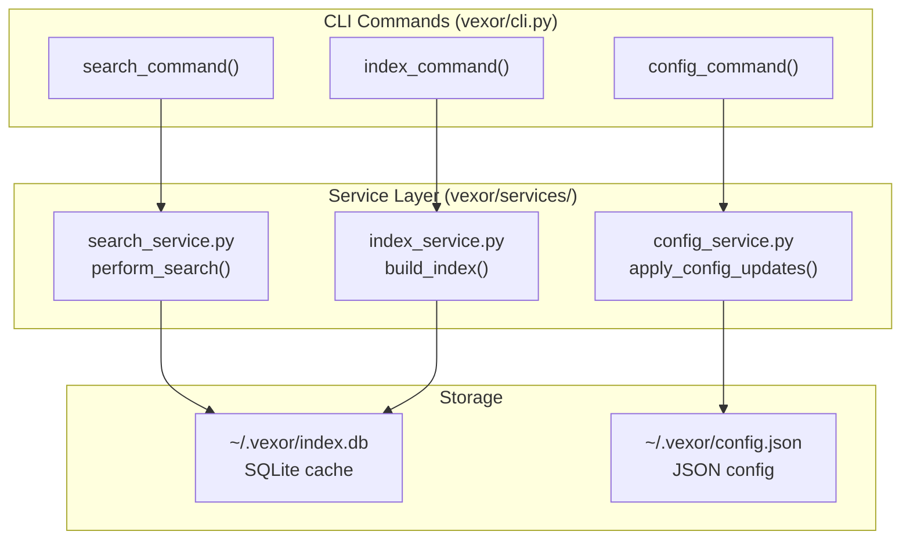
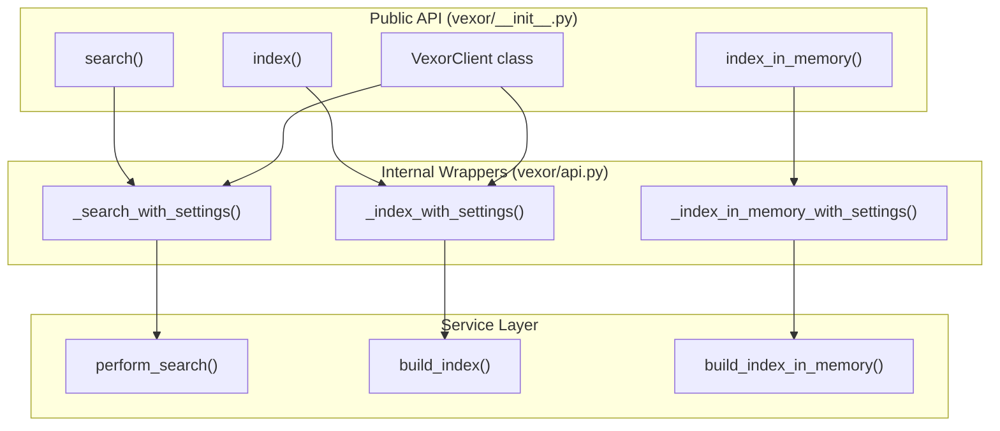
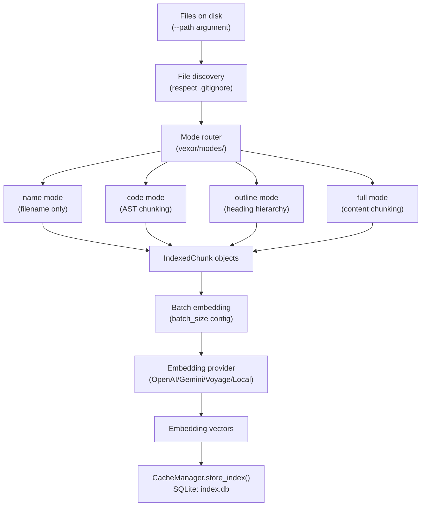
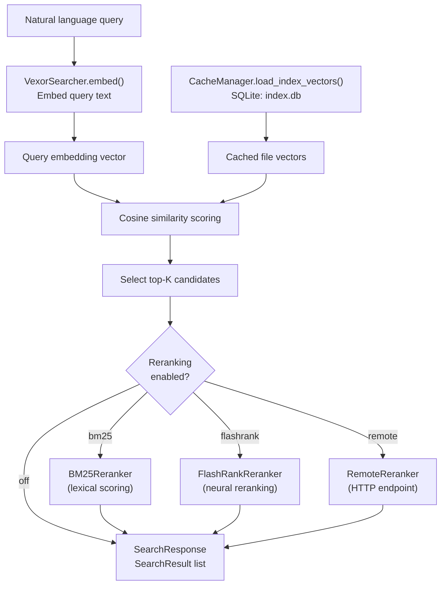

<!-- source: DeepWiki mcp.deepwiki.com · repo scarletkc/vexor · page 1.1 What is Vexor · fetched 2026-10-27 -->

# What is Vexor

<details>
<summary>Relevant source files</summary>

The following files were used as context for generating this wiki page:

- [README.md](README.md)

</details>


This page defines Vexor as a semantic search engine for files and code, explains its primary use cases, and identifies its target users. For specific features, see [Key Features](#1.2). For architectural details, see [System Architecture](#1.3).

---

## Definition

Vexor is a semantic search engine that builds reusable, persistent vector indexes over files and code. It accepts natural-language queries and returns ranked file matches based on semantic similarity rather than lexical pattern matching.

The system embeds both query text and file content into a shared vector space using configurable embedding providers (OpenAI, Gemini, Voyage AI, custom OpenAI-compatible endpoints, or local ONNX models). Similarity scoring uses cosine distance. Optional reranking refines results using BM25 lexical scoring, FlashRank neural reranking, or remote HTTP reranking services.

The canonical workflow:

```bash
vexor "api client config"  # searches current directory
```

This command triggers the `perform_search()` function in `vexor/services/search_service.py`, which embeds the query via `VexorSearcher.embed()`, loads cached vectors from `~/.vexor/index.db` via `CacheManager`, computes cosine similarity, and optionally reranks results before returning a `SearchResponse` object.

Sources: [README.md:18-36](), [vexor/services/search_service.py:1-200]()
</thinking>

---

## Primary Use Cases

Vexor solves the semantic file discovery problem where traditional text-based search tools (`grep`, `find`, `rg`) fail.

**Use Case 1: Human Developers**

Scenario: A developer remembers what a file implements but not its name or location.

Example: "Where is the function that parses API configuration?" Instead of manually traversing directories or writing complex regex patterns, the developer uses semantic search to find the target file based on its functional description.

**Use Case 2: AI Coding Assistants**

Scenario: An AI agent (Claude Code, Codex, etc.) needs to locate relevant files in a codebase to complete a task but cannot efficiently enumerate and read all files.

Example: The agent receives a task to "add rate limiting to the API client." It uses Vexor to semantically search for files related to "API client request handling" and receives ranked results without reading the entire codebase.

Vexor exposes an agent skill specification in `plugins/vexor/skills/vexor-cli/SKILL.md` that defines how agents should invoke the CLI tool.

| Search Type | Traditional Tools | Vexor Semantic Search |
|---|---|---|
| **Lexical match** | `grep "config_loader"` finds exact token | Finds files based on functional meaning |
| **Recall** | Requires knowledge of exact identifiers | Returns matches for synonyms and related concepts |
| **Agent integration** | Must read entire directory tree | Single search call returns ranked candidates |

Sources: [README.md:33-37](), [plugins/vexor/skills/vexor-cli/SKILL.md:1-40]()

---

## Target Users

Vexor targets two distinct user populations:

**1. Human Developers**

- Primary interface: CLI tool (`vexor/cli.py`) or Python API (`vexor/__init__.py`)
- Typical workflow: Interactive search during development, code review, or debugging
- Configuration: Managed via `~/.vexor/config.json` using `vexor config` commands

**2. AI Coding Assistants**

- Primary interface: CLI tool invoked as an agent skill
- Typical workflow: Autonomous file discovery during task execution
- Configuration: Inherits user's `~/.vexor/config.json` or accepts per-call overrides
- Example agents: Claude Code, Codex (both support skill installation via `vexor install --skills`)

The desktop GUI (`gui/`) exists but is explicitly marked experimental and not actively maintained. Production users should prefer the CLI or Python API.

Sources: [README.md:33-37](), [README.md:80-87](), [README.md:107-116]()

---

## System Entry Points

Vexor exposes three primary interfaces that all delegate to the same service layer:

| Interface | Entry Module | Primary Functions | Status |
|---|---|---|---|
| **CLI** | `vexor/cli.py` | `search_command()`, `index_command()`, `config_command()` | Stable |
| **Python API** | `vexor/__init__.py`, `vexor/api.py` | `search()`, `index()`, `index_in_memory()` | Stable |
| **Desktop GUI** | `gui/src/` (Electron + Vue) | IPC calls to CLI via `preload.js` | Experimental |
| **Agent Skill** | `plugins/vexor/skills/vexor-cli/` | Shell invocation of CLI commands | Stable |

All interfaces call functions in `vexor/services/` that implement core business logic.

**CLI-to-Service Mapping**



Sources: [vexor/cli.py:1-500](), [vexor/services/search_service.py:1-200](), [vexor/services/index_service.py:1-300](), [vexor/services/config_service.py:1-100]()

**Python API-to-Service Mapping**



Sources: [vexor/__init__.py:1-150](), [vexor/api.py:1-250](), [vexor/services/search_service.py:1-200](), [vexor/services/index_service.py:1-300]()

---

## Three Access Points

The same core engine is exposed through three interfaces. All three funnel into the same set of services in `vexor/services/`.

**Interfaces and their entry points:**

| Interface | Entry Point | Status |
|---|---|---|
| CLI | `vexor/cli.py` (`typer` app) | Stable |
| Python API | `vexor/api.py`, `vexor/__init__.py` | Stable |
| Desktop GUI | `gui/` (Electron + Vue) | Experimental |
| AI Agent Skill | `plugins/vexor/skills/vexor-cli/` | Stable |

The desktop app is explicitly labeled experimental and not actively maintained. For production use, the CLI is preferred.

Sources: [README.md:80-87]()


---

## Core Pipeline: Indexing and Searching

Vexor implements a two-phase pipeline: **indexing** (build vector database) and **searching** (query and rank).

**Phase 1: Indexing (`build_index()` in `vexor/services/index_service.py`)**

1. **File Discovery**: Scan target directory respecting `.gitignore`, filtering by extensions and exclude patterns
2. **Content Extraction**: Process each file using a mode-specific extractor from `vexor/modes/`:
   - `auto`: Routes by file type (`.py`/`.js`/`.ts` → `code`, `.md` → `outline`, etc.)
   - `name`: Embed filename only (fastest)
   - `head`: Extract first N lines
   - `full`: Chunk entire content
   - `code`: AST-aware chunking for Python/JS/TS (preserves function/class boundaries)
   - `outline`: Markdown heading hierarchy
3. **Batch Embedding**: Group chunks and call embedding provider (configured in `~/.vexor/config.json`)
4. **Storage**: Write vectors to SQLite cache at `~/.vexor/index.db` via `CacheManager.store_index()`

**Phase 2: Searching (`perform_search()` in `vexor/services/search_service.py`)**

1. **Query Embedding**: Call `VexorSearcher.embed(query)` using configured provider
2. **Vector Retrieval**: Load cached vectors via `CacheManager.load_index_vectors()`
3. **Similarity Scoring**: Compute cosine distance between query vector and all indexed vectors
4. **Top-K Selection**: Select candidates (default: 5 results, configurable via `--top`)
5. **Optional Reranking**: If configured, rerank via:
   - `bm25`: Lexical scoring using `BM25Reranker` in `vexor/rerankers/bm25.py`
   - `flashrank`: Neural reranking using `FlashRankReranker` in `vexor/rerankers/flashrank.py`
   - `remote`: HTTP reranking via `RemoteReranker` in `vexor/rerankers/remote.py`
6. **Response Construction**: Return `SearchResponse` containing list of `SearchResult` objects

**Indexing Pipeline Diagram**



Sources: [vexor/services/index_service.py:1-300](), [vexor/modes/:1-500](), [vexor/cache.py:1-400]()

**Search Pipeline Diagram**



Sources: [vexor/services/search_service.py:1-200](), [vexor/rerankers/:1-400](), [vexor/cache.py:1-400]()

---

## Storage and Configuration

Vexor persists data in two locations under `~/.vexor/`:

**Index Cache (`~/.vexor/index.db`)**

SQLite database managed by `CacheManager` class in `vexor/cache.py`. Contains:

| Table | Purpose | Key Columns |
|---|---|---|
| `index_metadata` | Index configuration and root path | `id`, `config_hash`, `absolute_root` |
| `indexed_chunk` | File chunk metadata | `id`, `index_id`, `file_path`, `mode` |
| `chunk_embedding` | Vector data (pickled numpy arrays) | `chunk_id`, `embedding_vector` |
| `chunk_meta` | Line numbers and preview text | `chunk_id`, `start_line`, `end_line`, `preview` |
| `query_cache` | Cached query embeddings per index | `index_id`, `query_text`, `embedding_vector` |
| `embedding_cache` | General text embedding cache | `text_hash`, `embedding_vector` |

The cache key is computed by `compute_config_hash()` in `vexor/cache.py` from parameters: `absolute_root`, `mode`, `include_hidden`, `no_recursive`, `no_respect_gitignore`, `extensions`, `exclude_patterns`.

Incremental updates: Re-running `build_index()` only re-embeds files with modified `mtime`. If >50% of files change, a full rebuild is triggered.

**Configuration File (`~/.vexor/config.json`)**

JSON file managed by functions in `vexor/config.py`. Controls:

- Embedding provider: `provider` (openai/gemini/voyageai/custom/local)
- Model selection: `model` (e.g., `text-embedding-3-small`)
- Authentication: `api_key` (or environment variables)
- Reranking: `rerank` (off/bm25/flashrank/remote)
- Concurrency: `batch_size`, `embed_concurrency`, `extract_concurrency`
- Dimensions: `embedding_dimensions` (optional, provider-specific)

Configuration precedence (highest to lowest):
1. Explicit function arguments
2. Per-call config override
3. In-memory runtime config (`_RUNTIME_CONFIG`)
4. On-disk `config.json`
5. Built-in defaults

Sources: [vexor/cache.py:1-400](), [vexor/config.py:1-200](), [README.md:237-249]()

---

## Relationship to Other Pages

- For a complete list of capabilities: [Key Features](#1.2)
- For the full system architecture diagram: [System Architecture](#1.3)
- For Python version and dependency requirements: [System Requirements](#1.4)
- For the CLI command reference: [CLI Reference](#4)
- For the Python API reference: [Python API Reference](#5)
- For agent integration details: [AI Agent Integration](#8.6)

---

