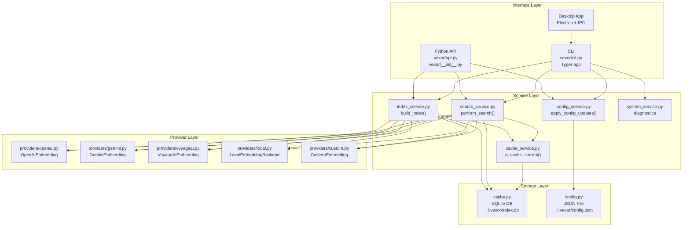
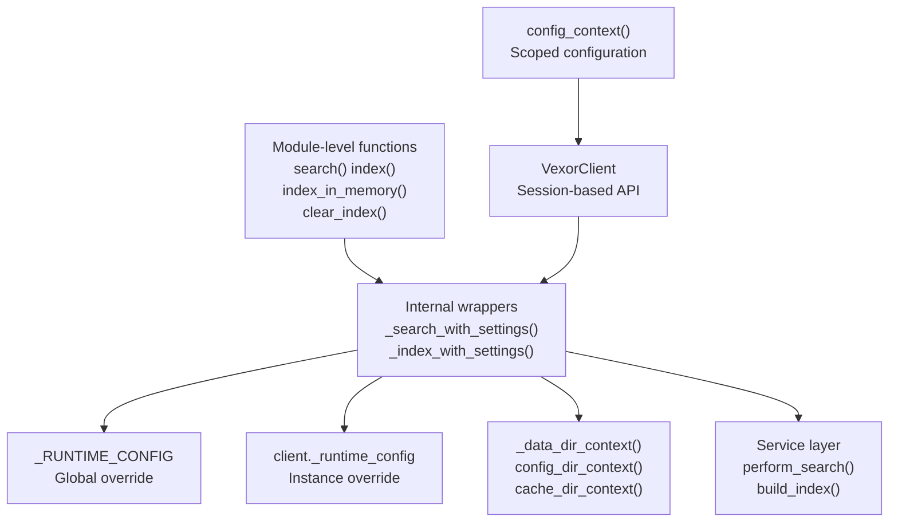
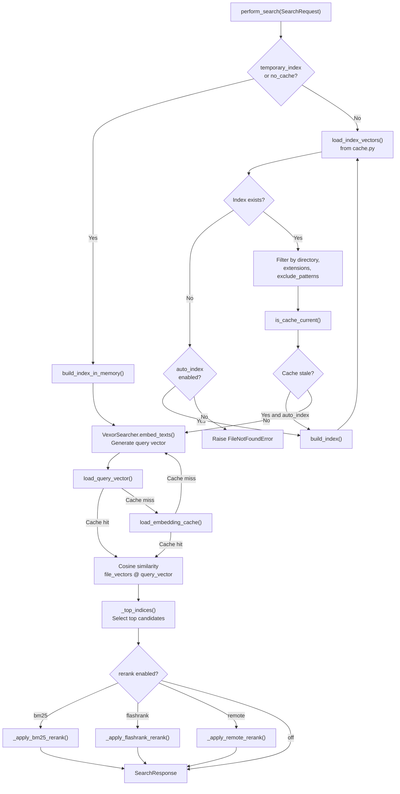
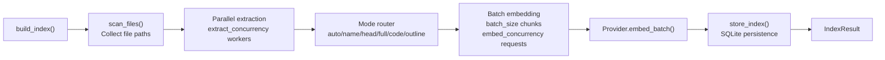
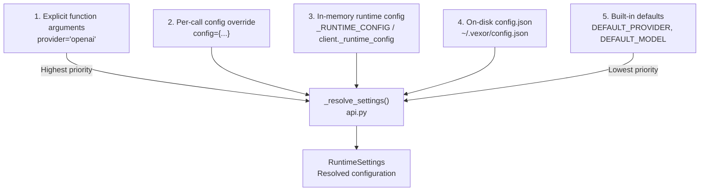
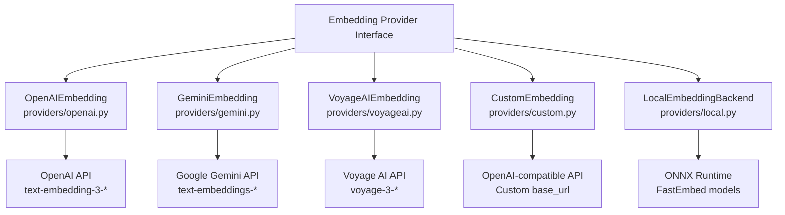
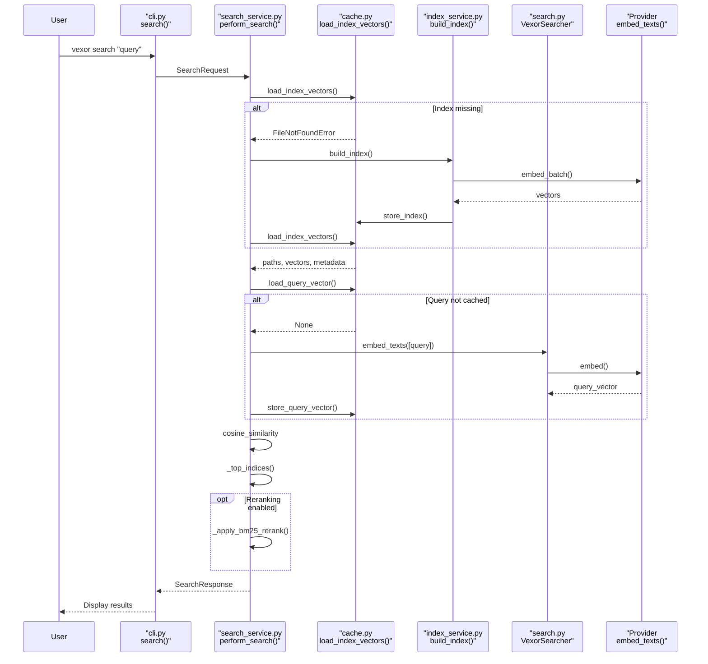

<!-- source: DeepWiki mcp.deepwiki.com · repo scarletkc/vexor · page 1.3 System Architecture · fetched 2026-10-27 -->

# System Architecture

<details>
<summary>Relevant source files</summary>

The following files were used as context for generating this wiki page:

- [README.md](README.md)
- [docs/api/python.md](docs/api/python.md)
- [tests/unit/test_api.py](tests/unit/test_api.py)
- [tests/unit/test_search_service.py](tests/unit/test_search_service.py)
- [vexor/api.py](vexor/api.py)
- [vexor/cli.py](vexor/cli.py)
- [vexor/services/search_service.py](vexor/services/search_service.py)

</details>


This document describes Vexor's internal architecture, explaining how the CLI, Python API, and desktop application delegate to a shared service layer that manages indexing, search, caching, and provider integrations. For conceptual explanations of semantic search and indexing modes, see [Core Concepts](#3). For detailed service implementations, see [Architecture Deep Dive](#7).

---

## Overview

Vexor implements a layered architecture where multiple user-facing interfaces converge on a unified service layer. The system stores persistent state in two locations: a SQLite database ([vexor/cache.py:1-800]()) for indexes and embeddings, and a JSON configuration file ([vexor/config.py:1-500]()) for settings. All interfaces share the same configuration resolution logic and cache management strategies.

**Sources:** [README.md:1-304](), [vexor/cli.py:1-100](), [vexor/api.py:1-100]()

---

## Layer Architecture



**Diagram 1: Layered Architecture with Code Entities**

Vexor's architecture consists of four layers:

1. **Interface Layer**: User-facing entry points that parse input and delegate to services
2. **Service Layer**: Business logic for indexing, search, configuration, and cache management
3. **Provider Layer**: Abstraction over different embedding APIs and local models
4. **Storage Layer**: Persistent state in SQLite and JSON

**Sources:** [vexor/cli.py:1-100](), [vexor/api.py:1-100](), [vexor/services/search_service.py:1-50](), [vexor/services/index_service.py:1-50]()

---

## Interface Layer

### CLI Implementation

The CLI is implemented in [vexor/cli.py]() using Typer. The `DefaultSearchGroup` class ([vexor/cli.py:115-147]()) treats unknown subcommands as search queries, allowing `vexor "query"` as shorthand for `vexor search "query"`.

| Command | Function | Description |
|---------|----------|-------------|
| `search` | [cli.py:348-529]() | Execute semantic search with auto-indexing |
| `index` | [cli.py:531-711]() | Build or refresh cached index |
| `config` | [cli.py:726-1048]() | Manage `~/.vexor/config.json` settings |
| `init` | [cli.py:713-723]() | Run interactive setup wizard |
| `doctor` | [cli.py:1283-1368]() | System diagnostics |
| `update` | [cli.py:1370-1467]() | Check/upgrade CLI version |
| `local` | [cli.py:1050-1177]() | Manage local embedding models |

**Sources:** [vexor/cli.py:149-154](), [vexor/cli.py:348-711]()

### Python API Implementation

The Python API is exposed through [vexor/api.py]() and re-exported in [vexor/__init__.py](). It provides both module-level functions and a session-based `VexorClient` class.



**Diagram 2: Python API Architecture**

The `VexorClient` class ([vexor/api.py:209-485]()) provides isolated configuration state without mutating global config. The `config_context` function ([vexor/api.py:487-509]()) creates a temporary client with scoped configuration.

**Sources:** [vexor/api.py:1-100](), [vexor/api.py:209-485](), [vexor/api.py:487-509]()

### Desktop Application

The desktop application is an Electron app that communicates with the CLI via subprocess invocation. It provides a GUI wrapper around CLI commands but does not implement independent business logic.

**Sources:** [README.md:80-88]()

---

## Service Layer

### Search Service

The `perform_search` function ([vexor/services/search_service.py:358-708]()) implements the complete search pipeline:



**Diagram 3: Search Service Flow with Function Names**

Key data structures:
- `SearchRequest` ([vexor/services/search_service.py:33-60]()): Input parameters
- `SearchResponse` ([vexor/services/search_service.py:62-70]()): Results with metadata

**Sources:** [vexor/services/search_service.py:358-708](), [vexor/services/search_service.py:33-70]()

### Index Service

The `build_index` function ([vexor/services/index_service.py:1-400]()) orchestrates file scanning, content extraction, embedding generation, and cache storage:



**Diagram 4: Index Service Pipeline**

The service uses `IndexedChunk` ([vexor/cache.py:50-100]()) objects to represent file chunks with embeddings and metadata.

**Sources:** [vexor/services/index_service.py:1-400](), [vexor/cache.py:50-100]()

---

## Configuration System

Configuration resolution follows a five-tier precedence system:



**Diagram 5: Configuration Precedence**

The `_resolve_settings` function ([vexor/api.py:1000-1100]()) merges configuration sources in order, with explicit arguments taking precedence over all other sources.

**Sources:** [vexor/api.py:1000-1100](), [vexor/config.py:1-500]()

---

## Storage Layer

### SQLite Cache Schema

The cache database at `~/.vexor/index.db` uses the following schema:

| Table | Purpose | Key Columns |
|-------|---------|-------------|
| `index_metadata` | Index configuration | `id`, `root_path`, `model`, `mode` |
| `indexed_chunk` | File chunks | `index_id`, `rel_path`, `chunk_index` |
| `chunk_embedding` | Vector data | `chunk_id`, `embedding_blob` |
| `chunk_meta` | Line numbers and previews | `chunk_id`, `start_line`, `end_line` |
| `query_cache` | Cached query embeddings | `index_id`, `query_hash` |
| `embedding_cache` | General text embeddings | `model`, `text_hash` |

**Schema Functions:**
- `store_index`: [vexor/cache.py:400-600]()
- `load_index_vectors`: [vexor/cache.py:600-800]()
- `store_query_vector`: [vexor/cache.py:800-900]()
- `load_embedding_cache`: [vexor/cache.py:900-1000]()

**Sources:** [vexor/cache.py:1-1000]()

### Configuration File

The `~/.vexor/config.json` file stores persistent settings:

```python
{
    "provider": "openai",
    "model": "text-embedding-3-small",
    "api_key": "sk-...",
    "batch_size": 0,
    "embed_concurrency": 4,
    "extract_concurrency": 4,
    "extract_backend": "auto",
    "auto_index": true,
    "rerank": "bm25",
    "embedding_dimensions": 1536
}
```

Functions:
- `load_config`: [vexor/config.py:200-300]()
- `save_config`: [vexor/config.py:300-400]()
- `apply_config_updates`: [vexor/services/config_service.py:1-100]()

**Sources:** [vexor/config.py:1-500](), [vexor/services/config_service.py:1-100]()

---

## Provider System

Vexor abstracts embedding generation through a common interface. Each provider implements:



**Diagram 6: Provider Architecture**

The `VexorSearcher` class ([vexor/search.py:1-200]()) selects the appropriate provider based on the `provider` configuration parameter and delegates embedding generation.

**Sources:** [vexor/providers/openai.py:1-100](), [vexor/providers/gemini.py:1-100](), [vexor/providers/voyageai.py:1-100](), [vexor/providers/custom.py:1-100](), [vexor/providers/local.py:1-100](), [vexor/search.py:1-200]()

---

## Data Flow: Complete Search Operation



**Diagram 7: Complete Search Sequence with Code Entities**

This sequence diagram shows how a CLI search invocation flows through the system, including cache lookups, auto-indexing, embedding generation, similarity computation, and optional reranking.

**Sources:** [vexor/cli.py:348-529](), [vexor/services/search_service.py:358-708](), [vexor/cache.py:400-900](), [vexor/services/index_service.py:1-400](), [vexor/search.py:1-200]()

---

## Key Design Patterns

### Separation of Concerns

The architecture strictly separates interface logic (CLI/API), business logic (services), provider abstraction, and storage operations. This allows:
- Multiple interfaces sharing the same core functionality
- Provider swapping without service layer changes
- Independent testing of each layer

**Sources:** [vexor/cli.py:1-100](), [vexor/api.py:1-100](), [vexor/services/]()

### Configuration Composition

Configuration sources are composed at call time using a clear precedence hierarchy. The `_resolve_settings` function ([vexor/api.py:1000-1100]()) implements this pattern, allowing runtime overrides without mutating global state.

**Sources:** [vexor/api.py:1000-1100]()

### Cache Layering

The cache system implements multiple layers:
1. **In-memory LRU cache**: Process-local, 2048-entry OrderedDict ([vexor/cache.py:100-200]())
2. **SQLite embedding cache**: Persistent text embeddings ([vexor/cache.py:900-1000]())
3. **SQLite query cache**: Per-index query vectors ([vexor/cache.py:800-900]())
4. **SQLite index cache**: File vectors and metadata ([vexor/cache.py:600-800]())

This layering provides fast lookups for repeated queries while maintaining persistence across sessions.

**Sources:** [vexor/cache.py:100-1000]()

### Provider Abstraction

All embedding providers implement a common interface with `embed_texts()` and `embed_batch()` methods. The `VexorSearcher` class ([vexor/search.py:1-200]()) selects the provider at runtime based on configuration, enabling seamless switching between APIs and local models.

**Sources:** [vexor/search.py:1-200](), [vexor/providers/]()

---

