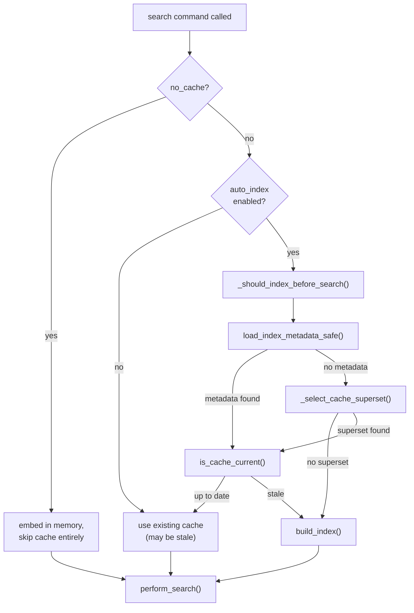
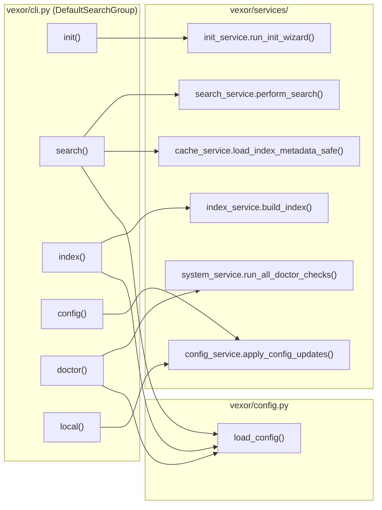

<!-- source: DeepWiki mcp.deepwiki.com · repo scarletkc/vexor · page 2.2 Quick Start - CLI · fetched 2026-10-27 -->

# Quick Start - CLI

<details>
<summary>Relevant source files</summary>

The following files were used as context for generating this wiki page:

- [README.md](README.md)
- [vexor/cli.py](vexor/cli.py)
- [vexor/text.py](vexor/text.py)

</details>


This page covers the minimum set of CLI commands needed to get Vexor running: initial setup, building an index, and performing a semantic search. It uses concrete commands and expected output.

- For the full CLI reference with every flag documented, see [CLI Reference](#4).
- For the Python API equivalent of these workflows, see [Quick Start - Python API](#2.3).
- For first-run wizard details beyond what this page covers, see [First-Run Setup](#2.5).

---

## Prerequisites

Vexor must be installed (see [Installation](#2.1)) and an embedding provider must be reachable. The default provider is `openai`, which requires `OPENAI_API_KEY` to be set in the environment or stored via `vexor config --set-api-key`.

---

## Step 0 — First-Run Setup

```bash
vexor init
```

Run the interactive setup wizard before your first search. It walks through provider selection, API key input, optional reranker setup, and shell alias creation. The wizard writes its choices to `~/.vexor/config.json`.

**The wizard also triggers automatically.** On the first invocation of any command, `run()` in [vexor/cli.py:1939-1953]() calls `should_auto_run_init()`. If no config file exists, the wizard runs in place of the requested command, then prints the command the user should re-run.

```
Vexor Setup Wizard
Let's configure the basics so you can search quickly.
...
Run your original command again:
vexor search "api client"
```

Use `--dry` to preview what the wizard would configure without writing anything:

```bash
vexor init --dry
```

---

## Step 1 — Search

### Search Shortcut

Any unrecognised subcommand is treated as a search query against the current directory. This is implemented in `DefaultSearchGroup.resolve_command()` at [vexor/cli.py:121-146]().

```bash
vexor "api client config"
```

This is equivalent to:

```bash
vexor search "api client config"
```

### Explicit Search

```bash
vexor search "api client config" --path ~/projects/demo --top 5
```

`--path` sets the root directory. `--top` (alias `-k`) controls how many results are returned. The default for both is the current working directory and 5 results respectively.

**Example output (rich format):**

```
Vexor semantic file search results
──────────────────────────────────
#   Similarity   File path                       Lines   Preview
1   0.923        ./src/config_loader.py          -       config loader entrypoint
2   0.871        ./src/utils/config_parse.py     -       parse config helpers
3   0.809        ./tests/test_config_loader.py   -       tests for config loader
```

The columns map to fields of the `SearchResult` type returned by `perform_search()`. The table is rendered by `_render_results()` at [vexor/cli.py:1801-1827]().

### In-Memory Search (No Cache)

```bash
vexor search "api client config" --no-cache
```

`--no-cache` skips both reading and writing the SQLite index. Files are embedded on the fly and results are not persisted. Useful for quick one-off queries on directories you do not want to maintain an index for.

### Auto-Index Behaviour

By default (`auto_index=True` in config), Vexor checks whether the index is stale or missing before searching. This check is performed by `_should_index_before_search()` at [vexor/cli.py:272-330](). If indexing is needed, it runs transparently and the search follows immediately.

**Auto-index decision flow:**



Sources: [vexor/cli.py:272-330](), [vexor/cli.py:463-488]()

---

## Step 2 — Index

### Build or Refresh the Index

```bash
vexor index                            # index current directory
vexor index --path ~/projects/demo     # index a specific path
```

Calls `build_index()` from `vexor/services/index_service.py`. On re-runs, only changed files are re-embedded. If more than 50% of files have changed, a full rebuild is triggered. See [Incremental Index Updates](#8.1) for details.

### Specify an Index Mode

```bash
vexor index --path ~/projects/demo --mode code
```

Mode controls how file content is extracted and chunked before embedding. The `auto` mode (default) routes intelligently: Python/JS/TS files use `code`, Markdown uses `outline`, and others use `head` or `full` based on size.

| Mode | What it extracts |
|---|---|
| `auto` | Smart routing per file type (default) |
| `name` | Filename only — fastest, no file I/O |
| `head` | First text snippet |
| `brief` | High-frequency keywords |
| `full` | Entire content, chunked |
| `code` | AST-aware chunks by class/function |
| `outline` | Markdown headings with breadcrumbs |

Sources: [README.md:226-234](), [vexor/text.py:29-33]()

### Inspect Index Metadata

```bash
vexor index --show
vexor index --path ~/projects/demo --mode code --show
```

Displays the cached index metadata matching the given options: mode, model, file count, embedding dimension, and generation timestamp. Implemented at [vexor/cli.py:606-644]().

### Clear an Index

```bash
vexor index --path . --clear
```

Removes cached index entries for the given path and flag combination. `--show` and `--clear` cannot be combined.

---

## CLI Command Map

The following diagram shows how the top-level commands in `vexor/cli.py` connect to the service functions they call.



Sources: [vexor/cli.py:348-402](), [vexor/cli.py:531-711](), [vexor/cli.py:713-722](), [vexor/cli.py:1512-1519]()

---

## Common Flags

These flags apply to both `search` and `index` commands.

| Flag | Default | Description |
|---|---|---|
| `--path PATH` / `-p` | `cwd` | Root directory to search or index |
| `--mode MODE` / `-m` | `auto` | Indexing mode |
| `--ext .py,.md` / `-e` | all | Filter by file extension (repeatable) |
| `--exclude-pattern PAT` | none | Gitignore-style exclude (repeatable) |
| `--include-hidden` / `-i` | `false` | Include hidden files |
| `--no-recursive` / `-n` | `false` | Do not recurse into subdirectories |
| `--no-respect-gitignore` | `false` | Include files excluded by `.gitignore` |

Search-only flags:

| Flag | Default | Description |
|---|---|---|
| `--top K` / `-k` | `5` | Number of results |
| `--format FORMAT` | `rich` | Output format: `rich`, `porcelain`, `porcelain-z` |
| `--no-cache` | `false` | In-memory search, no index read/write |

Sources: [vexor/cli.py:348-402](), [vexor/cli.py:531-583](), [README.md:271-287]()

---

## Output Formats

`vexor search` supports three output formats controlled by `--format`, implemented via the `SearchOutputFormat` enum at [vexor/cli.py:157-160]().

| Format | Description | Rendered by |
|---|---|---|
| `rich` | Human-readable Rich table (default) | `_render_results()` |
| `porcelain` | Tab-separated values, one result per line | `_render_results_porcelain()` |
| `porcelain-z` | NUL-delimited, suitable for `xargs -0` | `_render_results_porcelain_z()` |

**Porcelain field order:** `rank`, `similarity`, `path`, `chunk_index`, `start_line`, `end_line`, `preview`

Line fields are `-` when not applicable (e.g. `name` mode). Use `porcelain` or `porcelain-z` when piping results into scripts or other tools. For full format documentation see [Output Formats](#4.9).

---

## Cache and Index Key

The cache key is derived from: `--path`, `--mode`, `--include-hidden`, `--no-recursive`, `--no-respect-gitignore`, `--ext`, and `--exclude-pattern`. Changing any of these flags creates a separate index entry in `~/.vexor/index.db`.

```bash
vexor config --show-index-all   # list all cached indexes
vexor config --clear-index-all  # remove all cached indexes
vexor index --path . --clear    # remove index for current directory
```

Sources: [README.md:237-246](), [vexor/cli.py:1192-1203]()

---

## Configuration Snapshot

Before performing a search or building an index, the CLI loads settings from `~/.vexor/config.json` via `load_config()`. The resolved provider, model, batch size, concurrency, rerank strategy, and API key all come from this config. Override them persistently with `vexor config`:

```bash
vexor config --set-provider openai
vexor config --set-api-key "sk-..."
vexor config --rerank bm25
vexor config --show
```

Sources: [vexor/cli.py:404-416](), [vexor/cli.py:585-594]()

---

