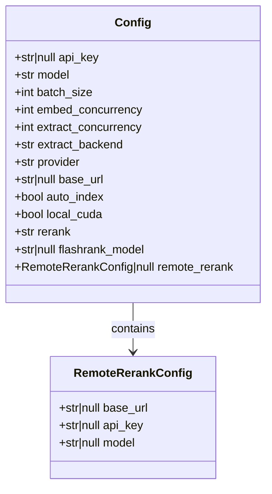
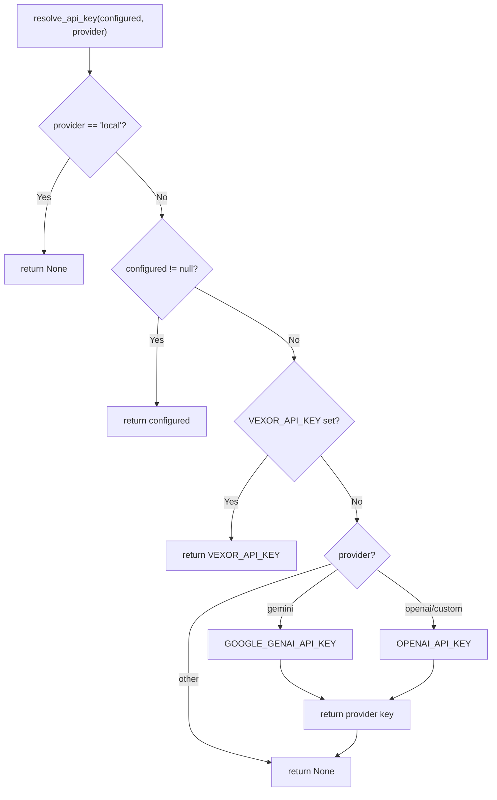
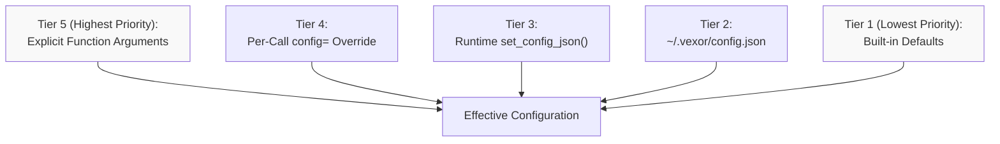

<!-- source: DeepWiki mcp.deepwiki.com · repo scarletkc/vexor · page 2.5 First-Run Setup · fetched 2026-10-27 -->

# Configuration Basics

<details>
<summary>Relevant source files</summary>

The following files were used as context for generating this wiki page:

- [README.md](README.md)
- [vexor/cli.py](vexor/cli.py)
- [vexor/text.py](vexor/text.py)

</details>


This page explains the structure of Vexor's `config.json` file, configuration precedence rules, and essential settings for getting started. For advanced configuration patterns in Python code, see [Configuration Management](#5.5). For deep dives into provider-specific settings and custom endpoints, see [Provider Configuration](#8.2).

---

## Configuration File Location

Vexor stores its configuration in a JSON file at a well-defined location. The path is defined by the `CONFIG_FILE` constant in [vexor/config.py:19]().

**Default Location:**
```
~/.vexor/config.json
```

This expands to:
- **Linux/macOS**: `/home/username/.vexor/config.json`
- **Windows**: `C:\Users\username\.vexor\config.json`

The configuration directory (`CONFIG_DIR`) can be temporarily overridden using `config_dir_context()` [vexor/config.py:96-109](), which is useful for testing or managing multiple configuration profiles.

**Sources:** [vexor/config.py:17-19](), [vexor/config.py:96-109]()

---

## config.json Structure

The configuration file is a JSON object that maps directly to the `Config` dataclass defined in [vexor/config.py:52-66](). All fields are optional; missing fields use built-in defaults.

### Configuration Schema



**Sources:** [vexor/config.py:44-66]()

### Field Reference

| Field | Type | Default | Description |
|-------|------|---------|-------------|
| `api_key` | `string \| null` | `null` | API key for remote embedding providers |
| `model` | `string` | `"text-embedding-3-small"` | Embedding model name |
| `batch_size` | `integer` | `64` | Number of texts per embedding request (0 = single request) |
| `embed_concurrency` | `integer` | `4` | Number of concurrent embedding requests |
| `extract_concurrency` | `integer` | CPU-dependent | Number of parallel file extraction workers |
| `extract_backend` | `string` | `"auto"` | Extraction worker pool type: `auto`, `thread`, or `process` |
| `provider` | `string` | `"openai"` | Embedding provider: `openai`, `gemini`, `custom`, or `local` |
| `base_url` | `string \| null` | `null` | Custom API endpoint URL (for `custom` provider or proxies) |
| `auto_index` | `boolean` | `true` | Whether to automatically build/refresh index before search |
| `local_cuda` | `boolean` | `false` | Enable CUDA GPU acceleration for `local` provider |
| `rerank` | `string` | `"off"` | Reranking strategy: `off`, `bm25`, `flashrank`, or `remote` |
| `flashrank_model` | `string \| null` | `null` | FlashRank model name (defaults to `ms-marco-TinyBERT-L-2-v2`) |
| `remote_rerank` | `object \| null` | `null` | Remote reranker configuration (see below) |

**Sources:** [vexor/config.py:52-66](), [vexor/config.py:24-37]()

### remote_rerank Object

When `rerank` is set to `"remote"`, the `remote_rerank` object configures the remote reranking service:

| Field | Type | Description |
|-------|------|-------------|
| `base_url` | `string \| null` | Remote reranker endpoint URL |
| `api_key` | `string \| null` | API key for remote reranker |
| `model` | `string \| null` | Model identifier for remote reranker |

**Sources:** [vexor/config.py:44-49]()

---

## Essential Settings

### API Keys

Vexor requires an API key for remote embedding providers (`openai`, `gemini`, `custom`). The `local` provider does not require a key.

#### Configuration Methods

**1. Via config.json:**
```json
{
  "api_key": "sk-..."
}
```

**2. Via CLI:**
```bash
vexor config --set-api-key "sk-..."
```

**3. Via Environment Variables:**

Vexor checks environment variables in this order:
1. `VEXOR_API_KEY` - General Vexor API key
2. `OPENAI_API_KEY` - For OpenAI and custom providers
3. `GOOGLE_GENAI_API_KEY` - For Gemini provider (legacy)

The resolution logic is implemented in `resolve_api_key()` [vexor/config.py:353-372]().

#### API Key Resolution Flow



**Sources:** [vexor/config.py:353-372](), [vexor/config.py:38-41]()

### Provider and Model

The `provider` and `model` fields determine which embedding service to use.

#### Supported Providers

| Provider | Description | Requires API Key | Default Model |
|----------|-------------|------------------|---------------|
| `openai` | OpenAI embedding API | Yes | `text-embedding-3-small` |
| `gemini` | Google Gemini embedding API | Yes | `gemini-embedding-001` |
| `custom` | OpenAI-compatible endpoint | Yes | User-specified |
| `local` | Local ONNX models | No | `intfloat/multilingual-e5-small` |

**Sources:** [vexor/config.py:24-32](), [vexor/config.py:35]()

#### Provider-Specific Defaults

The `resolve_default_model()` function [vexor/config.py:342-350]() applies provider-specific model defaults:

```mermaid
flowchart LR
    Input["provider + model"]
    CheckGemini{provider == 'gemini'<br/>AND<br/>(model empty OR<br/>model == DEFAULT_MODEL)}
    UseGemini["return 'gemini-embedding-001'"]
    CheckCustomModel{model specified?}
    UseCustom["return model"]
    UseDefault["return 'text-embedding-3-small'"]
    
    Input --> CheckGemini
    CheckGemini -->|Yes| UseGemini
    CheckGemini -->|No| CheckCustomModel
    CheckCustomModel -->|Yes| UseCustom
    CheckCustomModel -->|No| UseDefault
```

**Example Behavior:**
- Setting `provider: "gemini"` without specifying `model` → uses `gemini-embedding-001`
- Setting `provider: "openai"` without specifying `model` → uses `text-embedding-3-small`
- Setting `provider: "local"` with `model: "intfloat/e5-large"` → uses `intfloat/e5-large`

**Sources:** [vexor/config.py:342-350]()

#### Configuration Examples

**OpenAI (default):**
```json
{
  "provider": "openai",
  "model": "text-embedding-3-large",
  "api_key": "sk-..."
}
```

**Gemini:**
```json
{
  "provider": "gemini",
  "api_key": "..."
}
```

**Local (offline):**
```json
{
  "provider": "local",
  "model": "intfloat/multilingual-e5-small",
  "local_cuda": false
}
```

**Custom endpoint:**
```json
{
  "provider": "custom",
  "model": "custom-embedding-model",
  "base_url": "https://api.example.com/v1",
  "api_key": "..."
}
```

**Sources:** [vexor/config.py:35-36](), [README.md:119-127]()

### Performance Settings

These settings control embedding generation throughput and resource usage.

| Setting | Purpose | Tuning Guide |
|---------|---------|--------------|
| `batch_size` | Texts per API request | Higher = fewer requests, lower latency overhead. Set to `0` for single request per text. |
| `embed_concurrency` | Parallel embedding requests | Higher = faster indexing with rate-limit headroom. Default `4`. |
| `extract_concurrency` | Parallel file extraction | Higher = faster file processing. Defaults to CPU count (capped at 4). |
| `extract_backend` | Worker pool type | `auto` selects based on content; `thread` for I/O-bound; `process` for CPU-bound. |

**Sources:** [vexor/config.py:27-30](), [vexor/config.py:37]()

### Reranking Configuration

Reranking reorders semantic search results using a secondary relevance model.

#### Rerank Strategies

| Strategy | Description | Requirements |
|----------|-------------|--------------|
| `off` | No reranking (default) | None |
| `bm25` | Lexical keyword matching with score fusion | None (built-in) |
| `flashrank` | Local neural reranker | `pip install "vexor[flashrank]"` |
| `remote` | Remote reranking API | Configured `remote_rerank` object |

**FlashRank Configuration:**
```json
{
  "rerank": "flashrank",
  "flashrank_model": "ms-marco-MultiBERT-L-12"
}
```

If `flashrank_model` is unset, it defaults to `ms-marco-TinyBERT-L-2-v2` [vexor/config.py:33]().

**Remote Reranking Configuration:**
```json
{
  "rerank": "remote",
  "remote_rerank": {
    "base_url": "https://api.example.com/rerank",
    "api_key": "...",
    "model": "bge-reranker-v2-m3"
  }
}
```

Remote reranker API keys can also be set via the `VEXOR_REMOTE_RERANK_API_KEY` environment variable [vexor/config.py:375-383]().

**Sources:** [vexor/config.py:32-36](), [vexor/config.py:44-49](), [vexor/config.py:375-383](), [README.md:152-167]()

---

## Configuration Precedence

Vexor resolves configuration from multiple sources using a five-tier precedence system. Higher-numbered tiers override lower ones.

### Precedence Hierarchy



**Sources:** Architecture diagrams (Diagram 4), [vexor/cli.py:400-415]()

### Tier Descriptions

| Tier | Source | Scope | Example |
|------|--------|-------|---------|
| **5** | Explicit function arguments | Single call | `search("query", top=10)` |
| **4** | Per-call `config=` parameter | Single call | `search("query", config={"model": "..."})` |
| **3** | Runtime `set_config_json()` | Process lifetime | `set_config_json('{"provider": "gemini"}')` |
| **2** | Disk file `~/.vexor/config.json` | Persistent, global | Edited via `vexor config` or manually |
| **1** | Built-in defaults | Fallback | `DEFAULT_MODEL`, `DEFAULT_BATCH_SIZE`, etc. |

**CLI Behavior:**
The CLI always reads from Tier 2 (disk config) and Tier 1 (defaults). It applies explicit flags (Tier 5) like `--path`, `--mode`, `--top` on top of the loaded configuration [vexor/cli.py:400-415]().

**Python API Behavior:**
The Python API supports all five tiers. See [Configuration Management](#5.5) for details on using `config_from_json()`, `config_context()`, and per-call overrides.

**Sources:** [vexor/cli.py:400-415](), Diagram 4 from architecture overview

---

## Setting Configuration

### Via CLI

The `vexor config` command provides flags for modifying persistent configuration.

#### Common Commands

**Set API Key:**
```bash
vexor config --set-api-key "sk-..."
```

**Set Provider:**
```bash
vexor config --set-provider openai   # or gemini, custom, local
```

**Set Model:**
```bash
vexor config --set-model text-embedding-3-large
```

**Configure Reranking:**
```bash
vexor config --rerank bm25
vexor config --rerank flashrank --set-flashrank-model ms-marco-MultiBERT-L-12
```

**Performance Tuning:**
```bash
vexor config --set-batch-size 128
vexor config --set-embed-concurrency 8
vexor config --set-extract-concurrency 8
vexor config --set-extract-backend process
```

**View Current Configuration:**
```bash
vexor config --show
```

**Sources:** [vexor/cli.py:719-1237](), [README.md:116-150]()

### Via Python API

#### Loading and Saving

**Load configuration:**
```python
from vexor.config import load_config

config = load_config()
print(config.provider, config.model)
```

**Modify and save:**
```python
from vexor.config import load_config, save_config

config = load_config()
config.provider = "gemini"
config.api_key = "..."
save_config(config)
```

**Sources:** [vexor/config.py:112-136](), [vexor/config.py:139-174]()

#### Runtime Overrides (Tier 3)

Use `config_from_json()` to create a configuration without persisting it:

```python
from vexor.config import config_from_json

# From JSON string
runtime_config = config_from_json('{"provider": "local", "model": "..."}')

# From dictionary
runtime_config = config_from_json({"provider": "gemini", "api_key": "..."})
```

To persist runtime configuration:
```python
from vexor.config import update_config_from_json

# Load, merge, and save
update_config_from_json({"batch_size": 128})
```

**Sources:** [vexor/config.py:200-217]()

#### Direct Setters

Convenience functions for individual fields [vexor/config.py:220-318]():

```python
from vexor.config import (
    set_api_key,
    set_provider,
    set_model,
    set_batch_size,
    set_rerank,
    set_auto_index,
)

set_provider("openai")
set_model("text-embedding-3-large")
set_batch_size(128)
set_rerank("bm25")
set_auto_index(True)
```

**Sources:** [vexor/config.py:220-318]()

---

## Default Values

All configuration fields have sensible defaults defined as constants in [vexor/config.py:24-37]().

### Default Constants Reference

| Constant | Value | Description |
|----------|-------|-------------|
| `DEFAULT_MODEL` | `"text-embedding-3-small"` | Default OpenAI embedding model |
| `DEFAULT_GEMINI_MODEL` | `"gemini-embedding-001"` | Default Gemini embedding model |
| `DEFAULT_LOCAL_MODEL` | `"intfloat/multilingual-e5-small"` | Default local ONNX model |
| `DEFAULT_BATCH_SIZE` | `64` | Texts per embedding request |
| `DEFAULT_EMBED_CONCURRENCY` | `4` | Parallel embedding requests |
| `DEFAULT_EXTRACT_CONCURRENCY` | CPU count (1-4) | Parallel file extraction workers |
| `DEFAULT_EXTRACT_BACKEND` | `"auto"` | Worker pool selection strategy |
| `DEFAULT_PROVIDER` | `"openai"` | Default embedding provider |
| `DEFAULT_RERANK` | `"off"` | No reranking by default |
| `DEFAULT_FLASHRANK_MODEL` | `"ms-marco-TinyBERT-L-2-v2"` | Default FlashRank model |
| `DEFAULT_FLASHRANK_MAX_LENGTH` | `256` | FlashRank input token limit |

### Supported Values

| Setting | Valid Values |
|---------|--------------|
| `provider` | `openai`, `gemini`, `custom`, `local` |
| `rerank` | `off`, `bm25`, `flashrank`, `remote` |
| `extract_backend` | `auto`, `thread`, `process` |

**Sources:** [vexor/config.py:24-37](), [vexor/config.py:35-37]()

---

## Configuration File Resolution

The actual configuration file path can be overridden temporarily using `config_dir_context()` [vexor/config.py:95-109]():

```python
from pathlib import Path
from vexor.config import config_dir_context, load_config

# Use alternate config directory
with config_dir_context(Path("/tmp/vexor-test")):
    config = load_config()  # Loads from /tmp/vexor-test/config.json
```

This is useful for:
- Testing with isolated configurations
- Managing multiple configuration profiles
- Running Vexor in containerized environments with custom config paths

The override uses a `ContextVar` [vexor/config.py:20-23]() to ensure thread-safety and proper cleanup.

**Sources:** [vexor/config.py:20-23](), [vexor/config.py:83-92](), [vexor/config.py:95-109]()

---

