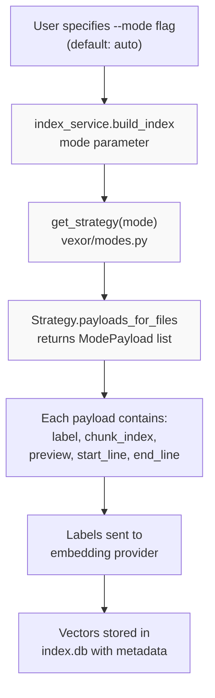
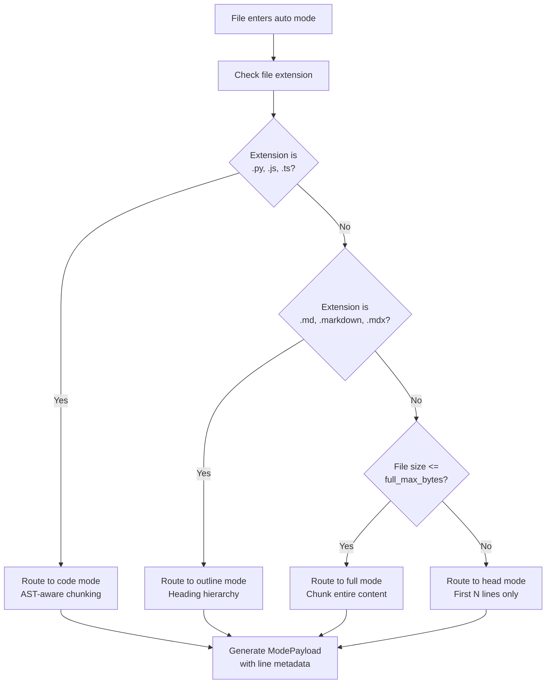
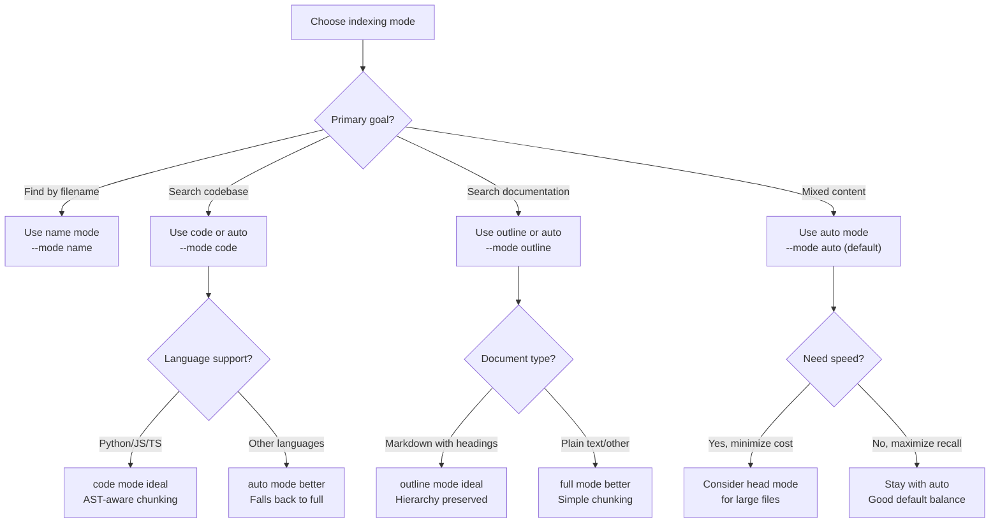
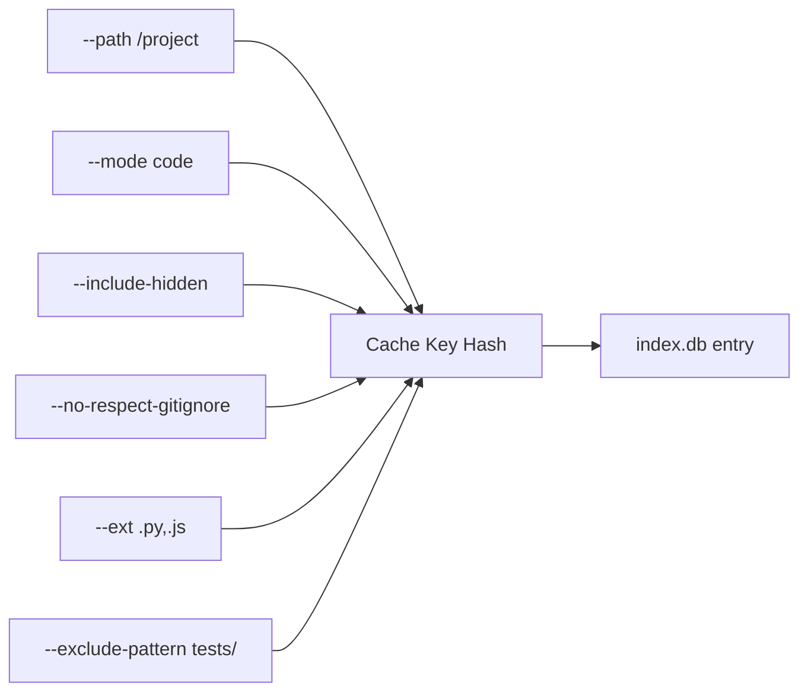
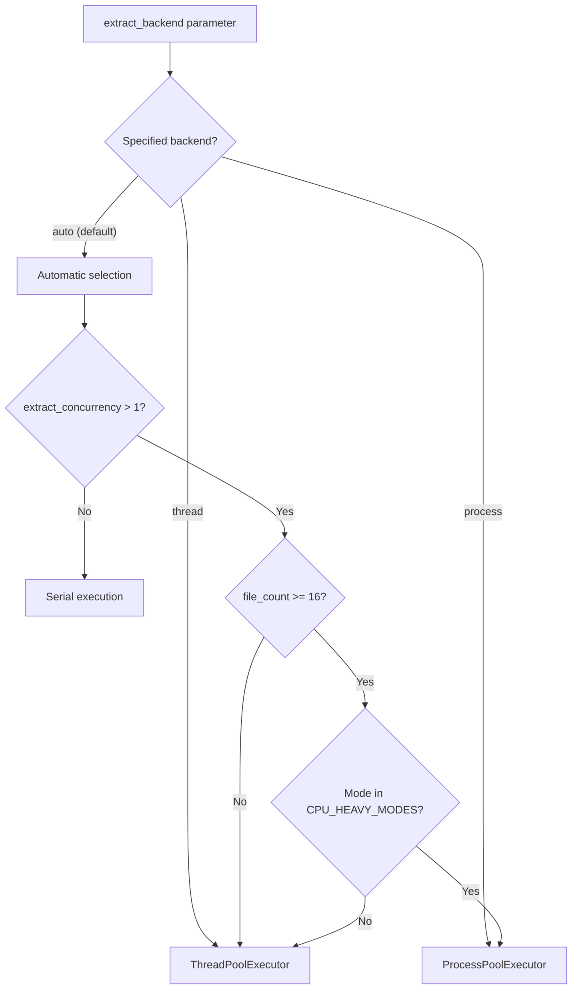
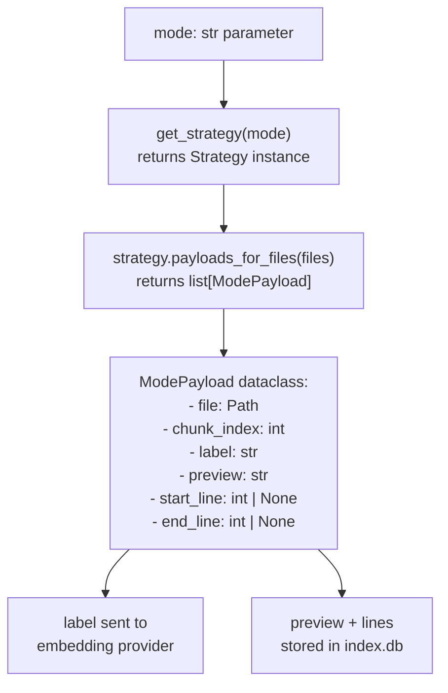

<!-- source: DeepWiki mcp.deepwiki.com · repo scarletkc/vexor · page 3.2 Indexing Modes · fetched 2026-10-27 -->

# Indexing Modes

<details>
<summary>Relevant source files</summary>

The following files were used as context for generating this wiki page:

- [README.md](README.md)
- [tests/integration/test_cli.py](tests/integration/test_cli.py)
- [vexor/text.py](vexor/text.py)

</details>


This page explains Vexor's seven indexing modes, which control how files are processed and chunked before embedding. Indexing modes determine the granularity and content extraction strategy for semantic search.

For information about the embedding providers that generate vectors from indexed content, see [Embedding Providers](#3.3). For details on how the index cache system stores and manages indexed data, see [Cache System](#3.5).

---

## Purpose and Scope

An **indexing mode** defines the extraction and chunking strategy applied during the indexing pipeline. Each mode balances speed, storage cost, and search recall differently. The mode is specified via the `--mode` flag on `vexor index` and `vexor search` commands, or through the Python API.

The choice of mode affects:
- **Extraction cost**: How much content is read and processed from disk
- **Embedding cost**: Number of API calls or local embeddings generated
- **Storage cost**: Size of cached index in `~/.vexor/index.db`
- **Search recall**: Which parts of files are searchable

---

## Mode Overview

Vexor provides seven indexing modes:

| Mode | Extraction Strategy | File Type Compatibility | Line Metadata |
|------|---------------------|-------------------------|---------------|
| `name` | Filename only | All files | No |
| `head` | First N lines | All text files | No |
| `brief` | Keyword extraction | All text files | No |
| `full` | Chunk entire content | All text files | Yes |
| `code` | AST-aware chunking | `.py`, `.js`, `.ts` (fallback to `full` for others) | Yes |
| `outline` | Markdown heading hierarchy | `.md`, `.markdown`, `.mdx` (fallback to `full` for others) | Yes |
| `auto` | Smart routing by file type | All files | Conditional |

**Sources:** [README.md:222-234](), [vexor/services/index_service.py:28-31]()

---

## Mode Selection Flow

When `vexor index` or `vexor search` is invoked, the mode selection process follows this flow:



**Sources:** [vexor/services/index_service.py:126-146](), [vexor/services/index_service.py:72-74](), [vexor/services/index_service.py:178]()

---

## Auto Mode Routing Logic

The `auto` mode implements intelligent file-type-based routing. This is the default mode and recommended for most use cases.



The `full_max_bytes` threshold is mode-specific and defaults to 10,000 bytes for `auto` mode. Files larger than this threshold fall back to `head` mode to avoid excessive chunking.

**Sources:** [README.md:228](), [vexor/services/index_service.py:207-209](), [vexor/services/index_service.py:939-948]()

---

## Name Mode

**Strategy:** Embeds only the filename, ignoring all file content.

**Use Cases:**
- Rapid filename-based search when content is irrelevant
- Projects with well-structured naming conventions
- Initial exploration of unknown codebases

**Characteristics:**
- **Fastest mode**: Zero disk I/O for content reading
- **Lowest storage cost**: One embedding per file
- **No line metadata**: Search results show file-level matches only
- **Limited recall**: Cannot find files by their internal content

**Example:**
```bash
vexor search "config loader" --mode name
# Matches filenames like "config_loader.py" but not content like "def load_config()"
```

**Sources:** [README.md:230](), [vexor/services/index_service.py:927-928]()

---

## Head Mode

**Strategy:** Extracts and embeds the first snippet (typically first N lines) of each file.

**Use Cases:**
- Large files where only headers/imports are relevant
- When full-text indexing is too expensive
- Quick semantic context without deep content analysis

**Characteristics:**
- **Lightweight extraction**: Reads partial file content
- **No line metadata**: Results show file-level preview only
- **Fast indexing**: Minimal content processing
- **Moderate recall**: Finds files by their opening content

**Behavior:**
- The exact number of lines extracted is strategy-dependent
- Falls back gracefully for binary or empty files

**Sources:** [README.md:230](), [vexor/services/index_service.py:927-928]()

---

## Brief Mode

**Strategy:** Extracts high-frequency keywords and embeds a summary representation.

**Use Cases:**
- Product requirement documents (PRDs)
- Planning documents with keyword-dense content
- Large text files where keyword matching is sufficient

**Characteristics:**
- **Keyword-focused**: Uses frequency analysis to extract representative terms
- **No line metadata**: Results are file-level
- **Compression**: Reduces large documents to keyword signatures
- **Best for non-code text**: Optimized for natural language documents

**Note:** This mode is less commonly used than `full` or `outline` for most workflows.

**Sources:** [README.md:231](), [plugins/vexor/skills/vexor-cli/SKILL.md:41]()

---

## Full Mode

**Strategy:** Chunks the entire file content and embeds each chunk separately.

**Use Cases:**
- Deep search through long documents
- When any part of a file might be relevant
- Text files that don't fit specialized modes (code/outline)

**Characteristics:**
- **Highest recall**: Every part of the file is searchable
- **Chunk-level results**: Search returns specific chunks with line ranges
- **Line metadata included**: `start_line` and `end_line` populated for each chunk
- **Higher cost**: Multiple embeddings per file for large documents
- **Text files only**: Automatically filters non-text files

**Chunking Behavior:**
- Chunk size and overlap are strategy-specific
- Binary files are excluded automatically
- Produces `N` embeddings for a file with `N` chunks

**Sources:** [README.md:232](), [vexor/services/index_service.py:937-938]()

---

## Code Mode

**Strategy:** AST-aware chunking that splits code at module, class, and function boundaries.

**Use Cases:**
- **Best default for codebases**: Preserves semantic code units
- Searching by function/class behavior
- When you need to locate specific code constructs

**Supported Languages:**
- **Python** (`.py`): Full AST parsing
- **JavaScript/TypeScript** (`.js`, `.ts`, `.jsx`, `.tsx`): Full AST parsing
- **Other files**: Fallback to `full` mode

**Characteristics:**
- **Intelligent chunking**: Respects code structure (no mid-function splits)
- **Line metadata included**: Each chunk has `start_line` and `end_line`
- **Preserves context**: Function/class names included in embeddings
- **Language-aware**: Uses appropriate parser for each file type

**Example Output:**
A Python file with 3 functions produces 3+ chunks:
- Module-level imports and globals
- `def function_one()` (lines 10-25)
- `class MyClass` (lines 27-50)
- `def function_two()` (lines 52-70)

**Fallback Behavior:**
```python
# For .cpp file (not in JSTS_EXTENSIONS or .py):
# Automatically routes to 'full' mode chunking
```

**Sources:** [README.md:233](), [vexor/services/index_service.py:933-936](), [vexor/services/index_service.py:18]()

---

## Outline Mode

**Strategy:** Chunks Markdown files by heading hierarchy, creating breadcrumb-aware chunks.

**Use Cases:**
- Documentation repositories
- README files with clear section structure
- Wiki or blog content organized by headings

**Supported Extensions:**
- `.md`, `.markdown`, `.mdx` (defined in `MARKDOWN_EXTENSIONS`)
- **Other files**: Fallback to `full` mode

**Characteristics:**
- **Hierarchy-aware**: Chunks respect heading levels (`#`, `##`, `###`)
- **Breadcrumb context**: Each chunk includes parent heading chain
- **Line metadata included**: `start_line` and `end_line` for each section
- **Preserves structure**: Nested sections maintain context

**Example Chunking:**
```markdown
# Installation Guide
...
## Prerequisites
...
## Step-by-Step
...
### Linux
...
### macOS
...
```
Produces chunks like:
- "Installation Guide" (lines 1-5)
- "Installation Guide → Prerequisites" (lines 6-12)
- "Installation Guide → Step-by-Step → Linux" (lines 13-20)
- "Installation Guide → Step-by-Step → macOS" (lines 21-28)

**Sources:** [README.md:234](), [vexor/services/index_service.py:929-932](), [vexor/services/index_service.py:29]()

---

## Line Metadata Behavior

Different modes produce different levels of location metadata. The following table shows which modes populate `start_line` and `end_line` fields in search results:

| Mode | Line Metadata | Notes |
|------|---------------|-------|
| `name` | ❌ No | Filename-only embedding |
| `head` | ❌ No | File-level preview |
| `brief` | ❌ No | Keyword summary |
| `full` | ✅ Yes | Chunk boundaries recorded |
| `code` | ✅ Yes | Function/class boundaries |
| `outline` | ✅ Yes | Heading section ranges |
| `auto` | ⚠️ Conditional | Depends on routed mode |

When line metadata is unavailable, search results display `-` for line numbers in porcelain output formats.

**Sources:** [vexor/services/index_service.py:919-949]()

---

## Mode Selection Guide

This decision tree helps choose the optimal mode for your use case:



**Recommendations:**
1. **Default choice**: Use `auto` unless you have specific requirements
2. **Code-heavy repos**: Use `code` mode for Python/JS/TS projects
3. **Documentation repos**: Use `outline` mode for Markdown-structured content
4. **Performance-critical**: Use `name` or `head` for fastest indexing
5. **Maximum recall**: Use `full` mode when every line matters

**Sources:** [plugins/vexor/skills/vexor-cli/SKILL.md:36-44](), [README.md:226-234]()

---

## Mode Switching and Cache Invalidation

Changing the mode for an indexed directory creates a **new cache entry** with a different cache key. The cache key includes the mode parameter along with other indexing flags.



**Implications:**
- Switching from `--mode auto` to `--mode code` triggers re-indexing
- The old `auto` mode cache remains in the database
- Both caches can coexist independently
- Use `vexor config --clear-index-all` to remove all cached indexes

**Cache Behavior Example:**
```bash
# Creates cache entry with key_1 (mode=auto)
vexor index --path /project --mode auto

# Creates separate cache entry with key_2 (mode=code)
vexor index --path /project --mode code

# Uses key_1 cache (mode must match)
vexor search "query" --path /project --mode auto

# Uses key_2 cache (mode must match)
vexor search "query" --path /project --mode code
```

**Sources:** [README.md:237-240](), [vexor/services/index_service.py:166-175]()

---

## Parallel Extraction Configuration

Modes vary in CPU intensity. Vexor can parallelize content extraction using threads or processes, with automatic backend selection based on mode and file count.

**Backend Selection Logic:**


**CPU-Heavy Modes:**
- `auto`, `code`, `outline`, `full`

**Lightweight Modes:**
- `name`, `head`, `brief`

**Configuration:**
```bash
# Set extraction concurrency (default: 4)
vexor config --set-extract-concurrency 8

# Set extraction backend
vexor config --set-extract-backend process  # or thread, auto
```

**Sources:** [vexor/services/index_service.py:31-32](), [vexor/services/index_service.py:51-70](), [vexor/services/index_service.py:103-123]()

---

## Implementation Details

### Strategy Resolution

The mode-to-strategy mapping is handled by `get_strategy(mode)` in `vexor/modes.py`. Each strategy implements the `payloads_for_files` method that returns `ModePayload` objects.



**Sources:** [vexor/services/index_service.py:25](), [vexor/services/index_service.py:72-74](), [vexor/services/index_service.py:178]()

### Incremental Update Behavior

When running `vexor index` on an already-indexed directory, Vexor performs incremental updates by detecting changed files. The mode must match the cached index's mode for incremental updates to apply.

**Incremental Update Conditions:**
1. Cache exists for the same `(path, mode, model, ...)` tuple
2. Change ratio ≤ 50% of total files (`INCREMENTAL_CHANGE_THRESHOLD`)
3. Embeddings dimension matches (if explicitly set)

**Change Detection:**
- Compares `mtime` (modification time) with tolerance of 0.5 seconds
- Compares file size as secondary check
- Re-embeds only changed/added files
- Removes deleted files from index

**Fallback to Full Rebuild:**
- Change ratio > 50%
- Embedding dimensions changed
- Cache version outdated

**Sources:** [vexor/services/index_service.py:27-28](), [vexor/services/index_service.py:205-261](), [vexor/services/index_service.py:627-638]()

---

## API Usage Examples

### CLI Mode Specification

```bash
# Explicit mode selection
vexor index --path /project --mode code
vexor search "authentication logic" --path /project --mode code

# Mode defaults to 'auto' if unspecified
vexor index --path /project
vexor search "authentication logic" --path /project
```

### Python API Mode Specification

```python
from vexor import index, search

# Explicit mode
index(path="/project", mode="code")
response = search("authentication logic", path="/project", mode="code")

# Mode defaults to 'auto'
index(path="/project")
response = search("authentication logic", path="/project")
```

**Sources:** [README.md:93-101](), [README.md:54-77]()

---

