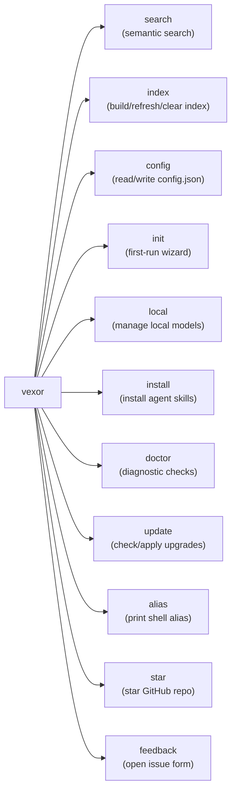

<!-- source: DeepWiki mcp.deepwiki.com · repo scarletkc/vexor · page 4 CLI Reference · fetched 2026-10-27 -->

# CLI Reference

<details>
<summary>Relevant source files</summary>

The following files were used as context for generating this wiki page:

- [vexor/cli.py](vexor/cli.py)
- [vexor/text.py](vexor/text.py)

</details>


This section documents all `vexor` CLI commands, their flags, and the behavior differences between them. It covers the command dispatch mechanism, global flags, output formats, and the auto-search shortcut. For installation instructions, see [Getting Started](#2). For the equivalent Python API, see [Python API Reference](#5).

---

## CLI Architecture

The CLI is implemented in [vexor/cli.py]() using the [Typer](https://typer.tiangolo.com/) library. All user-facing strings are centralized in [vexor/text.py]() under the `Messages` and `Styles` classes.

The entry point is the `run()` function [vexor/cli.py:1939-1953](), which wraps the Typer `app` object and handles the auto-init check before dispatching.

**Command → Service mapping**

```mermaid
graph TD
    subgraph "vexor/cli.py"
        run["run()"]
        search_cmd["search()"]
        index_cmd["index()"]
        config_cmd["config()"]
        local_cmd["local()"]
        install_cmd["install()"]
        doctor_cmd["doctor()"]
        update_cmd["update()"]
        init_cmd["init()"]
        alias_cmd["alias()"]
        star_cmd["star()"]
        feedback_cmd["feedback()"]
    end

    subgraph "vexor/services/"
        SS["search_service.perform_search()"]
        IS["index_service.build_index()"]
        CS["config_service.apply_config_updates()"]
        SYS["system_service.*"]
        INITSVC["init_service.run_init_wizard()"]
        SKILL["skill_service.install_bundled_skill()"]
        CACHE["cache.clear_all_cache()"]
    end

    run --> INITSVC
    search_cmd --> SS
    index_cmd --> IS
    config_cmd --> CS
    config_cmd --> CACHE
    local_cmd --> CS
    install_cmd --> SKILL
    doctor_cmd --> SYS
    update_cmd --> SYS
    init_cmd --> INITSVC
```



Sources: [vexor/cli.py:1-86](), [vexor/cli.py:1939-1953]()

---

## Default Search Shortcut

The `app` Typer instance uses `DefaultSearchGroup` as its `cls` [vexor/cli.py:149-154](). `DefaultSearchGroup` overrides `resolve_command()` so that any unrecognized token that does not start with `-` is treated as a search query [vexor/cli.py:115-146]().

This means:

```
vexor "retry logic"           # equivalent to: vexor search "retry logic"
vexor search "retry logic"    # explicit form
```

`DefaultSearchGroup` also pre-processes args via `_normalize_flashrank_model_args()` [vexor/cli.py:98-112]() to handle edge cases where `--set-flashrank-model` is passed with no value.

Sources: [vexor/cli.py:115-154]()

---

## Global Flags

These flags are registered on the root `app` callback [vexor/cli.py:333-345]() and are available before any subcommand.

| Flag | Short | Description |
|---|---|---|
| `--version` | `-v` | Print `Vexor vX.Y.Z` and exit |
| `--help` | `-h` | Show top-level help and exit |

Sources: [vexor/cli.py:333-345]()

---

## Command Summary

**All top-level commands**



Sources: [vexor/cli.py:348-1799]()

---

| Command | One-line description | Defined at |
|---|---|---|
| `search` | Semantic search over a directory's cached index | [vexor/cli.py:348-528]() |
| `index` | Build, refresh, clear, or display a directory index | [vexor/cli.py:531-711]() |
| `init` | Run the interactive first-run setup wizard | [vexor/cli.py:713-722]() |
| `config` | Read and write `~/.vexor/config.json` | [vexor/cli.py:725-1293]() |
| `local` | Download a local fastembed model and configure CUDA | [vexor/cli.py:1296-1445]() |
| `install` | Write agent skill files for Claude Code / Codex | [vexor/cli.py:1448-1509]() |
| `doctor` | Run diagnostic checks on the installation | [vexor/cli.py:1512-1573]() |
| `update` | Compare running version against PyPI; optionally upgrade | [vexor/cli.py:1576-1678]() |
| `alias` | Print a shell alias (`vx` → `vexor`) and optionally apply it | [vexor/cli.py:1681-1724]() |
| `star` | Star the GitHub repository via browser or `gh` CLI | [vexor/cli.py:1727-1756]() |
| `feedback` | Open the GitHub issue form via browser or `gh` CLI | [vexor/cli.py:1759-1798]() |

Sources: [vexor/cli.py:348-1799]()

---

## Common Flags Shared Across Commands

Several flags appear identically on both `search` and `index`:

| Flag | Short | Default | Description |
|---|---|---|---|
| `--path` | `-p` | `cwd` | Root directory to operate on |
| `--mode` | `-m` | `auto` | Indexing mode (`auto`, `name`, `head`, `brief`, `code`, `outline`, `full`) |
| `--include-hidden` | `-i` | `false` | Include hidden files and directories |
| `--no-recursive` | `-n` | `false` | Disable subdirectory recursion |
| `--ext` | `-e` | _(all)_ | Restrict to file extensions (repeatable, also comma/space-separated) |
| `--exclude-pattern` | | _(none)_ | gitignore-style exclusion patterns (repeatable) |
| `--no-respect-gitignore` | | `false` | Ignore `.gitignore` rules when scanning |

Mode validation is performed by `_validate_mode()` [vexor/cli.py:170-178](), which calls `get_strategy()` from `vexor/modes.py`.

Sources: [vexor/cli.py:349-402](), [vexor/cli.py:532-583](), [vexor/text.py:29-47]()

---

## Output Formats (`vexor search`)

The `search` command's `--format` flag selects among three output modes defined by the `SearchOutputFormat` enum [vexor/cli.py:157-160]():

| Format value | Enum member | Renderer function | Use case |
|---|---|---|---|
| `rich` | `SearchOutputFormat.rich` | `_render_results()` [vexor/cli.py:1801-1827]() | Human-readable Rich table |
| `porcelain` | `SearchOutputFormat.porcelain` | `_render_results_porcelain()` [vexor/cli.py:1839-1856]() | Tab-separated (`\t`) for scripts |
| `porcelain-z` | `SearchOutputFormat.porcelain_z` | `_render_results_porcelain_z()` [vexor/cli.py:1859-1873]() | NUL-delimited (`\0`) for `xargs -0` |

Both machine-readable formats emit the same seven fields per result in the same order:

| Position | Field | Notes |
|---|---|---|
| 1 | Result index | 1-based integer |
| 2 | Similarity score | Formatted as `0.000` |
| 3 | File path | Relative to `--path` |
| 4 | Chunk index | 0-based integer |
| 5 | Start line | `-` if not applicable |
| 6 | End line | `-` if not applicable |
| 7 | Preview text | Escaped (`\t`, `\n`, `\r`, `\\`) in `porcelain`; raw in `porcelain-z` |

In `porcelain` mode, special characters in the preview field are escaped by `_escape_porcelain_field()` [vexor/cli.py:1830-1836](). In `porcelain-z` mode, null bytes within the preview are stripped.

Informational messages (stale index warnings, no-results notices) are always written to `stderr` when a machine-readable format is active.

Sources: [vexor/cli.py:157-160](), [vexor/cli.py:522-528](), [vexor/cli.py:1801-1873]()

---

## Auto-Init Trigger

When `run()` [vexor/cli.py:1939-1953]() is called, it first invokes `should_auto_run_init()` from `vexor/services/init_service.py`. If this returns `True` (no config file exists and the invocation is not `init` itself), the wizard runs automatically, and the original command is printed for the user to re-run.

This is only relevant on first launch. Subsequent invocations skip the check once `~/.vexor/config.json` exists. See [vexor init](#4.8) for full details.

Sources: [vexor/cli.py:1939-1953]()

---

## Detailed Command Pages

Each command has a dedicated reference page:

- [Command Overview](#4.1) — flags conventions and the default-search shortcut
- [vexor search](#4.2) — all search flags, auto-index behavior, cache options
- [vexor index](#4.3) — building, refreshing, clearing, and displaying index metadata
- [vexor config](#4.4) — all `--set-*` and `--clear-*` flags, `--show`, `--show-index-all`
- [vexor doctor and update](#4.5) — diagnostic checks, version comparison, upgrade flow
- [vexor local](#4.6) — local fastembed model download and CUDA configuration
- [vexor install](#4.7) — agent skill installation for Claude Code and Codex
- [vexor init](#4.8) — the interactive setup wizard and `--dry` flag
- [Output Formats](#4.9) — detailed layout of `rich`, `porcelain`, and `porcelain-z`

---

