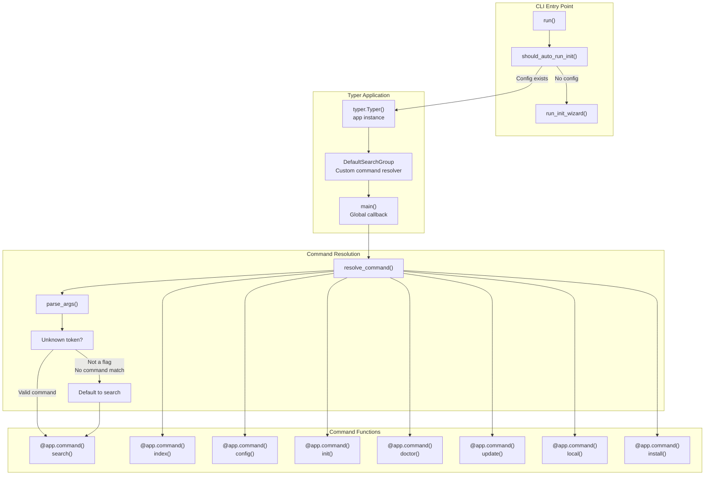
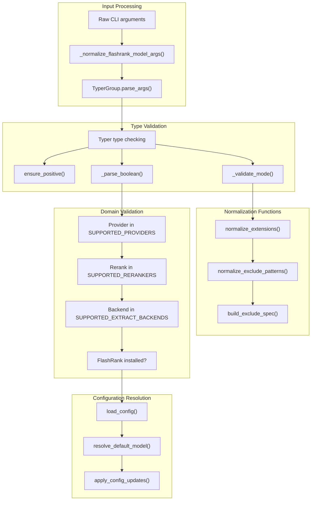
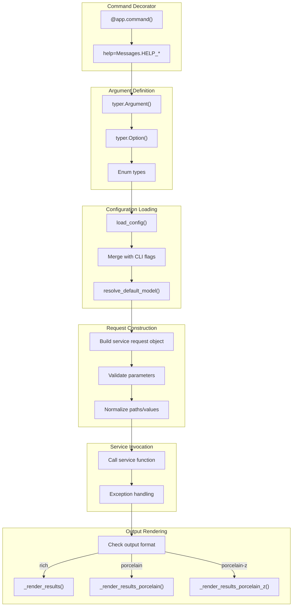
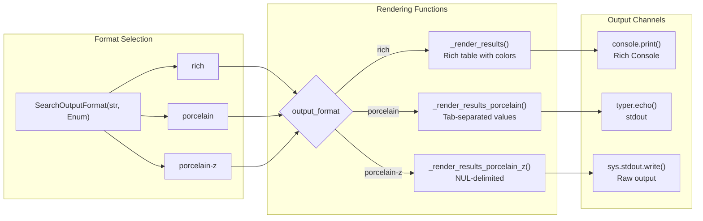
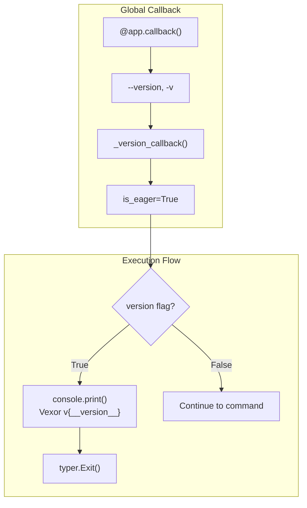
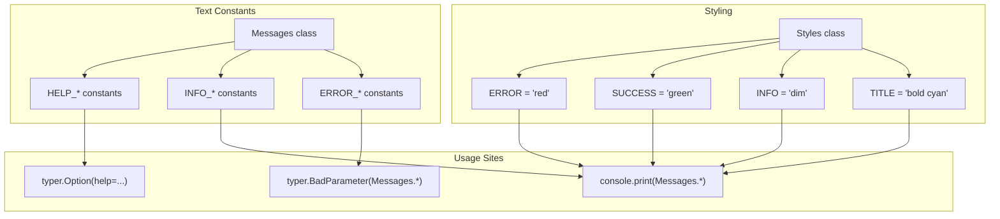

<!-- source: DeepWiki mcp.deepwiki.com · repo scarletkc/vexor · page 4.1 Command Overview · fetched 2026-10-27 -->

# Command Overview

<details>
<summary>Relevant source files</summary>

The following files were used as context for generating this wiki page:

- [README.md](README.md)
- [vexor/cli.py](vexor/cli.py)
- [vexor/text.py](vexor/text.py)

</details>


This page provides a comprehensive overview of all Vexor CLI commands, their invocation patterns, and common flags. It serves as the entry point to the CLI reference documentation. For detailed information about specific commands, see their dedicated reference pages ([4.2](#4.2), [4.3](#4.3), [4.4](#4.4), [4.5](#4.5), [4.6](#4.6), [4.7](#4.7), [4.8](#4.8)). For output format specifications, see [4.9](#4.9).

## Available Commands

Vexor provides eight primary commands plus utility commands for user convenience:

| Command | Purpose | Default Behavior |
|---------|---------|------------------|
| `search` | Execute semantic search over indexed files | Auto-indexes if cache missing and `auto_index` enabled |
| `index` | Build or refresh cached index for a directory | Incremental update if <50% files changed |
| `config` | Manage configuration stored in `~/.vexor/config.json` | Opens in `$EDITOR` if no flags provided |
| `init` | Interactive setup wizard for first-run configuration | Runs automatically if config missing |
| `doctor` | System diagnostics and health checks | Validates command, config, cache, API key, and connectivity |
| `update` | Check for newer releases and optionally upgrade | Detects install method and builds upgrade commands |
| `local` | Manage local embedding models | Downloads models to `~/.vexor/models/` |
| `install` | Install AI agent skills for Claude/Codex | Copies bundled skill to assistant directories |

**Additional Commands:**
- `alias` - Generate shell alias mapping `vx` to `vexor`
- `star` - Star the repository on GitHub (via `gh` CLI or browser)
- `feedback` - Open GitHub issue form

**Sources:** [vexor/cli.py:145-150](), [README.md:228-247]()

## Command Invocation Architecture

Vexor uses a custom Typer command group that enables flexible invocation patterns:



**Key Implementation Details:**

1. **`DefaultSearchGroup`** - Custom `TyperGroup` subclass that intercepts unknown commands and routes them to `search`
2. **Auto-initialization** - The `run()` function checks if config exists before dispatching to the Typer app
3. **Implicit search** - Any argument not matching a command name is treated as a search query

This architecture enables three invocation patterns:
```bash
vexor search "query text"       # Explicit command
vexor "query text"               # Implicit search (most common)
vexor --help                     # Global help
```

**Sources:** [vexor/cli.py:111-143](), [vexor/cli.py:145-150](), [vexor/cli.py:1882-1897](), [vexor/services/init_service.py]()

## Common Flags

Several flags are shared across multiple commands and follow consistent naming conventions:

### Directory and Path Options

| Flag | Type | Commands | Default | Description |
|------|------|----------|---------|-------------|
| `--path`, `-p` | `Path` | `search`, `index` | `Path.cwd()` | Target directory for operation |
| `--include-hidden`, `-i` | `bool` | `search`, `index` | `False` | Include hidden files/directories |
| `--no-recursive`, `-n` | `bool` | `search`, `index` | `False` | Disable directory recursion |
| `--no-respect-gitignore` | `bool` | `search`, `index` | `False` | Ignore `.gitignore` rules |

### Filtering Options

| Flag | Type | Commands | Default | Description |
|------|------|----------|---------|-------------|
| `--mode`, `-m` | `str` | `search`, `index` | `"auto"` | Indexing mode (auto/name/head/brief/full/code/outline) |
| `--ext`, `-e` | `list[str]` | `search`, `index` | `None` | File extension filter (repeatable) |
| `--exclude-pattern` | `list[str]` | `search`, `index` | `None` | Gitignore-style exclusion patterns (repeatable) |

### Search-Specific Options

| Flag | Type | Command | Default | Description |
|------|------|---------|---------|-------------|
| `--top`, `-k` | `int` | `search` | `5` | Number of results to return |
| `--format` | `SearchOutputFormat` | `search` | `"rich"` | Output format (rich/porcelain/porcelain-z) |
| `--no-cache` | `bool` | `search` | `False` | Disable all disk caching |

**Sources:** [vexor/cli.py:344-398](), [vexor/cli.py:526-577](), [README.md:249-263]()

## Flag Normalization and Validation

The CLI performs several preprocessing and validation steps on flags:



**Validation Functions:**

- **`_validate_mode()`** - Ensures mode exists in `available_modes()` using `get_strategy()`
- **`_parse_boolean()`** - Converts string values (true/false, yes/no, 1/0, on/off) to boolean
- **`ensure_positive()`** - Validates numeric arguments are >= 0
- **`normalize_extensions()`** - Splits comma/space-separated extension lists and normalizes format
- **`normalize_exclude_patterns()`** - Processes gitignore-style patterns and expands bare extensions
- **`build_exclude_spec()`** - Compiles patterns into pathspec matcher

**Special Handling:**

The `_normalize_flashrank_model_args()` function handles the edge case where `--set-flashrank-model` is followed by a flag (not a value), treating it as an empty string to reset to default.

**Sources:** [vexor/cli.py:94-108](), [vexor/cli.py:166-174](), [vexor/cli.py:177-183](), [vexor/utils.py]()

## Command Function Structure

All command functions follow a consistent pattern:



**Example: `search()` Command**

The search command demonstrates this pattern:

1. **Argument/Option Definition** - `query` as positional argument, numerous options with defaults
2. **Config Merge** - Loads `~/.vexor/config.json` and merges with CLI flags (CLI takes precedence)
3. **Request Construction** - Creates `SearchRequest` object with normalized values
4. **Service Call** - Invokes `perform_search(request)` from `search_service`
5. **Output Rendering** - Routes to appropriate renderer based on `--format` flag

**Sources:** [vexor/cli.py:344-524](), [vexor/cli.py:1744-1817]()

## Output Format System

Vexor supports three output formats controlled by the `SearchOutputFormat` enum:



**Format Specifications:**

| Format | Delimiter | Fields | Escaping | Use Case |
|--------|-----------|--------|----------|----------|
| `rich` | N/A (table) | Formatted display | N/A | Human consumption |
| `porcelain` | Tab (`\t`) | `rank`, `score`, `path`, `chunk_index`, `start_line`, `end_line`, `preview` | Backslash-escaped | Shell scripts, awk/cut |
| `porcelain-z` | NUL (`\0`) | Same as porcelain | NUL removed from preview | xargs -0, null-safe parsing |

**Porcelain Escaping:**

The `_escape_porcelain_field()` function handles special characters:
- `\` → `\\`
- `\t` → `\\t`
- `\n` → `\\n`
- `\r` → `\\r`

**Sources:** [vexor/cli.py:153-157](), [vexor/cli.py:1744-1817](), [vexor/cli.py:1773-1779](), [README.md:261-265]()

## Global Options and Callbacks

The CLI implements a global callback for version handling:



The `is_eager=True` setting ensures `--version` is processed before command parsing, allowing `vexor --version` to work without requiring a subcommand.

**Sources:** [vexor/cli.py:329-341](), [vexor/cli.py:160-163]()

## Error Handling Patterns

Commands follow consistent error handling patterns:

| Error Type | Detection | Response | Exit Code |
|------------|-----------|----------|-----------|
| Empty query | `not query.strip()` | Print error via `console` | 1 |
| Invalid mode | `get_strategy()` raises `ValueError` | `typer.BadParameter` | 1 |
| Missing index | Service raises `FileNotFoundError` | Format-specific error output | 1 |
| API errors | Service raises `RuntimeError` | Print exception message | 1 |
| Config conflicts | Multiple flags | `typer.BadParameter` with message | 1 |

**Format-Aware Error Output:**

The search command adjusts error output based on format:
- **rich**: Uses `console.print(_styled(..., Styles.ERROR))`
- **porcelain/porcelain-z**: Uses `typer.echo(..., err=True)` for stderr

**Sources:** [vexor/cli.py:417-496](), [vexor/cli.py:692-694]()

## Help Text System

All user-facing text is centralized in `vexor.text.Messages`:



This centralization enables:
- Consistent messaging across all commands
- Easy localization (future)
- Testable text without parsing CLI output

**Sources:** [vexor/text.py:1-436](), [vexor/cli.py:72]()

## Command Execution Entry Point

The `run()` function serves as the primary entry point with auto-initialization logic:

```python
def run(argv: list[str] | None = None) -> None:
    """Entry point wrapper allowing optional argument override."""
    args = list(argv) if argv is not None else sys.argv[1:]
    if should_auto_run_init(args, config_path=config_module.CONFIG_FILE):
        run_init_wizard()
        resume_cmd = "vexor"
        if args:
            resume_cmd = f"vexor {_format_command(args)}"
        console.print(_styled(Messages.INIT_RESUME_TITLE, Styles.INFO))
        console.print(resume_cmd)
        return
    if argv is None:
        app()
    else:
        app(args=args)
```

**Auto-Init Trigger Conditions:**
1. Config file does not exist at `~/.vexor/config.json`
2. Command is not `init` (prevents recursion)
3. No `--help` or `--version` flags

**Sources:** [vexor/cli.py:1882-1897](), [vexor/services/init_service.py]()

---

