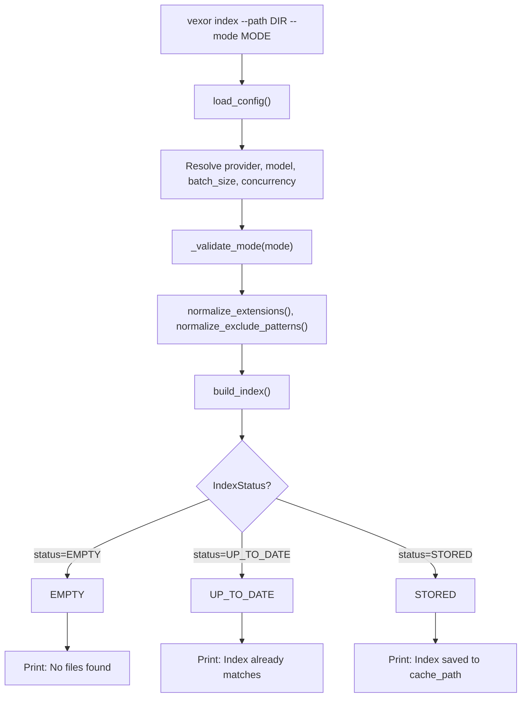
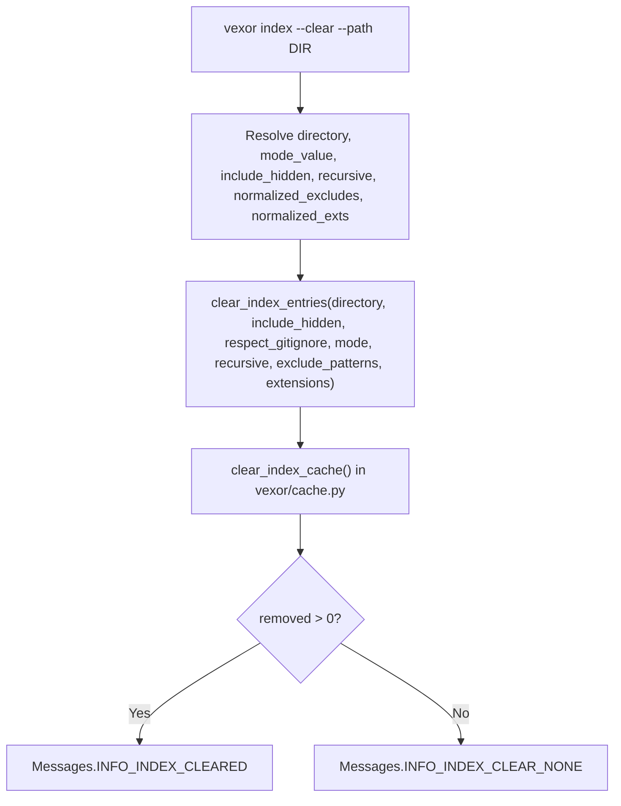
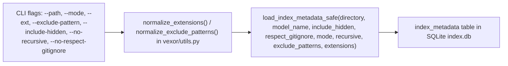
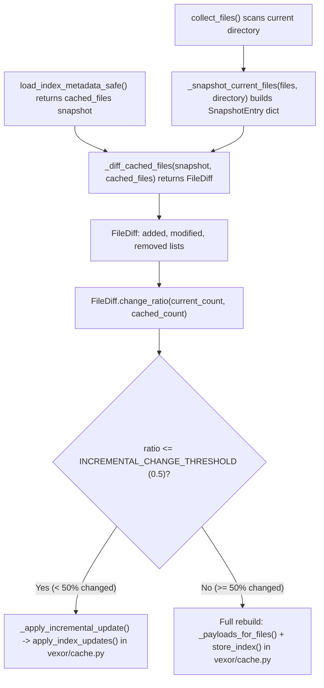

<!-- source: DeepWiki mcp.deepwiki.com · repo scarletkc/vexor · page 4.3 vexor index · fetched 2026-10-27 -->

# vexor index

<details>
<summary>Relevant source files</summary>

The following files were used as context for generating this wiki page:

- [tests/integration/test_cli.py](tests/integration/test_cli.py)
- [vexor/cli.py](vexor/cli.py)
- [vexor/text.py](vexor/text.py)

</details>


## Purpose and Scope

The `vexor index` command builds, displays, or clears cached vector indices for a directory. This page documents all flags and operations supported by the command. For programmatic index management, see [Python API - Index Functions](#5.3). For details on how indexing modes work, see [Indexing Modes](#3.2). For cache system architecture, see [Cache System](#3.5).

Sources: [vexor/cli.py:531-711]()

---

## Command Syntax and Operations

The `index` command supports three distinct operations controlled by flags:

| Operation | Flag | Description |
|-----------|------|-------------|
| **Build/Refresh** | (default) | Create or update the cached index |
| **Show** | `--show` | Display metadata about the cached index |
| **Clear** | `--clear` | Remove the cached index |

**Basic Syntax:**
```bash
vexor index [OPTIONS]
```

The command operates on a single directory specified by `--path` (defaults to current directory) and applies index mode, file filters, and recursion settings to determine which index to build, show, or clear.

Sources: [vexor/cli.py:531-583](), [vexor/text.py:24-47]()

---

## Index Build/Refresh Operation

### Overview

When invoked without `--show` or `--clear`, the command builds or refreshes a cached index. The operation is incremental by default: if a cached index exists and is current, no work is performed. If files have changed, only modified files are re-embedded.

**Index Build Flow Diagram:**



Sources: [vexor/cli.py:677-711]()

### Build Behavior

The `build_index` function from `vexor/services/index_service.py` implements the following logic:

1. **File Discovery**: Calls `collect_files()` from `vexor/utils.py`, which applies `.gitignore` rules, extension filters, hidden-file exclusion, and `--exclude-pattern` rules
2. **Cache Lookup**: Calls `load_index_metadata_safe()` from `vexor/services/cache_service.py` to retrieve an existing index by cache key (derived from path, mode, model, filters)
3. **Diff Computation**: Compares the current file snapshot against the cached file list to identify added, modified, and deleted files
4. **Incremental Update**: If fewer than 50% of files changed (`INCREMENTAL_CHANGE_THRESHOLD = 0.5`), updates only changed files via `apply_index_updates`
5. **Full Rebuild**: If ≥50% of files changed, re-embeds all files and calls `store_index`
6. **Persistence**: Stores the index to SQLite via `store_index` or `apply_index_updates` in `vexor/cache.py`

**`IndexStatus` Return Values** ([vexor/services/index_service.py:34-44]()):

| Value | Meaning |
|-------|---------|
| `IndexStatus.EMPTY` | No files matched the filters |
| `IndexStatus.UP_TO_DATE` | Cache exists and matches current directory state |
| `IndexStatus.STORED` | Index was built or updated and persisted |

Sources: [vexor/cli.py:677-711](), [vexor/services/index_service.py:126-375]()

### Configuration Precedence

Index build uses the following configuration sources in order:

1. Explicit CLI flags (`--path`, `--mode`, `--ext`, etc.)
2. Persistent config from `~/.vexor/config.json` (provider, model, batch_size, concurrency)
3. Built-in defaults

The effective configuration determines:
- **Embedding provider**: `openai`, `gemini`, `custom`, or `local`
- **Model name**: Used as part of cache key
- **Batch size**: Number of texts per embedding request (0 = single request)
- **Embed concurrency**: Parallel embedding API requests
- **Extract concurrency**: Parallel file content extraction workers
- **Extract backend**: `auto`, `thread`, or `process`

Sources: [vexor/cli.py:584-601]()

---

## Show Index Metadata Operation

### Overview

The `--show` flag displays metadata about the cached index matching the provided options. No indexing work is performed.

**Usage:**
```bash
vexor index --show [OPTIONS]
```

**Example Output:**
```
Cached index details for /home/user/project:
Mode: code
Model: text-embedding-3-small
Include hidden: no
Recursive: yes
Respect gitignore: yes
Exclude patterns: none
Extensions: .py, .js, .ts
Files: 142
Embedding dimension: 1536
Version: 3
Generated at: 2024-01-15T10:30:45Z
```

Sources: [vexor/cli.py:606-644](), [vexor/text.py:260-273]()

### Metadata Structure

The displayed metadata comes from `load_index_metadata_safe` which queries the `index_metadata` table:

| Field | Description |
|-------|-------------|
| `mode` | Indexing mode used |
| `model` | Embedding model name |
| `include_hidden` | Whether hidden files were included |
| `recursive` | Whether subdirectories were indexed |
| `respect_gitignore` | Whether .gitignore rules were applied |
| `exclude_patterns` | List of exclude patterns (or "none") |
| `extensions` | List of file extensions (or "all") |
| `files` | Number of files in index |
| `dimension` | Embedding vector dimension |
| `version` | Index schema version |
| `generated_at` | ISO 8601 timestamp of index creation |

Sources: [vexor/cli.py:626-644]()

### Handling Missing Cache

If no matching index exists, the command prints:
```
No cached index found for /path/to/directory.
```

The command exits with status 0 (success) whether the index exists or not.

Sources: [vexor/cli.py:617-624](), [tests/integration/test_cli.py:676-694]()

---

## Clear Index Operation

### Overview

The `--clear` flag removes the cached index matching the provided options. This is useful for forcing a full rebuild or freeing disk space.

**Usage:**
```bash
vexor index --clear [OPTIONS]
```

**Example Output:**
```
Removed 1 cached index entry for /home/user/project.
```

Sources: [vexor/cli.py:646-675]()

### Clear Behavior

**Clear operation flow (`vexor/cli.py` → `vexor/services/index_service.py`):**



Sources: [vexor/cli.py:646-675]()

### Implementation Details

`clear_index_entries` in `vexor/services/index_service.py` ([vexor/services/index_service.py:533-557]()):

1. Delegates to `clear_index` (imported as `clear_index_cache`) from `vexor/cache.py`
2. The cache function locates the `index_metadata` row matching all cache key parameters
3. Deletes matched entries (cascades to dependent tables via foreign keys)
4. Returns the count of removed entries as an integer, or `0` if no match was found

Sources: [vexor/cli.py:646-675](), [vexor/services/index_service.py:533-557]()

### Conflict with --show

The `--show` and `--clear` flags are mutually exclusive. Using both triggers an error:

```bash
vexor index --show --clear --path /some/path
# Error: Cannot use --show together with --clear.
```

Sources: [vexor/cli.py:603-604](), [tests/integration/test_cli.py:696-715]()

---

## Options Reference

### Path and Filtering Options

| Flag | Short | Type | Default | Description |
|------|-------|------|---------|-------------|
| `--path` | `-p` | Path | `.` (cwd) | Root directory to index |
| `--mode` | `-m` | String | `auto` | Indexing mode (see [Indexing Modes](#3.2)) |
| `--ext` | `-e` | String (repeatable) | None | Limit to specific file extensions |
| `--exclude-pattern` | | String (repeatable) | None | Exclude files by gitignore-style pattern |
| `--include-hidden` | `-i` | Flag | False | Include hidden files/directories |
| `--no-respect-gitignore` | | Flag | False | Ignore .gitignore rules |
| `--no-recursive` | `-n` | Flag | False | Don't recurse into subdirectories |

**Extension Format:**

Extensions can be specified multiple times or as comma/space-separated lists:
```bash
--ext .py --ext .js          # Multiple flags
--ext .py,.js                # Comma-separated
--ext ".py .js"              # Space-separated (quoted)
```

All extensions are normalized to lowercase with leading dots.

Sources: [vexor/cli.py:532-583](), [vexor/utils.py]()

**Exclude Pattern Format:**

Patterns follow gitignore syntax with automatic glob expansion:
```bash
--exclude-pattern tests/**           # Exclude tests directory
--exclude-pattern "*.tmp"            # Exclude .tmp files
--exclude-pattern .js                # Auto-expands to **/*.js
```

Sources: [vexor/cli.py:578-583](), [vexor/utils.py]()

### Operation Mode Flags

| Flag | Type | Description |
|------|------|-------------|
| `--show` | Flag | Display index metadata instead of building |
| `--clear` | Flag | Remove cached index instead of building |

These flags are mutually exclusive with each other. If neither is provided, the default build/refresh operation executes.

Sources: [vexor/cli.py:561-570]()

---

## Cache Key Computation

The cache key determines which index is built, shown, or cleared. It is computed from the following parameters — all of which are passed to `load_index_metadata_safe` and `store_index`:

| Parameter | Source |
|-----------|--------|
| Absolute root path | `--path` (resolved) |
| Model name | Config or provider default |
| Mode | `--mode` (default: `auto`) |
| `include_hidden` | `--include-hidden` flag |
| `respect_gitignore` | Inverse of `--no-respect-gitignore` |
| `recursive` | Inverse of `--no-recursive` |
| `extensions` | `--ext` (sorted, normalized) |
| `exclude_patterns` | `--exclude-pattern` (sorted, normalized) |

**Cache key flow (`load_index_metadata_safe` call site in the CLI):**



Changing any of these parameters produces a distinct cache entry. For example:

```bash
vexor index --path ~/proj --mode code --ext .py
# Creates index A

vexor index --path ~/proj --mode code --ext .py,.js
# Creates index B (different key — extensions differ)
```

Sources: [vexor/cli.py:606-616](), [vexor/services/cache_service.py]()

---

## Examples

### Basic Index Build

Create an index for the current directory using auto mode:
```bash
vexor index
```

Explicitly specify path and mode:
```bash
vexor index --path ~/projects/myapp --mode code
```

Sources: [README.md:72-78]()

### Filtering Files

Index only Python files:
```bash
vexor index --path ~/projects/myapp --ext .py
```

Index Python and JavaScript, excluding tests:
```bash
vexor index --ext .py,.js --exclude-pattern tests/**
```

Index with hidden files, ignoring .gitignore:
```bash
vexor index --include-hidden --no-respect-gitignore
```

Sources: [vexor/cli.py:572-583]()

### Non-Recursive Indexing

Index only files in the specified directory (no subdirectories):
```bash
vexor index --path ~/projects/myapp --no-recursive
```

Sources: [vexor/cli.py:556-560](), [tests/integration/test_cli.py:616-642]()

### Showing Index Metadata

Display metadata for the default index:
```bash
vexor index --show
```

Display metadata for a specific configuration:
```bash
vexor index --show --path ~/projects/myapp --mode code --ext .py
```

Sources: [vexor/cli.py:606-644](), [tests/integration/test_cli.py:644-674]()

### Clearing Indices

Clear the default index:
```bash
vexor index --clear
```

Clear a specific index configuration:
```bash
vexor index --clear --path ~/projects/myapp --mode code --ext .py
```

**Note**: The `--clear` operation requires all cache key parameters to match exactly. If you're unsure which configurations exist, use:
```bash
vexor config --show-index-all
```

Sources: [vexor/cli.py:646-675](), [tests/integration/test_cli.py:717-796]()

---

## Incremental Updates

### Update Detection

When `vexor index` is run on a directory with an existing cache, `build_index` performs a diff via `_diff_cached_files` and `_snapshot_current_files`:

**File change detection flow:**



**Change detection logic** (`_has_entry_changed`, [vexor/services/index_service.py:627-638]()):
- Files are compared by `mtime` and `size` from the cached snapshot
- `mtime` differences above `MTIME_TOLERANCE = 0.5` seconds trigger a re-check against size
- A file is considered unchanged only if `mtime` difference is within tolerance **and** size matches

**`INCREMENTAL_CHANGE_THRESHOLD`** ([vexor/services/index_service.py:27]()):
- Value: `0.5` (50%)
- If ≤50% of files changed, `_apply_incremental_update` handles only changed files
- If >50% of files changed, the entire index is rebuilt from scratch

Sources: [vexor/services/index_service.py:126-375](), [vexor/services/index_service.py:560-638]()

### Database Operations

**Incremental Update** (`apply_index_updates` in `vexor/cache.py`):
1. Deletes chunks for removed and modified files
2. Inserts new chunks for added and modified files
3. Updates the `index_metadata` row with the new file snapshot
4. Wrapped in a single transaction

**Full Rebuild** (`store_index` in `vexor/cache.py`):
1. Deletes all existing entries for the matching cache key
2. Inserts all new `IndexedChunk` entries in bulk
3. Wrapped in a single transaction

Sources: [vexor/services/index_service.py:641-725](), [vexor/services/index_service.py:343-375]()

---

## Status Messages

The command prints different messages based on the operation outcome:

| Status | Message Template |
|--------|------------------|
| Indexing started | `Indexing files under {path}...` |
| Empty directory | `No files found in the selected directory.` |
| Up to date | `Index already matches the current directory; nothing to do.` |
| Index saved | `Index saved to {path}.` |
| Show - no cache | `No cached index found for {path}.` |
| Show - found | `Cached index details for {path}:` (followed by metadata) |
| Clear - removed | `Removed {count} cached index entr{plural} for {path}.` |
| Clear - no cache | `No cached index found for {path}.` |

Sources: [vexor/text.py:247-273](), [vexor/cli.py:677-711]()

---

## Error Handling

### Invalid Mode

If an unsupported mode is provided:
```bash
vexor index --mode invalid
# Error: Unsupported mode 'invalid'. Allowed values: auto, name, head, brief, full, code, outline.
```

Sources: [vexor/cli.py:170-178]()

### Empty Extensions

If `--ext` is provided but results in no valid extensions:
```bash
vexor index --ext ""
# Error: Provide at least one valid file extension when using --ext.
```

Sources: [vexor/cli.py:601-602]()

### Runtime Errors

If indexing fails (e.g., API errors, file read errors):
```bash
vexor index --path ~/projects/myapp
# Error: <error message from build_index>
# Exit code: 1
```

The command catches `RuntimeError` from `build_index` and displays the error message.

Sources: [vexor/cli.py:698-700]()

---

## Integration with Search

The `vexor search` command can automatically trigger indexing if:
- `auto_index` is enabled in config (default: true)
- No cached index exists, OR
- The cached index is stale (files have changed)

To disable auto-indexing and manually control when indices are built:
```bash
vexor config --set-auto-index false
vexor index --path ~/projects/myapp --mode code
vexor search "query" --path ~/projects/myapp --mode code
```

Sources: [vexor/cli.py:272-331](), [vexor/config.py]()

---

## Related Commands

- `vexor search` - Searches the cached index (see [vexor search](#4.2))
- `vexor config --show-index-all` - Lists all cached indices
- `vexor config --clear-index-all` - Clears all cached indices
- `vexor config` - Manages provider, model, and concurrency settings (see [vexor config](#4.4))

Sources: [vexor/cli.py:816-824](), [README.md:228-248]()

---

