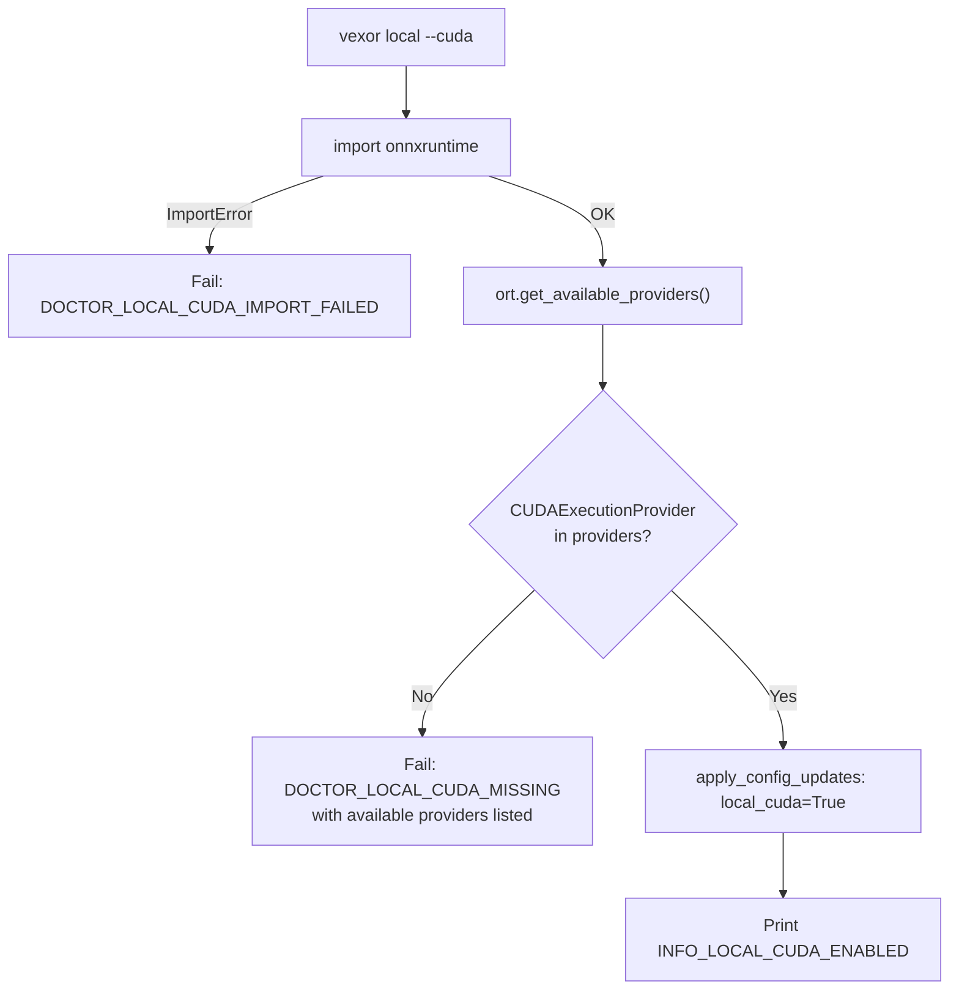

<!-- source: DeepWiki mcp.deepwiki.com · repo scarletkc/vexor · page 4.6 vexor local · fetched 2026-10-27 -->

# vexor local

<details>
<summary>Relevant source files</summary>

The following files were used as context for generating this wiki page:

- [tests/integration/test_cli.py](tests/integration/test_cli.py)
- [vexor/cli.py](vexor/cli.py)
- [vexor/text.py](vexor/text.py)

</details>


The `vexor local` command manages on-device embedding model setup. It covers downloading fastembed-compatible models, configuring Vexor to use the `local` provider, toggling CUDA/CPU execution, and cleaning up cached model files. This page documents all flags, constraints, and dependency requirements.

For information about switching providers more generally (including OpenAI, Gemini, Voyage AI, and custom endpoints), see [3.3](#3.3). For the `vexor init` wizard, which also offers a guided local setup path, see [4.8](#4.8).

---

## Overview

The `local` provider runs embedding inference entirely on the host machine using the [fastembed](https://github.com/qdrant/fastembed) library, backed by ONNX Runtime. No API key or network access is required after the model is downloaded.

**`vexor local`** is the dedicated command for:
- Downloading and verifying a local model (`--setup`)
- Switching between CPU and CUDA execution (`--cpu`, `--cuda`)
- Removing the model cache from disk (`--clean-up`)

Sources: [vexor/text.py:89-94](), [vexor/cli.py:74]()

---

## Dependencies

The `local` provider requires Python packages that are not installed by default. Two pip extras are available:

| Extra | Installs | GPU support |
|---|---|---|
| `vexor[local]` | `fastembed`, `onnxruntime` | No (CPU only) |
| `vexor[local-cuda]` | `fastembed`, `onnxruntime-gpu` | Yes (CUDA) |

If these packages are absent when a local-model operation is attempted, Vexor raises:

> *"Local model support is not installed. Install with `pip install "vexor[local]"` (or `vexor[local-cuda]` for GPU)."*

Sources: [vexor/text.py:109-113]()

---

## Flags Reference

| Flag | Argument | Description |
|---|---|---|
| `--setup` | *(none)* | Download the model and configure Vexor to use the `local` provider |
| `--model` | `MODEL_NAME` | Fastembed model name to use with `--setup` (defaults to `DEFAULT_LOCAL_MODEL`) |
| `--clean-up` | *(none)* | Delete the local model cache directory at `~/.vexor/models` |
| `--cuda` | *(none)* | Enable CUDA for local embeddings (requires `onnxruntime-gpu`) |
| `--cpu` | *(none)* | Disable CUDA and switch back to CPU |

Sources: [vexor/text.py:89-94]()

---

## Flag Constraints

The following mutual-exclusion rules are enforced by the CLI:

- `--cuda` and `--cpu` cannot be used together → `ERROR_LOCAL_CUDA_CONFLICT`
- `--clean-up` must be used alone; it cannot be combined with any other flag → `ERROR_LOCAL_OPTIONS_CONFLICT`
- `--model` requires a non-empty string → `ERROR_LOCAL_MODEL_EMPTY`

Sources: [vexor/text.py:117-119]()

---

## `--setup` Behaviour

**`vexor local --setup [--model NAME] [--cuda | --cpu]`**

**Setup flow diagram:**

```mermaid
flowchart TD
    A["vexor local --setup"] --> B{"fastembed installed?"}
    B -- "No" --> C["Raise ERROR_LOCAL_DEP_MISSING"]
    B -- "Yes" --> D["Resolve model name\n(--model or DEFAULT_LOCAL_MODEL)"]
    D --> E["Instantiate LocalEmbeddingBackend\n(model_name, cuda flag)"]
    E --> F{"Model download / load\nsucceeds?"}
    F -- "No" --> G["Raise ERROR_LOCAL_MODEL_LOAD"]
    F -- "Yes" --> H["Run test embed:\nbackend.embed([\"test\"])"]
    H --> I{"Embeddings returned?"}
    I -- "No" --> J["Print ERROR_NO_EMBEDDINGS"]
    I -- "Yes" --> K["apply_config_updates:\nprovider=local, model=MODEL"]
    K --> L["Print INFO_LOCAL_SETUP_DONE"]
```

Sources: [vexor/services/init_service.py:664-683](), [vexor/text.py:298-305](), [vexor/cli.py:74]()

When `--setup` completes successfully, Vexor calls `apply_config_updates` to persist `provider = "local"` and `model = <model_name>` in `~/.vexor/config.json`. The model files are stored in the fastembed cache directory, resolved by `resolve_fastembed_cache_dir`.

Sources: [vexor/cli.py:74](), [vexor/text.py:303]()

---

## `--cuda` and `--cpu` Behaviour

**`vexor local --cuda`** sets `local_cuda = true` in config and prints `INFO_LOCAL_CUDA_ENABLED`.  
**`vexor local --cpu`** sets `local_cuda = false` in config and prints `INFO_LOCAL_CUDA_DISABLED`.

These flags are independent of `--setup`. They update the config without re-downloading the model.

**CUDA availability check:**



Sources: [vexor/services/init_service.py:619-653](), [vexor/text.py:304-318]()

The CUDA check is also surfaced by `vexor doctor`. See [4.5](#4.5).

---

## `--clean-up` Behaviour

**`vexor local --clean-up`**

Removes the directory returned by `resolve_fastembed_cache_dir`. This is typically `~/.vexor/models` or the fastembed default cache path.

| Condition | Output |
|---|---|
| Cache directory does not exist | `INFO_LOCAL_CACHE_EMPTY` |
| Deletion successful | `INFO_LOCAL_CACHE_CLEARED` |
| Deletion fails | `ERROR_LOCAL_CACHE_CLEANUP` with path and reason |

`--clean-up` must be used alone; combining it with `--setup`, `--cuda`, or `--cpu` raises `ERROR_LOCAL_OPTIONS_CONFLICT`.

Sources: [vexor/text.py:117-118](), [vexor/text.py:300-302]()

---

## Code Entity Map

**Key symbols involved in `vexor local`:**

```mermaid
graph LR
    CMD["\"vexor local\"\ncli.py @app.command()"]
    LEB["\"LocalEmbeddingBackend\"\nvexor/providers/local.py"]
    RFCD["\"resolve_fastembed_cache_dir()\"\nvexor/providers/local.py"]
    ACU["\"apply_config_updates()\"\nvexor/services/config_service.py"]
    DLM["\"DEFAULT_LOCAL_MODEL\"\nvexor/config.py"]
    MSG["\"Messages\"\nvexor/text.py"]
    CFG["\"Config.local_cuda\"\nvexor/config.py"]

    CMD --> LEB
    CMD --> RFCD
    CMD --> ACU
    CMD --> DLM
    CMD --> MSG
    ACU --> CFG
    LEB -->|"fastembed + onnxruntime"| CFG
```

Sources: [vexor/cli.py:74](), [vexor/cli.py:25-46](), [vexor/text.py:89-94]()

---

## Configuration State Changes

Each sub-operation writes to `~/.vexor/config.json` via `apply_config_updates`:

| Operation | Config fields modified |
|---|---|
| `--setup` | `provider = "local"`, `model = <name>` |
| `--cuda` | `local_cuda = true` |
| `--cpu` | `local_cuda = false` |
| `--clean-up` | *(no config changes)* |

The `local_cuda` flag is read by `build_index` and `perform_search` at runtime to select the appropriate ONNX execution provider in `LocalEmbeddingBackend`.

Sources: [vexor/cli.py:453](), [vexor/cli.py:693](), [vexor/text.py:303-305]()

---

## Common Workflows

**First-time local setup (CPU):**
```
pip install "vexor[local]"
vexor local --setup
```

**First-time local setup (CUDA):**
```
pip install "vexor[local-cuda]"
vexor local --setup --cuda
```

**Switch an existing local install to CUDA:**
```
vexor local --cuda
```

**Switch back to CPU:**
```
vexor local --cpu
```

**Use a specific fastembed model:**
```
vexor local --setup --model BAAI/bge-small-en-v1.5
```

**Clear cached model files:**
```
vexor local --clean-up
```

Sources: [vexor/text.py:89-94](), [vexor/text.py:109-119](), [vexor/services/init_service.py:183-217]()

---

## Relationship to `vexor init`

The `vexor init` wizard offers a guided local setup path that internally calls the same `LocalEmbeddingBackend` setup logic. Choosing "Local" in the wizard's Step 1 is equivalent to running `vexor local --setup` (with an optional `--cuda`). The wizard additionally offers to install `fastembed` via pip if it is missing.

For the full init wizard reference, see [4.8](#4.8). For the init wizard implementation, see `_collect_local_settings` and `_prepare_local_model` in [vexor/services/init_service.py:160-217]().

---

