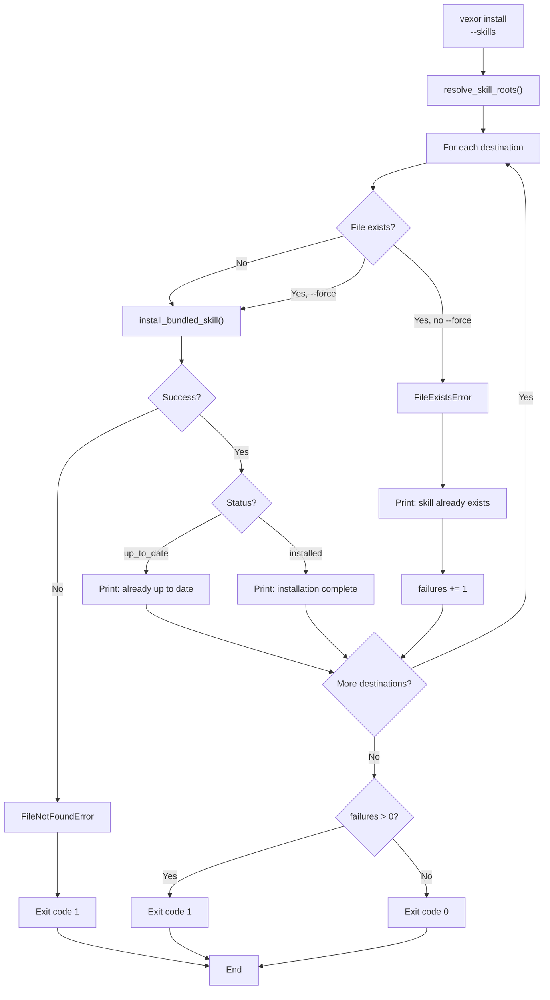

<!-- source: DeepWiki mcp.deepwiki.com · repo scarletkc/vexor · page 4.7 vexor install · fetched 2026-10-27 -->

# vexor install

<details>
<summary>Relevant source files</summary>

The following files were used as context for generating this wiki page:

- [plugins/vexor/skills/vexor-cli/SKILL.md](plugins/vexor/skills/vexor-cli/SKILL.md)
- [vexor/cli.py](vexor/cli.py)

</details>


This page documents the `vexor install` command, which installs Vexor Agent Skills for AI assistants like Claude and Codex. These skills enable AI assistants to use Vexor's semantic search capabilities directly from their chat interfaces.

For information about configuring and using Vexor with AI assistants after installation, see [AI Agent Integration](#8.6). For general CLI command reference, see [Command Overview](#4.1).

---

## Command Syntax

```bash
vexor install --skills <DESTINATION> [--force]
```

The command installs the bundled Vexor skill package to one or more skill directories specified by the `--skills` parameter.

**Sources:** [vexor/cli.py:1448-1510]()

---

## Command Flags

| Flag | Short | Required | Description |
|------|-------|----------|-------------|
| `--skills` | - | Yes | Comma-separated list of skill root directories or AI assistant names |
| `--force` | `-f` | No | Overwrite existing skill files if they already exist |

### Skills Parameter

The `--skills` parameter accepts:

1. **Assistant names**: `claude`, `codex` (case-insensitive)
2. **Custom paths**: Absolute or relative directory paths
3. **Multiple targets**: Comma-separated combinations of the above

The system resolves assistant names to their default skill directories:
- `claude` → `~/.continue/skills/`
- `codex` → `~/.codex/skills/`

**Sources:** [vexor/cli.py:1450-1454]()

---

## Installation Flow



**Sources:** [vexor/cli.py:1464-1509]()

---

## Installation Process Details

### Step 1: Destination Resolution

The `resolve_skill_roots()` function processes the `--skills` parameter:

```
Input: "claude,codex,/custom/path"
↓
resolve_skill_roots()
↓
Output: [
  Path("~/.continue/skills/"),
  Path("~/.codex/skills/"),
  Path("/custom/path")
]
```

### Step 2: Skill Installation

For each destination, `install_bundled_skill()` performs:

1. **Locate source**: Finds bundled skill at `plugins/vexor/skills/{DEFAULT_SKILL_NAME}/`
2. **Check destination**: Verifies if `{destination}/{skill_name}/` already exists
3. **Copy files**: Recursively copies skill directory structure
4. **Return status**: Returns `SkillInstallStatus.installed` or `SkillInstallStatus.up_to_date`

**Sources:** [vexor/cli.py:1473-1476](), [vexor/services/skill_service.py]()

---

## Installed Skill Structure

The default skill name is `vexor-cli`. After installation, the directory structure is:

```
{destination}/
└── vexor-cli/
    ├── SKILL.md              # Skill definition and documentation
    └── references/
        └── install-vexor.md  # Installation instructions for Vexor itself
```

### SKILL.md Contents

The skill definition includes:

- **Metadata**: Name, description for AI assistant indexing
- **Goal**: Purpose of the skill (semantic file discovery)
- **Command syntax**: Full `vexor` CLI usage documentation
- **Flags reference**: All search parameters and modes
- **Examples**: Common usage patterns
- **Troubleshooting**: Common issues and solutions

**Sources:** [plugins/vexor/skills/vexor-cli/SKILL.md:1-80]()

---

## Skill Capabilities

The installed skill enables AI assistants to:

| Capability | Description |
|------------|-------------|
| Semantic search | Find files by intent rather than exact text matching |
| Mode selection | Choose appropriate indexing strategy (name, head, code, outline, full) |
| Filtering | Apply extensions, exclude patterns, hidden files |
| Result parsing | Process rich, porcelain, or porcelain-z output formats |
| Diagnostics | Guide users through `vexor doctor` and configuration |

**Sources:** [plugins/vexor/skills/vexor-cli/SKILL.md:9-52]()

---

## Examples

### Install for Claude

```bash
vexor install --skills claude
```

Output:
```
✓ Installed Vexor skill to ~/.continue/skills/vexor-cli/
```

### Install for Multiple Assistants

```bash
vexor install --skills claude,codex
```

Output:
```
✓ Installed Vexor skill to ~/.continue/skills/vexor-cli/
✓ Installed Vexor skill to ~/.codex/skills/vexor-cli/
```

### Install to Custom Directory

```bash
vexor install --skills /path/to/my/ai/skills
```

### Force Reinstallation

```bash
vexor install --skills claude --force
```

This overwrites existing files if the skill is already installed.

**Sources:** [vexor/cli.py:1448-1510]()

---

## Error Handling

### Skill Already Exists

**Error:**
```
Error: Skill already exists at ~/.continue/skills/vexor-cli/
```

**Solutions:**
1. Use `--force` to overwrite existing installation
2. Manually remove the existing directory
3. Install to a different location

**Sources:** [vexor/cli.py:1478-1486]()

### Source Skill Not Found

**Error:**
```
Error: Bundled skill source not found: <reason>
```

**Cause:** The packaged skill files are missing from the Vexor installation. This indicates a corrupted or incomplete Vexor installation.

**Solution:** Reinstall Vexor using `pip install --force-reinstall vexor` or `pipx reinstall vexor`.

**Sources:** [vexor/cli.py:1487-1491]()

### Invalid Skills Parameter

**Error:**
```
Error: Invalid value for '--skills': <reason>
```

**Causes:**
- Empty string provided
- Malformed path
- Unknown assistant name

**Solution:** Provide valid assistant names (`claude`, `codex`) or valid directory paths.

**Sources:** [vexor/cli.py:1465-1467]()

---

## Exit Codes

| Code | Meaning |
|------|---------|
| 0 | All installations succeeded |
| 1 | One or more installations failed or source not found |

Multiple destinations are processed independently. Partial failures result in exit code 1, but successful installations are retained.

**Sources:** [vexor/cli.py:1508-1509]()

---

## Integration with AI Assistants

### Claude Desktop / Continue

Skills installed to `~/.continue/skills/` are automatically discovered by Continue (the VSCode extension for Claude). The skill appears in Claude's tool palette as `vexor-cli`.

### Codex

Skills installed to `~/.codex/skills/` are indexed by Codex. The skill enables semantic file discovery within Codex conversations.

### Custom Integrations

For other AI assistants or custom skill systems, install to a directory monitored by your assistant platform. The skill uses standard Markdown format with YAML frontmatter, compatible with most skill-based AI systems.

**Sources:** [vexor/services/skill_service.py]()

---

## Skill Service Architecture

```mermaid
graph LR
    CLI["vexor install<br/>--skills claude,codex<br/>--force"] --> ResolveRoots["resolve_skill_roots()"]
    
    ResolveRoots --> ParseInput["Parse comma-separated<br/>destinations"]
    ParseInput --> MapNames["Map assistant names:<br/>claude → ~/.continue/skills/<br/>codex → ~/.codex/skills/"]
    MapNames --> ExpandPaths["Expand ~ and relative paths"]
    
    ExpandPaths --> Roots["List[Path]"]
    
    Roots --> InstallLoop["For each destination root"]
    InstallLoop --> InstallSkill["install_bundled_skill(<br/>skill_name=DEFAULT_SKILL_NAME,<br/>skills_dir=root,<br/>force=force)"]
    
    InstallSkill --> FindSource["Locate bundled skill:<br/>plugins/vexor/skills/<br/>vexor-cli/"]
    FindSource --> CheckDest["Check destination:<br/>{root}/vexor-cli/"]
    
    CheckDest --> Exists{Exists?}
    Exists -->|No| CopyTree["shutil.copytree()"]
    Exists -->|Yes, force| RemoveAndCopy["rmtree() + copytree()"]
    Exists -->|Yes, no force| Raise["raise FileExistsError"]
    
    CopyTree --> ReturnInstalled["SkillInstallStatus.installed"]
    RemoveAndCopy --> ReturnInstalled
    Raise --> CLIError["CLI prints error<br/>continues to next destination"]
    
    ReturnInstalled --> CLISuccess["CLI prints success message"]
```



**Sources:** [vexor/cli.py:1464-1509](), [vexor/services/skill_service.py]()

---

## Relationship to Other Commands

| Command | Purpose | Relationship |
|---------|---------|--------------|
| `vexor search` | Execute semantic search | Skills enable AI assistants to call this |
| `vexor doctor` | System diagnostics | Skills guide users to run this for troubleshooting |
| `vexor config` | Configure Vexor settings | Skills reference this for API key setup |
| `vexor init` | Interactive setup wizard | Alternative to manual configuration referenced by skills |

**Sources:** [vexor/cli.py:348-723]()

---

