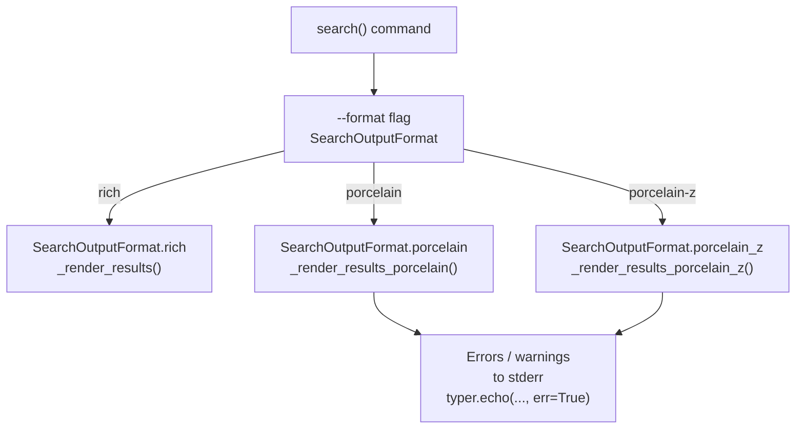
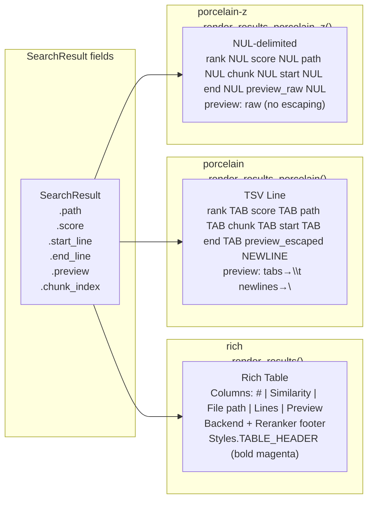

<!-- source: DeepWiki mcp.deepwiki.com · repo scarletkc/vexor · page 4.9 Output Formats · fetched 2026-10-27 -->

# Output Formats

<details>
<summary>Relevant source files</summary>

The following files were used as context for generating this wiki page:

- [plugins/vexor/skills/vexor-cli/SKILL.md](plugins/vexor/skills/vexor-cli/SKILL.md)
- [vexor/cli.py](vexor/cli.py)
- [vexor/text.py](vexor/text.py)

</details>


This page documents the three output formats available for `vexor search`: `rich`, `porcelain`, and `porcelain-z`. It covers the field layout of each, how to select them, and how errors and warnings are routed in non-interactive modes.

For the full reference of `vexor search` flags (query, path, top-k, mode, etc.), see [4.2](#4.2). For consuming search results from the Python API rather than the CLI, see [5.2](#5.2).

---

## Selecting an Output Format

The `--format` flag on `vexor search` controls the output format. It maps to the `SearchOutputFormat` enum defined in [vexor/cli.py:157-160]().

```
vexor search "<query>" --format <rich|porcelain|porcelain-z>
```

| Flag value | Enum member | Use case |
|---|---|---|
| `rich` | `SearchOutputFormat.rich` | Default; human-readable terminal table |
| `porcelain` | `SearchOutputFormat.porcelain` | Scripting; tab-separated values (TSV) |
| `porcelain-z` | `SearchOutputFormat.porcelain_z` | Scripting; NUL-delimited, safe for filenames with spaces/newlines |

The default is `rich`. The help text for `--format` is defined in `Messages.HELP_SEARCH_FORMAT` in [vexor/text.py:19-21]().

Sources: [vexor/cli.py:157-160](), [vexor/cli.py:392-396](), [vexor/text.py:19-21]()

---

## Format Dispatch Flow

**Search output dispatch**



Sources: [vexor/cli.py:463-528]()

---

## `rich` Format (Default)

Renders a [Rich](https://github.com/Textualize/rich) table to the terminal. Intended for interactive use.

### Table Layout

The table is printed by `_render_results()` in [vexor/cli.py]() using `rich.table.Table`.

| Column header | Content | Notes |
|---|---|---|
| `#` | 1-based rank | `Messages.TABLE_HEADER_INDEX` |
| `Similarity` | Cosine similarity score | `Messages.TABLE_HEADER_SIMILARITY` |
| `File path` | Path relative to search root | `Messages.TABLE_HEADER_PATH` |
| `Lines` | `L{start}-{end}` | `Messages.TABLE_HEADER_LINES` |
| `Preview` | Snippet from the matched chunk | `Messages.TABLE_HEADER_PREVIEW` |

Below the table, two metadata lines appear:
- **Backend:** the embedding backend in use (e.g., `openai`, `local`), from `response.backend`
- **Reranker:** the active reranker (e.g., `bm25`, `off`), from `response.reranker`

These labels are defined as `TABLE_BACKEND_PREFIX` and `TABLE_RERANKER_PREFIX` in [vexor/text.py:432-433]().

### Pre-search Status Messages

When `--format rich` is active, the CLI prints informational messages to **stdout** before the search runs:

- `"Indexing files under {path}..."` — when auto-index triggers
- `"Searching cached index under {path}..."` — normal cached search
- `"Searching in-memory index under {path}..."` — when `--no-cache` is set

These messages are suppressed in `porcelain` and `porcelain-z` modes.

Sources: [vexor/cli.py:463-528](), [vexor/text.py:426-433](), [tests/integration/test_cli.py:34-82]()

---

## `porcelain` Format

A tab-separated line per result. Designed for shell scripting and piping.

### Field Layout

Each result is emitted as a single line with the following fields, separated by tab characters (`\t`):

```
<rank>\t<score>\t<path>\t<chunk_index>\t<start_line>\t<end_line>\t<preview>\n
```

| Position | Field | Example | Notes |
|---|---|---|---|
| 1 | Rank | `1` | 1-based result index |
| 2 | Score | `0.990` | 3 decimal places |
| 3 | Path | `./alpha.txt` | Relative to search root, prefixed with `./` |
| 4 | Chunk index | `0` | 0-based; >0 for chunked files (e.g., `full` mode) |
| 5 | Start line | `5` | 1-based line number; `0` if not applicable |
| 6 | End line | `6` | 1-based line number |
| 7 | Preview | `alpha\tbeta\ncharlie` | Tabs escaped as `\t`, newlines escaped as `\n` |

The preview field has its literal tab and newline characters escaped so the line remains parseable as a single TSV record.

### Example

```
1	0.990	./alpha.txt	0	5	6	alpha\tbeta\ncharlie
```

Sources: [vexor/cli.py:522-524](), [tests/integration/test_cli.py:215-260]()

---

## `porcelain-z` Format

Identical fields to `porcelain`, but all fields — including the delimiter between records — use the NUL byte (`\0`) instead of tab and newline.

### Field Layout

```
<rank>\0<score>\0<path>\0<chunk_index>\0<start_line>\0<end_line>\0<preview>\0
```

| Position | Field | Notes |
|---|---|---|
| 1 | Rank | 1-based |
| 2 | Score | 3 decimal places |
| 3 | Path | Relative, `./`-prefixed |
| 4 | Chunk index | 0-based |
| 5 | Start line | |
| 6 | End line | |
| 7 | Preview | **Raw** — tabs and newlines are NOT escaped |

The key difference from `porcelain`: the preview field is emitted **verbatim** (tabs and newlines are preserved as-is), because NUL is the only field separator, so embedded tabs and newlines are unambiguous.

This format is safe for filenames containing spaces, tabs, or newlines, and is designed to be consumed with tools that support NUL-delimited input (e.g., `xargs -0`, `read -d $'\0'`).

Sources: [vexor/cli.py:525-527](), [tests/integration/test_cli.py:299-344]()

---

## Format Comparison

**Comparison of all three output formats**



| Feature | `rich` | `porcelain` | `porcelain-z` |
|---|---|---|---|
| Delimiter | Visual table | `\t` (tab) | `\0` (NUL) |
| Preview escaping | None (may wrap) | Tabs→`\t`, newlines→`\n` | None (raw) |
| Machine-parseable | No | Yes | Yes |
| Safe for filenames with whitespace | — | No | Yes |
| Status messages to stdout | Yes | No | No |
| Errors/warnings destination | stdout (styled) | stderr | stderr |

Sources: [vexor/cli.py:463-528](), [vexor/text.py:19-21](), [tests/integration/test_cli.py:215-344]()

---

## Error and Warning Routing

In `porcelain` and `porcelain-z` modes, all diagnostic output is sent to **stderr** so it does not contaminate the parseable stdout stream. This is implemented with `typer.echo(..., err=True)` calls in the `search` command.

Conditions that route to stderr in non-rich modes:

| Condition | Message |
|---|---|
| `FileNotFoundError` from `perform_search` | `Messages.ERROR_INDEX_MISSING` |
| `RuntimeError` or `ValueError` from `perform_search` | Exception message string |
| `response.index_empty is True` | `Messages.INFO_INDEX_EMPTY` |
| `response.is_stale is True` | `Messages.WARNING_INDEX_STALE` |
| No results returned | `Messages.INFO_NO_RESULTS` |

In `rich` mode, these same conditions are printed to **stdout** using `console.print()` with `Styles.ERROR` or `Styles.WARNING` styling.

Sources: [vexor/cli.py:489-520](), [vexor/text.py:249-255]()

---

## Integration with AI Agent Skills

The agent skill documentation in [plugins/vexor/skills/vexor-cli/SKILL.md]() explicitly recommends `--format porcelain` or `--format porcelain-z` when Vexor output is consumed programmatically inside agent workflows. See [8.6](#8.6) for the full agent integration guide.

Sources: [plugins/vexor/skills/vexor-cli/SKILL.md:19-50]()

---

