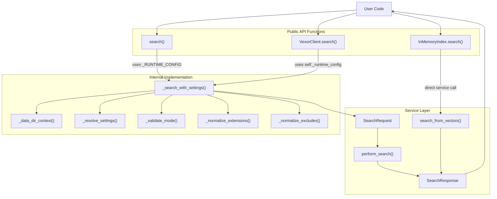
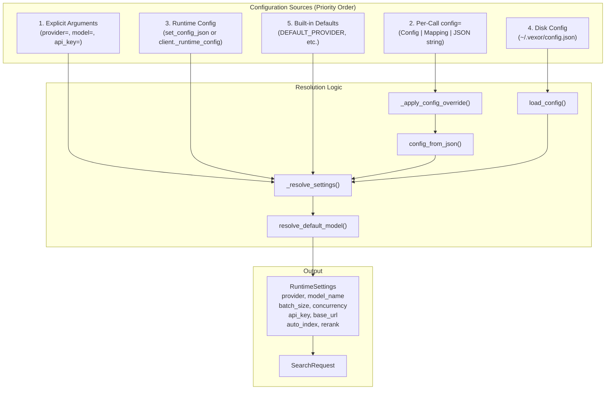
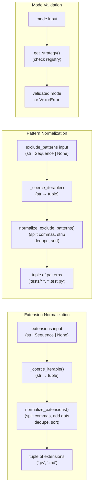

<!-- source: DeepWiki mcp.deepwiki.com · repo scarletkc/vexor · page 5.2 Search Functions · fetched 2026-10-27 -->

# Search Functions

<details>
<summary>Relevant source files</summary>

The following files were used as context for generating this wiki page:

- [docs/api/python.md](docs/api/python.md)
- [plugins/vexor/.claude-plugin/plugin.json](plugins/vexor/.claude-plugin/plugin.json)
- [tests/unit/test_api.py](tests/unit/test_api.py)
- [tests/unit/test_search_service.py](tests/unit/test_search_service.py)
- [vexor/__init__.py](vexor/__init__.py)
- [vexor/api.py](vexor/api.py)
- [vexor/services/search_service.py](vexor/services/search_service.py)

</details>


This page documents the search functions in Vexor's Python API. These functions perform semantic search operations over indexed files and return ranked results.

For general API design and configuration precedence, see [API Overview](#5.1). For building indices before searching, see [Index Functions](#5.3). For session-based API usage, see [VexorClient Class](#5.4). For in-memory search without disk persistence, see [InMemoryIndex](#5.6).

---

## Function Variants

Vexor provides three search function variants depending on the usage pattern:

| Function | Context | Typical Use Case |
|----------|---------|------------------|
| `search()` | Standalone | Quick scripts, one-off searches |
| `VexorClient.search()` | Instance method | Library integration, scoped configuration |
| `InMemoryIndex.search()` | Instance method | Searching pre-built in-memory indices |

Sources: [vexor/api.py:501-559](), [vexor/api.py:264-328](), [vexor/api.py:89-158]()

---

## Search Function Relationships



**Search Function Call Hierarchy**: The standalone `search()` and `VexorClient.search()` both funnel through `_search_with_settings()`, which handles parameter normalization and creates a `SearchRequest`. The `InMemoryIndex.search()` method constructs its own request and calls `search_from_vectors()` directly since it already has vectors loaded.

Sources: [vexor/api.py:501-782](), [vexor/api.py:264-328](), [vexor/api.py:89-158]()

---

## search()

```python
def search(
    query: str,
    *,
    path: Path | str = Path.cwd(),
    top: int = 5,
    include_hidden: bool = False,
    respect_gitignore: bool = True,
    mode: str = "auto",
    recursive: bool = True,
    extensions: Sequence[str] | str | None = None,
    exclude_patterns: Sequence[str] | str | None = None,
    provider: str | None = None,
    model: str | None = None,
    batch_size: int | None = None,
    embed_concurrency: int | None = None,
    extract_concurrency: int | None = None,
    extract_backend: str | None = None,
    base_url: str | None = None,
    api_key: str | None = None,
    local_cuda: bool | None = None,
    auto_index: bool | None = None,
    use_config: bool = True,
    config: Config | Mapping[str, object] | str | None = None,
    temporary_index: bool = False,
    no_cache: bool = False,
    data_dir: Path | str | None = None,
    config_dir: Path | str | None = None,
    cache_dir: Path | str | None = None,
) -> SearchResponse
```

Performs semantic search and returns ranked results. This is the standalone function for quick usage without managing a client instance.

### Parameters

#### Core Parameters

| Parameter | Type | Default | Description |
|-----------|------|---------|-------------|
| `query` | `str` | *required* | Search query text (whitespace-only raises `VexorError`) |
| `path` | `Path \| str` | `Path.cwd()` | Root directory to search |
| `top` | `int` | `5` | Number of results to return (must be positive) |
| `mode` | `str` | `"auto"` | Indexing mode: `auto`, `name`, `head`, `brief`, `code`, `outline`, `full` |

#### File Filtering Parameters

| Parameter | Type | Default | Description |
|-----------|------|---------|-------------|
| `include_hidden` | `bool` | `False` | Include hidden files and directories |
| `respect_gitignore` | `bool` | `True` | Respect `.gitignore` rules |
| `recursive` | `bool` | `True` | Recursively scan subdirectories |
| `extensions` | `Sequence[str] \| str \| None` | `None` | File extensions to include (e.g., `".py"` or `[".py", ".md"]`) |
| `exclude_patterns` | `Sequence[str] \| str \| None` | `None` | Patterns to exclude (pathspec format) |

#### Provider and Embedding Parameters

| Parameter | Type | Default | Description |
|-----------|------|---------|-------------|
| `provider` | `str \| None` | `None` | Embedding provider: `openai`, `gemini`, `custom`, `local` |
| `model` | `str \| None` | `None` | Model name (provider-specific) |
| `batch_size` | `int \| None` | `None` | Batch size for embedding requests |
| `embed_concurrency` | `int \| None` | `None` | Concurrent embedding requests |
| `extract_concurrency` | `int \| None` | `None` | Concurrent file extraction operations |
| `extract_backend` | `str \| None` | `None` | Extraction backend: `auto`, `thread`, `process` |
| `base_url` | `str \| None` | `None` | Base URL for custom/OpenAI providers |
| `api_key` | `str \| None` | `None` | API key for provider authentication |
| `local_cuda` | `bool \| None` | `None` | Use CUDA for local embeddings |

#### Configuration Parameters

| Parameter | Type | Default | Description |
|-----------|------|---------|-------------|
| `use_config` | `bool` | `True` | Load configuration from `~/.vexor/config.json` |
| `config` | `Config \| Mapping \| str \| None` | `None` | Per-call configuration override (dict or JSON string) |
| `auto_index` | `bool \| None` | `None` | Automatically build/refresh index if missing or stale |

#### Cache Control Parameters

| Parameter | Type | Default | Description |
|-----------|------|---------|-------------|
| `temporary_index` | `bool` | `False` | Build index in memory without cache read/write |
| `no_cache` | `bool` | `False` | Disable all disk caches (index + embedding + query) |

#### Directory Override Parameters

| Parameter | Type | Default | Description |
|-----------|------|---------|-------------|
| `data_dir` | `Path \| str \| None` | `None` | Override base directory for all data |
| `config_dir` | `Path \| str \| None` | `None` | Override configuration directory |
| `cache_dir` | `Path \| str \| None` | `None` | Override cache directory |

### Return Value

Returns a `SearchResponse` object with the following attributes:

| Attribute | Type | Description |
|-----------|------|-------------|
| `results` | `list[SearchResult]` | Ranked search results |
| `backend` | `str \| None` | Backend description (e.g., `"openai/text-embedding-3-small"`) |
| `is_stale` | `bool` | Whether the index is stale |
| `index_empty` | `bool` | Whether no files were indexed |
| `reranker` | `str \| None` | Reranker used (e.g., `"bm25"`, `"flashrank"`) |
| `base_path` | `Path` | Base directory that was searched |

Each `SearchResult` contains:

| Attribute | Type | Description |
|-----------|------|-------------|
| `path` | `Path` | File path (absolute) |
| `score` | `float` | Relevance score (0.0-1.0) |
| `preview` | `str \| None` | Text preview of the match |
| `chunk_index` | `int \| None` | Chunk index within file |
| `start_line` | `int \| None` | Starting line number |
| `end_line` | `int \| None` | Ending line number |

### Exceptions

- `VexorError`: Raised for invalid input (empty query, negative `top`, invalid mode, empty extensions after normalization)
- May propagate exceptions from service layer (e.g., network errors, embedding provider failures)

### Examples

Basic search:
```python
from vexor import search

response = search("configuration loader", path="./src")
for result in response.results:
    print(f"{result.path}: {result.score:.3f}")
```

Search with filtering:
```python
response = search(
    "authentication logic",
    path="./src",
    mode="code",
    extensions=[".py", ".js"],
    exclude_patterns=["tests/**", "*.test.py"],
)
```

Search with provider override:
```python
response = search(
    "error handling",
    path="./src",
    provider="openai",
    model="text-embedding-3-large",
    api_key="sk-...",
)
```

Search with per-call config:
```python
response = search(
    "database queries",
    path="./src",
    config={
        "provider": "gemini",
        "api_key": "...",
        "rerank": "bm25",
    },
)
```

Sources: [vexor/api.py:501-559](), [vexor/api.py:694-782](), [tests/unit/test_api.py:11-65]()

---

## VexorClient.search()

```python
def search(
    self,
    query: str,
    *,
    path: Path | str = Path.cwd(),
    top: int = 5,
    include_hidden: bool = False,
    respect_gitignore: bool = True,
    mode: str = "auto",
    recursive: bool = True,
    extensions: Sequence[str] | str | None = None,
    exclude_patterns: Sequence[str] | str | None = None,
    provider: str | None = None,
    model: str | None = None,
    batch_size: int | None = None,
    embed_concurrency: int | None = None,
    extract_concurrency: int | None = None,
    extract_backend: str | None = None,
    base_url: str | None = None,
    api_key: str | None = None,
    local_cuda: bool | None = None,
    auto_index: bool | None = None,
    use_config: bool | None = None,
    config: Config | Mapping[str, object] | str | None = None,
    temporary_index: bool = False,
    no_cache: bool = False,
    data_dir: Path | str | None = None,
    config_dir: Path | str | None = None,
    cache_dir: Path | str | None = None,
) -> SearchResponse
```

Instance method for searching with client-scoped configuration. Parameters are identical to the standalone `search()` function, with these behavioral differences:

- `use_config` defaults to the client's `self.use_config` value if not specified
- `data_dir`, `config_dir`, and `cache_dir` default to the client's instance values if not specified
- Uses `self._runtime_config` instead of the global `_RUNTIME_CONFIG`

### Usage Pattern

```python
from vexor import VexorClient

client = VexorClient(data_dir="/tmp/vexor-cache")
client.set_config_json({"provider": "openai", "api_key": "sk-..."})

response = client.search("error handling", path="./src", mode="code")
```

For detailed client documentation, see [VexorClient Class](#5.4).

Sources: [vexor/api.py:264-328](), [vexor/api.py:205-251]()

---

## InMemoryIndex.search()

```python
def search(
    self,
    query: str,
    *,
    top: int = 5,
    rerank: str | None = None,
    flashrank_model: str | None = None,
    remote_rerank: RemoteRerankConfig | None = None,
    no_cache: bool = True,
) -> SearchResponse
```

Searches against a pre-built in-memory index without touching disk. This method is called on an `InMemoryIndex` object returned by `index_in_memory()`.

### Parameters

| Parameter | Type | Default | Description |
|-----------|------|---------|-------------|
| `query` | `str` | *required* | Search query text |
| `top` | `int` | `5` | Number of results to return |
| `rerank` | `str \| None` | `None` | Reranking strategy: `off`, `bm25`, `flashrank`, `remote` |
| `flashrank_model` | `str \| None` | `None` | FlashRank model name |
| `remote_rerank` | `RemoteRerankConfig \| None` | `None` | Remote reranker configuration |
| `no_cache` | `bool` | `True` | Disable embedding/query caches |

### Behavior

Unlike the other search functions, `InMemoryIndex.search()`:
- Does not accept `path`, `mode`, `extensions`, or other indexing parameters (these were set when building the index)
- Does not read or write index cache (vectors are already in memory)
- Constructs a `SearchRequest` from the index's stored metadata
- Calls `search_from_vectors()` directly instead of `perform_search()`
- Defaults to `no_cache=True` since the typical use case is ephemeral in-memory search

### Example

```python
from vexor import index_in_memory

# Build in-memory index
index = index_in_memory(path="./src", mode="code", extensions=[".py"])

# Search multiple times without disk I/O
response1 = index.search("authentication", top=10)
response2 = index.search("error handling", top=10, rerank="bm25")
```

For details on building in-memory indices, see [Index Functions](#5.3) and [InMemoryIndex](#5.6).

Sources: [vexor/api.py:89-158](), [vexor/api.py:72-87]()

---

## Configuration Resolution



**Configuration Precedence Flow**: The `_resolve_settings()` function implements a five-level precedence hierarchy. Explicit arguments (level 1) override all other sources. The `config` parameter (level 2) is merged with lower-priority sources via `_apply_config_override()`. Runtime config (level 3) is either the global `_RUNTIME_CONFIG` or client's `_runtime_config`. Disk config (level 4) is loaded only if `use_config=True`. Built-in defaults (level 5) fill any remaining gaps.

Sources: [vexor/api.py:1003-1065](), [vexor/api.py:1067-1076](), [vexor/config.py]()

---

## Search Execution Flow

```mermaid
graph TB
    SearchCall["search() call"]
    
    subgraph "Parameter Processing"
        ValidateQuery["Validate query<br/>(non-empty)"]
        ValidateTop["Validate top<br/>(positive integer)"]
        ValidateMode["_validate_mode()<br/>(check available_modes)"]
        NormalizeExt["_normalize_extensions()<br/>(split, dedupe, add dots)"]
        NormalizeExcl["_normalize_excludes()<br/>(split, dedupe)"]
        ResolveDir["resolve_directory()<br/>(to absolute Path)"]
    end
    
    subgraph "Configuration Resolution"
        ResolveSettings["_resolve_settings()"]
        RuntimeSettings["RuntimeSettings"]
    end
    
    subgraph "Request Construction"
        CreateRequest["Create SearchRequest<br/>(query, directory, mode<br/>top_k, model_name<br/>extensions, excludes<br/>provider, api_key, etc.)"]
    end
    
    subgraph "Service Layer"
        PerformSearch["perform_search()"]
        AutoIndex["Auto-index if enabled<br/>and cache missing/stale"]
        LoadVectors["Load vectors from cache<br/>or trigger indexing"]
        EmbedQuery["Embed query<br/>(with caching)"]
        CosineSim["Compute cosine similarity"]
        Rerank["Apply reranking<br/>(bm25/flashrank/remote)"]
        AssembleResponse["Assemble SearchResponse"]
    end
    
    SearchResponse["SearchResponse<br/>(results, backend<br/>is_stale, reranker)"]
    
    SearchCall --> ValidateQuery
    ValidateQuery --> ValidateTop
    ValidateTop --> ValidateMode
    ValidateMode --> NormalizeExt
    NormalizeExt --> NormalizeExcl
    NormalizeExcl --> ResolveDir
    ResolveDir --> ResolveSettings
    
    ResolveSettings --> RuntimeSettings
    RuntimeSettings --> CreateRequest
    
    CreateRequest --> PerformSearch
    PerformSearch --> AutoIndex
    AutoIndex --> LoadVectors
    LoadVectors --> EmbedQuery
    EmbedQuery --> CosineSim
    CosineSim --> Rerank
    Rerank --> AssembleResponse
    
    AssembleResponse --> SearchResponse
```



**Search Call to Response**: The search functions validate inputs, normalize parameters, resolve configuration, and construct a `SearchRequest`. The service layer (`perform_search()`) handles auto-indexing logic, loads vectors from cache or triggers indexing, embeds the query, computes cosine similarity, applies reranking, and assembles the final response.

Sources: [vexor/api.py:694-782](), [vexor/services/search_service.py]()

---

## Parameter Normalization



**Parameter Normalization Flow**: Extensions and exclude patterns accept flexible input types (string or sequence) and are normalized to sorted tuples. The `_coerce_iterable()` helper converts single strings to tuples. Extensions are split on commas, prefixed with dots if missing, and deduplicated. Exclude patterns are split on commas, stripped, and deduplicated. The mode is validated against `available_modes()` via `get_strategy()`.

Sources: [vexor/api.py:974-1001](), [vexor/utils.py](), [vexor/modes.py]()

---

## Internal Implementation Details

### _search_with_settings()

This internal function is the common implementation used by both `search()` and `VexorClient.search()`. It:

1. Wraps execution in `_data_dir_context()` to temporarily override config/cache directories if specified
2. Validates `query` (non-empty) and `top` (positive)
3. Resolves `path` to an absolute `Path` via `resolve_directory()`
4. Validates `mode` via `_validate_mode()`
5. Normalizes `extensions` and `exclude_patterns`
6. Calls `_resolve_settings()` to create a `RuntimeSettings` object
7. Constructs a `SearchRequest` with all normalized parameters
8. Calls `perform_search()` and returns the `SearchResponse`

Sources: [vexor/api.py:694-782]()

### _resolve_settings()

This function implements the configuration precedence hierarchy:

1. Determines base config:
   - If `use_config=True` and `runtime_config` is provided, use that
   - Else if `use_config=True`, load from disk via `load_config()`
   - Else use empty `Config()`
2. Applies `config_override` if provided via `_apply_config_override()`
3. For each setting, applies precedence: explicit argument → config → default
4. Calls `resolve_default_model()` to determine the model name based on provider
5. Returns a `RuntimeSettings` object with all resolved values

Sources: [vexor/api.py:1003-1065]()

### _data_dir_context()

Context manager that temporarily overrides `config_dir` and/or `cache_dir` for the duration of a function call. Uses `ExitStack` to manage nested contexts.

Sources: [vexor/api.py:164-182]()

---

## Cache Control

The search functions support three cache control modes:

| Mode | Index Cache | Embedding Cache | Query Cache | Use Case |
|------|-------------|-----------------|-------------|----------|
| Default | Read/Write | Read/Write | Read/Write | Normal usage |
| `temporary_index=True` | No Read/Write | Read/Write | Read/Write | Ephemeral search without index persistence |
| `no_cache=True` | No Read/Write | No Read/Write | No Read/Write | Testing, benchmarking, or cache bypass |

When `no_cache=False` (default), Vexor also maintains a process-local LRU cache (2048 entries) for recently-used embeddings, separate from the disk cache.

Sources: [vexor/api.py:501-559](), [vexor/services/search_service.py]()

---

## Error Handling

The search functions raise `VexorError` for input validation failures:

```python
from vexor import search, VexorError

try:
    response = search("", path="./src")  # Empty query
except VexorError as e:
    print(f"Invalid input: {e}")

try:
    response = search("query", path="./src", mode="invalid")
except VexorError as e:
    print(f"Unsupported mode: {e}")

try:
    response = search("query", path="./src", top=-1)
except VexorError as e:
    print(f"Invalid top value: {e}")
```

Service-layer exceptions (network errors, provider failures, etc.) propagate directly and are not wrapped in `VexorError`.

Sources: [vexor/api.py:51-52](), [vexor/api.py:694-782](), [tests/unit/test_api.py:240-248]()

---

