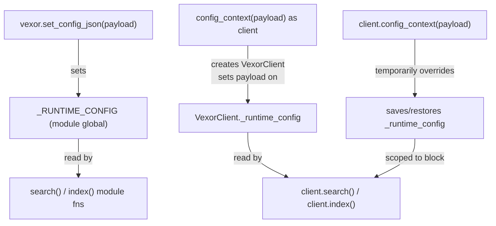
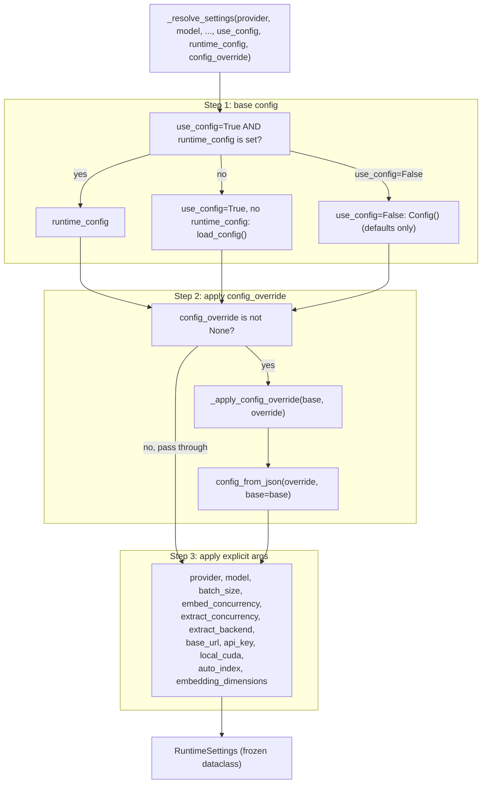
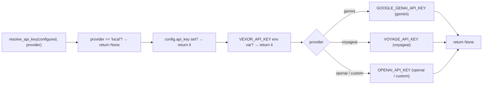
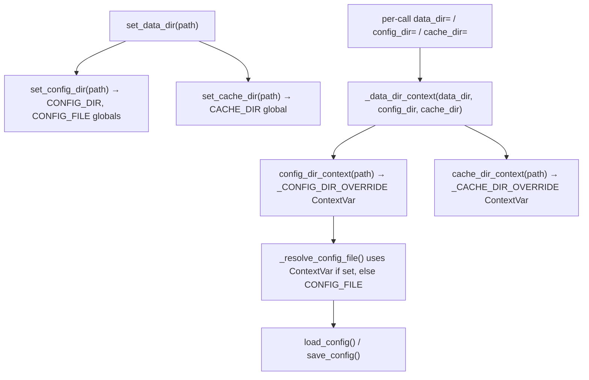

<!-- source: DeepWiki mcp.deepwiki.com · repo scarletkc/vexor · page 5.5 Configuration Management · fetched 2026-10-27 -->

# Configuration Management

<details>
<summary>Relevant source files</summary>

The following files were used as context for generating this wiki page:

- [docs/api/python.md](docs/api/python.md)
- [tests/unit/test_api.py](tests/unit/test_api.py)
- [vexor/api.py](vexor/api.py)
- [vexor/config.py](vexor/config.py)

</details>


This page documents how configuration is managed through the Python API: the `set_config_json`, `config_context`, and `set_data_dir` functions, how per-call `config` overrides work, and how all configuration sources are merged into a final `RuntimeSettings` object at call time.

For the underlying `Config` dataclass, `load_config`/`save_config`, and on-disk file format, see the architecture deep-dive at [7.7](#7.7). For `VexorClient` construction parameters and session scope, see [5.4](#5.4).

---

## Configuration Precedence

Every `search()`, `index()`, and `index_in_memory()` call resolves a `RuntimeSettings` object by merging sources in priority order. Higher-priority sources override lower ones.

**Configuration Resolution Order (highest to lowest)**

| Priority | Source | How it is supplied |
|----------|--------|--------------------|
| 1 | Explicit keyword arguments | `provider=`, `model=`, `api_key=`, etc. on the call |
| 2 | Per-call `config=` override | `config={...}` dict or JSON string passed to the function |
| 3 | In-memory runtime config | `set_config_json(...)` or `VexorClient._runtime_config` |
| 4 | Disk config (`config.json`) | `~/.vexor/config.json` (or overridden directory) |
| 5 | Built-in defaults | Constants in `vexor/config.py` (`DEFAULT_PROVIDER`, etc.) |

Disk config is skipped entirely when `use_config=False` is passed.

The resolution is performed by `_resolve_settings()` in [vexor/api.py:1029-1105]().

Sources: [vexor/api.py:1029-1105](), [docs/api/python.md:40-48]()

---

## `set_config_json` — Module-Level Runtime Config

```python
set_config_json(payload, *, replace=False)
```

Sets a process-wide in-memory config that applies to all subsequent module-level `search()`, `index()`, and `index_in_memory()` calls.

- **`payload`** — A `dict`, JSON string, or `None`. `None` clears the override.
- **`replace`** — If `False` (default), merges the payload on top of the current runtime config (or disk config if no runtime config is set). If `True`, starts from built-in defaults.
- Does **not** write to `config.json`.
- Raises `VexorError` if the payload cannot be parsed.

Internally stores the result in the module-level variable `_RUNTIME_CONFIG` in [vexor/api.py:165]().

**Example**

```python
import vexor

vexor.set_config_json({"provider": "gemini", "api_key": "KEY"})
response = vexor.search("query", path=".")
vexor.set_config_json(None)  # clear
```

`VexorClient` has an equivalent instance method `set_config_json` that stores to `self._runtime_config` instead of the module global [vexor/api.py:226-240]().

Sources: [vexor/api.py:165](), [vexor/api.py:194-206](), [vexor/api.py:226-240]()

---

## `config_context` — Scoped Config Override

Two forms are available: a module-level function and a `VexorClient` method.

### Module-Level `config_context`

```python
with config_context(payload, *, replace=False, data_dir=None, ...) as client:
    client.search(...)
```

Defined at [vexor/api.py:487-508](). Creates a `VexorClient`, applies `set_config_json(payload)` to it, yields the client, and clears the override on exit. The payload is scoped to the yielded client only — the module-level `_RUNTIME_CONFIG` is not touched.

### `VexorClient.config_context`

```python
with client.config_context({"provider": "gemini"}) as same_client:
    same_client.search(...)
```

Defined at [vexor/api.py:242-255](). Saves `self._runtime_config`, sets the new config via `set_config_json`, yields `self`, and restores the previous value.

**Comparison of mutation scope**

| Method | Scope | Mutates globals? |
|--------|-------|------------------|
| `set_config_json()` (module) | Process-wide, until cleared | Yes (`_RUNTIME_CONFIG`) |
| `config_context()` (module) | Block scope, isolated to yielded client | No |
| `client.set_config_json()` | Instance, until cleared | No |
| `client.config_context()` | Block scope, restores on exit | No |

**Scoping diagram**



Sources: [vexor/api.py:165](), [vexor/api.py:242-255](), [vexor/api.py:487-508]()

---

## `set_data_dir` — Persistent Directory Override

```python
set_data_dir(path)
```

Defined at [vexor/api.py:188-191](). Sets both the config directory and the cache directory to the same base path. This modifies the module-level globals `CONFIG_DIR` / `CONFIG_FILE` in `vexor/config.py` and `CACHE_DIR` in `vexor/cache.py`. The change persists until `set_data_dir(None)` is called (which resets to `~/.vexor`).

**Effect of `set_data_dir`**

| Module | Global mutated | Effect |
|--------|---------------|--------|
| `vexor/config.py` | `CONFIG_DIR`, `CONFIG_FILE` | `load_config()` and `save_config()` read/write from the new directory |
| `vexor/cache.py` | `CACHE_DIR` | SQLite `index.db` is opened under the new directory |

For temporary, scoped overrides, prefer the per-call `data_dir=` argument or `VexorClient(data_dir=...)` instead of `set_data_dir`. See [vexor/api.py:168-185]() for the context-manager equivalent (`_data_dir_context`) that is used internally.

Sources: [vexor/api.py:188-191](), [vexor/config.py:202-211]()

---

## Per-Call `config=` Override

Every `search()`, `index()`, and `index_in_memory()` call accepts a `config` parameter:

```python
vexor.search("query", path=".", config={"rerank": "bm25", "api_key": "KEY"})
```

- Accepts a `dict`, JSON string, or a `Config` instance.
- Applied on top of the resolved runtime/disk config for that call only.
- Does not persist anywhere.

Internally handled by `_apply_config_override()` at [vexor/api.py:1108-1117](), which calls `config_from_json()` from `vexor/config.py` with the current config as `base`.

---

## How Settings Are Resolved: `_resolve_settings`

All three resolution paths (module-level functions, `VexorClient` methods, per-call `config=`) converge into the private function `_resolve_settings()` at [vexor/api.py:1029-1105]().



The final `RuntimeSettings` object is a frozen dataclass defined at [vexor/api.py:56-72]().

Sources: [vexor/api.py:1029-1105](), [vexor/api.py:56-72](), [vexor/api.py:1108-1117]()

---

## Config Payload Schema

The `config=` parameter and `set_config_json()` accept a dict or JSON string with these fields. Unknown keys are silently ignored. Parsing is done by `_apply_config_payload()` in [vexor/config.py:549-591]().

| Field | Type | Default | Notes |
|-------|------|---------|-------|
| `provider` | string | `"openai"` | `openai`, `gemini`, `voyageai`, `custom`, `local` |
| `model` | string | `"text-embedding-3-small"` | Provider-specific model name |
| `api_key` | string \| null | `None` | Falls back to env vars (see below) |
| `base_url` | string \| null | `None` | API base URL override |
| `batch_size` | int | `64` | Embedding batch size |
| `embed_concurrency` | int | `4` | Parallel embedding requests |
| `extract_concurrency` | int | CPU-based | Parallel content extraction |
| `extract_backend` | string | `"auto"` | `auto`, `thread`, `process` |
| `embedding_dimensions` | int \| null | `None` | Only for models that support it |
| `auto_index` | bool | `true` | Auto-build index on search |
| `local_cuda` | bool | `false` | Use CUDA for local provider |
| `rerank` | string | `"off"` | `off`, `bm25`, `flashrank`, `remote` |
| `flashrank_model` | string \| null | `None` | FlashRank model name |
| `remote_rerank` | object | `None` | `{base_url, api_key, model}` |

`remote_rerank.base_url` is normalized to always end with `/rerank` by `normalize_remote_rerank_url()` in [vexor/config.py:375-394]().

Sources: [vexor/config.py:54-76](), [vexor/config.py:549-591](), [vexor/config.py:375-394](), [docs/api/python.md:122-140]()

---

## API Key Resolution

API keys are not strictly part of the config payload — they can also be supplied via environment variables. The resolution order is implemented in `resolve_api_key()` at [vexor/config.py:469-492]():



For the remote reranker, a separate function `resolve_remote_rerank_api_key()` checks `config.remote_rerank.api_key` first, then `VEXOR_REMOTE_RERANK_API_KEY` [vexor/config.py:495-503]().

Sources: [vexor/config.py:469-492](), [vexor/config.py:495-503]()

---

## Temporary vs. Persistent Config Directories

`set_data_dir()` makes a **permanent** (until reset) mutation to module globals. For isolated sessions — such as tests or multi-tenant library use — use either:

- **Per-call arguments**: `data_dir=`, `config_dir=`, `cache_dir=` on any API function. These are handled by `_data_dir_context()` [vexor/api.py:168-185]() using `ContextVar`-based overrides (`config_dir_context` [vexor/config.py:106-120]() and `cache_dir_context`).
- **`VexorClient` constructor**: Pass `data_dir=`, `config_dir=`, `cache_dir=` to the constructor [vexor/api.py:209-223](). These are merged with any per-call overrides inside `_resolve_dir_overrides()` [vexor/api.py:257-266]().

**Directory override mechanism**



The `ContextVar`-based overrides from `config_dir_context` [vexor/config.py:20-23]() take precedence over the module globals, so per-call and `VexorClient` directory overrides are safe for concurrent use.

Sources: [vexor/api.py:168-185](), [vexor/api.py:188-191](), [vexor/api.py:257-266](), [vexor/config.py:20-23](), [vexor/config.py:94-103](), [vexor/config.py:106-120]()

---

