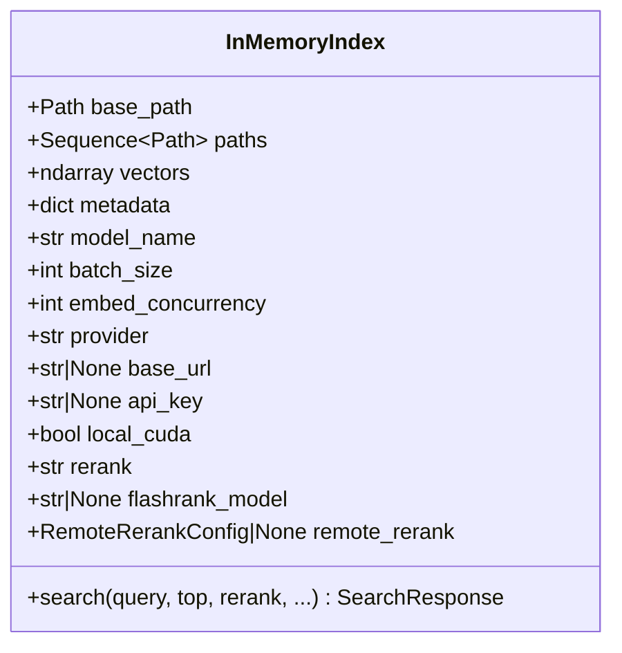
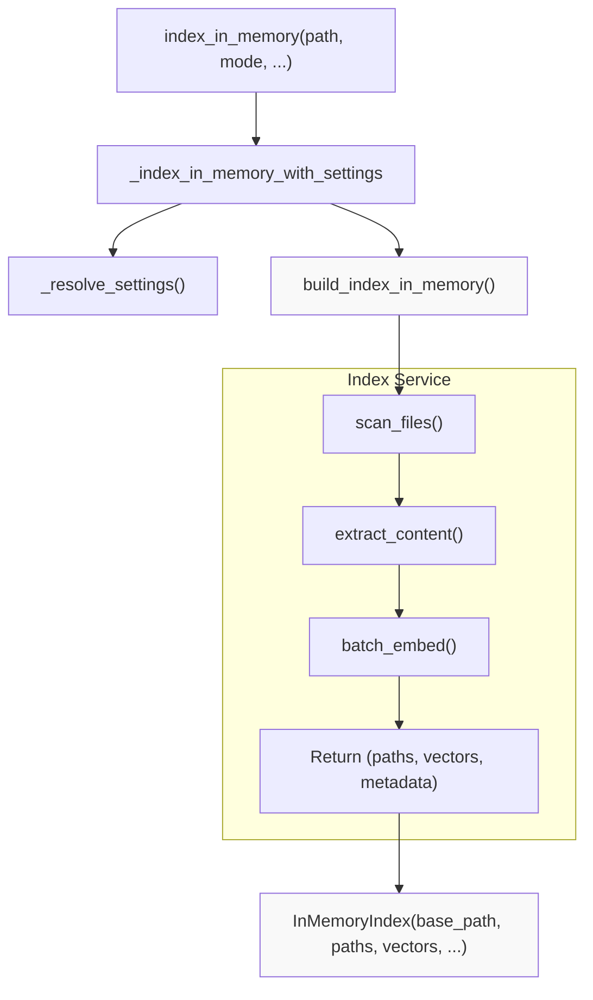
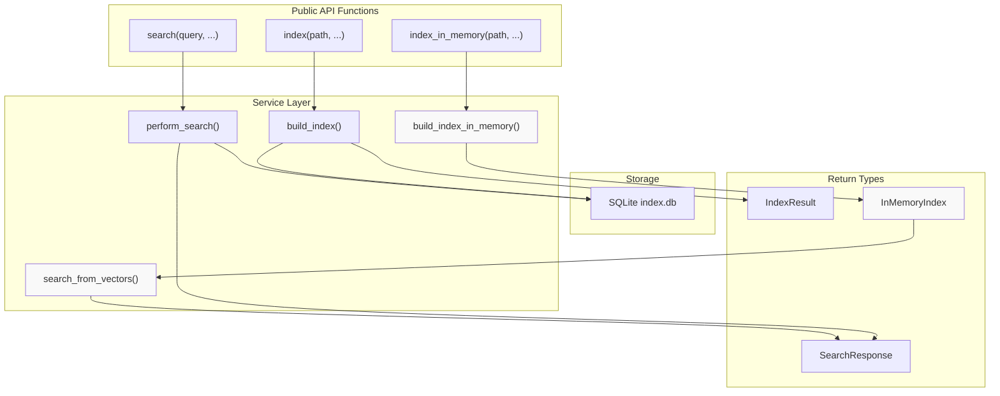

<!-- source: DeepWiki mcp.deepwiki.com · repo scarletkc/vexor · page 5.6 InMemoryIndex · fetched 2026-10-27 -->

# InMemoryIndex

<details>
<summary>Relevant source files</summary>

The following files were used as context for generating this wiki page:

- [docs/api/python.md](docs/api/python.md)
- [plugins/vexor/.claude-plugin/plugin.json](plugins/vexor/.claude-plugin/plugin.json)
- [tests/unit/test_api.py](tests/unit/test_api.py)
- [vexor/__init__.py](vexor/__init__.py)
- [vexor/api.py](vexor/api.py)

</details>


`InMemoryIndex` is a dataclass representing a complete semantic search index held entirely in memory. It enables temporary indexing workflows where index data is not persisted to disk, useful for one-off searches, testing, or scenarios where cache pollution is undesirable.

For information about disk-based persistent indexing, see [Index Functions](#5.3). For general search concepts, see [Search Functions](#5.2).

---

## Purpose and Scope

The `InMemoryIndex` class provides:

1. **Ephemeral indexing**: Build indexes without writing to the SQLite cache
2. **Direct search interface**: Search against pre-built vectors without cache lookups
3. **Reproducible searches**: Perform multiple searches against a fixed snapshot of files
4. **Test isolation**: Create independent index instances for testing without side effects

The class is returned by `index_in_memory()` and exposes a single `search()` method for querying the in-memory vectors.

**Sources**: [vexor/api.py:72-158](), [vexor/__init__.py:6]()

---

## Class Structure

### Fields



| Field | Type | Description |
|-------|------|-------------|
| `base_path` | `Path` | Root directory that was indexed |
| `paths` | `Sequence[Path]` | List of file paths in the index (one per chunk) |
| `vectors` | `np.ndarray` | Embedding vectors as a 2D numpy array (shape: `[n_chunks, dimension]`) |
| `metadata` | `dict` | Index configuration (mode, filters, chunk metadata) |
| `model_name` | `str` | Embedding model used to generate vectors |
| `batch_size` | `int` | Batch size for embedding operations |
| `embed_concurrency` | `int` | Concurrency limit for embedding requests |
| `provider` | `str` | Embedding provider (`openai`, `gemini`, `custom`, `local`) |
| `base_url` | `str \| None` | Custom API base URL |
| `api_key` | `str \| None` | API key for the provider |
| `local_cuda` | `bool` | Whether to use CUDA for local embeddings |
| `rerank` | `str` | Default reranking strategy (`off`, `bm25`, `flashrank`, `remote`) |
| `flashrank_model` | `str \| None` | FlashRank model name if using FlashRank reranking |
| `remote_rerank` | `RemoteRerankConfig \| None` | Remote reranking service configuration |

The `metadata` dictionary contains:
- `include_hidden`: Whether hidden files were included
- `respect_gitignore`: Whether gitignore rules were applied
- `mode`: Extraction mode used (`name`, `head`, `code`, etc.)
- `recursive`: Whether indexing was recursive
- `exclude_patterns`: Exclude patterns applied
- `extensions`: File extensions filter
- `chunks`: List of chunk metadata with `preview`, `chunk_index`, line numbers

**Sources**: [vexor/api.py:72-88]()

---

## Creation via index_in_memory()

The `InMemoryIndex` is instantiated by calling `index_in_memory()`, which performs the full indexing pipeline without writing to SQLite.

### Function Signature

```python
def index_in_memory(
    path: Path | str = Path.cwd(),
    *,
    include_hidden: bool = False,
    respect_gitignore: bool = True,
    mode: str = "auto",
    recursive: bool = True,
    extensions: Sequence[str] | str | None = None,
    exclude_patterns: Sequence[str] | str | None = None,
    provider: str | None = None,
    model: str | None = None,
    batch_size: int | None = None,
    embed_concurrency: int | None = None,
    extract_concurrency: int | None = None,
    extract_backend: str | None = None,
    base_url: str | None = None,
    api_key: str | None = None,
    local_cuda: bool | None = None,
    use_config: bool = True,
    config: Config | Mapping[str, object] | str | None = None,
    no_cache: bool = True,
    data_dir: Path | str | None = None,
    config_dir: Path | str | None = None,
    cache_dir: Path | str | None = None,
) -> InMemoryIndex
```

### Creation Pipeline



### Key Differences from Disk-Based Indexing

| Aspect | `index()` (Disk) | `index_in_memory()` (Memory) |
|--------|------------------|------------------------------|
| **SQLite write** | Yes, stores in `index.db` | No, vectors stay in RAM |
| **Cache key** | Generated and stored | Not applicable |
| **Staleness tracking** | File mtimes tracked | Not applicable |
| **Default `no_cache`** | `False` | `True` |
| **Incremental updates** | Supported via cache diff | Not supported |
| **Return type** | `IndexResult` | `InMemoryIndex` |

The `no_cache` parameter defaults to `True` for `index_in_memory()`, meaning even the embedding cache (separate from the index cache) is bypassed by default. This ensures complete isolation but may result in redundant embedding API calls if the same files are indexed multiple times.

**Sources**: [vexor/api.py:613-663](), [vexor/api.py:854-939](), [vexor/services/index_service.py:build_index_in_memory]()

---

## Search Method

The `InMemoryIndex.search()` method performs semantic search against the in-memory vectors.

### Method Signature

```python
def search(
    self,
    query: str,
    *,
    top: int = 5,
    rerank: str | None = None,
    flashrank_model: str | None = None,
    remote_rerank: RemoteRerankConfig | None = None,
    no_cache: bool = True,
) -> SearchResponse
```

### Parameters

| Parameter | Type | Default | Description |
|-----------|------|---------|-------------|
| `query` | `str` | (required) | Search query text |
| `top` | `int` | `5` | Number of results to return |
| `rerank` | `str \| None` | `None` | Override reranking strategy (`off`, `bm25`, `flashrank`, `remote`) |
| `flashrank_model` | `str \| None` | `None` | Override FlashRank model |
| `remote_rerank` | `RemoteRerankConfig \| None` | `None` | Override remote reranking config |
| `no_cache` | `bool` | `True` | Whether to bypass query/embedding caches |

### Search Execution Flow


### Implementation Details

The search method:

1. **Validates inputs**: Ensures query is non-empty and `top` is positive
2. **Reconstructs metadata**: Extracts filtering parameters from `self.metadata`
3. **Builds SearchRequest**: Creates a request object with all necessary settings
4. **Delegates to search_from_vectors()**: Calls the core search function with pre-built vectors

The key advantage is that `search_from_vectors()` bypasses all index loading logic, directly computing similarity against the provided vectors.

**Sources**: [vexor/api.py:89-158](), [vexor/services/search_service.py:search_from_vectors]()

---

## Workflow Patterns

### Basic Usage

```python
from vexor import index_in_memory

# Create in-memory index
index = index_in_memory(
    path="./src",
    mode="code",
    extensions=[".py", ".js"],
    no_cache=True
)

# Search multiple times against same snapshot
results1 = index.search("authentication logic", top=5)
results2 = index.search("database connection", top=10)
results3 = index.search("error handling", top=3, rerank="bm25")
```

### Testing Pattern

```python
import pytest
from vexor import index_in_memory

@pytest.fixture
def project_index(tmp_path):
    """Create isolated test index."""
    (tmp_path / "main.py").write_text("def authenticate(user): pass")
    (tmp_path / "db.py").write_text("def connect(): pass")
    
    return index_in_memory(
        path=tmp_path,
        mode="code",
        no_cache=True,
        use_config=False
    )

def test_search_finds_auth_function(project_index):
    response = project_index.search("user authentication")
    assert any("authenticate" in r.preview for r in response.results)
```

### Configuration Inheritance

The `InMemoryIndex` stores all embedding configuration at creation time. Subsequent searches reuse these settings unless explicitly overridden:

```python
# Index created with OpenAI embeddings
index = index_in_memory(
    path=".",
    provider="openai",
    model="text-embedding-3-large",
    api_key="sk-...",
    rerank="flashrank",
    flashrank_model="ms-marco-MultiBERT-L-12"
)

# Search uses OpenAI for query embedding
# and FlashRank for reranking
response = index.search("config loader")

# Override reranking only
response = index.search("config loader", rerank="bm25")
```

**Sources**: [docs/api/python.md:189-194](), [tests/unit/test_api.py:332-359]()

---

## Relationship to Other API Components



### Comparison Table

| Feature | `index()` + `search()` | `index_in_memory()` + `.search()` |
|---------|------------------------|-----------------------------------|
| **Persistence** | SQLite cache | RAM only |
| **Reusability** | Across processes | Single process only |
| **Memory overhead** | Low (vectors on disk) | High (vectors in RAM) |
| **Setup cost** | One-time (cached) | Per-instantiation |
| **Staleness** | Auto-detected | Not applicable |
| **Incremental updates** | Supported | Not supported |
| **Typical use case** | Production workflows | Testing, one-off searches |

**Sources**: [vexor/api.py:501-559](), [vexor/api.py:613-663](), [vexor/api.py:89-158]()

---

## Use Cases

### 1. Isolated Testing

```python
def test_mode_comparison(tmp_path):
    """Compare different extraction modes without cache pollution."""
    test_file = tmp_path / "module.py"
    test_file.write_text("class Parser:\n    def parse(self): pass")
    
    index_name = index_in_memory(tmp_path, mode="name", no_cache=True)
    index_code = index_in_memory(tmp_path, mode="code", no_cache=True)
    
    results_name = index_name.search("parser", top=1)
    results_code = index_code.search("parser", top=1)
    
    assert results_name.results[0].score != results_code.results[0].score
```

### 2. Ephemeral API Searches

```python
from flask import Flask, request, jsonify
from vexor import index_in_memory

app = Flask(__name__)

@app.route("/api/search")
def api_search():
    """Search uploaded code without persisting index."""
    repo_path = request.args.get("repo")
    query = request.args.get("query")
    
    # Build temporary index
    index = index_in_memory(repo_path, mode="auto", no_cache=True)
    response = index.search(query, top=10)
    
    return jsonify([
        {"path": str(r.path), "score": r.score}
        for r in response.results
    ])
```

### 3. Snapshot-Based Analysis

```python
from pathlib import Path
from vexor import index_in_memory

def analyze_codebase_evolution(repo_path: Path):
    """Compare search results across git commits."""
    import subprocess
    
    commits = ["HEAD~2", "HEAD~1", "HEAD"]
    snapshots = {}
    
    for commit in commits:
        subprocess.run(["git", "checkout", commit], cwd=repo_path)
        snapshots[commit] = index_in_memory(repo_path, mode="code")
    
    query = "authentication flow"
    for commit, index in snapshots.items():
        results = index.search(query, top=3)
        print(f"{commit}: {len(results.results)} relevant files")
```

**Sources**: [tests/unit/test_api.py:362-397](), [docs/api/python.md:189-194]()

---

## VexorClient Support

The `VexorClient` class also provides an `index_in_memory()` method that respects client-level configuration:

```python
from vexor import VexorClient

client = VexorClient(
    data_dir="/tmp/vexor",
    use_config=False
)
client.set_config_json({
    "provider": "local",
    "local_cuda": True,
    "rerank": "flashrank"
})

# Uses client's configuration
index = client.index_in_memory(
    path="./src",
    mode="code"
)

# Inherits local provider with CUDA and FlashRank reranking
response = index.search("database query", top=5)
```

The client method delegates to the same underlying `_index_in_memory_with_settings()` function but applies client-level configuration precedence.

**Sources**: [vexor/api.py:386-442](), [vexor/api.py:854-939]()

---

## Caching Behavior

Despite being "in-memory", the `InMemoryIndex` can still interact with embedding caches depending on the `no_cache` parameter:

| Cache Type | `no_cache=False` | `no_cache=True` (default) |
|------------|------------------|---------------------------|
| **Index cache** | Never used (not persistent) | Never used |
| **Embedding cache** | Used if available | Bypassed |
| **Query cache** | Used if available | Bypassed |

When `no_cache=False` during creation, the embedding cache can reduce API calls by reusing embeddings for previously indexed content. However, the resulting `InMemoryIndex` object itself is never written to or read from disk.

During searches, `no_cache` defaults to `True` in the `search()` method, bypassing query embedding caches. Set `no_cache=False` to reuse cached query embeddings across multiple search calls:

```python
index = index_in_memory(path=".", mode="code", no_cache=False)

# First call embeds query and caches it
response1 = index.search("authentication", no_cache=False)

# Second call reuses cached query embedding
response2 = index.search("authentication", no_cache=False)
```

**Sources**: [vexor/api.py:89-158](), [vexor/api.py:854-939]()

---

## Implementation Reference

### Key Files

- **Definition**: [vexor/api.py:72-158]()
- **Creation**: [vexor/api.py:613-663]() (`index_in_memory` function)
- **Creation Helper**: [vexor/api.py:854-939]() (`_index_in_memory_with_settings`)
- **Index Building**: [vexor/services/index_service.py:build_index_in_memory]()
- **Search Logic**: [vexor/services/search_service.py:search_from_vectors]()

### Related Types

- `SearchResponse`: [vexor/services/search_service.py]()
- `SearchRequest`: [vexor/services/search_service.py]()
- `RemoteRerankConfig`: [vexor/config.py]()
- `RuntimeSettings`: [vexor/api.py:55-70]()

**Sources**: [vexor/api.py:1-1077](), [vexor/__init__.py:1-39]()

---

