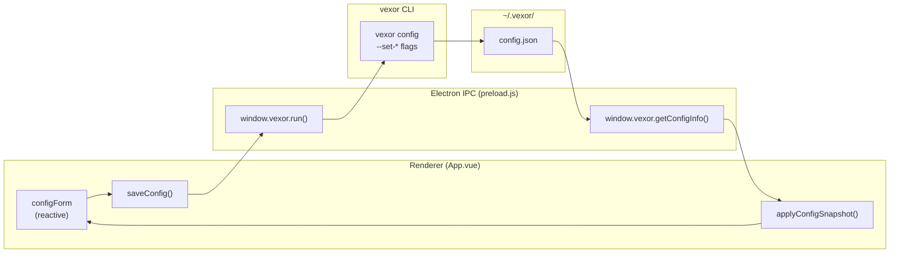
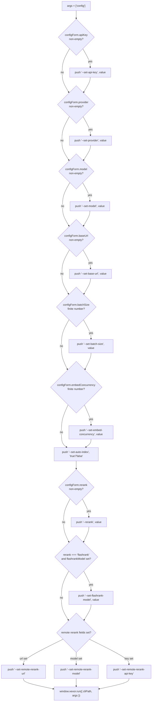
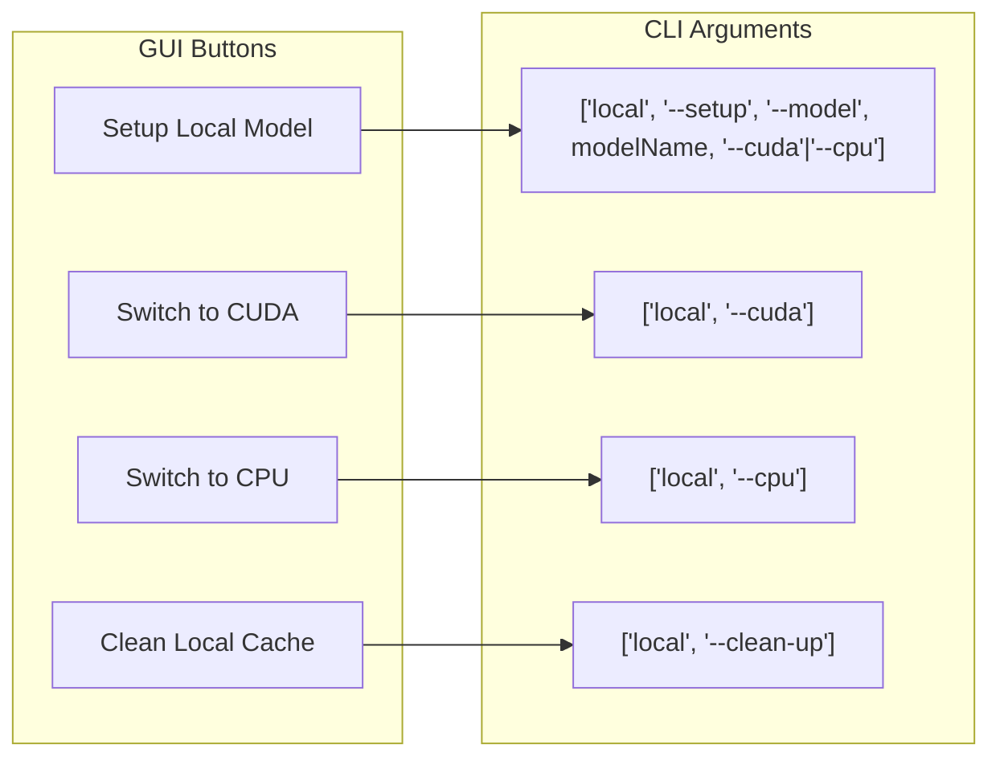
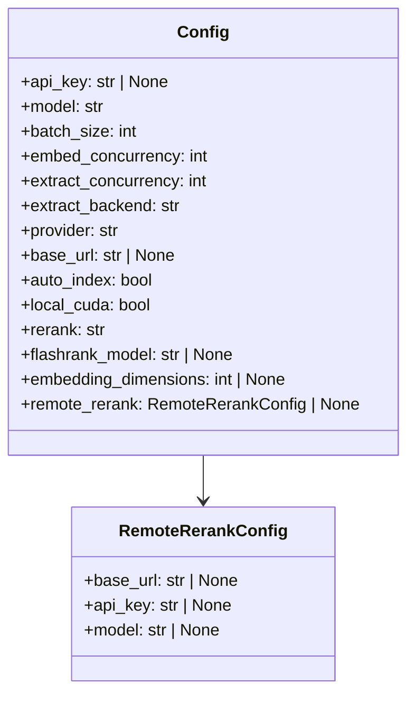

<!-- source: DeepWiki mcp.deepwiki.com · repo scarletkc/vexor · page 6.3 Configuration · fetched 2026-10-27 -->

# Configuration

Relevant source files

The following files were used as context for generating this wiki page:

- [gui/src/App.vue](gui/src/App.vue)

This page documents the **Config & Tools** tab of the Vexor desktop application. It covers which form fields map to which `vexor config` CLI flags, how `saveConfig()` assembles CLI invocations, and what each quick-tool button does.

For background on the underlying configuration data model (`Config` dataclass, `config.json` schema, and API key resolution), see [7.7](#7.7). For the full `vexor config` CLI reference, see [4.4](#4.4). For the desktop app interface overview, see [6.2](#6.2).

---

## How Configuration Works in the GUI

The desktop app does not write `config.json` directly. Instead, it constructs `vexor config` CLI invocations and delegates all writes to the CLI process. Reads are performed by loading the raw `config.json` file through the Electron main process and exposing it via `window.vexor.getConfigInfo()`.

**Configuration Tab — Data Flow**

Sources: [gui/src/App.vue:956-1002](), [gui/src/App.vue:763-793]()

---

## Core Config Section

The left card in the Config & Tools tab contains the primary embedding provider settings.

**Core Config Fields → CLI Flag Mapping**

| GUI Label | `configForm` field | CLI flag passed to `vexor config` | Config.py field |
|---|---|---|---|
| Provider | `configForm.provider` | `--set-provider` | `Config.provider` |
| Model | `configForm.model` | `--set-model` | `Config.model` |
| API Key | `configForm.apiKey` | `--set-api-key` | `Config.api_key` |
| Base URL | `configForm.baseUrl` | `--set-base-url` | `Config.base_url` |
| Batch Size | `configForm.batchSize` | `--set-batch-size` | `Config.batch_size` |
| Embed Concurrency | `configForm.embedConcurrency` | `--set-embed-concurrency` | `Config.embed_concurrency` |
| Auto Index | `configForm.autoIndex` | `--set-auto-index true\|false` | `Config.auto_index` |

Sources: [gui/src/App.vue:296-359](), [gui/src/App.vue:956-1002](), [vexor/config.py:62-76]()

### Provider Dropdown

The provider dropdown offers four options: `openai`, `gemini`, `custom`, `local`, plus an empty option labeled "(keep default)" which omits the flag entirely from the CLI call.

Sources: [gui/src/App.vue:307-315]()

### API Key Field

The API key field is typed `password` with `autocomplete="off"`. It is only appended to the CLI arguments if it contains a non-empty trimmed value. Leaving it blank does **not** clear the stored key — use the **Clear API key** quick-tool button for that.

Sources: [gui/src/App.vue:962-964]()

### CLI Path Field

The **CLI Path** field is stored in `localStorage` under the key `vexorCliPath` and is not written to `config.json`. It tells the GUI which binary to invoke. If the field is empty and a downloaded CLI exists, the downloaded binary takes priority.

Sources: [gui/src/App.vue:530](), [gui/src/App.vue:605-607]()

---

## saveConfig() — CLI Invocation Assembly

The `saveConfig()` function [gui/src/App.vue:956-1002]() builds an argument array starting with `"config"` and conditionally appends flags based on the current `configForm` state. It then calls `window.vexor.run({ cliPath, args })` and reloads the config on success.

**saveConfig() Argument Construction**

Sources: [gui/src/App.vue:956-1002]()

Note that `--set-auto-index` is **always** appended (not conditional), so saving the form always persists the current checkbox state.

---

## Rerank & Local Section

The right card contains reranking and local model configuration.

**Rerank & Local Fields → CLI Flag Mapping**

| GUI Label | `configForm` field | CLI flag | Config.py field |
|---|---|---|---|
| Rerank Mode | `configForm.rerank` | `--rerank` | `Config.rerank` |
| FlashRank Model | `configForm.flashrankModel` | `--set-flashrank-model` | `Config.flashrank_model` |
| Remote Rerank URL | `configForm.remoteRerankUrl` | `--set-remote-rerank-url` | `RemoteRerankConfig.base_url` |
| Remote Rerank Model | `configForm.remoteRerankModel` | `--set-remote-rerank-model` | `RemoteRerankConfig.model` |
| Remote Rerank API Key | `configForm.remoteRerankApiKey` | `--set-remote-rerank-api-key` | `RemoteRerankConfig.api_key` |

The **FlashRank Model** field only appears when `configForm.rerank === 'flashrank'`. The three **Remote Rerank** fields only appear when `configForm.rerank === 'remote'`.

Default values defined in `vexor/config.py`:

| Setting | Default constant | Value |
|---|---|---|
| `rerank` | `DEFAULT_RERANK` | `"off"` |
| `flashrank_model` | `DEFAULT_FLASHRANK_MODEL` | `"ms-marco-TinyBERT-L-2-v2"` |

Sources: [gui/src/App.vue:362-392](), [vexor/config.py:33-34]()

---

## Local Model Actions

The **Local Model Actions** subsection invokes `vexor local` subcommands.

**Local Model Action → CLI Invocation**

The model name for **Setup Local Model** is resolved from `localModel.value` if set, otherwise `configForm.model`, otherwise the string `"intfloat/multilingual-e5-small"` (which matches `DEFAULT_LOCAL_MODEL` in `vexor/config.py`). The `--cuda` or `--cpu` flag is appended based on `configForm.localCuda`.

Sources: [gui/src/App.vue:1020-1038](), [vexor/config.py:27]()

---

## Quick Tools

The Quick Tools block provides single-click shortcuts that each invoke `runConfigAction()`, which calls `window.vexor.run()` and refreshes the config display on completion.

**Quick Tool Buttons → CLI Invocations**

| Button Label | Function | CLI arguments |
|---|---|---|
| Run doctor | `runDoctor()` | `["doctor"]` |
| Show config | `showConfig()` | `["config", "--show"]` |
| Show index list | `showIndexAll()` | `["config", "--show-index-all"]` |
| Clear all indexes | `clearIndexAll()` | `["config", "--clear-index-all"]` |
| Clear FlashRank cache | `clearFlashrank()` | `["config", "--clear-flashrank"]` |
| Clear Base URL | `clearBaseUrl()` | `["config", "--clear-base-url"]` |
| Clear remote rerank | `clearRemoteRerank()` | `["config", "--clear-remote-rerank"]` |
| Clear API key | `clearApiKey()` | `["config", "--clear-api-key"]` |
| Init wizard | `openInitWizard()` | Runs `vexor init` in interactive modal |
| Show alias (vx) | `showAlias()` | `["alias"]` |
| Install skills | `openSkillsModal()` | Opens skills modal → `["install", "--skills", target]` |

Sources: [gui/src/App.vue:1040-1073](), [gui/src/App.vue:413-449]()

### Install Skills Modal

The **Install skills** button opens a modal with three options:

- **Install Target**: `auto`, `claude`, `codex`, or `custom` (free-text path)
- **Overwrite existing skill folder** checkbox (`--force` flag)

When confirmed, the target string and optional `--force` flag are assembled into `["install", "--skills", target]`.

Sources: [gui/src/App.vue:468-496](), [gui/src/App.vue:1162-1184]()

---

## Config Loading and Snapshot

On tab mount and after every `runConfigAction()` call, the GUI calls `loadConfig(true)`, which:

1. Calls `window.vexor.getConfigInfo()` to fetch the raw `config.json` contents.
2. Passes the result to `applyConfigSnapshot()`, which maps `config.json` keys to `configForm` fields.

**config.json key → configForm field mapping in applyConfigSnapshot()**

| `config.json` key | `configForm` field |
|---|---|
| `provider` | `configForm.provider` |
| `model` | `configForm.model` |
| `base_url` | `configForm.baseUrl` |
| `batch_size` | `configForm.batchSize` |
| `embed_concurrency` | `configForm.embedConcurrency` |
| `auto_index` | `configForm.autoIndex` |
| `rerank` | `configForm.rerank` |
| `flashrank_model` | `configForm.flashrankModel` |
| `local_cuda` | `configForm.localCuda` |
| `remote_rerank.base_url` | `configForm.remoteRerankUrl` |
| `remote_rerank.model` | `configForm.remoteRerankModel` |
| `remote_rerank.api_key` | `configForm.remoteRerankApiKey` |

Note that `api_key` is **not** read back into `configForm.apiKey`. This prevents an already-stored key from being displayed in the password field.

Sources: [gui/src/App.vue:763-793](), [vexor/config.py:123-148]()

---

## Underlying Config Data Model

The canonical storage for all settings is `~/.vexor/config.json`, managed by `load_config()` and `save_config()` in `vexor/config.py`. The GUI never writes this file directly — all writes go through the CLI.

**Config Dataclass Structure**

Sources: [vexor/config.py:54-76]()

The `extract_concurrency` and `extract_backend` fields exist in `Config` and `config.json` but have **no corresponding form fields** in the GUI's Config & Tools tab. They must be set via the CLI or Python API.

For information on `embedding_dimensions`, `extract_concurrency`, and `extract_backend` configuration through the CLI, see [4.4](#4.4). For the full configuration system internals including `ContextVar`-based overrides and API key resolution priority, see [7.7](#7.7).

---

