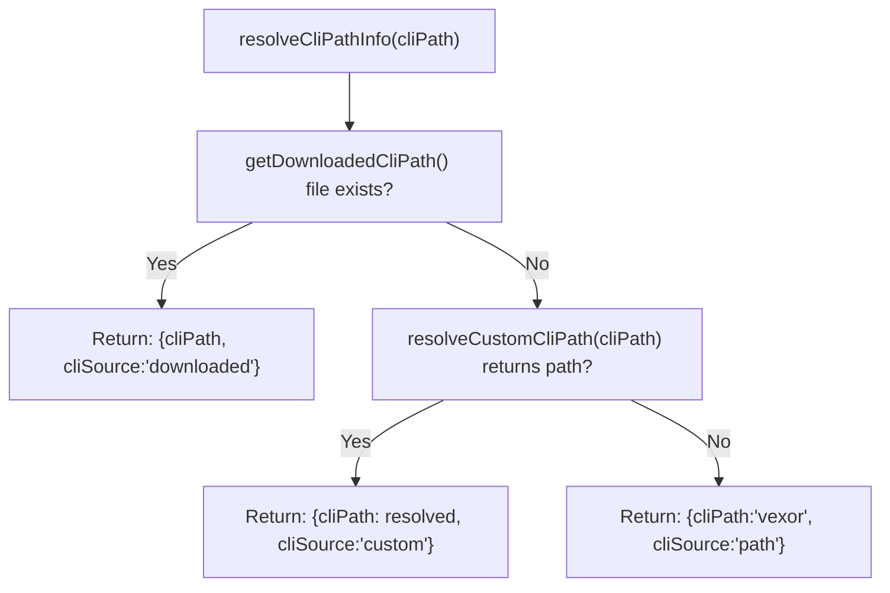
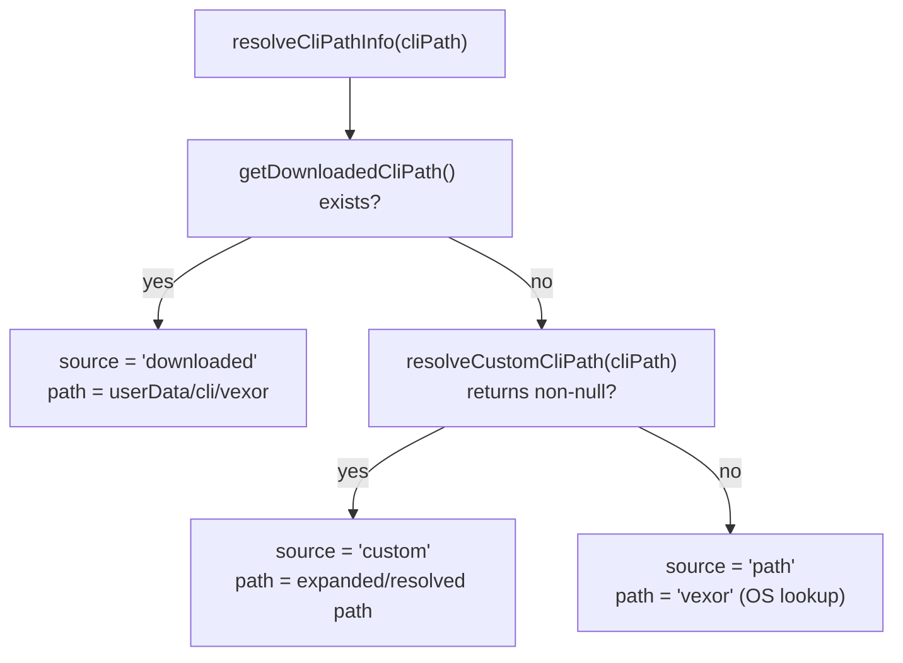
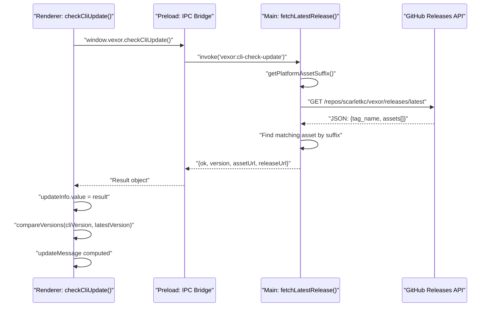
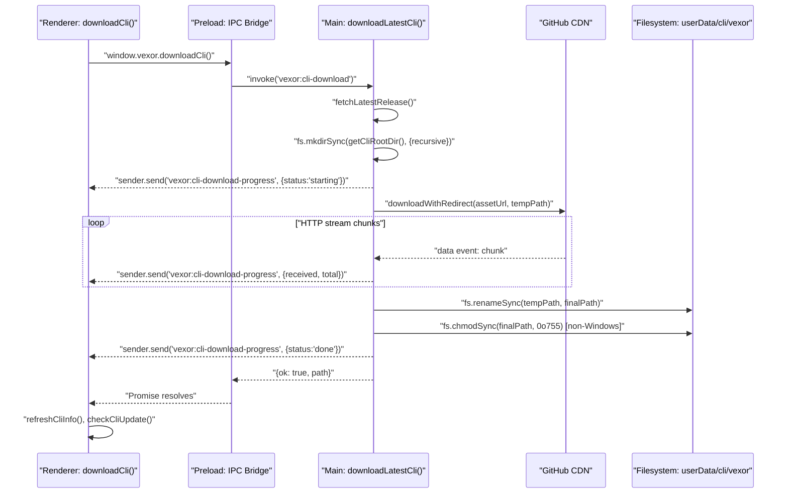
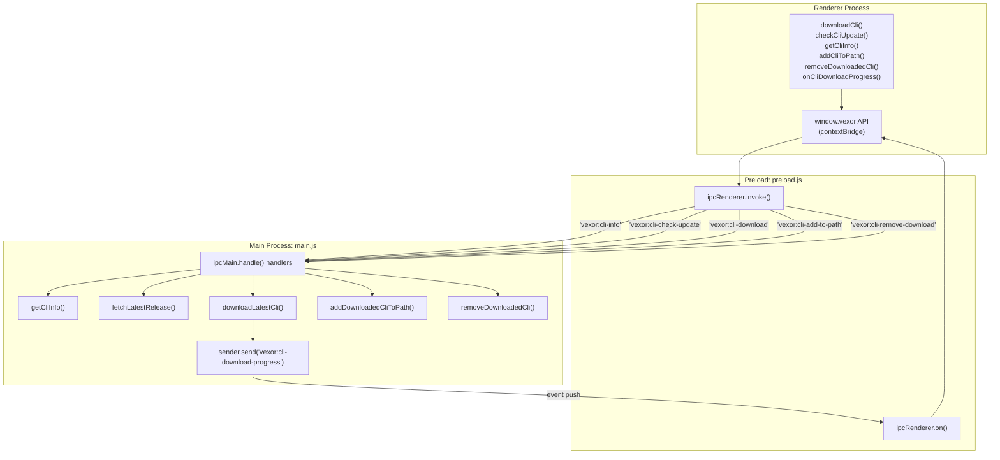
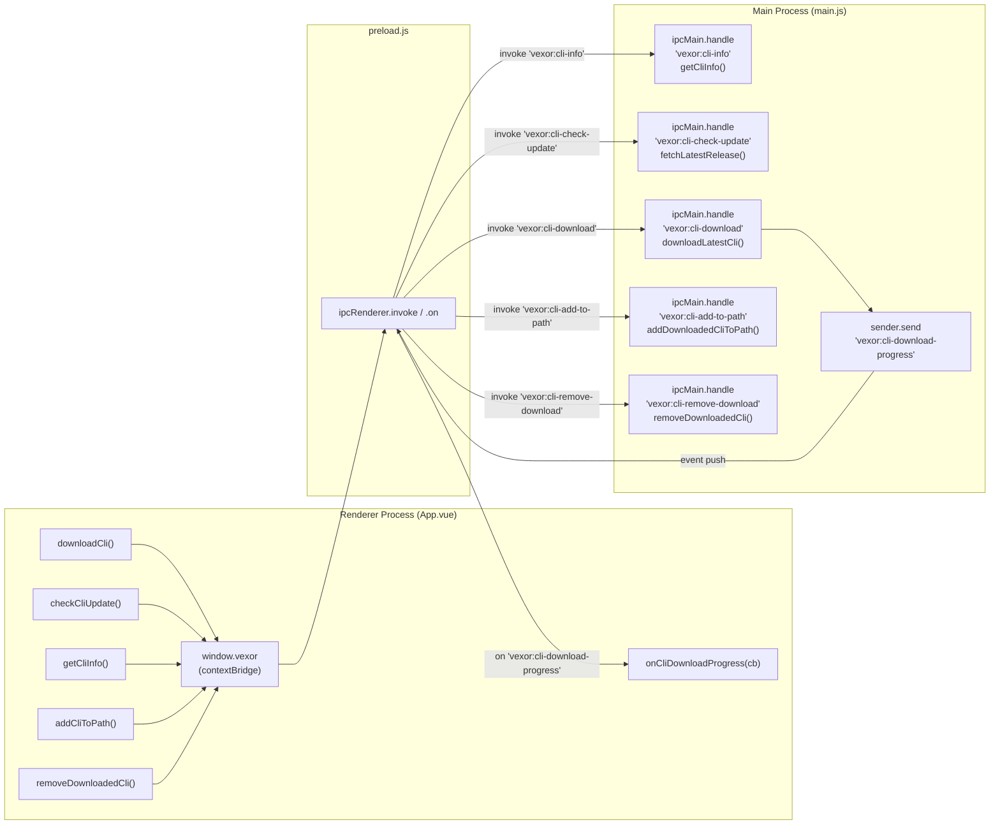

<!-- source: DeepWiki mcp.deepwiki.com · repo scarletkc/vexor · page 6.4 Updates and CLI Management · fetched 2026-10-27 -->

# Updates and CLI Management

Relevant source files

The following files were used as context for generating this wiki page:

- [gui/src/App.vue](gui/src/App.vue)

This page documents how the desktop application locates, downloads, updates, and manages the CLI binary. It covers the CLI resolution priority chain, GitHub release checking, the download pipeline with progress reporting, PATH modification, and the IPC bridge between renderer and main processes.

Related pages: [6.1](#6.1) for desktop app overview, [6.2](#6.2) for interface guide, [6.3](#6.3) for configuration.

---

## CLI Resolution

The desktop app does not bundle the CLI binary. It discovers or downloads it at runtime. All CLI invocations resolve the binary path through `resolveCliPathInfo()`.

**Resolution priority order:**

| Priority | Source | Condition | Resolved path |
|---|---|---|---|
| 1 | `"downloaded"` | `getDownloadedCliPath()` exists | `app.getPath("userData")/cli/vexor[.exe]` |
| 2 | `"custom"` | User-supplied `cliPath` is non-empty and resolvable | Result from `resolveCustomCliPath()` |
| 3 | `"path"` | Fallback | String `"vexor"` (OS resolves via `PATH` environment) |

The downloaded CLI always takes priority. The custom path (stored in `localStorage` as `vexorCliPath`) is only consulted when no downloaded binary exists. `resolveCustomCliPath()` supports tilde-prefixed home directory paths, absolute paths, relative paths, and bare command names.

The CLI root directory is `app.getPath("userData")/cli`. On Linux: `~/.config/Vexor Desktop/cli`. On Windows: `%APPDATA%\Vexor Desktop\cli`.
</thinking>

<old_str>
## CLI Info Query

The renderer invokes `window.vexor.getCliInfo({ cliPath })` on mount and after actions that modify CLI state. The main process handler `getCliInfo()` executes `vexor --version` via `runVexorCommand()`, parses the version string using `parseCliVersion()`, and returns an info object.

The returned object populates the `cliInfo` reactive object in the renderer:

| Field | Type | Description |
|---|---|---|
| `cliPath` | string | Resolved path to CLI binary |
| `cliSource` | string | One of: `"downloaded"`, `"custom"`, `"path"` |
| `cliAvailable` | boolean | `true` if `--version` succeeded with parseable version |
| `cliVersion` | string | Parsed version (e.g., `"0.9.2"`) |
| `downloadedDir` | string | Path to `app.getPath("userData")/cli` |
| `downloadedPath` | string | Full path to downloaded binary |
| `downloadedExists` | boolean | Whether downloaded binary file exists on disk |
| `downloadedInPath` | boolean | Whether `downloadedDir` is in system `PATH` |
| `appVersion` | string | Electron app version (GUI version) |

The `cliSourceLabel` computed property transforms `cliSource` values into labels displayed in the header status pill and Updates tab.

Sources: [gui/electron/main.js:181-190](), [gui/electron/main.js:192-214](), [gui/src/App.vue:533-543](), [gui/src/App.vue:621-635]()
</old_str>
<new_str>
**CLI Resolution Logic**

Sources: [gui/electron/main.js:56-58](), [gui/electron/main.js:72-90](), [gui/electron/main.js:92-102]()

**CLI Resolution Data Flow Diagram**

Sources: [gui/electron/main.js:56-106]()

---

## Update Check Flow

**Trigger:** User clicks "Check CLI Update" in the Updates tab, invoking `checkCliUpdate()`.

The main process handler for `vexor:cli-check-update` calls `fetchLatestRelease()`, which:

1. Determines platform asset suffix via `getPlatformAssetSuffix()`:
   - Windows → `"windows.exe"`
   - Linux → `"linux"`
   - macOS → Returns error (unsupported platform)
2. Fetches `https://api.github.com/repos/scarletkc/vexor/releases/latest` via `fetchJson()` with `User-Agent: vexor-desktop`
3. Constructs expected asset name: `vexor-{version}-{suffix}` (e.g., `vexor-0.9.2-linux`)
4. Returns `{ ok, version, tag, releaseUrl, assetName, assetUrl }`

The renderer stores results in `updateInfo` reactive object. The `updateMessage` computed property compares installed CLI version against latest GitHub version using `compareVersions()` and displays:

- `"CLI is up to date."` (versions match)
- `"Update available: v{latest}. Use Download CLI or open GitHub Releases."` (newer version available)
- `"Latest release: v{latest}. CLI not installed. Use Download CLI."` (CLI not found)
- Error message (check failed)

---

**Update Check Sequence**

Sources: [gui/electron/main.js:231-262](), [gui/electron/main.js:264-272](), [gui/electron/main.js:274-308](), [gui/electron/main.js:630-636](), [gui/src/App.vue:544-551](), [gui/src/App.vue:656-677](), [gui/src/App.vue:715-730](), [gui/src/App.vue:1076-1100]()

## CLI Download Pipeline

**Trigger:** User clicks "Download CLI", invoking `downloadCli()`.

The main process handler for `vexor:cli-download` executes `downloadLatestCli(sender)`:

1. Calls `fetchLatestRelease()` to obtain asset URL
2. Creates `userData/cli/` directory if it does not exist
3. Emits `vexor:cli-download-progress` with `{ status: "starting" }`
4. Calls `downloadWithRedirect()` to stream binary to temporary path `{destination}.download`
5. Atomically renames temporary file to final path
6. On non-Windows platforms, applies `chmod 0o755` to binary
7. Emits `vexor:cli-download-progress` with `{ status: "done" }`

`downloadWithRedirect()` follows HTTP 301/302/303/307/308 redirects recursively. This is required because GitHub asset URLs redirect to CDN URLs.

**Progress Reporting:** The `vexor:cli-download-progress` event is pushed from main to renderer. The renderer registers a listener via `window.vexor.onCliDownloadProgress` during `onMounted`. The `downloadInfo` reactive object tracks `{ inProgress, received, total, status }`. The `downloadProgressPercent` and `downloadProgressLabel` computed properties render progress bar and byte counter in Updates tab.

---

**Download Pipeline Sequence**

Sources: [gui/electron/main.js:310-359](), [gui/electron/main.js:361-387](), [gui/electron/main.js:638-644](), [gui/src/App.vue:552-557](), [gui/src/App.vue:642-654](), [gui/src/App.vue:1102-1118](), [gui/src/App.vue:1252-1257]()

## PATH Management

After downloading, `getCliRootDir()` may not be on system `PATH`. The Updates tab displays "Add Downloaded CLI to PATH" when `showAddToPath` is true (`downloadedExists && !downloadedInPath`).

### Adding to PATH

`addDownloadedCliToPath()` in main process implements platform-specific PATH modification:

| Platform | Mechanism | Function |
|---|---|---|
| Windows | Appends directory to User `PATH` via `setx PATH {updated}` | N/A |
| Linux | Appends export line to shell profile | `resolveProfilePath()`, `buildPathExportLine()` |
| macOS | Returns error (unsupported) | N/A |

On Linux, `resolveProfilePath()` selects profile file based on `$SHELL`:

| Shell (basename) | Profile file |
|---|---|
| `zsh` | `~/.zprofile` |
| `bash` | `~/.bashrc` |
| `fish` | `~/.config/fish/config.fish` |
| Other | `~/.profile` |

`buildPathExportLine()` generates shell-appropriate export:
- POSIX shells: `export PATH="$PATH:{dir}"`
- fish: `set -gx PATH $PATH "{dir}"`

All entries are preceded by `# Added by Vexor Desktop` marker comment.

The renderer invokes `window.vexor.addCliToPath()` and displays profile path in command log.

### Removing Downloaded CLI

Renderer function `removeDownloadedCli()` invokes `window.vexor.removeDownloadedCli()`. Main process handler:

1. Deletes binary file via `fs.unlinkSync()`
2. Removes `cli/` directory if empty
3. Removes marker block from profile (Linux) via `removePathFromProfile()`, or updates User `PATH` via `setx` (Windows) through `removePathFromWindows()`

Sources: [gui/electron/main.js:389-410](), [gui/electron/main.js:412-437](), [gui/electron/main.js:439-472](), [gui/electron/main.js:474-538](), [gui/electron/main.js:540-590](), [gui/src/App.vue:638-640](), [gui/src/App.vue:1120-1142](), [gui/src/App.vue:1144-1160]()

---

## IPC Bridge Reference

The IPC bridge connects Vue renderer to Electron main process through two files:

- **Preload:** [gui/electron/preload.js:1-33]() exposes `window.vexor` API via `contextBridge.exposeInMainWorld`
- **Main:** [gui/electron/main.js:592-744]() registers `ipcMain.handle` handlers in `app.whenReady()`

**CLI Management IPC Channels:**

| Renderer API | IPC Channel | Main Handler | Pattern |
|---|---|---|---|
| `getCliInfo(payload)` | `vexor:cli-info` | [gui/electron/main.js:626-628]() | invoke/handle |
| `checkCliUpdate()` | `vexor:cli-check-update` | [gui/electron/main.js:630-636]() | invoke/handle |
| `downloadCli()` | `vexor:cli-download` | [gui/electron/main.js:638-644]() | invoke/handle |
| `addCliToPath()` | `vexor:cli-add-to-path` | [gui/electron/main.js:646-652]() | invoke/handle |
| `removeDownloadedCli()` | `vexor:cli-remove-download` | [gui/electron/main.js:654-660]() | invoke/handle |
| `run(payload)` | `vexor:run` | [gui/electron/main.js:606-608]() | invoke/handle |
| `cancelRun()` | `vexor:run-cancel` | [gui/electron/main.js:610-624]() | invoke/handle |
| `onCliDownloadProgress(cb)` | `vexor:cli-download-progress` | (none, push only) | main→renderer event |

All invoke/handle pairs enforce `contextIsolation: true` security model. Renderer cannot access Node.js APIs directly.

---

**IPC Architecture**

Sources: [gui/electron/preload.js:1-33](), [gui/electron/main.js:592-744](), [gui/src/App.vue:1076-1160]()

**IPC Architecture Diagram**

Sources: [gui/electron/preload.js:1-33](), [gui/electron/main.js:592-744](), [gui/src/App.vue:1076-1160]()

---

## Running CLI Commands

All non-update CLI invocations (search, index, config, doctor, etc.) go through `runVexorCommand()` ([gui/electron/main.js:127-179]()), which:

- Spawns the resolved CLI binary using `child_process.spawn`.
- Sets `PYTHONIOENCODING=utf-8` and `PYTHONUTF8=1` in the child environment.
- Buffers `stdout` and `stderr` separately.
- Optionally tracks the child as `activeRunChild` for cancellation via `SIGINT` (`vexor:run-cancel` handler, [gui/electron/main.js:610-624]()).
- Returns `{ code, signal, stdout, stderr, error }`.

The renderer's `runAction()` ([gui/src/App.vue:894-940]()) builds CLI argument arrays and passes them to `window.vexor.run({ cliPath, args })`. For search operations, stdout is expected to be porcelain-format TSV and is parsed by `parsePorcelain()` ([gui/src/App.vue:858-878]()); for all other operations, the combined stderr/stdout is shown in the Command Log.

Sources: [gui/electron/main.js:127-179](), [gui/electron/main.js:606-624](), [gui/src/App.vue:858-940]()

---

