<!-- source: DeepWiki mcp.deepwiki.com · repo scarletkc/vexor · page 7.2 User Interface Layer · fetched 2026-10-27 -->

# User Interface Layer

<details>
<summary>Relevant source files</summary>

The following files were used as context for generating this wiki page:

- [docs/api/python.md](docs/api/python.md)
- [gui/src/App.vue](gui/src/App.vue)
- [tests/unit/test_api.py](tests/unit/test_api.py)
- [vexor/api.py](vexor/api.py)
- [vexor/cli.py](vexor/cli.py)

</details>


This document describes the architecture of Vexor's three user-facing interfaces: the CLI, Python API, and Desktop GUI. It covers how each interface is structured, how they resolve configuration, and how they delegate operations to the service layer. For detailed usage documentation of these interfaces, see [CLI Reference](#4), [Python API Reference](#5), and [Desktop Application](#6). For information about the service layer that these interfaces delegate to, see [Service Layer](#7.3).

## Overview

Vexor provides three distinct entry points that all delegate to a shared service layer:

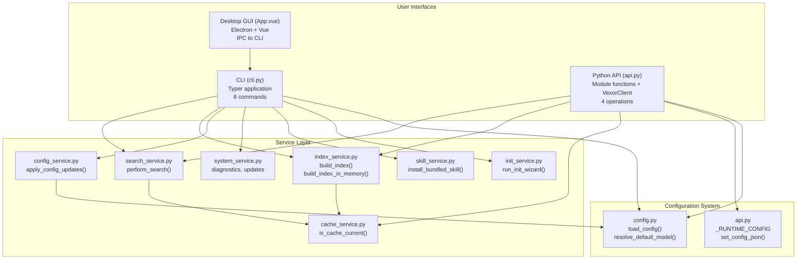

**Sources:** [vexor/cli.py:1-155](), [vexor/api.py:1-56](), [gui/src/App.vue:1-40]()

## CLI Architecture

The CLI is implemented using Typer and provides eight commands that directly invoke service layer functions. The architecture uses a custom command resolver that treats unknown subcommands as search queries.

### Command Routing

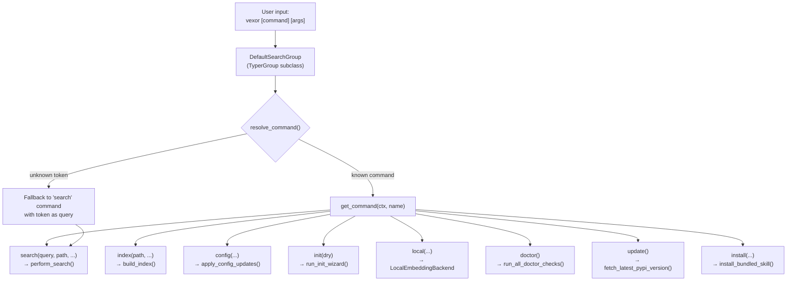

The `DefaultSearchGroup` class overrides `resolve_command()` to catch unknown subcommands and route them to the search command. This allows users to type `vexor "search query"` instead of `vexor search "search query"`.

**Sources:** [vexor/cli.py:115-147](), [vexor/cli.py:149-154]()

### CLI Command Structure

Each CLI command follows a consistent pattern:

| Command | Function | Service Delegation | Configuration |
|---------|----------|-------------------|---------------|
| `search` | [cli.py:348-529]() | `perform_search(SearchRequest)` | `load_config()` |
| `index` | [cli.py:531-711]() | `build_index()` | `load_config()` |
| `config` | [cli.py:725-1161]() | `apply_config_updates()` | Direct file I/O |
| `init` | [cli.py:713-722]() | `run_init_wizard()` | Writes config |
| `local` | [cli.py:1163-1297]() | `LocalEmbeddingBackend` methods | `load_config()` |
| `doctor` | [cli.py:1299-1337]() | `run_all_doctor_checks()` | `load_config()` |
| `update` | [cli.py:1339-1425]() | `fetch_latest_pypi_version()`, `run_upgrade_commands()` | None |
| `install` | [cli.py:1427-1503]() | `install_bundled_skill()` | None |

### Command Execution Flow

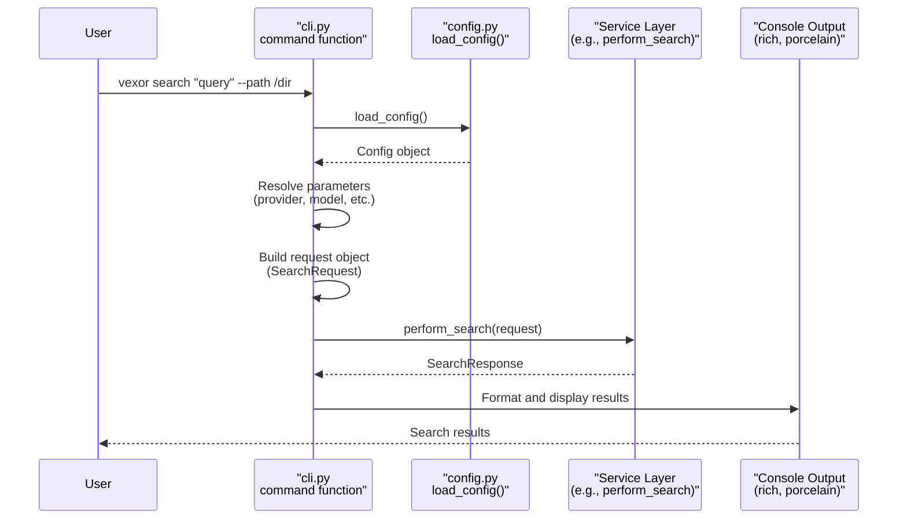

All CLI commands:
1. Load configuration from `~/.vexor/config.json` using `load_config()`
2. Parse command-line arguments using Typer
3. Merge configuration with CLI flags (CLI flags take precedence)
4. Construct request/parameter objects
5. Delegate to service layer functions
6. Format and display results using Rich Console or porcelain formats

**Sources:** [vexor/cli.py:348-529](), [vexor/cli.py:404-462](), [vexor/cli.py:488-501]()

## Python API Architecture

The Python API implements a three-layer architecture that separates public interface, preprocessing, and service delegation.

### API Layers

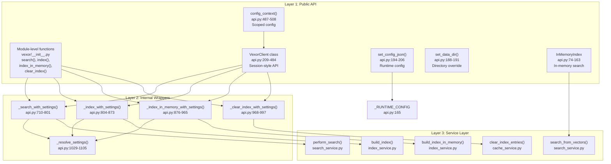

**Sources:** [vexor/api.py:1-56](), [vexor/api.py:209-484](), [vexor/api.py:511-707]()

### Layer 1: Public API

The public API is exposed through module-level functions and classes. Users can import and call these directly:

```python
# Module-level functions (vexor/__init__.py)
from vexor import search, index, index_in_memory, clear_index

# Session-style API (VexorClient)
from vexor import VexorClient

# Configuration utilities
from vexor import set_config_json, set_data_dir, config_context
```

The `VexorClient` class provides scoped configuration without mutating global state:

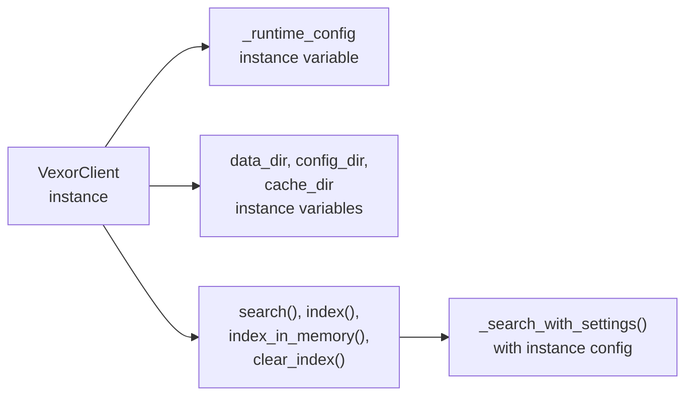

**Sources:** [vexor/api.py:209-267](), [vexor/api.py:268-334](), [vexor/api.py:487-508]()

### Layer 2: Internal Wrappers

Internal wrapper functions handle validation, normalization, and configuration resolution before delegating to services:

| Wrapper Function | Responsibilities | Service Delegation |
|------------------|------------------|-------------------|
| `_search_with_settings()` | Validate query, mode, extensions<br/>Resolve settings<br/>Build `SearchRequest` | `perform_search()` |
| `_index_with_settings()` | Validate mode, extensions<br/>Resolve settings<br/>Pass parameters | `build_index()` |
| `_index_in_memory_with_settings()` | Same as index<br/>Return `InMemoryIndex` | `build_index_in_memory()` |
| `_clear_index_with_settings()` | Validate mode, extensions<br/>Pass parameters | `clear_index_entries()` |

The `_data_dir_context()` context manager establishes directory overrides for the duration of an operation:

```python
with _data_dir_context(data_dir, config_dir=config_dir, cache_dir=cache_dir):
    # Operations here use overridden directories
    config = load_config()  # Reads from config_dir
    # Cache operations use cache_dir
```

**Sources:** [vexor/api.py:168-186](), [vexor/api.py:710-801](), [vexor/api.py:804-873]()

### Layer 3: Service Delegation

The wrapper functions construct appropriate request objects or parameter sets and delegate to service layer functions. The service layer has no knowledge of the API layer's configuration resolution logic.

**Sources:** [vexor/api.py:774-801](), [vexor/api.py:855-873]()

### InMemoryIndex Class

The `InMemoryIndex` class provides a specialized interface for temporary indexes:

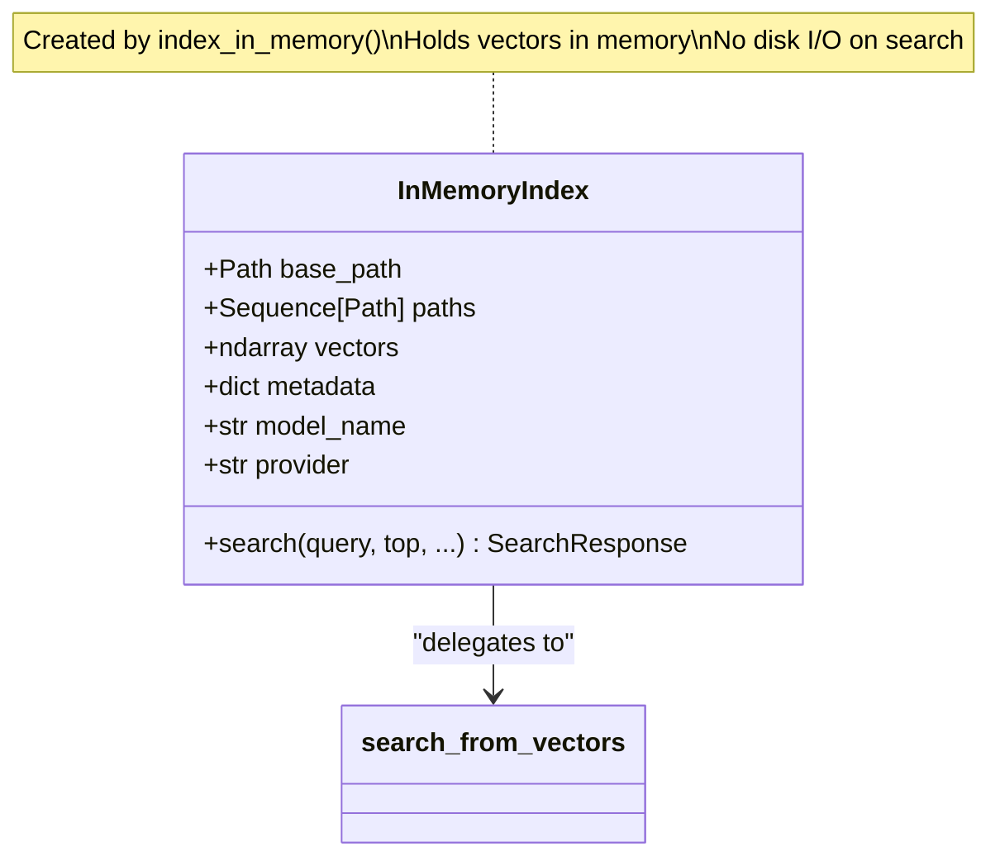

The `search()` method on `InMemoryIndex` constructs a `SearchRequest` from stored metadata and delegates to `search_from_vectors()`, bypassing cache operations entirely.

**Sources:** [vexor/api.py:74-163](), [vexor/api.py:92-162]()

## Desktop GUI Architecture

The Desktop GUI is an Electron application built with Vue that provides a graphical interface to Vexor's functionality. Unlike the CLI and Python API, the GUI does not directly call service functions—instead, it invokes the CLI as a subprocess.

### GUI to CLI Communication

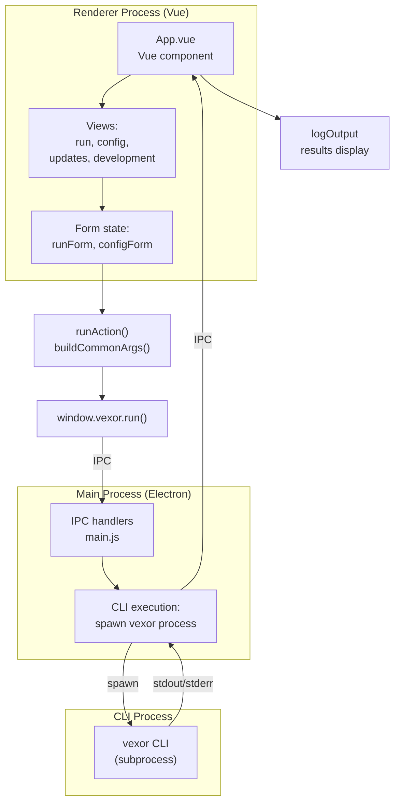

**Sources:** [gui/src/App.vue:1-100](), [gui/src/App.vue:894-940]()

### GUI View Structure

The GUI organizes functionality into four views:

| View | Purpose | Key Components |
|------|---------|----------------|
| `run` | Execute search/index | `runMode` (search/index)<br/>`runForm` (parameters)<br/>`results` (search results) |
| `config` | Manage configuration | `configForm` (provider, model, etc.)<br/>Quick tools (doctor, show config) |
| `updates` | CLI management | Download/remove CLI<br/>Check for updates<br/>Add to PATH |
| `development` | Debugging | DevTools access<br/>Window location |

Each view constructs CLI command arguments and invokes the CLI via IPC:

```javascript
// Example: Building search command
const args = ["search", runForm.query.trim(), "--format", "porcelain"];
args.push("--top", String(runForm.top || 5));
args.push(...buildCommonArgs());  // Add --path, --mode, --ext, etc.

const result = await window.vexor.run({ cliPath: cliPath.value, args });
```

**Sources:** [gui/src/App.vue:37-183](), [gui/src/App.vue:832-856](), [gui/src/App.vue:894-940]()

### GUI State Management

The GUI maintains reactive state using Vue's composition API:

| State Variable | Type | Purpose |
|----------------|------|---------|
| `runForm` | `reactive` | Search/index parameters |
| `configForm` | `reactive` | Configuration settings |
| `results` | `ref` | Parsed search results |
| `logOutput` | `ref` | Command output display |
| `cliInfo` | `reactive` | CLI version, path, availability |
| `configInfo` | `reactive` | Config file existence, contents |

The GUI parses porcelain output from search commands to display results in a table format.

**Sources:** [gui/src/App.vue:522-607](), [gui/src/App.vue:858-878]()

## Configuration Resolution

All three interfaces share a common configuration precedence system, though they implement it differently.

### Five-Tier Precedence

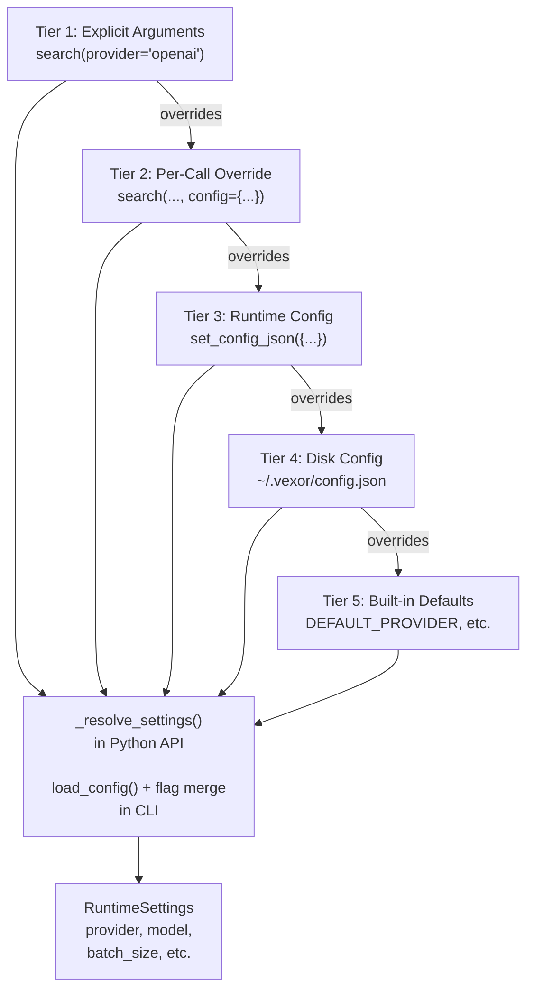

**Sources:** [vexor/api.py:1029-1105](), [vexor/cli.py:404-419]()

### Python API Configuration Resolution

The `_resolve_settings()` function implements the precedence hierarchy:

```python
def _resolve_settings(
    *,
    provider: str | None,          # Tier 1: Explicit argument
    model: str | None,
    # ... other parameters
    config_override: Config | Mapping | str | None,  # Tier 2: Per-call
    runtime_config: Config | None = None,           # Tier 3: Runtime
    use_config: bool,                               # Whether to load disk config
) -> RuntimeSettings:
    # Tier 3 or Tier 4
    config = runtime_config if (use_config and runtime_config) else None
    if config is None:
        config = load_config() if use_config else Config()  # Tier 4 or Tier 5
    
    # Apply Tier 2
    if config_override is not None:
        config = _apply_config_override(config, config_override)
    
    # Apply Tier 1 (explicit arguments override everything)
    provider_value = (provider or config.provider or DEFAULT_PROVIDER).lower()
    # ... resolve all settings
```

**Sources:** [vexor/api.py:1029-1105](), [vexor/api.py:1046-1060]()

### CLI Configuration Resolution

The CLI follows a simpler two-tier system:

1. Load disk config with `load_config()`
2. Command-line flags override config values

```python
config = load_config()
provider = (config.provider or DEFAULT_PROVIDER).lower()
model_name = resolve_default_model(provider, config.model)
batch_size = config.batch_size if config.batch_size is not None else DEFAULT_BATCH_SIZE
# ... use CLI flags if provided, otherwise use config values
```

**Sources:** [vexor/cli.py:404-419]()

### GUI Configuration

The GUI constructs CLI arguments from form state and invokes the CLI, which then performs standard CLI configuration resolution. The GUI maintains its own `configForm` state that it syncs with disk config via CLI commands:

```javascript
// Save config by invoking: vexor config --set-provider openai --set-api-key ...
const args = ["config"];
if (configForm.provider) args.push("--set-provider", configForm.provider);
if (configForm.apiKey.trim()) args.push("--set-api-key", configForm.apiKey.trim());
// ... build full command
const result = await window.vexor.run({ cliPath: cliPath.value, args });
```

**Sources:** [gui/src/App.vue:956-1002]()

## Delegation Patterns

All three interfaces follow similar delegation patterns to the service layer:

### Search Operation Delegation

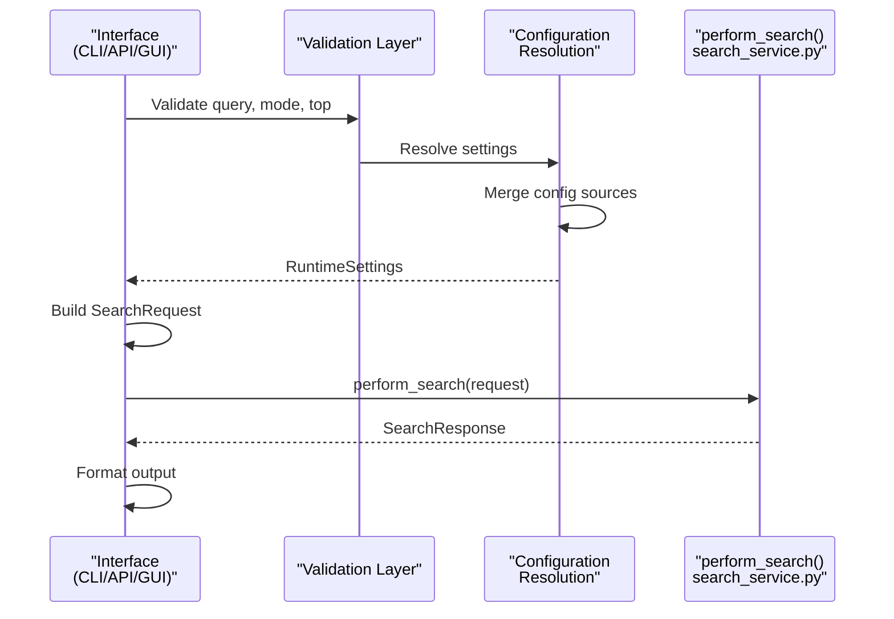

**Common steps across interfaces:**
1. Validate user input (query not empty, mode valid, positive integers)
2. Resolve configuration from multiple sources
3. Normalize extensions and exclude patterns
4. Construct `SearchRequest` object with all parameters
5. Delegate to `perform_search()`
6. Handle response and format output

**Sources:** [vexor/cli.py:421-501](), [vexor/api.py:741-801]()

### Index Operation Delegation

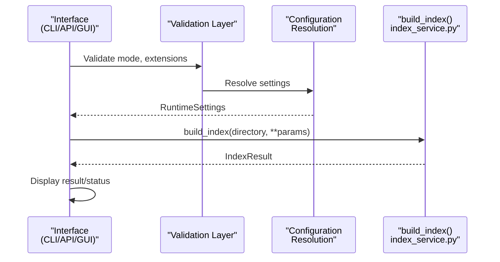

The index operation follows the same pattern but without needing to construct a request object—parameters are passed directly to `build_index()`.

**Sources:** [vexor/cli.py:677-710](), [vexor/api.py:855-873]()

### Configuration Management Delegation

Configuration management operations (via `vexor config` or `VexorClient.set_config_json()`) operate differently:

- **CLI**: Calls `apply_config_updates()` which directly modifies `config.json`
- **Python API**: Updates in-memory `_RUNTIME_CONFIG` or client-specific `_runtime_config` without touching disk

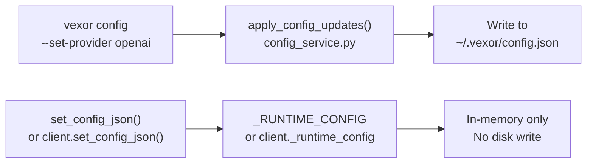

**Sources:** [vexor/cli.py:1035-1161](), [vexor/api.py:194-206](), [vexor/api.py:226-240]()

## Directory Override Contexts

The Python API supports per-operation directory overrides for config and cache locations through context managers:

```python
# Module-level function with directory overrides
search("query", data_dir="/tmp/vexor")

# VexorClient with instance-level directory overrides
client = VexorClient(data_dir="/tmp/vexor")

# Temporary directory override
with config_context({"provider": "openai"}, data_dir="/tmp/vexor") as client:
    client.search("query")
```

The `_data_dir_context()` context manager temporarily sets global directory variables:

```python
@contextmanager
def _data_dir_context(data_dir, *, config_dir, cache_dir):
    effective_config_dir = config_dir if config_dir is not None else data_dir
    effective_cache_dir = cache_dir if cache_dir is not None else data_dir
    with ExitStack() as stack:
        if effective_config_dir is not None:
            stack.enter_context(config_dir_context(effective_config_dir))
        if effective_cache_dir is not None:
            stack.enter_context(cache_dir_context(effective_cache_dir))
        yield
```

This allows operations to use alternate config/cache locations without permanently changing global state.

**Sources:** [vexor/api.py:168-186](), [vexor/api.py:741-801]()

## Summary

The User Interface Layer provides three distinct entry points with different design goals:

| Interface | Implementation | Delegation Pattern | Configuration Model |
|-----------|----------------|-------------------|---------------------|
| **CLI** | Typer + direct service calls | Command → service function | Disk config + CLI flags |
| **Python API** | Three-layer architecture | Public API → wrapper → service | Five-tier precedence |
| **Desktop GUI** | Electron/Vue + subprocess | Form → IPC → CLI → service | GUI form → CLI commands |

All interfaces share common characteristics:
- Validate input before service delegation
- Resolve configuration from multiple sources
- Construct appropriate request/parameter objects
- Delegate business logic to service layer
- Format output for their respective contexts

The layered architecture ensures separation of concerns: interfaces handle user interaction and configuration resolution, while services implement core functionality independent of interface details.

**Sources:** [vexor/cli.py:1-155](), [vexor/api.py:1-56](), [gui/src/App.vue:1-100]()

---

