<!-- source: DeepWiki mcp.deepwiki.com · repo scarletkc/vexor · page 7.6 Content Processing Pipeline · fetched 2026-10-27 -->

# Content Processing Pipeline

Relevant source files

The following files were used as context for generating this wiki page:

- [docs/roadmap.md](docs/roadmap.md)
- [tests/integration/test_cli.py](tests/integration/test_cli.py)
- [tests/unit/test_cache_upgrade_and_lines.py](tests/unit/test_cache_upgrade_and_lines.py)
- [tests/unit/test_index_service.py](tests/unit/test_index_service.py)

## Purpose and Scope

This document details the content processing pipeline that transforms raw files into searchable embeddings during index creation. The pipeline encompasses file collection, content extraction, parallel processing, and embedding generation. For information about how these embeddings are stored, see [Storage Layer](#7.4). For details on embedding provider implementations, see [Provider System](#7.5).

---

## Overview

The content processing pipeline executes during index creation (`vexor index` CLI command or `vexor.index()` API call) and consists of four main phases:

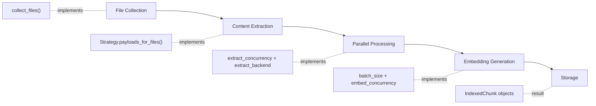

**Sources:** [vexor/services/index_service.py](), [vexor/utils.py](), [vexor/modes.py]()

---

## File Collection Phase

The pipeline begins by collecting files from the target directory using `collect_files()` from `vexor.utils`. This function applies multiple filters to determine which files should be indexed.

### Collection Parameters

| Parameter | Type | Purpose |
|-----------|------|---------|
| `recursive` | bool | Whether to scan subdirectories |
| `include_hidden` | bool | Whether to include hidden files (starting with `.`) |
| `respect_gitignore` | bool | Whether to honor `.gitignore` rules |
| `extensions` | tuple[str] | File extensions to include (e.g., `(".py", ".md")`) |
| `exclude_patterns` | list[str] | Glob patterns to exclude |

### Collection Logic

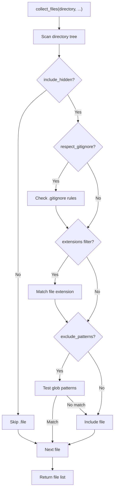

**Sources:** [vexor/utils.py](), [tests/integration/test_cli.py:382-413]()

---

## Content Extraction Phase

Once files are collected, the pipeline extracts content based on the selected indexing mode. Each mode uses a different extraction strategy to balance between indexing speed and search quality.

### Extraction Strategy Selection

The `get_strategy()` function in `vexor/modes.py` instantiates the appropriate strategy class based on the mode parameter:

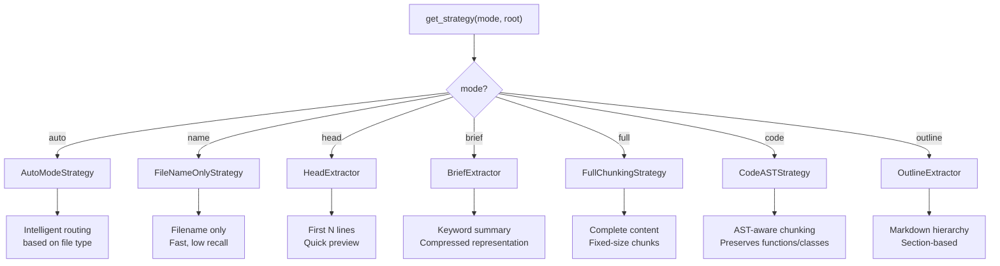

**Sources:** [vexor/modes.py](), [vexor/services/index_service.py]()

### Strategy Interface

All extraction strategies implement the `payloads_for_files()` method, which transforms a list of file paths into `IndexedChunk` objects:

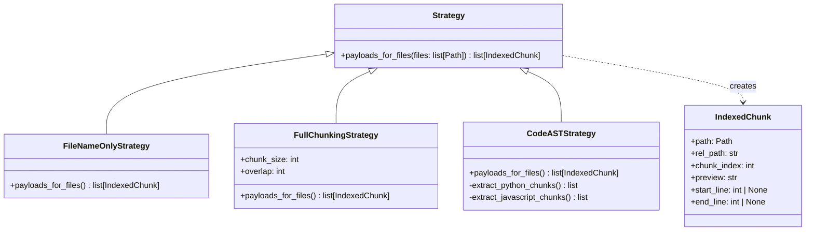

**Sources:** [vexor/modes.py](), [vexor/cache.py:IndexedChunk]()

### Mode-Specific Extraction

#### Name Mode
- **Implementation:** `FileNameOnlyStrategy.payloads_for_files()`
- **Behavior:** Creates one chunk per file containing only the filename
- **Use case:** Fastest indexing, suitable for file discovery by name
- **Chunks per file:** 1

#### Head Mode
- **Implementation:** `HeadExtractor.payloads_for_files()` via `extract_head()`
- **Behavior:** Extracts the first N lines (default: 20)
- **Use case:** Quick preview of file contents
- **Chunks per file:** 1
- **Line tracking:** Sets `start_line=1`, `end_line=N`

**Sources:** [tests/integration/test_cli.py:1486-1542]()

#### Full Mode
- **Implementation:** `FullChunkingStrategy.payloads_for_files()`
- **Behavior:** Splits file into fixed-size chunks with overlap
- **Configuration:** `chunk_size` (default: 1000 chars), `overlap` (default: 200 chars)
- **Use case:** Maximum search recall, captures all content
- **Chunks per file:** Variable based on file size
- **Line tracking:** Calculates start/end lines for each chunk

#### Code Mode
- **Implementation:** `CodeASTStrategy.payloads_for_files()`
- **Behavior:** AST-aware chunking for Python, JavaScript, TypeScript
- **Chunking strategy:** Preserves function/class boundaries
- **Use case:** Code search with semantic structure
- **Chunks per file:** One per function/class/top-level construct
- **Line tracking:** Extracted from AST node positions

**Sources:** [vexor/modes.py]()

#### Outline Mode
- **Implementation:** `OutlineExtractor.payloads_for_files()`
- **Behavior:** Extracts Markdown heading hierarchy
- **Chunking strategy:** One chunk per section (heading + content until next heading)
- **Use case:** Document structure-aware search
- **Chunks per file:** One per section
- **Supported formats:** Markdown (`.md`)

#### Brief Mode
- **Implementation:** `BriefExtractor.payloads_for_files()`
- **Behavior:** Creates keyword-based summary
- **Use case:** Compressed representation for large codebases
- **Chunks per file:** 1

#### Auto Mode
- **Implementation:** `AutoModeStrategy.payloads_for_files()`
- **Behavior:** Intelligently routes to appropriate mode based on file characteristics

**Auto Mode Routing Logic:**

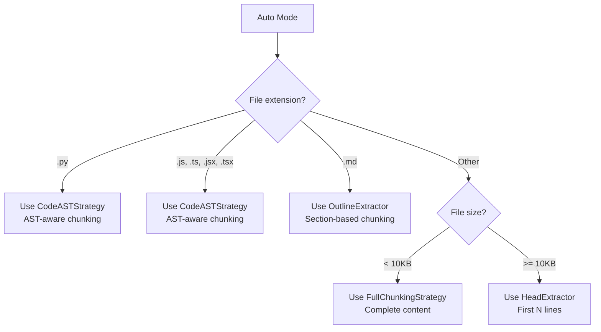

**Sources:** [vexor/modes.py]()

---

## Parallel Processing Architecture

The extraction phase supports parallel processing to accelerate indexing for large codebases. Two configuration parameters control parallelism:

### Configuration Parameters

| Parameter | Type | Default | Purpose |
|-----------|------|---------|---------|
| `extract_concurrency` | int | 4 | Number of parallel workers |
| `extract_backend` | str | "auto" | Execution backend: "thread", "process", or "auto" |

### Backend Selection

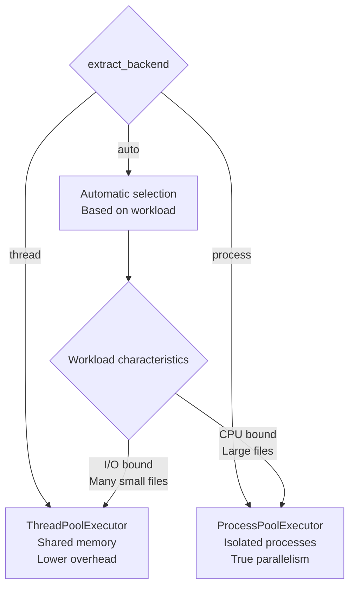

**Sources:** [vexor/services/index_service.py](), [tests/integration/test_cli.py:830-883]()

### Execution Flow

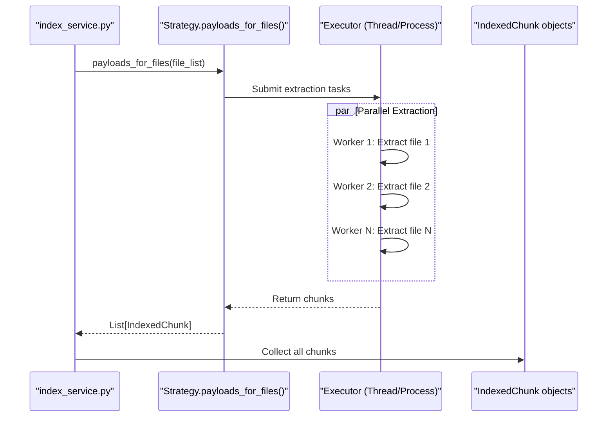

**Sources:** [vexor/services/index_service.py]()

---

## Embedding Generation Phase

After extraction, the pipeline generates embeddings for each chunk using the configured embedding provider. This phase implements batching and parallel request handling for performance optimization.

### Embedding Configuration

| Parameter | Type | Default | Purpose |
|-----------|------|---------|---------|
| `batch_size` | int | 100 | Chunks per embedding request |
| `embed_concurrency` | int | 4 | Parallel embedding requests |

### Embedding Workflow

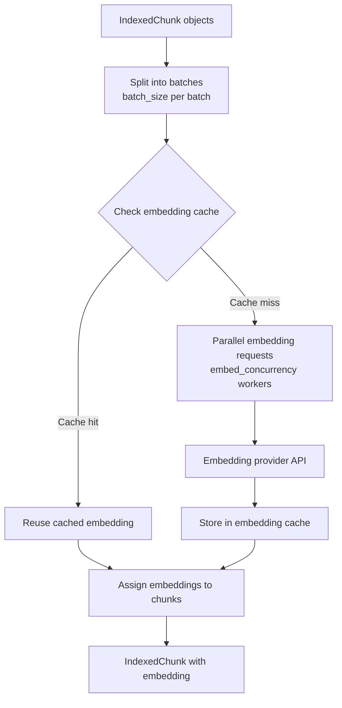

**Sources:** [vexor/services/index_service.py](), [tests/unit/test_index_service.py:94-116]()

### Embedding Cache

The `_embed_labels_with_cache()` function implements a two-tier caching strategy to avoid redundant embedding API calls:

1. **In-memory LRU cache:** Fast lookups for recent embeddings (2048 entries max)
2. **SQLite persistent cache:** Stores embeddings across sessions in `embedding_cache` table

**Cache key:** Hash of `(model_name, text_content)`

**Behavior:**
- On cache hit: Returns cached embedding immediately
- On cache miss: Calls provider API, stores result in cache
- Shared across all indexes using the same model

**Sources:** [vexor/services/index_service.py:_embed_labels_with_cache](), [tests/unit/test_index_service.py:94-116]()

### Batch Processing Logic

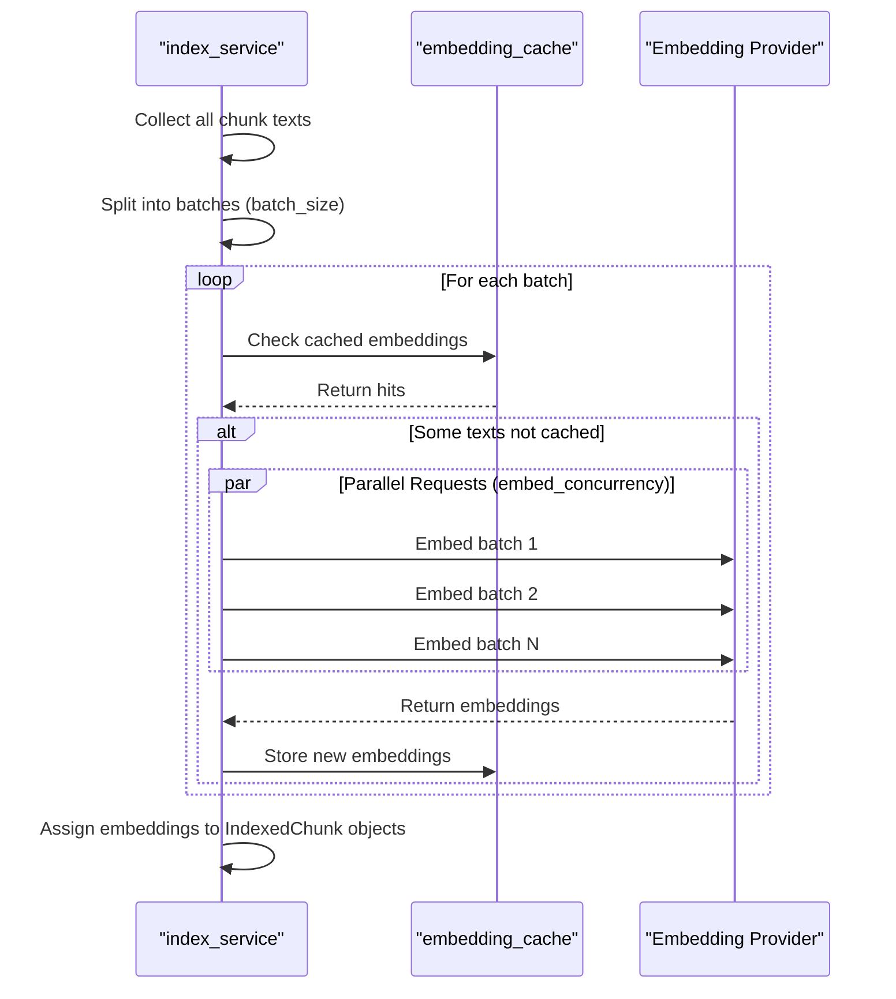

**Sources:** [vexor/services/index_service.py]()

---

## Data Structures

### IndexedChunk

The `IndexedChunk` class is the primary data structure representing a single searchable unit:

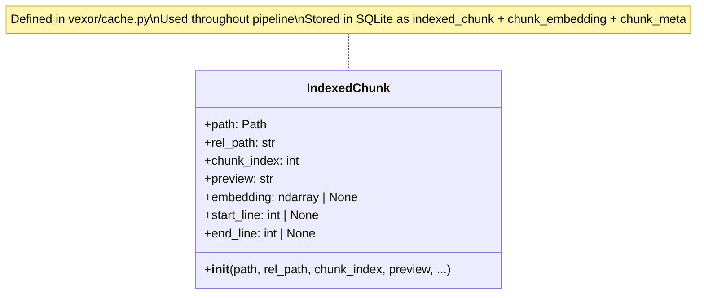

**Field descriptions:**

| Field | Type | Purpose |
|-------|------|---------|
| `path` | Path | Absolute file path |
| `rel_path` | str | Path relative to index root |
| `chunk_index` | int | Sequential chunk number within file (0-based) |
| `preview` | str | Text preview for display in search results |
| `embedding` | ndarray \| None | Vector embedding (assigned during embedding phase) |
| `start_line` | int \| None | Starting line number of chunk in source file |
| `end_line` | int \| None | Ending line number of chunk in source file |

**Sources:** [vexor/cache.py:IndexedChunk](), [tests/unit/test_index_service.py]()

### Line Number Tracking

Line numbers are tracked to enable precise result navigation. The tracking strategy varies by extraction mode:

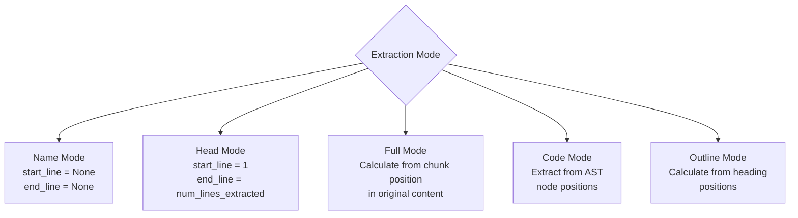

**Backfilling:** If an older index lacks line metadata (due to schema upgrades), the `backfill_chunk_lines()` function recalculates and stores line numbers during the next index operation.

**Sources:** [vexor/cache.py:backfill_chunk_lines](), [tests/unit/test_cache_upgrade_and_lines.py:67-111](), [tests/unit/test_index_service.py:142-210]()

---

## Incremental Update Mechanism

The pipeline supports incremental updates to avoid re-processing unchanged files.

### File Change Detection

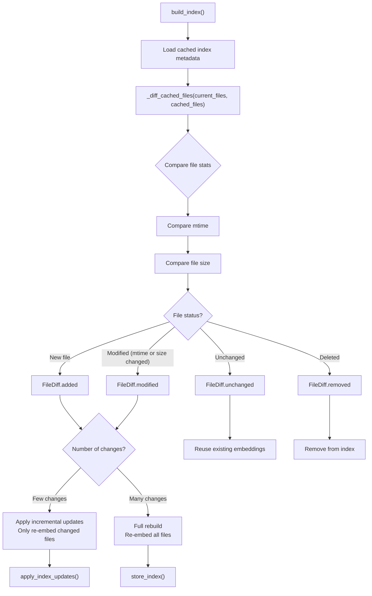

**Threshold for full rebuild:** If more than 75% of files changed, the pipeline performs a full rebuild instead of incremental updates to avoid fragmentation.

**Sources:** [vexor/services/index_service.py:build_index](), [tests/unit/test_index_service.py:32-91]()

### Incremental Update Flow

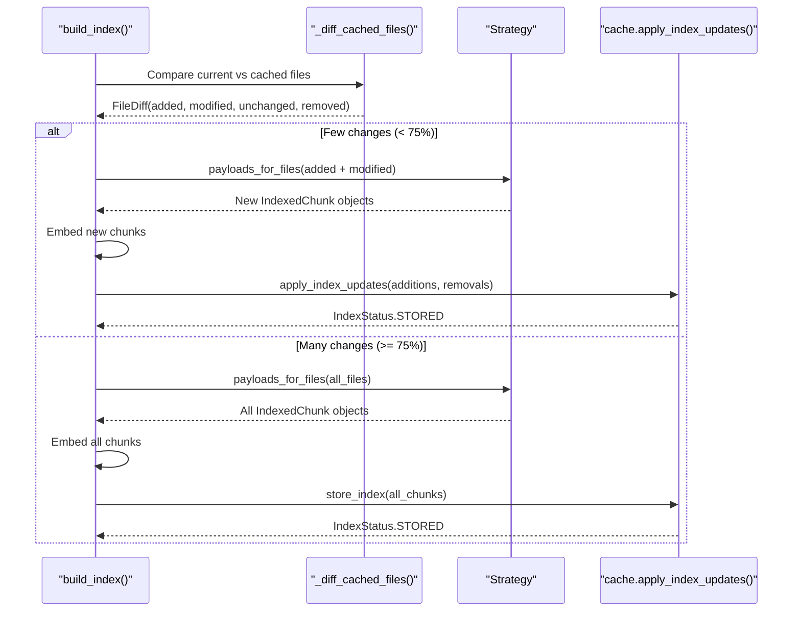

**Sources:** [vexor/services/index_service.py:build_index](), [tests/unit/test_index_service.py:32-91]()

---

## Performance Characteristics

### Processing Speed by Mode

| Mode | Relative Speed | Chunks per File | CPU Usage |
|------|---------------|-----------------|-----------|
| Name | Fastest (1x) | 1 | Minimal |
| Head | Fast (2x) | 1 | Low |
| Brief | Medium (5x) | 1 | Medium |
| Outline | Medium (6x) | Variable | Medium |
| Code | Slow (10x) | Variable | High (AST parsing) |
| Full | Slowest (15x) | Variable (many) | Medium |
| Auto | Variable | Variable | Variable |

### Optimization Strategies

**For large codebases (1000+ files):**
- Increase `extract_concurrency` to 8-16
- Use `extract_backend="process"` for CPU-intensive modes (code, full)
- Increase `embed_concurrency` to match provider rate limits

**For small projects (< 100 files):**
- Use `extract_backend="thread"` to reduce overhead
- Lower `extract_concurrency` to 2-4
- Use `batch_size=50` for faster iteration

**For repeated indexing:**
- Enable incremental updates (default behavior)
- Use embedding cache to avoid redundant API calls
- Consider `mode="head"` or `mode="name"` for fast iterations during development

**Sources:** [vexor/services/index_service.py](), [docs/roadmap.md:8-14]()

---

## Error Handling

The pipeline implements error handling at multiple levels:

### File-Level Errors
- **Unreadable files:** Skipped with warning, processing continues
- **Binary files:** Detected and skipped (except in name mode)
- **Permission errors:** Logged, file excluded from index

### Extraction Errors
- **Malformed code (code mode):** Falls back to full-text chunking
- **Invalid encoding:** Attempts UTF-8, falls back to Latin-1, skips if both fail

### Embedding Errors
- **API rate limits:** Implements exponential backoff (handled by provider layer)
- **Network errors:** Retries up to 3 times before failing
- **Invalid API key:** Fails immediately with clear error message

**Sources:** [vexor/services/index_service.py](), [vexor/modes.py]()

---

