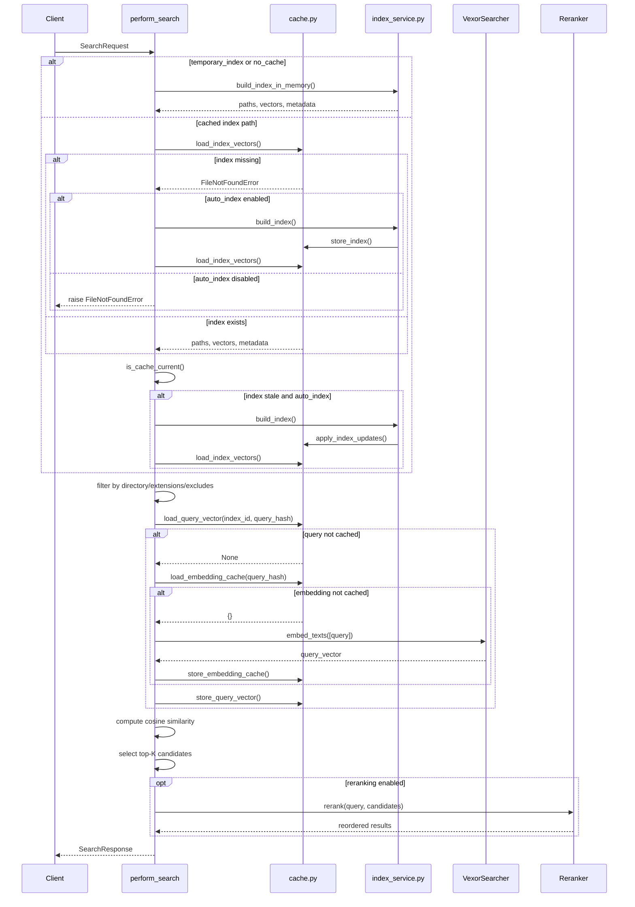
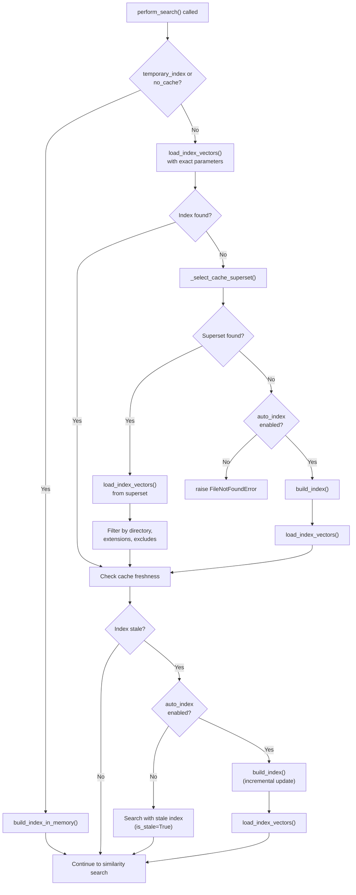
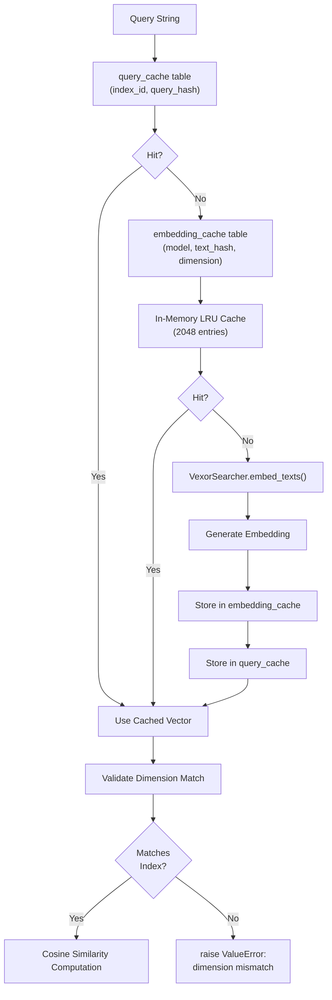
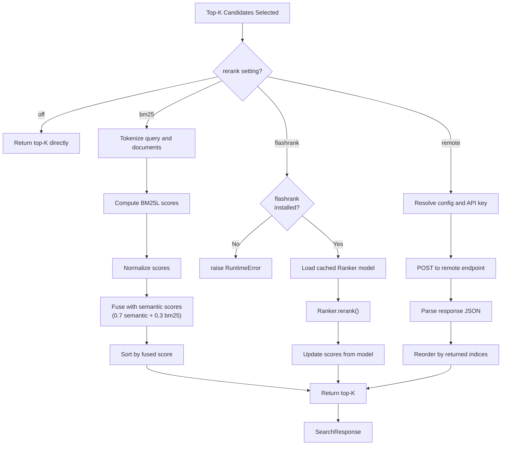

<!-- source: DeepWiki mcp.deepwiki.com · repo scarletkc/vexor · page 7.8 Search Execution Flow · fetched 2026-10-27 -->

# Search Execution Flow

<details>
<summary>Relevant source files</summary>

The following files were used as context for generating this wiki page:

- [tests/unit/test_cache.py](tests/unit/test_cache.py)
- [tests/unit/test_search_service.py](tests/unit/test_search_service.py)
- [vexor/cache.py](vexor/cache.py)
- [vexor/services/search_service.py](vexor/services/search_service.py)

</details>


This document traces the complete execution path of a semantic search operation in Vexor, from query input through vector similarity computation to final reranked results. It covers the main search path, cache interactions, automatic indexing, and the optional reranking phase.

For information about the indexing process that creates the data structures searched here, see [Content Processing Pipeline](#7.6). For details about the cache schema and storage layer, see [Storage Layer](#7.4). For the public API that invokes search operations, see [User Interface Layer](#7.2).

---

## Overview

Search execution in Vexor follows a multi-stage pipeline:

1. **Request Validation** - Parse and validate search parameters
2. **Index Resolution** - Locate or create an index for the target directory
3. **Cache Management** - Check cache freshness and trigger auto-indexing if needed
4. **Query Embedding** - Generate or retrieve cached query vector
5. **Similarity Computation** - Calculate cosine similarity scores
6. **Candidate Selection** - Select top-K results based on semantic similarity
7. **Optional Reranking** - Apply BM25, FlashRank, or remote reranking
8. **Response Construction** - Package results with metadata

The primary entry point is `perform_search()` in `search_service.py`, which orchestrates these stages and handles both cached and temporary indexes.

**Sources:** [vexor/services/search_service.py:358-708]()

---

## Search Request and Response Data Structures

### SearchRequest

The `SearchRequest` dataclass encapsulates all parameters needed for a search operation:

| Field | Type | Description |
|-------|------|-------------|
| `query` | `str` | The semantic search query text |
| `directory` | `Path` | Target directory to search |
| `mode` | `str` | Index mode (name/head/full/code/outline/brief/auto) |
| `top_k` | `int` | Number of results to return |
| `model_name` | `str` | Embedding model identifier |
| `provider` | `str` | Embedding provider (openai/gemini/voyage/custom/local) |
| `auto_index` | `bool` | Whether to automatically create/refresh index |
| `temporary_index` | `bool` | Use in-memory index without caching |
| `no_cache` | `bool` | Skip all caching (index and query) |
| `rerank` | `str` | Reranking strategy (off/bm25/flashrank/remote) |
| `exclude_patterns` | `tuple[str, ...]` | Patterns to exclude from search |
| `extensions` | `tuple[str, ...]` | File extensions to filter |

**Sources:** [vexor/services/search_service.py:33-60]()

### SearchResponse

The `SearchResponse` dataclass contains search results and metadata:

| Field | Type | Description |
|-------|------|-------------|
| `base_path` | `Path` | Root directory searched |
| `backend` | `str \| None` | Embedding backend used (cpu/cuda) |
| `results` | `Sequence[SearchResult]` | Ordered list of matching files |
| `is_stale` | `bool` | Whether the index is out of date |
| `index_empty` | `bool` | Whether no files were found |
| `reranker` | `str \| None` | Reranking method applied (if any) |

Each `SearchResult` contains:
- `path` - File path relative to base
- `score` - Similarity or reranking score
- `preview` - Text preview of the match
- `chunk_index` - Index of matching chunk within file
- `start_line`, `end_line` - Line number range (if available)

**Sources:** [vexor/services/search_service.py:62-70](), [vexor/search.py]()

---

## Main Search Flow



**Diagram: Complete Search Execution Sequence**

The search flow branches based on caching strategy. Temporary indexes bypass all caching and build in-memory. Cached indexes go through a multi-tier cache lookup with automatic staleness detection and re-indexing.

**Sources:** [vexor/services/search_service.py:358-708](), [tests/unit/test_search_service.py:33-89]()

---

## Index Resolution and Loading

### Cache Lookup Strategy

When searching with cached indexes, Vexor attempts to load the index in this order:

1. **Exact Match** - Load index matching all parameters (directory, mode, model, extensions, excludes)
2. **Superset Fallback** - If exact match fails, search for a compatible superset index that covers the requested scope
3. **Auto-Indexing** - If no compatible index exists and `auto_index=True`, create a new index



**Diagram: Index Resolution Decision Tree**

This flowchart shows how `perform_search()` resolves the appropriate index to use, including fallback logic for superset indexes and automatic re-indexing.

**Sources:** [vexor/services/search_service.py:376-436](), [vexor/services/search_service.py:876-955]()

### Superset Index Selection

When an exact index match is not found, `_select_cache_superset()` searches for the best compatible superset index. A superset is valid if:

- It covers the requested directory (request dir is subdirectory of cached root)
- Model, mode, include_hidden, and respect_gitignore match exactly
- If request is recursive, cached index must also be recursive
- Cached extensions are empty OR a superset of requested extensions
- Cached exclude patterns are empty OR a subset of requested exclude patterns

Candidate selection prioritizes:
1. Shortest directory distance (closest parent)
2. Recursive match over mismatch
3. Fewest total files
4. Fewest extensions
5. Smallest exclude pattern gap

**Sources:** [vexor/services/search_service.py:958-1020]()

### Index Filtering

When using a superset index, results are filtered in three passes:

1. **Directory Filter** - Keep only files under the requested directory (with recursion respect)
2. **Extension Filter** - Keep only files with requested extensions
3. **Exclude Pattern Filter** - Remove files matching exclude patterns

Each filter operates on three parallel arrays: `paths`, `file_vectors`, and `metadata`, maintaining index alignment.

**Sources:** [vexor/services/search_service.py:1023-1174]()

---

## Query Embedding Generation

Query embeddings follow a two-tier cache strategy:

### Query Cache (Index-Specific)

Query vectors are cached per-index in the `query_cache` table, keyed by `(index_id, query_hash)`. This cache is checked first:

```python
query_hash = query_cache_key(request.query, request.model_name)
query_vector = load_query_vector(int(index_id), query_hash)
```

The query hash normalizes the model name (strips provider prefixes like `openai/`, `gemini/`) to improve cache hit rates across provider changes.

**Sources:** [vexor/services/search_service.py:583-590](), [vexor/cache.py:74-89]()

### Embedding Cache (General Text)

If the query-specific cache misses, the general `embedding_cache` is checked, keyed by `(model, text_hash, dimension)`:

```python
query_text_hash = embedding_cache_key(request.query, dimension=request.embedding_dimensions)
cached = load_embedding_cache(request.model_name, [query_text_hash], dimension=request.embedding_dimensions)
query_vector = cached.get(query_text_hash)
```

The dimension is included in the hash to prevent cross-contamination when users switch between different embedding dimensions (e.g., 512 vs 1024).

**Sources:** [vexor/services/search_service.py:592-599](), [vexor/cache.py:92-106]()

### Embedding Generation

If both caches miss, the query is embedded via `VexorSearcher.embed_texts()`:

```python
query_vector = searcher.embed_texts([request.query])[0]
```

The new embedding is stored in both caches for future reuse.

**Sources:** [vexor/services/search_service.py:601-623]()

### Cache Architecture



**Diagram: Query Embedding Cache Hierarchy**

The two-tier cache provides both index-specific query caching (for repeated searches on the same index) and general text embedding caching (for query reuse across different indexes with the same model).

**Sources:** [vexor/services/search_service.py:578-623](), [vexor/cache.py:1400-1458]()

---

## Vector Similarity Computation

### Dimension Validation

Before computing similarity, Vexor validates that the query vector dimension matches the index dimension:

```python
index_dimension = file_vectors.shape[1] if file_vectors.ndim == 2 else 0
query_dimension = query_vector.shape[0]
if index_dimension != query_dimension:
    raise ValueError(
        f"Embedding dimension mismatch: index has {index_dimension}-dim vectors, "
        f"but query embedding is {query_dimension}-dim. "
        f"This typically happens when embedding_dimensions was changed after building the index. "
        f"Rebuild the index with: vexor index {request.directory}"
    )
```

This validation prevents silent failures when users change the `embedding_dimensions` parameter after indexing.

**Sources:** [vexor/services/search_service.py:636-644]()

### Cosine Similarity Calculation

Similarity is computed as a matrix-vector product (dot product), which equals cosine similarity for normalized vectors:

```python
query_vector = np.asarray(query_vector, dtype=np.float32).ravel()
similarities = np.asarray(file_vectors @ query_vector, dtype=np.float32)
```

The `@` operator performs matrix multiplication: `(N x D) @ (D,) = (N,)` where N is the number of file chunks and D is the embedding dimension.

### Top-K Selection

The `_top_indices()` helper efficiently selects the top-K highest-scoring chunks:

```python
top_indices = _top_indices(similarities, candidate_count)
```

Implementation uses `np.argpartition()` for O(N) performance when K << N, falling back to sorting for small arrays. Results are stable-sorted by score (descending) then by index (ascending).

**Sources:** [vexor/services/search_service.py:633-647](), [vexor/services/search_service.py:121-127]()

### Chunk Metadata Loading

For each top candidate, metadata (preview text, line numbers) is loaded from the cache:

```python
chunk_meta_by_id = load_chunk_metadata(candidate_ids)
```

This batch operation uses the `chunk_meta` table, which stores preview text and line ranges for each chunk. The preview is used for result display and reranking.

**Sources:** [vexor/services/search_service.py:648-678]()

---

## Reranking Phase

Reranking refines the initial semantic similarity results using additional signals. Vexor supports three reranking strategies:

### Candidate Overselection

When reranking is enabled, the system first selects more candidates than requested (typically 2x, capped at 150) to give the reranker a larger pool:

```python
def _resolve_rerank_candidates(top_k: int) -> int:
    candidate = int(top_k * 2)
    return max(20, min(candidate, 150))
```

After reranking, the top-K results are returned from the reordered candidates.

**Sources:** [vexor/services/search_service.py:116-118](), [tests/unit/test_search_service.py:982-992]()

### BM25 Reranking

BM25 is a lexical scoring algorithm that combines term frequency (TF) and inverse document frequency (IDF). It's effective for queries with specific keywords.

**Document Construction:**
```python
def _build_rerank_document(result: SearchResult) -> str:
    preview = result.preview or ""
    return f"{result.path.name} {result.path.as_posix()} {preview}".strip()
```

Documents include filename, path, and preview text to provide multiple matching opportunities.

**Tokenization:**
- Primary: BertPreTokenizer from HuggingFace `tokenizers` library (if available)
- Fallback: Regex-based `[A-Za-z0-9_]+` pattern matching

**Score Fusion:**
BM25 uses additive score fusion between semantic and lexical scores:

```python
fused_score = 0.7 * semantic_score + 0.3 * bm25_score
```

Both scores are normalized by their respective maximum values before fusion. The semantic weight (0.7) ensures semantic similarity remains the primary signal while BM25 provides lexical refinement.

**Sources:** [vexor/services/search_service.py:144-163](), [vexor/services/search_service.py:87-99]()

### FlashRank Reranking

FlashRank is a neural reranking model that runs locally using ONNX Runtime. It requires the `flashrank` Python package:

```python
from flashrank import Ranker, RerankRequest

ranker = _get_flashranker(model_name, max_length=8192)
rerank_request = RerankRequest(query=query, passages=passages)
reranked = ranker.rerank(rerank_request)
```

Models are cached via `@lru_cache(maxsize=4)` to avoid reloading. The default model is `ms-marco-MiniLM-L-12-v2`, but users can specify alternatives via `flashrank_model`.

**Sources:** [vexor/services/search_service.py:178-223](), [vexor/services/search_service.py:166-175]()

### Remote Reranking

Remote reranking delegates to an HTTP API endpoint, useful for production deployments with dedicated reranking infrastructure:

**Configuration Resolution:**
```python
def _resolve_remote_rerank_config(config: RemoteRerankConfig | None) -> RemoteRerankConfig:
    base_url = normalize_remote_rerank_url(config.base_url)
    api_key = resolve_remote_rerank_api_key(config.api_key)  # reads VEXOR_REMOTE_RERANK_API_KEY env var
    # ... validation
```

**Request Format:**
```json
{
    "model": "rerank-model",
    "query": "user query",
    "documents": ["doc1 text", "doc2 text", ...]
}
```

**Response Format:**
```json
{
    "results": [
        {"index": 0, "relevance_score": 0.95},
        {"index": 1, "relevance_score": 0.82}
    ]
}
```

The response is parsed to extract reordered indices and optional relevance scores.

**Sources:** [vexor/services/search_service.py:323-355](), [vexor/services/search_service.py:248-290]()

### Reranking Flow



**Diagram: Reranking Strategy Selection and Execution**

Each reranking strategy operates on the candidate pool and returns a reordered list with updated scores. The final results are truncated to the requested `top_k`.

**Sources:** [vexor/services/search_service.py:679-700]()

---

## Result Construction

The final `SearchResponse` aggregates all search metadata:

```python
return SearchResponse(
    base_path=request.directory,
    backend=searcher.device,  # "cpu" or "cuda"
    results=results,
    is_stale=stale,
    index_empty=False,
    reranker=reranker,  # "bm25", "flashrank", "remote", or None
)
```

Each `SearchResult` in the results list contains:
- **path** - Absolute file path
- **score** - Final score (semantic or reranked)
- **preview** - Text snippet from the matched chunk
- **chunk_index** - Which chunk within the file matched
- **start_line, end_line** - Line number range (if mode supports it)

The `is_stale` flag indicates whether the index is outdated relative to the filesystem, allowing callers to display warnings or trigger re-indexing.

**Sources:** [vexor/services/search_service.py:701-708](), [vexor/services/search_service.py:669-677]()

---

## Alternative Search Paths

### In-Memory Search

The `search_from_vectors()` function provides a simplified path for searching pre-loaded in-memory indexes (used by `InMemoryIndex` class):

```python
def search_from_vectors(
    request: SearchRequest,
    *,
    paths: Sequence[Path],
    file_vectors: np.ndarray,
    metadata: dict,
    is_stale: bool = False,
) -> SearchResponse:
```

This path skips index loading and staleness checks but follows the same embedding caching, similarity computation, and reranking logic as the main path.

**Sources:** [vexor/services/search_service.py:711-841]()

### Temporary Index Search

When `temporary_index=True` or `no_cache=True`, the search flow delegates to:

```python
def _perform_search_with_temporary_index(request: SearchRequest) -> SearchResponse:
    paths, file_vectors, metadata = build_index_in_memory(...)
    return search_from_vectors(request, paths=paths, file_vectors=file_vectors, metadata=metadata)
```

This path builds a fresh index in memory without touching the cache, useful for one-off searches or testing.

**Sources:** [vexor/services/search_service.py:844-873](), [tests/unit/test_search_service.py:91-142]()

---

## Performance Considerations

### Cache Effectiveness

The multi-tier caching strategy dramatically improves performance:

1. **Index Cache** - Avoids re-embedding entire directory trees (minutes → seconds)
2. **Query Cache (per-index)** - Avoids re-embedding queries for the same index (seconds → milliseconds)
3. **Embedding Cache (general)** - Shares embeddings across indexes (API calls → cache hits)
4. **In-Memory LRU** - Keeps hot embeddings in RAM (disk I/O → memory access)

**Sources:** [tests/unit/test_search_service.py:372-446]()

### Dimension Mismatch Prevention

The explicit dimension validation at [vexor/services/search_service.py:636-644]() prevents silent failures when configuration changes. Without this check, a dimension mismatch would produce incorrect similarity scores rather than a clear error.

**Sources:** [tests/unit/test_search_service.py:995-1046]()

### Superset Index Reuse

The superset fallback mechanism (lines 958-1020 in search_service.py) allows users to search subdirectories without re-indexing the entire parent tree, significantly improving performance for large codebases.

**Sources:** [tests/unit/test_search_service.py:623-715]()

---

## Code Entity Reference

### Key Functions

| Function | Location | Purpose |
|----------|----------|---------|
| `perform_search` | [vexor/services/search_service.py:358]() | Main search orchestration with caching |
| `search_from_vectors` | [vexor/services/search_service.py:711]() | Search pre-loaded in-memory index |
| `_load_index_vectors_for_request` | [vexor/services/search_service.py:876]() | Load index with superset fallback |
| `_select_cache_superset` | [vexor/services/search_service.py:958]() | Find best compatible parent index |
| `_filter_index_by_directory` | [vexor/services/search_service.py:1119]() | Filter index to subdirectory |
| `_filter_index_by_extensions` | [vexor/services/search_service.py:1023]() | Filter by file extensions |
| `_filter_index_by_exclude_patterns` | [vexor/services/search_service.py:1068]() | Filter by exclude patterns |
| `_top_indices` | [vexor/services/search_service.py:121]() | Efficient top-K selection |
| `_apply_bm25_rerank` | [vexor/services/search_service.py:144]() | BM25 lexical reranking |
| `_apply_flashrank_rerank` | [vexor/services/search_service.py:178]() | Neural reranking with FlashRank |
| `_apply_remote_rerank` | [vexor/services/search_service.py:323]() | HTTP API reranking |

### Cache Operations

| Function | Location | Purpose |
|----------|----------|---------|
| `load_index_vectors` | [vexor/cache.py:1107]() | Load vectors and metadata from cache |
| `load_query_vector` | [vexor/cache.py:1326]() | Load cached query embedding |
| `store_query_vector` | [vexor/cache.py:1366]() | Store query embedding to cache |
| `load_embedding_cache` | [vexor/cache.py:1400]() | Load general text embeddings |
| `store_embedding_cache` | [vexor/cache.py:1462]() | Store general text embeddings |
| `load_chunk_metadata` | [vexor/cache.py:1265]() | Load preview text and line numbers |
| `query_cache_key` | [vexor/cache.py:83]() | Generate query cache hash |
| `embedding_cache_key` | [vexor/cache.py:92]() | Generate embedding cache hash |

**Sources:** [vexor/services/search_service.py:1-1224](), [vexor/cache.py:1-2368]()

---

