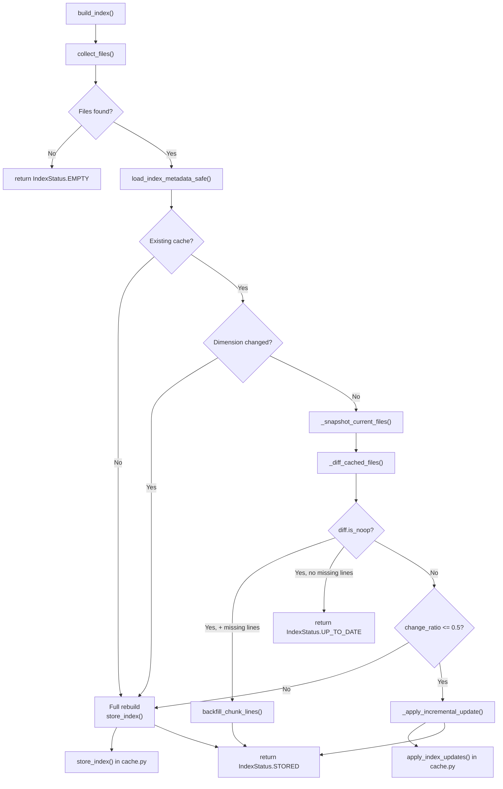
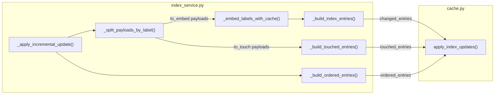
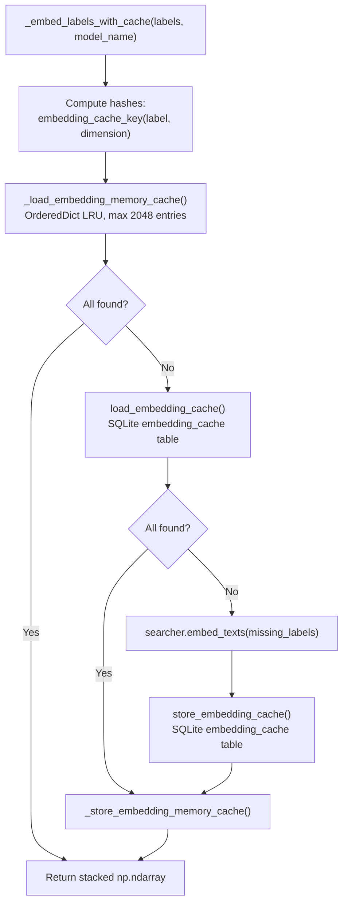

<!-- source: DeepWiki mcp.deepwiki.com · repo scarletkc/vexor · page 8.1 Incremental Index Updates · fetched 2026-10-27 -->

# Incremental Index Updates

<details>
<summary>Relevant source files</summary>

The following files were used as context for generating this wiki page:

- [docs/roadmap.md](docs/roadmap.md)
- [tests/unit/test_cache.py](tests/unit/test_cache.py)
- [tests/unit/test_cache_upgrade_and_lines.py](tests/unit/test_cache_upgrade_and_lines.py)
- [tests/unit/test_index_service.py](tests/unit/test_index_service.py)
- [vexor/cache.py](vexor/cache.py)

</details>


This page covers the internal mechanics of how Vexor decides whether to rebuild an index from scratch or apply a minimal delta update when `build_index()` is called a second time on the same directory. It also explains how the embedding cache is used to avoid redundant API calls within both paths.

For background on the cache storage schema itself, see [Cache System](#3.5). For details on managing the cache manually (clearing, inspecting), see [Cache Management](#8.3). For the full `build_index()` API surface, see [Index Functions](#5.3).

---

## Overview

Every call to `build_index()` in [vexor/services/index_service.py]() goes through a decision tree before any embedding API call is made. The goal is to only embed content that has genuinely changed, and to reuse previously computed embeddings where possible. Two separate layers of caching contribute to this:

1. **File diff check** — compare current filesystem state against the stored index to identify added, modified, and removed files.
2. **Embedding cache** — for content that must be re-embedded, check a content-addressed SQLite table before calling the embedding API.

---

## Decision Tree: Full Rebuild vs. Incremental Update

**Decision tree for `build_index()`**



Sources: [vexor/services/index_service.py:126-375]()

---

## File Change Detection

### Snapshot and Diff

`_snapshot_current_files()` walks the collected `files` list and records each file's `mtime` and `size_bytes` into a `dict[str, SnapshotEntry]`, keyed by relative path.

`_diff_cached_files()` compares that snapshot against the `cached_files` list loaded from the stored index metadata. It populates a `FileDiff` dataclass:

| Field | Type | Meaning |
|---|---|---|
| `added` | `list[Path]` | Files on disk not in the cache |
| `modified` | `list[Path]` | Files in both but with changed mtime or size |
| `removed` | `list[str]` | Files in the cache that are no longer on disk |

**Change detection logic in `_has_entry_changed()`:**

```
if |entry.mtime - cached.mtime| > MTIME_TOLERANCE (0.5 seconds):
    if file size is the same → treat as unchanged (mtime drift, content identical)
    else → modified
elif file size differs → modified
else → unchanged
```

`MTIME_TOLERANCE` is set to `5e-1` (0.5 seconds) to tolerate filesystem timestamp rounding across different OS/filesystem combinations.

Sources: [vexor/services/index_service.py:560-638](), [vexor/services/index_service.py:27-31]()

---

## The 50% Threshold

After computing the diff, `build_index()` calls `diff.change_ratio()`:

```
change_ratio = (len(added) + len(modified) + len(removed)) / max(current_count, cached_count, 1)
```

This is compared against `INCREMENTAL_CHANGE_THRESHOLD = 0.5`.

| `change_ratio` | Path taken |
|---|---|
| `<= 0.5` | Incremental update via `_apply_incremental_update()` |
| `> 0.5` | Full rebuild — re-extracts and re-embeds all files, calls `store_index()` |

The rationale: if more than half the files changed, the overhead of incremental bookkeeping (computing ordered positions, patching the SQLite rows) exceeds the cost of a clean write.

Sources: [vexor/services/index_service.py:260-341](), [vexor/services/index_service.py:568-582]()

---

## Incremental Update Pipeline

When `change_ratio <= 0.5`, the incremental path runs. The key function is `_apply_incremental_update()`.

**Incremental update internals**



Sources: [vexor/services/index_service.py:641-725]()

### Step 1: Split Payloads by Label Hash

`_split_payloads_by_label()` separates changed file payloads into two buckets:

- **`to_embed`** — payloads where the content hash differs from the cached label hash (actual content change).
- **`to_touch`** — payloads where the content hash matches the cached label hash (mtime/size changed, but text is identical — e.g. a `touch` command or filesystem copy).

The comparison uses `embedding_cache_key(payload.label)` (a SHA-1 of the label text) against `cached_label_map[rel_path][chunk_index]` stored in the index.

If chunk counts differ between current and cached, the whole file goes to `to_embed`.

Sources: [vexor/services/index_service.py:830-863]()

### Step 2: Embed Only What Changed

`_embed_labels_with_cache()` is called only for `to_embed` payloads. See the [Embedding Cache](#embedding-cache) section below for how this avoids API calls.

### Step 3: Build Touched Entries

`_build_touched_entries()` creates lightweight update tuples for `to_touch` payloads — only `size_bytes`, `mtime`, `preview`, `start_line`, `end_line`, and `label_hash` are refreshed. No embedding vector is recomputed.

Sources: [vexor/services/index_service.py:866-891]()

### Step 4: Rebuild Position Order

`_build_ordered_entries()` walks the full current file list and emits `(rel_path, chunk_index)` tuples in filesystem order. This list drives a bulk `UPDATE indexed_chunk SET position = ?` in `apply_index_updates()`, so search result ordering remains consistent with the file layout.

Sources: [vexor/services/index_service.py:894-917]()

### Step 5: Write to SQLite

`apply_index_updates()` in `vexor/cache.py` handles all three categories atomically inside a `BEGIN IMMEDIATE` transaction:

| Operation | SQL action |
|---|---|
| Removed files | `DELETE FROM indexed_file WHERE index_id = ? AND rel_path = ?` |
| Changed files | Delete + re-insert `indexed_file`, `indexed_chunk`, `chunk_embedding`, `chunk_meta` |
| Touched files | `UPDATE indexed_file SET size_bytes, mtime` + `INSERT OR REPLACE INTO chunk_meta` |
| Position update | `UPDATE indexed_chunk SET position = ?` for all chunks |
| Metadata refresh | `UPDATE index_metadata SET generated_at, dimension, version` |

Sources: [vexor/cache.py:587-880]()

---

## Embedding Cache

The embedding cache prevents re-calling the embedding API for content that was already embedded in a prior run — even across a full rebuild.

**Embedding cache lookup flow in `_embed_labels_with_cache()`**



Sources: [vexor/services/index_service.py:728-777](), [vexor/cache.py:92-158]()

### Cache Key Design

`embedding_cache_key(text, dimension)` computes `SHA-1(text | "dim=" + dimension)`. Including the `dimension` parameter prevents cross-dimension cache pollution when `embedding_dimensions` is changed between runs.

Sources: [vexor/cache.py:92-105]()

### Two-Level Storage

| Level | Implementation | Capacity | Eviction |
|---|---|---|---|
| In-memory | `_EMBED_MEMORY_CACHE` (`OrderedDict`) | `EMBED_MEMORY_CACHE_MAX_ENTRIES = 2048` | LRU (popitem on overflow) |
| On-disk | `embedding_cache` SQLite table | `EMBED_CACHE_MAX_ENTRIES = 50_000` | TTL 30 days + count cap on write |

The in-memory cache is checked first at load time via `_load_embedding_memory_cache()`. New embeddings from the API are written to both levels. The memory cache is keyed on `(model, dimension, text_hash)`.

Sources: [vexor/cache.py:29-34](), [vexor/cache.py:108-158]()

### Embedding Cache Pruning

When `store_embedding_cache()` is called, it:
1. Deletes entries older than `EMBED_CACHE_TTL_DAYS = 30`.
2. If total rows exceed `EMBED_CACHE_MAX_ENTRIES = 50_000`, deletes the oldest rows (by `created_at`) until under the cap.

Sources: [vexor/cache.py:29-31]()

---

## Dimension Change Handling

If `build_index()` detects that `embedding_dimensions` was explicitly changed between runs and a cached index exists with a different dimension, it forces a full rebuild with `force_no_cache = True`:

- `cached_files` is cleared, bypassing the incremental path entirely.
- The embedding cache is also bypassed for this run (`no_cache or force_no_cache`), because cached vectors from the old dimension are incompatible.

Additionally, inside `_apply_incremental_update()`, if new embeddings return a shape that doesn't match `cached_index_dimension`, a `ValueError` is raised rather than silently mixing vectors of different sizes.

Sources: [vexor/services/index_service.py:190-204](), [vexor/services/index_service.py:686-695]()

---

## Line Metadata Backfill

For modes that produce line-range metadata (`code`, `outline`, `auto`, `full`), the index stores `start_line` and `end_line` per chunk. Older cached indexes may lack this. `_missing_line_files()` identifies files where this data is absent.

When `diff.is_noop` (no file changes) but `missing_line_files` is non-empty, `build_index()` calls `backfill_chunk_lines()` instead of returning `UP_TO_DATE`. This re-extracts content for only the affected files and patches `chunk_meta` in place — no re-embedding occurs.

The same backfill runs after an incremental update for files that were not in the changed set.

Sources: [vexor/services/index_service.py:209-258](), [vexor/services/index_service.py:315-340](), [vexor/cache.py:883-988]()

---

## Summary of Outcomes

| Condition | `IndexStatus` returned | API calls made |
|---|---|---|
| No files found | `EMPTY` | None |
| No changes detected, lines complete | `UP_TO_DATE` | None |
| No changes detected, lines missing | `STORED` | None (backfill only) |
| Change ratio ≤ 50%, content hashes match | `STORED` | None (touch only) |
| Change ratio ≤ 50%, content changed | `STORED` | Only for changed chunks (may hit embedding cache) |
| Change ratio > 50% or no cache | `STORED` | All files (may partially hit embedding cache) |
| Dimension changed | `STORED` | All files, embedding cache bypassed |

---

