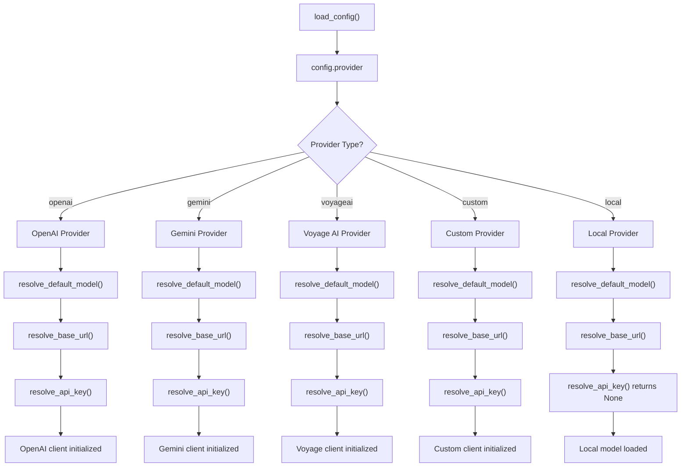
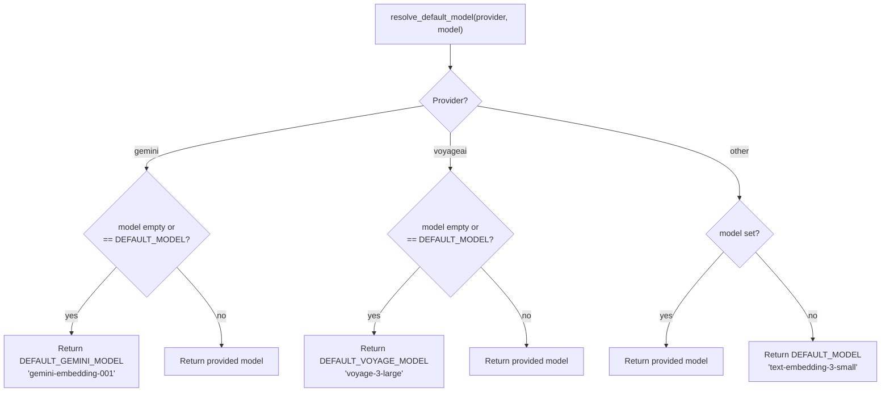
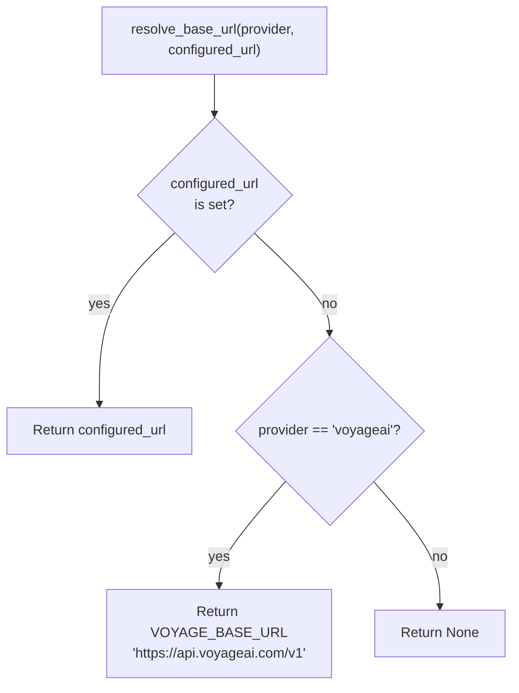
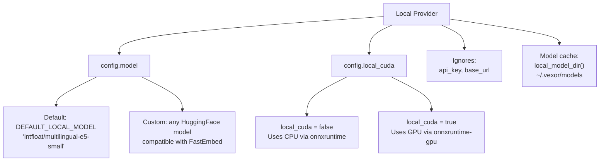
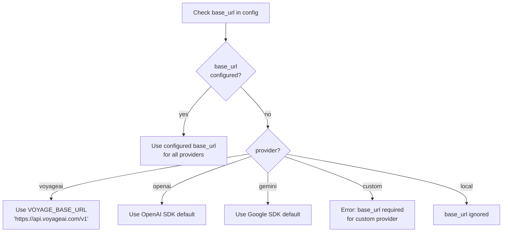
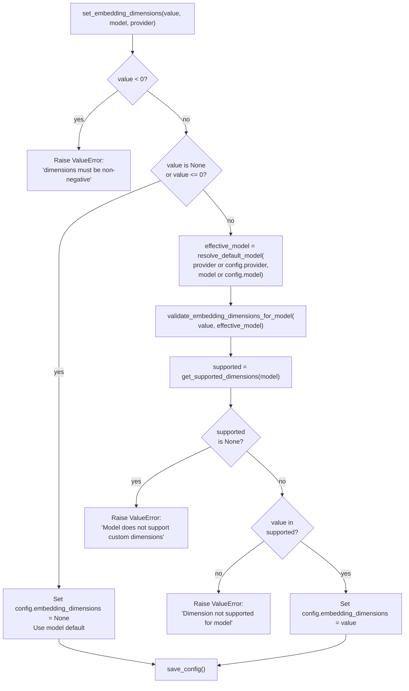
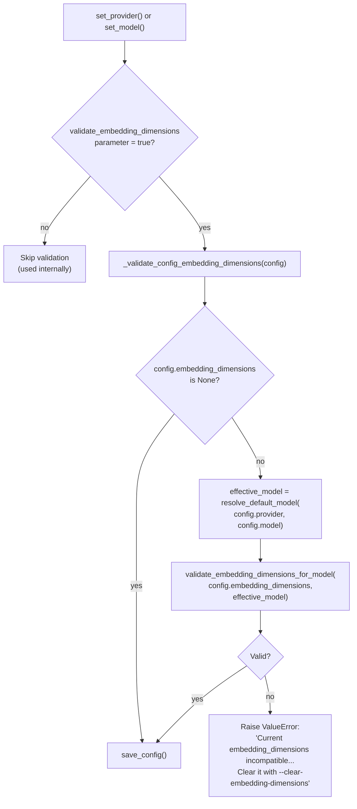
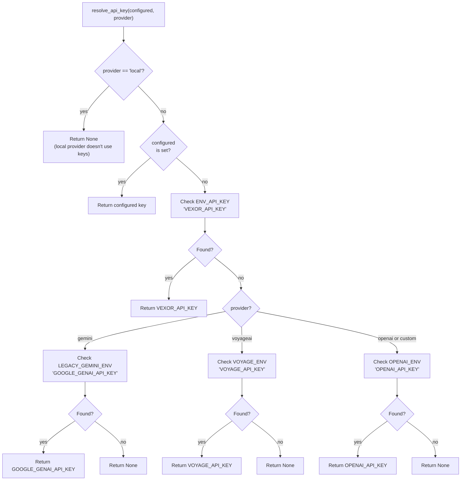

<!-- source: DeepWiki mcp.deepwiki.com · repo scarletkc/vexor · page 8.2 Provider Configuration · fetched 2026-10-27 -->

# Provider Configuration

<details>
<summary>Relevant source files</summary>

The following files were used as context for generating this wiki page:

- [README.md](README.md)
- [vexor/config.py](vexor/config.py)

</details>


This page covers advanced configuration of embedding providers in Vexor. It explains how to set up remote API providers (OpenAI, Gemini, Voyage AI, custom), configure the local offline provider, customize base URLs for proxies, and manage embedding dimensions.

For basic provider setup and first-time configuration, see [First-Run Setup](#2.5). For information about the provider system architecture, see [Provider System](#7.5). For runtime configuration management via the Python API, see [Configuration Management](#5.5).

---

## Provider System Overview

Vexor supports five distinct embedding providers, each with different configuration requirements and capabilities. The provider is selected via the `provider` field in the configuration, which controls how text is converted to embedding vectors.

**Provider Resolution Flow**



**Sources:** [vexor/config.py:37-38](), [vexor/config.py:397-417](), [vexor/config.py:469-492]()

---

## Remote Providers

Remote providers communicate with cloud-based embedding APIs. They require API keys and support optional base URL overrides for proxies or custom endpoints.

### Provider-Specific Defaults

Each remote provider has default model and base URL values that are automatically applied when not explicitly configured:

| Provider | Default Model | Default Base URL | Environment Variable |
|----------|---------------|------------------|---------------------|
| `openai` | `text-embedding-3-small` | OpenAI API default | `OPENAI_API_KEY`, `VEXOR_API_KEY` |
| `gemini` | `gemini-embedding-001` | Google AI default | `GOOGLE_GENAI_API_KEY`, `VEXOR_API_KEY` |
| `voyageai` | `voyage-3-large` | `https://api.voyageai.com/v1` | `VOYAGE_API_KEY`, `VEXOR_API_KEY` |
| `custom` | *(required)* | *(required)* | `OPENAI_API_KEY`, `VEXOR_API_KEY` |

**Model Resolution Logic:**



**Sources:** [vexor/config.py:24-27](), [vexor/config.py:397-407]()

### OpenAI Provider

The `openai` provider uses OpenAI's embedding API. It supports dimension customization for `text-embedding-3-small` and `text-embedding-3-large` models.

**Configuration:**
```bash
vexor config --set-provider openai
vexor config --set-model text-embedding-3-small
vexor config --set-api-key "sk-..."
```

**Supported Models with Custom Dimensions:**
- `text-embedding-3-small`: 256, 512, 1024, 1536
- `text-embedding-3-large`: 256, 512, 1024, 1536, 3072

**Sources:** [vexor/config.py:41-43](), [vexor/config.py:272-277]()

### Gemini Provider

The `gemini` provider integrates with Google's Gemini embedding API. When switching to this provider, the model automatically defaults to `gemini-embedding-001` unless explicitly overridden.

**Configuration:**
```bash
vexor config --set-provider gemini
vexor config --set-api-key "AIza..."
```

The model defaults to `gemini-embedding-001` even if the previous config had a different model set, ensuring provider-specific defaults are used.

**Sources:** [vexor/config.py:25](), [vexor/config.py:401-402](), [vexor/config.py:480-482]()

### Voyage AI Provider

The `voyageai` provider connects to Voyage AI's embedding service. It automatically sets the base URL to `https://api.voyageai.com/v1` when no custom base URL is configured.

**Configuration:**
```bash
vexor config --set-provider voyageai
vexor config --set-api-key "pa-..."
```

**Voyage Models Supporting Custom Dimensions:**
- `voyage-3` (prefix): 256, 512, 1024, 2048
- `voyage-code-3` (prefix): 256, 512, 1024, 2048

**Base URL Resolution:**


**Sources:** [vexor/config.py:26](), [vexor/config.py:36](), [vexor/config.py:44-45](), [vexor/config.py:410-417]()

### Custom OpenAI-Compatible Providers

The `custom` provider enables integration with any OpenAI-compatible embedding API (e.g., Ollama, local inference servers, or proprietary endpoints).

**Requirements:**
- `model` must be explicitly set
- `base_url` must be explicitly set
- API key is optional (some local servers don't require authentication)

**Configuration:**
```bash
vexor config --set-provider custom
vexor config --set-model "text-embedding-ada-002"
vexor config --set-base-url "http://localhost:11434/v1"
vexor config --set-api-key "optional-key"  # or omit if not needed
```

**Sources:** [vexor/config.py:37](), [vexor/config.py:488-490]()

---

## Local Provider

The `local` provider performs embedding generation entirely offline using ONNX Runtime and FastEmbed models. It requires no API keys and supports both CPU and GPU execution.

**Local Provider Configuration Schema**



**Sources:** [vexor/config.py:27](), [vexor/config.py:72](), [vexor/config.py:191-192](), [vexor/config.py:473-474]()

### Setup and Installation

**Install the local backend:**
```bash
pip install "vexor[local]"
```

**Download and configure a model:**
```bash
vexor local --setup --model intfloat/multilingual-e5-small
```

The `--setup` command performs three operations:
1. Downloads the model to `~/.vexor/models`
2. Sets `provider` to `local`
3. Sets `model` to the specified model name

**Manual configuration:**
```bash
vexor config --set-provider local
vexor config --set-model "intfloat/multilingual-e5-small"
```

**Sources:** [README.md:199-221](), [vexor/config.py:191-192]()

### GPU Support

GPU acceleration requires CUDA drivers and the `onnxruntime-gpu` package:

```bash
pip install "vexor[local-cuda]"
vexor local --setup --cuda
```

Or manually:
```bash
vexor config --set-provider local
vexor config --local-cuda true
```

**Switch between CPU and GPU:**
```bash
vexor local --cpu   # Disable CUDA
vexor local --cuda  # Enable CUDA
```

The `local_cuda` flag is stored in the configuration and persists across sessions.

**Sources:** [README.md:205-220](), [vexor/config.py:72](), [vexor/config.py:292-295]()

### Model Management

**List available models:**
Models are cached in `~/.vexor/models`. The directory structure follows FastEmbed conventions.

**Clear model cache:**
```bash
vexor local --clean-up
```

This removes all downloaded models from `~/.vexor/models`.

**Sources:** [README.md:217](), [vexor/config.py:191-192]()

---

## Base URL Configuration

The `base_url` field allows routing API requests through proxies or custom endpoints. This is particularly useful for:
- Corporate proxies
- Regional API endpoints
- Self-hosted inference servers
- Rate limiting/caching layers

**Setting a base URL:**
```bash
vexor config --set-base-url "https://proxy.example.com"
```

**Clearing the base URL:**
```bash
vexor config --clear-base-url
```

**Provider-Specific Behavior:**



**Important Notes:**
- The `custom` provider **requires** an explicit `base_url`
- The `local` provider **ignores** the `base_url` field
- The `voyageai` provider defaults to `https://api.voyageai.com/v1` when `base_url` is not set
- OpenAI and Gemini providers use their SDK defaults when `base_url` is not set

**Sources:** [vexor/config.py:70](), [vexor/config.py:280-283](), [vexor/config.py:410-417]()

---

## Embedding Dimensions

Some embedding models support custom dimensionality, allowing trade-offs between vector size and semantic fidelity. Reducing dimensions decreases storage and improves search speed at the cost of some accuracy.

### Supported Models

The following models support the `dimensions` parameter:

| Model Prefix | Supported Dimensions |
|-------------|---------------------|
| `text-embedding-3-small` | 256, 512, 1024, 1536 |
| `text-embedding-3-large` | 256, 512, 1024, 1536, 3072 |
| `voyage-3` | 256, 512, 1024, 2048 |
| `voyage-code-3` | 256, 512, 1024, 2048 |

**Dimension Validation Flow:**



**Sources:** [vexor/config.py:41-46](), [vexor/config.py:314-348](), [vexor/config.py:420-448]()

### Configuration Commands

**Set custom dimensions:**
```bash
vexor config --set-embedding-dimensions 1024
```

**Clear dimensions (use model default):**
```bash
vexor config --clear-embedding-dimensions
```

**Validation behavior:**
- Dimensions are validated against the current effective model (resolved from `provider` + `model`)
- Negative values are rejected
- Zero and `None` clear the setting
- Unsupported models raise an error
- Invalid dimensions for supported models raise an error with valid options

**Sources:** [vexor/config.py:314-348](), [README.md:180-196]()

### Dimension Compatibility

When changing providers or models, the stored `embedding_dimensions` is automatically validated:



**Example incompatibility scenario:**
1. Set provider to `openai`, model to `text-embedding-3-small`, dimensions to `1024` ✓
2. Change provider to `gemini` → raises error because `gemini-embedding-001` doesn't support custom dimensions

**Resolution:**
```bash
vexor config --clear-embedding-dimensions
vexor config --set-provider gemini
```

**Sources:** [vexor/config.py:240-245](), [vexor/config.py:272-277](), [vexor/config.py:451-466]()

### Impact on Indexes

Changing `embedding_dimensions` **invalidates existing indexes**. The cache key includes the dimension setting, so indexes built with different dimensions are considered separate.

**After changing dimensions:**
```bash
vexor config --set-embedding-dimensions 512
vexor index --path . --clear  # Rebuild index with new dimensions
```

**Sources:** [README.md:192-196]()

---

## API Key Resolution

API keys are resolved from multiple sources with a defined precedence order. The resolution logic differs by provider to support legacy environment variables and provider-specific conventions.

**API Key Resolution Hierarchy:**



**Resolution Order:**
1. `config.api_key` (if set in `~/.vexor/config.json`)
2. `VEXOR_API_KEY` environment variable (universal fallback)
3. Provider-specific environment variables:
   - Gemini: `GOOGLE_GENAI_API_KEY`
   - Voyage AI: `VOYAGE_API_KEY`
   - OpenAI/Custom: `OPENAI_API_KEY`

**Sources:** [vexor/config.py:47-51](), [vexor/config.py:469-492]()

### Setting API Keys

**Via configuration file:**
```bash
vexor config --set-api-key "your-key-here"
```

**Via environment variable (recommended for CI/CD):**
```bash
export VEXOR_API_KEY="your-key-here"
# or provider-specific:
export OPENAI_API_KEY="sk-..."
export VOYAGE_API_KEY="pa-..."
export GOOGLE_GENAI_API_KEY="AIza..."
```

**Sources:** [README.md:150-154]()

---

## Configuration Examples

### Minimal OpenAI Setup
```bash
vexor config --set-provider openai
vexor config --set-api-key "sk-..."
# model defaults to text-embedding-3-small
```

### Voyage AI with Custom Dimensions
```bash
vexor config --set-provider voyageai
vexor config --set-api-key "pa-..."
vexor config --set-model voyage-3-large
vexor config --set-embedding-dimensions 1024
```

### OpenAI via Proxy
```bash
vexor config --set-provider openai
vexor config --set-base-url "https://proxy.company.com"
vexor config --set-api-key "sk-..."
```

### Custom Provider (Ollama)
```bash
vexor config --set-provider custom
vexor config --set-model "nomic-embed-text"
vexor config --set-base-url "http://localhost:11434/v1"
# No API key needed for local Ollama
```

### Local Provider with GPU
```bash
pip install "vexor[local-cuda]"
vexor local --setup --cuda --model "intfloat/multilingual-e5-small"
```

### Switching Providers
```bash
# From OpenAI to Gemini
vexor config --clear-embedding-dimensions  # Gemini doesn't support custom dimensions
vexor config --set-provider gemini
vexor config --set-api-key "AIza..."
# model automatically becomes gemini-embedding-001

# Clear and rebuild indexes
vexor index --path . --clear
```

**Sources:** [README.md:119-221](), [vexor/config.py:272-295]()

---

