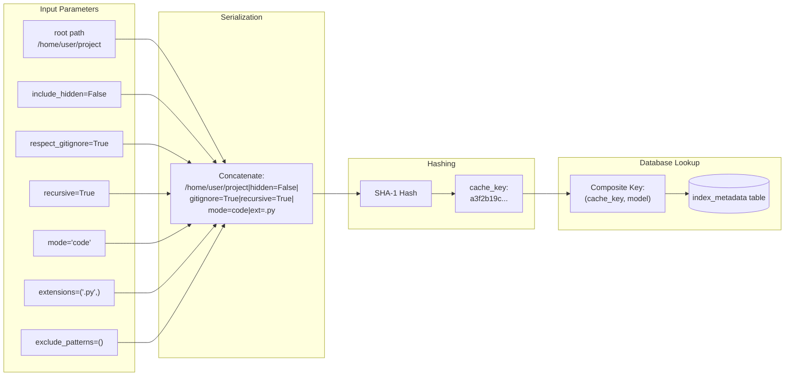
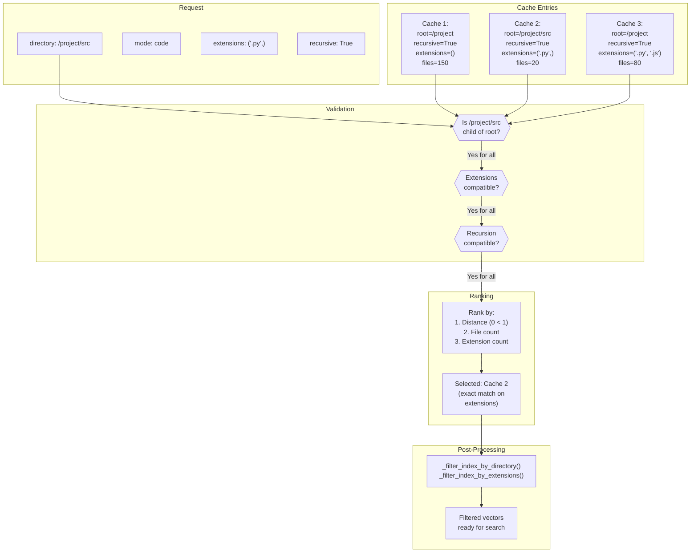
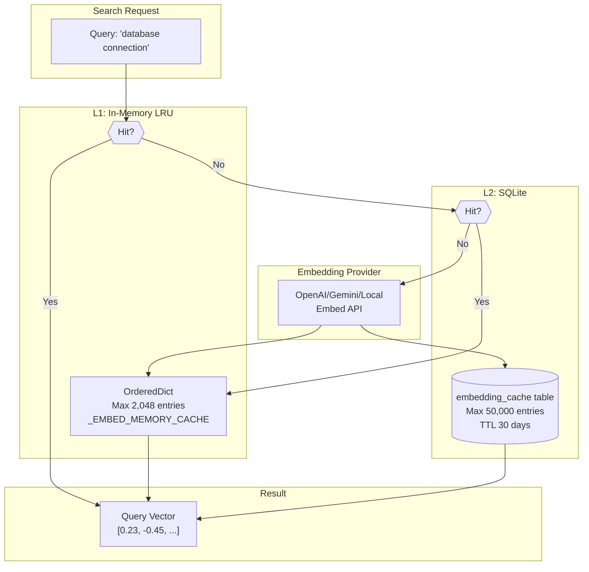

<!-- source: DeepWiki mcp.deepwiki.com · repo scarletkc/vexor · page 8.3 Cache Management · fetched 2026-10-27 -->

# Cache Management

<details>
<summary>Relevant source files</summary>

The following files were used as context for generating this wiki page:

- [tests/unit/test_cache.py](tests/unit/test_cache.py)
- [vexor/cache.py](vexor/cache.py)
- [vexor/cli.py](vexor/cli.py)

</details>


This page explains how to manage Vexor's cache system, including cache key computation, superset cache selection, and manual cache control. For architectural details about the SQLite schema and two-tier caching strategy, see [Cache System](#3.5). For automatic staleness detection and incremental updates, see [Incremental Index Updates](#8.1).

---

## Cache Key Computation

Every cached index is identified by a **cache key**, which is a SHA-1 hash computed from all indexing parameters. This ensures that different search configurations use separate cache entries.

### Parameters Included in Cache Key

The cache key includes:

| Parameter | Description | Example Values |
|-----------|-------------|----------------|
| `root` | Absolute resolved path | `/home/user/project` |
| `include_hidden` | Include hidden files | `True`, `False` |
| `respect_gitignore` | Honor `.gitignore` rules | `True`, `False` |
| `recursive` | Recurse into subdirectories | `True`, `False` |
| `mode` | Extraction mode | `name`, `code`, `full`, etc. |
| `extensions` | File extension filter | `(".py", ".js")` or `()` |
| `exclude_patterns` | Exclusion patterns | `("*.test.js",)` or `()` |

The cache key computation is implemented in [vexor/cache.py:51-72]():

```python
def _cache_key(
    root: Path,
    include_hidden: bool,
    respect_gitignore: bool,
    recursive: bool,
    mode: str,
    extensions: Sequence[str] | None = None,
    exclude_patterns: Sequence[str] | None = None,
) -> str:
```

**Important**: The `model` parameter is **not** part of the cache key. Instead, the same cache key can store indexes for multiple models, distinguished by the `(cache_key, model)` composite key in the database schema.

### Cache Key Diagram



Sources: [vexor/cache.py:51-72](), [vexor/cache.py:148-172]()

---

## Superset Cache Selection

When an exact cache match is not found, Vexor attempts to **reuse a superset cache** instead of rebuilding from scratch. A superset cache is a broader index that contains the requested files as a subset.

### Superset Selection Criteria

A cache entry qualifies as a superset if:

1. **Directory hierarchy**: The cached root is an ancestor of the requested directory
2. **Model match**: Same embedding model
3. **Flags match**: Same `include_hidden`, `respect_gitignore`, `mode`
4. **Recursion compatibility**: If requesting `recursive=True`, the cache must also be recursive
5. **Extension superset**: Cached extensions must be a superset of requested extensions (or both empty)
6. **Exclusion subset**: Cached exclusions must be a subset of requested exclusions (or both empty)

### Selection Algorithm

When multiple superset candidates exist, Vexor ranks them by:

1. **Directory distance** (ascending): Prefer closer ancestors
2. **Recursion mismatch** (ascending): Prefer matching recursion flags
3. **File count** (ascending): Prefer smaller indexes
4. **Extension count** (ascending): Prefer narrower extension filters
5. **Exclusion gap** (ascending): Prefer closer exclusion matches

The implementation is in [vexor/services/search_service.py:910-964]():



Sources: [vexor/services/search_service.py:910-964](), [vexor/services/search_service.py:840-908]()

### Superset Usage Example

Consider this directory structure:

```
/project/
├── src/
│   ├── core.py
│   └── utils.py
├── tests/
│   └── test_core.py
└── README.md
```

If you have a cached recursive index for `/project` with all files, searching `/project/src` will reuse that cache and filter to only `src/` files, avoiding re-embedding.

**CLI behavior**:
```bash
# Creates cache for /project (recursive)
vexor index /project --recursive

# Reuses /project cache, filters to /project/src
vexor search "database connection" /project/src --recursive
```

Sources: [vexor/services/search_service.py:1062-1118](), [tests/unit/test_search_service.py:623-715]()

---

## Query and Embedding Caching

Beyond index caching, Vexor maintains two additional cache layers to avoid redundant embedding API calls:

### 1. Query Vector Cache

Query embeddings are cached per `(index_id, query_hash)`. This enables instant repeated searches of the same query against the same index.

- **Table**: `query_cache` in SQLite
- **Key computation**: [vexor/cache.py:83-90]()
- **Storage**: [vexor/cache.py:1353-1385]()
- **Loading**: [vexor/cache.py:1313-1351]()

**Model normalization**: The model prefix (`openai/`, `gemini/`, etc.) is stripped when computing query cache keys, so `openai/text-embedding-3-small` and `text-embedding-3-small` share the same cache entry.

### 2. General Embedding Cache

Individual text embeddings are cached by `(model, text_hash)`, enabling reuse across different indexes and queries.

- **Table**: `embedding_cache` in SQLite
- **Key computation**: [vexor/cache.py:92-97]()
- **TTL**: 30 days (configurable via `EMBED_CACHE_TTL_DAYS`)
- **Capacity**: 50,000 entries (configurable via `EMBED_CACHE_MAX_ENTRIES`)
- **Auto-pruning**: Triggered on each write operation

### Two-Tier Memory Architecture

Both cache types use a two-tier strategy:



Sources: [vexor/cache.py:33-34](), [vexor/cache.py:99-146](), [vexor/cache.py:1387-1486]()

---

## Manual Cache Control

### Listing Cached Indexes

#### CLI
```bash
# List all cached indexes with metadata
vexor index --show
```

Output includes:
- Root path
- Model
- Mode
- File count
- Recursive flag
- Extensions
- Exclude patterns
- Timestamp

#### Python API
```python
import vexor.cache as cache

entries = cache.list_cache_entries()
for entry in entries:
    print(f"Root: {entry['root_path']}")
    print(f"Model: {entry['model']}")
    print(f"Files: {entry['file_count']}")
```

Sources: [vexor/cache.py:1509-1577]()

### Clearing Specific Indexes

#### CLI
```bash
# Clear index for specific directory
vexor index --clear /path/to/project

# Clear with specific mode
vexor index --clear /path/to/project --mode code

# Clear with specific extensions
vexor index --clear /path/to/project --extensions .py,.js
```

#### Python API
```python
from pathlib import Path
import vexor

# Clear all indexes for a directory
count = vexor.clear_index(
    root=Path("/path/to/project"),
    include_hidden=False,
    mode="code",
    recursive=True
)
print(f"Removed {count} index(es)")

# Clear for specific model only
count = vexor.clear_index(
    root=Path("/path/to/project"),
    model="text-embedding-3-small"
)
```

The `clear_index()` function removes entries matching the cache key criteria. If `model` is specified, only that model's index is removed; otherwise, all models for that cache key are removed.

Sources: [vexor/cache.py:1579-1643]()

### Clearing All Caches

#### CLI
```bash
# Remove entire cache database
vexor config --clear-cache
```

This removes the SQLite database file located at `~/.vexor/index.db`, which contains:
- All index metadata
- All cached embeddings
- All query vectors

#### Python API
```python
import vexor

# Clear all indexes and embeddings
count = vexor.clear_all_cache()
print(f"Removed {count} index(es)")
```

**Warning**: This operation is irreversible and requires re-indexing all projects.

Sources: [vexor/cache.py:1645-1663]()

### Clearing Embedding Caches

The general embedding cache can be pruned separately:

```python
import vexor.cache as cache

# Prune old embeddings (manual trigger)
cache._prune_embedding_cache(
    connection,
    ttl_days=30,
    max_entries=50_000
)
```

However, pruning is automatically triggered during `store_embedding_cache()` operations, so manual pruning is rarely needed.

Sources: [vexor/cache.py:1488-1507]()

---

## Cache Directory Configuration

### Default Location

By default, all cache data is stored in:
```
~/.vexor/index.db
```

### Changing the Cache Directory

#### Global Change
```python
import vexor.cache as cache
from pathlib import Path

# Set globally for the process
cache.set_cache_dir(Path("/custom/cache/dir"))
```

#### Context Manager (Temporary Override)
```python
import vexor.cache as cache
from pathlib import Path

with cache.cache_dir_context("/tmp/vexor-cache"):
    # All cache operations use /tmp/vexor-cache
    vexor.index("/path/to/project")
# Reverts to default after context
```

Sources: [vexor/cache.py:179-216]()

---

## Troubleshooting

### Issue: Cache Not Being Reused

**Symptoms**: Re-embedding files despite unchanged content

**Diagnosis**:
1. Check cache key parameters match:
   ```python
   from vexor.cache import _cache_key
   
   key = _cache_key(
       root=Path("/project"),
       include_hidden=False,
       respect_gitignore=True,
       recursive=True,
       mode="code",
       extensions=None,
       exclude_patterns=None
   )
   print(f"Cache key: {key}")
   ```

2. Verify the index exists:
   ```bash
   vexor index --show | grep "/project"
   ```

**Common causes**:
- Different `mode` parameter
- Different `recursive` flag
- Different `extensions` or `exclude_patterns`
- Model changed but cache key computation doesn't include model

**Solution**: Use consistent parameters or clear and rebuild the index.

### Issue: Stale Cache Warnings

**Symptoms**: "Index is stale" warnings despite recent indexing

**Diagnosis**: File modification times changed (e.g., `git checkout`, file sync)

**Solution**:
```bash
# Force rebuild
vexor index /path/to/project --force
```

Or in Python:
```python
# Clear existing cache first
vexor.clear_index(root=Path("/path/to/project"))

# Rebuild
vexor.index("/path/to/project")
```

### Issue: Out of Memory with Large Caches

**Symptoms**: High memory usage during search

**Diagnosis**: In-memory LRU cache holding too many embeddings

**Solution**: Reduce `EMBED_MEMORY_CACHE_MAX_ENTRIES` (default 2,048):

```python
import vexor.cache as cache

# Before any operations
cache.EMBED_MEMORY_CACHE_MAX_ENTRIES = 512
```

Or disable in-memory caching entirely:
```python
cache.EMBED_MEMORY_CACHE_MAX_ENTRIES = 0
```

### Issue: SQLite Database Locked

**Symptoms**: `sqlite3.OperationalError: database is locked`

**Causes**:
- Concurrent writes from multiple processes
- Long-running transaction held by another process

**Solution**:
1. Wait for the other operation to complete
2. Check for stale locks: restart processes accessing the cache
3. If persistent, clear and rebuild:
   ```bash
   vexor config --clear-cache
   vexor index /path/to/project
   ```

The cache uses `PRAGMA busy_timeout = 5000` (5 seconds) for automatic retry, but deadlocks can still occur with very high concurrency.

### Issue: Superset Cache Not Selected

**Symptoms**: Re-indexing when a broader cache exists

**Diagnosis**: Check superset compatibility:
```python
from vexor.cache import list_cache_entries

entries = list_cache_entries()
for entry in entries:
    print(f"Root: {entry['root_path']}")
    print(f"Recursive: {entry['recursive']}")
    print(f"Extensions: {entry['extensions']}")
    print(f"Exclude: {entry['exclude_patterns']}")
```

**Common causes**:
- Parent cache has `recursive=False` but request needs `recursive=True`
- Parent cache has narrower extensions than request
- Different `mode` or `respect_gitignore` settings

**Solution**: Rebuild parent cache with compatible settings, or accept the separate index.

Sources: [vexor/services/search_service.py:910-964](), [vexor/services/cache_service.py]() (staleness detection), [tests/unit/test_search_service.py:288-370]()

---

## Cache Database Schema Reference

For manual inspection or recovery, the SQLite schema is documented in [Cache System](#3.5). The primary tables are:

| Table | Purpose |
|-------|---------|
| `index_metadata` | Index configuration and timestamps |
| `indexed_file` | File metadata (paths, sizes, mtimes) |
| `indexed_chunk` | Chunk positions and ordering |
| `chunk_embedding` | Vector embeddings (BLOB) |
| `chunk_meta` | Previews, line numbers, labels |
| `query_cache` | Cached query vectors by index |
| `embedding_cache` | General embedding cache |

To inspect directly:
```bash
sqlite3 ~/.vexor/index.db "SELECT root_path, model, file_count FROM index_metadata;"
```

Sources: [vexor/cache.py:301-387]()

---

