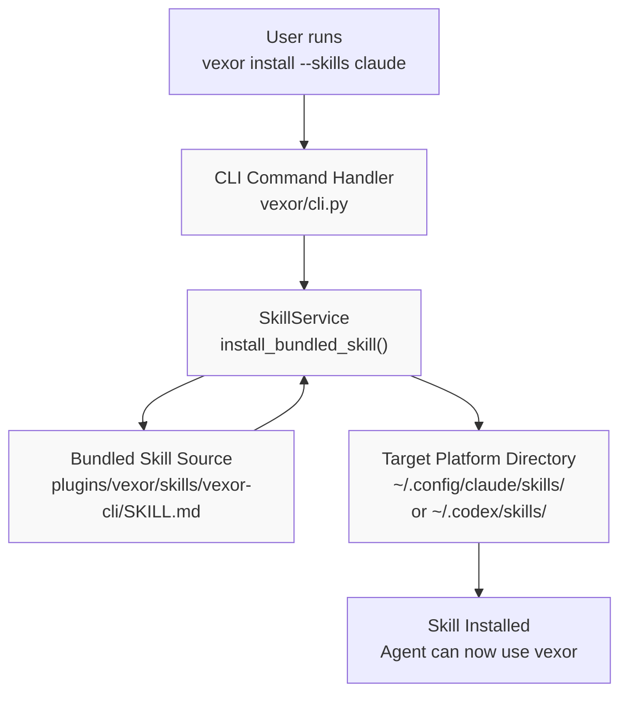
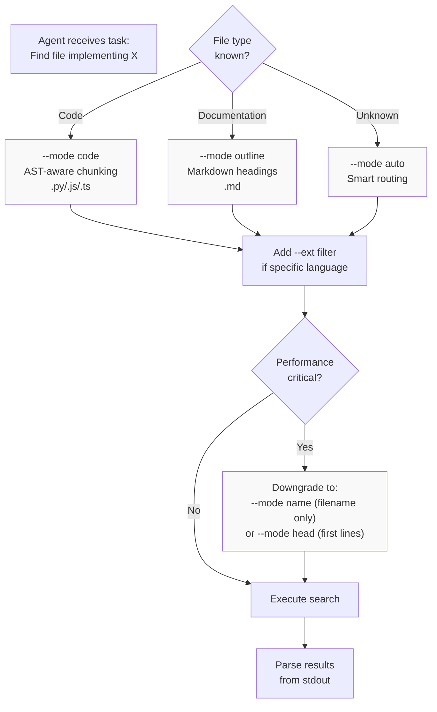
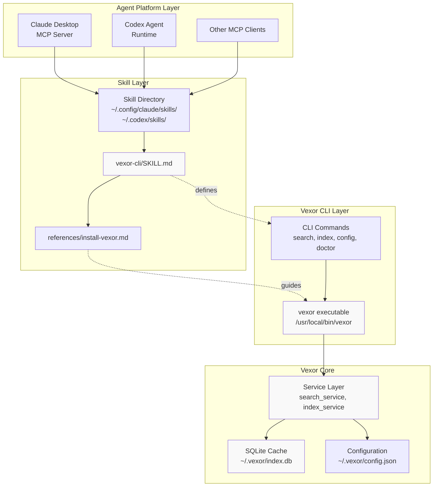

<!-- source: DeepWiki mcp.deepwiki.com · repo scarletkc/vexor · page 8.6 AI Agent Integration · fetched 2026-10-27 -->

# AI Agent Integration

<details>
<summary>Relevant source files</summary>

The following files were used as context for generating this wiki page:

- [README.md](README.md)
- [plugins/vexor/skills/vexor-cli/SKILL.md](plugins/vexor/skills/vexor-cli/SKILL.md)

</details>


## Purpose and Scope

This document explains how to install and configure Vexor skills for AI coding assistants (Claude Code, Codex, and other agents). It covers the skill installation process, skill file format, and best practices for agent-driven semantic file discovery. For CLI command reference, see [CLI Reference](#4). For Python API integration, see [Python API Reference](#5).

---

## Overview

Vexor provides bundled skills that teach AI assistants how to perform semantic file discovery. Skills are declarative capability definitions that include command syntax, usage guidelines, examples, and troubleshooting instructions. When installed, these skills enable AI agents to autonomously locate files by intent rather than exact text matching.

**Supported Platforms:**
- Claude Code (Claude Desktop with MCP integration)
- Codex (GitHub Copilot agents)
- Any MCP-compatible AI assistant

**Sources:** [README.md:106-115]()

---

## Skill Installation

### Command Syntax

```bash
# Install for Claude Code
vexor install --skills claude

# Install for Codex
vexor install --skills codex
```

The `install` command copies the skill definition to the appropriate location for the target platform:
- **Claude Code:** Installs to the MCP skills directory
- **Codex:** Installs to the Codex skills directory

**Sources:** [README.md:110-113](), [README.md:264-265]()

### Installation Flow



**Sources:** [README.md:110-113](), [plugins/vexor/skills/vexor-cli/SKILL.md:1-4]()

---

## Skill Definition Format

Vexor skills use Markdown format with YAML frontmatter. The bundled skill is located at `plugins/vexor/skills/vexor-cli/SKILL.md`.

### Frontmatter Structure

```yaml
---
name: vexor-cli
description: Semantic file discovery via `vexor`. Use whenever locating where something is implemented/loaded/defined in a medium or large repo, or when the file location is unclear. Prefer this over manual browsing.
---
```

The frontmatter defines:
- **name:** Skill identifier (must be unique)
- **description:** When and why the agent should invoke this skill

**Sources:** [plugins/vexor/skills/vexor-cli/SKILL.md:1-4]()

### Skill Content Sections

| Section | Purpose |
|---------|---------|
| **Goal** | High-level objective (e.g., "Find files by intent, not exact text") |
| **Use It Like This** | When to invoke the skill vs. alternatives |
| **Command** | Full command syntax with parameter placeholders |
| **Common Flags** | Parameter descriptions and defaults |
| **Modes** | Indexing strategy explanations (auto, name, head, brief, code, outline, full) |
| **Troubleshooting** | Common issues and diagnostic commands |
| **Examples** | Concrete usage patterns for typical scenarios |
| **Tips** | Performance considerations and workflow advice |

**Sources:** [plugins/vexor/skills/vexor-cli/SKILL.md:8-80]()

---

## Agent Workflow with Vexor

When an AI assistant has the Vexor skill installed, it follows this workflow to discover files:

```mermaid
sequenceDiagram
    participant User
    participant Agent["AI Agent<br/>(Claude/Codex)"]
    participant Skill["vexor-cli Skill<br/>Definition"]
    participant VexorCLI["vexor CLI<br/>Subprocess"]
    participant Cache["SQLite Cache<br/>~/.vexor/index.db"]
    
    User->>Agent: "Find the config loader implementation"
    Agent->>Skill: Check skill catalog
    Skill-->>Agent: vexor-cli skill available
    Agent->>Agent: Match task to skill description:<br/>"locating where something is implemented"
    Agent->>Skill: Read command syntax and examples
    Skill-->>Agent: vexor "config loader" --mode code --ext .py
    Agent->>VexorCLI: Execute command
    
    alt Index Missing
        VexorCLI->>Cache: Check for cached index
        Cache-->>VexorCLI: Not found
        VexorCLI->>VexorCLI: Auto-index if enabled
        VexorCLI->>Cache: Store index
    else Index Current
        VexorCLI->>Cache: Load vectors
    end
    
    VexorCLI->>VexorCLI: Perform semantic search
    VexorCLI-->>Agent: Results (TSV or rich format)
    Agent->>Agent: Parse results:<br/>paths, scores, previews
    Agent-->>User: "Found: ./src/config_loader.py (0.923)"
    Agent->>Agent: Read file for further analysis
```

**Sources:** [plugins/vexor/skills/vexor-cli/SKILL.md:12-16](), [README.md:106-115]()

---

## Command Syntax Reference

The skill teaches agents this command structure:

```bash
vexor "<QUERY>" [--path <ROOT>] [--mode <MODE>] [--ext .py,.md] \
  [--exclude-pattern <PATTERN>] [--top 5] [--format rich|porcelain|porcelain-z]
```

### Critical Parameters

| Parameter | Type | Purpose | Agent Guidance |
|-----------|------|---------|----------------|
| `<QUERY>` | string | Semantic search query | Natural language description of what you're looking for |
| `--path` | directory | Root search directory | Default: current directory |
| `--mode` | enum | Extraction strategy | Pick cheapest that works: `name` → `head` → `code` → `full` |
| `--ext` | list | File extension filter | e.g., `.py,.md` for Python and Markdown only |
| `--exclude-pattern` | pattern | Gitignore-style exclusion | Repeatable; `.js` expands to `**/*.js` |
| `--top` | int | Result count | Default: 5; increase for broader search |
| `--format` | enum | Output format | `rich` (human), `porcelain` (TSV), `porcelain-z` (NUL-delimited) |
| `--no-cache` | flag | In-memory only | Skip cache read/write for one-off searches |

**Sources:** [plugins/vexor/skills/vexor-cli/SKILL.md:18-34]()

---

## Indexing Mode Selection

The skill provides mode selection guidance optimized for agent efficiency:



### Mode Comparison Table

| Mode | Speed | Recall | Use When |
|------|-------|--------|----------|
| `name` | Fastest | Lowest | Filename contains keywords |
| `head` | Fast | Low | First lines are representative |
| `brief` | Fast | Medium | PRD/requirements documents |
| `code` | Medium | High | Python/JS/TS codebases |
| `outline` | Medium | High | Markdown documentation |
| `full` | Slow | Highest | Deep content search needed |
| `auto` | Variable | Variable | Unknown file types (default) |

**Sources:** [plugins/vexor/skills/vexor-cli/SKILL.md:36-44]()

---

## Skill Usage Examples

The bundled skill includes these example patterns that agents can adapt:

### Example 1: Find CLI Entrypoints

```bash
vexor search "typer app commands" --top 5
```

**When to use:** Locating command-line interface definitions, argument parsers, or CLI entrypoints.

### Example 2: Search Documentation by Structure

```bash
vexor search "user authentication flow" --path docs --mode outline --ext .md --format porcelain
```

**When to use:** Finding specific sections in Markdown documentation using heading hierarchy.

### Example 3: Locate Configuration Logic

```bash
vexor search "config loader" --path . --mode code --ext .py
```

**When to use:** Finding configuration loading, parsing, or validation code in Python projects.

### Example 4: Exclude Test Files

```bash
vexor search "config loader" --path . --exclude-pattern tests/** --exclude-pattern .js
```

**When to use:** Filtering out test files and specific languages to focus search scope.

**Sources:** [plugins/vexor/skills/vexor-cli/SKILL.md:53-73]()

---

## Troubleshooting Guidance

The skill provides diagnostic instructions for common agent failures:

### Configuration Issues

```bash
# Check configuration and connectivity
vexor doctor

# View current settings
vexor config --show
```

Agents should run `vexor doctor` when encountering API errors, cache failures, or configuration problems. The diagnostic output includes:
- Command availability check
- Config file validation
- Cache database status
- API key verification
- API connectivity test

### Output Format Issues

For script processing, agents should prefer structured output:

```bash
# Tab-separated values (TSV)
vexor search "query" --format porcelain

# NUL-delimited (for paths with spaces)
vexor search "query" --format porcelain-z
```

**Porcelain fields:** `rank`, `similarity`, `path`, `chunk_index`, `start_line`, `end_line`, `preview`

### File Visibility Issues

```bash
# Include hidden files (dotfiles)
vexor search "query" --include-hidden

# Include gitignored files
vexor search "query" --no-respect-gitignore

# Non-recursive (top-level only)
vexor search "query" --no-recursive
```

**Sources:** [plugins/vexor/skills/vexor-cli/SKILL.md:46-51]()

---

## Installation Requirements

Before agents can use Vexor, it must be installed and configured. The skill references an installation guide:

### Installation Check

The skill instructs agents to check for Vexor availability:

```bash
# Check if vexor is available
which vexor

# If missing, follow installation instructions
# Reference: references/install-vexor.md
```

If `vexor` command is not found, agents should either:
1. Direct the user to install Vexor via `pip install vexor`
2. Provide installation instructions from `references/install-vexor.md` (if bundled with the skill)

### Minimum Configuration

For Vexor to function, the following must be configured:
- **Provider:** `openai`, `gemini`, `voyageai`, `custom`, or `local`
- **API Key:** Via `vexor config --set-api-key` or environment variable
- **Model:** Provider-specific embedding model (optional, defaults per provider)

Agents should instruct users to run `vexor init` for guided setup or `vexor doctor` to diagnose missing configuration.

**Sources:** [plugins/vexor/skills/vexor-cli/SKILL.md:12-16](), [README.md:47-51]()

---

## Performance Considerations

The skill provides performance guidance for agents managing multiple searches:

### First Search (Indexing)

```
First time search will index files (may take a minute). 
Subsequent searches are fast. Use longer timeouts if needed.
```

Agents should set appropriate timeouts (e.g., 60-120 seconds) for initial searches that trigger auto-indexing. Subsequent searches complete in <1 second for typical repositories.

### Cache Reuse

Index cache keys derive from:
- `--path` (root directory)
- `--mode` (extraction strategy)
- `--include-hidden`, `--no-recursive`, `--no-respect-gitignore` (traversal flags)
- `--ext`, `--exclude-pattern` (filtering rules)

Agents should keep these flags consistent across searches to maximize cache reuse. Changing flags creates a new index entry.

### Result Interpretation

```
Results return similarity ranking, exact file location, 
line numbers, and matching snippet preview.
```

Agents can parse structured output to:
1. Prioritize by similarity score (higher = better match)
2. Navigate directly to line numbers (if provided)
3. Show preview snippets to user for confirmation

**Sources:** [plugins/vexor/skills/vexor-cli/SKILL.md:75-79]()

---

## Integration Architecture



**Sources:** [README.md:106-115](), [plugins/vexor/skills/vexor-cli/SKILL.md:1-80]()

---

## Best Practices for Agent Integration

### 1. Use Vexor First for File Discovery

The skill description explicitly states: "Prefer this over manual browsing." Agents should invoke Vexor before attempting:
- Recursive directory listing with `ls -R`
- Manual file searching with `find` or `grep`
- Browsing directory structures to locate implementations

**When not to use Vexor:**
- Exact filename is known (use direct file access)
- Small projects with <10 files (overhead not justified)
- Real-time file creation/deletion monitoring

### 2. Choose Appropriate Modes

Follow this decision tree:
1. **Known file type:** Use `--mode code` (Python/JS/TS) or `--mode outline` (Markdown)
2. **Unknown file type:** Use `--mode auto` (default)
3. **Performance critical:** Downgrade to `--mode name` or `--mode head`
4. **Deep content search:** Upgrade to `--mode full`

### 3. Filter Aggressively

Combine filtering flags to reduce noise:

```bash
# Multiple extensions
vexor search "query" --ext .py --ext .md

# Exclude patterns (repeatable)
vexor search "query" --exclude-pattern tests/** --exclude-pattern __pycache__

# Shorthand: bare extension expands to wildcard
vexor search "query" --exclude-pattern .pyc
```

### 4. Parse Structured Output

For automated processing, use `--format porcelain`:

```python
import subprocess

result = subprocess.run(
    ["vexor", "search", "config loader", "--format", "porcelain"],
    capture_output=True, text=True, check=True
)

for line in result.stdout.strip().split('\n'):
    rank, similarity, path, chunk_idx, start_line, end_line, preview = line.split('\t')
    # Process structured data
```

### 5. Handle First-Run Indexing

When indexing is triggered, agents should:
1. Set timeout to 60-120 seconds
2. Inform user: "Indexing files in [path] (first time, may take a moment)..."
3. Cache the result for subsequent searches
4. If timeout occurs, suggest running `vexor index --path <path>` manually

**Sources:** [plugins/vexor/skills/vexor-cli/SKILL.md:12-79]()

---

## Skill Maintenance and Updates

### Version Compatibility

The bundled skill is versioned with Vexor releases. When agents encounter unexpected output or errors, they should check:

```bash
# Check Vexor version
vexor --version

# Check for updates
vexor update

# Upgrade to latest
vexor update --upgrade
```

### Skill Re-installation

After Vexor upgrades, agents may need to re-install skills to get updated syntax or features:

```bash
# Re-install to sync with new Vexor version
vexor install --skills claude --force  # (if --force flag exists)
```

### Custom Skill Modifications

Platform administrators can modify the installed skill file at:
- `~/.config/claude/skills/vexor-cli/SKILL.md` (Claude)
- `~/.codex/skills/vexor-cli/SKILL.md` (Codex)

Common customizations:
- Adjust default `--top` value for team preferences
- Add project-specific `--exclude-pattern` examples
- Modify mode recommendations based on codebase characteristics

**Sources:** [README.md:110-115](), [README.md:267]()

---

## Related Documentation

- **[CLI Reference](#4):** Full CLI command documentation
- **[Quick Start - CLI](#2.2):** Basic CLI usage tutorial
- **[Indexing Modes](#3.2):** Detailed mode explanations
- **[Configuration Management](#8.2):** Provider and API key setup
- **[Multi-Interface Workflows](#8.7):** Combining CLI with Python API

**Sources:** [README.md:1-304](), [plugins/vexor/skills/vexor-cli/SKILL.md:1-80]()

---

