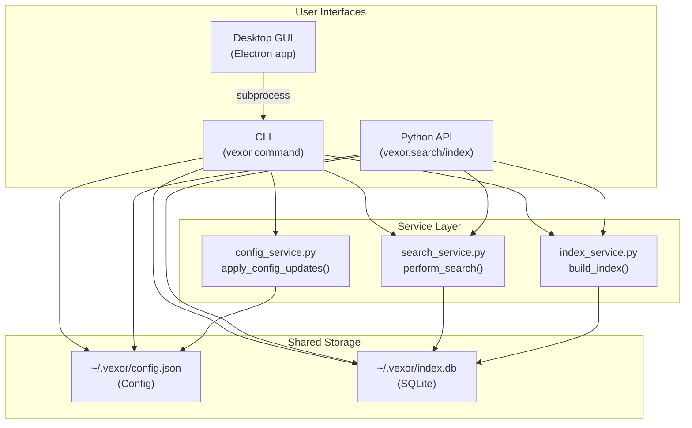
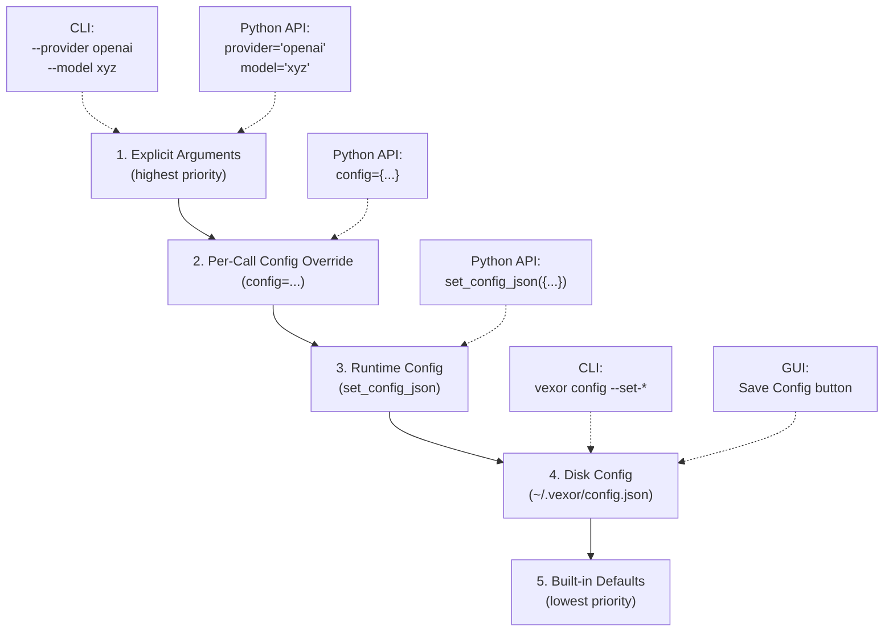
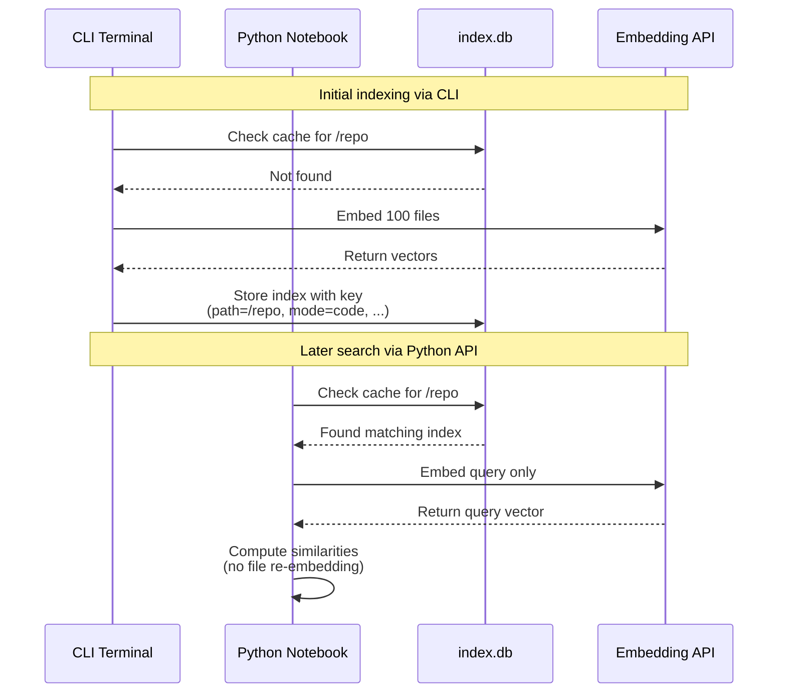
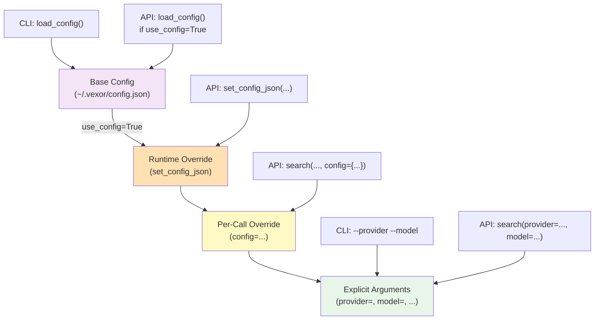

<!-- source: DeepWiki mcp.deepwiki.com · repo scarletkc/vexor · page 8.7 Multi-Interface Workflows · fetched 2026-10-27 -->

# Multi-Interface Workflows

<details>
<summary>Relevant source files</summary>

The following files were used as context for generating this wiki page:

- [docs/api/python.md](docs/api/python.md)
- [gui/src/App.vue](gui/src/App.vue)
- [tests/unit/test_api.py](tests/unit/test_api.py)
- [vexor/api.py](vexor/api.py)
- [vexor/cli.py](vexor/cli.py)

</details>


This document explains how to combine Vexor's three interfaces—CLI, Python API, and Desktop GUI—in sophisticated workflows that leverage the strengths of each. It covers shared state management, configuration precedence, and common integration patterns for users who need programmatic access alongside interactive tooling.

For basic usage of individual interfaces, see [Quick Start - CLI](#2.2), [Quick Start - Python API](#2.3), and [Quick Start - Desktop App](#2.4). For configuration details, see [Configuration System](#7.7). For AI agent integration specifically, see [AI Agent Integration](#8.6).

## Interface Architecture Overview

Vexor provides three entry points that all operate on the same underlying service layer and storage:

| Interface | Primary Use Case | Implementation | Execution Model |
|-----------|-----------------|----------------|-----------------|
| CLI (`vexor`) | Shell scripts, terminal interaction, CI/CD | [vexor/cli.py]() | Direct service layer calls |
| Python API | Programmatic access, notebooks, automation | [vexor/api.py]() | Direct service layer calls |
| Desktop GUI | Visual configuration, file browsing, diagnostics | [gui/src/App.vue]() | Subprocess CLI execution |

All three interfaces share:
- Configuration file at `~/.vexor/config.json`
- SQLite cache at `~/.vexor/index.db`
- Embedding provider credentials
- Reranking settings

**Sources:** [vexor/cli.py:1-90](), [vexor/api.py:1-50](), [gui/src/App.vue:1-50]()

### Interface Relationships



**Key Insight:** The GUI wraps the CLI via subprocess execution at [gui/src/App.vue:931-938](), while the CLI and Python API both make direct service layer calls. This means GUI operations benefit from CLI's comprehensive validation and error handling.

**Sources:** [vexor/cli.py:488-501](), [vexor/api.py:710-801](), [gui/src/App.vue:894-939]()

## Shared State Architecture

All interfaces access two shared storage locations by default:

### Configuration Storage

The file `~/.vexor/config.json` stores persistent settings:

```json
{
  "provider": "openai",
  "model": "text-embedding-3-small",
  "api_key": "sk-...",
  "batch_size": 50,
  "embed_concurrency": 5,
  "auto_index": true,
  "rerank": "bm25"
}
```

**Write Operations:**
- CLI: `vexor config --set-provider openai` at [vexor/cli.py:726-1052]()
- Python API: `vexor.set_config_json(...)` updates runtime config only (no disk write)
- GUI: Uses CLI subprocess to execute `vexor config` commands at [gui/src/App.vue:956-1002]()

**Read Operations:**
- All interfaces: `load_config()` at [vexor/config.py]()
- Python API: Can bypass disk with `use_config=False` parameter

**Sources:** [vexor/cli.py:843-1052](), [vexor/api.py:194-207](), [vexor/config.py:load_config]()

### Cache Storage

The SQLite database at `~/.vexor/index.db` contains:

| Table | Purpose | Shared Across |
|-------|---------|---------------|
| `index_metadata` | Index configuration and file snapshots | All interfaces |
| `indexed_chunk` + `chunk_embedding` | File content vectors | All interfaces |
| `query_cache` | Embedded queries per index | All interfaces |
| `embedding_cache` | General text embeddings | All interfaces |

**Cache Isolation Keys:**
- Directory path (absolute, resolved)
- Model name
- Mode (name/head/full/code/outline)
- Recursive flag
- Include hidden flag
- Respect gitignore flag
- Extensions tuple
- Exclude patterns tuple

This means an index built via CLI with `vexor index --path /repo --mode code` is automatically available to Python API calls with `vexor.search("query", path="/repo", mode="code")`.

**Sources:** [vexor/cache.py:get_index_key](), [vexor/services/search_service.py:272-330]()

## Configuration Precedence Across Interfaces

### Precedence Hierarchy



**Sources:** [vexor/api.py:1029-1106](), [vexor/cli.py:404-462]()

### Interface-Specific Behavior

**CLI:**
- Always reads `~/.vexor/config.json` via `load_config()` at [vexor/cli.py:404-416]()
- Command-line flags override config file
- No runtime config mechanism

**Python API:**
- Module-level functions: Use `_RUNTIME_CONFIG` if set at [vexor/api.py:165-206]()
- `VexorClient`: Uses instance `_runtime_config` at [vexor/api.py:209-256]()
- `use_config=False` skips disk config entirely
- `config=` parameter provides per-call override at [vexor/api.py:732-772]()

**GUI:**
- Reads config for display at [gui/src/App.vue:763-793]()
- Writes config via CLI subprocess at [gui/src/App.vue:997-1002]()
- No direct access to runtime config (uses CLI)

**Sources:** [vexor/cli.py:404-416](), [vexor/api.py:194-207](), [gui/src/App.vue:763-793]()

## Common Workflow Patterns

### Pattern 1: CLI Indexing + Python API Search

Build indexes via CLI in your development workflow, then search programmatically:

```bash
# One-time or scheduled indexing
vexor index --path /workspace/project --mode code --recursive
```

```python
# In your application or notebook
from vexor import search

response = search(
    "authentication logic",
    path="/workspace/project",
    mode="code",
    top=10
)

for result in response.results:
    print(f"{result.path}:{result.start_line} - {result.score:.3f}")
```

**Benefits:**
- Leverage CLI's comprehensive error messages during setup
- Fast programmatic search without rebuild overhead
- Shared cache eliminates duplicate work

**Cache Key Match:** Both use same directory, mode, and flags → same cache entry.

**Sources:** [vexor/cli.py:532-711](), [vexor/api.py:511-571]()

### Pattern 2: GUI Configuration + CLI Scripting

Use GUI for initial setup and provider configuration, then script with CLI:

1. Open Desktop GUI
2. Navigate to "Config & Tools" tab
3. Set provider, API key, model via form at [gui/src/App.vue:295-359]()
4. Click "Save Config" → executes `vexor config --set-*` at [gui/src/App.vue:997-1002]()
5. Close GUI
6. Run CLI commands with saved configuration:

```bash
#!/bin/bash
# Configuration already persisted by GUI
vexor search "database connection" --path . --mode code
```

**Benefits:**
- Visual configuration reduces syntax errors
- GUI validates settings before writing
- CLI inherits all GUI configuration

**Sources:** [gui/src/App.vue:956-1002](), [vexor/cli.py:404-416]()

### Pattern 3: Multiple Data Directories

Run isolated Vexor instances for different projects without configuration conflicts:

```python
from vexor import VexorClient

# Project A: Use OpenAI
client_a = VexorClient(data_dir="/tmp/vexor-project-a")
client_a.set_config_json({
    "provider": "openai",
    "api_key": "sk-proj-a-..."
})
client_a.index(path="/workspace/project-a", mode="code")

# Project B: Use Gemini
client_b = VexorClient(data_dir="/tmp/vexor-project-b")
client_b.set_config_json({
    "provider": "gemini",
    "api_key": "AIza..."
})
client_b.index(path="/workspace/project-b", mode="code")

# Search against different indexes with different models
results_a = client_a.search("auth", path="/workspace/project-a")
results_b = client_b.search("auth", path="/workspace/project-b")
```

Each `data_dir` contains:
- `config.json` (isolated configuration)
- `index.db` (isolated cache)
- `models/` (isolated local models)
- `flashrank/` (isolated reranker cache)

**Implementation:** The context manager `_data_dir_context` at [vexor/api.py:168-186]() temporarily overrides `CONFIG_DIR` and `CACHE_DIR` globals.

**Sources:** [vexor/api.py:168-192](), [vexor/api.py:209-256]()

### Pattern 4: Scoped Configuration Override

Temporarily override configuration without mutating global state:

```python
from vexor import config_context

# Base configuration: Use OpenAI by default
# (from ~/.vexor/config.json)

# Temporarily use Gemini for specific search
with config_context({"provider": "gemini", "api_key": "AIza..."}) as client:
    results = client.search("authentication", path="/workspace", mode="code")
    
# After context exits, subsequent searches use OpenAI again
```

**Implementation:** The `config_context` function at [vexor/api.py:487-509]() creates a `VexorClient`, sets its runtime config, yields it, then clears the config on exit.

**Use Cases:**
- A/B testing different providers
- One-off searches with experimental models
- Temporary dimension overrides

**Sources:** [vexor/api.py:487-509](), [vexor/api.py:242-256]()

### Pattern 5: GUI Diagnostics + CLI Repair

Use GUI for system health checks, then execute CLI commands to fix issues:

1. Open Desktop GUI → "Config & Tools" tab
2. Click "Run doctor" button at [gui/src/App.vue:1040-1042]()
3. Review diagnostic output in Command Log
4. If FlashRank cache is corrupted, click "Clear FlashRank cache"
5. If index is stale, switch to "Search / Index" tab
6. Build fresh index via GUI or drop to terminal:

```bash
vexor index --path /workspace --mode code --clear
```

The `doctor` command at [vexor/cli.py:1142-1267]() checks:
- Provider availability
- API key validity
- Model compatibility
- Cache integrity
- Local model setup
- FlashRank installation

**Sources:** [gui/src/App.vue:1040-1042](), [vexor/cli.py:1142-1267](), [vexor/services/system_service.py:run_all_doctor_checks]()

## Advanced Integration Patterns

### Cross-Interface Cache Reuse



**Cache Key Matching Rules:**

1. Directory paths are resolved to absolute paths at [vexor/utils.py:resolve_directory]()
2. Symlinks are followed to their targets
3. `mode` must match exactly
4. Boolean flags (`recursive`, `include_hidden`, `respect_gitignore`) must match
5. Extensions and exclude patterns must match (order-independent)

**Example: Cache Hit**
```python
# CLI creates cache entry
$ vexor index --path ~/projects/app --mode code --ext .py,.js

# Python API finds cache entry
vexor.search("auth", path="~/projects/app", mode="code", extensions=[".py", ".js"])
# ✓ Cache hit: same resolved path, mode, extensions
```

**Example: Cache Miss**
```python
# CLI creates cache entry with --recursive (default)
$ vexor index --path ~/projects/app --mode code

# Python API misses cache
vexor.search("auth", path="~/projects/app", mode="code", recursive=False)
# ✗ Cache miss: recursive flag differs
```

**Sources:** [vexor/cache.py:get_index_key](), [vexor/services/cache_service.py:load_index_metadata_safe]()

### In-Memory Indexing with Persistent Search

Build temporary indexes via Python API, then search them without disk writes:

```python
from vexor import index_in_memory

# Build index in memory (no cache write)
index = index_in_memory(
    path="/tmp/documents",
    mode="full",
    provider="openai",
    model="text-embedding-3-small",
    no_cache=True  # Skip embedding cache too
)

# Search the in-memory index multiple times
for query in ["contract terms", "payment schedule", "liability"]:
    results = index.search(query, top=5)
    print(f"\n{query}:")
    for r in results:
        print(f"  {r.path.name}: {r.score:.3f}")
```

**Implementation Details:**
- `index_in_memory` at [vexor/api.py:627-679]() calls `build_index_in_memory` from [vexor/services/index_service.py]()
- Returns `InMemoryIndex` dataclass at [vexor/api.py:74-163]()
- The `.search()` method at [vexor/api.py:92-162]() calls `search_from_vectors` at [vexor/services/search_service.py:search_from_vectors]()
- Query embedding still uses cache unless `no_cache=True` is passed to `.search()`

**Use Cases:**
- One-time document analysis without persistent storage
- Testing different indexing modes without polluting cache
- Embedding temporary files (uploads, generated content)

**Sources:** [vexor/api.py:74-163](), [vexor/api.py:627-679](), [vexor/services/index_service.py:build_index_in_memory]()

### Mixed Interface Automation

Combine all three interfaces in a single workflow:

```python
#!/usr/bin/env python3
"""
Automated code review assistant:
1. Use Python API to index repositories
2. Use CLI to generate reports
3. Monitor via GUI
"""

import subprocess
from pathlib import Path
from vexor import VexorClient

# Step 1: Index multiple repositories with Python API
repos = ["/workspace/backend", "/workspace/frontend", "/workspace/mobile"]

for repo_path in repos:
    client = VexorClient(data_dir=f"/tmp/vexor-{Path(repo_path).name}")
    client.set_config_json({
        "provider": "openai",
        "model": "text-embedding-3-small",
        "embedding_dimensions": 512
    })
    
    print(f"Indexing {repo_path}...")
    result = client.index(
        path=repo_path,
        mode="code",
        recursive=True,
        extensions=[".py", ".js", ".ts"]
    )
    print(f"  Indexed {result.files_indexed} files")

# Step 2: Run searches via CLI for report generation
queries = [
    "SQL injection vulnerability",
    "hardcoded credentials",
    "authentication bypass"
]

for query in queries:
    for repo_path in repos:
        cmd = [
            "vexor", "search", query,
            "--path", repo_path,
            "--mode", "code",
            "--format", "porcelain",  # Machine-readable output
            "--top", "10"
        ]
        
        result = subprocess.run(cmd, capture_output=True, text=True)
        if result.returncode == 0 and result.stdout.strip():
            print(f"\n{query} in {repo_path}:")
            for line in result.stdout.strip().split("\n"):
                parts = line.split("\t")
                print(f"  {parts[2]} (score: {parts[1]})")

# Step 3: GUI monitoring
print("\nOpen Vexor Desktop GUI to:")
print("  - Review search results visually")
print("  - Run diagnostics with 'vexor doctor'")
print("  - Adjust configuration if needed")
```

**Benefits:**
- Python API: Programmatic control, data directory isolation
- CLI: Structured output (`--format porcelain`), shell integration
- GUI: Visual review, configuration management, diagnostics

**Sources:** [vexor/api.py:209-256](), [vexor/cli.py:349-529](), [gui/src/App.vue:894-939]()

### Configuration Layering Strategy



**Example: Maximum Flexibility**

```python
from vexor import VexorClient

# Base: OpenAI from disk config
# (provider=openai, model=text-embedding-3-small in ~/.vexor/config.json)

client = VexorClient()

# Runtime: Override to use higher dimensions
client.set_config_json({"embedding_dimensions": 1536})

# Most searches use OpenAI with 1536 dimensions
results1 = client.search("auth", path="/repo", mode="code")

# Per-call: One-off test with Gemini
results2 = client.search(
    "auth", 
    path="/repo", 
    mode="code",
    config={"provider": "gemini"}  # Temporary override
)

# Explicit: Override specific parameter
results3 = client.search(
    "auth",
    path="/repo",
    mode="code",
    embedding_dimensions=512  # Just this search
)

# Runtime override still active for subsequent calls
results4 = client.search("auth", path="/repo", mode="code")
# Uses: provider=openai, embedding_dimensions=1536
```

**Sources:** [vexor/api.py:1029-1106](), [vexor/api.py:242-256]()

## Troubleshooting Multi-Interface Issues

### Issue: Config changes not visible across interfaces

**Symptom:** Setting `--set-provider gemini` via CLI doesn't affect Python API searches.

**Cause:** Python API using `use_config=False` or runtime config override.

**Solution:**
```python
# Ensure disk config is read
from vexor import search

response = search("query", path="/repo", use_config=True)  # Default

# OR clear runtime override
from vexor import set_config_json
set_config_json(None)  # Clear runtime config
```

**Sources:** [vexor/api.py:1042-1050](), [vexor/api.py:194-207]()

### Issue: Cache not shared between CLI and API

**Symptom:** Python API rebuilds index that CLI already created.

**Cause:** Path resolution mismatch (relative vs absolute, symlinks, trailing slashes).

**Diagnosis:**
```python
from pathlib import Path
from vexor.utils import resolve_directory

# Check how path resolves
cli_path = resolve_directory("~/projects/app")  # /home/user/projects/app
api_path = resolve_directory("/home/user/projects/app")  # Same
symlink_path = resolve_directory("/workspace")  # Resolves to real path

print(cli_path == api_path)  # Must be True for cache hit
```

**Solution:** Use consistent absolute paths or let `resolve_directory` normalize them.

**Sources:** [vexor/utils.py:resolve_directory](), [vexor/cache.py:get_index_key]()

### Issue: GUI shows "CLI not found"

**Symptom:** Desktop GUI displays "CLI not found. Download it or set a CLI path first."

**Cause:** `vexor` command not on PATH and no downloaded CLI exists.

**Solution:**

1. **Option A:** Download via GUI
   - Click "Download CLI" button at [gui/src/App.vue:1102-1118]()
   - Click "Add Downloaded CLI to PATH"
   
2. **Option B:** Set custom CLI path
   - Install via `pip install vexor`
   - In GUI "Config & Tools" tab, set "CLI Path" to output of `which vexor`
   - Saves to localStorage at [gui/src/App.vue:605-607]()

3. **Option C:** Add to PATH manually
   ```bash
   export PATH="$PATH:$HOME/.vexor/bin"
   ```

**Sources:** [gui/src/App.vue:795-807](), [gui/src/App.vue:1102-1160]()

### Issue: Different embedding dimensions across interfaces

**Symptom:** Index created with CLI doesn't match API search expectations.

**Cause:** Dimension mismatch between indexing and search.

**Diagnosis:**
```bash
# Check index dimension
vexor index --show --path /repo

# Output shows: dimension: 1536
```

```python
# API search with different dimension fails
vexor.search("query", path="/repo", embedding_dimensions=512)
# Error: Dimension mismatch
```

**Solution:** Ensure consistent `embedding_dimensions` or rebuild index:
```bash
vexor index --path /repo --clear
```

Then configure dimension uniformly:
```bash
vexor config --set-embedding-dimensions 512
```

**Sources:** [vexor/cli.py:607-644](), [vexor/api.py:1077-1088](), [vexor/config.py:validate_embedding_dimensions_for_model]()

---

