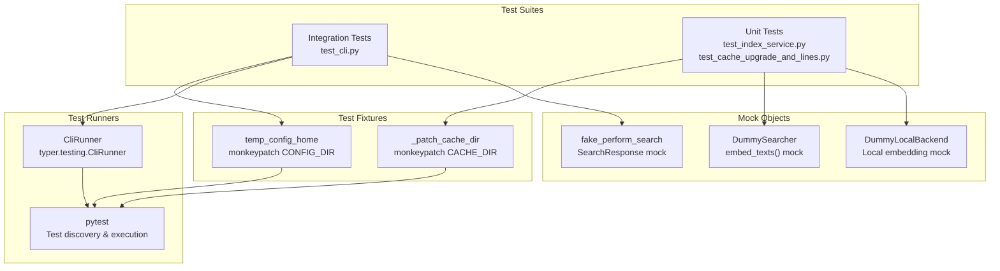
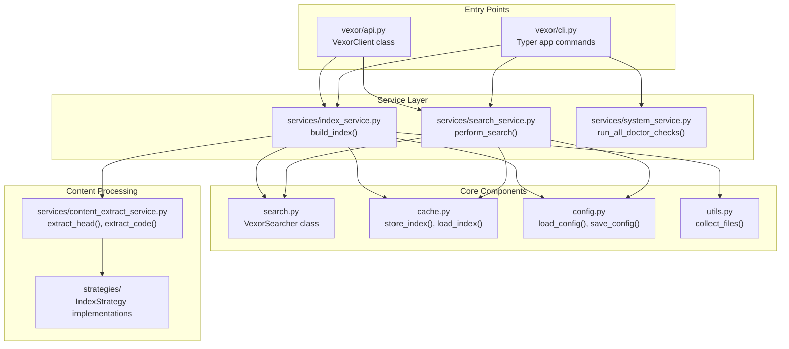

<!-- source: DeepWiki mcp.deepwiki.com · repo scarletkc/vexor · page 9 Development and Contributing · fetched 2026-10-27 -->

# Development and Contributing

<details>
<summary>Relevant source files</summary>

The following files were used as context for generating this wiki page:

- [README.md](README.md)
- [docs/roadmap.md](docs/roadmap.md)
- [tests/unit/test_cache_upgrade_and_lines.py](tests/unit/test_cache_upgrade_and_lines.py)
- [tests/unit/test_index_service.py](tests/unit/test_index_service.py)

</details>


This section covers the full developer and contributor workflow for Vexor: environment setup, test infrastructure, codebase navigation, contribution conventions, planned features, and the CI/CD build and release pipeline.

| Subsection | Purpose |
|---|---|
| [9.1 Development Setup](#9.1) | Clone, editable install, optional extras, GUI environment |
| [9.2 Testing](#9.2) | Unit and integration test structure, fixtures, running pytest |
| [9.3 Project Structure](#9.3) | Directory layout, what lives where |
| [9.4 Contributing Guidelines](#9.4) | Contribution workflow and coding conventions from `AGENTS.md` |
| [9.5 Roadmap](#9.5) | Planned features and performance improvements |
| [9.6 Build and Release](#9.6) | CI/CD pipeline, PyInstaller packaging, version management |

---

## Development Workflow Overview

Vexor uses `pytest` for testing, `hatchling` for builds, `typer` for CLI development, and `pyinstaller` for standalone executables. Tests are organized into unit and integration suites, both run offline via fake provider fixtures.

**Development cycle — key commands and files involved**

```mermaid
flowchart LR
    A["Edit source\nvexor/ or tests/"]
    B["pytest tests/\npytest --cov=vexor\n--cov-report=term-missing"]
    C["python -m vexor --help\nvexor index --path . --mode head\nvexor search \"query\" --path ."]
    D["git commit"]
    E["GitHub PR"]
    F["CI: pytest_job\nprepare_release\nbuild_release\npublish_release\npublish_pypi"]
    G["Code Review"]
    H["Merge"]

    A --> B
    B --> C
    C --> D
    D --> E
    E --> F
    F --> G
    G --> H
    G --> A
```

Sources: [AGENTS.md:6-11](), [pyproject.toml:59-65]()

---

## Testing Infrastructure

Vexor maintains comprehensive test coverage through two test suites: integration tests that exercise CLI commands end-to-end, and unit tests that verify individual components in isolation.

### Test Organization

| Test Type | Location | Purpose | Key Patterns |
|-----------|----------|---------|--------------|
| **Integration Tests** | `tests/integration/test_cli.py` | End-to-end CLI command validation | `CliRunner`, full command execution |
| **Unit Tests - Index Service** | `tests/unit/test_index_service.py` | Index building and caching logic | `DummySearcher`, cache mocking |
| **Unit Tests - Cache** | `tests/unit/test_cache_upgrade_and_lines.py` | Schema upgrades and data migrations | SQLite direct manipulation |

### Testing Architecture Diagram



**Sources:** [tests/integration/test_cli.py:1-1545](), [tests/unit/test_index_service.py:1-306](), [tests/unit/test_cache_upgrade_and_lines.py:1-127]()

### Key Testing Patterns

**Test Fixture: Configuration Isolation**

The `temp_config_home` fixture ensures tests do not interfere with user configuration:

```python
@pytest.fixture(autouse=True)
def temp_config_home(tmp_path, monkeypatch):
    config_dir = tmp_path / "config"
    config_file = config_dir / "config.json"
    monkeypatch.setattr("vexor.config.CONFIG_DIR", config_dir)
    monkeypatch.setattr("vexor.config.CONFIG_FILE", config_file)
    return config_file
```

**Sources:** [tests/integration/test_cli.py:25-31]()

**Mock Object: DummySearcher**

Tests use `DummySearcher` to avoid real embedding API calls:

```python
class DummySearcher:
    def __init__(self, *args, **kwargs):
        self.device = "dummy"
    
    def embed_texts(self, texts):
        if not texts:
            return np.zeros((0, 3), dtype=np.float32)
        return np.ones((len(texts), 3), dtype=np.float32)
```

**Sources:** [tests/unit/test_index_service.py:12-24](), [tests/integration/test_cli.py:1487-1494]()

**Monkeypatching Strategy**

Tests extensively use `monkeypatch` to inject dependencies:

```python
monkeypatch.setattr("vexor.search.VexorSearcher", DummySearcher)
monkeypatch.setattr("vexor.cli.perform_search", fake_perform_search)
monkeypatch.setattr("vexor.cache.CACHE_DIR", cache_dir)
```

This pattern allows testing without external dependencies (API keys, network access, etc.).

**Sources:** [tests/integration/test_cli.py:60](), [tests/unit/test_index_service.py:34]()

### CLI Testing with CliRunner

Integration tests use `typer.testing.CliRunner` to invoke commands programmatically:

```python
runner = CliRunner()
result = runner.invoke(
    app,
    ["search", "alpha", "--path", str(tmp_path), "--top", "1"],
)
assert result.exit_code == 0
assert "alpha.txt" in result.stdout
```

**Sources:** [tests/integration/test_cli.py:62-75]()

### Test Coverage Areas

The test suite validates:

| Component | Test Examples |
|-----------|---------------|
| **Search Command** | Output formats (rich/porcelain/porcelain-z), flag parsing, auto-indexing, staleness warnings |
| **Index Command** | Building, clearing, showing metadata, incremental updates, empty directories |
| **Config Command** | Setting providers, API keys, reranking options, editing config file |
| **Local Command** | Setup, cleanup, CUDA/CPU toggling |
| **Init Wizard** | Interactive configuration flow |
| **Doctor Command** | System diagnostics |
| **Update Command** | Version checking, upgrade process |
| **Install Command** | Skills installation for AI agents |

**Sources:** [tests/integration/test_cli.py:34-1486]()

---

## Project Code Structure

### Component Interaction for Development



**Sources:** Project structure from repository

### Key Modules for Contributors

| Module | Primary Classes/Functions | Purpose |
|--------|---------------------------|---------|
| `vexor/cli.py` | `app`, `search_command()`, `index_command()` | CLI command definitions |
| `vexor/api.py` | `VexorClient`, `search()`, `index()` | Python API interface |
| `vexor/search.py` | `VexorSearcher`, `SearchResult` | Embedding generation and similarity search |
| `vexor/cache.py` | `store_index()`, `load_index()`, `load_index_vectors()` | SQLite-backed caching |
| `vexor/config.py` | `load_config()`, `save_config()`, `resolve_provider()` | Configuration management |
| `vexor/services/search_service.py` | `perform_search()`, `SearchRequest`, `SearchResponse` | Search orchestration |
| `vexor/services/index_service.py` | `build_index()`, `IndexResult`, `IndexStatus` | Index building orchestration |
| `vexor/services/content_extract_service.py` | `extract_head()`, `extract_code()` | Content extraction strategies |
| `vexor/utils.py` | `collect_files()`, `is_gitignored()` | File system utilities |

**Sources:** [tests/integration/test_cli.py:8-15](), [tests/unit/test_index_service.py:5-7]()

---

## Development Environment Requirements

### Core Dependencies

| Dependency | Purpose | Version Constraint |
|------------|---------|-------------------|
| **Python** | Runtime | ≥3.9 |
| **typer** | CLI framework | ~2.0 |
| **numpy** | Vector operations | ≥1.20 |
| **pytest** | Testing framework | Latest |
| **openai** | OpenAI provider | Latest |
| **google-generativeai** | Gemini provider | Latest |

### Optional Development Dependencies

| Dependency | Purpose | When Needed |
|------------|---------|-------------|
| **fastembed** | Local embeddings | Testing local provider |
| **flashrank** | Neural reranking | Testing FlashRank |
| **mypy** | Type checking | Static analysis |
| **black** | Code formatting | Code style enforcement |

**Sources:** Repository dependency files

---

## Contributing Process

### Contribution Types

Vexor welcomes several types of contributions:

1. **Bug Fixes**: Address issues in existing functionality
2. **Feature Additions**: Implement new capabilities (see [Roadmap](#9.5))
3. **Test Coverage**: Add tests for untested code paths
4. **Documentation**: Improve code comments and user documentation
5. **Performance Improvements**: Optimize existing operations

### Code Quality Requirements

**Testing Requirements**

All new features and bug fixes must include tests:

- CLI commands require integration tests in `tests/integration/test_cli.py`
- Service layer changes require unit tests in `tests/unit/`
- Cache schema changes require upgrade tests
- New extraction modes require end-to-end tests

Example test structure for a new CLI command:

```python
def test_new_command_basic_usage(tmp_path, monkeypatch):
    runner = CliRunner()
    # Setup test environment
    # Invoke command
    result = runner.invoke(app, ["new-command", "--flag", "value"])
    # Assert expected behavior
    assert result.exit_code == 0
```

**Sources:** [tests/integration/test_cli.py:34-83]()

**Monkeypatch Pattern for External Dependencies**

When testing code that calls external APIs:

```python
def test_with_external_api(tmp_path, monkeypatch):
    captured = {}
    
    def fake_api_call(request):
        captured["request"] = request
        return expected_response
    
    monkeypatch.setattr("vexor.module.real_function", fake_api_call)
    # Test code that calls real_function
```

**Sources:** [tests/integration/test_cli.py:38-58]()

### Common Development Tasks

**Adding a New Index Mode**

1. Create extraction function in `vexor/services/content_extract_service.py`
2. Create strategy class in `vexor/strategies/`
3. Register strategy in `get_strategy()` function
4. Add CLI flag support in `vexor/cli.py`
5. Add tests in `tests/integration/test_cli.py` and `tests/unit/test_index_service.py`

**Adding a New Embedding Provider**

1. Implement provider class following `VexorSearcher` interface
2. Add provider resolution in `vexor/config.py`
3. Add configuration options in `vexor/cli.py` config command
4. Add provider-specific tests with mocked API calls

**Modifying Cache Schema**

1. Update table definitions in `vexor/cache.py`
2. Increment `CACHE_VERSION` constant
3. Add migration logic in `_ensure_schema()`
4. Add upgrade test in `tests/unit/test_cache_upgrade_and_lines.py`

**Sources:** [tests/unit/test_cache_upgrade_and_lines.py:12-64]()

---

## Roadmap Highlights

The project roadmap includes several high-priority features:

### Near-Term Priorities

| Feature | Description | Status |
|---------|-------------|--------|
| **OCR Support** | Image content extraction using `rapidocr-onnxruntime` | In Development |
| **Azure Provider** | Azure OpenAI embedding support | Planned |
| **Go/Rust Code Mode** | AST-aware chunking via tree-sitter | Planned |

### Performance Improvements

| Optimization | Target Area | Expected Impact |
|--------------|-------------|-----------------|
| **Vector Storage Migration** | Replace SQLite blobs with `memmap` | Faster search initialization |
| **Async Embedding APIs** | Use `AsyncOpenAI`, async Gemini | Reduced thread overhead |
| **Adaptive Batching** | Dynamic batch size based on API responses | Better throughput |
| **Batch Query API** | Multiple queries per search call | Reduced I/O |

### Ecosystem Integration

| Integration | Description | Priority |
|-------------|-------------|----------|
| **VS Code Extension** | Native editor integration | High |
| **Official API Relay** | Managed embedding service | Medium |
| **Per-Project Cache** | `.vexor/` directory support | Medium |
| **`.vexorignore`** | Project-specific ignore rules | Low |

For detailed roadmap information, see [Roadmap](#9.5).

**Sources:** [docs/roadmap.md:1-20]()

---

## Testing Best Practices for Contributors

### Isolation and Determinism

Tests must be isolated and deterministic:

- Use `tmp_path` fixtures for file system operations
- Use `monkeypatch` to override global state
- Mock all external API calls
- Avoid relying on system configuration

**Example: Isolated Cache Testing**

```python
def _patch_cache_dir(tmp_path, monkeypatch):
    cache_dir = tmp_path / "cache"
    monkeypatch.setattr(cache, "CACHE_DIR", cache_dir)
```

**Sources:** [tests/unit/test_index_service.py:27-29]()

### Testing Incremental Updates

Index service tests verify incremental update logic:

```python
def test_build_index_runs_incremental_update(tmp_path, monkeypatch):
    # Initial index build
    first = build_index(root, ...)
    assert first.status == IndexStatus.STORED
    
    # Modify one file
    file_a.write_text("updated")
    
    # Rebuild should skip unchanged files
    second = build_index(root, ...)
    assert second.status == IndexStatus.STORED
    # Verify only changed file was re-embedded
```

**Sources:** [tests/unit/test_index_service.py:32-92]()

### Testing Cache Schema Upgrades

Cache upgrade tests verify data migration:

```python
def test_ensure_schema_upgrades_legacy_indexed_file(tmp_path, monkeypatch):
    # Create legacy schema
    conn.executescript("""CREATE TABLE indexed_file (...)""")
    
    # Run upgrade
    cache._ensure_schema(conn)
    
    # Verify new schema exists
    table_names = {row[0] for row in conn.execute("SELECT name FROM sqlite_master")}
    assert "indexed_chunk" in table_names
```

**Sources:** [tests/unit/test_cache_upgrade_and_lines.py:12-64]()

### Testing CLI Output Formats

CLI tests verify all output formats (rich, porcelain, porcelain-z):

```python
def test_search_outputs_porcelain(tmp_path, monkeypatch):
    result = runner.invoke(app, ["search", "query", "--format", "porcelain"])
    assert result.exit_code == 0
    assert "1\t0.990\t./file.txt\t0\t5\t6\tpreview\n" in result.stdout
```

**Sources:** [tests/integration/test_cli.py:215-261]()

---

## Debugging and Development Tools

### Running Individual Tests

```bash
# Run specific test file
pytest tests/unit/test_index_service.py

# Run specific test function
pytest tests/integration/test_cli.py::test_search_outputs_table

# Run with verbose output
pytest -v tests/

# Run with print statements visible
pytest -s tests/
```

### Using Monkeypatch for Debugging

When debugging test failures, inspect captured data:

```python
def test_with_debugging(tmp_path, monkeypatch):
    captured = {}
    
    def fake_function(*args, **kwargs):
        captured["args"] = args
        captured["kwargs"] = kwargs
        return expected_value
    
    monkeypatch.setattr("module.function", fake_function)
    
    # Run test
    result = some_operation()
    
    # Debug captured values
    print(f"Function was called with: {captured}")
```

**Sources:** [tests/integration/test_cli.py:38-82]()

### CLI Development Mode

Run Vexor from source for development:

```bash
# Run CLI from source
python -m vexor search "query"

# Run with Python debugger
python -m pdb -m vexor search "query"

# Install in editable mode
pip install -e .
```

---

## Summary

Vexor's development infrastructure emphasizes testability, modularity, and contributor accessibility. The test suite provides comprehensive coverage through integration and unit tests, with extensive use of mocking and fixture isolation. Contributors should familiarize themselves with the testing patterns, understand the modular architecture, and follow the established contribution workflow.

For next steps:
- Set up your development environment: [Development Setup](#9.1)
- Understand the test suite: [Testing](#9.2)
- Navigate the codebase: [Project Structure](#9.3)
- Review contribution process: [Contributing Guidelines](#9.4)
- See planned features: [Roadmap](#9.5)

---

