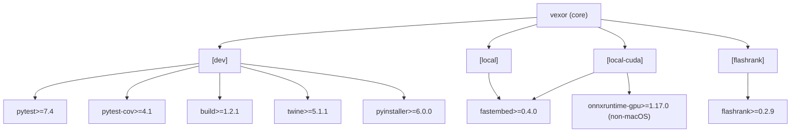
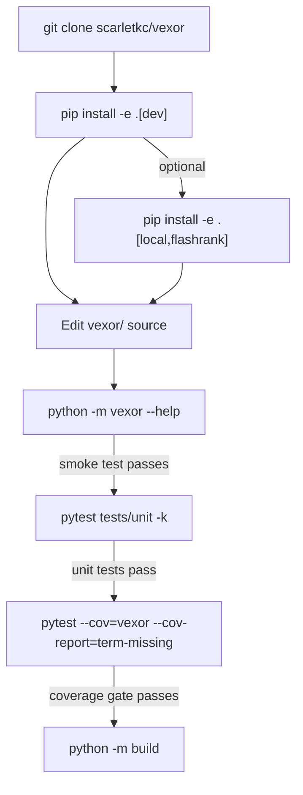
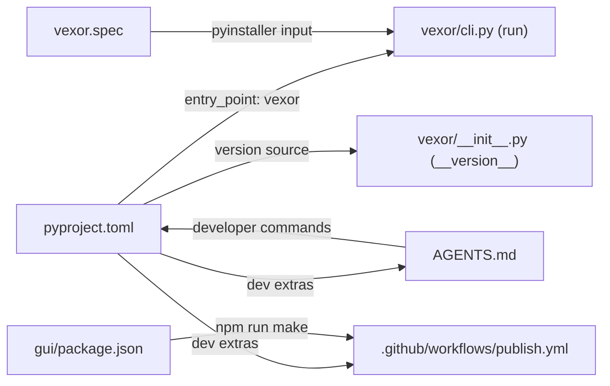

<!-- source: DeepWiki mcp.deepwiki.com · repo scarletkc/vexor · page 9.1 Development Setup · fetched 2026-10-27 -->

# Development Setup

<details>
<summary>Relevant source files</summary>

The following files were used as context for generating this wiki page:

- [README.md](README.md)

</details>


This page covers the steps needed to set up a local development environment for Vexor: cloning the repo, installing in editable mode, enabling optional feature sets, running the test suite, and starting the GUI development environment. For information about the CI/CD pipeline that runs on push to `main`, see [Build and Release](#9.6). For the repository's directory layout and module responsibilities, see [Project Structure](#9.3). For testing conventions specifically, see [Testing](#9.2).

---

## Prerequisites

| Requirement | Minimum Version | Notes |
|---|---|---|
| Python | 3.9 | 3.10 is used in CI |
| pip | latest | `pip install --upgrade pip` recommended |
| Node.js | 20 | Only required for GUI development |
| npm | bundled with Node 20 | GUI dependency management |

The Python version floor is declared in [pyproject.toml:12]() (`requires-python = ">=3.9"`). CI runs on Python 3.10 [.github/workflows/publish.yml:19-22]().

---

## Cloning and Editable Install

```
git clone https://github.com/scarletkc/vexor
cd vexor
pip install -e ".[dev]"
```

The `.[dev]` extra installs the package in editable mode along with all development tooling declared in [pyproject.toml:59-65]():

| Package | Role |
|---|---|
| `pytest>=7.4` | Test runner |
| `pytest-cov>=4.1` | Coverage reporting |
| `build>=1.2.1` | Wheel and sdist packaging (`python -m build`) |
| `twine>=5.1.1` | PyPI upload |
| `pyinstaller>=6.0.0` | Standalone binary packaging (`vexor.spec`) |

After installation, the `vexor` CLI entry point (defined as `vexor = "vexor.cli:run"` in [pyproject.toml:73-74]()) becomes available. Verify with:

```
python -m vexor --help
```

Sources: [pyproject.toml:59-65](), [AGENTS.md:6-11]()

---

## Optional Extras

The following extras can be appended to the install command or added afterward with `pip install "vexor[extra]"`. They are independent of `[dev]`.

**Dependency diagram for optional extras**



Sources: [pyproject.toml:51-68]()

| Extra | Install Command | What It Enables |
|---|---|---|
| `dev` | `pip install -e ".[dev]"` | pytest, coverage, PyInstaller, twine |
| `local` | `pip install -e ".[local]"` | `fastembed` for local CPU embeddings |
| `local-cuda` | `pip install -e ".[local-cuda]"` | `fastembed` + `onnxruntime-gpu` for CUDA inference |
| `flashrank` | `pip install -e ".[flashrank]"` | `flashrank` for local neural reranking |

Combining extras is supported: `pip install -e ".[dev,local,flashrank]"`.

`onnxruntime-gpu` is excluded on macOS; the `local-cuda` extra uses the platform marker `platform_system != "Darwin"` [pyproject.toml:56-58]().

Sources: [pyproject.toml:51-68](), [AGENTS.md:7]()

---

## Smoke-Testing the Install

After `pip install -e ".[dev]"`:

```
# Verify the CLI loads correctly
python -m vexor --help

# Realistic index run (no API key needed for the --mode name)
vexor index --path . --mode head

# Search against the indexed directory
vexor search "config loader" --path . --mode name
```

These are the same commands used in AGENTS.md for manual verification [AGENTS.md:8]().

---

## Running the Test Suite

**Basic run (offline, uses fake providers):**
```
pytest
```

**Scope a specific area:**
```
pytest tests/unit -k cache
```

**With coverage report (required before merging):**
```
pytest --cov=vexor --cov-report=term-missing
```

**CI equivalent (generates XML for Codecov upload):**
```
python -m pytest -q --cov=vexor --cov-report=xml
```

The `pythonpath = ["."]` option in [pyproject.toml:96]() ensures the repo root is on `sys.path` so imports work without installation quirks. Tests are organized under `tests/unit/` and `tests/integration/`; all tests run against fake embedding providers so no API keys are required.

Sources: [pyproject.toml:94-97](), [AGENTS.md:9-11](), [.github/workflows/publish.yml:84-88]()

---

## Development Workflow Diagram

**From clone to verified change**



Sources: [AGENTS.md:6-11](), [pyproject.toml:59-68]()

---

## GUI Development Environment

The desktop application lives under `gui/` and is built with Electron and Vue. It is marked experimental. Node 20 is required.

**Initial setup:**
```
cd gui
npm ci
```

**Start the dev server (hot-reload):**
```
npm run start
```
*(Refer to `gui/package.json` for the exact script names exposed by the Electron Forge configuration.)*

**Build a distributable zip:**
```
npm run make
```

The CI build matrix uses `npm ci` followed by `npm run make` and captures the output at `gui/out/make/zip/<platform>/*/*.zip` [.github/workflows/publish.yml:307-338]().

The GUI communicates with the CLI via an IPC bridge (`preload.js`). During development the GUI expects the `vexor` binary to be on `PATH`; the editable install from the Python setup step satisfies this.

Sources: [.github/workflows/publish.yml:307-346](), [AGENTS.md:4]()

---

## Building the Standalone Binary

PyInstaller is included in the `[dev]` extra and is driven by `vexor.spec` at the repo root.

```
rm -rf dist build
pyinstaller vexor.spec
```

The output binary is placed in `dist/vexor` (Linux) or `dist/vexor.exe` (Windows). This mirrors the CI `build_release` job [.github/workflows/publish.yml:244-247]().

Sources: [.github/workflows/publish.yml:239-247](), [pyproject.toml:64]()

---

## Key Files at a Glance

**Module map for development-relevant entry points**



Sources: [pyproject.toml:73-77](), [AGENTS.md:4-11](), [.github/workflows/publish.yml:1-10]()

---

