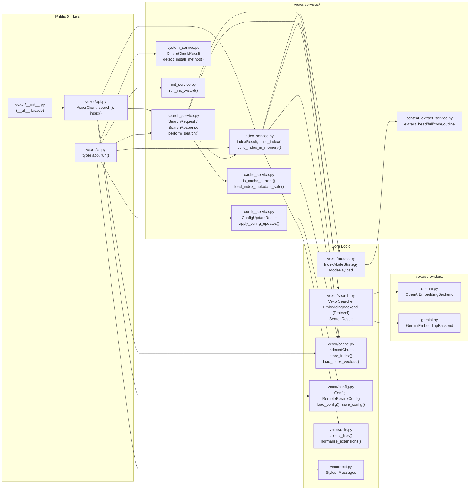
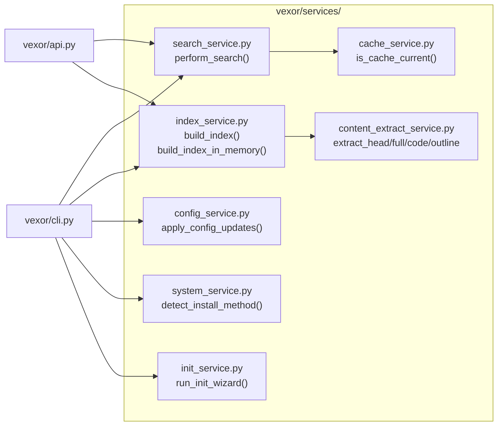
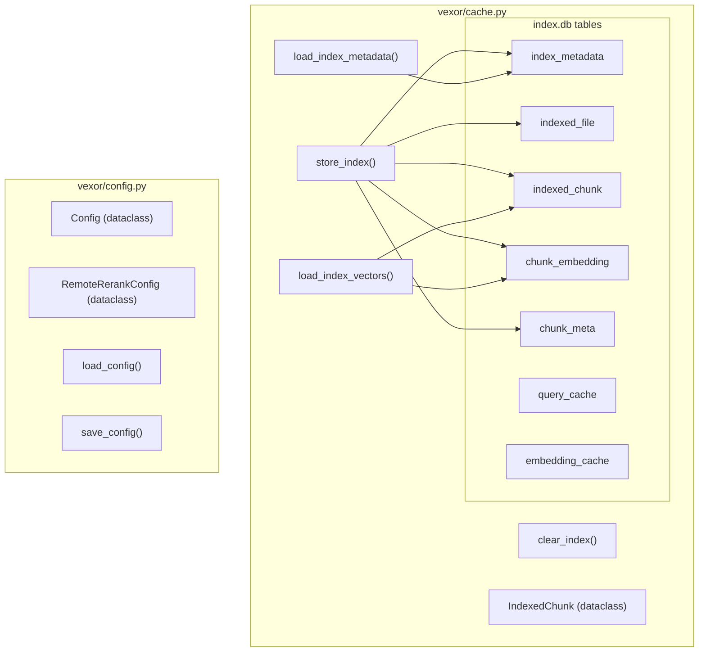
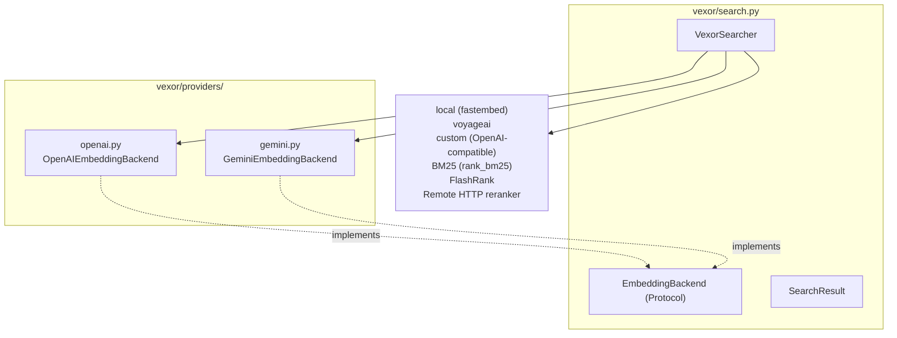
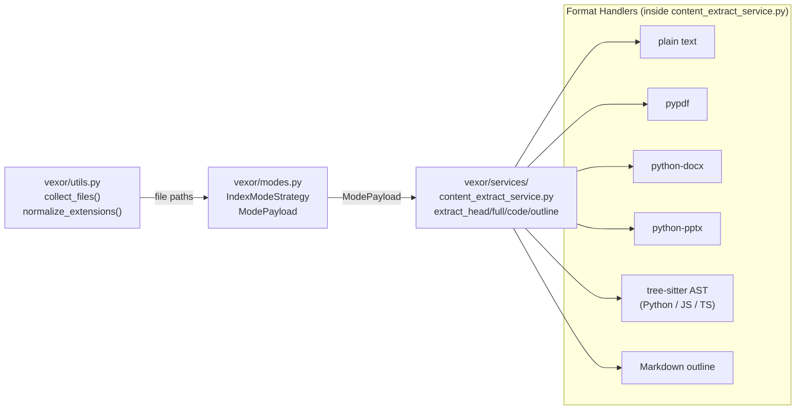
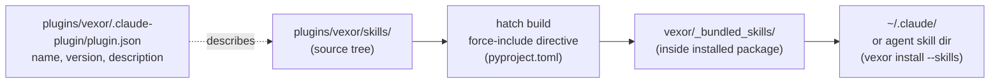
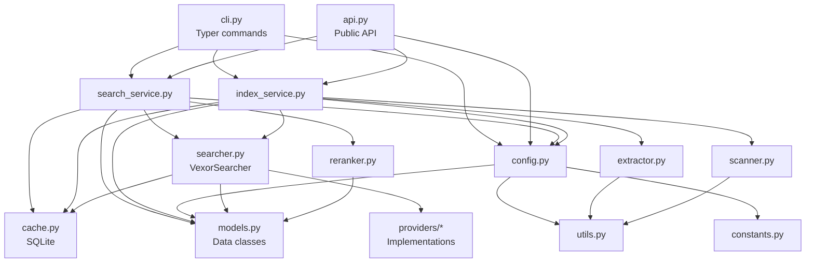

<!-- source: DeepWiki mcp.deepwiki.com · repo scarletkc/vexor · page 9.3 Project Structure · fetched 2026-10-27 -->

# Project Structure

Relevant source files

The following files were used as context for generating this wiki page:

- [README.md](README.md)
- [plugins/vexor/.claude-plugin/plugin.json](plugins/vexor/.claude-plugin/plugin.json)
- [vexor/__init__.py](vexor/__init__.py)

## Purpose and Scope

This page provides an overview of the Vexor codebase organization, describing the physical layout of directories and modules and the responsibilities of key components. It is intended for developers who want to understand where different functionality lives in the codebase.

For detailed architectural patterns and data flows, see [Architecture Deep Dive](#7). For setting up a development environment, see [Development Setup](#9.1). For information about the test organization, see [Testing](#9.2).

---

## High-Level Directory Layout

The Vexor repository is organized as follows:

| Path | Purpose |
|------|---------|
| `vexor/` | Core Python package: search, indexing, configuration, providers |
| `vexor/services/` | Service layer: business logic modules invoked by CLI and API |
| `vexor/providers/` | Embedding backend implementations |
| `gui/` | Experimental Electron + Vue desktop GUI (experimental) |
| `plugins/vexor/` | AI agent skill bundles for Claude Code, Codex, etc. |
| `tests/` | Unit and integration test suite |
| `scripts/` | Utility scripts (e.g. `bump_version.py`) |
| `pyproject.toml` | Package metadata, dependencies, build configuration |
| `vexor.spec` | PyInstaller spec for standalone executable builds |
| `README.md` | User-facing documentation |

Sources: [pyproject.toml:79-96]()

---

## Core Python Package Structure

The `vexor/` package is organized into a public surface, a service layer (`vexor/services/`), core logic modules, and provider implementations (`vexor/providers/`).

**`vexor/` — flat modules (core logic and public surface):**

| Module | Key Symbols | Role |
|--------|-------------|------|
| `__init__.py` | `__all__`, `__version__`, `get_version()` | Public API facade and version source of truth |
| `api.py` | `VexorClient`, `search()`, `index()`, `index_in_memory()`, `clear_index()`, `set_config_json()`, `config_context()`, `set_data_dir()` | Python API implementation |
| `cli.py` | Typer app, `run()` | CLI entry point; all `vexor` subcommands |
| `search.py` | `VexorSearcher`, `EmbeddingBackend` (Protocol), `SearchResult` | Embedding dispatch, cosine similarity, provider selection |
| `modes.py` | `IndexModeStrategy`, `ModePayload` | Indexing mode selection and content routing |
| `cache.py` | `IndexedChunk`, `store_index()`, `load_index_vectors()` | SQLite `index.db` CRUD operations |
| `config.py` | `Config`, `RemoteRerankConfig`, `load_config()`, `save_config()` | Configuration dataclasses and disk persistence |
| `utils.py` | `collect_files()`, `normalize_extensions()` | File collection and path utilities |
| `text.py` | `Styles`, `Messages` | All user-visible CLI strings (centralised) |
| `__main__.py` | — | `python -m vexor` entry point (used by PyInstaller) |
| `_bundled_skills/` | — | AI agent skill files copied from `plugins/vexor/skills/` at build time |

**`vexor/services/` — service layer:**

| Module | Key Symbols | Role |
|--------|-------------|------|
| `search_service.py` | `SearchRequest`, `SearchResponse`, `perform_search()` | End-to-end search orchestration |
| `index_service.py` | `IndexResult`, `build_index()`, `build_index_in_memory()` | Index build and incremental update logic |
| `config_service.py` | `ConfigUpdateResult`, `apply_config_updates()` | Applies configuration changes to disk |
| `cache_service.py` | `is_cache_current()`, `load_index_metadata_safe()` | Cache validation and safe metadata loading |
| `system_service.py` | `DoctorCheckResult`, `detect_install_method()` | `vexor doctor` and `vexor update` logic |
| `init_service.py` | `run_init_wizard()` | Interactive first-run configuration wizard |
| `content_extract_service.py` | `extract_head()`, `extract_full()`, `extract_code()`, `extract_outline()` | Per-mode content extraction from files |

**`vexor/providers/` — embedding backends:**

| Module | Key Symbols | Role |
|--------|-------------|------|
| `openai.py` | `OpenAIEmbeddingBackend` | OpenAI API embeddings (`text-embedding-3-small`) |
| `gemini.py` | `GeminiEmbeddingBackend` | Google Gemini embeddings (`gemini-embedding-001`) |

> Local (`fastembed`), VoyageAI, and custom (OpenAI-compatible) backends are also supported via `VexorSearcher` in `vexor/search.py`.

The following diagram maps the module layout to key code symbols:

**vexor/ Module Dependency Graph**

Sources: [vexor/__init__.py:1-39](), [pyproject.toml:88-92]()

---

## Entry Points

### CLI Entry Point

`vexor/cli.py` is the CLI entry point. The `run()` function is registered as the `vexor` console script in `pyproject.toml`.

| Component | Location | Purpose |
|-----------|----------|---------|
| Typer application | `vexor/cli.py` | Command router and argument parsing |
| `run()` | `vexor/cli.py` | Entry point; triggers auto-init on first run |
| Command handlers | `vexor/cli.py` | Functions for `search`, `index`, `config`, `doctor`, `update`, `local`, `install`, `init` |

Sources: [pyproject.toml:73-74]()

### Python API Entry Point

`vexor/__init__.py` re-exports the public surface from `vexor/api.py`. The `__all__` list is the canonical contract.

| Export | Type | Purpose |
|--------|------|---------|
| `search()` | function | Perform semantic search |
| `index()` | function | Build or refresh persistent index |
| `index_in_memory()` | function | Build non-persistent in-memory index |
| `clear_index()` | function | Remove cached index from disk |
| `VexorClient` | class | Session-based API client with shared config |
| `InMemoryIndex` | class | Ephemeral index returned by `index_in_memory()` |
| `set_config_json()` | function | Runtime configuration override (JSON string) |
| `config_context()` | context manager | Temporary scoped config override |
| `set_data_dir()` | function | Global data directory override |
| `VexorError` | exception | Base exception class for API errors |
| `get_version()` | function | Returns `__version__` string |

Sources: [vexor/__init__.py:5-38]()

---

## Core Module Responsibilities

### Service Layer (`vexor/services/`)

The service layer contains the business logic invoked by both `cli.py` and `api.py`. Each module owns one functional domain.

**Service Layer Interaction Diagram**

| Module | Key Symbols | Responsibility |
|--------|-------------|----------------|
| `search_service.py` | `SearchRequest`, `SearchResponse`, `perform_search()` | Orchestrates query embedding, cache loading, similarity scoring, reranking |
| `index_service.py` | `IndexResult`, `build_index()`, `build_index_in_memory()` | Drives file collection, content extraction, embedding, cache write |
| `config_service.py` | `ConfigUpdateResult`, `apply_config_updates()` | Applies configuration field changes to `config.json` |
| `cache_service.py` | `is_cache_current()`, `load_index_metadata_safe()` | Validates whether cached index is still current; safe metadata loading |
| `system_service.py` | `DoctorCheckResult`, `detect_install_method()` | Runs `vexor doctor` health checks; detects pip/pipx/standalone install |
| `init_service.py` | `run_init_wizard()` | Interactive first-run configuration wizard |
| `content_extract_service.py` | `extract_head()`, `extract_full()`, `extract_code()`, `extract_outline()` | Format-specific text extraction for each indexing mode |

---

### Storage Layer (`vexor/cache.py` and `vexor/config.py`)

**Storage Layer Schema and Operations**

| Module | Key Symbols | Responsibility |
|--------|-------------|----------------|
| `vexor/cache.py` | `IndexedChunk`, `store_index()`, `load_index_vectors()`, `load_index_metadata()`, `clear_index()` | All SQLite `index.db` operations: schema, CRUD, embedding cache, query cache |
| `vexor/config.py` | `Config`, `RemoteRerankConfig`, `load_config()`, `save_config()` | `config.json` persistence at `~/.vexor/`; API key resolution; embedding dimension validation |

The `index.db` file and `config.json` file are both stored in `~/.vexor/` by default.

---

### Provider System (`vexor/search.py` and `vexor/providers/`)

`vexor/search.py` defines the `EmbeddingBackend` Protocol (structural interface) and the `VexorSearcher` class that dispatches to the appropriate backend at runtime. Two backends are in `vexor/providers/`; local, VoyageAI, and custom backends are handled directly inside `VexorSearcher`.

**Provider System Structure**

| Symbol | Module | Role |
|--------|--------|------|
| `EmbeddingBackend` | `vexor/search.py` | Structural Protocol defining the embedding backend interface |
| `VexorSearcher` | `vexor/search.py` | Selects backend from config; handles batching, retries, concurrency |
| `SearchResult` | `vexor/search.py` | Dataclass for a single search result |
| `OpenAIEmbeddingBackend` | `vexor/providers/openai.py` | OpenAI API (`text-embedding-3-small`) |
| `GeminiEmbeddingBackend` | `vexor/providers/gemini.py` | Google Gemini API (`gemini-embedding-001`) |

---

### Content Processing Pipeline

File collection and content extraction are handled by `vexor/utils.py` and `vexor/services/content_extract_service.py`, with mode selection driven by `vexor/modes.py`.

**Content Processing Data Flow**

| Symbol | Module | Role |
|--------|--------|------|
| `collect_files()` | `vexor/utils.py` | Walks the filesystem; applies `.gitignore`, extension, exclude-pattern, and hidden-file filters |
| `normalize_extensions()` | `vexor/utils.py` | Normalises extension lists passed via CLI flags |
| `IndexModeStrategy` | `vexor/modes.py` | Selects which extraction strategy to apply (auto/name/head/brief/code/outline/full) |
| `ModePayload` | `vexor/modes.py` | Carries the extracted text and mode metadata to the indexing pipeline |
| `extract_head()`, `extract_full()`, `extract_code()`, `extract_outline()` | `vexor/services/content_extract_service.py` | Format-specific extraction implementations |

---

## Desktop Application Structure (`gui/`)

The desktop application is an experimental Electron + Vue application located in the `gui/` directory (not `desktop/`).

| Component | Location | Technology |
|-----------|----------|------------|
| Main process | `gui/main.js` | Electron; IPC, CLI subprocess management, GitHub release check |
| Renderer process | `gui/src/` | Vue.js frontend components (tabs: Search/Index, Config & Tools, Updates, Development) |
| IPC bridge | `gui/preload.js` | Secure renderer-to-main IPC channel |
| Root component | `gui/src/App.vue` | Top-level Vue component |

The GUI does not import the `vexor` Python package. Instead, it communicates by spawning `vexor` CLI subprocesses and parsing their output. See page [6]() for usage documentation.

---

## AI Agent Skills Structure (`plugins/vexor/`)

The `plugins/vexor/` directory contains skill bundles for AI coding assistants (Claude Code, OpenAI Codex, etc.).

**Skills Distribution Pipeline**

Skills are bundled at package build time via the `force-include` directive in `pyproject.toml`, so they are available offline after installation. The `vexor install --skills` command copies them from `vexor/_bundled_skills/` to the appropriate agent skill directory.

The `plugins/vexor/.claude-plugin/plugin.json` file provides plugin metadata (name, version, description) for the Claude plugin registry.

There is also a `vexor-cli/SKILL.md` file in the repository which provides a SKILL.md-format description of the CLI for use by AI agents.

Sources: [pyproject.toml:79-92](), [plugins/vexor/.claude-plugin/plugin.json:1-19]()

---

## Configuration and Build Files

### Package Metadata

The `pyproject.toml` file defines package configuration following PEP 621:

| Section | Purpose |
|---------|---------|
| `[project]` | Package metadata, dependencies, Python version requirement |
| `[project.optional-dependencies]` | Optional feature groups: `local`, `local-cuda`, `dev`, `flashrank` |
| `[project.scripts]` | Console script entry point registration |
| `[build-system]` | Build backend configuration (hatchling) |
| `[tool.hatch.version]` | Dynamic version from `vexor/__init__.py` |
| `[tool.hatch.build.targets.*]` | Include/exclude rules for sdist and wheel |
| `[tool.pytest.ini_options]` | Test runner configuration |

**Key Dependencies:**

| Category | Libraries |
|----------|-----------|
| Embedding APIs | `google-genai`, `openai` |
| CLI/UI | `typer`, `rich` |
| ML/Vector | `scikit-learn`, `numpy`, `rank-bm25`, `tokenizers` |
| File parsing | `pypdf`, `python-docx`, `python-pptx`, `tree-sitter` |
| Infrastructure | `python-dotenv`, `pathspec`, `charset-normalizer` |

**Optional Dependencies:**

| Feature | Dependencies | Install With |
|---------|--------------|--------------|
| Local embeddings | `fastembed` | `pip install vexor[local]` |
| Local embeddings (CUDA) | `fastembed`, `onnxruntime-gpu` | `pip install vexor[local-cuda]` |
| FlashRank reranker | `flashrank` | `pip install vexor[flashrank]` |
| Development | `pytest`, `pytest-cov`, `build`, `twine`, `pyinstaller` | `pip install vexor[dev]` |

**Sources:** [pyproject.toml:1-97]()

### Version Management

Version is defined in a single location and dynamically extracted:

- **Source of truth:** `__version__` in [vexor/__init__.py:33]()
- **Extracted by:** Hatchling build backend using [pyproject.toml:76-77]()
- **Exported as:** `get_version()` function in [vexor/__init__.py:36-38]()
- **Current version:** `0.23.1rc1` ([vexor/__init__.py:33](), [plugins/vexor/.claude-plugin/plugin.json:3]())

Sources: [vexor/__init__.py:33-38](), [pyproject.toml:76-77]()

---

## Module Dependency Overview

The following diagram shows the primary dependency relationships between major modules:

**Dependency Principles:**

1. **Layered Architecture:** CLI and API depend on service layer; service layer depends on storage and provider layers
2. **No Circular Dependencies:** Service modules do not depend on CLI or API modules
3. **Shared Models:** Data classes in `models.py` are used across all layers for type safety
4. **Configuration Injection:** `config.py` provides settings to all components without creating circular dependencies
5. **Provider Abstraction:** Service layer depends on `searcher.py` interface, not concrete provider implementations

**Sources:** Derived from system architecture diagrams and package structure

---

