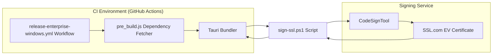
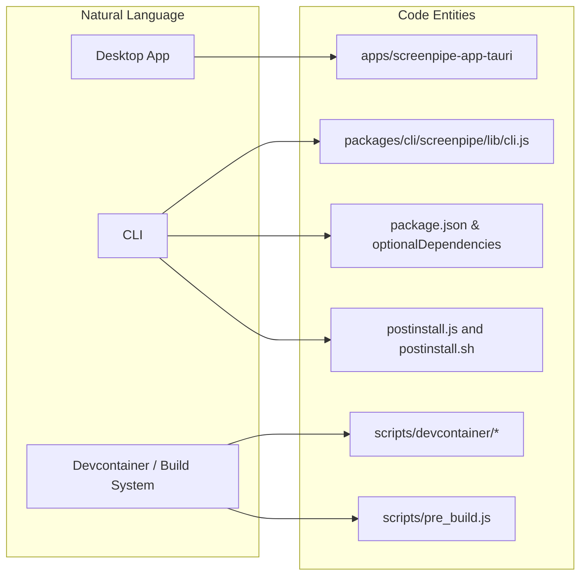
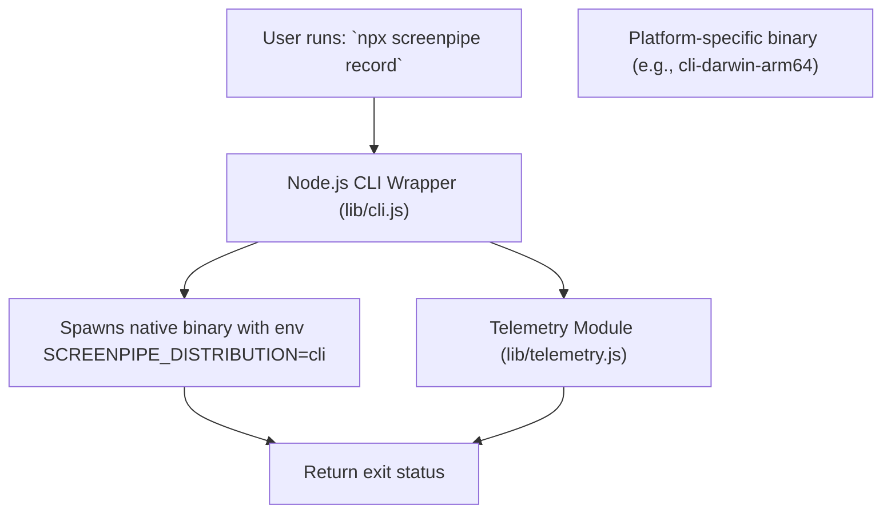

<!-- source: DeepWiki mcp.deepwiki.com · repo screenpipe/screenpipe · page 1.1 Installation · fetched 2026-10-27 -->

# Installation

<details>
<summary>Relevant source files</summary>

The following files were used as context for generating this wiki page:

- [LICENSE.md](LICENSE.md)
- [README.md](README.md)
- [crates/screenpipe-engine/src/analytics.rs](crates/screenpipe-engine/src/analytics.rs)
- [crates/screenpipe-engine/src/resource_monitor.rs](crates/screenpipe-engine/src/resource_monitor.rs)
- [crates/screenpipe-engine/src/telemetry_context.rs](crates/screenpipe-engine/src/telemetry_context.rs)
- [docs/telemetry-support-context.md](docs/telemetry-support-context.md)
- [packages/cli/screenpipe-darwin-arm64/package.json](packages/cli/screenpipe-darwin-arm64/package.json)
- [packages/cli/screenpipe-darwin-x64/package.json](packages/cli/screenpipe-darwin-x64/package.json)
- [packages/cli/screenpipe-linux-x64/package.json](packages/cli/screenpipe-linux-x64/package.json)
- [packages/cli/screenpipe-win32-x64/package.json](packages/cli/screenpipe-win32-x64/package.json)
- [packages/cli/screenpipe/lib/cli.js](packages/cli/screenpipe/lib/cli.js)
- [packages/cli/screenpipe/lib/index.js](packages/cli/screenpipe/lib/index.js)
- [packages/cli/screenpipe/lib/telemetry.js](packages/cli/screenpipe/lib/telemetry.js)
- [packages/cli/screenpipe/lib/telemetry.test.js](packages/cli/screenpipe/lib/telemetry.test.js)
- [packages/cli/screenpipe/package.json](packages/cli/screenpipe/package.json)
- [packages/cli/screenpipe/scripts/postinstall.js](packages/cli/screenpipe/scripts/postinstall.js)
- [packages/cli/screenpipe/scripts/postinstall.sh](packages/cli/screenpipe/scripts/postinstall.sh)

</details>


This document provides platform-specific installation instructions for the Screenpipe desktop application, CLI, and development environments. Screenpipe is a local-first system that captures screen and audio data, requiring specific system dependencies for OCR, transcription engines, and event-driven capture.

## Installation Methods Overview

Screenpipe is distributed as a unified Rust workspace where the desktop app (Tauri) and CLI share core recording logic.

| Method           | Use Case                                         | Platforms              | Distribution                                         |
|------------------|-------------------------------------------------|-----------------------|----------------------------------------------------|
| **Desktop App**  | GUI, visual timeline, tray management, automatic updates | macOS, Windows, Linux | `.dmg`, `.exe`, `.AppImage` via [screenpi.pe](https://screenpi.pe/onboarding) |
| **CLI**          | Headless recording, server-side usage, automation | macOS, Windows, Linux | `npx screenpipe record`                             |
| **Development**  | Building from source, contributing                | macOS, Windows, Linux | Git clone + Cargo/Bun                               |

**System Topology: Installation to Execution**

```mermaid
graph TD
    subgraph "Distribution Layer"
        NPM["npm Registry"]
        DMG["macOS .dmg"]
        EXE["Windows .exe"]
        SRC["GitHub Source"]
    end

    subgraph "Build & Preparation"
        PRE["pre_build.js (Dependency Fetcher)"]
        SETUP_BLAS["setup_openblas.js"]
    end

    subgraph "Execution Layer"
        CLI["screenpipe CLI (Binary)"]
        APP["screenpipe-app-tauri (GUI)"]
    end

    subgraph "Core Engines"
        VM["VisionManager Engine"]
        AM["AudioManager Engine"]
        DB["SQLite DB (FTS5 Full-Text Search)"]
    end

    NPM -->|"npx" CLI
    DMG -->|"Install" APP
    EXE -->|"Install" APP
    SRC --> PRE
    PRE --> SETUP_BLAS
    PRE --> APP

    CLI --> VM
    CLI --> AM
    APP --> VM
    APP --> AM

    VM --> DB
    AM --> DB
```

The diagram depicts the flow from distribution formats to build and preparation scripts, leading to the executable CLI and desktop applications, which in turn connect to core engines managing vision and audio capture, both storing data locally in SQLite with full-text-search capabilities.

Sources: [README.md:86-100]()

---

## Desktop Application

The Screenpipe desktop application is built using **Tauri** for a lightweight, cross-platform native shell with a **Next.js** frontend. It manages the lifecycle of the local recording server and offers a rich graphical UI for timeline review, search, notifications, and managing AI "Pipes" and "Connections".

### Platform Support

- **macOS (Apple Silicon & Intel)**  
  Full support with Screen Recording permissions required in System Settings → Privacy & Security → Screen Recording.  
  Utilizes native optimizations such as ScreenCaptureKit and Metal integration for efficient screen capture.

- **Windows 10/11**  
  Distributed as signed `.exe` installers and binaries. Requires `.NET 8.0` runtime for some CLI components if not using installer. Screen capture relies on Windows Graphics Capture (WGC) and UI Automation (UIA) accessibility APIs.

- **Linux**  
  Provided as an AppImage bundle. Requires system dependencies like `libasound2-dev` (Ubuntu/Debian), `alsa-lib` (Fedora), and `ffmpeg` to be installed for audio capture and video processing.

### Setup & Onboarding

- Upon first launch, the app guides the user through granting required permissions (screen/audio recording) and configures settings such as storage location and retention.
- It automatically starts the embedded local REST API server on `localhost:3030` managing the recording engines.
- The desktop app UI provides access to recordings, search interfaces, pipes management, and AI integrations.

Sources: [README.md:86-100]()

---

## CLI Installation

The CLI is designed for terminal/automation-first users or environments where the desktop app is unnecessary or unavailable, such as headless servers.

### Quick Start

Run the following command to start continuous recording and local data capture:

```bash
npx -y screenpipe@latest record
```

This command downloads the correct prebuilt binary for your platform and architecture, then launches the background recorder. Recorded data is stored by default in the `~/.screenpipe/` directory on Unix-like systems.

### Usage Notes

- The CLI binary invocation is wrapped by a Node.js script (`lib/cli.js`) that manages telemetry, signal forwarding, and platform-specific binary resolution based on OS and architecture [packages/cli/screenpipe/lib/cli.js:1-160]().
- Telemetry is opt-in but automatically disabled during CI runs or if environment variables specifying opt-out are set, to avoid polluting metrics.
- If the binary is not available for your platform or architecture, you will see an error suggesting reinstalling via npm.
- To suppress periodic prompts reminding users to install the desktop app, set the environment variable:  
  `SCREENPIPE_NO_REMINDERS=1`

### MCP Server Installation for AI Integration

To enable AI assistants like Claude to interface with Screenpipe's memory and pipes system, install the Model Context Protocol (MCP) server which communicates via standard IO or other transports:

```bash
claude mcp add screenpipe -- npx -y screenpipe-mcp@latest
```

This setup links your local screen and audio memory with AI assistants for query and automation workflows.

Sources: [README.md:87-101](), [packages/cli/screenpipe/lib/cli.js:1-160]()

---

## System Dependencies and Post-Install Setup

### FFmpeg and Audio Libraries

- **macOS**: The postinstall script downloads a prebuilt `ffmpeg` binary for ARM64 or x64 architectures if `ffmpeg` is missing. The binary is installed under `~/.local/bin/ffmpeg` with quarantine removed for execution permissions [packages/cli/screenpipe/scripts/postinstall.sh:14-37]().
- **Linux**: It installs `ffmpeg` via common package managers (`apt-get`, `dnf`, or `pacman`) and ensures the availability of audio libraries such as `libasound2-dev` or `alsa-lib` [packages/cli/screenpipe/scripts/postinstall.sh:40-67]().
- **Windows**: No `ffmpeg` installation attempted by postinstall; users should install manually if needed.

The postinstall scripts run automatically upon `npm install screenpipe` or `bunx screenpipe` and also send anonymized telemetry about the install success or failure to PostHog for usage tracking.

Sources: [packages/cli/screenpipe/scripts/postinstall.sh:1-120](), [packages/cli/screenpipe/scripts/postinstall.js:1-147]()

---

## Development Environment Setup

Developers working on Screenpipe can leverage ready-made devcontainers and scripts for setting up a consistent development environment.

### Devcontainer Configuration

- The repository includes a `.devcontainer/` directory (not shown here but part of the repo) which configures VS Code Remote Containers or compatible systems.
- The devcontainer provides the Rust toolchain, Node.js/Bun, and system dependencies preinstalled for quick startup.
- Useful for contributors targeting Linux or cross-platform compatibility, with scripts automating first-time setup, including OpenBLAS for numerical computations.

### Build from Source

- Clone the repository:  
  `git clone https://github.com/screenpipe/screenpipe.git`
- Enter the workspace and use Cargo to build the Rust crates and Tauri desktop app.
- Run frontend `Next.js` with `npm run dev` or similar inside the `apps/` directory.
- Linux developers need to ensure libraries such as `libasound2-dev` and `ffmpeg` are installed before building.

Sources: [README.md:87-101]()

---

## Verification and Health Check

After installation (desktop or CLI), verify the local backend server is running:

```bash
curl http://localhost:3030/health
```

You should receive a JSON response:

```json
{"status":"healthy"}
```

Indicating the recording server and REST API are ready for interaction.

Sources: [README.md:87-101]()

---

## Enterprise Deployment Considerations

For enterprise users requiring centralized management and compliance:

- Windows builds are signed with EV code signing certificates via the CI pipeline, ensuring compliance with Microsoft Intune and other policy platforms.
- Screenpipe supports enterprise-grade license enforcement and audit telemetry.
- The signing process integrates with the build pipeline using scripts like `sign-ssl.ps1` combined with certificates from SSL.com, managed within the GitHub Actions workflows.

**Enterprise Build & Signing Data Flow**



Sources: [README.md:176-177]()

---

## Key Installation File Locations

| Data Type          | Default Path                                               | Description                                  |
|--------------------|------------------------------------------------------------|----------------------------------------------|
| SQLite Database    | `~/.screenpipe/db.sqlite`                                   | Main local storage with FTS5-enabled tables |
| Media Assets       | `~/.screenpipe/data/`                                       | Captured screen frames (JPEG) and audio chunks |
| Pipes Configuration| `~/.screenpipe/pipes/`                                      | User-configured AI Pipes (workflows, automations) |

These directories contain your local-screen capture history and AI interaction state.

Sources: [README.md:87-101]()

---

# Summary

Screenpipe’s installation covers multiple deployment options:

- **Desktop App:** Full GUI and automatic lifecycle management.
- **CLI:** Headless background recording daemon, easy to install via `npx`.
- **Development:** Source builds with Rust and Node.js environments using devcontainers.
- **System dependencies**: Managed through postinstall scripts with platform-specific logic.
- **Enterprise**: Signed Windows builds and compliance via CI pipeline.

This local-first and modular setup ensures that Screenpipe runs efficiently across all supported platforms with minimum friction.

---

# Maps Bridging Natural Language Entities to Code Entities

### 1. Installation Components and Code Entities



This diagram connects high-level user terms like “Desktop App” and “CLI” to their concrete implementations in the codebase, including wrapper scripts and package.json metadata for platform binaries.

---

### 2. CLI Execution Flow and Telemetry Integration



This flowchart shows the role of the Node.js CLI utility in launching the platform binary and handling telemetry events, as orchestrated by the `lib/cli.js` file.

Sources: [packages/cli/screenpipe/lib/cli.js:1-160](), [packages/cli/screenpipe/scripts/postinstall.js:1-147]()

---

# References to Key Files

- Desktop app packaging and entry: `apps/screenpipe-app-tauri`
- CLI wrapper script: `packages/cli/screenpipe/lib/cli.js:1-161`  
- CLI platform-dependent binaries: `packages/cli/screenpipe-darwin-arm64/package.json` and similar  
- Post-installation and dependency setup: `packages/cli/screenpipe/scripts/postinstall.js:1-148`, `packages/cli/screenpipe/scripts/postinstall.sh:1-120`  
- Telemetry context and analytics integration: `crates/screenpipe-engine/src/analytics.rs:1-209`, `crates/screenpipe-engine/src/telemetry_context.rs:1-186`  

Sources: [README.md:86-101](), [packages/cli/screenpipe/lib/cli.js:1-160](), [packages/cli/screenpipe/scripts/postinstall.js:1-147](), [packages/cli/screenpipe/scripts/postinstall.sh:1-120](), [crates/screenpipe-engine/src/analytics.rs:1-209](), [crates/screenpipe-engine/src/telemetry_context.rs:1-186]()

---

