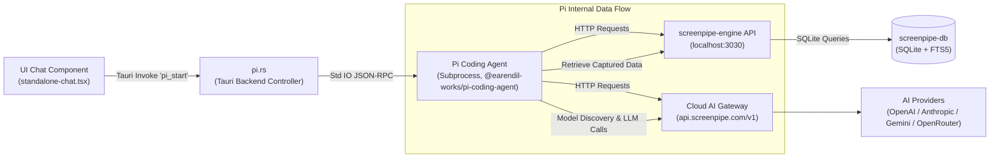

<!-- source: DeepWiki mcp.deepwiki.com · repo screenpipe/screenpipe · page 2.1 System Overview · fetched 2026-10-27 -->

# System Overview

<details>
<summary>Relevant source files</summary>

The following files were used as context for generating this wiki page:

- [Cargo.lock](Cargo.lock)
- [Cargo.toml](Cargo.toml)
- [apps/screenpipe-app-tauri/lib/frame-thumbnails.test.ts](apps/screenpipe-app-tauri/lib/frame-thumbnails.test.ts)
- [apps/screenpipe-app-tauri/lib/frame-thumbnails.ts](apps/screenpipe-app-tauri/lib/frame-thumbnails.ts)
- [apps/screenpipe-app-tauri/src-tauri/Cargo.lock](apps/screenpipe-app-tauri/src-tauri/Cargo.lock)
- [apps/screenpipe-app-tauri/src-tauri/Cargo.toml](apps/screenpipe-app-tauri/src-tauri/Cargo.toml)
- [crates/screenpipe-audio/Cargo.toml](crates/screenpipe-audio/Cargo.toml)
- [crates/screenpipe-audio/src/utils/ffmpeg.rs](crates/screenpipe-audio/src/utils/ffmpeg.rs)
- [crates/screenpipe-core/src/ffmpeg.rs](crates/screenpipe-core/src/ffmpeg.rs)
- [crates/screenpipe-core/src/lib.rs](crates/screenpipe-core/src/lib.rs)
- [crates/screenpipe-engine/src/routes/frames.rs](crates/screenpipe-engine/src/routes/frames.rs)
- [crates/screenpipe-engine/src/snapshot_compaction.rs](crates/screenpipe-engine/src/snapshot_compaction.rs)
- [crates/screenpipe-engine/src/video_utils.rs](crates/screenpipe-engine/src/video_utils.rs)
- [crates/screenpipe-screen/Cargo.toml](crates/screenpipe-screen/Cargo.toml)
- [packages/sdk/Cargo.lock](packages/sdk/Cargo.lock)
- [packages/sdk/examples/tauri-app/src-tauri/Cargo.lock](packages/sdk/examples/tauri-app/src-tauri/Cargo.lock)

</details>


This page documents the component topology of Screenpipe, detailing the integration of the Tauri app, embedded server, recording engines, database, AI execution layer, and the Cargo workspace crate organization. It clarifies the implementation structure, data flows, key classes and functions, and how these elements coordinate to provide a 24/7 local-first AI-powered memory system.

---

## Component Topology

Screenpipe is a modular Rust-based system with a Tauri desktop shell embedding an HTTP server and managing multiple data capture engines. It emphasizes local data capture and processing combined with AI interaction.

```mermaid
graph TB
    subgraph "Apps/screenpipe-app-tauri"
        Main["main.rs<br/>(AppHandle & Lifecycle)"]
        Tray["tray.rs<br/>(System Tray & Menu)"]
        Shortcuts["shortcuts.rs<br/>(Global Hotkeys)"]
        Vault["screenpipe-vault<br/>(Encrypted Storage)"]
        Store["store.rs<br/>(Settings Store & Recovery)"]
        CaptureSession["CaptureSession<br/>(Recording Orchestration)"]
        ServerCore["ServerCore<br/>(HTTP API, Pipe & DB)"]
        PiAgent["pi.rs<br/>(Pi Coding Agent Controller)"]
    end

    subgraph "Crates workspace crates"
        ScreenpipeScreen["screenpipe-screen<br/>(Screen Capture, OCR, Video)"]
        ScreenpipeAudio["screenpipe-audio<br/>(Audio Capture, VAD, STT)"]
        ScreenpipeA11y["screenpipe-a11y<br/>(UI Events accessibility)"]
        ScreenpipeDB["screenpipe-db<br/>(SQLite + FTS5 DB Layer)"]
        ScreenpipeCore["screenpipe-core<br/>(Pipes & Agents Runtime)"]
        ScreenpipeEngine["screenpipe-engine<br/>(Server Core, Pipes, HTTP API)"]
        ScreenpipeRedact["screenpipe-redact<br/>(PII Redaction AI)"]
        ScreenpipeVault["screenpipe-vault<br/>(encryption & secrets)"]
        ScreenpipeConnect["screenpipe-connect<br/>(Third-party Connections)"]
        ScreenpipeEvents["screenpipe-events<br/>(Event Types & Coordination)"]
    end
    
    Frontend["Tauri UI (React + TypeScript)"]

    %% Frontend <--> Tauri Shell
    Frontend <-->|Tauri Invoke RPC| Main
    Main --> Tray
    Main --> Shortcuts
    Main --> Vault

    %% Tauri Shell --> Engine & Session Control
    Main --> ServerCore
    Main --> CaptureSession

    %% CaptureSession --> Recording Engines
    CaptureSession --> ScreenpipeScreen
    CaptureSession --> ScreenpipeAudio
    CaptureSession --> ScreenpipeA11y

    %% Recording Engines --> DB
    ScreenpipeScreen --> ScreenpipeDB
    ScreenpipeAudio --> ScreenpipeDB
    ScreenpipeA11y --> ScreenpipeDB

    %% ServerCore --> DB
    ServerCore --> ScreenpipeDB

    %% ServerCore --> PiAgent (JSON-RPC)
    ServerCore <-->|JSON-RPC (pipes & reasoning)| PiAgent

    %% PiAgent --> ServerCore (HTTP API)
    PiAgent --> ServerCore

    %% Vault accessed from Main and related crates
    ServerCore --> ScreenpipeVault

```

**Title:** Screenpipe Component Topology and Crate Map  
**Sources:**  
- [apps/screenpipe-app-tauri/src-tauri/Cargo.toml:5-60]()  
- [apps/screenpipe-app-tauri/src-tauri/src/main.rs:1-143]()  
- [apps/screenpipe-app-tauri/src-tauri/src/recording.rs:7-170]()  
- [crates/screenpipe-engine/src/server.rs]()  
- [crates/screenpipe-audio/Cargo.toml]()  
- [crates/screenpipe-core/src/lib.rs:5-75]()  

---

## 1. Desktop Application (Tauri Shell)

The desktop application is implemented using Tauri, serving as a native shell for the web frontend and acting as the orchestrator for background components.

### Implementation Details

- **`main.rs`** initializes the core application state, including the `RecordingState` which holds the embedded server (`ServerCore`) and a `CaptureSession` instance for managing recording workers. It manages app lifecycle events and sets up the IPC (Tauri invoke) communication channels with the frontend UI [apps/screenpipe-app-tauri/src-tauri/src/main.rs:1-143]().
  
- **Global Shortcuts** are registered and dynamically updated based on user preferences using Tauri plugins, enabling hotkeys for recording controls and UI toggling [apps/screenpipe-app-tauri/src-tauri/src/main.rs:137-140]().

- **System Tray and Health Monitoring** are handled in `tray.rs`. The tray menu dynamically reflects the current recording status, providing context-aware user controls and feedback [apps/screenpipe-app-tauri/src-tauri/src/tray.rs:40-80]().

- **Settings Storage (`store.rs`)** uses an encrypted `store.bin` file managed by `screenpipe-vault`. It implements layered recovery and atomic write techniques to ensure data durability and integrity [apps/screenpipe-app-tauri/src-tauri/src/store.rs:1-134]().

### Data Flow

User interactions from the frontend translate into invoke commands handled in Rust code, while state and settings are persisted locally. Lifecycle management ensures recording and server components operate independently but cohesively.

**Sources:**  
- [apps/screenpipe-app-tauri/src-tauri/src/main.rs:1-143]()  
- [apps/screenpipe-app-tauri/src-tauri/src/tray.rs:40-80]()  
- [apps/screenpipe-app-tauri/src-tauri/src/store.rs:1-134]()  
- [apps/screenpipe-app-tauri/lib/utils/tauri.ts:50-90]()  

---

## 2. Embedded Server and Recording Orchestration

Screenpipe separates the long-lived service layer (`ServerCore`) from the resource-intensive, start/stop capable recording machinery (`CaptureSession`).

### Key Components

| Component      | Code Entity                                  | Responsibilities                                   |
|----------------|---------------------------------------------|---------------------------------------------------|
| `ServerCore`   | `screenpipe-engine/src/server.rs`           | HTTP API with Axum, SQLite DB connection pool, pipe execution, cloud token management, and downloads [apps/screenpipe-app-tauri/src-tauri/src/recording.rs:10-40]() |
| `CaptureSession` | `apps/screenpipe-app-tauri/src-tauri/src/capture_session.rs` | Manages start/stop of capture engines: screen, audio, accessibility event watchers [apps/screenpipe-app-tauri/src-tauri/src/recording.rs:140-170]() |

### Boot and Health Phases

The system uses a `BootPhase` state machine controlling startup sequencing, database migration, and initialization of media pipelines to avoid race conditions. The system delays HTTP server binding until migration completes [apps/screenpipe-app-tauri/src-tauri/src/health.rs:50-63]().

---

### Recording Engines

The capture session controls three main capture engines, each as dedicated async subsystems:

- **Screen Capture & Video (`screenpipe-screen`)**: Captures frames, extracts UI accessibility trees, applies OCR fallback, manages video chunk writing and compaction [crates/screenpipe-screen/Cargo.toml]().

- **Audio Capture & Processing (`screenpipe-audio`)**: Captures system microphone data with voice activity detection (VAD), applies speaker diarization, runs transcription using Whisper, Deepgram, or OpenAI, and handles audio encoding with FFmpeg [crates/screenpipe-audio/Cargo.toml](), [crates/screenpipe-audio/src/utils/ffmpeg.rs]().

- **Accessibility Events and UI Monitoring (`screenpipe-a11y`)**: Observes platform accessibility APIs to log UI interactions contextually [crates/screenpipe-a11y/Cargo.toml - not shown but inferred].

Each engine writes structured data to the shared SQLite backend for indexed search and AI querying.

**Sources:**  
- [apps/screenpipe-app-tauri/src-tauri/src/recording.rs:140-170]()  
- [crates/screenpipe-screen/Cargo.toml]()  
- [crates/screenpipe-audio/Cargo.toml]()  
- [crates/screenpipe-audio/src/utils/ffmpeg.rs]()  

---

## 3. Storage and Database Layer

Screenpipe adopts a local-first architecture, optimizing SQLite for storing rich multimedia data and full-text search.

### Database Layer: `screenpipe-db`

- Implements SQLite database with FTS5 full-text search and WAL mode for concurrent access.

- Contains schema and query abstractions for frames, audio transcriptions, UI elements, and metadata.

- Provides write queue and coalescing mechanisms to avoid write amplification [apps/screenpipe-app-tauri/src-tauri/src/recording.rs:70-90]().

### Settings and Encrypted Storage: `screenpipe-vault`

- Manages encryption and decryption of sensitive storage files like `store.bin` with a magic header `SPSTORE1` [apps/screenpipe-app-tauri/src-tauri/src/store.rs:40-60]().

- Ensures atomic writes using temporary files and `fsync`, preventing data loss on crashes or power loss [apps/screenpipe-app-tauri/src-tauri/src/store.rs:120-134]().

### Data Persistence Flow

Captured frames and audio chunks are asynchronously written to the database via the engine processes, which concurrently serve the HTTP API for queries and AI pipes execution.

**Sources:**  
- [apps/screenpipe-app-tauri/src-tauri/src/store.rs:1-134]()  
- [apps/screenpipe-app-tauri/src-tauri/src/recording.rs:68-90]()  
- [crates/screenpipe-db/src/lib.rs - inferred, not shown]()

---

## 4. AI Layer: Pi Agent and AI Gateway Integration

Screenpipe integrates AI thoughtfully, orchestrating local and cloud AI providers to reason over captured data.

### Pi Coding Agent (`pi.rs`)

- Acts as a JSON-RPC subprocess controller communicating with the Pi agent executable (`@earendil-works/pi-coding-agent`).

- Manages multi-session conversation kinds including `chat` for user dialogues, `pipe-watch` for live pipe execution, and `pipe-run` for historical query runs [apps/screenpipe-app-tauri/lib/hooks/use-settings.tsx:120-140]().

- Maintains stateful chat stores with messages, intents, and citation tracking for AI responses [apps/screenpipe-app-tauri/lib/hooks/use-settings.tsx:145-195]().

### AI Provider Routing

- Supports multiple providers via tiered routing through a Cloudflare worker-based AI gateway including native Ollama, OpenAI, Anthropic, Gemini, OpenRouter, and Vertex.

- Configuration presets (`AIPreset`) define URL, model, max input tokens, and other parameters [apps/screenpipe-app-tauri/lib/hooks/use-settings.tsx:50-82]().

### AI Workflow



**Title:** AI Layer Data Flow  
**Sources:**  
- [apps/screenpipe-app-tauri/lib/hooks/use-settings.tsx:50-140]()  
- [apps/screenpipe-app-tauri/src-tauri/src/pi.rs:1-40]()  

---

## 5. Cargo Workspace Crate Map

Screenpipe workspace is organized into multiple crates to modularize functionality. Key crates include:

| Crate Name            | Description                                       | Location                        |
|-----------------------|-------------------------------------------------|--------------------------------|
| `screenpipe-app`      | The Tauri desktop application shell              | `apps/screenpipe-app-tauri`    |
| `screenpipe-engine`   | Embedded HTTP server, pipe runtime, API          | `crates/screenpipe-engine`     |
| `screenpipe-screen`   | Screen capture, OCR and video handling            | `crates/screenpipe-screen`     |
| `screenpipe-audio`    | Audio capture, VAD, diarization and transcription | `crates/screenpipe-audio`      |
| `screenpipe-a11y`     | Accessibility event monitoring                     | `crates/screenpipe-a11y`       |
| `screenpipe-db`       | SQLite schema, FTS5, and query layer              | `crates/screenpipe-db`         |
| `screenpipe-core`     | Core types, pipes and agents runtime               | `crates/screenpipe-core`       |
| `screenpipe-vault`    | Encrypted storage (store.bin), secrets            | `crates/screenpipe-vault`      |
| `screenpipe-connect`  | Third-party integrations and connections          | `crates/screenpipe-connect`    |
| `screenpipe-redact`   | Privacy filters and PII redaction pipelines        | `crates/screenpipe-redact`     |
| `screenpipe-events`   | Event schemas and event distribution utilities     | `crates/screenpipe-events`     |

This workspace organization enables independent development, testing, and versioning while maintaining strong internal module boundaries.

**Sources:**  
- [apps/screenpipe-app-tauri/src-tauri/Cargo.toml:5-60]()  
- [Cargo.toml:5-100]()  
- [crates/screenpipe-core/src/lib.rs]()  

---

## Summary Data Flow

| Phase           | Component               | Description                  | Primary Code Entities                   |
|-----------------|-------------------------|------------------------------|----------------------------------------|
| **UI Interaction** | Tauri UI (React/TS)       | User commands, settings       | `main.rs`, `tray.rs`, `shortcuts.rs`  |
| **Server Startup** | Embedded HTTP Server      | Pipe runtime, DB API          | `screenpipe-engine::server`            |
| **Data Capture**  | Recording Engines         | Screen, audio, UI events      | `CaptureSession`, `screenpipe-screen`, `screenpipe-audio`, `screenpipe-a11y` |
| **Storage**      | SQLite & Encrypted Store  | Data persistence and security | `screenpipe-db`, `screenpipe-vault`    |
| **AI Reasoning** | Pi Coding Agent           | AI query execution            | `pi.rs`, `screenpipe-core::agents`, cloud AI gateway       |

---

# Detailed Interactions

### Reading captured screen/audio data

- The `CaptureSession` controls and monitors all active capture engines. Each engine feeds its data into `screenpipe-db` asynchronously.

- User interface frames and audio chunks are stored with rich metadata including timestamps, subtitles, and contextual information.

- Video frames can be extracted and cached as JPEG thumbnails by the embedded HTTP API in `screenpipe-engine` [crates/screenpipe-engine/src/routes/frames.rs]().

### AI Query Execution

- Queries from the Tauri frontend invoke methods on the Pi Coding Agent controller `pi.rs` which communicates with its subprocess via JSON-RPC.

- The agent fetches screen and audio data from local DB through the embedded server API and also routes natural language queries through cloud AI when configured.

- AI provider interaction supports flexible routing, model selection, and authentication management.

---

# Conclusion

This page provided an in-depth system overview of Screenpipe's component topology, including the Tauri shell, embedded server, multi-engine recording architecture, database layer, AI integration, and crate workspace organization. The design emphasizes modularity, local data ownership, and seamless AI reasoning to deliver a comprehensive desktop memory system.

---

**Sources Summary:**  
- apps/screenpipe-app-tauri/src-tauri/Cargo.toml:5-60  
- apps/screenpipe-app-tauri/src-tauri/src/main.rs:1-143  
- apps/screenpipe-app-tauri/src-tauri/src/recording.rs:7-170  
- apps/screenpipe-app-tauri/src-tauri/src/tray.rs:40-80  
- apps/screenpipe-app-tauri/src-tauri/src/store.rs:1-134  
- apps/screenpipe-app-tauri/lib/hooks/use-settings.tsx:49-195  
- apps/screenpipe-app-tauri/src-tauri/src/pi.rs:1-40  
- crates/screenpipe-engine/src/server.rs  
- crates/screenpipe-audio/Cargo.toml  
- crates/screenpipe-audio/src/utils/ffmpeg.rs  
- crates/screenpipe-core/src/lib.rs:5-75  
- crates/screenpipe-screen/Cargo.toml  
- crates/screenpipe-engine/src/routes/frames.rs:1-204  
- Cargo.toml:5-100

---

