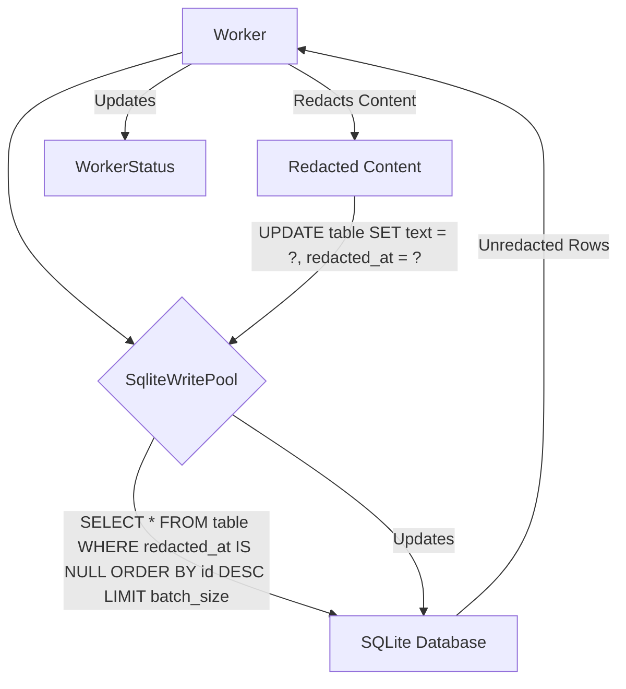

<!-- source: DeepWiki mcp.deepwiki.com · repo screenpipe/screenpipe · page 2.6 Privacy & Redaction · fetched 2026-10-27 -->

# Privacy & Redaction

<details>
<summary>Relevant source files</summary>

The following files were used as context for generating this wiki page:

- [apps/screenpipe-app-tauri/components/settings/retention-settings.tsx](apps/screenpipe-app-tauri/components/settings/retention-settings.tsx)
- [apps/screenpipe-app-tauri/src-tauri/src/chatgpt_oauth.rs](apps/screenpipe-app-tauri/src-tauri/src/chatgpt_oauth.rs)
- [apps/screenpipe-app-tauri/src-tauri/src/secrets.rs](apps/screenpipe-app-tauri/src-tauri/src/secrets.rs)
- [apps/screenpipe-app-tauri/src-tauri/src/sync.rs](apps/screenpipe-app-tauri/src-tauri/src/sync.rs)
- [crates/screenpipe-audio/src/core/source_buffer.rs](crates/screenpipe-audio/src/core/source_buffer.rs)
- [crates/screenpipe-audio/tests/bluetooth_gap_hallucination_test.rs](crates/screenpipe-audio/tests/bluetooth_gap_hallucination_test.rs)
- [crates/screenpipe-db/Cargo.toml](crates/screenpipe-db/Cargo.toml)
- [crates/screenpipe-db/src/migrations/20260627000000_add_frames_text_json_redacted_at.sql](crates/screenpipe-db/src/migrations/20260627000000_add_frames_text_json_redacted_at.sql)
- [crates/screenpipe-db/tests/evict_media_null_chunk_test.rs](crates/screenpipe-db/tests/evict_media_null_chunk_test.rs)
- [crates/screenpipe-db/tests/multi_pool_wal_parity_test.rs](crates/screenpipe-db/tests/multi_pool_wal_parity_test.rs)
- [crates/screenpipe-db/tests/orphan_chunk_null_poisoning_test.rs](crates/screenpipe-db/tests/orphan_chunk_null_poisoning_test.rs)
- [crates/screenpipe-engine/Cargo.toml](crates/screenpipe-engine/Cargo.toml)
- [crates/screenpipe-engine/src/archive.rs](crates/screenpipe-engine/src/archive.rs)
- [crates/screenpipe-engine/src/cli/backup.rs](crates/screenpipe-engine/src/cli/backup.rs)
- [crates/screenpipe-engine/src/cli/store_file.rs](crates/screenpipe-engine/src/cli/store_file.rs)
- [crates/screenpipe-engine/src/power/monitor.rs](crates/screenpipe-engine/src/power/monitor.rs)
- [crates/screenpipe-engine/src/retention.rs](crates/screenpipe-engine/src/retention.rs)
- [crates/screenpipe-engine/src/routes/data.rs](crates/screenpipe-engine/src/routes/data.rs)
- [crates/screenpipe-engine/src/sync_api.rs](crates/screenpipe-engine/src/sync_api.rs)
- [crates/screenpipe-engine/src/sync_provider.rs](crates/screenpipe-engine/src/sync_provider.rs)
- [crates/screenpipe-engine/tests/retention_lean_test.rs](crates/screenpipe-engine/tests/retention_lean_test.rs)
- [crates/screenpipe-redact/Cargo.toml](crates/screenpipe-redact/Cargo.toml)
- [crates/screenpipe-redact/examples/v45_phase3_smoke.rs](crates/screenpipe-redact/examples/v45_phase3_smoke.rs)
- [crates/screenpipe-redact/src/adapters/onnx.rs](crates/screenpipe-redact/src/adapters/onnx.rs)
- [crates/screenpipe-redact/src/adapters/rfdetr.rs](crates/screenpipe-redact/src/adapters/rfdetr.rs)
- [crates/screenpipe-redact/src/adapters/tinfoil.rs](crates/screenpipe-redact/src/adapters/tinfoil.rs)
- [crates/screenpipe-redact/src/adapters/tinfoil_image.rs](crates/screenpipe-redact/src/adapters/tinfoil_image.rs)
- [crates/screenpipe-redact/src/image/frame_redactor.rs](crates/screenpipe-redact/src/image/frame_redactor.rs)
- [crates/screenpipe-redact/src/image/mod.rs](crates/screenpipe-redact/src/image/mod.rs)
- [crates/screenpipe-redact/src/image/worker.rs](crates/screenpipe-redact/src/image/worker.rs)
- [crates/screenpipe-redact/src/lib.rs](crates/screenpipe-redact/src/lib.rs)
- [crates/screenpipe-redact/src/ocr_json.rs](crates/screenpipe-redact/src/ocr_json.rs)
- [crates/screenpipe-redact/src/pipeline.rs](crates/screenpipe-redact/src/pipeline.rs)
- [crates/screenpipe-redact/src/span.rs](crates/screenpipe-redact/src/span.rs)
- [crates/screenpipe-redact/src/worker/columns.rs](crates/screenpipe-redact/src/worker/columns.rs)
- [crates/screenpipe-redact/src/worker/mod.rs](crates/screenpipe-redact/src/worker/mod.rs)
- [crates/screenpipe-redact/src/worker/tables.rs](crates/screenpipe-redact/src/worker/tables.rs)
- [crates/screenpipe-redact/tests/worker_integration.rs](crates/screenpipe-redact/tests/worker_integration.rs)
- [crates/screenpipe-screen/src/browser_utils/windows.rs](crates/screenpipe-screen/src/browser_utils/windows.rs)
- [crates/screenpipe-secrets/Cargo.toml](crates/screenpipe-secrets/Cargo.toml)
- [crates/screenpipe-secrets/src/lib.rs](crates/screenpipe-secrets/src/lib.rs)
- [crates/screenpipe-secrets/src/migration.rs](crates/screenpipe-secrets/src/migration.rs)
- [crates/screenpipe-secrets/src/store.rs](crates/screenpipe-secrets/src/store.rs)
- [crates/screenpipe-secrets/src/telemetry.rs](crates/screenpipe-secrets/src/telemetry.rs)

</details>


This page details the `screenpipe-redact` pipeline, which is responsible for identifying and redacting Personally Identifiable Information (PII) from various data sources within Screenpipe. This includes adapters for machine learning models (ONNX, CoreML, DirectML), image and text redaction workers, privacy filters, and secure storage for secrets and vaults. The system is designed to operate off the capture hot path, ensuring that sensitive data is processed asynchronously and securely.

## Redaction Pipeline Overview

The core of the redaction system is the `screenpipe-redact` crate [crates/screenpipe-redact/Cargo.toml:6-12](). It provides a background reconciliation worker that polls the database for un-redacted rows across various text surfaces (e.g., `frames.full_text`, audio transcripts, accessibility text, typed/clipboard input, and per-element text) and writes redacted versions back [crates/screenpipe-redact/src/worker/mod.rs:6-12](). The worker operates on a newest-first basis to ensure recent activity is redacted promptly [crates/screenpipe-redact/src/worker/mod.rs:14-16]().

The redaction process is destructive: when a row is processed, the original source column is overwritten with the redacted version, ensuring the raw secret is removed [crates/screenpipe-redact/src/worker/mod.rs:45-51]().

### Key Components

*   **`Redactor` Trait**: Defines the interface for redaction logic, allowing different implementations (e.g., regex-based, ML-based).
*   **`Pipeline`**: Orchestrates multiple `Redactor` implementations, applying them sequentially.
*   **`Worker`**: The asynchronous background task that manages the redaction process, interacting with the database and `Redactor` implementations.
*   **ONNX/CoreML/DirectML Adapters**: Provide machine learning capabilities for PII detection in both text and images.
*   **Privacy Filters**: Mechanisms to prevent sensitive data from being processed or stored.
*   **Secrets/Vault Storage**: Securely stores sensitive information like API keys and OAuth tokens.

### Data Flow

The redaction worker continuously monitors the SQLite database for new, unredacted data.

```mermaid
graph TD
    A[Data Capture] --> B{SQLite Database};
    B -- Unredacted Data --> C[Redaction Worker ("Worker")];
    C -- Polls for unredacted rows --> D{Redaction Pipeline ("Pipeline")};
    D -- Text/Image Data --> E[Redactor Adapters];
    E -- Detected PII --> F[Redaction Logic];
    F -- Redacted Data --> D;
    D -- Updates Database --> B;
    B -- Redacted Data --> G[Search & Display];

    subgraph Redaction Worker
        C
        D
        E
        F
    end

    subgraph Redactor Adapters
        E1[ONNX Text Redactor]
        E2[RF-DETR Image Redactor]
        E3[Regex Redactor]
        E4[Tinfoil Enclave Redactor]
        E --> E1
        E --> E2
        E --> E3
        E --> E4
    end

    subgraph Secrets Management
        H[SecretStore]
        I[OS Keychain]
        J[Vault Key]
        H -- Encrypts/Decrypts --> I
        H -- Uses --> J
    end

    C -- Reads config --> K[WorkerConfig];
    C -- Manages resources --> L[ResourceGovernor];
    C -- Updates --> M[WorkerStatus];
    H -- Stores --> N[OAuthTokens];
    N -- Used by --> O[ChatGPT OAuth];

    style C fill:#f9f,stroke:#333,stroke-width:2px
    style D fill:#f9f,stroke:#333,stroke-width:2px
    style E fill:#f9f,stroke:#333,stroke-width:2px
    style F fill:#f9f,stroke:#333,stroke-width:2px
    style H fill:#f9f,stroke:#333,stroke-width:2px
```
**Diagram: Redaction Pipeline Data Flow**

Sources:
- [crates/screenpipe-redact/src/worker/mod.rs:6-12]()
- [crates/screenpipe-redact/src/worker/mod.rs:14-16]()
- [crates/screenpipe-redact/src/worker/mod.rs:45-51]()
- [crates/screenpipe-redact/Cargo.toml:6-12]()

## Redaction Worker

The `Worker` struct [crates/screenpipe-redact/src/worker/mod.rs:129-139]() is the central orchestrator for redaction. It operates as a background task, continuously polling the database for unredacted content.

### `WorkerConfig`

The behavior of the `Worker` is controlled by `WorkerConfig` [crates/screenpipe-redact/src/worker/mod.rs:52-100]().

*   `batch_size`: Maximum rows to redact per database round-trip.
*   `initial_batch_size`: Starting batch size for new backlogs.
*   `target_batch_duration`: Target wall time for a single redaction work slice.
*   `idle_between_batches`: Minimum cooldown between batches.
*   `poll_interval`: Sleep duration when no unredacted data is found.
*   `resource_governor`: An optional `ResourceGovernor` [crates/screenpipe-resource/src/lib.rs]() to coordinate CPU usage with other background tasks.
*   `tables`: Specifies which database tables to reconcile (e.g., `audio_transcriptions`, `frames`, `ui_events`, `elements`) [crates/screenpipe-redact/src/worker/tables.rs]().
*   `columns`: Defines which specific columns within those tables should be scrubbed [crates/screenpipe-redact/src/worker/columns.rs]().
*   `session_dir`: Optional directory for coding-agent session logs (`*.jsonl`) to scrub secrets from.
*   `session_min_idle`: Minimum idle time for a session file before it's eligible for scrubbing.

### `WorkerStatus`

The `Worker` exposes its current state through `WorkerStatus` [crates/screenpipe-redact/src/worker/mod.rs:120-126](), which includes:
*   `running`: Whether the worker is active.
*   `paused`: Whether the worker is paused.
*   `redacted_total`: Cumulative count of redacted items.
*   `last_error`: Last encountered error.
*   `last_redacted_at`: Timestamp of the last redaction.

### Database Interaction

The `Worker` uses `sqlx::SqlitePool` for database connections and `screenpipe_sqlite_coordinator::SqliteWritePool` for write operations [crates/screenpipe-redact/src/worker/mod.rs:132-133](). It queries for rows where the `*_redacted_at` timestamp is `NULL` and updates the corresponding text column with the redacted content, setting the `*_redacted_at` timestamp to the current time [crates/screenpipe-redact/tests/worker_integration.rs:76-130]().


**Diagram: Redaction Worker Database Interaction**

Sources:
- [crates/screenpipe-redact/src/worker/mod.rs:129-139]()
- [crates/screenpipe-redact/src/worker/mod.rs:52-100]()
- [crates/screenpipe-redact/src/worker/tables.rs]()
- [crates/screenpipe-redact/src/worker/columns.rs]()
- [crates/screenpipe-redact/src/worker/mod.rs:120-126]()
- [crates/screenpipe-redact/src/worker/mod.rs:132-133]()
- [crates/screenpipe-redact/tests/worker_integration.rs:76-130]()

## Redactor Adapters

Screenpipe employs various redactor adapters, each specialized for different types of PII and data formats. These adapters implement the `Redactor` trait [crates/screenpipe-redact/src/lib.rs:100-105]().

### ONNX Text Redactor

The ONNX text redactor (`OnnxRedactor`) is responsible for detecting PII in text using a machine learning model.

*   **Model**: A 6-layer xlm-roberta student model, distilled from an xlm-roberta-large teacher, trained on a large gold corpus [crates/screenpipe-redact/src/adapters/onnx.rs:5-10](). It uses mixed int4-matmul/int8-embedding quantization.
*   **Runtime**: Utilizes ONNX Runtime for inference, supporting CPU, CoreML (macOS), and DirectML (Windows) execution providers [crates/screenpipe-redact/src/adapters/onnx.rs:11-15](). This avoids the need for platform-specific GPU SDKs like CUDA or Vulkan.
*   **Model Files**: Expects `model.onnx` (or `model_quantized.onnx`), `tokenizer.json`, and `config.json` in a specified directory [crates/screenpipe-redact/src/adapters/onnx.rs:25-32](). These files are downloaded from HuggingFace on first run [crates/screenpipe-redact/src/adapters/onnx.rs:155-158]().
*   **BIO Decoding**: The model outputs a 27-way distribution per WordPiece token. `OnnxRedactor::infer` picks the argmax, coalesces `B-X (I-X)*` runs into `RedactedSpan`s, and maps labels [crates/screenpipe-redact/src/adapters/onnx.rs:38-43]().

### RF-DETR Image Redactor

The RF-DETR image redactor (`RfdetrRedactor`) detects PII in images.

*   **Model**: RF-DETR-Nano ONNX model, exported from the `screenpipe-pii-bench-image` training pipeline [crates/screenpipe-redact/src/adapters/rfdetr.rs:5-9]().
*   **Runtime**: Similar to the text redactor, it uses ONNX Runtime with CoreML on Mac, DirectML on Windows, and CPU as a baseline [crates/screenpipe-redact/src/adapters/rfdetr.rs:9-11]().
*   **Performance**: `rfdetr_v38` (512x512 input, FP16 ONNX) shows improved recall and precision on real-screen data compared to previous versions [crates/screenpipe-redact/src/adapters/rfdetr.rs:22-44]().
*   **Tiled Inference**: Can perform inference on a 2x2 grid of overlapping tiles for larger frames, significantly improving recall for small text [crates/screenpipe-redact/src/adapters/rfdetr.rs:137-152]().

### Regex Redactor

The `RegexRedactor` uses regular expressions to identify and redact PII. This is a simpler, rule-based approach often used for common patterns like email addresses, API keys, and phone numbers. It's particularly useful for scrubbing coding-agent session logs [crates/screenpipe-redact/src/worker/mod.rs:90-94]().

### Tinfoil Enclave Redactor

This adapter is designed for enhanced security, leveraging Tinfoil enclave attestation. It uses AMD SEV-SNP attestation and Sigstore code-provenance verification, along with TLS certificate pinning, for a privacy-filter PII redaction service [crates/screenpipe-engine/Cargo.toml:98-102](), [crates/screenpipe-redact/Cargo.toml:43-47](). This protects unredacted text in transit to the enclave from MITM attacks or compromised CAs.

### MLX Adapter (Apple Silicon)

For Apple Silicon Macs, an experimental MLX adapter (`screenpipe-rfdetr-mlx`) is available for image PII detection, offering significantly faster performance than the CoreML EP for the same model [crates/screenpipe-redact/Cargo.toml:110-114]().

```mermaid
graph TD
    A[Redactor Trait] --> B[OnnxRedactor];
    A --> C[RfdetrRedactor];
    A --> D[RegexRedactor];
    A --> E[TinfoilEnclaveRedactor];
    A --> F[MlxRfdetrRedactor];

    subgraph ONNX Text Redactor
        B -- "xlm-roberta model" --> B1[ONNX Runtime];
        B1 -- "CPU, CoreML, DirectML EPs" --> B2[Text PII Detection];
    end

    subgraph RF-DETR Image Redactor
        C -- "RF-DETR-Nano model" --> C1[ONNX Runtime];
        C1 -- "CPU, CoreML, DirectML EPs" --> C2[Image PII Detection];
    end

    subgraph Regex Redactor
        D -- "Configured Regex Patterns" --> D1[Pattern Matching];
        D1 -- "Secrets, Emails, etc." --> D2[Text PII Detection];
    end

    subgraph Tinfoil Enclave Redactor
        E -- "Secure Enclave" --> E1[Attested Redaction Service];
        E1 -- "TLS Cert Pinning" --> E2[Protected PII Redaction];
    end

    subgraph MLX Image Redactor (Apple Silicon)
        F -- "RF-DETR-Nano model" --> F1[MLX Framework];
        F1 -- "Apple Silicon Acceleration" --> F2[Faster Image PII Detection];
    end
```
**Diagram: Redactor Adapter Implementations**

Sources:
- [crates/screenpipe-redact/src/lib.rs:100-105]()
- [crates/screenpipe-redact/src/adapters/onnx.rs:5-10]()
- [crates/screenpipe-redact/src/adapters/onnx.rs:11-15]()
- [crates/screenpipe-redact/src/adapters/onnx.rs:25-32]()
- [crates/screenpipe-redact/src/adapters/onnx.rs:155-158]()
- [crates/screenpipe-redact/src/adapters/onnx.rs:38-43]()
- [crates/screenpipe-redact/src/adapters/rfdetr.rs:5-9]()
- [crates/screenpipe-redact/src/adapters/rfdetr.rs:9-11]()
- [crates/screenpipe-redact/src/adapters/rfdetr.rs:22-44]()
- [crates/screenpipe-redact/src/adapters/rfdetr.rs:137-152]()
- [crates/screenpipe-redact/src/worker/mod.rs:90-94]()
- [crates/screenpipe-engine/Cargo.toml:98-102]()
- [crates/screenpipe-redact/Cargo.toml:43-47]()
- [crates/screenpipe-redact/Cargo.toml:110-114]()

## Privacy Filters and Retention

Screenpipe offers mechanisms to control data retention and ensure privacy.

### Local Data Retention

The `retention` module [crates/screenpipe-engine/src/retention.rs:5-7]() manages the automatic deletion of old data after a configurable number of days. This is a local alternative to cloud archiving, ensuring permanent deletion without upload.

*   **`RetentionConfig`**: Defines whether retention is enabled, the `retention_days`, and the `RetentionMode` [crates/screenpipe-engine/src/retention.rs:77-83]().
*   **`RetentionMode`**:
    *   `Media` (default): Keeps all database rows but reclaims media files (mp4/wav/jpeg) [crates/screenpipe-engine/src/retention.rs:57-59]().
    *   `Lean`: Reclaims media and strips heavy text data (per-node accessibility/OCR elements, raw accessibility tree JSON, `ui_events`) while keeping `full_text` and transcripts searchable [crates/screenpipe-engine/src/retention.rs:60-63]().
    *   `All`: The legacy behavior that wipes everything past the cutoff [crates/screenpipe-engine/src/retention.rs:64-65]().
*   **API Endpoints**: `/retention/configure` (POST) to enable/disable and set parameters, and `/retention/status` (GET) to retrieve current status [crates/screenpipe-engine/src/retention.rs:133-136](), [crates/screenpipe-engine/src/retention.rs:118-125]().

### Cloud Archive

The `archive` module [crates/screenpipe-engine/src/archive.rs:5-9]() handles encrypting and uploading old data to the cloud, followed by local deletion. This feature has been removed from Storage settings [apps/screenpipe-app-tauri/src-tauri/src/sync.rs:16-17](), [crates/screenpipe-engine/src/archive.rs:188-194]().

### UI for Retention Settings

The desktop application provides a user interface for configuring retention settings [apps/screenpipe-app-tauri/components/settings/retention-settings.tsx:95-104](). Users can enable/disable local retention, set the number of days, and choose the retention mode. It also displays the status of the retention process, including last cleanup time and any errors [apps/screenpipe-app-tauri/components/settings/retention-settings.tsx:136-145]().

## Secrets and Vault Storage

Screenpipe employs a robust system for securely storing sensitive information.

### `SecretStore`

The `screenpipe-secrets` crate provides the `SecretStore` [crates/screenpipe-secrets/src/store.rs]() for managing encrypted secrets.

*   **Encryption**: Secrets are encrypted with AES-256-GCM [apps/screenpipe-app-tauri/src-tauri/src/chatgpt_oauth.rs:15-16]().
*   **Key Management**: The encryption key is stored in the OS keychain [apps/screenpipe-app-tauri/src-tauri/src/chatgpt_oauth.rs:16-17]().
*   **Data Directory**: The `SecretStore` is opened for the default Screenpipe data directory [apps/screenpipe-app-tauri/src-tauri/src/chatgpt_oauth.rs:59-60]().
*   **Retry Logic**: Reading and writing tokens to the store includes retry logic to handle transient failures like database locks or keychain hiccups [apps/screenpipe-app-tauri/src-tauri/src/chatgpt_oauth.rs:71-109](), [apps/screenpipe-app-tauri/src-tauri/src/chatgpt_oauth.rs:111-138]().

### Migration of Legacy Secrets

The `screenpipe-secrets::migration` module handles migrating legacy secret files (e.g., `*-oauth.json`, `connections.json`) into the unified `SecretStore` [crates/screenpipe-secrets/src/migration.rs:19-24]().

*   **File Permissions**: It first fixes permissions on all secret-like files [crates/screenpipe-secrets/src/migration.rs:32-35]().
*   **OAuth Files**: Migrates `*-oauth.json` files to `oauth:{name}` keys in the `SecretStore` [crates/screenpipe-secrets/src/migration.rs:45-48]().
*   **Connections**: Extracts tokens from `connections.json` to `connection:{name}:token` keys [crates/screenpipe-secrets/src/migration.rs:120-122]().
*   **Legacy Files**: Old files are not deleted immediately but are kept for a grace period to ensure compatibility with older readers [crates/screenpipe-secrets/src/migration.rs:97-107]().

### Example: ChatGPT OAuth Tokens

ChatGPT OAuth tokens are stored in the `SecretStore` under the key `oauth:chatgpt` [apps/screenpipe-app-tauri/src-tauri/src/chatgpt_oauth.rs:34-35](). The `OAuthTokens` struct [apps/screenpipe-app-tauri/src-tauri/src/chatgpt_oauth.rs:38-45]() holds the `access_token`, `refresh_token`, and `expires_at`. The system checks for token expiration and handles re-authentication [apps/screenpipe-app-tauri/src-tauri/src/chatgpt_oauth.rs:148-152]().

```mermaid
graph TD
    A[Sensitive Data] --> B[SecretStore];
    B -- Encrypts with AES-256-GCM --> C[OS Keychain];
    C -- Stores --> D[Vault Key];
    B -- Stores encrypted data in --> E[SQLite Database (secrets table)];

    subgraph Legacy Migration
        F[Legacy *-oauth.json files] --> G[Migration Logic];
        H[Legacy connections.json] --> G;
        G -- Migrates to --> B;
        G -- Fixes permissions --> I[Secret Files];
    end

    J[ChatGPT OAuth Flow] --> K[OAuthTokens];
    K -- Stored in --> B;
    B -- Retrieved by --> J;
    J -- Checks --> L[Token Expiration];
```
**Diagram: Secrets and Vault Storage**

Sources:
- [crates/screenpipe-secrets/src/store.rs]()
- [apps/screenpipe-app-tauri/src-tauri/src/chatgpt_oauth.rs:15-16]()
- [apps/screenpipe-app-tauri/src-tauri/src/chatgpt_oauth.rs:16-17]()
- [apps/screenpipe-app-tauri/src-tauri/src/chatgpt_oauth.rs:59-60]()
- [apps/screenpipe-app-tauri/src-tauri/src/chatgpt_oauth.rs:71-109]()
- [apps/screenpipe-app-tauri/src-tauri/src/chatgpt_oauth.rs:111-138]()
- [crates/screenpipe-secrets/src/migration.rs:19-24]()
- [crates/screenpipe-secrets/src/migration.rs:32-35]()
- [crates/screenpipe-secrets/src/migration.rs:45-48]()
- [crates/screenpipe-secrets/src/migration.rs:120-122]()
- [crates/screenpipe-secrets/src/migration.rs:97-107]()
- [apps/screenpipe-app-tauri/src-tauri/src/chatgpt_oauth.rs:34-35]()
- [apps/screenpipe-app-tauri/src-tauri/src/chatgpt_oauth.rs:38-45]()
- [apps/screenpipe-app-tauri/src-tauri/src/chatgpt_oauth.rs:148-152]()

---

