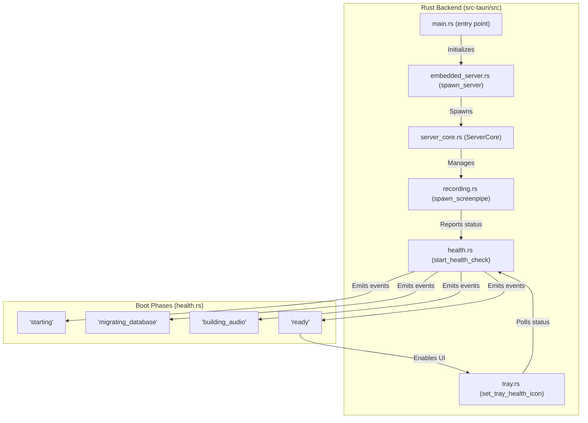
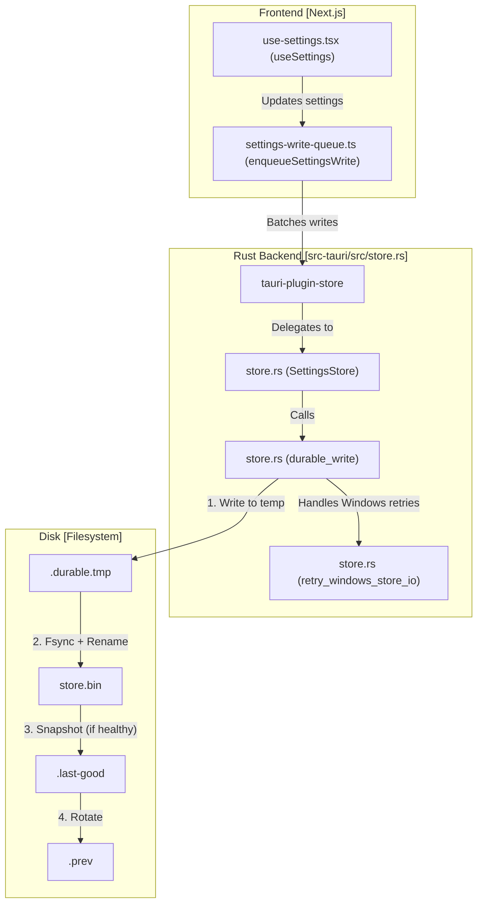

<!-- source: DeepWiki mcp.deepwiki.com · repo screenpipe/screenpipe · page 3 Desktop Application · fetched 2026-10-27 -->

# Desktop Application

<details>
<summary>Relevant source files</summary>

The following files were used as context for generating this wiki page:

- [apps/screenpipe-app-tauri/app/error.tsx](apps/screenpipe-app-tauri/app/error.tsx)
- [apps/screenpipe-app-tauri/app/global-error.tsx](apps/screenpipe-app-tauri/app/global-error.tsx)
- [apps/screenpipe-app-tauri/app/globals.css](apps/screenpipe-app-tauri/app/globals.css)
- [apps/screenpipe-app-tauri/app/layout.tsx](apps/screenpipe-app-tauri/app/layout.tsx)
- [apps/screenpipe-app-tauri/app/providers.tsx](apps/screenpipe-app-tauri/app/providers.tsx)
- [apps/screenpipe-app-tauri/components/__tests__/reduced-motion.test.ts](apps/screenpipe-app-tauri/components/__tests__/reduced-motion.test.ts)
- [apps/screenpipe-app-tauri/components/meeting-notes/__tests__/note-editor-paste.test.ts](apps/screenpipe-app-tauri/components/meeting-notes/__tests__/note-editor-paste.test.ts)
- [apps/screenpipe-app-tauri/components/meeting-notes/__tests__/note-editor-roundtrip.test.ts](apps/screenpipe-app-tauri/components/meeting-notes/__tests__/note-editor-roundtrip.test.ts)
- [apps/screenpipe-app-tauri/components/meeting-notes/note-editor.tsx](apps/screenpipe-app-tauri/components/meeting-notes/note-editor.tsx)
- [apps/screenpipe-app-tauri/components/settings/general-settings.tsx](apps/screenpipe-app-tauri/components/settings/general-settings.tsx)
- [apps/screenpipe-app-tauri/components/settings/privacy-section.tsx](apps/screenpipe-app-tauri/components/settings/privacy-section.tsx)
- [apps/screenpipe-app-tauri/components/settings/recording-settings.tsx](apps/screenpipe-app-tauri/components/settings/recording-settings.tsx)
- [apps/screenpipe-app-tauri/components/settings/skills-browser.tsx](apps/screenpipe-app-tauri/components/settings/skills-browser.tsx)
- [apps/screenpipe-app-tauri/components/settings/skills-card.test.tsx](apps/screenpipe-app-tauri/components/settings/skills-card.test.tsx)
- [apps/screenpipe-app-tauri/components/settings/skills-card.tsx](apps/screenpipe-app-tauri/components/settings/skills-card.tsx)
- [apps/screenpipe-app-tauri/components/theme-provider.test.tsx](apps/screenpipe-app-tauri/components/theme-provider.test.tsx)
- [apps/screenpipe-app-tauri/components/theme-provider.tsx](apps/screenpipe-app-tauri/components/theme-provider.tsx)
- [apps/screenpipe-app-tauri/components/ui/skeleton.tsx](apps/screenpipe-app-tauri/components/ui/skeleton.tsx)
- [apps/screenpipe-app-tauri/components/update-banner.tsx](apps/screenpipe-app-tauri/components/update-banner.tsx)
- [apps/screenpipe-app-tauri/lib/analytics-id.test.ts](apps/screenpipe-app-tauri/lib/analytics-id.test.ts)
- [apps/screenpipe-app-tauri/lib/analytics-id.ts](apps/screenpipe-app-tauri/lib/analytics-id.ts)
- [apps/screenpipe-app-tauri/lib/events/__tests__/tauri-events.test.ts](apps/screenpipe-app-tauri/lib/events/__tests__/tauri-events.test.ts)
- [apps/screenpipe-app-tauri/lib/events/tauri-events.ts](apps/screenpipe-app-tauri/lib/events/tauri-events.ts)
- [apps/screenpipe-app-tauri/lib/hooks/use-settings.tsx](apps/screenpipe-app-tauri/lib/hooks/use-settings.tsx)
- [apps/screenpipe-app-tauri/lib/logging/__tests__/browser-log.test.ts](apps/screenpipe-app-tauri/lib/logging/__tests__/browser-log.test.ts)
- [apps/screenpipe-app-tauri/lib/logging/browser-log.ts](apps/screenpipe-app-tauri/lib/logging/browser-log.ts)
- [apps/screenpipe-app-tauri/lib/skills-registry.ts](apps/screenpipe-app-tauri/lib/skills-registry.ts)
- [apps/screenpipe-app-tauri/lib/utils/tauri.ts](apps/screenpipe-app-tauri/lib/utils/tauri.ts)
- [apps/screenpipe-app-tauri/src-tauri/src/commands.rs](apps/screenpipe-app-tauri/src-tauri/src/commands.rs)
- [apps/screenpipe-app-tauri/src-tauri/src/embedded_server.rs](apps/screenpipe-app-tauri/src-tauri/src/embedded_server.rs)
- [apps/screenpipe-app-tauri/src-tauri/src/health.rs](apps/screenpipe-app-tauri/src-tauri/src/health.rs)
- [apps/screenpipe-app-tauri/src-tauri/src/main.rs](apps/screenpipe-app-tauri/src-tauri/src/main.rs)
- [apps/screenpipe-app-tauri/src-tauri/src/meeting_export.rs](apps/screenpipe-app-tauri/src-tauri/src/meeting_export.rs)
- [apps/screenpipe-app-tauri/src-tauri/src/process_exit.rs](apps/screenpipe-app-tauri/src-tauri/src/process_exit.rs)
- [apps/screenpipe-app-tauri/src-tauri/src/recording.rs](apps/screenpipe-app-tauri/src-tauri/src/recording.rs)
- [apps/screenpipe-app-tauri/src-tauri/src/recording/db_wedge.rs](apps/screenpipe-app-tauri/src-tauri/src/recording/db_wedge.rs)
- [apps/screenpipe-app-tauri/src-tauri/src/server_core.rs](apps/screenpipe-app-tauri/src-tauri/src/server_core.rs)
- [apps/screenpipe-app-tauri/src-tauri/src/store.rs](apps/screenpipe-app-tauri/src-tauri/src/store.rs)
- [apps/screenpipe-app-tauri/src-tauri/src/tray.rs](apps/screenpipe-app-tauri/src-tauri/src/tray.rs)
- [apps/screenpipe-app-tauri/src-tauri/src/updates.rs](apps/screenpipe-app-tauri/src-tauri/src/updates.rs)
- [crates/screenpipe-config/src/recording.rs](crates/screenpipe-config/src/recording.rs)
- [crates/screenpipe-engine/src/bin/screenpipe-engine.rs](crates/screenpipe-engine/src/bin/screenpipe-engine.rs)
- [crates/screenpipe-engine/src/cli/export.rs](crates/screenpipe-engine/src/cli/export.rs)
- [crates/screenpipe-engine/src/cli/mod.rs](crates/screenpipe-engine/src/cli/mod.rs)
- [crates/screenpipe-engine/src/lib.rs](crates/screenpipe-engine/src/lib.rs)
- [crates/screenpipe-engine/src/meeting_export.rs](crates/screenpipe-engine/src/meeting_export.rs)
- [crates/screenpipe-engine/src/recording_config.rs](crates/screenpipe-engine/src/recording_config.rs)
- [crates/screenpipe-engine/src/routes/mod.rs](crates/screenpipe-engine/src/routes/mod.rs)
- [crates/screenpipe-engine/src/server.rs](crates/screenpipe-engine/src/server.rs)

</details>


The screenpipe desktop application is a Tauri 2.x app that combines a Rust backend with a Next.js static-export frontend. The Rust backend embeds the `screenpipe-engine` recording system and spawns it as an internal HTTP server. The frontend communicates with this embedded server via REST and WebSocket APIs. All IPC between the TypeScript frontend and Rust backend flows through Tauri's command/event system, with TypeScript bindings auto-generated by `tauri-specta`.

For the application startup sequence, recording state machine, and embedded server lifecycle, see [Application Lifecycle & Server](#3.1). For window creation and overlay management, see [Window Management & Overlays](#3.2). For the Timeline component, see [Timeline & Rewind](#3.3). For search and filtering, see [Search & Filtering](#3.4). For settings persistence, see [Settings & Configuration](#3.5). For global shortcuts, see [Global Shortcuts](#3.6). For the system tray, see [System Tray & Notifications](#3.7). For onboarding and health monitoring, see [Onboarding & Health](#3.8). For account management, see [Account & Billing](#3.9). For diagnostics and feedback, see [Diagnostics & Feedback](#3.10).

The desktop app communicates with the embedded server's REST API at `http://localhost:3030` (default).

---

## Technology Stack

The application lives under `apps/screenpipe-app-tauri/` and combines a Rust Tauri backend with a Next.js static export frontend. The frontend is built by Bun and packaged as static HTML/CSS/JS that Tauri serves via its custom protocol handler.

| Component | Technology | Version / Details |
|---|---|---|
| Desktop framework | Tauri | 2.x [apps/screenpipe-app-tauri/src-tauri/Cargo.toml:28-38]() |
| Rust async runtime | tokio | 1.x [apps/screenpipe-app-tauri/src-tauri/Cargo.toml:78-79]() |
| Frontend framework | Next.js (static export) | App Router [apps/screenpipe-app-tauri/app/layout.tsx:1-1]() |
| IPC binding generator | tauri-specta | [apps/screenpipe-app-tauri/lib/utils/tauri.ts:5-5]() |
| Settings persistence | tauri-plugin-store | [apps/screenpipe-app-tauri/src-tauri/Cargo.toml:49-49]() |
| Embedded recording engine | screenpipe-engine | Local crate [apps/screenpipe-app-tauri/src-tauri/Cargo.toml:132-132]() |

Sources: [apps/screenpipe-app-tauri/src-tauri/Cargo.toml:17-132](), [apps/screenpipe-app-tauri/lib/utils/tauri.ts:1-10](), [apps/screenpipe-app-tauri/app/layout.tsx:1-1]()

---

## Directory Structure

```
apps/screenpipe-app-tauri/
├── app/                         # Next.js App Router pages
│   ├── layout.tsx               # Root layout for the application
│   ├── global-error.tsx         # Global error boundary
│   ├── providers.tsx            # Context providers for the app
│   └── globals.css              # Global styles
├── components/
│   ├── settings/                # Settings UI components
│   ├── ui/                      # Shadcn UI components
│   └── update-banner.tsx        # Update notification banner
├── lib/
│   ├── hooks/                   # React hooks (use-settings, use-health-check)
│   ├── utils/tauri.ts           # Auto-generated Tauri IPC bindings
│   └── analytics-id.ts          # Analytics ID management
└── src-tauri/
    ├── src/                     # Rust backend modules
    │   ├── main.rs              # App entry point and plugin registration
    │   ├── recording.rs         # Capture session and server lifecycle
    │   ├── pi.rs                # AI agent (Pi) process management
    │   ├── tray.rs              # System tray menu and status icons
    │   ├── commands.rs          # Tauri commands (IPC handlers)
    │   ├── store.rs             # Persistent settings and local state
    │   └── health.rs            # Health monitoring logic
```

Sources: [apps/screenpipe-app-tauri/src-tauri/src/main.rs:34-100](), [apps/screenpipe-app-tauri/lib/utils/tauri.ts:10-150](), [apps/screenpipe-app-tauri/app/layout.tsx:1-1](), [apps/screenpipe-app-tauri/app/global-error.tsx:1-1](), [apps/screenpipe-app-tauri/app/providers.tsx:1-1](), [apps/screenpipe-app-tauri/app/globals.css:1-1](), [apps/screenpipe-app-tauri/components/update-banner.tsx:1-1](), [apps/screenpipe-app-tauri/lib/analytics-id.ts:1-1]()

---

## Rust Backend

The Rust backend is initialized from `src-tauri/src/main.rs`. It manages two independent lifecycles: the **Server** (DB + HTTP + pipes) and the **Capture** (vision + audio + UI events).

### Module Reference

| Module | Key Symbols | Description |
|---|---|---|
| `recording.rs` | `spawn_screenpipe`, `stop_screenpipe` | Manages capture engine lifecycle and `LocalApiContext` for server communication. [apps/screenpipe-app-tauri/src-tauri/src/recording.rs:11-12](), [apps/screenpipe-app-tauri/src-tauri/src/recording.rs:32-44]() |
| `pi.rs` | `PiExecutor`, `pi_start` | Manages the Pi coding agent subprocesses. [apps/screenpipe-app-tauri/src-tauri/src/main.rs:121-121]() |
| `tray.rs` | `set_tray_health_icon`, `prefetch_tray_menu_data` | Renders the system tray with live status and dynamic menu items. [apps/screenpipe-app-tauri/src-tauri/src/main.rs:173-174](), [apps/screenpipe-app-tauri/src-tauri/src/tray.rs:65-66]() |
| `commands.rs` | `log_webview_build_failure`, `install_native_timeline_bridge` | Rust-side handlers for native OS events and logging webview build failures. [apps/screenpipe-app-tauri/src-tauri/src/commands.rs:35-40](), [apps/screenpipe-app-tauri/src-tauri/src/commands.rs:30-31]() |
| `health.rs` | `start_health_check`, `get_recording_status` | Monitors engine and server health, providing status updates. [apps/screenpipe-app-tauri/src-tauri/src/main.rs:195-195](), [apps/screenpipe-app-tauri/src-tauri/src/health.rs:8-9]() |
| `store.rs` | `get_store`, `SettingsStore`, `retry_windows_store_io` | Persistent settings and local state storage with settings-loss recovery, including Windows-specific retry logic. [apps/screenpipe-app-tauri/src-tauri/src/main.rs:168-168](), [apps/screenpipe-app-tauri/src-tauri/src/store.rs:15-16](), [apps/screenpipe-app-tauri/src-tauri/src/store.rs:82-86]() |
| `server_core.rs` | `ServerCore`, `EmbeddedServerHandle` | Manages the embedded `screenpipe-engine` server lifecycle. [apps/screenpipe-app-tauri/src-tauri/src/server_core.rs:1-1]() |
| `embedded_server.rs` | `spawn_server` | Spawns the embedded server. [apps/screenpipe-app-tauri/src-tauri/src/embedded_server.rs:1-1]() |
| `updates.rs` | `start_update_check`, `stop_before_update` | Handles application updates, including pre-update shutdown procedures. [apps/screenpipe-app-tauri/src-tauri/src/main.rs:39-39](), [apps/screenpipe-app-tauri/src-tauri/src/updates.rs:73-73]() |
| `process_exit.rs` | `request_prepared_app_relaunch` | Manages graceful application exit and relaunch. [apps/screenpipe-app-tauri/src-tauri/src/process_exit.rs:1-1]() |

Sources: [apps/screenpipe-app-tauri/src-tauri/src/main.rs:34-154](), [apps/screenpipe-app-tauri/src-tauri/src/commands.rs:5-12](), [apps/screenpipe-app-tauri/src-tauri/src/store.rs:49-90](), [apps/screenpipe-app-tauri/src-tauri/src/recording.rs:11-12](), [apps/screenpipe-app-tauri/src-tauri/src/recording.rs:32-44](), [apps/screenpipe-app-tauri/src-tauri/src/tray.rs:65-66](), [apps/screenpipe-app-tauri/src-tauri/src/health.rs:8-9](), [apps/screenpipe-app-tauri/src-tauri/src/server_core.rs:1-1](), [apps/screenpipe-app-tauri/src-tauri/src/embedded_server.rs:1-1](), [apps/screenpipe-app-tauri/src-tauri/src/updates.rs:73-73](), [apps/screenpipe-app-tauri/src-tauri/src/process_exit.rs:1-1]()

---

**System Architecture: Boot and Health Lifecycle**

This diagram associates the internal health monitoring states with the code entities that manage them.



Sources: [apps/screenpipe-app-tauri/src-tauri/src/main.rs:116-118](), [apps/screenpipe-app-tauri/src-tauri/src/main.rs:195-195](), [apps/screenpipe-app-tauri/src-tauri/src/main.rs:112-113](), [apps/screenpipe-app-tauri/src-tauri/src/embedded_server.rs:1-1](), [apps/screenpipe-app-tauri/src-tauri/src/server_core.rs:1-1](), [apps/screenpipe-app-tauri/src-tauri/src/recording.rs:11-12]()

---

## IPC Boundary

The communication between the Next.js frontend and Rust backend is strictly typed via Specta.

### Command & Event Mapping

| TypeScript Call | Rust Handler | Description |
|---|---|---|
| `commands.getMediaFile(path)` | `get_media_file` | Reads local capture files as base64 with retry logic. [apps/screenpipe-app-tauri/src-tauri/src/main.rs:198-198]() |
| `commands.piStart(payload)` | `pi_start` | Spawns a new Pi agent subprocess. [apps/screenpipe-app-tauri/lib/utils/tauri.ts:197-199]() |
| `commands.getEnv(name)` | `get_env` | Retrieves environment variables. [apps/screenpipe-app-tauri/src-tauri/src/main.rs:160-160]() |
| `commands.calendarAuthorize()` | `calendar_authorize` | Requests macOS calendar permissions. [apps/screenpipe-app-tauri/lib/utils/tauri.ts:68-70]() |
| `commands.bunCheck()` | `bun_check` | Locates the bundled Bun binary for agent execution. [apps/screenpipe-app-tauri/lib/utils/tauri.ts:56-58]() |
| `commands.applyEnterpriseUiVisibility()`| `apply_enterprise_ui_visibility` | Reconciles UI with enterprise policy. [apps/screenpipe-app-tauri/lib/utils/tauri.ts:35-37]() |
| `commands.testOpenaiCompatibleTranscription()` | `test_openai_compatible_transcription` | Verifies OpenAI-compatible transcription endpoint. [apps/screenpipe-app-tauri/src-tauri/src/recording.rs:83-83]() |
| `commands.awaitSafeRestart()` | `await_safe_restart` | Frontend-callable gate for safe restarts during updates. [apps/screenpipe-app-tauri/lib/utils/tauri.ts:44-46]() |
| `commands.setTrayHealthIcon()` | `set_tray_health_icon` | Sets the system tray icon based on health status. [apps/screenpipe-app-tauri/src-tauri/src/main.rs:173-173]() |
| `commands.writeBrowserLog()` | `write_browser_log` | Writes browser logs to the Rust backend. [apps/screenpipe-app-tauri/src-tauri/src/main.rs:175-175]() |

Sources: [apps/screenpipe-app-tauri/lib/utils/tauri.ts:10-250](), [apps/screenpipe-app-tauri/src-tauri/src/main.rs:158-200](), [apps/screenpipe-app-tauri/src-tauri/src/recording.rs:83-83](), [apps/screenpipe-app-tauri/src-tauri/src/main.rs:173-173](), [apps/screenpipe-app-tauri/src-tauri/src/main.rs:175-175]()

---

**Data Flow: Settings Persistence & Recovery**

This diagram illustrates how the application protects user settings during updates and power loss by using a durable write strategy and recovery snapshots.



Sources: [apps/screenpipe-app-tauri/src-tauri/src/store.rs:49-100](), [apps/screenpipe-app-tauri/src-tauri/src/store.rs:135-145](), [apps/screenpipe-app-tauri/lib/hooks/use-settings.tsx:9-15](), [apps/screenpipe-app-tauri/lib/hooks/use-settings.tsx:111-111](), [apps/screenpipe-app-tauri/components/settings/settings-write-queue.ts:1-1]()

---

## Frontend Infrastructure

The frontend is a Next.js application using `nuqs` for URL-based state management and React hooks for local state.

### Settings & Configuration
The `useSettings` hook provides a centralized interface for reading and writing application configuration [apps/screenpipe-app-tauri/lib/hooks/use-settings.tsx:133-134](). It manages complex types like `AIPreset` and `RecordingSettings` while ensuring data is persisted via `tauri-plugin-store`. The `SettingsStore` struct in Rust defines the schema for these settings [apps/screenpipe-app-tauri/src-tauri/src/store.rs:400-400]().

### Recording Settings UI
The `RecordingSettings` component allows users to configure audio/video capture parameters, including transcription engines (Whisper, Deepgram), monitor selection, and capture frequency [apps/screenpipe-app-tauri/components/settings/recording-settings.tsx:14-40](). It leverages the `useSettings` hook to interact with the backend.

Sources: [apps/screenpipe-app-tauri/lib/hooks/use-settings.tsx:27-82](), [apps/screenpipe-app-tauri/components/settings/recording-settings.tsx:106-113](), [apps/screenpipe-app-tauri/src-tauri/src/store.rs:400-400]()

---

