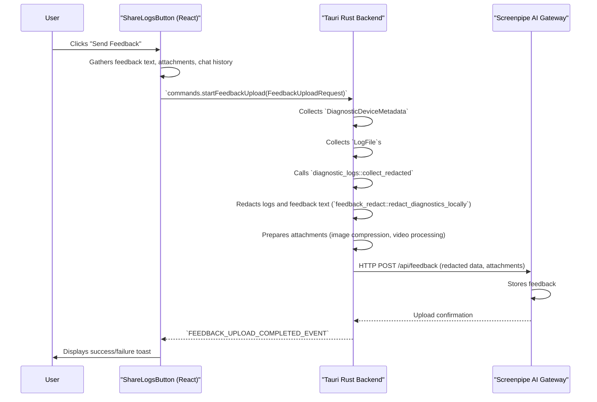

<!-- source: DeepWiki mcp.deepwiki.com · repo screenpipe/screenpipe · page 3.10 Diagnostics & Feedback · fetched 2026-10-27 -->

# Diagnostics & Feedback

<details>
<summary>Relevant source files</summary>

The following files were used as context for generating this wiki page:

- [apps/screenpipe-app-tauri/components/__tests__/sidebar-footer.test.tsx](apps/screenpipe-app-tauri/components/__tests__/sidebar-footer.test.tsx)
- [apps/screenpipe-app-tauri/components/__tests__/team-invite-popover.test.tsx](apps/screenpipe-app-tauri/components/__tests__/team-invite-popover.test.tsx)
- [apps/screenpipe-app-tauri/components/feedback-dialog.tsx](apps/screenpipe-app-tauri/components/feedback-dialog.tsx)
- [apps/screenpipe-app-tauri/components/share-logs-button.test.tsx](apps/screenpipe-app-tauri/components/share-logs-button.test.tsx)
- [apps/screenpipe-app-tauri/components/share-logs-button.tsx](apps/screenpipe-app-tauri/components/share-logs-button.tsx)
- [apps/screenpipe-app-tauri/components/sidebar-footer.tsx](apps/screenpipe-app-tauri/components/sidebar-footer.tsx)
- [apps/screenpipe-app-tauri/components/team-invite-popover.tsx](apps/screenpipe-app-tauri/components/team-invite-popover.tsx)
- [apps/screenpipe-app-tauri/lib/hooks/use-team-summary.test.tsx](apps/screenpipe-app-tauri/lib/hooks/use-team-summary.test.tsx)
- [apps/screenpipe-app-tauri/lib/hooks/use-team-summary.ts](apps/screenpipe-app-tauri/lib/hooks/use-team-summary.ts)
- [apps/screenpipe-app-tauri/lib/utils/feedback-attachments.test.ts](apps/screenpipe-app-tauri/lib/utils/feedback-attachments.test.ts)
- [apps/screenpipe-app-tauri/lib/utils/feedback-attachments.ts](apps/screenpipe-app-tauri/lib/utils/feedback-attachments.ts)
- [apps/screenpipe-app-tauri/src-tauri/src/analytics.rs](apps/screenpipe-app-tauri/src-tauri/src/analytics.rs)
- [apps/screenpipe-app-tauri/src-tauri/src/diagnostic_logs.rs](apps/screenpipe-app-tauri/src-tauri/src/diagnostic_logs.rs)
- [apps/screenpipe-app-tauri/src-tauri/src/enterprise/backfill.rs](apps/screenpipe-app-tauri/src-tauri/src/enterprise/backfill.rs)
- [apps/screenpipe-app-tauri/src-tauri/src/enterprise/source_identity_tests.rs](apps/screenpipe-app-tauri/src-tauri/src/enterprise/source_identity_tests.rs)
- [apps/screenpipe-app-tauri/src-tauri/src/enterprise/sync.rs](apps/screenpipe-app-tauri/src-tauri/src/enterprise/sync.rs)
- [apps/screenpipe-app-tauri/src-tauri/src/enterprise/upload.rs](apps/screenpipe-app-tauri/src-tauri/src/enterprise/upload.rs)
- [apps/screenpipe-app-tauri/src-tauri/src/enterprise_sync.rs](apps/screenpipe-app-tauri/src-tauri/src/enterprise_sync.rs)
- [apps/screenpipe-app-tauri/src-tauri/src/feedback_redact.rs](apps/screenpipe-app-tauri/src-tauri/src/feedback_redact.rs)
- [apps/screenpipe-app-tauri/src-tauri/src/log_files.rs](apps/screenpipe-app-tauri/src-tauri/src/log_files.rs)
- [apps/screenpipe-app-tauri/src-tauri/src/media_commands.rs](apps/screenpipe-app-tauri/src-tauri/src/media_commands.rs)
- [apps/screenpipe-app-tauri/src-tauri/tests/enterprise_sync_test.rs](apps/screenpipe-app-tauri/src-tauri/tests/enterprise_sync_test.rs)
- [crates/screenpipe-db/src/db/source_identity.rs](crates/screenpipe-db/src/db/source_identity.rs)
- [crates/screenpipe-db/tests/range_export_frame_sources_test.rs](crates/screenpipe-db/tests/range_export_frame_sources_test.rs)
- [crates/screenpipe-gateway/src/api.rs](crates/screenpipe-gateway/src/api.rs)
- [crates/screenpipe-gateway/src/bin/seed.rs](crates/screenpipe-gateway/src/bin/seed.rs)
- [crates/screenpipe-gateway/src/identity_tests.rs](crates/screenpipe-gateway/src/identity_tests.rs)
- [crates/screenpipe-gateway/src/ingest.rs](crates/screenpipe-gateway/src/ingest.rs)
- [crates/screenpipe-telemetry-wire/src/lib.rs](crates/screenpipe-telemetry-wire/src/lib.rs)
- [crates/screenpipe-telemetry-wire/src/manifest.rs](crates/screenpipe-telemetry-wire/src/manifest.rs)

</details>


This page details the implementation of Screenpipe's diagnostics and feedback mechanisms. It covers the user-facing feedback dialog, the lifecycle of feedback and log uploads, the collection and redaction of diagnostic logs, analytics reporting, and how the system handles disk pressure.

## Feedback Dialog and Upload Lifecycle

The feedback dialog is a central component for users to report issues or provide suggestions. It allows users to include text, screenshots, and recent screen recordings.

### Frontend Implementation

The user interface for the feedback dialog is implemented in React within the `ShareLogsButton` component.
The `ShareLogsButton` component manages the state of the feedback form, including the feedback text, attached images, and videos. It also handles drag-and-drop functionality for attachments and the overall sending phase.

- **Component**: `ShareLogsButton` [apps/screenpipe-app-tauri/components/share-logs-button.tsx:154-164]()
- **State Management**: Uses `useState` hooks for `feedbackText`, `image`, `video`, `phase`, and `dragDepth`. [apps/screenpipe-app-tauri/components/share-logs-button.tsx:170-176]()
- **Attachment Handling**:
    - Images are compressed using `compressImageFile` before being attached. [apps/screenpipe-app-tauri/components/share-logs-button.tsx:56-79]()
    - Videos can be attached from files or from recent recordings. [apps/screenpipe-app-tauri/components/share-logs-button.tsx:125-139]()
    - The `classifyAttachmentFile` and `classifyAttachmentMeta` functions help determine the type and metadata of attachments. [apps/screenpipe-app-tauri/components/share-logs-button.tsx:50-50]()
- **Chat History Inclusion**: Users can opt to include recent chat conversations, which are loaded via `loadAllConversations`. [apps/screenpipe-app-tauri/components/share-logs-button.tsx:42-42]()
- **Event Listening**: The component listens for the `FEEDBACK_UPLOAD_COMPLETED_EVENT` from the Tauri backend to update the UI with the upload status. [apps/screenpipe-app-tauri/components/share-logs-button.tsx:207-210]()

### Backend Integration

When the user submits feedback, the frontend calls the `startFeedbackUpload` Tauri command. This command initiates the upload process on the Rust backend.

- **Tauri Command**: `commands.startFeedbackUpload` [apps/screenpipe-app-tauri/components/share-logs-button.tsx:24-24]()
- **Request Structure**: The `FeedbackUploadRequest` struct defines the data sent to the backend, including feedback text, attachments (as data URLs), chat history, and system information. [apps/screenpipe-app-tauri/components/share-logs-button.tsx:23-24]()

### Feedback Upload Lifecycle

The `startFeedbackUpload` command in Rust orchestrates the entire upload process:

1.  **Collect Diagnostic Data**: Gathers system information, app version, and diagnostic logs.
2.  **Redact Sensitive Information**: Applies redaction to logs and other text content to protect user privacy.
3.  **Prepare Attachments**: Processes and potentially compresses image and video attachments.
4.  **Upload to Gateway**: Sends the prepared data to the Screenpipe AI Gateway.

#### Feedback Upload Process

Sources:
- [apps/screenpipe-app-tauri/components/share-logs-button.tsx:154-164]()
- [apps/screenpipe-app-tauri/components/share-logs-button.tsx:170-176]()
- [apps/screenpipe-app-tauri/components/share-logs-button.tsx:56-79]()
- [apps/screenpipe-app-tauri/components/share-logs-button.tsx:125-139]()
- [apps/screenpipe-app-tauri/components/share-logs-button.tsx:50-50]()
- [apps/screenpipe-app-tauri/components/share-logs-button.tsx:42-42]()
- [apps/screenpipe-app-tauri/components/share-logs-button.tsx:207-210]()
- [apps/screenpipe-app-tauri/components/share-logs-button.tsx:24-24]()
- [apps/screenpipe-app-tauri/components/share-logs-button.tsx:23-24]()

## Log Sharing and Diagnostic Logs

Screenpipe collects various logs to aid in debugging and support. These logs are carefully handled to ensure privacy.

### Log Collection

The `diagnostic_logs` module is responsible for collecting log files.
- **`collect_redacted`**: This function is the primary entry point for collecting and redacting logs for user-initiated feedback. [apps/screenpipe-app-tauri/src-tauri/src/diagnostic_logs.rs:54-56]()
- **`collect_redacted_from_dirs`**: Used by enterprise builds and tests to collect logs from specified directories. [apps/screenpipe-app-tauri/src-tauri/src/diagnostic_logs.rs:67-69]()
- **`get_log_files`**: A Tauri command that identifies relevant log files from various application data directories. [apps/screenpipe-app-tauri/src-tauri/src/log_files.rs:79-88]()
- **`collect_log_files`**: Gathers `.log` files and rotated panic logs from a list of directories, deduping by canonical path. [apps/screenpipe-app-tauri/src-tauri/src/log_files.rs:114-164]()
- **`read_tail`**: Reads only the last `max_bytes` of a log file to prevent reading excessively large files into memory. [apps/screenpipe-app-tauri/src-tauri/src/log_files.rs:51-75]()

### Log File Identification

The system identifies specific log files for collection:
- **`is_screenpipe_owned_log_name`**: Checks if a log file name belongs to Screenpipe, including panic logs, recovery logs, update diagnostics, and general application logs. [apps/screenpipe-app-tauri/src-tauri/src/diagnostic_logs.rs:79-93]()
- **`is_panic_log`**: Identifies `last-panic.log` and `last-panic.log.prev`. [apps/screenpipe-app-tauri/src-tauri/src/log_files.rs:36-37]()
- **`is_dated_rolling_log`**: Recognizes dated rolling log files like `screenpipe.YYYY-MM-DD.log`. [apps/screenpipe-app-tauri/src-tauri/src/diagnostic_logs.rs:95-121]()

### Redaction of Reports

Privacy is paramount, so all diagnostic reports undergo a redaction process.
- **`redact_files`**: This asynchronous function takes a list of `LogFile`s, builds a raw bundle, and then applies local redaction. [apps/screenpipe-app-tauri/src-tauri/src/diagnostic_logs.rs:123-132]()
- **`feedback_redact::redact_diagnostics_locally`**: Performs the actual redaction of diagnostic text. This process is time-bound to prevent indefinite blocking. [apps/screenpipe-app-tauri/src-tauri/src/diagnostic_logs.rs:127-128]()
- **`MAX_REDACTED_BUNDLE_BYTES`**: Limits the size of the redacted bundle to prevent excessively large uploads. [apps/screenpipe-app-tauri/src-tauri/src/diagnostic_logs.rs:32-32]()
- **`REDACTION_TIMEOUT`**: Ensures that redaction completes within a specified duration. [apps/screenpipe-app-tauri/src-tauri/src/diagnostic_logs.rs:33-33]()

### Device Metadata

Basic device metadata is collected to provide context for diagnostic reports.
- **`device_metadata`**: Gathers OS name, OS version, and app version. [apps/screenpipe-app-tauri/src-tauri/src/diagnostic_logs.rs:42-46]()

Sources:
- [apps/screenpipe-app-tauri/src-tauri/src/diagnostic_logs.rs:54-56]()
- [apps/screenpipe-app-tauri/src-tauri/src/diagnostic_logs.rs:67-69]()
- [apps/screenpipe-app-tauri/src-tauri/src/log_files.rs:79-88]()
- [apps/screenpipe-app-tauri/src-tauri/src/log_files.rs:114-164]()
- [apps/screenpipe-app-tauri/src-tauri/src/log_files.rs:51-75]()
- [apps/screenpipe-app-tauri/src-tauri/src/diagnostic_logs.rs:79-93]()
- [apps/screenpipe-app-tauri/src-tauri/src/log_files.rs:36-37]()
- [apps/screenpipe-app-tauri/src-tauri/src/diagnostic_logs.rs:95-121]()
- [apps/screenpipe-app-tauri/src-tauri/src/diagnostic_logs.rs:123-132]()
- [apps/screenpipe-app-tauri/src-tauri/src/diagnostic_logs.rs:127-128]()
- [apps/screenpipe-app-tauri/src-tauri/src/diagnostic_logs.rs:32-32]()
- [apps/screenpipe-app-tauri/src-tauri/src/diagnostic_logs.rs:33-33]()
- [apps/screenpipe-app-tauri/src-tauri/src/diagnostic_logs.rs:42-46]()

## Analytics

Screenpipe collects anonymized analytics data to understand usage patterns and improve the application. This is managed by the `AnalyticsManager`.

### Analytics Manager

The `AnalyticsManager` is responsible for collecting and sending telemetry data to PostHog.
- **`AnalyticsManager` struct**: Holds the HTTP client, PostHog API key, distinct user ID, email, and other configuration. [apps/screenpipe-app-tauri/src-tauri/src/analytics.rs:68-81]()
- **Initialization**: `AnalyticsManager::new` sets up the manager with provided credentials and intervals. [apps/screenpipe-app-tauri/src-tauri/src/analytics.rs:136-157]()
- **Host Information**: `HostInfo::collect` gathers static host metadata like OS, kernel version, CPU count, and total memory. [apps/screenpipe-app-tauri/src-tauri/src/analytics.rs:30-45]()
- **Attribution**: `fetch_attribution` attempts to retrieve UTM attribution from `screenpipe.com` based on IP matching, caching the result. [apps/screenpipe-app-tauri/src-tauri/src/analytics.rs:165-191]()
- **Event Sending**: `send_event` constructs and sends events to PostHog, including common properties and event-specific data. [apps/screenpipe-app-tauri/src-tauri/src/analytics.rs:200-220]()
- **Periodic Health Check**: `spawn_periodic_health_check` sends a "heartbeat" event with system health and settings every `interval_hours`. [apps/screenpipe-app-tauri/src-tauri/src/analytics.rs:222-239]()

### Data Collected

Analytics events include various properties to provide context:
- **Common Properties**: `distinct_id`, `email`, `app_version`, `os_name`, `os_version`, `kernel_version`, `host_name`, `cpu_count`, `total_memory`. [apps/screenpipe-app-tauri/src-tauri/src/analytics.rs:241-260]()
- **Settings-derived Properties**:
    - `pipeline_ocr_cache_hit_rate`: OCR cache performance. [apps/screenpipe-app-tauri/src-tauri/src/analytics.rs:83-85]()
    - `health_audio_capture_mode`: Actual audio capture mode. [apps/screenpipe-app-tauri/src-tauri/src/analytics.rs:87-89]()
    - `audio_capture_mode_setting`: Configured audio capture mode. [apps/screenpipe-app-tauri/src-tauri/src/analytics.rs:91-101]()
    - `smart_pii_settings`: Information about PII redaction settings, including whether Tinfoil is active. [apps/screenpipe-app-tauri/src-tauri/src/analytics.rs:114-134]()
- **Enterprise Telemetry**: For enterprise builds, a separate telemetry sync mechanism exists, managed by the `enterprise_sync` module. This syncs various data streams (frames, audio, UI events, parsed data, memories, feedback) to a customer-controlled endpoint. [apps/screenpipe-app-tauri/src-tauri/src/enterprise_sync.rs:1-17]()

#### Analytics Data Flow
```mermaid
graph TD
    A[Screenpipe App] --> B{AnalyticsManager};
    B --> C[HostInfo::collect];
    B --> D[fetch_attribution];
    B --> E[SettingsStore];
    B --> F[Health Check];
    B --> G[PostHog API];

    C -- "OS, CPU, Memory" --> B;
    D -- "UTM Attribution" --> B;
    E -- "App Settings" --> B;
    F -- "Health Status" --> B;
    B -- "Periodic Events (e.g., 'Heartbeat')" --> G;
    B -- "Specific User Actions" --> G;

    subgraph Enterprise Sync (Optional)
        H[EnterpriseSyncConfig] --> I[LocalApiClient];
        I --> J[Screenpipe HTTP Server];
        J -- "Frames, Audio, UI Events, etc." --> I;
        I --> K[Enterprise Ingest Endpoint];
        K -- "JSONL Batches" --> L[Customer Storage (R2/S3)];
    end
```
Sources:
- [apps/screenpipe-app-tauri/src-tauri/src/analytics.rs:68-81]()
- [apps/screenpipe-app-tauri/src-tauri/src/analytics.rs:136-157]()
- [apps/screenpipe-app-tauri/src-tauri/src/analytics.rs:30-45]()
- [apps/screenpipe-app-tauri/src-tauri/src/analytics.rs:165-191]()
- [apps/screenpipe-app-tauri/src-tauri/src/analytics.rs:200-220]()
- [apps/screenpipe-app-tauri/src-tauri/src/analytics.rs:222-239]()
- [apps/screenpipe-app-tauri/src-tauri/src/analytics.rs:241-260]()
- [apps/screenpipe-app-tauri/src-tauri/src/analytics.rs:83-85]()
- [apps/screenpipe-app-tauri/src-tauri/src/analytics.rs:87-89]()
- [apps/screenpipe-app-tauri/src-tauri/src/analytics.rs:91-101]()
- [apps/screenpipe-app-tauri/src-tauri/src/analytics.rs:114-134]()
- [apps/screenpipe-app-tauri/src-tauri/src/enterprise_sync.rs:1-17]()

## Disk Pressure Handling

While not explicitly detailed in the provided snippets, the concept of disk pressure handling is crucial for a 24/7 recording system. The `enterprise_sync` module hints at mechanisms to prevent data loss or excessive disk usage:

- **Cursor Management**: The `enterprise_sync` module uses a cursor file (`enterprise_sync_cursor.json`) to track the last successfully synced record. This prevents re-emitting the entire database and ensures incremental syncs. [apps/screenpipe-app-tauri/src-tauri/src/enterprise/sync.rs:96-96]()
- **Backfill Window**: On first run or cursor corruption, a `SAFE_BACKFILL` window (15 minutes) is used to avoid re-syncing old data, mitigating initial disk pressure. [apps/screenpipe-app-tauri/src-tauri/src/enterprise/sync.rs:55-55]()
- **Page Limits**: When pulling records from the local API, `PAGE_LIMIT` (500 records) is used to keep individual upstream POST requests under a manageable size, preventing large memory spikes. [apps/screenpipe-app-tauri/src-tauri/src/enterprise/sync.rs:59-59]()
- **Bounded Log Collection**: The diagnostic log collection explicitly limits the number of files (`MAX_FILES`) and bytes per file (`MAX_FILE_BYTES`) to prevent runaway log collection from consuming excessive disk space or memory during report generation. [apps/screenpipe-app-tauri/src-tauri/src/diagnostic_logs.rs:29-31]()

These mechanisms, while primarily for enterprise sync and diagnostics, contribute to overall disk pressure management by ensuring that data collection and transmission are bounded and incremental.

Sources:
- [apps/screenpipe-app-tauri/src-tauri/src/enterprise/sync.rs:96-96]()
- [apps/screenpipe-app-tauri/src-tauri/src/enterprise/sync.rs:55-55]()
- [apps/screenpipe-app-tauri/src-tauri/src/enterprise/sync.rs:59-59]()
- [apps/screenpipe-app-tauri/src-tauri/src/diagnostic_logs.rs:29-31]()

---

