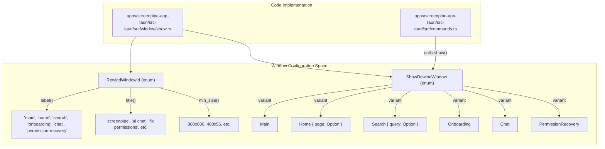
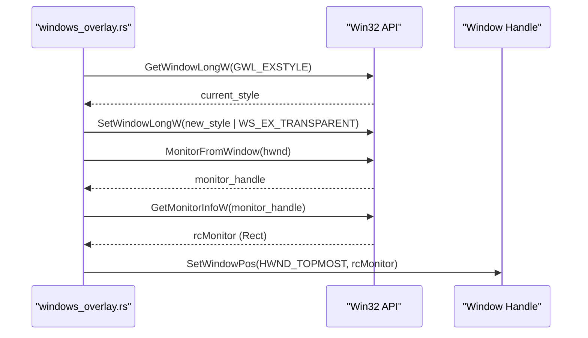
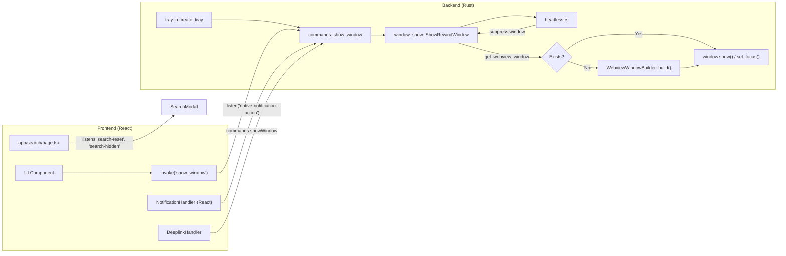

<!-- source: DeepWiki mcp.deepwiki.com · repo screenpipe/screenpipe · page 3.2 Window Management & Overlays · fetched 2026-10-27 -->

# Window Management & Overlays

Relevant source files

The following files were used as context for generating this wiki page:

- [apps/screenpipe-app-tauri/app/search/page.test.tsx](apps/screenpipe-app-tauri/app/search/page.test.tsx)
- [apps/screenpipe-app-tauri/app/search/page.tsx](apps/screenpipe-app-tauri/app/search/page.tsx)
- [apps/screenpipe-app-tauri/app/shortcut-reminder/page.test.tsx](apps/screenpipe-app-tauri/app/shortcut-reminder/page.test.tsx)
- [apps/screenpipe-app-tauri/app/shortcut-reminder/page.tsx](apps/screenpipe-app-tauri/app/shortcut-reminder/page.tsx)
- [apps/screenpipe-app-tauri/e2e/specs/history-swipe-navigation.spec.ts](apps/screenpipe-app-tauri/e2e/specs/history-swipe-navigation.spec.ts)
- [apps/screenpipe-app-tauri/src-tauri/src/headless.rs](apps/screenpipe-app-tauri/src-tauri/src/headless.rs)
- [apps/screenpipe-app-tauri/src-tauri/src/native_overlay_win.rs](apps/screenpipe-app-tauri/src-tauri/src/native_overlay_win.rs)
- [apps/screenpipe-app-tauri/src-tauri/src/native_shortcut_reminder.rs](apps/screenpipe-app-tauri/src-tauri/src/native_shortcut_reminder.rs)
- [apps/screenpipe-app-tauri/src-tauri/src/overlay_health.rs](apps/screenpipe-app-tauri/src-tauri/src/overlay_health.rs)
- [apps/screenpipe-app-tauri/src-tauri/src/search_only.rs](apps/screenpipe-app-tauri/src-tauri/src/search_only.rs)
- [apps/screenpipe-app-tauri/src-tauri/src/shortcuts.rs](apps/screenpipe-app-tauri/src-tauri/src/shortcuts.rs)
- [apps/screenpipe-app-tauri/src-tauri/src/window/capture_protection.rs](apps/screenpipe-app-tauri/src-tauri/src/window/capture_protection.rs)
- [apps/screenpipe-app-tauri/src-tauri/src/window/first_responder.rs](apps/screenpipe-app-tauri/src-tauri/src/window/first_responder.rs)
- [apps/screenpipe-app-tauri/src-tauri/src/window/focus.rs](apps/screenpipe-app-tauri/src-tauri/src/window/focus.rs)
- [apps/screenpipe-app-tauri/src-tauri/src/window/gesture.rs](apps/screenpipe-app-tauri/src-tauri/src/window/gesture.rs)
- [apps/screenpipe-app-tauri/src-tauri/src/window/mod.rs](apps/screenpipe-app-tauri/src-tauri/src/window/mod.rs)
- [apps/screenpipe-app-tauri/src-tauri/src/window/panel.rs](apps/screenpipe-app-tauri/src-tauri/src/window/panel.rs)
- [apps/screenpipe-app-tauri/src-tauri/src/window/show.rs](apps/screenpipe-app-tauri/src-tauri/src/window/show.rs)
- [apps/screenpipe-app-tauri/src-tauri/src/windows_overlay.rs](apps/screenpipe-app-tauri/src-tauri/src/windows_overlay.rs)
- [apps/screenpipe-app-tauri/src-tauri/swift/shortcut_reminder.swift](apps/screenpipe-app-tauri/src-tauri/swift/shortcut_reminder.swift)
- [apps/screenpipe-app-tauri/src-tauri/swift/shortcut_reminder_tests.swift](apps/screenpipe-app-tauri/src-tauri/swift/shortcut_reminder_tests.swift)
- [crates/screenpipe-overlay-win/src/actions.rs](crates/screenpipe-overlay-win/src/actions.rs)
- [crates/screenpipe-overlay-win/src/layout.rs](crates/screenpipe-overlay-win/src/layout.rs)
- [crates/screenpipe-overlay-win/src/preview.rs](crates/screenpipe-overlay-win/src/preview.rs)
- [crates/screenpipe-overlay-win/src/render.rs](crates/screenpipe-overlay-win/src/render.rs)
- [crates/screenpipe-overlay-win/src/state.rs](crates/screenpipe-overlay-win/src/state.rs)
- [crates/screenpipe-overlay-win/src/text.rs](crates/screenpipe-overlay-win/src/text.rs)
- [crates/screenpipe-overlay-win/src/window.rs](crates/screenpipe-overlay-win/src/window.rs)
- [docs/TESTING.md](docs/TESTING.md)

This document describes the window management system in the Screenpipe desktop application, including window types, lifecycle management, overlay modes, and platform-specific implementations for macOS and Windows.

## Overview

The window management system is responsible for creating, showing, hiding, and destroying the various windows that make up the Screenpipe desktop application. The system uses Tauri's `WebviewWindow` API as the foundation, with significant platform-specific enhancements to support overlay behaviors and focus management.

Key capabilities include:
- **macOS**: Uses `NSPanel` API (via `tauri-nspanel`) for overlay mode, providing floating window behavior with proper space management and gesture support (magnify/pinch-to-zoom).
- **Windows**: Implements custom click-through overlays using Win32 APIs and monitor-aware positioning.
- **Unified Lifecycle**: A consistent Rust-based API for showing and hiding windows that handles focus restoration and shortcut registration.
- **Enterprise Policy Integration**: Dynamically hides or restores UI components based on managed enterprise policies.

Sources: [apps/screenpipe-app-tauri/src-tauri/src/window/show.rs:1-122](), [apps/screenpipe-app-tauri/src-tauri/src/windows_overlay.rs:1-23](), [apps/screenpipe-app-tauri/src-tauri/src/window/mod.rs:56-91]()

## Window Types & IDs

The application defines a set of windows using the `RewindWindowId` enum, each with specific dimensions and routing.

### Code Entity Mapping: Window Definitions

| Window Type | Label | Min Size | Purpose |
|-------------|-------|----------|---------|
| `Main` | `main` | 800×600 | Timeline view with frame navigation |
| `Home` | `home` | 800×600 | Main application dashboard and settings |
| `Search` | `search` | 400×56 | Floating search bar interface |
| `Onboarding`| `onboarding`| 450×500 | First-time setup wizard |
| `Chat` | `chat` | 600×750 | Standalone AI memory chat interface |
| `PermissionRecovery` | `permission-recovery` | 500×580 | Guided OS permission fixing UI |

Sources: [apps/screenpipe-app-tauri/src-tauri/src/window/show.rs:71-147]()

## macOS Implementation: NSPanel & Overlays

On macOS, Screenpipe leverages `NSPanel` to create windows that can float above full-screen apps and appear on all Spaces (desktops).

### NSPanel Configuration
When a window is shown as a panel (specifically the `Main` window in overlay mode), the following configurations are applied:
1. **Non-activating**: Uses `NSNonactivatingPanelMask` to prevent the app from taking focus from the current foreground app [apps/screenpipe-app-tauri/src-tauri/src/window/show.rs:52-58]().
2. **Collection Behavior**: Set to `NSWindowCollectionBehaviorCanJoinAllSpaces` so the window follows the user across desktops. This behavior is gated by `window_activation_allowed()` for e2e tests [apps/screenpipe-app-tauri/src-tauri/src/window/mod.rs:144-152]().
3. **First Responder**: The `WKWebView` is explicitly set as the first responder to ensure it receives scroll and gesture events (pinch-to-zoom) [apps/screenpipe-app-tauri/src-tauri/src/window/first_responder.rs:1-10]().

### Focus Management
To provide a seamless "memory overlay" experience, Screenpipe tracks the previously active application:
- **`save_frontmost_app`**: Called before showing the overlay [apps/screenpipe-app-tauri/src-tauri/src/window/focus.rs:10-10]().
- **`restore_frontmost_app`**: Called when the overlay is hidden, returning focus to the user's previous work environment [apps/screenpipe-app-tauri/src-tauri/src/window/focus.rs:11-11]().

### Gestures & Swizzling
Screenpipe implements a custom `NSMagnificationGestureRecognizer` to handle pinch-to-zoom, as `WKWebView` often swallows these events. It also swizzles `WKWebView`'s `scrollWheel:` method to emit `native-scroll` events to the frontend [apps/screenpipe-app-tauri/src-tauri/src/window/gesture.rs:38-142]().

Sources: [apps/screenpipe-app-tauri/src-tauri/src/window/show.rs:49-68](), [apps/screenpipe-app-tauri/src-tauri/src/window/mod.rs:109-152](), [apps/screenpipe-app-tauri/src-tauri/src/window/gesture.rs:5-149](), [apps/screenpipe-app-tauri/src-tauri/src/window/first_responder.rs:1-10](), [apps/screenpipe-app-tauri/src-tauri/src/window/focus.rs:10-11]()

## Windows Implementation: Click-Through & Monitor Awareness

Windows support is handled via direct Win32 API calls to manage extended window styles and monitor positioning.

### Click-Through Logic
The `windows_overlay.rs` module provides functionality to toggle between interactive and "ghost" modes:
- **Interactive**: The window behaves like a normal UI.
- **Click-Through**: Uses `WS_EX_TRANSPARENT` so mouse events fall through to windows beneath Screenpipe [apps/screenpipe-app-tauri/src-tauri/src/windows_overlay.rs:30-30]().

### Monitor Positioning
The overlay is forced to cover the physical monitor rect using `GetMonitorInfoW` and `SetWindowPos`. This ensures the overlay is perfectly aligned with the screen boundaries regardless of Tauri's default decorations [apps/screenpipe-app-tauri/src-tauri/src/windows_overlay.rs:108-133]().

Sources: [apps/screenpipe-app-tauri/src-tauri/src/windows_overlay.rs:64-156]()

## Native Overlays: Notifications & Shortcut Reminders

Screenpipe uses custom native SwiftUI overlays on macOS for high-performance, non-blocking UI elements like notifications and status indicators.

### Shortcut Reminder
The `shortcut_reminder.swift` provides a persistent, audio-reactive pill that displays active recording status and keyboard shortcuts [apps/screenpipe-app-tauri/src-tauri/swift/shortcut_reminder.swift:100-147]().
- **Audio Equalizer**: The `AudioEqualizer` component in the frontend renders real-time speech-reactive bars based on `speechRatio` [apps/screenpipe-app-tauri/app/shortcut-reminder/page.tsx:32-32]().
- **Screen Matrix**: A scanning animation indicating screen capture activity, reacting to `captureFps` (not directly shown in provided `shortcut_reminder.swift` but implied by `useOverlayData` in frontend) [apps/screenpipe-app-tauri/app/shortcut-reminder/page.tsx:102-102]().
- **Action Callback**: Actions from the shortcut reminder (e.g., "open chat") are dispatched back to Rust via `shortcutSetActionCallback` [apps/screenpipe-app-tauri/src-tauri/swift/shortcut_reminder.swift:53-59]().
- **E2E Testing**: The `nonIntrusiveE2E` flag and `gatedLevel`, `gatedBehavior`, `gatedOrderFront` functions in `shortcut_reminder.swift` allow e2e tests to run without the overlay interfering with the developer's desktop, by placing the panel at a level where it cannot be composited over any app window [apps/screenpipe-app-tauri/src-tauri/swift/shortcut_reminder.swift:22-50]().

### Recording Health State
The shortcut reminder also displays the recording health state, which is pushed from Rust.
- **State Machine**: The `overlay_health.rs` module manages a state machine (`Normal`, `Failure`, `Recovering`, `Fixing`, `Recovered`) and pushes transitions to the overlay [apps/screenpipe-app-tauri/src-tauri/src/overlay_health.rs:74-93]().
- **FFI**: On macOS, `shortcut_set_health_state` is called via FFI to update the SwiftUI panel [apps/screenpipe-app-tauri/src-tauri/swift/shortcut_reminder.swift:82-95]().
- **Frontend Display**: The `ShortcutReminderPage` in the frontend listens for health state changes and displays appropriate messages and actions, such as "Recording needs help" or "Quit & reopen" [apps/screenpipe-app-tauri/app/shortcut-reminder/page.tsx:90-97](), [apps/screenpipe-app-tauri/app/shortcut-reminder/page.test.tsx:178-205]().

Sources: [apps/screenpipe-app-tauri/src-tauri/swift/shortcut_reminder.swift:100-147](), [apps/screenpipe-app-tauri/app/shortcut-reminder/page.tsx:32-32](), [apps/screenpipe-app-tauri/app/shortcut-reminder/page.tsx:102-102](), [apps/screenpipe-app-tauri/src-tauri/swift/shortcut_reminder.swift:53-59](), [apps/screenpipe-app-tauri/src-tauri/swift/shortcut_reminder.swift:22-50](), [apps/screenpipe-app-tauri/src-tauri/src/overlay_health.rs:74-93](), [apps/screenpipe-app-tauri/src-tauri/swift/shortcut_reminder.swift:82-95](), [apps/screenpipe-app-tauri/app/shortcut-reminder/page.tsx:90-97](), [apps/screenpipe-app-tauri/app/shortcut-reminder/page.test.tsx:178-205]()

## Window Lifecycle & Data Flow

Windows are managed via the `ShowRewindWindow` implementation, which ensures windows are only created once and reused when possible.

### State Transitions
- **Creation**: `WebviewWindowBuilder::build()` is wrapped with platform-specific decorators (e.g., `hidden_title` and `TitleBarStyle::Overlay` for macOS) [apps/screenpipe-app-tauri/src-tauri/src/window/show.rs:181-185]().
- **Visibility**: Windows are usually hidden rather than destroyed to maintain frontend state and avoid use-after-free crashes. Logical visibility is tracked via `MAIN_PANEL_SHOWN` [apps/screenpipe-app-tauri/src-tauri/src/window/panel.rs:28-28]().
- **Theme Sync**: The `SettingsStore` is checked during window creation to apply the correct light/dark theme at the OS level [apps/screenpipe-app-tauri/src-tauri/src/window/show.rs:193-200]().
- **Enterprise Enforcement**: `set_enterprise_hidden` reconciles the running session with managed policies, hiding windows if the UI is restricted [apps/screenpipe-app-tauri/src-tauri/src/headless.rs:41-67]().
- **Dormant Mode**: The application can enter a "dormant" state (e.g., tray-only) where UI windows are suppressed. `should_suppress_window` determines if a window should be shown based on this state [apps/screenpipe-app-tauri/src-tauri/src/headless.rs:29-31]().

### Data Flow Diagram

Sources: [apps/screenpipe-app-tauri/src-tauri/src/window/show.rs:108-112](), [apps/screenpipe-app-tauri/src-tauri/src/window/panel.rs:28-28](), [apps/screenpipe-app-tauri/src-tauri/src/headless.rs:29-31](), [apps/screenpipe-app-tauri/src-tauri/src/headless.rs:41-67](), [apps/screenpipe-app-tauri/app/search/page.tsx:96-131]()

---

